# AlphaQ：面向 MoE 量化的免校准位宽分配（中文翻译）

> 中文翻译（意译复述，非逐字翻译）：本文按章节用中文重新讲述 arXiv:2606.04980v1 的全部内容（含附录），表格数字与公式与原文保持一致。原文采用 arXiv 默认许可，故不做逐句翻译。原文：https://arxiv.org/abs/2606.04980 ，PDF：https://arxiv.org/pdf/2606.04980v1 ，代码：github.com/Superone77/AlphaQ 。
>
> 论文：*AlphaQ: Calibration-Free Bit Allocation for Mixture-of-Experts Quantization*。作者：Wanqi Yang, Yuexiao Ma, Alexander Conzelmann, Xiawu Zheng, Michael W. Mahoney, T. Konstantin Rusch, Shiwei Liu（ELLIS Institute Tübingen / Max Planck Institute for Intelligent Systems / ICSI & LBNL / UC Berkeley & Liquid AI / 厦门大学）。

## 摘要

MoE 通过稀疏激活专家来扩大模型容量，但部署时所有专家权重都得常驻显存，所以实际上受内存带宽/容量限制。给不同专家分配不同位宽的混合精度量化可以大幅压缩显存。已有方法通常依赖校准数据来估计专家重要性并据此分配位宽，而前沿 MoE 大模型的训练数据是闭源的，校准集只能当作不完美的替身，可能误判专家的使用情况，导致位宽分配次优。

作者的出发点有两个：现代 MoE 中专家之间质量差异很大；重尾自正则化（HT-SR）理论能在不接触训练/测试数据的情况下预测网络质量。据此提出 **AlphaQ**，一种面向 MoE 量化的免校准位宽分配方法。核心原则很简单：权重谱越重尾的专家通常训练得越充分，应获得更高位宽；重尾结构较弱的专家可以更激进地量化。AlphaQ 度量每个专家的谱重尾程度，再求解一个带全局比特预算约束的优化问题，使总量化误差最小。

在多个 MoE 模型上，同等比特预算下 AlphaQ 一致优于基于校准的基线。尤其在 Qwen1.5-MoE 上，专家平均只用 3.5 比特就接近全精度精度，同时带来超过 $`4\times`$ 的内存压缩。

## 1 引言

MoE（Jacobs 等 1991；Shazeer 等 2017；Fedus 等 2022 等）把每个 token 路由到少量专家，在海量参数下取得很好的质量/效率折中。但稀疏计算并不等于省内存：推理时所有专家权重都要驻留 GPU，专家权重存储成了主要内存瓶颈。量化因此是让 MoE 可部署的重要途径。然而专家之间、甚至同一专家内部的层对性能的贡献都不同，如何在专家和层之间精确分配比特依然困难。

现有 MoE 量化方法大多是数据驱动流程，用输入相关的统计量得到混合精度配置，但有两个根本局限：

1. **局部最优。** 部分方法（PMQ、MxMoE、AFG 等）在固定预算下做局部分配，例如每个 block 或每个专家用同样的比特预算，忽略了不同 Transformer block / 专家对全局性能贡献不均，局部最优在全局上可能是次优的（Deng 等 2026）。
2. **依赖校准数据。** 前沿 MoE 的原始训练数据通常不可得，只能用有偏、不完整的校准数据估计专家重要性。校准集若不具代表性，可能根本激活不到某些专家，使重要性估计有偏。这样量化后模型的表现直接绑定在校准分布上，跨域泛化差。

图 1 展示了这种现象：用数据驱动的 PMQ 方法，以不同领域数据（C4、MATH、GitHub-Code）校准 Mixtral-8×7B，得到的混合精度分配差异很大（不同数据集下的专家激活模式见附录 A.1），在常识（MMLU）、数学推理（GSM8K）、代码（HumanEval）上的表现严重偏科。例如用 MATH 校准的模型数学强，但代码任务落后于 GitHub-Code 校准的模型，说明模型过拟合了校准领域，对未见领域鲁棒性下降。虽然越来越多工作试图提高校准统计的质量（Zheng 等 2025；Hu 等 2025a），但数据驱动方法要覆盖所有潜在领域依然非常困难。

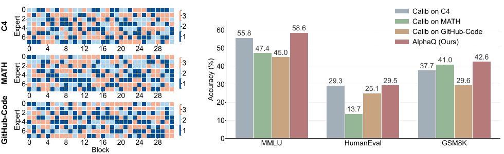

针对此，作者提出 AlphaQ，一种新的免校准（因而与数据无关）的 MoE 位宽分配方法。（脚注 1：“免校准”只针对位宽分配阶段，之后的量化步骤可以用任意现有量化方法实现。）AlphaQ 受 HT-SR 理论（Martin & Mahoney 2019）启发：权重谱越重尾的专家，在经验上对应更有信息量的结构和更强的相关性。具体做法是：从权重矩阵谱的形状刻画每个专家的训练充分度与重要性，并在全局精度预算下分配位宽，即重尾特征值谱的专家得到更高精度，训练不足或不敏感、谱更轻尾的专家被更激进地量化。

AlphaQ 的核心是一个统一的、与数据无关的重要性指标，用来量化不同 MoE 架构与不同层之间的专家差异。用该指标可以观察到，重要性的多样性存在于 MoE 家族之间、单个模型内部，甚至单个 block 内部。细粒度、高稀疏的 MoE（如 DeepSeekV2-Lite、Qwen1.5-MoE）方差更大，而专家较少的普通 MoE（如 Mixtral-8×7B）方差小得多。

基于这个免校准的重要性信号，AlphaQ 把混合精度量化表述为带预算约束的优化问题，足够灵活以适应不同架构、模型、深度、宽度，以及专家内部各子模块之间的重要性差异。图 2 对比了 AlphaQ 与数据驱动方法。

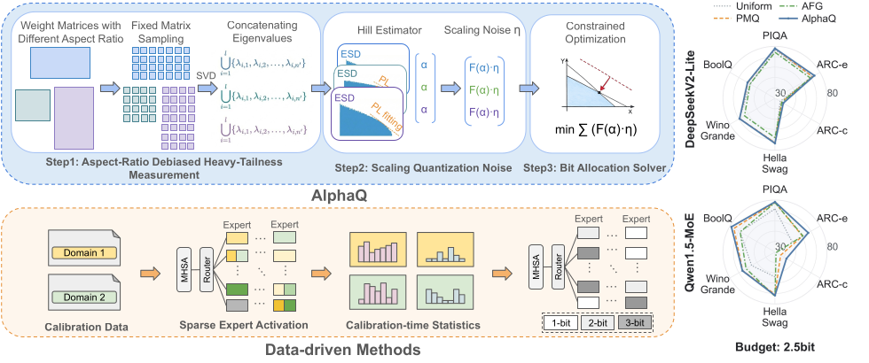

总体上，作者在多种 MoE LLM 与基准上证明，AlphaQ 减小了量化带来的精度损失，并在相同比特预算下优于现有基于校准的位宽分配方法。配合作者的量化推理后端，低比特 MoE 模型进一步降低了权重内存占用并加快端到端推理。值得一提的是，在 3.5 比特预算下，Qwen1.5-MoE 精度与 BF16 持平，而权重内存只有其四分之一。

## 2 背景与相关工作

### 2.1 MoE 量化

训练后量化（PTQ；Dettmers 2022；Frantar 2022；Xiao 2023；Lin 2024；Liu 2024b）用低精度表示权重和激活，显著降低 LLM 的存储和计算成本。近来针对 MoE-LLM 的 PTQ 受到更多关注。已有工作（Huang 2024；Duanmu 2025；Deng 2026；Xie 2025）主要把“给稀疏激活的专家分配不同量化精度”写成优化问题：

- MC-MoE 中的 PMQ：借助校准数据上的专家激活频率和重构误差，求解逐 Transformer block 的线性规划来分配精度。
- GEMQ（Deng 2026）：把该思路扩展到全局层面做精度分配。
- MxMoE（Duanmu 2025）：用校准数据的专家激活频率和敏感度自动生成定制 kernel，在相近比特预算下大幅加速。
- MoEQuant（Hu 2025a）：考虑到专家激活依赖校准数据，提出专家均衡采样的校准策略，改善了 MoE 上的传统量化方法，但没有消除位宽分配对校准的依赖。
- DynaMo（Zheng 2025）：强调 MoE 量化应感知数据-模型分布漂移，通过建模专家在不同输入分布下的动态来实现。但其实验主要考察通用文本分布（WikiText2、C4）之间的迁移，没有显式暴露位宽分配中与领域相关的校准偏置。

相比之下，AlphaQ 直接针对这一失败模式，通过免校准的全局位宽分配来规避。

### 2.2 HT-SR 理论与指标

HT-SR 理论通过分析各层权重相关矩阵的经验谱密度（ESD），为网络训练充分度提供了有原则的分析框架（Martin & Mahoney 2019、2020；Martin 等 2021）。它植根于随机矩阵理论和学习的统计力学，认为训练后权重矩阵 ESD 的重尾结构能强有力地预测模型性能（Martin 等 2021；Yang 等 2023）。

ESD 常被建模为“尖峰”（与真值对齐的已学特征）加“主体”（服从 Marchenko-Pastur 律的噪声，Wang 等 2023）。但 HT-SR 利用的经验事实是：现代 SOTA 网络是“强相关系统”，因此重尾谱指标更合适。非正式地说，ESD 的重尾源于尖峰与主体的相互作用，标志着训练良好的模型处于关键的“主体衰减”阶段（Kothapalli 2024）。

HT-SR 指标分为“尺度指标”（与泛化差距相关，但与自报告的模型质量不相关；Yang 2023）和“形状指标”，例如拟合的幂律指数 $`\alpha`$ （Martin 2021）或更鲁棒的 PL_Alpha_Hill（Zhou 2023）。后者刻画权重矩阵的结构质量，可用于模型诊断与剪枝（Liu 2024c；Lu 2024；Hu 2025b；He 2025），甚至能在不接触训练/测试数据的情况下预测 SOTA 模型质量（Martin 2021；Yang 2023；He 2026a,b）。

## 3 AlphaQ

本节先定义记号并用 PL_Alpha_Hill 从模型权重计算免校准的重要性分数，然后构造一个全局的、带预算约束的优化来跨专家与子模块分配混合精度。

### 3.1 记号

**block** 指一个 Transformer block。主流 MoE 中每个 block 含两个模块：注意力模块，以及包含多个专家和一个路由层的 MoE 模块。每个注意力或 MoE 模块由多个**层**（如投影层）组成。术语汇总见附录 A.2。

考虑一个有 $`L`$ 层的 MoE 模型。设第 $`i`$ 层权重矩阵为 $`\mathbf{W}_{i}\in\mathbb{R}^{m\times n}`$ ，相应的相关矩阵为 $`\mathbf{X}_{i}=\mathbf{W}_{i}^{\top}\mathbf{W}_{i}`$ 。 $`\mathbf{X}_{i}`$ 的经验谱密度（ESD）视作其特征值分布上的概率测度，定义为

```math
\mu_{\mathbf{X}_{i}}:=\frac{1}{n}\sum_{j=1}^{n}\delta_{\lambda_{j}(\mathbf{X}_{i})},
```

其中 $`\lambda_{1}(\mathbf{X}_{i})\leq\cdots\leq\lambda_{n}(\mathbf{X}_{i})`$ 是 $`\mathbf{X}_{i}`$ 的特征值， $`\delta`$ 是 Dirac delta 函数。（式 1）

### 3.2 估计 MoE 中的层重要性

当校准时的激活不可靠或有偏时，作者直接从模型参数得到位宽分配信号。所依据的经验观察是：权重矩阵的谱结构编码了所学到的相关性和对噪声的敏感性（Martin & Mahoney 2019、2020；Lu 2024）。具体而言，HT-SR 理论表明，提取更多信息特征的层，其权重矩阵会形成重尾 ESD，意味着训练更好、提取推理信号更有效（Lu 2024）。因此作者基于 ESD 的重尾程度估计层重要性：强重尾 ESD 的权重矩阵编码了更丰富的相关结构，应得到更高位宽；轻尾 ESD 的层得到更低位宽。

**PL_Alpha_Hill 指标。** 为量化权重矩阵 ESD 的重尾特性，采用 PL_Alpha_Hill（Zhou 2023）。（脚注 2：相对于 HT-SR 原始的拟合幂律 $`\alpha`$ 指标，该指标是“有偏”的，但在关注区域内与 $`\alpha`$ 相关，且估计更鲁棒。）该指标把特征值域分成等宽的箱并统计每箱中的特征值个数。ESD 的尾部定义为：计数最大的那个箱中的特征值，加上所有超过该箱上界的特征值；尾部用幂律（PL）密度建模：

```math
p(\lambda)\propto\lambda^{-\alpha},\qquad\lambda_{\min}<\lambda<\lambda_{\max},
```

（式 2）其中指数 $`\alpha`$ 刻画重尾程度，越小越重尾。然后在 ESD 尾部上用 Hill 估计器（Hill 1975）估计 $`\alpha`$ ：

```math
\alpha=1+\left(\frac{1}{k}\sum_{i=1}^{k}\ln\frac{\lambda_{n-i+1}}{\lambda_{n-k}}\right)^{-1},
```

（式 3）其中 $`\lbrace\lambda_{i}\rbrace_{i=1}^{n}`$ 是用于尾部拟合的特征值（升序）， $`k`$ 决定截断幂律估计的下阈值 $`\lambda_{\min}`$ 。 $`k`$ 用 Fix-finger 方法（Yang 2023）选取，使 $`\lambda_{\min}`$ 与 ESD 的峰值对齐。为消除矩阵长宽比对谱形状度量的影响（Hu 2025b），采用固定长宽比矩阵子采样（FARMS，Hu 2025b）。式 3 的推导见附录 A.3。

按 HT-SR 理论，PL_Alpha_Hill 越小表示谱重尾越强，在位宽分配中的相对重要性越高。PL_Alpha_Hill 免校准（不需要训练或测试数据），并且是全局可比的重要性指标。

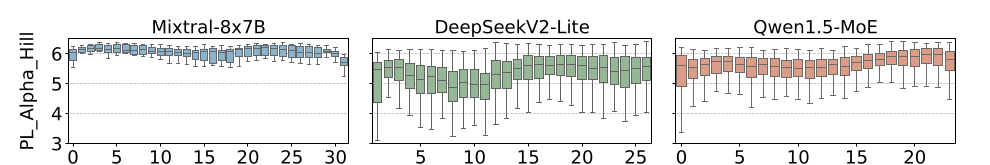

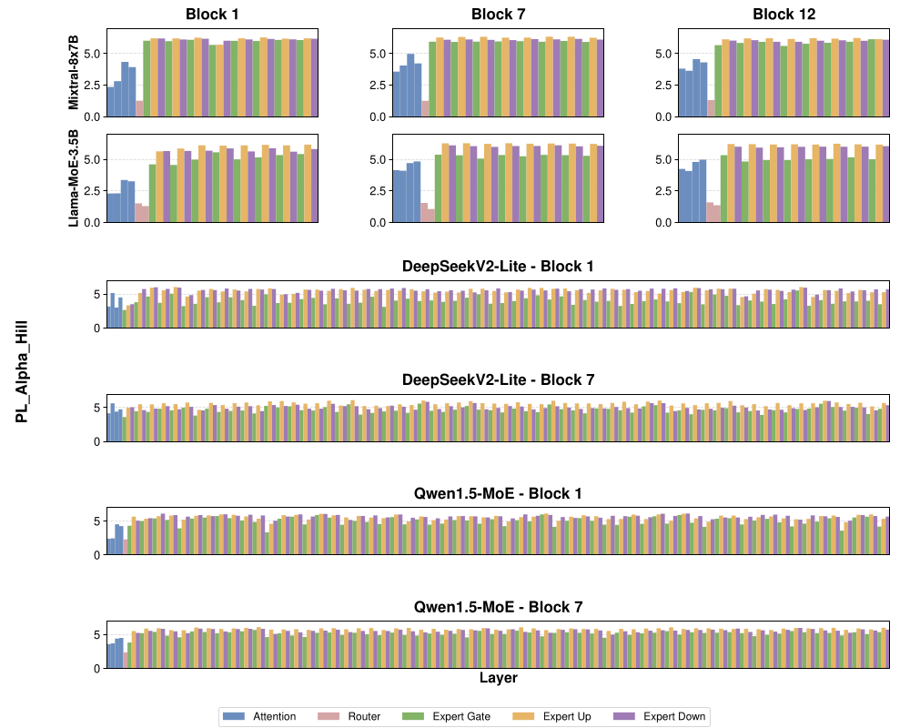

**基于 alpha 的重要性分析。** 作者用 PL_Alpha_Hill 分析了常见 MoE 模型。如图 3 所示，PL_Alpha_Hill 在层、block 和架构之间都有明显差异：

- i）层与专家级异质性。同一 MoE block 内，不同投影层的 PL_Alpha_Hill 值不同（图 4），说明给整个专家分配单一位宽会漏掉层级差异。同一 MoE 层内专家间的 PL_Alpha_Hill 也有变化，说明统一的专家精度可能对重要专家保护不足。更多按专家的证据见附录 A.4。
- ii）Block 级异质性。不同 MoE block 的 PL_Alpha_Hill 分布不同，说明固定的逐 block 预算可能次优，位宽预算应跨 block 全局分配，让模型中更重要的区域获得更高精度。
- iii）架构级异质性。PL_Alpha_Hill 的分布也随 MoE 架构而异。Mixtral-8×7B 这类普通 MoE block 内方差较小，而 DeepSeekV2-Lite、Qwen1.5-MoE 这类细粒度 MoE 方差大得多。这说明从 PL_Alpha_Hill 到重要性的映射应适应模型级的 PL_Alpha_Hill 分布。

这些观察促成了设计：位宽分配应利用逐层的 PL_Alpha_Hill 分布来决定全局比特预算花在哪里。因此作者把 AlphaQ 写成一个带预算约束的优化问题，把免校准的重要性信号转化为逐层的位宽分配。

### 3.3 位宽分配优化

在得到全局可比的重要性信号后，要在固定的全局比特预算下分配位宽，使精度退化最小。

**重要性缩放的量化噪声。** 仅有重要性指标不足以确定位宽：位宽分配需要同时量化“提高某处精度的收益”与“在预算内其他地方降低精度的代价”。PL_Alpha_Hill 给出免校准的重要性估计，但不反映低比特量化引起的数值扰动；反过来，单看量化噪声也无法说明被影响的模块在结构上是否重要。附录 A.5 对二者的相互作用有详细分析。

作者把量化噪声的幅度建模为量化位宽和权重分布的函数。在标准的均匀噪声近似下，量化噪声被视为零均值噪声，其方差正比于量化步长的平方。步长随位宽 $`b`$ 指数衰减，即 $`\Delta_{l,b}\propto 2^{-b}`$ ，所以噪声方差按 $`2^{-2b}`$ 变化（推导见附录 A.6）。为体现层间权重分布差异，用权重矩阵方差 $`\mathrm{Var}(\mathbf{W}_{l})`$ 调制，以 $`\mathrm{Var}(\mathbf{W}_{l})2^{-2b}`$ 衡量逐层量化噪声。

再用基于 alpha 的重要性缩放该噪声，对重要层的扰动惩罚更重。具体地，逐层量化噪声乘以 $`\left(\tilde{\alpha}/{{\alpha}_{l}}\right)^{\gamma}`$ ，其中 $`\tilde{\alpha}=\mathrm{median}\lbrace\alpha_{l}\rbrace_{l=1}^{L}`$ ， $`\gamma`$ 是与数据无关的曲率参数。设 $`\alpha_{\min}`$ 、 $`\alpha_{\max}`$ 、 $`v_{\alpha}`$ 分别为目标模块上 PL_Alpha_Hill 的最小值、最大值和方差，默认取 $`\gamma_{\mathrm{default}}=\alpha_{\min}(\alpha_{\max}-\alpha_{\min})/v_{\alpha}`$ （推导见附录 A.7）。于是层 $`l`$ 在位宽 $`b`$ 下的缩放量化噪声定义为

```math
\eta_{l,b}=\left(\frac{\tilde{\alpha}}{{\alpha}_{l}}\right)^{\gamma}\cdot\mathrm{Var}(\mathbf{W}_{l})2^{-2b}.
```

（式 4）

**带预算约束的形式化。** 以 $`\eta_{l,b}`$ 为逐层代价，在目标比特预算下最小化所有层的总缩放量化噪声。设 $`\mathcal{B}`$ 是候选位宽集合（如 $`\mathcal{B}=\lbrace 1,2,3,4\rbrace`$ ）。引入二值指示变量 $`x_{l,b}\in\lbrace 0,1\rbrace`$ ，当层 $`l`$ 被分配位宽 $`b`$ 时 $`x_{l,b}=1`$ ，否则为 0。为保证配置合法，施加两条约束：i）每层恰好分配一个位宽；ii）对有 $`N_{l}`$ 个参数的层 $`l`$ ，分配位宽 $`b`$ 的代价为 $`N_{l}\cdot b`$ ，量化后模型总大小不得超过目标预算 $`B_{\text{tot}}`$ 。合起来得到如下整数线性规划（ILP）：

```math
\min_{\lbrace x_{l,b}\rbrace}\ \sum_{l=1}^{L}\sum_{b\in\mathcal{B}}x_{l,b}\cdot\eta_{l,b}
```

```math
\text{s.t.}\ \sum_{l=1}^{L}\sum_{b\in\mathcal{B}}x_{l,b}\cdot N_{l}\cdot b\leq B_{\text{tot}},
```

```math
\sum_{b\in\mathcal{B}}x_{l,b}=1,\quad\forall l\in\lbrace 1,\dots,L\rbrace,
```

```math
x_{l,b}\in\lbrace 0,1\rbrace.
```

（式 5）求解式 5 得到使总的重要性缩放量化噪声（进而精度退化）最小的最优位宽分配。式 5 是标准的多选择背包问题（Pisinger & Toth 1998），现代 ILP 求解器（如 PuLP，Mitchell 2011）可在数秒内求到全局最优。

## 4 实验结果

### 4.1 实验设置

在四个代表性 MoE LLM 上评估 AlphaQ：DeepSeekV2-Lite、Qwen1.5-MoE、Mixtral-8×7B 和 Qwen3-30B-A3B。计算 PL_Alpha_Hill 时，FARMS 子矩阵大小为 $`256\times 256`$ ，沿每个维度的采样步长为 256。

量化方面遵循前人工作（Huang 2024），做仅权重量化，采用分组非对称 GPTQ（组大小 128，用 WikiText2 的 128 条样本校准）。所有非专家层（包括注意力和路由器）统一用 4 比特。对专家层做逐层粒度的混合精度：每层从 $`\lbrace 1,2,3,4\rbrace`$ 中选位宽，用“每层平均比特数”（MoE block 中所有层位宽的平均）控制压缩程度，报告 2.5 和 3.5 两种设定。

在预算匹配下对比两个基线：Uniform（所有专家同位宽）和 PMQ（基于校准的混合精度 MoE 量化方法）。Uniform 在预算为 $`x.5`$ 时，按 Huang 2024 的做法，前一半 MoE block 用 $`x{+}1`$ 比特，后一半用 $`x`$ 比特。在部分设定下还与更多位宽分配方法对比：block score predictor（BSP，Li 2024）、基于 Hessian 的方法（Hessian，Dong 2020）和 Automated Fine-Grained MoE Quantization（AFG，Xie 2025）。

评估指标：WikiText2 困惑度（PPL，越低越好）和五项基准上的平均零样本准确率（Avg.，越高越好）：PIQA、ARC-Easy（ARC-e）、ARC-Challenge（ARC-c）、HellaSwag、WinoGrande（WinoG.），使用 EleutherAI LM Harness。

### 4.2 主要结果

混合精度量化总体上比均匀位宽质量更高，尤其在低比特预算下，反映了 MoE 模型中各层重要性的异质性（表 1）。并且相比基于校准的方法，AlphaQ 在各模型和预算下都取得一致更强的结果，说明免校准位宽分配效果更好。更详细的结果见附录 A.8。

**表 1：DeepSeekV2-Lite、Qwen1.5-MoE、Mixtral-8×7B 和 Qwen3-30B-A3B 上的结果。WikiText2 困惑度（越低越好）与五个零样本任务上的准确率（越高越好）。Avg. 为五项任务平均准确率。各比特预算下的最优结果在原文中加粗。**

| 模型 | Bits | 方法 | WikiText2 ↓ | PIQA | ARC-e | ARC-c | HellaSwag | WinoG. | Avg. |
|---|---|---|---|---|---|---|---|---|---|
| Mixtral-8×7B | 16 | Original | 3.84 | 83.57 | 83.67 | 59.30 | 84.03 | 76.24 | 77.36 |
| | 2.5 | Uniform | 6.16 | 79.38 | 77.40 | 50.26 | 58.84 | 73.40 | 67.86 |
| | 2.5 | BSP | 13.61 | 68.23 | 54.97 | 28.38 | 55.61 | 62.19 | 53.88 |
| | 2.5 | Hessian | 5.41 | 80.21 | 76.38 | 51.20 | 67.05 | 72.97 | 69.56 |
| | 2.5 | AFG | – | 74.32 | 69.20 | 37.57 | 67.88 | 63.80 | 62.55 |
| | 2.5 | PMQ | 5.32 | 80.36 | 77.10 | 51.28 | 69.23 | 73.95 | 70.38 |
| | 2.5 | AlphaQ | 5.17 | 80.84 | 78.87 | 51.59 | 69.24 | 73.24 | 70.76 |
| | 3.5 | Uniform | 4.29 | 81.28 | 83.04 | 54.95 | 73.58 | 76.19 | 73.81 |
| | 3.5 | PMQ | 4.25 | 81.21 | 82.49 | 53.92 | 72.90 | 76.09 | 73.32 |
| | 3.5 | AlphaQ | 4.23 | 81.51 | 83.38 | 55.80 | 74.67 | 76.10 | 74.29 |
| DeepSeekV2-Lite | 16 | Original | 6.31 | 80.08 | 76.47 | 48.98 | 78.01 | 71.51 | 71.01 |
| | 2.5 | Uniform | 8.14 | 76.66 | 71.34 | 35.84 | 72.44 | 69.46 | 65.15 |
| | 2.5 | AFG | – | 74.32 | 69.20 | 37.57 | 67.88 | 63.80 | 62.55 |
| | 2.5 | PMQ | 6.95 | 77.86 | 71.68 | 37.37 | 72.76 | 69.06 | 65.75 |
| | 2.5 | AlphaQ | 6.64 | 78.02 | 73.77 | 39.22 | 73.38 | 69.30 | 66.74 |
| | 3.5 | Uniform | 6.83 | 79.21 | 74.56 | 44.57 | 76.27 | 70.83 | 69.09 |
| | 3.5 | PMQ | 6.57 | 79.63 | 75.26 | 45.83 | 76.97 | 71.04 | 69.75 |
| | 3.5 | AlphaQ | 6.44 | 79.89 | 75.51 | 46.51 | 77.21 | 71.21 | 70.07 |
| Qwen1.5-MoE | 16 | Original | 7.22 | 80.52 | 69.23 | 44.11 | 77.21 | 68.59 | 67.93 |
| | 2.5 | Uniform | 10.36 | 71.49 | 49.07 | 29.44 | 53.98 | 55.96 | 51.99 |
| | 2.5 | AFG | – | 77.53 | 61.07 | 31.20 | 72.77 | 62.12 | 60.94 |
| | 2.5 | PMQ | 9.01 | 77.58 | 60.56 | 36.26 | 70.69 | 65.82 | 62.18 |
| | 2.5 | AlphaQ | 8.14 | 78.21 | 66.97 | 42.72 | 71.81 | 66.12 | 65.17 |
| | 3.5 | Uniform | 8.13 | 79.31 | 66.81 | 41.51 | 74.52 | 67.54 | 65.94 |
| | 3.5 | PMQ | 7.42 | 80.31 | 69.02 | 43.81 | 77.13 | 68.50 | 67.75 |
| | 3.5 | AlphaQ | 7.38 | 80.46 | 69.15 | 44.33 | 77.70 | 68.55 | 68.04 |
| Qwen3-30B-A3B | 16 | Original | 8.71 | 80.25 | 79.29 | 55.80 | 77.75 | 71.11 | 72.84 |
| | 2.5 | Uniform | 10.29 | 78.07 | 75.93 | 50.07 | 71.72 | 68.01 | 68.76 |
| | 2.5 | PMQ | 10.94 | 76.61 | 68.43 | 45.99 | 72.13 | 66.22 | 65.88 |
| | 2.5 | AlphaQ | 9.27 | 78.34 | 75.87 | 50.35 | 74.49 | 68.71 | 69.56 |

值得注意的是，在 Qwen1.5-MoE 上，3.5 比特预算的 AlphaQ 在五个零样本任务的平均准确率上与 BF16 模型相当。在更激进的 2.5 比特设定下，AlphaQ 也在各模型上保持相对较强的表现：零样本平均准确率仅下降 4.3%（DeepSeekV2-Lite）、2.8%（Qwen1.5-MoE）和 6.6%（Mixtral-8×7B），说明即使比特预算极紧，该分配仍然有益。为在更大规模的 MoE 上评估，加入 Qwen3-30B-A3B 的结果：在 2.5 比特预算下它同样在整体上超过 Uniform 和 PMQ。

### 4.3 AlphaQ 与多领域校准基线的对比

为与校准覆盖面更广的基线比较，作者在 OLMoE-1B-7B（Muennighoff 2024）上用 3 比特预算，以各种单领域与混合领域校准集运行 PMQ，并在常识基准 MMLU、数学推理基准 MATH 和中文基准 CEval（Huang 2023）上评估量化模型。

**表 2：OLMoE-1B-7B 在 3 比特预算下，AlphaQ 与使用多领域校准的 PMQ 的对比。各基准上最优结果在原文中加粗。**

| 方法 | MMLU | MATH | CEval | Avg. |
|---|---|---|---|---|
| BF16 | 53.40 | 21.40 | 31.06 | 35.29 |
| Uniform 3-bit | 43.56 | 11.45 | 27.19 | 27.40 |
| PMQ (C4) | 43.80 | 12.07 | 25.11 | 26.99 |
| PMQ (CEval-dev) | 44.04 | 11.15 | 22.66 | 25.95 |
| PMQ (MATH) | 44.43 | 12.82 | 22.96 | 26.74 |
| PMQ (C4+CEval-dev) | 44.79 | 11.71 | 23.03 | 26.51 |
| PMQ (C4+MATH) | 44.38 | 12.91 | 25.78 | 27.69 |
| PMQ (MATH+CEval-dev) | 44.33 | 12.37 | 21.99 | 26.23 |
| AlphaQ | 44.75 | 13.11 | 28.72 | 28.86 |

作者指出（原文此处写作“表 3”，实际对应表 2），即使允许多领域混合，PMQ 依然对校准领域敏感：在各校准设定中，即便多领域 PMQ 配置也不能在每个维度上都追平 Uniform，而 AlphaQ 通过避免校准领域偏置提高了整体平均。AlphaQ 在 OLMoE 基准上也优于近期的跨数据集方法 DynaMo，详细结果见附录 A.9。这些结果说明，扩大校准覆盖面只是把失败模式转移到别的任务上，并没有消除对校准数据集的敏感性。

### 4.4 消融实验

**AlphaQ 中哪些组件起作用？** 为分离各组件的贡献，在 OLMoE-1B-7B 的 3 比特预算下做消融，量化 PL_Alpha_Hill、量化噪声及二者结合的收益。

**表 3：OLMoE-1B-7B 的组件消融。报告 WikiText2 困惑度和六个零样本任务的平均准确率。Alpha 指 PL_Alpha_Hill，Direct 指把 Alpha 和量化噪声直接相乘。**

| 方法 | PPL ↓ | Avg. Acc. ↑ |
|---|---|---|
| BF16 | 7.95 | 70.45 |
| Uniform 3-bit | 11.78 | 64.73 |
| Noise-only | 11.22 | 63.74 |
| Alpha-only | 10.03 | 66.23 |
| Alpha+Noise (Direct) | 9.56 | 66.81 |
| Alpha+Noise (Ours) | 9.19 | 67.11 |

表 3 显示，PL_Alpha_Hill 单独就已经提供了比量化噪声强得多的位宽分配信号，说明它抓住了有意义的层重要性。但无论 PL_Alpha_Hill 还是仅噪声的分配都不够，二者都明显落后于最终的 AlphaQ。引入量化噪声能进一步提升性能；Direct 变体与最终变体的差距说明 PL_Alpha_Hill 与量化噪声如何组合也很重要。只有把基于 alpha 的重要性指标与量化噪声项恰当地结合，才能得到最佳结果。

**如何在 block 之间分配位宽？** 比较两种预算分配策略：i）固定整个模型的全局平均位宽；ii）固定每个 block 的平均位宽。

**表 4：位宽预算分配的消融。比较逐 block 预算与全局预算下 WikiText2 的困惑度（PPL）和六个零样本基准上的准确率（Acc.）。**

| 比特预算 | 方式 | Mixtral-8×7B PPL ↓ | Mixtral-8×7B Acc. ↑ | DeepSeekV2-Lite PPL ↓ | DeepSeekV2-Lite Acc. ↑ |
|---|---|---|---|---|---|
| 2.5 | Block | 5.81 | 71.68 | 6.99 | 64.61 |
| 2.5 | Global (Ours) | 5.17 | 72.39 | 6.64 | 65.69 |
| 3.5 | Block | 4.71 | 72.56 | 6.59 | 68.72 |
| 3.5 | Global (Ours) | 4.23 | 75.98 | 6.44 | 69.03 |

在所有设定中，全局预算都优于逐 block 预算（原文此处引用的是“表 5”，实际对应表 4）。这说明 MoE 各 block 的重要性不相等，而 HT-SR 理论为跨 block 比较层的重要性提供了统一视角。

**如何在 block 内部分配位宽？** 比较逐层与逐专家的分配粒度。

**表 5：位宽分配粒度的消融。比较不同比特预算下逐专家与逐层分配的 WikiText2 困惑度。**

| 模型 | 2-bit PPL ↓ Expert | 2-bit PPL ↓ Layer | 3-bit PPL ↓ Expert | 3-bit PPL ↓ Layer |
|---|---|---|---|---|
| Mixtral 8×7B | 6.28 | 6.11 | 4.72 | 4.37 |
| DeepSeekV2-Lite | 7.47 | 7.30 | 6.81 | 6.69 |

如表 5 所示，更细粒度的逐层策略在所有设定下都一致优于逐专家分配。说明 AlphaQ 能有效捕捉每个专家内部各层的相对重要性并据此分配位宽，实现更细粒度的混合精度量化。

### 4.5 效率评估

**端到端效率。** 在 NVIDIA A40 GPU（48 GB）上评估。图 5 给出推理加速、内存占用与精度之间的权衡。

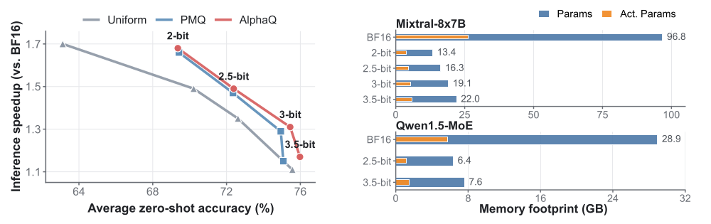

AlphaQ 在 Mixtral-8×7B 上始终处于帕累托前沿，在精度与推理加速之间提供更优折中。同时，AlphaQ 在各比特预算下大幅缓解了 MoE 的内存瓶颈：Mixtral-8×7B 在 2 比特时加速 $`1.68\times`$ ，参数内存从 96.8 GB 降到 13.4 GB；即使在 3.5 比特预算下，也能把 Mixtral-8×7B 的参数内存降到 22.0 GB，对应 $`4.4\times`$ 压缩。Qwen1.5-MoE 在 3.5 比特预算下，AlphaQ 仅用 7.6 GB 权重就保持 BF16 级精度，约为 BF16 内存的四分之一。更详细的效率结果见附录 A.10。

**PL_Alpha_Hill 的开销。** 计算 PL_Alpha_Hill 是离线预处理步骤，每个模型在求解 ILP 之前做一次。如表 6 所示，代价不大：完整做一遍 alpha 计算，OLMoE-1B-7B 约需 3 分钟，Qwen3-30B-A3B 约需 9 分钟，每个模块仅 44 到 57 毫秒。由于该步骤在量化前完成、不影响在线推理，作者认为部署上可行。

**表 6：PL_Alpha_Hill 的离线计算代价。报告完整一遍 alpha 计算的总时间与平均每模块时间。**

| 模型 | 模块数 | 总时间 (s) | 每模块 (ms) |
|---|---|---|---|
| OLMoE-1B-7B | 3152 | 180.28 | 57.19 |
| Qwen3-30B-A3B | 12448 | 549.26 | 44.12 |

**量化推理后端。** 作者实现了一个把低比特反量化与 Tensor Core GEMM 结合的量化推理后端；相对原始 BF16 模型，它同时加速 prefill 和 decode。所有层的 prefill 阶段以及非专家层的 decode 阶段，复用 PMQ 风格的 HQQ（Badri & Shaji 2023）后端做反量化；MoE 专家层的 decode 阶段则实现了融合的 Triton kernel 以减少显存流量。详细的运行时实现与 profiling 见附录 A.11。

## 5 结论

本文提出 AlphaQ，一种面向 MoE 量化的免校准位宽分配方法。受 HT-SR 理论启发，AlphaQ 通过度量谱重尾程度，直接从模型权重得到重要性信号。借助该指标，作者从 HT-SR 视角系统分析了 MoE 模型，揭示出多个层面的重要性多样性。基于这些观察，AlphaQ 在固定比特预算下通过全局约束优化来分配位宽，实现免校准的 MoE 位宽分配。大量实验表明，基于权重的位宽分配是提高混合精度 MoE 量化泛化性的有效且有前景的途径。

## 参考文献

参考文献列表从略，请见原文。

## 附录 A

### A.1 依赖校准的专家激活与位宽分配

为说明校准数据集对 MoE 位宽分配的影响，作者把 PMQ（Huang 2024）应用到 Mixtral-8×7B，使用不同领域的数据集。如图 6 所示，统计到的专家激活频率随校准数据显著变化，因此不同的校准时统计量会导致差异很大的数据驱动分配。

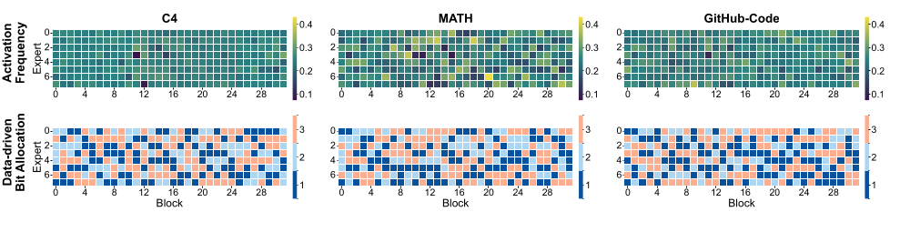

### A.2 术语汇总

为避免歧义，图 7 汇总了全文使用的术语，说明如下：

- **Global（全局）：** 指整个模型。全局预算意味着为整个模型定义一个比特预算，由所有 block、专家和层共享。
- **Block：** 指一个 Transformer block。主流 MoE 中每个 block 由三个主要模块组成：注意力模块、包含多个专家的 MoE 模块、路由模块。逐 block 预算是给每个 Transformer block 独立分配相同的比特预算。
- **Expert（专家）：** 是 MoE 模块内的一个前馈网络。每个专家通常含多个层（如 up/gate/down 投影）。逐专家位宽分配意味着专家内所有子模块共用同一位宽设置。
- **Layer（层）：** 指模块内的单个子模块，例如专家中的投影层（up、gate、down）。逐层位宽分配指给每个子模块独立分配位宽。

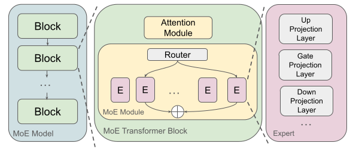

### A.3 Hill 估计器的推导

#### A.3.1 尾部模型假设

沿用 3.2 节，ESD 尾部用截断幂律密度建模：

```math
p(\lambda)\propto\lambda^{-\alpha},\qquad\lambda_{\min}<\lambda<\lambda_{\max},
```

（式 6）其中 $`\alpha`$ 是幂律指数，越小表示尾部越重。

#### A.3.2 从幂律密度到 Pareto 形式

为推导式 3 所用的估计器，把式 6 改写成 Pareto 分布。令 $`\beta=\alpha-1`$ ，则密度可写为

```math
p(\lambda)=\beta\,\lambda_{\min}^{\beta}\,\lambda^{-(\beta+1)},\qquad\lambda\geq\lambda_{\min},
```

（式 7）其中归一化常数由下式确定：

```math
1=\int_{\lambda_{\min}}^{\infty}\beta\,\lambda_{\min}^{\beta}\,\lambda^{-(\beta+1)}\,d\lambda.
```

（式 8）式 7 是标准 Pareto 形式，估计出 $`\beta`$ 即得 $`\alpha=\beta+1`$ 。

#### A.3.3 似然与对数似然

设 $`\lambda_{1},\dots,\lambda_{k}`$ 是 $`k`$ 个相互独立的尾部样本，且 $`\lambda_{i}\geq\lambda_{\min}`$ 。在式 7 下， $`\beta`$ 的似然为

```math
L(\beta)=\prod_{i=1}^{k}\beta\,\lambda_{\min}^{\beta}\,\lambda_{i}^{-(\beta+1)}=\beta^{k}\lambda_{\min}^{k\beta}\prod_{i=1}^{k}\lambda_{i}^{-(\beta+1)}.
```

（式 9）取对数得

```math
\ln L(\beta)=k\ln\beta+k\beta\ln\lambda_{\min}-(\beta+1)\sum_{i=1}^{k}\ln\lambda_{i}.
```

（式 10）

#### A.3.4 最大似然估计

求导并令其为零：

```math
\frac{\partial\ln L}{\partial\beta}=\frac{k}{\beta}+k\ln\lambda_{\min}-\sum_{i=1}^{k}\ln\lambda_{i}=0,
```

（式 11）得到

```math
\frac{1}{\beta}=\frac{1}{k}\sum_{i=1}^{k}\ln\!\left(\frac{\lambda_{i}}{\lambda_{\min}}\right).
```

（式 12）因此

```math
\hat{\beta}=\left(\frac{1}{k}\sum_{i=1}^{k}\ln\!\left(\frac{\lambda_{i}}{\lambda_{\min}}\right)\right)^{-1},\qquad\hat{\alpha}=1+\hat{\beta}.
```

（式 13）实现中，把各子矩阵的特征值拼接并升序排序：

```math
\lambda_{1}\leq\lambda_{2}\leq\cdots\leq\lambda_{n}.
```

（式 14）取最大的 $`k`$ 个特征值 $`\lbrace\lambda_{n-k+1},\dots,\lambda_{n}\rbrace`$ 作为尾部样本，下截断取第 $`(n-k)`$ 个顺序统计量，即 $`\lambda_{\min}=\lambda_{n-k}`$ 。把 $`\lambda_{i}\leftarrow\lambda_{n-i+1}`$ 和 $`\lambda_{\min}=\lambda_{n-k}`$ 代入式 13，得到式 3 所用的 Hill 估计器：

```math
\hat{\alpha}=1+\left(\frac{1}{k}\sum_{i=1}^{k}\ln\frac{\lambda_{n-i+1}}{\lambda_{n-k}}\right)^{-1}.
```

（式 15）

**直观理解。** 该估计器是超过阈值的平均对数超出量的倒数。尾部越重，对数超出量越大， $`\hat{\alpha}`$ 越小；尾部越轻，对数超出量越小， $`\hat{\alpha}`$ 越大。

**基于 FARMS 的分数计算。** 为使谱估计在形状各异的矩阵之间可比，用固定长宽比矩阵子采样（FARMS）启发式（Hu 2025b）计算 PL_Alpha_Hill：对每一层，把权重矩阵划分成固定长宽比的子矩阵，构造对应的 Gram 矩阵并收集它们的特征值，然后拼接并升序排序，再套用式 15 的 Hill 估计器。这得到对矩阵形状更鲁棒的谱重尾度估计。

### A.4 补充的 PL_Alpha_Hill 比较

3.2 节展示的逐层 PL_Alpha_Hill 分布是 AlphaQ 做 MoE 位宽分配的动机。作者在图 8 中进一步给出被采样 block 内的逐专家 PL_Alpha_Hill 分布。结果表明，同一 MoE 层内的专家也可以有不同的 PL_Alpha_Hill，说明即使在单个 block 内，专家重要性也是异质的。

作为对照，图 9 给出四个非 MoE 模型的逐层 PL_Alpha_Hill 分布：Llama3-1B（Grattafiori 2024）、Llama3-3B、Qwen1.5-4B（Team 2024b）和 Qwen3-4B（Yang 2025）。这些稠密模型的结果作为补充证据，说明 3.2 节分析的强专家级和 block 级异质性是 MoE 量化中尤其重要的问题。

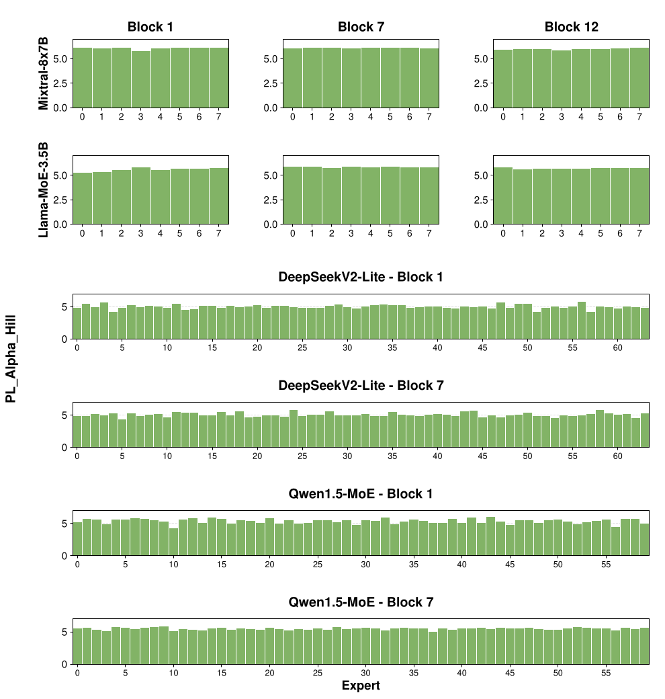

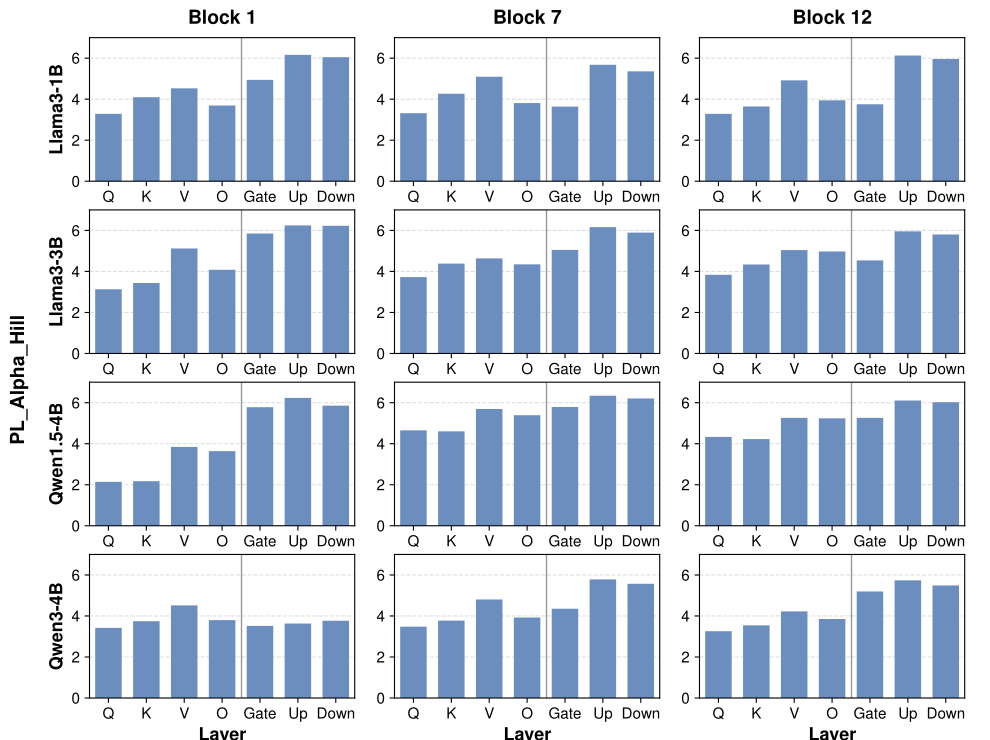

### A.5 重要性与量化噪声分析

为构建模块级分析，作者采样投影模块，每次把一个被采样模块量化到 2 比特，其余权重保持全精度，然后度量由此造成的困惑度上升，作为该模块的退化。量化噪声轴使用 3.3 节的量化噪声模型。由于 PL_Alpha_Hill 越小表示谱越重尾、结构重要性越高，AlphaQ 预测：当高量化噪声与低 PL_Alpha_Hill 重合时会出现大的退化。


图 10 给出模块级上 PL_Alpha_Hill 与量化噪声的联合视图。(a) 面板直接展示二者的相互作用，(b) 面板比较单个指标与组合指标。大的退化倾向于集中在高量化噪声和低 PL_Alpha_Hill 的区域，但点的分散程度也表明单独一个信号都不够。alpha 缩放量化噪声更清晰的单调趋势支持了目标函数的形式：量化噪声应按结构重要性加权，而不是单独使用。这与表 3 的组件消融一致。

### A.6 量化噪声模型的合理性

这里给出把逐层量化误差方差建模为 $`\eta_{l,b}\propto 2^{-2b}`$ 的理论依据。考虑对第 $`l`$ 层权重 $`\mathbf{W}_{l}`$ 使用均匀量化器。假设权重落在区间 $`[-R_{l},R_{l}]`$ 内，其中 $`R_{l}`$ 是由 $`\mathbf{W}_{l}`$ 分布决定的截断值。对 $`b`$ 比特量化，步长 $`\Delta_{l,b}`$ 定义为

```math
\Delta_{l,b}=\frac{2R_{l}}{2^{b}}.
```

（式 16）按 Bennett 高分辨率量化假设（Widrow & Kollár 2008），当步长相对于信号变化足够小时，量化误差 $`E=Q(w)-w`$ 可近似为在 $`\left[-\frac{\Delta_{l,b}}{2},\frac{\Delta_{l,b}}{2}\right]`$ 上均匀分布的随机变量。宽度为 $`\Delta_{l,b}`$ 的连续均匀分布方差为 $`\Delta_{l,b}^{2}/12`$ 。因此第 $`l`$ 层量化误差的方差可近似为

```math
\mathrm{Var}(\mathbf{E}_{l,b})\approx\frac{\Delta_{l,b}^{2}}{12}=\frac{1}{12}\left(\frac{2R_{l}}{2^{b}}\right)^{2}=\frac{R_{l}^{2}}{3}\cdot 2^{-2b}.
```

（式 17）于是定义 $`c_{l}=R_{l}^{2}/3`$ 。由于截断范围 $`R_{l}`$ 通常与权重标准差成正比， $`c_{l}`$ 随 $`\mathrm{Var}(\mathbf{W}_{l})`$ 变化。这就得到正文使用的指数衰减模型：

```math
\eta_{l,b}=c_{l}2^{-2b},
```

（式 18）其中 $`c_{l}`$ 刻画层特有的尺度。

### A.7 无数据的默认值与 $`\gamma`$ 的敏感性


作者根据模型权重统计量设定 $`\gamma`$ 。设 $`\alpha_{\min}`$ 、 $`\alpha_{\max}`$ 、 $`v_{\alpha}`$ 分别为目标模块上 PL_Alpha_Hill 的最小值、最大值和方差。 $`\alpha`$ 越小表示重尾越强，所以 $`\alpha_{\min}`$ 和 $`\alpha_{\max}`$ 界定了模型内部高重要性和低重要性的两个端点。

为设定幂律映射 $`w_{\gamma}(\alpha)=(\tilde{\alpha}/\alpha)^{\gamma}`$ 的尺度（这里 $`\tilde{\alpha}`$ 取 $`\lbrace\alpha_{l}\rbrace_{l}`$ 的均值；注意正文 3.3 节写的是中位数），在两个端点之间构造一个局部判别代理。具体引入两个局部密度替代：

```math
p_{\text{high}}(\alpha)\propto\exp\left(-\frac{(\alpha-\alpha_{\min})^{2}}{2v_{\alpha}}\right),\quad p_{\text{low}}(\alpha)\propto\exp\left(-\frac{(\alpha-\alpha_{\max})^{2}}{2v_{\alpha}}\right),
```

（式 19）二者共享方差尺度 $`v_{\alpha}`$ ，分别以高、低重要性端点为中心。这一构造只是局部代理，并不假设 $`\alpha`$ 的分布有全局参数形式。定义对数判别分数

```math
s(\alpha)=\log\frac{p_{\text{high}}(\alpha)}{p_{\text{low}}(\alpha)}.
```

（式 20）代入替代形式得

```math
s(\alpha)=-\frac{(\alpha-\alpha_{\min})^{2}}{2v_{\alpha}}+\frac{(\alpha-\alpha_{\max})^{2}}{2v_{\alpha}}.
```

（式 21）展开平方并化简得

```math
s(\alpha)=-\frac{\alpha_{\max}-\alpha_{\min}}{v_{\alpha}}\cdot\alpha+C,
```

（式 22）其中 $`C`$ 是与 $`\alpha`$ 无关的常数。因此

```math
\frac{d}{d\alpha}s(\alpha)=-\frac{\alpha_{\max}-\alpha_{\min}}{v_{\alpha}}.
```

（式 23）判别分数 $`s(\alpha)`$ 给出了一个无数据的参考尺度，描述重要性在两个端点之间变化有多快。用它来标定幂律映射 $`w_{\gamma}(\alpha)`$ 的曲率。幂律映射的对数斜率为

```math
\frac{d}{d\alpha}\log w_{\gamma}(\alpha)=-\frac{\gamma}{\alpha}.
```

（式 24）在映射最敏感的高重要性端点 $`\alpha_{\min}`$ ，令 $`\log w_{\gamma}(\alpha)`$ 的局部斜率与 $`s(\alpha)`$ 的斜率匹配：

```math
\left.\frac{d}{d\alpha}\log w_{\gamma}(\alpha)\right|_{\alpha=\alpha_{\min}}=\frac{d}{d\alpha}s(\alpha).
```

（式 25）代入两个斜率得

```math
-\frac{\gamma}{\alpha_{\min}}=-\frac{\alpha_{\max}-\alpha_{\min}}{v_{\alpha}},
```

（式 26）解得

```math
\gamma_{\mathrm{default}}=\frac{\alpha_{\min}(\alpha_{\max}-\alpha_{\min})}{v_{\alpha}}.
```

（式 27）有了这个默认 $`\gamma`$ ，位宽分配方法能适应不同的 PL_Alpha_Hill 分布：PL_Alpha_Hill 分布集中的模型需要更大的曲率来凸显重要性差异，分布更宽的模型则需要较弱的放大。图 11 给出 AlphaQ 在代表性 MoE 模型上对 $`\gamma`$ 的敏感性。

### A.8 更多实验结果

表 7、8、9 给出各模型和各比特预算下更详细的结果。在 2.0 / 2.5 / 3.0 / 3.5 四种每层比特预算下，把 AlphaQ 与 PMQ 和 Uniform 比较。评估报告 WikiText2 困惑度（PPL，越低越好）和六个基准上的平均零样本准确率（Avg.，越高越好）：PIQA、ARC-Easy、ARC-Challenge、HellaSwag、WinoGrande 和 BoolQ（Clark 2019），均使用 EleutherAI LM Harness。

图 12、13、14 给出 AlphaQ 在 2 比特预算下的详细位宽分配结果，包括逐层和逐专家两种设定。

**表 7：DeepSeekV2-Lite 上的结果。WikiText2 困惑度与六个零样本任务准确率。各位宽下最优结果在原文中加粗。**

| Bits | 方法 | WikiText2 ↓ | PIQA | ARC-e | ARC-c | HellaSwag | WinoGrande | BoolQ | Avg. |
|---|---|---|---|---|---|---|---|---|---|
| 16 | Original | 6.31 | 80.08 | 76.47 | 48.98 | 78.01 | 71.51 | 65.00 | 70.01 |
| 2 | Uniform | 9.57 | 73.07 | 60.61 | 35.84 | 62.87 | 62.04 | 55.03 | 58.24 |
| 2 | PMQ | 7.99 | 75.14 | 61.68 | 37.37 | 66.20 | 68.11 | 57.66 | 61.03 |
| 2 | AlphaQ | 7.30 | 76.03 | 67.20 | 40.33 | 68.70 | 67.92 | 58.10 | 63.05 |
| 2.5 | Uniform | 8.14 | 76.66 | 71.34 | 35.84 | 72.44 | 69.46 | 57.58 | 63.89 |
| 2.5 | PMQ | 6.95 | 77.86 | 71.68 | 37.37 | 72.76 | 69.06 | 60.03 | 64.79 |
| 2.5 | AlphaQ | 6.64 | 78.02 | 73.77 | 39.22 | 73.38 | 69.30 | 60.45 | 65.69 |
| 3 | Uniform | 7.50 | 78.50 | 72.51 | 40.83 | 74.49 | 70.11 | 60.66 | 66.18 |
| 3 | PMQ | 6.70 | 79.16 | 73.15 | 41.44 | 75.04 | 70.23 | 61.53 | 66.76 |
| 3 | AlphaQ | 6.60 | 79.32 | 73.41 | 41.56 | 75.44 | 70.86 | 61.98 | 67.10 |
| 3.5 | Uniform | 6.83 | 79.21 | 74.56 | 44.57 | 76.27 | 70.83 | 62.50 | 67.99 |
| 3.5 | PMQ | 6.57 | 79.63 | 75.26 | 45.83 | 76.97 | 71.04 | 63.21 | 68.66 |
| 3.5 | AlphaQ | 6.44 | 79.89 | 75.51 | 46.51 | 77.21 | 71.21 | 63.85 | 69.03 |

**表 8：Qwen1.5-MoE-A2.7B 上的结果。WikiText2 困惑度与六个零样本任务准确率。各位宽下最优结果在原文中加粗。**

| Bits | 方法 | WikiText2 ↓ | PIQA | ARC-e | ARC-c | HellaSwag | WinoGrande | BoolQ | Avg. |
|---|---|---|---|---|---|---|---|---|---|
| 16 | Original | 7.22 | 80.52 | 69.23 | 44.11 | 77.21 | 68.59 | 79.57 | 69.87 |
| 2 | Uniform | 14.25 | 66.38 | 42.89 | 30.29 | 49.06 | 53.12 | 72.14 | 52.31 |
| 2 | PMQ | 10.47 | 74.76 | 59.05 | 34.56 | 64.34 | 64.72 | 74.52 | 61.99 |
| 2 | AlphaQ | 9.03 | 76.12 | 61.04 | 36.89 | 66.91 | 67.76 | 76.84 | 64.26 |
| 2.5 | Uniform | 10.36 | 71.49 | 49.07 | 29.44 | 53.98 | 55.96 | 68.69 | 54.77 |
| 2.5 | PMQ | 9.01 | 77.58 | 60.56 | 36.26 | 70.69 | 65.82 | 75.54 | 64.41 |
| 2.5 | AlphaQ | 8.14 | 78.21 | 66.97 | 42.72 | 71.81 | 66.12 | 78.41 | 67.37 |
| 3 | Uniform | 9.22 | 76.59 | 62.53 | 39.81 | 68.50 | 65.27 | 74.51 | 64.53 |
| 3 | PMQ | 7.85 | 79.82 | 68.19 | 42.55 | 76.15 | 68.22 | 77.89 | 68.80 |
| 3 | AlphaQ | 7.60 | 80.11 | 68.81 | 43.51 | 76.94 | 68.45 | 77.81 | 69.27 |
| 3.5 | Uniform | 8.13 | 79.31 | 66.81 | 41.51 | 74.52 | 67.54 | 76.81 | 67.75 |
| 3.5 | PMQ | 7.42 | 80.31 | 69.02 | 43.81 | 77.13 | 68.50 | 79.22 | 69.67 |
| 3.5 | AlphaQ | 7.38 | 80.46 | 69.15 | 44.33 | 77.70 | 68.55 | 79.45 | 69.86 |

**表 9：Mixtral-8x7B 上的结果。WikiText2 困惑度与六个零样本任务准确率。各位宽下最优结果在原文中加粗。**

| Bits | 方法 | WikiText2 ↓ | PIQA | ARC-e | ARC-c | HellaSwag | WinoGrande | BoolQ | Avg. |
|---|---|---|---|---|---|---|---|---|---|
| 16 | Original | 3.84 | 83.57 | 83.67 | 59.30 | 84.03 | 76.24 | 85.35 | 78.69 |
| 2 | Uniform | 6.30 | 74.81 | 71.09 | 40.44 | 54.04 | 65.75 | 72.57 | 63.12 |
| 2 | PMQ | 6.10 | 78.29 | 73.06 | 48.38 | 64.95 | 71.27 | 80.58 | 69.42 |
| 2 | AlphaQ | 6.01 | 78.52 | 74.62 | 46.59 | 64.76 | 71.31 | 80.39 | 69.36 |
| 2.5 | Uniform | 6.16 | 79.38 | 77.40 | 50.26 | 58.84 | 73.40 | 82.01 | 70.22 |
| 2.5 | PMQ | 5.32 | 80.36 | 78.45 | 51.58 | 69.23 | 73.95 | 82.54 | 72.35 |
| 2.5 | AlphaQ | 5.17 | 80.84 | 78.87 | 51.59 | 69.24 | 73.24 | 82.57 | 72.39 |
| 3 | Uniform | 4.91 | 80.20 | 79.55 | 49.57 | 70.23 | 74.19 | 82.01 | 72.62 |
| 3 | PMQ | 4.41 | 81.39 | 82.53 | 53.75 | 73.03 | 75.77 | 83.18 | 74.94 |
| 3 | AlphaQ | 4.37 | 81.56 | 82.32 | 54.44 | 73.47 | 77.27 | 83.64 | 75.45 |
| 3.5 | Uniform | 4.29 | 81.28 | 83.04 | 54.95 | 73.58 | 76.19 | 84.36 | 75.57 |
| 3.5 | PMQ | 4.25 | 81.21 | 82.49 | 53.92 | 72.90 | 76.09 | 83.84 | 75.08 |
| 3.5 | AlphaQ | 4.23 | 81.51 | 83.38 | 55.80 | 74.67 | 76.10 | 84.45 | 75.98 |

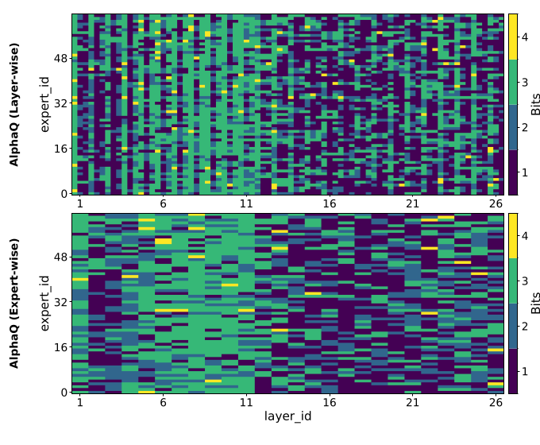

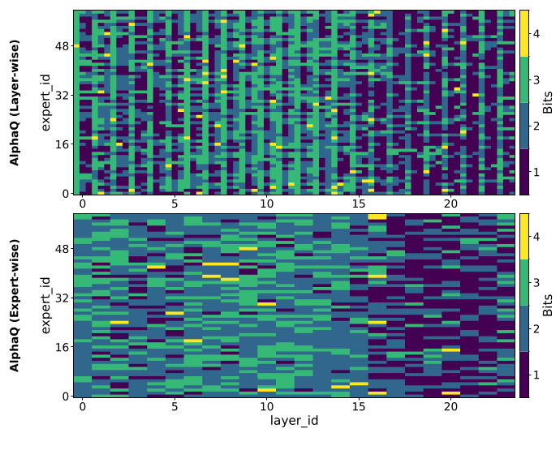

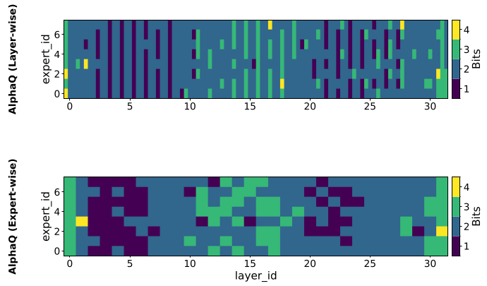

### A.9 与 DynaMo 的比较

作为参照，作者还把 AlphaQ 与近期的跨数据集 MoE 量化方法 DynaMo（Zheng 2025）作比较。表 10 显示，在重叠的 OLMoE 基准上 AlphaQ 优于 DynaMo。

**表 10：OLMoE-1B-7B 在 3 比特下与 DynaMo 的比较。DynaMo 的数字取自原论文报告结果。WikiText/C4 的 PPL 越低越好，下游准确率越高越好。**

| 方法 | WikiText | C4 | ARC-Challenge | ARC-Easy | PIQA |
|---|---|---|---|---|---|
| DynaMo | 9.64 | 15.31 | 25.85 | 43.52 | 58.87 |
| AlphaQ | 9.19 | 14.64 | 26.91 | 46.11 | 60.08 |

作者推测的原因是：DynaMo 依赖启发式的 token 利用率信号来定义通道和专家重要性，并且只在两个通用语料（WikiText 和 C4）上评估跨数据集适应；而 AlphaQ 完全避开了基于校准的重要性估计，在同样的 OLMoE 3 比特设定下迁移效果依然更好。

### A.10 加速与内存压缩

**表 11：Mixtral-8×7B 与 Qwen1.5-MoE 的效率分析。报告相对 BF16 基线的加速、模型总大小（Params），以及推理时激活的参数（Act. Params）。**

| 模型 | 方法 | 预算 | 加速 ↑ | Params (GB) ↓ | Act. Params (GB) ↓ |
|---|---|---|---|---|---|
| Mixtral-8×7B | BF16 | 16-bit | 1.00× | 96.80 | 26.31 |
| | Uniform | 2-bit | 1.70× | 13.61 | 3.70 |
| | PMQ | 2-bit | 1.66× | 13.41 | 3.73 |
| | PMQ | 2.5-bit | 1.47× | 16.24 | 4.53 |
| | AlphaQ | 2-bit | 1.69× | 13.41 | 3.75 |
| | AlphaQ | 2.5-bit | 1.50× | 16.30 | 4.52 |
| | AlphaQ | 3-bit | 1.31× | 19.12 | 5.27 |
| | AlphaQ | 3.5-bit | 1.17× | 22.03 | 5.81 |
| Qwen1.5-MoE | BF16 | 16-bit | 1.00× | 28.94 | 5.74 |
| | AlphaQ | 2.5-bit | 1.22× | 6.37 | 1.16 |
| | AlphaQ | 3.5-bit | 1.12× | 7.60 | 1.45 |

内存压缩方面（表 11），AlphaQ 有效缓解了 MoE 模型的内存瓶颈。在 Mixtral 8×7B 上，参数内存占用从 96.8 GB（BF16）降到 2 比特预算下约 13.4 GB（压缩比 $`7.2\times`$ ）；在 3.5 比特预算下压缩比为 $`4.4\times`$ 。借助优化后的 kernel，AlphaQ 在相近低比特预算下内存占用与 PMQ 相近，而实测加速在 2 比特和 2.5 比特下略高。值得注意的是，在 3.5 比特预算下 Qwen1.5-MoE 的权重内存占用降到 BF16 的约四分之一。

### A.11 运行时实现与 decode 优化

作者对 MoE 专家层使用优化的运行时后端。prefill 阶段复用 PMQ 风格的 HQQ（Badri & Shaji 2023）后端：用 CUDA kernel 做比特解包和反量化，再做 Tensor Core GEMM。profiling 显示这种拆分在计算受限的 prefill 中很有效，但在访存受限的 decode 中收益有限，原因是反量化与 GEMM 之间存在数据搬运：具体来说，decode 时 `Memcpy HtoD` 和 `aten::copy_` 成为主导开销。因此作者实现了 decode 专用的融合 Triton kernel，把解包、反量化和 GEMM 融合进单个 kernel。profiling 证实这一改动显著降低了 decode 期间 `Memcpy HtoD` 与 `aten::copy_` 的开销。

在此后端之上，还可以选择把逐层量化元数据缓存在 GPU 上用于 token 生成，避免在各 decode 步之间反复做主机到设备的传输。这会略微增加峰值内存：在 Mixtral-8×7B 的同一 WikiText2 基准上，2 比特量化模型的 GPU 峰值内存从 13418 MiB 升到 14259 MiB（增加 841 MiB，约 6.1%），对大多数 GPU 仍可接受。

表 12 给出 WikiText 上的端到端加速以及 decode 的 token 吞吐。相对 PMQ 风格后端，融合 kernel 把 decode token 速率提高近 $`1.5\times`$ ；再加上元数据缓存，吞吐进一步提高到 10.3 token/s。

**表 12：Mixtral-8×7B 上不同后端的 WikiText2 decode 性能。所报告的提升均在同一个 2 比特量化模型上测得。**

| Decode 后端 | Token 速率 (token/sec) ↑ |
|---|---|
| Unpack + Dequant + GEMM | 6.43 |
| Fused Kernel | 9.84 |
| Fused Kernel + metadata caching | 10.36 |

### A.12 局限性

作者指出本工作仍有若干局限：

1. 实验仅限于仅权重量化。把 AlphaQ 扩展到激活位宽分配需要更广泛的验证，留作未来工作。
2. AlphaQ 依赖权重谱的重尾程度作为专家与层级重要性的代理。该假设在本文评估的 MoE 语言模型上成立，并且已知在计算机视觉模型上也成立（Martin 2021），但对非语言模型或更广泛的 MoE 架构是否通用仍需验证。
3. 本文只聚焦于降低位宽分配中的领域偏置。在量化中，与分配正交的数据依赖过程（如 GPTQ 中的误差补偿）仍可能注入由校准带来的领域偏置，留待未来工作。
4. 作者没有与所有现有 MoE 量化和压缩方法做直接对比，这可能限制对该方法相对优势的全面评估。这些方向留给未来工作，并计划把 AlphaQ 进一步扩展到更广的 MoE 架构和更全面的实证研究。
