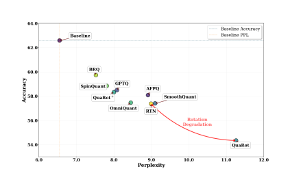
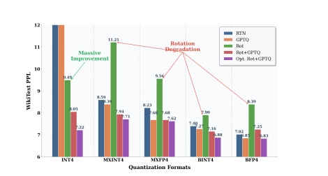
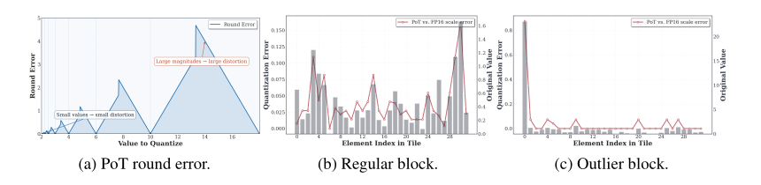
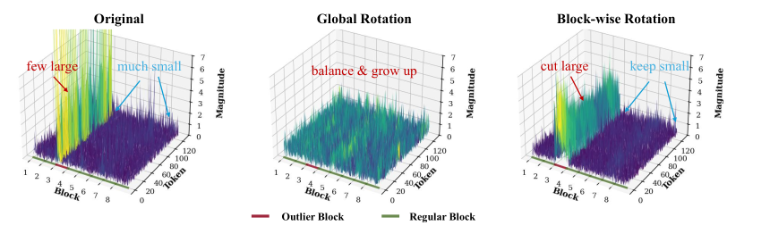
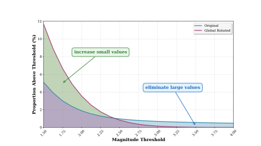
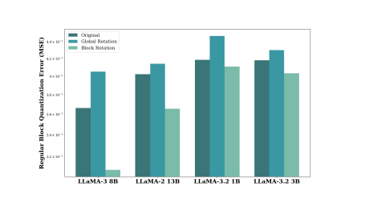
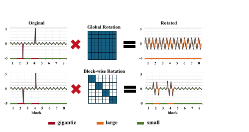
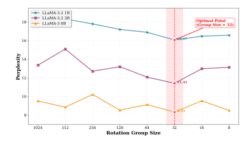
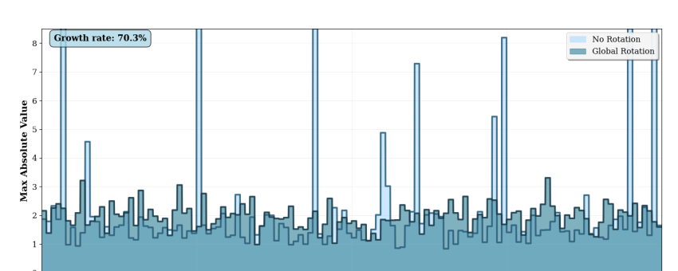
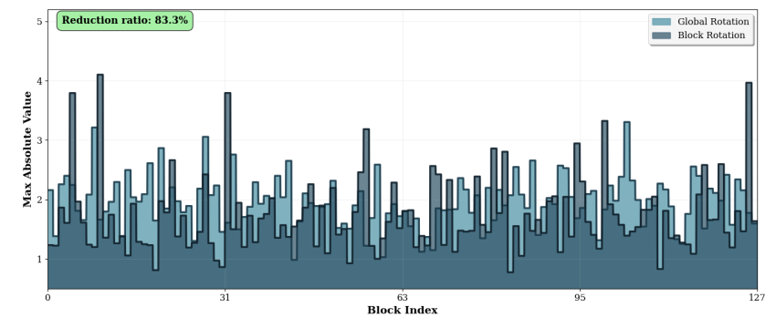

**中文翻译（复述，非逐字翻译）**：Block Rotation is All You Need for MXFP4 Quantization（arXiv:2511.04214v1，BRQ）。以下按原文章节顺序用自己的话复述，表格数字与公式保持原样；原文版权归作者所有（arXiv 非独占许可）。

# 面向 MXFP4 量化，分块旋转就够了

作者：Yuantian Shao、Peisong Wang（通讯）、Yuanteng Chen、Chang Xu、Zhihui Wei、Jian Cheng（南京理工大学、中科院自动化所、中国科学院大学、悉尼大学等）。

## 摘要

大语言模型规模暴涨，带来了内存、算力和能耗上的沉重负担。训练后量化（PTQ）是一条很有希望的部署路线，但要把权重和激活都压到 4 bit（W4A4）并保持精度，仍然没解决。现有方法大多是为 INT4 设计的，而 MXFP4（一种 FP4 格式，NVIDIA、AMD、Intel 的硬件都开始支持）的出现，让人怀疑这些方法还适不适用。

本文先在 MXFP4 下建立了一个较完整的 PTQ 基准。系统评测发现：GPTQ 这类方法一直表现不错；而几乎所有当前最优方法都在用的旋转类方法，却与 MXFP4 严重不兼容。作者首次深入分析了这一冲突，把根源归结为：MXFP4 的 PoT（2 的幂）块缩放，与全局旋转把离群值能量摊到所有通道之间，存在根本性的错配。基于这一认识，作者提出一种简单有效的分块旋转策略，让旋转类方法适配 MXFP4，在多种 LLM 上带来明显的精度提升。研究结果既给从业者提供了清晰指引，也为新兴低精度格式下的 PTQ 研究打下基础。

## 1 引言

LLM 已成为现代 AI 的基石，但规模越来越大，内存、计算、能耗成本都很高。众多压缩技术中，PTQ 因为免训练、工程开销小而被广泛采用。INT8、INT4 量化已有实际应用，但 W4A4 仍是难题：对近期较新的模型（例如 LLaMA-3.2 1B/3B），朴素的 4 bit 量化会造成严重的性能退化，因此 W4A4 是高效部署的重要前沿。

与此同时，硬件的进步催生了微缩放（MX）数据格式家族，MXFP4 是其中之一。它是 OCP（开放计算项目）提出的开放标准，目前 AMD Ryzen AI MAX+ 395、Nvidia RTX 5090/B200 等都已支持。相比 INT4，FP4 更适合处理长尾分布；共享的块缩放因子既扩展了可表示的动态范围，又限制了离群值的影响范围。它不仅能用于推理，也能用于低精度训练，还能在 Apple M 系列、NVIDIA Ampere/Ada GPU 和常见 x86 CPU 上高效模拟或转换，软硬件兼容面很广。据作者所知，openai/gpt-oss 是第一个原生支持 FP4 的 LLM，用的就是 MXFP4，说明这一格式在未来低精度格式中的重要性。

现有 W4A4 方法主要为 INT4 设计，且评测时数据集、量化设置、模拟方式各不相同，所以从业者并不清楚怎么把它们用到 MXFP4 上。为此，作者把已有 PTQ 方法分成三类：(1) 补偿类，(2) 变换类，(3) 优化类，并在 MXFP4 下对每类的代表方法做了细致对比。评测挑出了真正有明显提升的方法，也暴露出旋转类技术与 MXFP4 的不兼容。

作者进一步追问：为什么旋转加 MXFP4 会导致性能崩塌？据其所知这是首次对该问题的深入研究。根本原因是一个错配：MXFP4 靠共享的 PoT 块缩放来压制离群值，而旋转方法则是把离群值的能量分散到所有通道。据此作者提出分组旋转策略，可以很容易地并入现有旋转方案，显著提升 MXFP4 下的 PTQ 精度。

主要贡献：

- 建立了 MXFP4 格式下的 W4A4 量化基准，系统归类现有 PTQ 方法，对代表性方法做了详细评测，并指出它们在新格式下的局限。
- 深入研究了 MXFP4 下的旋转类方法，指出破坏性的相互作用根本上来自两件事叠加：PoT 缩放无法恢复块内的大值，而全局旋转又放大了原本较小的值。
- 提出分块旋转量化（Block-wise Rotation Quantization，BRQ），让旋转方法适配 MXFP4，可无缝并入现有旋转方案，在多个模型和任务上显著提升 MXFP4 PTQ 精度。

## 2 PTQ 方法分类

本文只关注完全量化的 W4A4 PTQ，排除混合精度方案，以保证 MXFP4 下评测公平一致。作者把现有低比特 PTQ 方法分成三类：补偿类、变换类、优化类。

### 2.1 补偿类方法

这类方法通过调整已量化的权重，来修正低比特带来的扰动，从而降低量化误差。代表是 GPTQ：它按列对权重矩阵做离线优化，利用 Hessian 的二阶信息近似做精确补偿，显著降低整体量化损失。后续方法沿着这个思路扩展：BoA 引入了关注注意力的 Hessian；RSQ 做逐 token 加权；QuantEase 用坐标下降做前向重构；VPTQ 把向量量化与逐通道独立的二阶优化结合；APTQ 用 Hessian 的迹来指导选择性的混合精度量化。

这些方法的共同点是显式纠错，对基于 Transformer 的 LLM 尤其有效，特别是对低比特扰动敏感的、注意力密集的模块。

### 2.2 变换类方法

低比特下，离群值会显著放大量化误差。精心设计的等价变换可以重新分布或重塑数据，削弱极值的影响。SmoothQuant 做平滑变换，把激活中的大离群值转移到相应的权重缩放上；QServe 沿类似原理，把渐进式低比特量化、系统级优化与 SmoothAttention 结合，在保持模型精度的同时提升推理吞吐；QuIP 引入非相干处理，使权重和激活空间里离群值的贡献去相关；QuIP# 进一步用随机 Hadamard 变换提升计算效率，增强正交性并降低通道间相干性；QuaRot 与 DuQuant 则利用旋转变换把离群值摊到幅值较小的激活子空间或多个通道中，降低对低比特表示的敏感性，提高重构精度。

这类方法对激活方差大或极端离群值明显的模块尤其有效，也是优化类方法的基础。

### 2.3 优化类方法

由于手工设计等价变换很难，一些工作把这些变换参数化为可学习变量，放在模型里优化以获得更高性能。OmniQuant 引入可学习的权重裁剪和等价变换，取得更好的 W4A4 表现；SpinQuant 表明，优化旋转矩阵比随机变换更能分散权重离群值，在极低比特下显著降低量化误差；AffineQuant 与 FlatQuant 把仿射变换用于同时调整权重和激活，把分布拉平以减轻离群值影响并简化优化；KurTail 利用基于峰度的旋转来缓解 LLM 激活中的离群值，实现高保真低比特量化。

总体上，优化类方法能充分利用梯度信息，在严格的低比特约束下自适应调整权重与激活，在低比特场景中接近最优精度。

## 3 基准与分析

为了检验现有 PTQ 算法是否真正用好了 MXFP4，作者建立了一个较全面的基准。本节不提新技术，只客观评测三类中的代表方法：在不同规模的模型上测试 7 种最先进方法，对各模型的困惑度和下游准确率求平均，汇总在图 1 和图 2 中。这个基准为比较提供了公平基础，并揭示了促使后续改进的关键局限。

### 3.1 实验设置

所有实验在 NVIDIA A800 GPU 服务器上进行，MX 格式量化使用微软开源仓库 microsoft/microxcaling 来模拟。

**方法选择。** 从第 2 节的三类各挑代表方法。补偿类选 GPTQ；变换类选 SmoothQuant 和 QuaRot，并区分 QuaRot 的两个变体：QuaRot 是随机旋转加 RTN，QuaRot+ 是随机旋转加 GPTQ，以便分别看单独随机旋转的作用以及与 GPTQ 结合的作用；优化类选 OmniQuant 和 SpinQuant，分别代表参数优化和端到端旋转优化。另外，用块大小 32、FP16 缩放的 RTN INT4 作为朴素基线（BINT4）。

**模型。** 在多个主流 LLM 上评测，包括 LLaMA-2 7B/13B、LLaMA-3 8B、LLaMA-3.2 1B/3B 和 Mistral-7B，覆盖不同规模和架构，为量化研究提供了稳健的试验场。

**数据集与指标。** 用 WikiText2 的困惑度（PPL）作为语言建模质量的代理指标，并在五个零样本下游任务上测准确率：PIQA、WinoGrande、OpenBookQA、ARC-Easy、ARC-Challenge。

### 3.2 评测结果

表 1 显示，MXFP4 RTN 相比 FP16 精度大幅下降，甚至不如 BINT4 基线。说明尽管 MXFP4 的硬件优势明显，在其上做 PTQ 依然很有挑战，也再次说明有必要系统评估现有 PTQ 方法在 MXFP4 上的表现。

**表 1：** 多个 LLM 在 FP16、BINT4、MXFP4 量化下的 WikiText 困惑度（Wiki）与零样本平均准确率（Avg.）对比。QuaRot+ 表示与 GPTQ 算法结合的变体。（原文用黑色粗体标最好、灰色粗体标最差；此处略去格式。详细结果见附录 A.5。）

| Method | LLaMA-2 7B Wiki | Avg. | LLaMA-2 13B Wiki | Avg. | LLaMA-3 8B Wiki | Avg. | LLaMA-3.2 1B Wiki | Avg. | LLaMA-3.2 3B Wiki | Avg. | Mistral 7B Wiki | Avg. |
|---|---|---|---|---|---|---|---|---|---|---|---|---|
| FP16 | 5.47 | 62.59 | 4.88 | 64.89 | 6.14 | 65.85 | 9.75 | 53.81 | 7.81 | 61.60 | 5.25 | 66.73 |
| BINT4 | 5.94 | 61.30 | 5.16 | 63.32 | 7.40 | 63.12 | 13.56 | 48.36 | 9.29 | 57.47 | 5.63 | 65.28 |
| RTN | 7.08 | 57.26 | 5.90 | 61.40 | 8.23 | 60.61 | 15.91 | 46.89 | 10.27 | 55.22 | 6.56 | 62.86 |
| GPTQ | 6.56 | 59.27 | 5.41 | 62.91 | 7.68 | 61.48 | 13.35 | 48.52 | 9.50 | 55.40 | 6.00 | 63.34 |
| SmoothQuant | 7.04 | 57.18 | 5.73 | 61.52 | 8.11 | 61.22 | 16.86 | 46.48 | 10.38 | 55.05 | 6.49 | 62.96 |
| QuaRot | 13.09 | 50.32 | 7.03 | 59.09 | 9.56 | 59.26 | 17.86 | 45.42 | 13.36 | 51.60 | 6.65 | 60.33 |
| QuaRot+ | 6.29 | 58.35 | 5.57 | 61.57 | 7.68 | 61.57 | 12.78 | 48.83 | 9.92 | 55.91 | 5.73 | 63.66 |
| OmniQuant | 6.56 | 56.67 | 5.43 | 61.89 | 8.16 | 60.47 | 14.32 | 48.17 | 9.85 | 55.76 | 6.37 | 61.82 |
| SpinQuant | 5.99 | 59.24 | 5.20 | 62.78 | 7.62 | 61.93 | 12.72 | 49.09 | 9.85 | 56.19 | 5.68 | 63.79 |

此外，大多数方法直接用在 MXFP4 上都有一定改善。GPTQ 表现突出，稳定地带来明显收益，在某些模型上甚至超过 BINT4（如 LLaMA-3.2 1B：15.91/46.89 → 13.35/48.52）。其他方法则不太可靠：OmniQuant 在小模型（LLaMA-3.2 1B/3B）上需要仔细调超参才能稳定优化，但仍不及 GPTQ（原文写为 LLaMA 3.2 1B 的 PPL 14.32 对 3.35，按表 1 应为 13.35，疑为笔误）；SmoothQuant 只有边际收益，甚至可能有害，说明在 MXFP4 的缩放机制下，模型对参数幅值格外敏感。

最令人意外的是旋转类方法。QuaRot 配 RTN 会导致灾难性退化（如 LLaMA-2 7B：7.08/57.26 → 13.09/50.32）；即使和 GPTQ 结合，收益也不稳定且有限。这说明随机旋转与 MXFP4 在结构上不兼容，而这种破坏性相互作用的根源此前并未被充分讨论。SpinQuant 利用直通估计器（STE）做端到端优化，使旋转能自适应对齐 MXFP4 的非均匀缩放；这种强制优化确实在一定程度上缓解了不兼容，但相比 QuaRot+ 只带来边际提升（如 Mistral 7B：5.73/63.66 → 5.68/63.79），说明仅靠优化不能完全解决兼容问题。

考虑到旋转在 INT4 量化中的关键作用，作者还考察了它在其他常用量化格式下的影响。图 2 给出旋转及其变体在 INT4（权重逐通道对称量化、激活逐 token 非对称量化）、BINT4、BFP4（BINT4 的 FP4 版本）以及 MXINT4 与 MXFP4 下的结果。主要发现如下。





- **A. INT4 从旋转中受益很大。** 在被广泛研究的 INT4 设置下，仅用旋转就有显著提升；再配合 GPTQ 或旋转优化，收益进一步放大，说明旋转对分布均匀的整数格式特别有效。
- **B. 不用旋转时，FP4 格式优于 INT4。** 不用旋转时，BFP4 和 MXFP4 稳定地比 BINT4 和 MXINT4 好，说明 FP4 更宽的动态范围和更灵活的表示更适合 4 bit 量化。
- **C. 随机旋转会损害分组格式。** 与 INT4 相反，分组量化格式（BINT4、BFP4、MXINT4、MXFP4）在随机旋转下性能下降，在 MX 类格式上尤为明显，甚至会低于简单的 RTN。
- **D. FP16 缩放与 PoT 缩放行为分化。** 对 FP16 缩放的格式，旋转后 BINT4 优于 BFP4；而对 PoT 缩放的格式，MXFP4 不如其 FP16 缩放的对应物，旋转还会放大这一差距。
- **E. MX 格式的 PoT 缩放带来额外损失。** 把 MXINT4/MXFP4 与其 FP16 缩放对应的 BINT4/BFP4 比较，PoT 缩放一致地带来更大的量化误差，旋转之后更为严重。
- **F. 优化后的旋转在 MXFP4 上仍有限。** 优化旋转加 GPTQ 确实改善了 MXFP4，但最终结果仍落后于可比配置下的 INT4。

总的来说，结果显示出鲜明的分歧：旋转及其变体能稳定增强 INT4，却无法推广到 MXFP4；尤其是旋转与 MXFP4 分块 PoT 缩放的相互作用，导致了独特的退化模式。这就引出一个关键问题：为什么一项在 INT4 中本质上有益的技术，到了 MXFP4 却有害？为回答它，下一节深入分析 MXFP4 的结构特性及其与旋转变换的破坏性相互作用。

## 4 为什么旋转变换会损害 MXFP4

旋转变换在 INT4 上很成功，却在 MXFP4 下降低了量化精度。要弄清原因，作者先剖析 MXFP4 独特的性质与固有局限，再分析旋转如何重塑模型数据分布，综合两方面找到冲突的根源，并据此提出实用的解决办法。

### 4.1 MXFP4 块内大值恢复能力有限

MXFP4 的每个数值采用 E2M1 格式：1 位符号、1 位尾数、2 位指数。它做对称的逐组量化，组大小固定为 32，每组配一个 E8M0（PoT）缩放因子，由硬件直接支持。由于粒度更细，加上 FP4 的非均匀表示，MXFP4 的量化信噪比（QSNR）远高于逐张量或逐通道的 INT4，因此能更好地逼近全精度值。



图 2 表明，BFP4 与 MXFP4 因缩放格式不同会有明显的性能差距。为进一步研究两种缩放的差异，作者把量化块分成两类：不含离群值的“正常块”（regular block）和含有一个或多个离群值的“离群块”（outlier block）。图 3b、3c 展示了两类块中 MXFP4 相对 BFP4 的量化误差。无论哪类块，误差都随元素幅值增大而增大；尤其在离群块里，离群值的量化损失可达正常块最大损失的约五倍。这主要是因为 PoT 格式在大幅值处粒度很粗，会放大表示大数值时的舍入误差（见图 3a）。

总结来说，MXFP4 的主要瓶颈是它在块内重构大值的能力有限，且重构误差随幅值急剧增长。因此，要提升 MXFP4 的表现，最终取决于能否有效降低这些大值。

### 4.2 旋转导致小值变大

W4A4 量化中，性能下降的主要来源是激活的量化误差。为研究旋转类变换与 MXFP4 的兼容问题，作者细致分析了旋转前后的激活分布。



如图 4 所示，传统旋转方法用旋转矩阵把原本集中在少数通道的离群值重新分散到所有维度，以此降低量化误差。但旋转并不减少总能量，激活的 L2 范数保持不变：原离群通道的能量并没有消失，而是被分摊到之前数值较小的通道，使这些通道被放大。为验证这一点，作者从 LLaMA-3 8B 采样了 2048 个激活，分析旋转后的分布变化（图 5）。结果显示，旋转基本消除了约 1% 超过 3 的激活（对应图中蓝色区域），但代价是大幅增加了大于 1.5 的激活比例（旋转前约 5%，旋转后约 11%，对应图中绿色区域）。这清楚地说明旋转会放大小值块。





综合上述观察，作者把旋转与 MXFP4 不兼容的原因归结为如下破坏性相互作用：

- 全局旋转放大了正常块的缩放，使其更难量化；
- MXFP4 块内对大值的重构较差，进一步加剧了这些被放大的正常块的量化误差；
- 正常块的数量远多于离群块，误差累积后占主导，最终使旋转后整体量化损失大幅上升。

为验证这一推断，作者在不同模型上测量了全局旋转前后正常块的平均量化误差。如图 6 所示，旋转后正常块的量化损失显著增加，有力支持了这一猜想。由于正常块远多于离群块，这种不平衡最终导致全局旋转下 MXFP4 的量化精度崩塌。

### 4.3 修复 MXFP4 中的旋转



为缓解旋转与 MXFP4 块级 PoT 缩放之间的不兼容，作者提出分块旋转策略：在每个量化块内独立做旋转变换（图 7）。全局旋转会把离群值混到所有通道；分块旋转则把激活切成固定大小的组（与 MXFP4 块对齐，如 32 个通道），在每组内独立做正交变换。这样既保留了旋转的去噪效果，又避免了全局混合造成的小值通道被过度放大。

形式化地，设线性层的激活向量为 $`x\in\mathbb{R}^{N}`$ ，划分为 $`B`$ 个大小为 $`g`$ 的块，满足 $`N=B\times g`$ 。分块旋转构造一个块对角矩阵：

```math
R_{\mathrm{block}}=\mathrm{diag}(R_{1},R_{2},\ldots,R_{B}),\quad R_{i}\in\mathbb{R}^{g\times g},\;R_{i}^{\top}R_{i}=I.
```

（式 1）

相比全局旋转，分块旋转有以下优点：

- **抑制离群值：** 各块内独立旋转，能把原本集中在少数通道的离群值重新分散；这种离散化避免单个离群值主导量化过程，从而降低离群块的量化误差。
- **量化误差可控：** 每块独立旋转，小值通道被放大的现象被限制在块内，避免误差跨块传播，使正常块的量化损失保持可控，而这正是全局旋转的关键问题。
- **在线计算减少：** 分块旋转大幅减少 $`down_{proj}`$ 层之前 $`R_{4}`$ 的在线计算。输入维度为 $`N`$ 时，全局旋转的复杂度为 $`O(N^{2})`$ ，分块旋转降为 $`O(N\times 32)`$ 。这不仅提升计算效率，也便于大规模部署旋转类量化。

## 5 实验

本节使用与第 3 节相同的测试集和超参数评估 BRQ，对比 GPTQ、QuaRot+、SpinQuant、RTN 和 BINT4。除 LLaMA 与 Mistral 外，还加入了 Qwen 模型的评测。

### 5.1 主要结果

**表 2：** BRQ（随机分块旋转）与现有不做优化的 PTQ 方法的性能对比。LLaMA-2 7B/13B/70B 与 Qwen2.5 7B 的结果见附录 A.3 / A.5。

| Method | LLaMA 3 8B Wiki | Avg | LLaMA 3.2 1B Wiki | Avg | LLaMA 3.2 3B Wiki | Avg | Mistral 7B Wiki | Avg | Qwen2.5 1.5B Wiki | Avg | Qwen2.5 3B Wiki | Avg |
|---|---|---|---|---|---|---|---|---|---|---|---|---|
| FP16 | 6.14 | 65.85 | 9.75 | 53.81 | 7.81 | 61.60 | 5.25 | 66.73 | 9.87 | 58.83 | 8.03 | 61.91 |
| BINT4 | 7.40 | 63.12 | 13.56 | 48.36 | 9.29 | 57.47 | 5.63 | 65.28 | 13.98 | 53.98 | 10.32 | 58.03 |
| RTN | 8.23 | 60.61 | 15.91 | 46.89 | 10.27 | 55.22 | 6.56 | 62.86 | 16.61 | 52.69 | 11.03 | 57.77 |
| GPTQ | 7.68 | 61.48 | 13.35 | 48.52 | 9.50 | 55.40 | 6.00 | 63.34 | 13.94 | 53.13 | 10.20 | 58.23 |
| QuaRot+ | 7.68 | 61.57 | 12.78 | 48.83 | 9.92 | 55.91 | 5.73 | 63.66 | 12.80 | 53.50 | 9.65 | 58.27 |
| BRQ | 7.14 | 63.54 | 11.95 | 49.87 | 9.41 | 56.88 | 5.59 | 64.19 | 12.15 | 54.83 | 9.48 | 59.68 |

表 2 是把分块随机 Hadamard 旋转与 GPTQ 结合、在 MXFP4 下的结果。相比 QuaRot+ 的全局旋转，BRQ 提升明显，除 LLaMA-3.2 3B 外在所有情形都超过了强基线 BINT4。在更难的 LLaMA-3.2 1B 和 Qwen2.5 1.5B 上，BRQ 把困惑度从 12.78/12.80 降到 11.95/12.15，下游任务准确率从 48.83/53.50 升到 49.87/54.83。这些结果证实分块旋转是让旋转类方法与 MXFP4 协调工作的关键，也印证了第 4 节的分析。

**表 3：** 优化后的分块旋转（BRQ Spin）、随机分块旋转（BRQ）与优化后的全局旋转（SpinQuant）的性能对比。

| Method | LLaMA 3 8B Wiki | Avg | LLaMA 3.2 1B Wiki | Avg | LLaMA 3.2 3B Wiki | Avg | Mistral 7B Wiki | Avg | Qwen2.5 1.5B Wiki | Avg | Qwen2.5 3B Wiki | Avg |
|---|---|---|---|---|---|---|---|---|---|---|---|---|
| FP16 | 6.14 | 65.85 | 9.75 | 53.81 | 7.81 | 61.60 | 5.25 | 66.73 | 9.87 | 58.83 | 8.03 | 61.91 |
| SpinQuant | 7.62 | 61.93 | 12.72 | 49.09 | 9.85 | 56.19 | 5.68 | 63.79 | 12.64 | 53.57 | 9.58 | 59.09 |
| BRQ | 7.14 | 63.54 | 11.95 | 49.87 | 9.41 | 56.88 | 5.59 | 64.19 | 12.15 | 54.17 | 9.48 | 59.68 |
| BRQ Spin | 7.13 | 63.39 | 11.93 | 50.00 | 9.08 | 57.29 | 5.57 | 64.26 | 11.95 | 55.07 | 9.46 | 59.65 |

接着评估优化分块旋转矩阵的收益。表 3 对比 SpinQuant、随机分块旋转的 BRQ，以及在 SpinQuant 框架内优化分块旋转的 BRQ Spin。沿用 SpinQuant 的设置，采用 Cayley Adam 优化器，使用 Wikitext2 中 800 条长 2048 的序列。

即使不做优化，BRQ 也已超过使用优化全局旋转的 SpinQuant。例如在 LLaMA-3 8B 上，BRQ 把困惑度从 7.68（原文如此；表 3 中 SpinQuant 为 7.62）降到 7.14，同时也优于 BINT4（7.40）；下游准确率从 SpinQuant 的 61.93 升至 63.54，把误差差距缩小了 41%。其他模型上趋势类似。考虑到 SpinQuant 的优化成本很高，BRQ 无需优化就能取得更好的结果，对实际部署更实用。

此外，优化还能带来进一步收益：LLaMA-3.2 3B 的困惑度从随机分块旋转的 9.41 降到优化后的 9.08，明显好于 SpinQuant 的 9.85。但对 LLaMA-3 8B 和 Mistral 7B 等许多模型，提升仍然有限。这些发现既显示了 BRQ 与现有框架的兼容性，也提示 SpinQuant 的优化方案可能存在局限。

### 5.2 旋转维度的影响



为进一步验证旋转维度与 MXFP4 的匹配，图 8 给出 LLaMA-3 8B 与 LLaMA-3.2 1B/3B 在不同旋转维度下的 PPL。可以看到：旋转维度越大，离群值的影响越被放大，总体损失增加；维度越小，则可分散的通道不足。当旋转维度恰好等于 MXFP4 块大小时 PPL 最佳，与第 4 节的分析一致。

### 5.3 性能分析

**表 4：** LLaMA-2 7B 在不同序列长度与批大小下的预填充（prefill）延迟（ms）。开销是相对 MXFP4 计算的。

| Batch | Method | SeqLen 512 Latency | Overhead | SeqLen 1024 Latency | Overhead | SeqLen 2048 Latency | Overhead | SeqLen 4096 Latency | Overhead |
|---|---|---|---|---|---|---|---|---|---|
| 1 | MXFP4 | 243.09 | - | 339.31 | - | 584.31 | - | 1274.84 | - |
| 1 | QuaRot | 260.18 | 7.03% | 362.91 | 6.96% | 618.43 | 5.84% | 1334.03 | 4.64% |
| 1 | BRQ | 253.35 | 4.22% | 353.30 | 4.12% | 604.25 | 3.41% | 1307.10 | 2.53% |
| 8 | MXFP4 | 732.34 | - | 1444.37 | - | 3449.58 | - | 8699.71 | - |
| 8 | QuaRot | 789.13 | 7.75% | 1547.36 | 7.13% | 3646.83 | 5.72% | 9032.39 | 3.82% |
| 8 | BRQ | 763.72 | 4.28% | 1499.30 | 3.80% | 3554.16 | 3.03% | 8816.30 | 1.34% |

实现基于 PyTorch 与 CUDA 12.4，MXFP4 量化用 microsoft/microxcaling。本节在 NVIDIA A800 上比较 BRQ 与 QuaRot 在预填充和解码两个阶段的性能。

表 4 报告了 LLaMA-2 7B 的预填充速度。正如预期，BRQ 的分块旋转大幅减少了在线旋转计算：相比 QuaRot，BRQ 把旋转带来的额外推理延迟降低了 40%，让旋转类量化更实用。注意 A800 并不原生支持 FP4 推理，在专用 MXFP4 硬件上推理速度还会进一步提升。

## 6 结论与未来工作

本文在 MXFP4 格式下对有代表性的 INT4 PTQ 算法做了基准评测，系统揭示了现有方法在这一硬件友好格式下的局限。作者分析了 MXFP4 与旋转类方法的不兼容，指出冲突在于分块量化与旋转引起的能量重分布，并被 MXFP4 的 PoT 缩放进一步放大。为此提出 BRQ，使旋转适配 MXFP4，解决了兼容问题并显著提升了 PTQ 性能。

未来计划探索更好的旋转矩阵优化方案，并研究：用优化后的分块旋转替换在线快速 Hadamard 变换 $`R_{4}`$ ，能否在谨慎平衡推理延迟的同时进一步提升精度。作者希望这项工作能为在下一代低比特浮点硬件上部署大语言模型提供理论洞见和实用指导。

## 参考文献

原文列出约 45 条参考文献，此处仅概述（均为论文中引用的相关工作）：量化算法类有 GPTQ、SmoothQuant、QuaRot、QuIP、QuIP#、SpinQuant、OmniQuant、AffineQuant、FlatQuant、DuQuant、KurTail、BoA、RSQ、QuantEase、VPTQ、APTQ、QServe、FPTQuant；格式与硬件类有 OCP MX 规范 v1.0、微软 microxcaling 仓库、AMD Quark、NVIDIA TensorRT-LLM、OpenAI gpt-oss、AMXFP4、BCQ、BBAL、MX 共享微指数（Darvish Rouhani 等）；评测数据集类有 PIQA、WinoGrande、OpenBookQA、ARC；其余为 LLM8.int8 离群值研究、Cayley 变换 Stiefel 流形优化，以及若干关于 LLM 压缩与离群值的综述。

## 附录 A

### A.1 LLM 的使用

作者说明，论文文字曾借助 LLM 做专业润色，以提升清晰度、连贯性和学术写作规范。

### A.2 实验细节

本节给出基准中各方法的详细超参数设置以便复现。所有方法都以 WikiText2 作为校准数据集，在 NVIDIA A800 GPU 上进行。

- **GPTQ：** 用 128 条长 2048 的序列校准；Hessian 估计的阻尼参数设为 0.01，遵循原作者推荐。
- **SmoothQuant：** 用 512 条长 512 的序列校准激活缩放；平滑系数 $`\alpha`$ 取 0.85，与官方仓库一致。
- **OmniQuant：** 用 128 条长 2048 的序列校准，对可学习权重裁剪和等价变换做优化。
- **SpinQuant：** 用 800 条长 2048 的序列校准，用 Cayley SGD 优化器训练旋转矩阵。

### A.3 在 70B 模型上的应用

为考察 BRQ 在更大模型上的效果，作者在 LLaMA-2 70B 上做了对比实验。如表 5 所示，BRQ 在该规模上依然稳定优于现有方法。特别是相对同样使用随机 Hadamard 变换的 QuaRot，BRQ 把 LLaMA-2 70B 的困惑度从 3.76 降到 3.62，平均下游准确率从 68.86 提升到 69.10。由于服务器内存限制，SpinQuant 无法在 70B 上运行，所以没有它的结果。这些结果进一步证明 BRQ 对大规模模型有效。

**表 5：** 不同量化方法在 LLaMA-2 70B 上的性能。

| Method | WiKi | WG | PIQA | OBQA | ARC-E | ARC-C | Avg |
|---|---|---|---|---|---|---|---|
| FP16 | 3.32 | 77.97 | 82.75 | 48.80 | 81.01 | 57.50 | 69.61 |
| RTN | 4.20 | 75.92 | 80.90 | 46.00 | 78.53 | 53.32 | 66.93 |
| GPTQ | 3.79 | 75.37 | 80.84 | 48.00 | 79.92 | 54.60 | 67.75 |
| QuaRot+ | 3.76 | 77.66 | 81.82 | 47.80 | 79.75 | 57.25 | 68.86 |
| BRQ | 3.62 | 77.68 | 82.54 | 47.60 | 80.30 | 57.40 | 69.10 |

### A.4 旋转对比

图 9 展示了块级缩放分布（定义为每块内绝对值最大值）在原始激活和全局旋转后的变化。原始激活中只有一小部分块含有离群值，大多数块的缩放相对较小。全局旋转后，虽然突出的离群值被缓解，但超过 70% 的正常块的缩放大幅增加。这种对正常块缩放的放大，正是全局旋转后 MXFP4 量化性能崩塌的根本原因。





作者进一步分析了图 10 中缩放显著增长的那些块，评估分块旋转对它们的影响（原文此处写作“图 8”，应指图 10）。对比全局旋转与分块旋转下的缩放分布可见，分块旋转缓解了全局旋转造成的缩放膨胀的 80% 以上（图中标注为 83.3%）。这有力证明了分块旋转能有效缓解全局旋转引起的量化退化。

### A.5 详细结果

本节给出正文实验的详细结果。注意，这些实验中 BRQ 使用分块随机 Hadamard 矩阵做旋转，不对旋转矩阵做任何额外优化。

#### A.5.1 LLaMA 系列结果

以下是表 1 和表 2 中 LLaMA 系列模型的详细结果。

**表 6：** LLaMA-2 7B 上不同方法在多个基准上的评测。

| Method | WiKi | WG | PIQA | OBQA | ARC-E | ARC-C | Avg |
|---|---|---|---|---|---|---|---|
| Baseline | 5.47 | 68.98 | 79.05 | 44.20 | 74.57 | 46.16 | 62.59 |
| BINT4 | 5.94 | 68.19 | 76.93 | 43.00 | 73.65 | 44.71 | 61.30 |
| RTN | 7.08 | 64.80 | 76.39 | 39.20 | 65.70 | 40.19 | 57.26 |
| SmoothQuant | 7.04 | 64.64 | 76.17 | 39.00 | 66.75 | 39.33 | 57.18 |
| GPTQ | 6.56 | 66.61 | 76.55 | 40.60 | 71.12 | 41.46 | 59.27 |
| OmniQuant | 6.56 | 63.06 | 76.33 | 36.60 | 67.09 | 40.27 | 56.67 |
| QuaRot | 13.09 | 59.11 | 71.21 | 34.40 | 55.05 | 31.82 | 50.32 |
| QuaRot+ | 6.29 | 67.24 | 75.68 | 39.80 | 69.02 | 40.01 | 58.35 |
| SpinQuant | 5.99 | 66.14 | 77.69 | 40.40 | 70.58 | 41.38 | 59.24 |
| BRQ | 5.84 | 67.09 | 76.77 | 44.80 | 73.23 | 43.17 | 61.01 |

**表 7：** LLaMA-3 8B 上不同方法在多个基准上的评测。

| Method | WiKi | WG | PIQA | OBQA | ARC-E | ARC-C | Avg |
|---|---|---|---|---|---|---|---|
| Baseline | 6.14 | 73.16 | 80.57 | 44.80 | 77.56 | 53.15 | 65.85 |
| BINT4 | 7.40 | 70.40 | 78.94 | 43.60 | 73.95 | 48.72 | 63.12 |
| RTN | 8.23 | 67.56 | 77.31 | 41.80 | 70.74 | 45.64 | 60.61 |
| SmoothQuant | 8.11 | 67.88 | 78.29 | 43.60 | 71.00 | 45.31 | 61.22 |
| GPTQ | 7.68 | 70.48 | 76.06 | 42.00 | 73.23 | 45.64 | 61.48 |
| OmniQuant | 8.16 | 66.06 | 77.20 | 40.60 | 72.85 | 45.65 | 60.47 |
| QuaRot | 9.56 | 67.71 | 75.57 | 41.60 | 69.02 | 42.40 | 59.26 |
| QuaRot+ | 7.68 | 68.16 | 75.36 | 42.80 | 72.66 | 48.89 | 61.57 |
| SpinQuant | 7.62 | 69.56 | 76.93 | 42.00 | 72.90 | 48.25 | 61.93 |
| BRQ | 7.14 | 71.98 | 78.51 | 42.60 | 75.04 | 49.57 | 63.54 |

**表 8：** LLaMA-2 13B 上不同方法在多个基准上的评测。

| Method | WiKi | WG | PIQA | OBQA | ARC-E | ARC-C | Avg |
|---|---|---|---|---|---|---|---|
| Baseline | 4.88 | 72.13 | 80.52 | 45.20 | 77.44 | 49.14 | 64.89 |
| BINT4 | 5.16 | 72.06 | 78.84 | 43.20 | 75.55 | 46.93 | 63.32 |
| RTN | 5.90 | 69.45 | 77.25 | 42.60 | 72.64 | 45.05 | 61.40 |
| SmoothQuant | 5.73 | 69.14 | 77.37 | 42.40 | 72.98 | 45.73 | 61.52 |
| GPTQ | 5.41 | 70.56 | 78.56 | 44.40 | 75.04 | 45.98 | 62.91 |
| OmniQuant | 5.43 | 68.43 | 78.29 | 42.00 | 74.58 | 46.16 | 61.89 |
| QuaRot | 7.03 | 65.43 | 76.87 | 40.20 | 71.08 | 41.89 | 59.09 |
| QuaRot+ | 5.57 | 67.79 | 78.18 | 40.60 | 74.62 | 46.67 | 61.57 |
| SpinQuant | 5.20 | 68.98 | 78.45 | 42.80 | 75.63 | 48.04 | 62.78 |
| BRQ | 5.19 | 70.48 | 79.27 | 43.20 | 75.76 | 47.56 | 63.25 |

**表 9：** LLaMA-3.2 1B 上不同方法在多个基准上的评测。

| Method | WiKi | WG | PIQA | OBQA | ARC-E | ARC-C | Avg |
|---|---|---|---|---|---|---|---|
| Baseline | 9.75 | 60.61 | 74.53 | 37.20 | 60.47 | 36.26 | 53.81 |
| BINT4 | 13.56 | 54.78 | 69.26 | 34.80 | 52.74 | 30.20 | 48.36 |
| RTN | 15.91 | 54.30 | 66.10 | 32.80 | 50.37 | 30.88 | 46.89 |
| SmoothQuant | 16.86 | 55.72 | 66.27 | 30.60 | 50.55 | 29.27 | 46.48 |
| GPTQ | 13.35 | 56.66 | 69.58 | 32.40 | 52.48 | 31.48 | 48.52 |
| OmniQuant | 14.32 | 55.09 | 68.12 | 32.80 | 53.37 | 31.48 | 48.17 |
| QuaRot | 17.86 | 55.40 | 66.05 | 29.40 | 47.93 | 28.32 | 45.42 |
| QuaRot+ | 12.78 | 56.74 | 69.85 | 32.60 | 53.42 | 31.56 | 48.83 |
| SpinQuant | 12.72 | 55.38 | 70.67 | 33.00 | 53.87 | 32.51 | 49.09 |
| BRQ | 11.95 | 55.88 | 70.46 | 34.20 | 55.47 | 33.36 | 49.87 |

**表 10：** LLaMA-3.2 3B 上不同方法在多个基准上的评测。

| Method | WiKi | WG | PIQA | OBQA | ARC-E | ARC-C | Avg |
|---|---|---|---|---|---|---|---|
| Baseline | 7.81 | 69.37 | 77.52 | 43.40 | 71.63 | 46.07 | 61.60 |
| BINT4 | 9.29 | 64.64 | 75.19 | 38.60 | 66.50 | 42.41 | 57.47 |
| RTN | 10.27 | 63.93 | 73.06 | 40.00 | 62.16 | 36.94 | 55.22 |
| SmoothQuant | 10.38 | 62.27 | 73.05 | 38.40 | 62.93 | 38.59 | 55.05 |
| GPTQ | 9.50 | 63.29 | 73.55 | 37.00 | 63.04 | 40.10 | 55.40 |
| OmniQuant | 9.85 | 61.01 | 75.84 | 38.40 | 63.30 | 40.27 | 55.76 |
| QuaRot | 13.36 | 59.43 | 70.23 | 35.60 | 57.40 | 35.32 | 51.60 |
| QuaRot+ | 9.92 | 65.43 | 73.18 | 37.80 | 64.65 | 38.48 | 55.91 |
| SpinQuant | 9.85 | 65.11 | 73.61 | 38.60 | 64.87 | 38.74 | 56.19 |
| BRQ | 9.41 | 62.59 | 75.35 | 38.60 | 67.42 | 40.44 | 56.88 |

#### A.5.2 Mistral 系列结果

以下是表 1 和表 2 中 Mistral 系列模型的详细结果。

**表 11：** Mistral 7B 上不同方法在多个基准上的评测。

| Method | WiKi | WG | PIQA | OBQA | ARC-E | ARC-C | Avg |
|---|---|---|---|---|---|---|---|
| Baseline | 5.25 | 73.95 | 82.10 | 44.00 | 79.50 | 54.09 | 66.73 |
| BINT4 | 5.63 | 72.06 | 80.41 | 44.80 | 77.57 | 51.54 | 65.28 |
| RTN | 6.56 | 69.06 | 80.73 | 43.00 | 74.66 | 46.84 | 62.86 |
| SmoothQuant | 6.49 | 70.64 | 79.71 | 42.00 | 75.08 | 47.35 | 62.96 |
| GPTQ | 6.00 | 69.53 | 79.48 | 43.20 | 75.71 | 48.80 | 63.34 |
| OmniQuant | 6.37 | 67.25 | 78.56 | 40.20 | 75.13 | 47.95 | 61.82 |
| QuaRot | 6.65 | 68.27 | 78.94 | 39.00 | 71.42 | 44.02 | 60.33 |
| QuaRot+ | 5.73 | 69.61 | 80.84 | 42.80 | 76.85 | 48.20 | 63.66 |
| SpinQuant | 5.68 | 71.90 | 79.71 | 42.80 | 76.35 | 48.21 | 63.79 |
| BRQ | 5.59 | 71.72 | 80.69 | 42.80 | 76.68 | 49.06 | 64.19 |

#### A.5.3 Qwen 系列结果

以下是表 2 中 Qwen2.5 系列模型的详细结果。

**表 12：** Qwen2.5 1.5B 上不同方法在多个基准上的评测。

| Method | WiKi | WG | PIQA | OBQA | ARC-E | ARC-C | Avg |
|---|---|---|---|---|---|---|---|
| Baseline | 9.87 | 62.98 | 75.41 | 41.20 | 71.13 | 43.43 | 58.83 |
| BINT4 | 13.98 | 58.43 | 70.44 | 37.00 | 66.67 | 37.36 | 53.98 |
| RTN | 16.61 | 57.93 | 70.51 | 36.60 | 61.20 | 37.20 | 52.69 |
| GPTQ | 13.94 | 58.14 | 70.09 | 37.40 | 62.90 | 37.14 | 53.13 |
| QuaRot | 16.33 | 56.75 | 70.29 | 32.00 | 61.03 | 36.75 | 51.36 |
| QuaRot+ | 12.80 | 58.96 | 71.87 | 36.80 | 62.42 | 37.46 | 53.50 |
| SpinQuant | 12.64 | 59.91 | 71.22 | 36.60 | 62.58 | 37.52 | 53.57 |
| BRQ | 12.15 | 58.96 | 71.87 | 36.80 | 67.00 | 39.51 | 54.83 |

**表 13：** Qwen2.5 3B 上不同方法在多个基准上的评测。

| Method | WiKi | WG | PIQA | OBQA | ARC-E | ARC-C | Avg |
|---|---|---|---|---|---|---|---|
| Baseline | 8.03 | 68.90 | 78.67 | 41.80 | 73.27 | 46.93 | 61.91 |
| BINT4 | 10.32 | 64.25 | 74.61 | 41.20 | 67.17 | 42.92 | 58.03 |
| RTN | 11.03 | 63.46 | 74.10 | 41.00 | 68.48 | 41.81 | 57.77 |
| GPTQ | 10.20 | 64.01 | 75.14 | 39.20 | 70.37 | 42.41 | 58.23 |
| QuaRot | 11.32 | 59.43 | 62.67 | 39.60 | 62.67 | 37.97 | 52.47 |
| QuaRot+ | 9.65 | 63.54 | 75.46 | 38.40 | 70.24 | 43.69 | 58.27 |
| SpinQuant | 9.58 | 63.77 | 75.14 | 40.00 | 72.43 | 44.11 | 59.09 |
| BRQ | 9.48 | 63.38 | 75.52 | 41.80 | 71.97 | 45.73 | 59.68 |

**表 14：** Qwen2.5 7B 上不同方法在多个基准上的评测。

| Method | WiKi | WG | PIQA | OBQA | ARC-E | ARC-C | Avg |
|---|---|---|---|---|---|---|---|
| Baseline | 7.81 | 71.35 | 79.43 | 45.40 | 75.72 | 49.74 | 64.33 |
| BINT4 | 9.07 | 67.01 | 77.15 | 43.80 | 73.06 | 46.50 | 61.50 |
| RTN | 10.00 | 67.80 | 76.01 | 43.60 | 74.79 | 46.93 | 61.83 |
| GPTQ | 9.10 | 65.98 | 77.86 | 44.00 | 75.38 | 47.70 | 62.18 |
| QuaRot | 9.57 | 64.17 | 77.86 | 42.00 | 74.66 | 48.55 | 61.45 |
| QuaRot+ | 8.45 | 65.98 | 76.71 | 42.60 | 74.37 | 49.15 | 61.76 |
| SpinQuant | 8.41 | 66.69 | 78.13 | 43.60 | 76.14 | 49.74 | 62.86 |
| BRQ | 8.34 | 67.96 | 78.40 | 44.80 | 77.02 | 48.89 | 63.41 |
