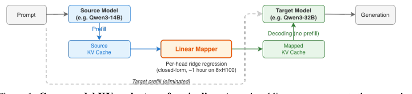

#+title:      错在哪,比错多少要命
#+subtitle:   同家族模型互转记忆,一张免训练的线性对照表 — Cross-Model KV Cache Transfer in LLM Families: A Closed-Form Linear Mapping for Prefill Reuse
#+date:       [2026-10-11 Sun 07:21]
#+filetags:   :paper:
#+identifier: 20261011T072111
#+source:     arXiv:2608.03893, https://arxiv.org/abs/2608.03893
#+authors:    Taekyung Heo, Rasoul Shafipour, Ritchie Zhao, Maximilian Golub, Mohammad Mahdi Kamani, Ritika Borkar, Makesh Tarun Chandran, Pantea Zardoshti, Bita Darvish Rouhani (NVIDIA)
#+venue:      arXiv preprint, 2026

* 问题

想象一个客服聊天系统。用户一上来问的都是些家常问题,系统派一个便宜的小模型接待——Qwen3 的 8B 版本,又快又省钱。聊到第十五轮,用户突然抛出一道要真正推理的难题,系统觉得不能再糊弄了,把对话转交给同系列更强的 32B 大模型。大模型一接手,先得把前十五轮的聊天记录从头读一遍——这叫"预填充"(prefill),是模型在开口回答之前,把整段上文过一遍自己的网络、在心里为每个词算出一份"记忆痕迹"(专业叫 KV 缓存)的过程。问题是,这十五轮话 8B 模型几分钟前已经原原本本读过一遍、算过一遍了,32B 模型现在要做的,其实是把同一段文字再算一遍,只是换了个"脑子"在算。文字没变,工作量却要从头来过。而且这事不是只发生一次:聊天还会继续,用户还可能把问题转回便宜的小模型,也可能这套系统正在做"先用小模型答一轮、答得不满意就升级到大模型"的级联策略——每一次换脑子,就是一次重新读稿。读的文字越长、换得越频繁,这笔重复劳动就越贵。

业内早就有省读稿功夫的办法,只是都绕不开"同一个脑子"这个前提。像 SGLang 的前缀缓存、Prompt Cache 这类技术,能让同一个模型在不同请求之间共享已经读过的部分——但换了模型,之前算出的记忆痕迹形状都对不上,这套办法立刻失效,等于没发生过。2024 年有一个叫 DroidSpeak 的方案往前走了一步,想办法让不同模型之间也能共享记忆痕迹,可它要求两个模型的架构必须完全一样——这几乎等于要求换的不是"脑子",只是换了件衣服,实际应用里很难凑这种巧合。2025 年的 IAM 把要求放宽了一些,允许架构有差异,但它只是把小模型"读这段话时注意力往哪儿看"的习惯搬给大模型参考,并没有真把小模型算出来的那份具体记忆痕迹原封不动地交出去——相当于只告诉大模型"重点在这几句",大模型还是得自己从头把全文再算一遍。几乎同一时间冒出来的一批更激进的方案——C2C、LatentAlign、PrefillShare 这些——确实能把具体的记忆痕迹数值在任意两个不同架构的模型之间搬运,但代价是,每一对模型组合都要单独训练一个"翻译器"网络,而且是靠梯度下降、拿着大把数据慢慢调出来的。换句话说,旧路要么只能用在"同一个脑子"上,要么为了跨脑子就得先烧一炉训练成本。

这篇论文的作者换了个角度问问题:他们没有去追求"任意两个模型之间都能转记忆",而是先往回缩一步——盯着同一个模型家族内部的大小号成员(比如 Qwen3 的 8B 和 32B,它们"记忆痕迹"的头数和每个头的维度天生就是对齐的,只是层数和参数规模不同)。他们想问的是:既然这些大小号本来就是同一套设计理念、吃同一批训练数据长大的兄弟,它们记下的东西之间,会不会压根不需要训练一个复杂的翻译器,只用一张最朴素的"对照表"——一次线性变换——就能把小的记忆痕迹直接读成大的形状?

* 翻译

#+ATTR_ORG: :width 1200

还是那个客服系统,我们把镜头拉近到 8B 向 32B 交接的那一刻。作者先没有急着设计方案,而是做了一件很朴素的事:把 8B 读那十五轮对话时,每一层、每个注意力头算出来的记忆痕迹,和 32B 自己读同样文字算出来的记忆痕迹,一个个拿出来做最简单的线性回归对比——用 8B 某一层的记忆痕迹,能多大程度上猜出 32B 某一层的记忆痕迹?结果出乎意料:在 Qwen3 14B 转 32B 这一对上,只拿 8B 一层的数据去猜 32B 对应层,就已经能解释 32B"键"信息 56% 的变化,"值"信息 32% 的变化——再多看几层源头信息拼起来猜,这两个数字涨到 79% 和 65%。换句话说,两个兄弟模型的记忆痕迹之间,并不是毫无关联的两套密码,而是存在着一条相当直的线性关系,一张简单的对照表就能抓住大半。

这时候你可能会问:既然关系这么"直",那是不是随便挑一层对一层做个对照表就行了?作者发现没这么简单,这里藏着三道弯,少一道这套办法都立不住。

第一道弯是"该照哪几层抄"。8B 和 32B 层数不一样,32B 的某一层该向 8B 的哪一层或哪几层取经,答案并不是"同一层号对同一层号"这么直白——作者让程序贪心地试:给 32B 每一层挨个尝试从 8B 的哪些层组合里猜最准,发现单看一层最多只能抓到全部可猜信息的六七成,信息是分散在好几个源头层里的,前几层叠加收益最大,叠到六层左右基本够用。于是方法里第一个关键设计出炉:给 32B 的每一层,挑出 8B 里对它最有预测力的那前 k 层(k 是个可调的数,通常是个位数到二十出头),把这几层的记忆痕迹拼在一起,再去做对照——这一步后来被证明是整套方法里贡献最大的单一设计:k 从 8 砍到 1,键信息的拟合优度直接从 0.79 掉回 0.56。

第二道弯是"位置信息会把对照表锁死"。记忆痕迹里的"键"部分并不是干净的语义信号,它被打上了一层"这个词排在第几位"的位置戳(这套机制叫 RoPE,旋转位置编码)。如果直接拿带着位置戳的键去做对照,算出来的对照表就被焊死在"训练时看到的那段对话正好是一千来个词长"这个具体长度上——换一段更长的对话,对照表可能就不准了。作者的处理办法是先把位置戳摘下来(这是一步可以精确撤销的旋转,摘下来不丢信息),在"干干净净只剩语义"的空间里拟合对照表,等对照表算出结果后,再按 32B 自己的位置规则重新把位置戳盖回去。这样一来,同一张对照表不管对话是几十个词还是三万多个词,都能直接套用,不用因为长度变了重新训练。

第三道弯,也是全文最有意思的一道弯,出现在交接基本做完之后。作者原以为"对照表拟合得越准(专业说法是拟合优度 R² 越高),交接出来的大模型表现就该越好",可实测数据并不买账:Llama 3.1 从 8B 到 70B 这一对,对照表拟合优度高达 0.84,交接后在 HellaSwag 这个常识推理测试上保住了 94% 的原本准确率;可反过来从 70B 向 8B 交接,同样 0.84 的拟合优度,保住的准确率却掉到只剩 37%。同样的"猜得准不准",换了个方向,结果天差地别——这说明光看对照表猜得准不准,并不能预判交接会不会成功。

于是作者去查错误到底落在了哪里,而不是错误有多大。他们算了一个新指标:把交接后模型实际算出的"注意力关注结果"和它本该算出的结果做比对,看两者方向有多接近(用余弦相似度衡量)。这个指标的逻辑是:对照表猜错的那部分信息,如果恰好落在模型的注意力机制根本不会去看的角落,猜错了也没关系,不影响最终回答;可如果猜错的地方恰好是注意力拼命要盯着看的地方,哪怕整体拟合优度很高,下游表现也会崩。拿这个新指标去跟准确率保留比例对比,相关性达到 0.57(统计学上这是一个相当扎实的正相关),而原来那个"拟合优度"的相关性只有 -0.20,几乎没有预测力。

这个发现直接解释了作者接下来做的一件事:遇到对照表失灵的几对模型(Ministral 系列的两对跨度较大的组合,线性对照表交出的保留比例只有四成出头),换成一个两层的非线性小网络(多层感知机)去做同样的对照,HellaSwag 上的保留比例立刻从 68% 和 59% 跳到 92% 和 96% 以上,涨幅最高达到 37 个百分点。细看这个非线性对照表做对了什么——它并没有整体上猜得更准,而是把原本误打误撞落在"注意力正盯着看"的那部分错误,挪到了"注意力压根不看"的角落里。这也解释了为什么线性对照表在容易的几对模型上已经够用、换上非线性反而还略微变差一点点:当残留误差本来就没落在要害处,再费劲去重新分配它,没有意义。

六组跨三个模型家族的实测汇总起来,是两极分化的结果:Qwen3 14B 转 32B、Qwen3 8B 转 32B、Llama 3.1 8B 转 70B(这是测试里跨度最大的一对)、Ministral 3B 转 8B 这四对,平均保住了原模型 73% 到 98% 的准确率,而且交接速度比老老实实重新读一遍快 2.7 到 25 倍,对话续了十轮之后準确率的掉速也很缓慢;但 Ministral 3B 转 14B 和 8B 转 14B 这两对,保留比例掉到四成出头,换上前面说的非线性小网络才能救回来。头数、每头维度对得上(论文管这叫"记忆痕迹匹配"),是能搬家的必要条件,却不是充分条件——真正决定搬不搬得成的,是搬家之后剩下的那点误差,有没有恰好落在对方注意力真正要用的地方。

* 核心概念

- *同科机(matched-KV)*:这是整套方法能成立的前提,不是一个算法组件,而是一个作者主动划定的边界。只有当两个模型记忆痕迹的头数和每个头的维度完全对齐时(哪怕层数、参数总量差很多),才叫"同科机"——好比两个人身高体重不同,但骨骼结构、关节数目是同一套图纸。在客服系统的例子里,Qwen3 8B 和 32B 正是这种"同科机"关系。少了这个前提,记忆痕迹的形状都对不上号,连拼对照表的起点都没有——所以作者一开始就把研究范围收窄到"同一家族内部",没有去碰任意两个架构之间的转换,这是故事转折成立的地基。

- *跨层挑源头 + 按头分别对照*:在客服例子里,32B 的某一层要猜,不是只能照抄 8B 的同一层号,而是程序会先去试哪几层 8B 的记忆痕迹拼在一起猜得最准,挑出前 k 层拼成输入,再对每一个注意力头单独做一次线性回归,头与头之间互不借用参数。少了"跨层挑源头"这一步,只能照单层对单层猜,键信息的拟合优度直接打六七折;少了"按头分别对照",不同头承担的语义职能被硬拧到一套参数里,反而会把头与头之间本来就不一样的分工搅乱。这是全文贡献最大的单一设计。

- *先摘位置戳再对照(RoPE 剥离)*:记忆痕迹里的"键"部分天生带着"这是第几个词"的位置戳。如果直接拿带位置戳的键去对照,算出来的对照表就被焊死在拟合时那段对话的长度上;摘掉位置戳、在纯语义空间里对照、事后再按目标模型的规则重新盖上位置戳,对照表就能在任意长度的对话上直接套用。这是让这张对照表从"只能救这一次交接"变成"能长期在生产里反复用"的设计选择——没有它,每换一次对话长度都可能要重新算一遍对照表,等于把训练成本变相搬了回来。

- *看错误落在哪儿,而不是错了多少(注意力输出相似度)*:这是整个故事里最反直觉的一件道具。作者原以为"对照表猜得准"(拟合优度高)就该带来"交接后模型表现好",结果两者相关性几乎为零,真正跟表现挂钩的,是猜错的那部分信息有没有落进模型注意力真正会去翻的角落。在客服例子里,这意味着两次交接即便整体"记错"的量差不多,只要错的位置不一样,一次可能顺利接上话,另一次可能直接把回答带偏。少了这件道具,作者就没法解释"为什么同样拟合优度、交接结果却天差地别",也就没法说清楚为什么换个非线性网络能在某几对模型上大幅翻盘。

* 洞见

两个模型能不能共享一份记忆,衡量的尺子从一开始就用错了:重要的不是"对照表猜得有多准",而是猜错的那一点点,有没有恰好砸在对方真正会去看的地方。整体拟合优度高,可能只是在无关紧要的角落猜得特别细;局部猜得粗糙一点,只要错处落在盲区,交接照样顺畅。这意味着,任何想要衡量"两套系统能不能对接"的场合——不止是模型之间搬记忆,广义上任何把一份内部表征从一个系统搬到另一个系统的尝试——都该先问一句:对方真正在意的是整体像不像,还是某几个特定方向像不像?衡量标准站错了地方,会把本该成立的方案误判为失败,也会把看似完美的方案送上线之后才发现翻车。

* 博导审稿

选题这步我觉得站得住。"模型换脑子就得重读全文"这事,在级联调度、长对话升级这些实际部署场景里确实存在,不是凭空造出来的痛点——作者也没有贪心地想一步到位解决"任意模型互转",而是先收窄到"同科机"这个干净的子问题,这个取舍很克制,值得肯定。

方法成熟度上,线性对照表加岭回归这个选择本身没什么花哨的,胜在便宜——几十分钟拟合一次,不用反向传播。但我更在意一个没被摊开讲的预设:整套方法默认"交接只发生一次,之后目标模型就老老实实按自己的方式往下算"。可现实的级联场景是反复横跳的——一会儿小模型接,一会儿大模型接,相当于每隔几轮就把一段"猜出来的记忆痕迹"喂回模型,模型后续生成的内容又会反过来影响后面猜的对不对。论文里的多轮交接实验只测了十轮,漂移看起来是线性缓慢增长的,但这篇论文并没有认真讨论"猜出来的记忆痕迹会不会系统性地偏向某个方向、然后在反复交接里自我放大"这件事——如果这里面藏着正反馈,十轮之内看不出来,几十轮之后未必还稳。这是我觉得最值得盯的一个隐忧,比"小模型升级到大模型保留率只有四成"这种明显的失败案例更值得深挖。

实验诚意总体公道:六对模型里明确报告了两对失败案例,没有藏着掖着;用来对照的新指标(注意力输出相似度)也是老老实实跟传统的拟合优度摆在一起比相关性,没有回避"旧指标不管用"这件尴尬事。但选 k(该用源头几层)这个超参数是在同一批要汇报成绩的测试集上选出来的,论文自己承认这最多造成 2.49 个百分点的虚高,这种"既当裁判又当选手"的小瑕疵该扣分,好在作者主动披露并给出了量级。

写作功力上,从"线性关系存在"到"接入点在于误差落点而非误差大小"这条逻辑链讲得清楚,但"同科机"这个边界条件如果推广到跨家族的模型会怎样,论文基本没碰,只列进了未来工作——这是个合理的克制,但读者读完容易误以为"只要头数维度对得上就该线性可转",其实论文自己的两个失败案例已经说明光对齐维度不够,这点需要在正文里更早、更明确地提醒读者。

判决:weak accept——选题干净、转折扎实、副发现(错误落点比大小重要)是全文最有价值的部分,但多轮反复交接里误差会不会自我放大这个隐忧没有被认真对待,值得在后续工作里补上。

* 启发

迁移:这套"别看整体对不对,看错处落在哪儿"的检验思路,不必局限在模型换脑子这件事上——任何做压缩、剪枝、量化、知识蒸馏的场景,习惯性地用整体误差(比如均方误差、拟合优度)去判断方案好坏,都可以照这篇论文的思路换一把尺子:先搞清楚下游真正依赖的是输出的哪个子空间(对注意力机制而言是查询方向加权之后的结果),再去衡量误差有没有砸在那个子空间里,而不是笼统地看误差总量。这意味着你可以在评估任何"近似替代"方案时,多问一句"这点误差,下游到底会不会看见它",而不是止步于一个全局分数。

混搭:这篇论文"先挑最像的几个源头层拼起来、再按头单独对照"的做法,和知识蒸馏里"教师模型挑最相关的几层给学生模型对齐"的思路有天然的接口——可以试着把"跨层挑源头"这套挑选逻辑,搬到蒸馏里当一个更轻量、免训练的热身步骤:不急着上梯度下降,先用线性对照表粗略对齐几层,再决定要不要精调,省下一部分前期试错的训练成本。

反转:这篇论文提醒我们一个容易被忽略的默认假设——很多人下意识觉得"模型越像,互相替代越安全",论文用 Llama 3.1 那对数字直接打脸:同样的拟合优度 0.84,换个方向交接,保留率从 94% 掉到 37%。这意味着你在评估任何"用小模型近似代替大模型"或者反过来的方案时,该停止用单一方向的测试结果去下结论,开始把两个方向都测一遍,因为"看起来一样像"和"实际替代得住"之间,可能藏着一个方向性的陷阱。
