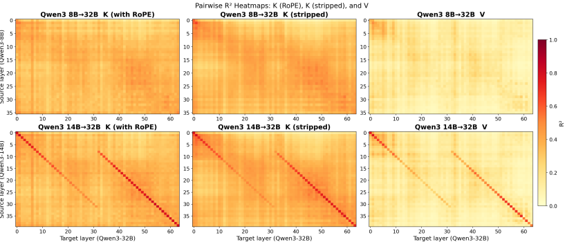
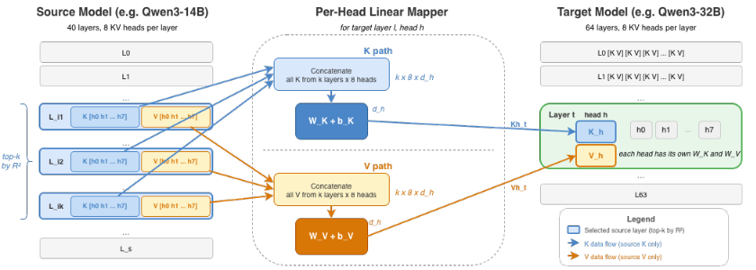
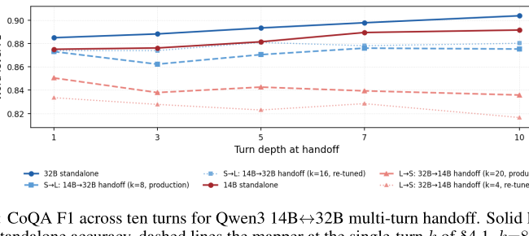
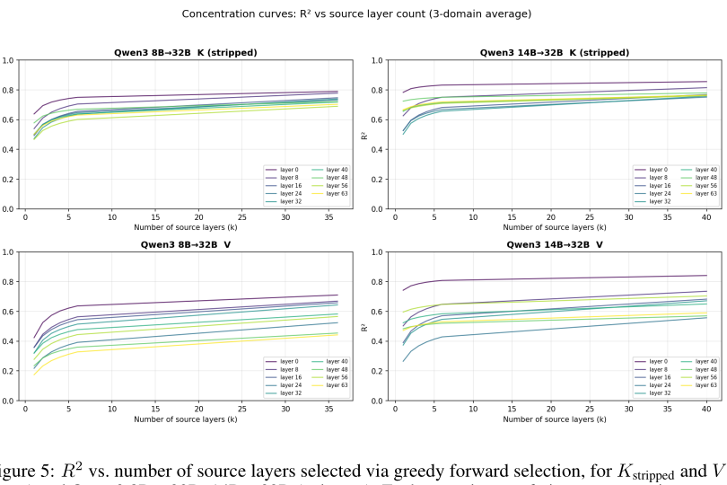
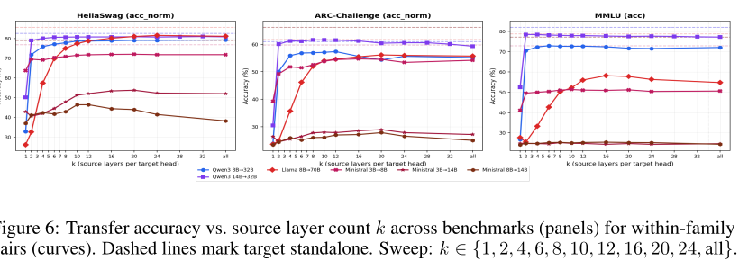
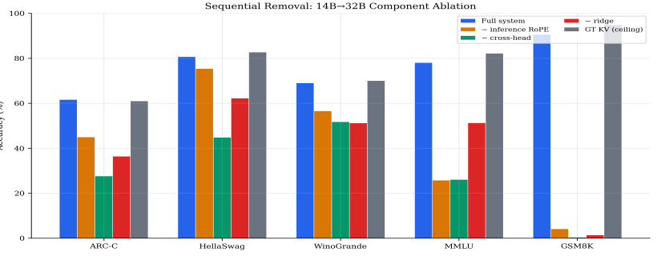
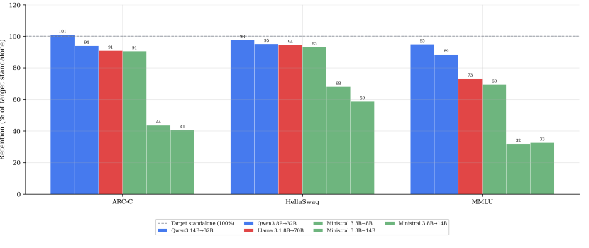
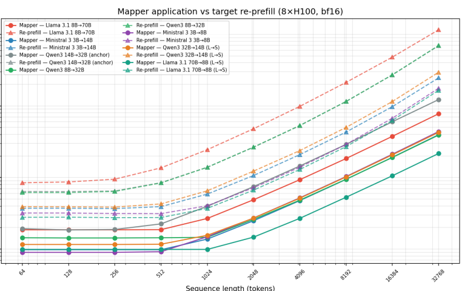

# CrossKV：LLM 同族模型间的 KV 缓存跨模型迁移——一个用于复用 Prefill 结果的闭式线性映射

> 本文为 arXiv:2608.03893（*Cross-Model KV Cache Transfer in LLM Families: A Closed-Form Linear Mapping for Prefill Reuse*）的中文解读与复述（非逐句翻译），原文采用 CC BY 4.0 许可，逐字翻译本无版权问题，但为与本仓库其他解读保持一致，这里仍以自己的话重新组织行文，数据、表格与关键数字按原文如实转录。作者来自 NVIDIA：Taekyung Heo、Rasoul Shafipour、Ritchie Zhao、Maximilian Golub、Mohammad Mahdi Kamani、Ritika Borkar、Makesh Tarun Chandran、Pantea Zardoshti、Bita Darvish Rouhani。

## 摘要

生产环境的 LLM 服务越来越依赖在同一个模型家族内部的不同规模模型之间来回切换：成本—质量级联（cost-quality cascading）、会话中途切换模型、以及请求路由，都属于这一类场景。每一次切换都会迫使"接手"的模型从零开始重新做一遍 prefill。本文提出**跨模型 KV 缓存迁移（cross-model KV cache transfer）**：让接手模型直接复用发起模型已经算好的 KV 缓存，从而跳过 prefill。作者发现，只要源模型和目标模型的 KV 头数与每头维度相同（称为 *matched-KV*），跨模型 KV 之间就存在相当强的线性结构。在 Qwen3 14B→32B 上，仅用一个源层就能解释目标模型 key 方差的 56%、value 方差的 32%；用上多个源层后分别提升到 79% 和 65%。

基于这一发现，作者设计了一个闭式的 ridge 回归映射器，按注意力头独立拟合，分三步走：第一步，为每个目标层挑选最具预测力的 top-*k* 个源层并拼接其 KV；第二步，在映射前先把 RoPE 从 key 中剥离，使拟合过程与位置无关、可跨上下文长度复用；第三步，在一个很小的校准集（500 条 FineWeb-Edu 序列，每条 1,024 token）上做 ridge 回归拟合。令人意外的是，在三个模型家族的六对迁移组合中，这个线性映射器在其中四对上保留了接收方独立 prefill 精度的 73%–98%，而另外两对则明显退化。一个非线性 MLP 能在失败的组合上把 HellaSwag 的保留率最多拉高 37 个百分点。该映射器比重新 prefill 快 2.7–25 倍，并且在多轮对话切换中保持稳定，这使得跨模型 KV 缓存迁移具备了工程可行性。

## 1 引言

生产环境中的 LLM 服务越来越多地涉及长的、会累积上下文的 agent 式会话；同时，出于成本—质量级联、会话中途切换、以及请求路由的需要（OpenAI, 2025），系统也越来越依赖在同一模型家族内不同规模的成员之间来回切换（Yang et al., 2025；Grattafiori et al., 2024）。同一家族的不同规模模型共享核心架构选择和大量预训练数据，但在架构细节和训练配方上会因规模而异。这两个趋势会叠加放大 prefill 的开销：长会话会拉长 prompt，而每一次模型切换都要在接手模型上把累积的上下文重新 prefill 一遍。Prefill 是生成之前填充 KV 缓存的前向计算，其开销随模型规模和 prompt 长度增长。前缀缓存（prefix caching）只能在单一模型内部缓解这个问题。

既然 prefill 的产出就是 KV 缓存，那么跨模型复用它，本质上就变成了一个表示转换问题：把一个模型的 KV 缓存变换成另一个模型期望的格式。本文把这个问题称为**跨模型 KV 缓存迁移**，并把研究范围限定在同一家族内部的迁移。这个映射是双向的：小模型到大模型的迁移用来提升质量，大模型到小模型的迁移用来降低成本。图 1 展示了整个流程。这个流程是对模型内 KV 复用的一种推广：跨层共享（Brandon et al., 2024；Wu and Tu, 2024；Chang et al., 2025）利用的是单个模型内部的冗余，前缀缓存（Zheng et al., 2024；Gim et al., 2024）复用的是同一模型不同请求之间的 KV；而跨模型 KV 缓存迁移则是把缓存值从一个模型映射到另一个模型。


跨模型 KV 缓存迁移之所以困难，是因为源模型和目标模型可能在层数、隐藏维度和 KV 头配置上都不同。已有工作用神经网络融合器（Fu et al., 2026）、学习出的隐空间适配器（Dery et al., 2026）、注意力模式映射（Zhao et al., 2025），或者要求架构完全相同的 KV 共享（Liu et al., 2026）来弥合这些差异，但每一种都需要基于梯度的训练，或者很强的架构假设（详见 §2.2）。

本文的发现是：跨模型 KV 关系存在相当强的线性结构，允许一种小样本、无需梯度训练的拟合。在 Qwen3 14B→32B 上，单个源层就能解释目标 key 方差的 56%、value 方差的 32%，用上多个源层后分别提升到 79% 和 65%（§2.3）。基于这个观察，本文提出一个闭式的按头 ridge 映射器（§3），它整合了三个组件：从小型校准集拟合的按头 ridge 回归、每个目标层从其最具预测力的 top-*k* 个源层取信息的跨层源选择，以及把位置旋转和语义内容解耦、使拟合结果能跨上下文长度迁移的内容空间（RoPE 剥离）映射。

在来自三个家族的六对 matched-KV 迁移组合上（源模型和目标模型共享 KV 头数与每头维度，详见 §4.2），线性映射器在其最好的几对组合上，平均跨五个基准测试，保留了 73%–98% 的独立精度。作者进一步发现：决定每对组合保留率的是误差落在什么地方，而不是误差有多大。一个非线性 MLP 能把残差误差从对注意力敏感的子空间中挪开，在较难的组合上把 HellaSwag 保留率最多拉高 37 个百分点（§4.4）。在三个家族共 12 次 matched-KV 评估中，注意力输出相似度与 HellaSwag 保留率的 Pearson 相关系数达到 +0.57，优于 *R*²（§4.5）。

**贡献总结。**

1. **闭式映射框架。** 提出一个基于按头 ridge 回归、无需梯度的跨模型 KV 缓存迁移框架。两个关键设计是：每个目标层从其最具预测力的 top-*k* 个源层拟合，且 key 在 RoPE 剥离后的内容空间中映射，使拟合结果能跨上下文长度迁移（§3）。
2. **多家族验证。** 在三个家族的六对 matched-KV 组合上验证了该框架。其中四对在小到大方向上以比重新 prefill 低 2.7–25 倍的延迟，保留了五个基准测试上 73%–98% 的独立精度（§4.7）。
3. **非线性扩展。** 一个非线性 MLP 通过把残差误差从对注意力敏感的子空间中挪开，在较难的 Ministral 组合上把 HellaSwag 保留率最多提升 37 个百分点（§4.4、§4.5）。
4. **注意力输出余弦相似度预测跨组合保留率。** 在三个家族共 12 次 matched-KV 评估中，注意力输出余弦相似度与 HellaSwag 保留率的 Pearson 相关系数为 +0.57，优于 *R*²（*r* = −0.20）。同样的误差集中度分析也解释了 MLP 带来的 37 个百分点增益，本质上是把误差重新分布到了注意力不敏感的方向上（§4.5）。

## 2 背景与动机

### 2.1 问题形式化

考虑一个有 *L*ₛ 层的源模型 𝒮 和一个有 *L*ₜ 层的目标模型 𝒯。二者都使用分组查询注意力（GQA），KV 头数分别为 *n*ₖᵥˢ 和 *n*ₖᵥᵗ，每头维度分别为 *d*ₕˢ 和 *d*ₕᵗ。对于一个长度为 *T* 的输入序列 **x** = (*x*₁, …, *x*ₜ)，源模型第 *l* 层（*l* ∈ {1, …, *L*ₛ}）、第 *h* 个头（*h* ∈ {1, …, *n*ₖᵥˢ}）会产生 key 和 value：**K**ₛ^(l,h), **V**ₛ^(l,h) ∈ ℝ^(T×dₕˢ)。用 𝒞𝒮 表示源模型跨所有层、所有头的完整 KV 缓存，𝒞𝒯 对目标模型类似定义。源模型和目标模型在同一家族内共享分词器，因此输入序列对两者而言长度相同。当 *n*ₖᵥˢ = *n*ₖᵥᵗ 且 *d*ₕˢ = *d*ₕᵗ 时，称这对迁移为 **matched KV**，即便 *L*ₛ、*L*ₜ 或参数量在不同规模之间不同。

本文要寻找一个映射 *f*: 𝒞𝒮 → 𝒞̂𝒯，使得目标模型用 𝒞̂𝒯 代替自己原本的 𝒞𝒯 来解码时，产生的输出等价：

```math
m\left(\mathcal{T}(\mathbf{x};\hat{\mathcal{C}}_{\mathcal{T}})\right)\;\approx\;m\left(\mathcal{T}(\mathbf{x};\mathcal{C}_{\mathcal{T}})\right),
```

其中下游任务 τ 用度量 *m* 评估。*f* 被分解为按层按头的映射 *f*ₖ^(l,h) 和 *f*ᵥ^(l,h)，分别产生目标模型每层每头的 key 和 value。本文用目标模型的下游精度来衡量迁移质量，而不是单纯依赖重建误差指标。

### 2.2 已有方法

近期的跨模型 KV 复用方法，无一例外需要基于梯度的训练或架构约束。C2C（Fu et al., 2026）为每一对模型训练神经网络融合器；LatentAlign（Dery et al., 2026）为每个模型学习一个进入共享隐空间的适配器；IAM（Zhao et al., 2025）替换的是小模型的注意力*模式*，而不是 KV 值本身；DroidSpeak（Liu et al., 2026）要求架构完全相同。更进一步的基于训练的方法（Woo et al., 2026b；Woo et al., 2026a）也受到同样的基于梯度的约束。据作者所知，此前没有工作研究过跨模型 KV 关系是否简单到可以支持一个闭式的、无需训练的映射。与本文正交互补的三条研究线是：模型内跨层 KV 复用（Brandon et al., 2024；Wu and Tu, 2024；Chang et al., 2025）、prefill 加速（Liu et al., 2025；Upasani et al., 2026；Qiao et al., 2025），以及跨 LLM 的线性表示对齐（Huh et al., 2024；Chen et al., 2025；Bello et al., 2025；Huang et al., 2025）。附录 A 的表 6 对跨模型方法做了系统比较。

### 2.3 跨模型 KV 中的线性结构



在确定映射器架构之前，作者先探究跨模型 KV 关系本身具有什么结构。这项分析在 Qwen3 上完成，其线性结构的结论可以推广到其他 matched-KV 组合。分析探测了三种缓存类型：K_rope 表示模型实际使用的、带 RoPE 旋转的 key；K_stripped 表示通过 **R**_Θ⁻¹（见 §3.3）去掉位置相关 RoPE 旋转之后的 key；V 表示 value，它本身不带位置编码。对每种缓存类型 *C* ∈ {K_rope, K_stripped, V}，以及每一个源层 *l'* ∈ {1, …, *L*ₛ}、目标层 *l* ∈ {1, …, *L*ₜ}、头 *h* 的三元组，作者在 token 级别拟合一个单源普通最小二乘回归。校准所用的 *N* 个 token（从 FineWeb-Edu 序列中按 §3.1 所述方式二次采样得到）各贡献一个观测样本，把源模型的每 token 特征向量 *C*ₛ^(l',h) ∈ ℝ^(dₕˢ) 映射到目标的 *C*ₜ^(l,h) ∈ ℝ^(dₕᵗ)：

```math
\hat{C}_{t}^{l,h}=C_{s}^{l^{\prime},h}\,\mathbf{W}+\mathbf{b},\qquad\mathbf{W}\in\mathbb{R}^{d_{h}^{s}\times d_{h}^{t}},\ \mathbf{b}\in\mathbb{R}^{d_{h}^{t}},
```

这里把 *C*ₛ^(l',h) 当作行向量处理，以与 §3 中生产用映射器的约定保持一致。需要强调的是，这只是一个"单三元组、单缓存类型"的探测实验，并不是 §3 中真正的生产映射器——生产映射器会拼接多个源层并加入 ridge 正则化。拟合质量用决定系数 *R*² 衡量，在 *n*ₖᵥᵗ 个目标头上取平均，得到每个 (*l'*, *l*) 对的按头平均 *R*²。把这些值画成一张热力图（行是源层，列是目标层，见图 2），可以看出四个定性规律，定量数字见 §4：

1. **线性拟合程度很高：** 在最容易预测的目标层上，一个单一的线性回归就已经能捕获跨模型 KV 方差的很大一部分。沿对角线，按头平均 *R*² 明显高于零；在 Qwen3 14B→32B 上最好的单个源—目标单元格，K_stripped 的 *R*² 达到 0.81，在较弱的 8B→32B 上达到 0.65，都出现在热力图峰值处。按层平均的生产用 ridge 回归 *R*² 见附录 C。
2. **模型越接近，对角线越清晰：** 架构差异和深度差距越大，这个模式越被稀释。
3. **RoPE 会"污染"拟合：** 剥离 RoPE 通常会让对角线变得更清晰，这也是 §3.3 中位置—内容分解设计的动机。
4. **K 比 V 更可预测：** 按头平均 *R*² 上通常有约 0.2 的差距（详见附录 B）。

**映射器需要多少个源层？** 上面的探测实验只用了一个源层。作者用贪心前向选择（greedy forward selection）把它扩展开：每一步都迭代加入能最大程度提升 *R*² 的那个源层。结果显示，互补信息分布在多个源层上。在 Qwen3 14B→32B 上，*k*=1 只能捕获 *k*=all 时 *R*² 的 66%（K_stripped）和 42%（V），从 *k*=1 到 *k*=4 增益最大，到 *k*=6 时 *R*² 已经接近 *k*=all 的值（详见附录 B 和 C）。这正是 §3.2 中采用 top-*k* 选择策略的动机。

## 3 映射器设计

图 3 展示了针对单个目标 (层 *l*，头 *h*) 对的映射器结构。每个目标层按 *R*² 挑选出一个 top-*k* 的源层子集，把被选中的源层 key 和 value 拼接起来，再用独立的 ridge 回归 **W**ₖ、**W**ᵥ 把它们映射到目标空间。每个映射器都是一次闭式线性求解，针对所有 *L*ₜ×*n*ₖᵥᵗ 个目标头各自独立重复一遍。映射器由三个组件构成：按头 ridge 回归（§3.1）、跨层源选择（§3.2）和内容空间映射（§3.3）。

### 3.1 按头 ridge 回归

源模型和目标模型的层数不同（*L*ₛ ≠ *L*ₜ）、每头维度不同（*d*ₕˢ ≠ *d*ₕᵗ），甚至 KV 头数也可能不同（*n*ₖᵥˢ ≠ *n*ₖᵥᵗ）。为此，作者为每个目标 (层, 头) 独立拟合一个线性映射：

```math
\hat{\mathbf{K}}_{t}^{l,h}=\mathbf{X}_{K}^{l}\mathbf{W}_{K}^{l,h}+\mathbf{b}_{K}^{l,h},\qquad\hat{\mathbf{V}}_{t}^{l,h}=\mathbf{X}_{V}^{l}\mathbf{W}_{V}^{l,h}+\mathbf{b}_{V}^{l,h},
```

其中 **X**ₖ^l 拼接了 §3.2 所述 *k* 个被选中源层的 key 特征，**W**ₖ^(l,h) ∈ ℝ^((k·nₖᵥˢ·dₕˢ)×dₕᵗ) 是权重矩阵。



**拟合。** 把 *N* 个校准 token 堆叠起来，得到设计矩阵 **X** ∈ ℝ^(N×(k nₖᵥˢ dₕˢ)) 和响应矩阵 **Y** ∈ ℝ^(N×dₕᵗ)。为了数值稳定性，作者使用 λ=0.01 的 ridge 回归而不是纯粹的最小二乘：在较大的 *k* 下，特征维度可以达到数万，而 top-*k* 选出的源层按构造彼此相关，使得 **X**ᵀ**X** 接近奇异。Tikhonov 正则项能以很小的拟合偏差稳定住矩阵求逆。闭式解为：

```math
\mathbf{W}^{*}=(\mathbf{X}^{\top}\mathbf{X}+\lambda\mathbf{I})^{-1}\mathbf{X}^{\top}\mathbf{Y}.
```

求解前先对 **X** 和 **Y** 做中心化，所以上面得到的 **W*** 估计的是斜率，公式 (3) 中的偏置项再通过 **b** = **Ȳ** − **X̄W*** 恢复。校准数据是 500 条长度为 1,024 的 FineWeb-Edu 序列，按步长 4 二次采样，每个目标头大约得到 128K 个 token 级观测样本。映射器的总参数量（K 加 V）为 2·*L*ₜ·*n*ₖᵥᵗ·(*k*·*n*ₖᵥˢ·*d*ₕˢ)·*d*ₕᵗ，各组合具体大小见附录 D。在单台 8×H100 节点上，每对组合的拟合时间约为 47–87 分钟，全程没有任何基于梯度的训练。拟合时间相对目标头数是亚线性增长的，因为构造 **X**ᵀ**X**（复杂度 𝒪(*N*·*d*ₛ²)，其中 *d*ₛ = *k*·*n*ₖᵥˢ·*d*ₕˢ 是源特征维度）才是耗时的主要部分，而它对每个目标层只需计算一次，在该层所有头之间共享。各组合具体耗时见附录 E。

### 3.2 跨层源选择

源模型和目标模型层数不同，这就带来一个问题：到底该用哪些源层来为每个目标层的映射提供信息。§2.3 已经说明，对于某个给定的目标层，并不是所有源层都同样有信息量。因此，对每个目标层 *l*，作者按 RoPE 剥离后的 key 和 value 的按头平均 *R*²，挑出 top-*k* 个源层，拼接它们的 KV 特征，再按 §3.1 拟合多源 ridge 回归：

```math
\mathbf{X}_{K}^{l}=[\bar{\mathbf{K}}_{s}^{l_{1}}\,\|\,\bar{\mathbf{K}}_{s}^{l_{2}}\,\|\,\cdots\,\|\,\bar{\mathbf{K}}_{s}^{l_{k}}],
```

其中 **K̄**ₛ^(lᵢ) ∈ ℝ^(T×(nₖᵥˢ·dₕˢ)) 是源层 *lᵢ* 上所有 Key 头的拼接，{*l*₁, …, *l*ₖ} 是为目标层 *l* 挑出的 top-*k* 个源层。**X**ᵥ^l 按同样方式从 Value 头构造。一个目标层内所有的头都共享同一组被选中的源层，从而实现跨头信息流动。源层数量 *k* 是一个超参数，按组合通过参数扫描来选定（§4.1）。在三个映射器组件中，跨层源选择是贡献最大的单一组件（§4.3）。

### 3.3 内容空间映射（RoPE 分解）

标准 RoPE（Su et al., 2024）对查询和 key 应用一个依赖位置的旋转。KV 缓存里只存储旋转后的 key：**k**_RoPE(*t*) = **R**_Θ(*t*)**k**_content，而查询则在解码时现算。把 RoPE 与内容解耦，使整个映射流水线更模块化：按头 ridge 权重是在一个与位置无关的空间中计算的，因此在不同 RoPE 配置的组合之间、以及目标模型 RoPE 支持的任意位置上，都依然有效。直接在 RoPE 耦合的 key 上拟合映射器，在短上下文基准测试上也能工作得不错（在噪声范围内，见表 2），但这会把权重和拟合时所见的 1024-token 位置分布绑死。解耦后的形式则天然能扩展到更长的上下文，这对服务长达 32k token 的 prompt（§4.7）很关键。

具体做法是：先剥离源模型的 RoPE，在位置无关空间里应用 **W**ₖ，再用目标模型的 RoPE 重新编码：

```math
\hat{\mathbf{K}}_{t}=(\mathbf{K}_{s}\,\mathbf{R}_{\Theta_{s}}^{-1}(t)\,\mathbf{W}_{K}+\mathbf{b}_{K})\,\mathbf{R}_{\Theta_{t}}(t).
```

在校准阶段，回归目标 **Y** 是通过从目标模型的真实 key 中剥离其 RoPE 构造出来的，所以 **W**ₖ 完全是在位置无关空间中拟合的。由于 **R**_Θ 是正交矩阵，求逆是精确的，且代价可以忽略不计。Value 不带位置编码，直接映射即可。

## 4 实验

实验要回答四个问题：(1) 在三个模型家族上，ridge 映射器与目标模型自身 KV 的吻合程度如何（§4.2）？(2) 哪些组件真正重要（§4.3）？(3) 非线性映射器能否挽救 ridge 表现不佳的组合（§4.4），以及是什么决定了每对组合的最终结果（§4.5）？(4) 迁移在多轮对话中是否稳定（§4.6），延迟优势有多大（§4.7）？

### 4.1 实验设置

**模型家族。** 本文评估三个 matched-KV 家族（Qwen3、Llama 3.1、Ministral 3），源模型和目标模型在不同规模之间共享 KV 头数与每头维度（完整表格见附录 D）。所有家族都使用稠密全注意力，因此每个目标层都会接收映射后的 KV。模型要么是经过后训练的（Qwen3、Ministral 3），要么是 base 模型（Llama 3.1），评估都在 completion 模式下进行。

**基准测试。** 评估在五个精度基准测试加上 WikiText-2 困惑度上进行：ARC-Challenge（Clark et al., 2018）、HellaSwag（Zellers et al., 2019）、WinoGrande（Sakaguchi et al., 2020）、MMLU 5-shot（Hendrycks et al., 2021）、带思维链提示的 GSM8K 8-shot（Cobbe et al., 2021；Wei et al., 2022），以及前缀条件的 WikiText-2 困惑度。CoQA（Reddy et al., 2019）用来衡量多轮切换的表现（§4.6）。全部五个精度基准测试都在六对组合、各自选定的 *k* 下完整评估。困惑度覆盖范围及其协议见附录 D。保留率定义为 (迁移精度)/(目标独立精度)×100%。由于不同基准测试的"随机猜测"底线不同，作者还报告了按底线归一化的保留率，即 (精度−随机底线)/(目标精度−随机底线)，这样随机猜测对应 0%，目标模型自身精度对应每个基准测试上的 100%。

**映射器配置。** 所有组合都使用 ridge 回归（λ=0.01）和内容空间映射。源层数量 *k* 在 {1, 2, 4, 6, 8, 10, 12, 16, 20, 24, all} 上扫描。每对组合选取使得（ARC-C、HellaSwag、WinoGrande、MMLU 的对数似然精度的）算术平均最大的那个 *k*，近似平局时偏向更大的 *k* 以覆盖更多评估场景。GSM8K、CoQA 多轮评估和 prefill 延迟都不参与这个选择过程。把某个基准测试纳入选择准则，最多会把该基准测试自身报告的精度抬高 2.49 个百分点（详见附录 H）。各组合选定的 *k*、映射器总参数量（1.01–3.36 B）、存储大小（4–12 GB）以及完整家族表见附录 D。

### 4.2 主要结果

主要结果聚焦于三个家族六对 matched-KV 组合的小到大（S→L）迁移。大到小（L→S）方向的评估限于 HellaSwag，出现在机制分析（§4.5）和多轮评估（§4.6）中。所有组合都在各自选定的 *k*、完整流水线下评估。结果差异很大（平均保留率 42%–98%）。表 1 给出了核心的逐组合数字，完整的分家族表见附录 F。

**表 1：各组合在选定 *k* 下的迁移保留率（ridge，内容空间映射），涵盖三个家族六对 matched-KV 组合。** 每个基准测试列是保留率，首行给出每个基准测试的随机猜测底线。Avg 和 Avg_fn 分别是跨这些基准测试的保留率和按底线归一化保留率的平均值，按未四舍五入的数值计算。各基准测试的按底线归一化数值见附录 F。

| Family | Pair (k) | Avg | Avg_fn | ARC-C | HellaSwag | WinoGrande | MMLU | GSM8K |
|---|---|---|---|---|---|---|---|---|
| 随机猜测底线 | — | — | — | 25% | 25% | 50% | 25% | ≈0% |
| Qwen3 | 14B→32B (8) | 97.6% | 96.3% | 101.0% | 97.6% | 98.5% | 95.0% | 95.6% |
| Qwen3 | 8B→32B (12) | 87.5% | 80.7% | 94.0% | 95.2% | 91.0% | 88.5% | 68.8% |
| Llama 3.1 | 8B→70B (20) | 72.8% | 62.9% | 90.9% | 94.4% | 87.1% | 73.3% | 18.2% |
| Ministral 3 | 3B→8B (all) | 76.2% | 65.9% | 90.6% | 93.3% | 91.3% | 69.4% | 36.6% |
| Ministral 3 | 3B→14B (20) | 44.2% | 14.7% | 43.6% | 68.0% | 74.0% | 32.0% | 3.2% |
| Ministral 3 | 8B→14B (12) | 41.6% | 11.1% | 40.7% | 58.7% | 74.2% | 32.7% | 1.6% |

两个观察结构了后续全部内容：

1. **Tier 1（高保留率层级）。** 四对 matched-KV 组合在五个基准测试上平均保留了 73%–98% 的目标精度：Qwen3 14B→32B、Qwen3 8B→32B、Llama 3.1 8B→70B（本文评估中参数比例最极端的一对）、以及 Ministral 3B→8B。
2. **Tier 2（低保留率层级）。** 两对 matched-KV 组合退化严重：Ministral 8B→14B 和 Ministral 3B→14B 只有 42%–44% 的平均保留率，按底线归一化后更只有 11%–15%。

两个层级合在一起说明：matched KV 只是迁移成功的一个相关因素，而不是充分条件。§4.4 和 §4.5 进一步调查了还有哪些因素决定了每对组合的结果。附录 F 的图 8 可视化了跨组合的保留率。

### 4.3 消融实验

**表 2：Qwen3 14B→32B 上的映射器组件消融实验。** 单元格为各基准测试上的精度，最右列是 WikiText-2 困惑度。"Full" 使用 *k*=8、ridge 回归和内容空间（RoPE 剥离）映射。"− inference RoPE" 使用内容空间拟合但推理时不重新旋转，制造出拟合—评估不匹配。"− all RoPE" 是完全耦合的变体（拟合和推理都保留 RoPE）。最后两行在此基础上进一步去掉跨层源选择（*k*=1）和 ridge 正则化。

| Configuration | ARC-C | HellaSwag | WinoGrande | MMLU | GSM8K | PPL |
|---|---|---|---|---|---|---|
| Full (k=8, ridge, content-space) | 61.60 | 80.70 | 68.98 | 78.09 | 90.98 | 7.33 |
| − inference RoPE | 44.97 | 75.39 | 56.59 | 25.79 | 4.17 | 7.70 |
| − all RoPE (fit + inference) | 61.09 | 80.73 | 68.59 | 77.70 | 90.98 | 7.35 |
| − RoPE − cross-layer (k=1) | 27.65 | 44.81 | 51.78 | 26.07 | 0.38 | 22.73 |
| − RoPE − cross-layer − ridge | 36.43 | 62.26 | 51.22 | 51.26 | 1.44 | 9.86 |

本文在 Qwen3 14B→32B（保留率最高的组合）上刻画映射器的行为，这样任何退化都最容易被看出来。表 2 给出组件消融结果，校准对 λ、*N* 和校准数据域的敏感性见附录 C。

1. **跨层源选择是贡献最大的组件。** 把 *k* 从 8 降到 1，会把 K 的 *R*² 从 0.79 降到 0.56（详见附录 C）。
2. **内容空间映射的影响因基准测试而异。** 关闭推理时的 RoPE 处理会让 MMLU 和 GSM8K 几乎跌到随机水平，而 HellaSwag 只下降约 5 个百分点。
3. **校准过程是稳健的。** λ 在四个数量级范围内扫描、*N* 在 50–1000 条序列范围内扫描，都显示出很宽的平坦区域，只有在 λ=1 时才会崩溃。样本数量在 *N*=200 之后趋于平坦，*N*=50 时仍在生产配置的约 1.6 个百分点之内。校准数据域是唯一有实际代价的维度：用 CodeAlpaca 校准会让 HellaSwag 下降 5.24 个百分点，而用 Wikipedia 校准基本在噪声范围内。

### 4.4 用 MLP 替代 ridge 回归

§4.2 的一个自然后续问题是：非线性映射器能否挽救 ridge 回归表现不佳的那些组合？作者为每个 (目标层, 头, K/V) 单独训练一个 MLP，用和 ridge 回归相同的 MSE 损失，在推理时直接替换 ridge 作为映射器。MLP 包含两个 1,024 单元、ReLU 激活的隐藏层，用 Adam 训练（完整设置见附录 E）。实验覆盖四对 Qwen3 和 Ministral 3 组合，涵盖从成功到失败的全部区间，使用与 ridge 相同的下游评估流水线，因此唯一改变的变量是映射器的函数形式。

表 3 展示了两个观察：在 ridge 本来就表现良好的组合上，MLP 略逊于 ridge；而在 ridge 失败的组合上，MLP 把 HellaSwag 保留率提升了 24.3 到 36.8 个百分点，使全部四对组合的保留率都超过 90%。这说明线性 ridge 在跨模型 KV 关系本身已经是线性的情况下已经足够，而 MLP 只在 ridge 不足的地方才有帮助，而不是全面压制 ridge。

**表 3：四对 Qwen3 和 Ministral 3 组合上 ridge 与 MLP 的 HellaSwag 保留率对比。**

| Pair | Ridge | MLP | Δ |
|---|---|---|---|
| Qwen3 14B→32B | 97.6% | 97.3% | −0.3 pp |
| Ministral 3B→8B | 93.3% | 91.8% | −1.5 pp |
| Ministral 3B→14B | 68.0% | 92.3% | **+24.3 pp** |
| Ministral 8B→14B | 58.7% | 95.5% | **+36.8 pp** |

从 ridge 换成 MLP 后到底改变了什么？在用于评估的 HellaSwag token 上，ridge 的 *R*²ₖ 是严重为负的（见表 4），说明校准阶段拟合出的线性映射器根本无法外推到评估数据上，而 MLP 弥补了大部分这个差距。§4.5 进一步表明，校准阶段的 *R*² 并不能预测跨组合的保留率，而这个增益恰好伴随着误差集中度的降低和注意力输出余弦相似度的提高。

### 4.5 什么决定了迁移质量？

校准阶段的 *R*² 是衡量迁移质量最自然的先验指标：如果它能预测保留率，那么部署前的筛选就可以只依赖拟合结果。然而在本文评估的六对 matched-KV 组合（双向）上，*R*² 本身并不能预测每对组合的实际表现。Llama 3.1 8B→70B 在校准数据上拟合出 *R*²ₖ=0.84 的 ridge 回归，在小到大方向保留了 94% 的 HellaSwag 精度，但在大到小方向只保留了 37%。Ministral 3B→8B 在相同的 *R*²ₖ=0.84 下，两个方向都保留了 93%。相同的校准 *R*² 产生了截然不同的下游结果。§4.4 还表明，把 ridge 换成 MLP，能在 ridge 表现不佳的组合上带来最多 37 个百分点的下游提升。由此引出两个问题：什么标量指标比 *R*² 更能跨组合预测保留率？MLP 到底在失败组合上做了什么不同于 ridge 的事情？

**注意力输出余弦相似度。** *R*² 衡量的是映射器平均重建每个 K、V 通道的精确程度，对所有维度一视同仁。而注意力机制并非如此：它用目标模型的查询 **Q** 对 K 打分，再用得到的注意力权重对 V 加权。真正决定下游行为是否被保留的量，是目标模型本应算出的注意力输出。作者直接用余弦相似度来度量这一点：比较映射后 KV 和真实 KV 各自产生的注意力输出，并跨层跨头取平均。在三个家族共 12 次 matched-KV 评估（六个 S→L 方向加六个 L→S 方向）中，平均余弦相似度与 HellaSwag 保留率的 Pearson 相关系数达到 +0.57，而校准数据域上的 *R*²ₖ 几乎没有相关性（*r*=−0.20）。*R*² 在单对组合内部依然有用，例如用于源层选择，但不是跨组合比较的正确标量。

余弦相似度在组合层面总结了注意力保真度。为了解释为什么拥有相似 *R*² 的不同映射器会产生不同的余弦相似度，作者进一步考察残差误差究竟落在哪里。

**映射器的误差落在哪里。** 作者按头度量误差的集中程度。对于 K，把映射器每 token 的 K 误差投影到目标模型每头查询矩阵 **Q**ₕ 的右奇异向量上，用对应的奇异值平方加权每个分量，再除以所有分量上的平均误差，得到 K-集中度；对于 V，用每个位置上真实注意力权重的平方来加权该位置上的 V 误差，再除以逐位置平均误差。两个量都在各头之间取平均。集中度大于 1 意味着误差集中在注意力读取的地方，小于 1 意味着误差落在注意力忽略的地方。

**MLP 的干预效果。** 这解释了 §4.4 中的疑问，也厘清了非线性映射器的作用。作者在相同的四对组合、相同的校准数据上比较 ridge 和 MLP，唯一变化的是映射器本身。表 4 给出了各组合的具体变化。在 ridge 表现不佳的组合上，MLP 大幅降低了 K-集中度（平均约 −2.5），提高了注意力输出余弦相似度（平均约 +0.45），HellaSwag 保留率因此提升 24.3 到 36.8 个百分点。而在 ridge 本来就成功的组合上，这些变化都小得多，且保留率并不随之改善：Ministral 3B→8B 在两个指标上都有改善，但 HellaSwag 精度反而略有下降。这说明单纯重新分布误差本身并不足够，只有当被错放的误差原本足够大、能真正影响结果时，这种重新分布才会改变下游精度——这也正是为什么只要跨模型 KV 关系本身是线性的，线性 ridge 就已经够用。同样的变化也把评估域上的 *R*²ₖ 从严重为负拉升到接近零（尽管仍为负）：ridge 在校准数据域上拟合出的线性映射器无法外推到 HellaSwag token 上，而 MLP 弥补了大部分这个差距。

**表 4：把 ridge 替换为 MLP 后各组合的变化（Δ = MLP − ridge，全部在 HellaSwag token 上测量）。** HS 数值即表 3 中的 HellaSwag 保留率。Ridge 的 *R*²ₖ 在失败组合上严重为负，说明校准阶段拟合的线性映射器无法外推。在加粗的失败组合上，MLP 把 *R*²ₖ 拉向零、降低了 K-集中度、提高了注意力输出余弦相似度，并恢复了 HellaSwag 保留率。

| Pair | Ridge R²_K | ΔR²_K | Ridge R²_V | ΔR²_V | Ridge HS | ΔHS | ΔK-conc | ΔV-conc | Δcosine |
|---|---|---|---|---|---|---|---|---|---|
| Qwen3 14B→32B | 0.75 | −0.05 | 0.56 | −0.06 | 97.6% | −0.3 pp | −0.03 | +0.00 | −0.03 |
| Ministral 3B→8B | −0.10 | +0.77 | 0.59 | −0.09 | 93.3% | −1.5 pp | −0.45 | −0.08 | +0.07 |
| **Ministral 3B→14B** | **−7.81** | **+7.62** | 0.17 | **+0.27** | 68.0% | **+24.3 pp** | **−2.31** | **−0.23** | **+0.41** |
| **Ministral 8B→14B** | **−3.22** | **+3.08** | 0.19 | **+0.37** | 58.7% | **+36.8 pp** | **−2.71** | **−0.23** | **+0.48** |

### 4.6 多轮切换

会话中途切换模型的场景会在源模型和目标模型之间逐轮交替，为此作者在 Qwen3 14B↔32B 上用 CoQA（Reddy et al., 2019）测量漂移：100 段对话，每段约 15 轮，覆盖五个领域。每一轮的回答都用 F1 分数与标准答案比较，第 *t* 轮的漂移定义为目标模型独立精度与映射器精度在同一轮上的 F1 差距。两个方向上的漂移都很小（图 4）。小到大方向的差距从第 1 轮到第 10 轮扩大了 1.7 个百分点，映射器基本保持稳定，而 32B 模型自身的上限在逐步上升；大到小方向的漂移则以每轮 0.33 个百分点的速度线性增长。两个斜率在这个单一组合、十轮以内的评估中都小到不足以造成级联失败，不过大到小方向上的线性漂移如果延伸到非常长的会话中仍会持续累积。针对多轮任务单独调优 *k*，最多也只会让漂移变化 2.0 个百分点（图中虚线）。



### 4.7 Prefill 延迟

**表 5：Qwen3 14B↔32B 在各方向选定的 k 下（S→L 为 k=8，L→S 为 k=20），重新 prefill 与 KV 缓存迁移的延迟对比。**

| Seq len | S→L Mapper (ms) | S→L Re-prefill (ms) | S→L Speedup | L→S Mapper (ms) | L→S Re-prefill (ms) | L→S Speedup |
|---|---|---|---|---|---|---|
| 64 | 14.0 | 61.7 | 4× | 11.6 | 39.2 | 3× |
| 8K | 67.8 | 1154.8 | 17× | 101.9 | 501.0 | 5× |
| 32K | 277.6 | 6975.3 | 25× | 427.1 | 2952.7 | 7× |

我们真正想要跳过的开销是接收方的 prefill，因此作者在 Qwen3 14B↔32B 上直接比较了端到端的重新 prefill 延迟与 KV 缓存迁移延迟。映射器把目标模型的整个 transformer 主体替换成一次按层的批量矩阵乘法，使接收方可以直接从映射好的缓存开始解码。表 5 给出了各序列长度下的延迟数据。在从 64 到 32,768 token 的序列长度范围内，映射器在小到大方向上快 4–25 倍，在大到小方向上快 3–7 倍。大到小方向的加速比会随序列长度增大而扩大，因为映射器的运行时间增长速度远慢于接收方重新 prefill 的增长速度。完整的序列长度扫描结果见附录 G。

## 5 更广泛的影响、未来工作与局限性

**更广泛的影响。** 跨模型 KV 缓存迁移让接收方跳过重新 prefill，为频繁切换模型的 agent 式工作负载（成本—质量级联、会话中途切换、请求路由）降低服务成本、能耗和尾延迟。

**未来工作。**

1. **可训练的映射器替代方案。** 线性回归可以在一个小校准集上直接拟合，无需反向传播，这正是它成为本文实践起点的原因。§4.4 的 MLP 结果表明，非线性变体能挽救 ridge 表现不佳的 matched-KV 组合，因此系统性地比较 MLP、MoE，以及直接优化余弦相似度的注意力对齐目标函数，是一个很自然的后续方向。
2. **可预测的可迁移性。** 注意力输出余弦相似度是一个事后诊断指标，因为它要求先把映射器拟合出来。一个能在拟合之前就估计可迁移性的信号将能加速部署筛选，用 HellaSwag 这样有代表性工作负载上的下游保留率作为一个候选代理指标。
3. **跨家族迁移。** 这种闭式方法能否推广到不同家族之间（比如 Qwen3→Llama 3.1）仍是开放问题。不同家族之间也许共享了足够的表示结构以支持类似的映射，也许需要完全不同的机制。
4. **隐藏因素。** 除了架构之外，训练数据的重叠程度、微调配方以及其他非架构因素，也可能影响可迁移性。本文把对这些因素的系统研究留给未来工作。
5. **混合架构。** 把映射器扩展到注意力受限的混合架构（滑动窗口、局部注意力），以及像 Nemotron 3（Blakeman et al., 2025）这样在 KV 之外还携带 SSM 状态的注意力—循环混合架构，是很自然的下一步。

**局限性。**

1. **单一领域的校准数据。** 校准只使用了 FineWeb-Edu。附录 C 在一对组合上测量了换成 Wikipedia 或 CodeAlpaca 的代价。这两种替换都没有把"学科领域"和"文本语域"分开，因此这个扫描无法界定校准数据局限在医学或法律这样单一领域时的影响上限。
2. ***k* 的选择。** 每对组合的 *k* 是在本文所报告的同一批对数似然基准测试上选定的。附录 H 测量了这种做法带来的影响，最多 2.49 个百分点，并补充了一个留出评估，但二者都无法替代真正"样本外"地选取 *k*。
3. **Matched-KV 是一个经验性条件。** 闭式映射器本身对源模型和目标模型的维度没有结构性要求，但本文所用的六对组合按构造全部是 matched-KV，没有测试过 mismatched-KV 的组合。ridge 迁移能否在 mismatched-KV 条件下成功，留给未来工作。
4. **适用范围。** 本文只覆盖同一家族内、稠密全注意力模型之间的迁移，混合注意力架构和注意力—循环混合架构不在本文范围内。

## 6 结论

同一 LLM 家族内部的跨模型 KV 缓存迁移，允许一种闭式的、无需训练的拟合方式。跨模型 KV 关系在很大程度上是线性的，一个闭式的按头 ridge 映射在本文评估中保留率最高的四对 matched-KV 组合上保留了 73%–98% 的独立精度，运行速度比重新 prefill 快 2.7–25 倍，并且在多轮切换中保持稳定。每对组合的保留率是由残差误差相对目标模型注意力敏感子空间所处的位置决定的，而不是由误差的大小决定的。注意力输出余弦相似度捕捉到了这一点，并且比 *R*² 更能预测跨组合的保留率（在三个家族共 12 次 matched-KV 评估中，*r*=+0.57 对比 *r*=−0.20），一个非线性 MLP 通过把误差重新分布到对注意力不敏感的方向上，在较难的组合上把 HellaSwag 保留率最多提升了 37 个百分点。这些结果把跨模型映射器的评价标准，从单纯的重建误差指标，转向了对子空间敏感的诊断指标，并为未来的跨模型映射器设计指明了"注意力对齐"这一目标方向。

## 附录 A：跨模型 KV 缓存迁移方法对比

本附录把 §2.2 正文中的方法比较整理成表格。每一行记录该方法是否无需梯度训练、是否能跨规模（不同参数量）工作、迁移的是 KV 值本身还是注意力模式、以及映射是否是闭式的。本文方法是唯一同时满足全部四条标准的方法。

**表 6：跨模型 KV 缓存迁移方法对比。**

| Method | Gradient-free | Cross-scale | Transfers KV values | Closed-form |
|---|---|---|---|---|
| C2C [Fu et al., 2026] | – | ✓ | ✓ | – |
| LatentAlign [Dery et al., 2026] | – | ✓ | ✓ | – |
| IAM [Zhao et al., 2025] | ✓ | ✓ | – | – |
| DroidSpeak [Liu et al., 2026]† | ✓ | – | ✓ | – |
| **Ours** | ✓ | ✓ | ✓ | ✓ |

† DroidSpeak 只在架构完全相同的模型之间（相同隐藏维度、层数、头配置）迁移 KV，因此"跨规模"和"闭式"两列标记为"—"，表示不适用而非不具备。

## 附录 B：线性结构分析

本附录汇总了支撑 §2.3 线性结构论断的实证证据：量化映射器实际需要多少源层的贪心前向选择曲线。四个定性规律所依据的逐对 *R*² 热力图已作为图 2 内嵌在 §2.3 中，*k*=1、8、all 时按层平均的生产用 ridge *R*² 见附录 C。

**用贪心前向选择做源层选择。** §2.3 中的单源 *R*² 探测实验衡量的是每个目标层能被单个源层预测到什么程度。这里作者通过贪心前向选择，进一步追问映射器到底需要多少个源层：从最好的单个源层开始，每一步迭代加入能最大程度提升联合 *R*² 的源层，从而得到从 *k*=1 到 *k*=all 的曲线。



曲线从 *k*=1 到 *k*=4 陡峭上升，到 *k*=6 时已经接近 *k*=all 的取值。从数字上看，即便在最"陡峭"的组合（Qwen3 14B→32B）上，只挑单个最好的源层并跨目标层取平均，*R*² 也只能达到 K_stripped 的 0.56 和 V 的 0.32，而 *k*=8 聚合后分别达到 0.79 和 0.65。同样的 0.56 也出现在表 7 中生产用 ridge *k*=1 那一行；这是一个比 §2.3 中单元格峰值 0.81 更弱的量，后者挑的是最可预测的那个目标层。K 和 V 的互补信息都分布在不同层上，这正是本文映射器设计中采用跨层 top-*k* 选择（§3.2）的动机。图 5 使用的是贪心前向选择（按目标层和头做联合 *R*² 最大化），而本文的生产映射器（§3.2）出于可行性考虑，使用的是按单源头平均 *R*² 排序的固定 top-*k*。两者都支持同一个定性结论：互补信息分布在多个源层之上。

## 附录 C：扩展消融实验

本附录汇总了支撑 §4.3 的消融表格和图示：源层数量扫描、完整的逐组件移除表，以及校准过程对 ridge λ、样本数量 *N* 和校准数据域的敏感性。

**源层数量。** 拟合 *R*² 随 *k* 增加而提升，但收益递减：

**表 7：Qwen3 14B→32B 上 K 和 V 的样本内 R² 随源层数量 k 的变化。**

| k | K R² (14B→32B) | V R² (14B→32B) |
|---|---|---|
| 1 | 0.5572 | 0.3249 |
| 8 | 0.7914 | 0.6541 |
| all | 0.8451 | 0.7645 |

从 *k*=1 到 *k*=8 带来了最大的 K *R*² 增益，从 *k*=8 到 *k*=all 则收益递减。

下游任务上也体现出同样的饱和模式，跨组合和跨基准测试都成立（图 6）。*k*=1 在所有情况下都明显不够，每对组合至少在一个基准测试上会大幅下降。更接近的模型组合饱和得更早：Qwen3 14B→32B 到 *k*=8 时 HellaSwag 已经在峰值的 0.3 个百分点以内，而差距更大的 Llama 3.1 8B→70B 一直要到 *k*=24 才持续提升。



**逐个移除组件。** 依次移除每个映射器组件，可以分离出各自的贡献（图 7 和表 2）。§4.3 已经指出跨层源选择（*k*=8→*k*=1）是贡献最大的组件。在 RoPE 耦合的 key 上同时拟合和推理（"− all RoPE" 一行）在 1,024-token 的拟合上下文下，于每个基准测试上都落在完整解耦流水线的噪声范围内。之所以依然偏好解耦形式，是因为它天然能推广到不同的 RoPE 配置和更长的上下文（§3.3），而不是因为耦合变体在校准分布上本身表现不佳。



逐组件移除的数值表见正文表 2（§4.3）。

**校准协议的敏感性。** ridge 的 λ（在生产值 0.01 周围跨四个数量级）和样本数量 *N*（50–1000 条序列）都在生产值附近有很宽的平坦区域，这是因为按头拟合的系统本身是过定的。只有在极端值上才会出现崩溃：λ=1 时（HellaSwag −15.79 个百分点）ridge 惩罚项的作用已经压过了最小二乘目标本身。*N* 在 200 条序列之后趋于平坦，*N*=50 时仍在生产配置的约 1.6 个百分点以内。校准数据域是唯一有真实代价的维度（见表 8）。

**表 8：Qwen3 14B→32B / HellaSwag 上的校准敏感性，生产配置数值加粗。**

| Sweep | Setting | HellaSwag | Δ vs. prod. |
|---|---|---|---|
| λ (N=500, FineWeb) | 0 | 80.86 | +0.13 |
| | 1e-4 | 80.88 | +0.15 |
| | **0.01** | **80.73** | — |
| | 0.1 | 79.75 | −0.98 |
| | 1 | 64.94 | −15.79 |
| N (λ=0.01, FineWeb) | 50 | 79.09 | −1.64 |
| | 100 | 79.72 | −1.01 |
| | 200 | 80.44 | −0.29 |
| | **500** | **80.73** | — |
| | 1000 | 80.89 | +0.16 |
| Domain (λ=0.01, N=500) | CodeAlpaca | 75.46 | −5.24 |
| | Wikipedia | 79.65 | −1.05 |
| | **FineWeb-Edu** | **80.70** | — |

**跨基准测试的校准数据域。** 作者在七个对数似然基准测试上重复了数据域扫描，把三个按不同数据域校准出的映射器都在全部七个基准测试上评估（表 9）。全部用对数似然打分，这样能把校准数据域的效应和生成式解码带来的额外方差区分开。

**表 9：Qwen3 14B→32B（k=8）上校准数据域 × 评估基准测试。** 单元格为精度，括号内是相对 FineWeb-Edu 映射器在同一基准测试上的保留率。

| Benchmark | Register | FineWeb-Edu | Wikipedia | CodeAlpaca |
|---|---|---|---|---|
| HellaSwag | commonsense | 80.70 | 79.65 (98.7%) | 75.46 (93.5%) |
| MMLU | broad knowledge | 78.07 | 78.05 (100.0%) | 78.13 (100.1%) |
| ARC-Challenge | hard science QA | 61.60 | 61.26 (99.5%) | 56.23 (91.3%) |
| ARC-Easy | easy science QA | 83.63 | 83.08 (99.4%) | 80.43 (96.2%) |
| PIQA | physical commonsense | 80.79 | 80.79 (100.0%) | 79.49 (98.4%) |
| BoolQ | reading comprehension | 87.31 | 85.72 (98.2%) | 88.50 (101.4%) |
| WinoGrande | coreference | 68.98 | 69.22 (100.3%) | 62.27 (90.3%) |
| Mean | | 77.30 | 76.82 (99.4%) | 74.36 (95.9%) |

保留率在每个单元格都保持在 90% 以上。两种非目标数据域把代价分摊到不同的地方：Wikipedia 平均保持 99.4%，而且各基准测试之间波动很小；CodeAlpaca 平均 95.9%，但波动范围达 11.1 个百分点——在 MMLU 和 BoolQ 上与 FineWeb-Edu 持平，而在指代消解和困难科学问答上代价最大。

## 附录 D：实验设置细节

本附录汇总了 §4.1 和 §3 中提到的实验设置细节：本文研究的迁移组合在各架构维度上的情况（表 10）、评估所用的基准测试（表 11）、基准测试覆盖范围的说明、本文家族表所用的困惑度协议，以及各组合的映射器大小（表 12）。

**表 10：本文研究的迁移组合及其完整架构维度。** 所有组合都是 matched-KV（nₖᵥˢ=nₖᵥᵗ 且 dₕˢ=dₕᵗ），这是 §2.3 线性结构分析的前提条件，并且都使用稠密全注意力，因此每个目标层都会收到映射后的 KV。

| Family | Source→Target | Param ratio | KV heads (s→t) | Head dim (s→t) | Depth ratio |
|---|---|---|---|---|---|
| Qwen3 | 8B, 14B → 32B | 2.3–4× | 8→8 (matched) | 128→128 | 1.6–1.8× |
| Llama 3.1 | 8B → 70B | 8.8× | 8→8 (matched) | 128→128 | 2.5× |
| Ministral 3 | 3B, 8B → 8B, 14B | 1.8–4.7× | 8→8 (matched) | 128→128 | 1.2–1.5× |

**基准测试。** 本文在五个精度基准测试加 WikiText-2 困惑度上评估迁移质量，并用 CoQA 评估多轮切换。对数似然打分遵循 lm-evaluation-harness 的默认设置。MMLU 用 5-shot 提示，GSM8K 用 8-shot 思维链提示 [Wei et al., 2022]，其余都是零样本。

**表 11：用于评估迁移质量的基准测试。** CoQA 多轮评估（§4.6）单独报告。

| Benchmark | Metric | Category |
|---|---|---|
| ARC-Challenge [Clark et al., 2018] | acc_norm | Classification |
| HellaSwag [Zellers et al., 2019] | acc_norm | Classification |
| WinoGrande [Sakaguchi et al., 2020] | acc | Classification |
| MMLU 5-shot [Hendrycks et al., 2021] | acc | Classification |
| GSM8K 8-shot [Cobbe et al., 2021] | acc | Generation |
| Perplexity (WikiText-2) | ppl | Language modeling |

**覆盖范围。** 全部五个精度基准测试都在六对组合、各自选定的 *k* 下完整评估。迁移困惑度只在 Qwen3 的各组合和 Llama 3.1 上报告。Ministral 3 是经过推理能力调优的模型，其独立 WikiText-2 困惑度比另外两个家族高出几个数量级，因此前缀 KV 困惑度对它而言不是一个有意义的比较指标，故未报告。缺失的条目在各家族表格中显示为"—"。

**困惑度协议。** 标准的滑动窗口困惑度无法把 KV 缓存质量和目标模型自身前向计算的质量区分开。作者把 WikiText-2 切分成不重叠的 2,048-token 片段，用一个 1,024-token 的前缀 KV 缓存为条件，对每个片段的后 1,024 个 token 打分；这个前缀 KV 缓存要么来自目标模型自身的前向计算（独立模式），要么来自映射器从源模型迁移而来（迁移模式）。两种模式打分的都是完全相同的续写 token，从而把前缀 KV 质量单独隔离出来。

**映射器配置。** ARC-Challenge、HellaSwag 和 MMLU 在每个 *k* 下都评估。WinoGrande、生成式基准测试和困惑度只在选定的 *k* 和 *k*=all 下评估，以控制计算成本。对于 Ministral 3B→8B，按准则选出的最优 *k*=20 和 *k*=all 在对数似然基准测试上的差距小于 0.6 个百分点，本文用 *k*=all 以便在所有基准测试上使用单一配置。

**表 12：§4.2 所用各迁移组合在选定 k 下的映射器大小与存储。** 总参数量包含所有目标层上的 K 和 V 头。"all (N)" 表示 k 等于源层总数 N。

| Transfer | k | Total params (K+V) | Storage |
|---|---|---|---|
| Qwen3 8B→32B | 12 | 1.61 B | 6 GB |
| Qwen3 14B→32B | 8 | 1.07 B | 4 GB |
| Llama 3.1 8B→70B | 20 | 3.36 B | 12 GB |
| Ministral 3 3B→8B | all (26) | 1.85 B | 7 GB |
| Ministral 3 8B→14B | 12 | 1.01 B | 4 GB |
| Ministral 3 3B→14B | 20 | 1.68 B | 6 GB |

**服务成本。** K 和 V 合计的映射器大小为 2·*L*ₜ·*n*ₖᵥᵗ·(*k*·*n*ₖᵥˢ·*d*ₕˢ)·*d*ₕᵗ，由目标模型深度、头数以及 *k* 决定，不随序列长度或缓存大小增长。

映射器不必常驻 GPU：推理时每个目标层只需一次批量矩阵乘法，因此服务系统可以把映射器放在 CPU 内存或磁盘上，按需调入当前激活的组合。按 25–50 GB/s 的主机到设备带宽（PCIe Gen4/Gen5）估算，在 4–12 GB 的大小范围内，这大约需要 80–480 毫秒，只在某个组合被激活时支付一次，并在该组合后续的请求中摊销。这些数字是根据大小和带宽计算出来的，并非实测。

ridge 拟合是有方向性的，因此每个方向都需要自己的映射器；一个覆盖 *P* 个模型的路由器最多要处理 *P*(*P*−1) 个有序组合。按上面约 6.5 GB 的平均大小估算，3、4、5 个模型组成的模型集群大约分别需要 39、79 和 131 GB。这个增长相对 *P* 是二次的，但占用的预算是磁盘或主机内存，而不是显存。表中的六个映射器围绕这个平均值大约有 3 倍的跨度。

## 附录 E：运行信息

本附录记录了校准数据、精度方案、MLP 优化设置和算力使用情况。全部实验都在单台 8×H100 节点上完成。

| Parameter | Value |
|---|---|
| Calibration data | FineWeb-Edu，500 条序列 × 1,024 token，步长 4，每个目标头约 128K 个 token 级观测样本 |
| Precision | bfloat16（前向计算）、float32（协方差）、float64（分析） |
| Ridge regularization | λ=0.01（生产配置） |
| Source feature | *d*ₛ = *k*·*n*ₖᵥˢ·*d*ₕˢ（跨头拼接） |
| MLP baseline（§4.4）architecture | 每个 (目标层, 头, K\|\|V)：Linear(*d*ₛ, 1024) → ReLU → Linear(1024, 1024) → ReLU → Linear(1024, *d*ₕᵗ) |
| MLP baseline optimization | Adam，学习率 1e-3，20 个 epoch，MSE 损失，batch size 4,096 |
| Mapper fitting compute | 单台 8×H100 节点，跨 matched-KV 组合端到端约 1 小时每对（Qwen3 8B→32B 约 47 分钟，Qwen3 14B→32B 约 52 分钟，Llama 3.1 8B→70B 约 50 分钟，Ministral 3B→8B 约 75 分钟，3B→14B 约 84 分钟，8B→14B 约 87 分钟）。构造 **X**ᵀ**X**（复杂度 𝒪(*N*·*d*ₛ²)）对每个目标层只计算一次，在该层所有头之间共享 |
| Eval sharding | HellaSwag/MMLU 16 路，ARC-Challenge 4 路 |

## 附录 F：扩展主要结果

本附录汇总了支撑 §4.2 核心数字的分家族独立精度与迁移精度对比（表 13）、各基准测试的按底线归一化保留率（表 15），以及 ARC-C、HellaSwag 和 MMLU 上的逐组合保留率可视化（图 8）。

**表 13：分家族的独立精度与迁移精度完整结果（表 1 的完整版）。** 每个区块先列出目标模型的独立基线，再列出来自每个源模型的迁移精度。

| Family | Method | ARC-C | HellaSwag | WinoGrande | MMLU | GSM8K | PPL |
|---|---|---|---|---|---|---|---|
| **Qwen3 (matched KV)** | | | | | | | |
| | 32B standalone | 61.01 | 82.65 | 70.01 | 82.17 | 95.15 | 6.79 |
| | 14B standalone | 60.49 | 78.87 | 69.30 | 78.86 | 95.00 | 7.63 |
| | 8B standalone | 56.83 | 75.00 | 64.88 | 75.42 | 91.66 | 8.67 |
| | 14B→32B (k=8) | 61.60 | 80.70 | 68.98 | 78.09 | 90.98 | 7.33 |
| | 8B→32B (k=12) | 57.34 | 78.67 | 63.69 | 72.74 | 65.50 | 7.98 |
| **Llama 3.1 (matched KV)** | | | | | | | |
| | 70B standalone | 61.77 | 85.81 | 72.45 | 78.84 | 81.12 | 2.47 |
| | 8B standalone | 55.03 | 79.32 | 63.14 | 64.97 | 56.10 | 5.58 |
| | 8B→70B (k=20) | 56.14 | 81.03 | 63.14 | 57.78 | 14.78 | 4.37 |
| **Ministral 3 (matched KV)** | | | | | | | |
| | 14B standalone | 66.30 | 79.01 | 69.77 | 77.33 | 88.02 | — |
| | 8B standalone | 59.81 | 76.92 | 67.01 | 72.97 | 84.38 | — |
| | 3B standalone | 53.33 | 69.10 | 60.30 | 64.37 | 81.12 | — |
| | 3B→8B (k=all) | 54.18 | 71.78 | 61.17 | 50.61 | 30.86 | — |
| | 8B→14B (k=12) | 26.96 | 46.39 | 51.78 | 25.25 | 1.44 | — |
| | 3B→14B (k=20) | 28.92 | 53.75 | 51.62 | 24.73 | 2.81 | — |

**按底线归一化的保留率。** 表 14 在 Qwen3 32B 目标模型上，在两个锚点处读取 §4.1 定义的度量。目标模型自身的真实缓存应该得分 100%。而 8B→32B 映射器在去掉 RoPE 分离和跨层选择（*k*=1）之后——对应表 2 第四行的情形——在 ARC-C、WinoGrande 和 MMLU 上的得分落在随机猜测底线及以下，所以一个合理的"保留率"式指标应该在这里读出约 0%。

**表 14：以保留率 / 按底线归一化保留率表示的度量锚点，均针对 Qwen3 32B 目标模型。** 被消融的映射器在 WinoGrande 上得分 48.5，而随机猜测底线是 50，保留率把这记为 69.2%，而按底线归一化则将其置于 −7.7%。

| Anchor | Avg | ARC-C | HellaSwag | WinoGrande | MMLU | GSM8K |
|---|---|---|---|---|---|---|
| Ground-truth cache | 99.9 / 99.9 | 100.0 / 100.0 | 100.0 / 100.1 | 100.0 / 100.0 | 100.0 / 100.0 | 99.3 / 99.3 |
| − RoPE − cross-layer (k=1) | 35.1 / -0.5 | 37.8 / -5.5 | 38.4 / 11.7 | 69.2 / -7.7 | 28.9 / -2.1 | 1.1 / 1.1 |

**表 15：六对 matched-KV 组合各基准测试的按底线归一化保留率。** ARC-C、HellaSwag 和 MMLU 的随机猜测底线为 25%，WinoGrande 为 50%，GSM8K 约为 0%，因此按底线归一化后 GSM8K 数值保持不变。

| Family | Pair (k) | Avg | ARC-C | HellaSwag | WinoGrande | MMLU | GSM8K |
|---|---|---|---|---|---|---|---|
| Qwen3 | 14B→32B (8) | 96.3 | 101.6 | 96.6 | 94.9 | 92.9 | 95.6 |
| Qwen3 | 8B→32B (12) | 80.7 | 89.8 | 93.1 | 68.4 | 83.5 | 68.8 |
| Llama 3.1 | 8B→70B (20) | 62.9 | 84.7 | 92.1 | 58.5 | 60.9 | 18.2 |
| Ministral 3 | 3B→8B (all) | 65.9 | 83.8 | 90.1 | 65.7 | 53.4 | 36.6 |
| Ministral 3 | 3B→14B (20) | 14.7 | 9.5 | 53.2 | 8.2 | -0.5 | 3.2 |
| Ministral 3 | 8B→14B (12) | 11.1 | 4.7 | 39.6 | 9.0 | 0.5 | 1.6 |

归一化会改变各基准测试之间的相对排序。WinoGrande 的随机猜测底线最高，因此变化幅度也最大：在 Llama 3.1 8B→70B 上，从 87.1% 降到了 58.5%。GSM8K 几乎不变，因为它的底线本来就接近 0；在保留率最高的组合上，归一化后它甚至反超了 WinoGrande。



## 附录 G：Prefill 延迟细节

本附录把 §4.7 的单一组合测量扩展到三个家族共七对组合、两个迁移方向。

**实验设置。** 测量在单台配备 NVLink 的 8×H100 节点上进行，使用 bf16，每个单元格 50 次热身加 30 次计时试验。KV 缓存迁移延迟包含把源缓存搬运到目标进程所需的跨 GPU 传输。重新 prefill 用 flash_attention_2 运行目标模型的 transformer 主体，不包含语言模型头。映射器以 eager 模式运行，不使用 torch.compile 或 CUDA graph。在短序列下，来自 Python 调度和跨 GPU 传输的固定开销会主导映射器的墙钟时间（Qwen3 14B→32B 映射器为 14.0 毫秒）。

**表 16：七对组合在各自生产 k 下，重新 prefill 与 KV 缓存迁移延迟对比。** 第 3–4 列是 32,768-token 处的数值。最后一列是十个序列长度（从 64 到 32,768）范围内的变化区间。在全部 70 个单元格中，映射器都更快。

| Family | Pair (k) | Transfer @32K | Re-prefill @32K | Speedup |
|---|---|---|---|---|
| **Small-to-large** | | | | |
| Qwen3 | 14B→32B (8) | 278 ms | 6,975 ms | 4.4–25.1× |
| Qwen3 | 8B→32B (12) | 392 ms | 6,975 ms | 4.3–17.8× |
| Llama 3.1 | 8B→70B (20) | 777 ms | 11,562 ms | 4.5–14.9× |
| Ministral 3 | 3B→14B (20) | 396 ms | 2,465 ms | 3.8–6.2× |
| Ministral 3 | 3B→8B (all) | 438 ms | 1,764 ms | 2.7–4.0× |
| **Large-to-small** | | | | |
| Qwen3 | 32B→14B (20) | 427 ms | 2,953 ms | 3.3–6.9× |
| Llama 3.1 | 70B→8B (10) | 216 ms | 1,652 ms | 2.8–7.6× |



**注意事项。** 两种条件都在合成输入上测量，这样可以单独隔离计算开销。端到端的迁移过程还应包含把映射后的缓存传输到目标进程这一步，本文未测量这部分。Ministral 3 的重新 prefill 只计时了语言模型解码器主体，不包含视觉塔——这对纯文本缓存迁移而言是正确的比较对象，但并不是一次完整的模型前向计算。

## 附录 H：源层数量选择

源层数量 *k* 是针对每对组合、在同样出现在结果中的基准测试上选定的。本附录给出选择协议，并界定一个基准测试自身参与选择会在多大程度上抬高其报告精度。

**协议。** 对每对组合，在 *k* ∈ {1, 2, 4, 6, 8, 10, 12, 16, 20, 24, all} 上扫描，取使对数似然基准测试精度算术平均最大的 *k*。该准则名义上覆盖 ARC-Challenge、HellaSwag、WinoGrande 和 MMLU，但在这六对组合的大多数 *k* 下 WinoGrande 数据缺失，因此实际上 argmax 是在 ARC-Challenge、HellaSwag 和 MMLU 三者上计算的。近似平局时偏向更大的 *k*：五对组合直接取 argmax，Ministral 3B→8B 则选择了 *k*=all，而不是仅落后它 0.38 个百分点的 argmax 结果 *k*=20（见附录 D）。GSM8K、CoQA 和 prefill 延迟从不参与选择过程——argmax 只在上述三个基准测试上计算，因此它们在构造上就是留出（holdout）基准测试。

**留一基准测试重新选择。** 作者依次去掉一个参与选择的基准测试，用剩下两个重新按 argmax 选 *k*，再分别在"完整选择 *k*"和"留一法 *k*"下读取被去掉的那个基准测试的精度，以此分离出"一个基准测试自身参与选择"对其报告精度的抬高程度。Ministral 3B→8B 这一行用的是数据驱动的 argmax（*k*=20），而不是人工覆盖后选用的 *k*=all。

**表 17：留一基准测试重新选择结果。** 18 组实验中有 12 组 *k* 不变。被留出的基准测试精度变化最多 2.49 个百分点（平均 0.30 个百分点），且只要发生变化，方向总是向下的。

| Family | Pair | Full-select k | LOO k (drop HS / MMLU / ARC-C) | Max Δ (pp) |
|---|---|---|---|---|
| Qwen3 | 8B→32B | 12 | 12 / 12 / 12 | 0.00 |
| Qwen3 | 14B→32B | 8 | 4 / 10 / 6 | 0.61 |
| Llama 3.1 | 8B→70B | 20 | 20 / 24 / 20 | 1.45 |
| Ministral 3 | 3B→8B | 20 | 20 / 16 / 20 | 0.25 |
| Ministral 3 | 3B→14B | 20 | 20 / 20 / 20 | 0.00 |
| Ministral 3 | 8B→14B | 12 | 20 / 12 / 12 | 2.49 |

最大的变化出现在 Ministral 8B→14B（2.49 个百分点），这是一个 Tier 2 组合。在四对 Tier 1 组合上，这个变化最多只有 1.45 个百分点。

**留出的基准测试。** 作者在三个完全没有参与 *k* 选择过程的基准测试上评估了每对组合选定的映射器（表 18）。拟合本身和 *k* 都未改变，因此这衡量的是报告配置在"样本外"情况下的表现。

**表 18：三个从未用于选择 k 的基准测试上的保留率，均在各组合选定的 k 下测量。** 保留率是相对目标模型在同一基准测试上的独立精度计算的。

| Family | Pair | PIQA | BoolQ | ARC-Easy | Mean |
|---|---|---|---|---|---|
| Qwen3 | 14B→32B | 98.0% | 101.9% | 99.8% | 99.9% |
| Qwen3 | 8B→32B | 97.1% | 99.9% | 94.4% | 97.1% |
| Llama 3.1 | 8B→70B | 97.0% | 96.2% | 99.5% | 97.5% |
| Ministral 3 | 3B→8B | 97.8% | 95.1% | 97.6% | 96.8% |
| Ministral 3 | 3B→14B | 83.4% | 57.4% | 50.4% | 63.7% |
| Ministral 3 | 8B→14B | 84.9% | 44.4% | 48.6% | 59.3% |

保留率在每对组合上都不低于样本内保留率，§4.2 中的分层结构在这里再次出现：四对 Tier 1 组合都保持在 96% 以上，两对 Tier 2 组合都低于 64%。PIQA 和 ARC-Easy 比参与选择的基准测试更简单，所以这两组数字的绝对水平不能跨组直接比较。
