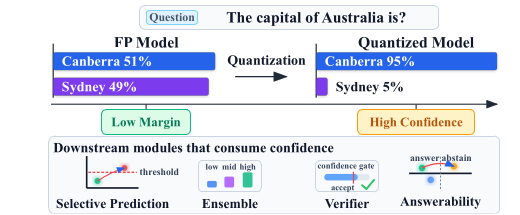
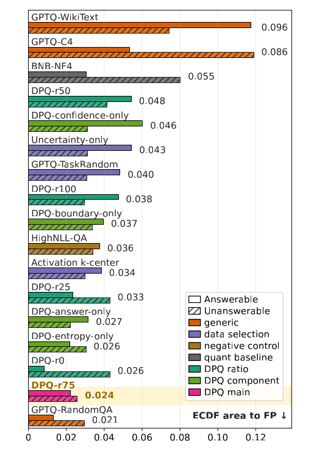
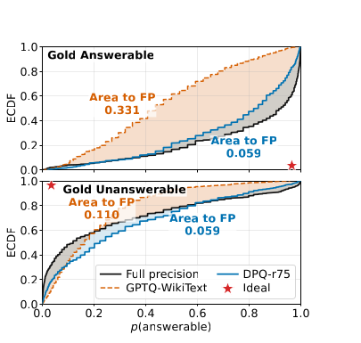
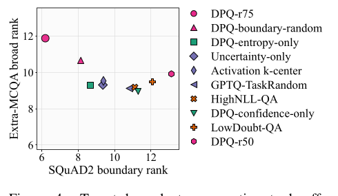
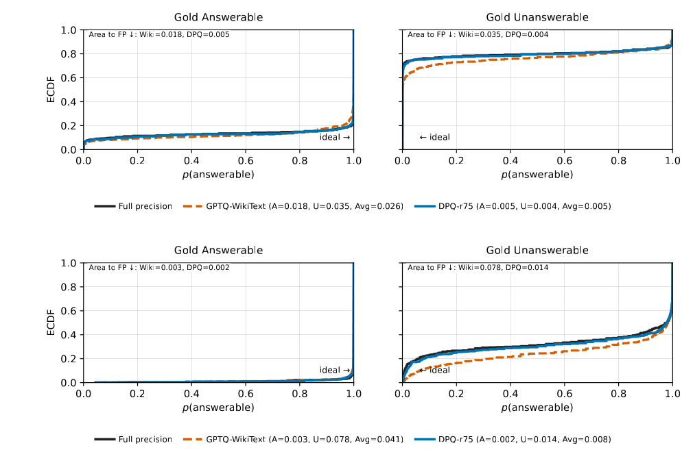

# 中文翻译：Target-Aware Calibration Data Selection for Preserving Uncertainty in Quantized Language Models（DPQ）

> 中文翻译（复述）：以下为 arXiv:2608.21019v1 的逐节中文复述，用自己的话转述原文内容，并非逐字翻译。表格、数字与公式保持与原文一致。论文：https://arxiv.org/abs/2608.21019 ，代码：https://github.com/xi-xiaoran/DPQ 。

作者：Zhen Yang、Sizai Hou、Kaiwen Zheng、Yaofang Liu、Liang He、Yixuan Chen、Kangning Cui（Yale、HKUST、HKUST(GZ)、CityU HK、上海光机所、Oxford、CityU HK (Dongguan)）。

## 摘要

量化被广泛用于部署大语言模型，但它对不确定性行为（置信度、margin、拒答/弃权）的影响很少被当作首要目标。本文把"量化时的校准数据选择"表述为一个**依赖目标的不确定性保持问题**：不同的部署场景关注输入分布的不同区域，而已有工作要么优化面向精度的压缩指标，要么在量化之后再调整分数。作者用"分布保持风险"和"边界保持风险"来形式化这一目标，并给出一个简单的混合失配（mixture-mismatch）论证，说明为什么不应指望某一个固定的校准配方适配所有目标。

作者提出 Doubt-Preserving Quantization（**DPQ**）：一族轻量的量化前配方，利用全精度（FP）模型的预测，构造由"高疑虑样本"与"通用锚点"混合而成的、与目标对齐的校准集。在 8 个语言模型、9 个 NLP 基准、22 种对比方法上，领先的固定配方随保持目标而变化：DPQ-r75 在 SQuAD2 可答性边界保持上领先；而较温和或单信号的变体（DPQ-r50、confidence-only、entropy-only）更能保持广义多选 QA 的行为。结论是：校准数据应当针对部署所需保持的具体 FP 分数行为来选择，而不是被当作量化中一个固定不变的细节。

## 1 引言

量化已成为在内存与算力受限条件下部署 LLM 的标准手段。GPTQ、AWQ、SmoothQuant、OmniQuant、LLM.int8()、SpQR 以及 QLoRA 风格的 4-bit 表示等权重量化/低比特后训练方法，让大模型能在小硬件上运行。然而大多数压缩评测仍然只看精度、困惑度或基准分数。对于依赖模型分数做拒答、重排序、集成、验证或可答性判断的应用，这并不完整：此时保持置信度、margin 与可答性决策，与保持 top-1 答案同样重要。

已有工作表明量化会使置信度发生偏移（Proskurina 等，2024），校准数据也会影响压缩质量（Williams 与 Aletras，2024），但校准数据的选择很少以"保持 FP 不确定性行为"为目标。



即使精度不变，这一区别也很重要。如图 1 所示，FP 模型可能给两个选项分配概率 $`(0.51, 0.49)`$ ，而其量化版本给出 $`(0.95, 0.05)`$ ；top-1 答案相同，但置信 margin 变了。这类偏移会改变下游依赖不确定性的决策，尤其是可答性检测：分数的微小变化就可能决定系统是否去回答一个本不可回答的问题。现有方法并没有直接针对这种"保持"问题：面向精度的校准数据研究（Williams 与 Aletras，2024）优化的是重建质量或标签精度；后验校准（Guo 等，2017；Zhong 等，2025）是在量化之后调整分数。温度类映射保持 argmax，无法修复决策翻转；更灵活的映射可以改善标签校准，但代价是让量化模型偏离 FP 行为。

因此作者把量化的校准数据选择表述为依赖目标的不确定性保持问题。广义的可答任务需要**分布保持**（选项概率、置信度、margin）；可答性/拒答为主的任务需要**边界保持**（低 margin 的回答/不回答决策）。作者把这两种目标形式化为两个保持风险，并给出混合失配论证：除非目标恰好一致，否则不应期待"边界样本 + 通用锚点"的某个固定混合比例适配所有目标。基于此提出 DPQ：一个轻量的量化前框架，用 FP 预测挑出高疑虑/可答性边界样本，与通用锚点混合，再运行不改动的量化器。实验上观察到这种目标依赖：DPQ-s128-r75 在 SQuAD2 可答性边界保持上最好，而广义 MCQA 偏好较温和或单信号配方（DPQ-r50、confidence-only、entropy-only）。后验与 AWQ 分析进一步表明：保持信号部分可迁移，但基于分数的指标仍然依赖具体量化器。

**贡献。**

- 问题：把量化的校准数据选择表述为保持 FP 不确定性行为，并针对不同部署目标给出分布风险与边界风险。
- 方法：给出混合失配论证，提出 DPQ 这一轻量、目标感知的配方族：用 FP 预测选出高疑虑/靠近边界的样本，与通用锚点混合，量化器保持不变。
- 评测：在 8 个模型、9 个基准、22 种对比方法上表明最优配方取决于保持目标：高边界比例的混合更好地保持可答性边界，较温和的配方更好地保持广义 MCQA 行为。

## 2 相关工作

**LLM 量化。** 后训练量化包括近似二阶的权重量化（GPTQ）、激活感知与激活平滑方法（AWQ、SmoothQuant）、8-bit 与 4-bit 表示（LLM.int8()、QLoRA），以及近期的低比特 PTQ 系统（ZeroQuant、OmniQuant、SpQR、SqueezeLLM、AQLM 类、QuIP#、QuaRot 等）。这些方法主要优化重建误差或下游精度。校准数据为量化提供支撑，但很少以保持置信度、margin 或拒答行为为明确目标来挑选。

**校准数据与数据选择。** Williams 与 Aletras（2024）说明校准数据会影响剪枝与量化；自校准（Williams 等，2025）让模型自己生成校准数据。本文研究的是另一个目标：选择校准数据以保持 FP 的不确定性行为。相关的数据选择方法（不确定性采样、core-set、梯度/表示多样性选择；Settles 2009、Sener 与 Savarese 2018、Ash 等 2020）原本用于提升数据效率，是有用的对照，但并不直接针对"量化 vs FP 的选项概率保持"，因此被作为基线纳入。

**置信度校准。** 校准在概率预测与评估中有悠久历史（Brier、Platt、Guo 等、Nixon 等等），选择性预测与不确定性估计也被广泛研究。对语言模型，已有工作研究 QA、提示、微调场景下的置信度、自我认知和"知道自己不知道"。这些工作主要分析 FP 模型、提示或直接微调，而非量化过程中的校准数据选择。

**后验校准。** Proskurina 等（2024）记录了低比特压缩下的置信度偏移；Zhong 等（2025）提出软提示式后验校准。它们都是在量化固定之后介入。温度类映射保持 argmax，不能修复决策或可答性翻转；灵活的分数空间校准器能改变决策，但可能偏离 FP 行为。本文则研究量化之前的校准数据选择。

## 3 问题表述

作者把量化的校准数据选择表述为带任务依赖目标的不确定性保持。§3.1 定义分布风险与边界风险；§3.2 解释为什么低 margin 样本在量化扰动下脆弱；§3.3 给出混合失配论证，为 §4 的 DPQ 设计空间提供动机。

### 3.1 保持风险

**选项打分。** 对输入 $`x`$ 与候选选项 $`\mathcal{Y}(x)=\lbrace y_1,\ldots,y_K\rbrace`$ ，FP 模型给每个选项一个分数 $`s_0(x,y_i)`$ ，并诱导出

```math
p_0(y_i \mid x)=\frac{\exp s_0(x,y_i)}{\sum_{j=1}^{K}\exp s_0(x,y_j)},
```
（式 1）

其中 $`s_0`$ 由条件语言模型似然算得。用校准集 $`\mathcal{D}`$ 得到的量化模型类似地给出分数 $`s^{Q}_{\mathcal{D}}(x,y_i)`$ 和概率 $`p^{Q}_{\mathcal{D}}(y_i\mid x)`$ 。标准精度只检查 top 选项是否等于标签；这里关心的是 $`p^{Q}_{\mathcal{D}}`$ 是否保持了 $`p_0`$ 的不确定性行为。在 SQuAD2 中，可答性被当作二选一， $`p(\mathrm{answerable})`$ 表示"可回答"选项的 softmax 概率。

**风险。** 期望取自目标评测分布。定义两个保持风险。第一个是

```math
\mathcal{R}_{\mathrm{dist}}(\mathcal{D})=\mathbb{E}_{x}\left[\mathrm{JSD}\left(p^{Q}_{\mathcal{D}}(\cdot\mid x),p_{0}(\cdot\mid x)\right)\right],
```
（式 2）

衡量量化引起的选项分布变化。第二个是

```math
\mathcal{R}_{\mathrm{bdry}}(\mathcal{D})=\mathbb{E}_{x}\left[\mathbf{1}\lbrace a^{Q}_{\mathcal{D}}(x)\neq a_{0}(x)\rbrace\, w(x)\right],
```
（式 3）

其中 $`a_0(x)=\arg\max_y p_0(y\mid x)`$ ， $`a^{Q}_{\mathcal{D}}(x)=\arg\max_y p^{Q}_{\mathcal{D}}(y\mid x)`$ 分别是 FP 与量化后的决策， $`w(x)\geq 0`$ 对可答性或低 margin 样本加权。当量化模型要作为 FP 模型的直接替代品（广义 MCQA、重排序、集成）时， $`\mathcal{R}_{\mathrm{dist}}`$ 重要；当可答性/拒答决策是核心（SQuAD2 可答性、安全过滤、选择性预测）时， $`\mathcal{R}_{\mathrm{bdry}}`$ 重要。

**指标。** 实证上用 ECE、adaptive ECE、NLL、Brier 分数，以及 FP 行为指标：FP 一致率、 $`\mathrm{JSD}(p^{Q}_{\mathcal{D}},p_0)`$ 、置信度偏移、top-two margin 漂移、margin 相关性。对 SQuAD2 另外报告边界精度偏差与可答率偏差，度量量化后的回答/弃答决策和回答率偏离 FP 多远。这些指标评价的是对全精度参照的保真度，而不是真值意义上的校准改善：FP 一致率和对 FP 的 JSD 衡量量化模型能否替换一个已验证过的 FP 模型接入下游消费分数的流水线。

### 3.2 边界脆弱性

不确定性行为在决策边界附近最脆弱。令 $`s_0(x)\in\mathbb{R}^K`$ 与 $`s^{Q}_{\mathcal{D}}(x)\in\mathbb{R}^K`$ 为 FP 与量化后的选项分数向量，定义 $`\Delta_{\mathcal{D}}(x)=s^{Q}_{\mathcal{D}}(x)-s_0(x)`$ 。令 $`i^*`$ 、 $`j^*`$ 为 FP 的最高与次高选项，margin 为 $`\gamma(x)=s_0(x,i^*)-s_0(x,j^*)>0`$ 。

**命题 1（top-two 边界脆弱性）。** 若 $`\Delta_{\mathcal{D}}(x,j^*)-\Delta_{\mathcal{D}}(x,i^*)>\gamma(x)`$ ，则 $`i^*`$ 与 $`j^*`$ 的相对顺序被量化翻转。反过来，若 $`\|\Delta_{\mathcal{D}}(x)\|_{\infty}<\gamma(x)/2`$ ，则 FP 的 top-1 决策被保持。

也就是说，小 margin 样本在小扰动下就会翻转，大 margin 样本则稳定。这并不意味着 GPTQ 直接优化选项分数，而是说明重建误差在哪里会变成行为误差。通用文本校准可能降低平均重建误差，却漏掉控制可答性和置信度的激活方向；边界感知的校准把这些脆弱方向暴露给量化器。

### 3.3 混合失配

两个风险强调输入空间的不同部分，作者用混合视角把这点明确化。

**混合视角。** 令 $`q_{\mathrm{bdry}}`$ 为边界/高疑虑样本的分布， $`q_{\mathrm{anchor}}`$ 为通用锚点（如 WikiText 或随机 QA）的分布。校准配方为 $`q_r=r\,q_{\mathrm{bdry}}+(1-r)\,q_{\mathrm{anchor}}`$ ，其中 $`r\in[0,1]`$ 是 DPQ 使用的边界比例；例如 DPQ-r75 对应 $`r=0.75`$ 。目标保持分布为 $`T_\theta=\theta q_{\mathrm{bdry}}+(1-\theta)q_{\mathrm{anchor}}`$ 。可答性边界保持对应较大的 $`\theta`$ ，广义可答 MCQA 保持对应较小的 $`\theta`$ 。

**固定配方。** 通用文本校准（WikiText、C4）大致对应 $`r\approx 0`$ ；仅边界或仅可答性的变体对应 $`r\approx 1`$ 。难例挖掘选择的是另一块区域：一个样本可能"自信地答错"，NLL 高且 margin 大，却并不不确定；因此高 NLL $`\neq`$ 高疑虑。后验校准介入的阶段不同：温度映射保持 argmax，修复不了翻转；灵活映射能改变决策，但可能偏离 FP 行为。这些固定选择无法匹配所有目标，形式化陈述见附录 C。

**命题 2（混合比例失配）。** 设 $`\ell_{\mathcal{D}}(x)\in[0,1]`$ 为校准集 $`\mathcal{D}`$ 下有界的保持损失，定义 $`R_P(\mathcal{D})=\mathbb{E}_{x\sim P}[\ell_{\mathcal{D}}(x)]`$ 。对任意两个分布 $`T`$ 与 $`q`$ ，

```math
|R_T(\mathcal{D})-R_q(\mathcal{D})|\leq \mathrm{TV}(T,q).
```

若 $`q_{\mathrm{bdry}}`$ 与 $`q_{\mathrm{anchor}}`$ 的支撑集不相交，则

```math
\mathrm{TV}(T_\theta,q_r)=|\theta-r|,
```
（式 4）

故失配上界在 $`r^*=\theta`$ 处最小。于是若两个目标的 $`\theta_1\neq\theta_2`$ ，则不存在同时使两者失配最小的单一 $`r`$ 。

证明与行为风险代理见附录 C.3。该结果应视为设计原则，而非某个量化器上最佳比例的精确预测。它促使我们评估依赖目标的混合，并把经验上的胜者解读为"目标-配方匹配"，而不是期待某个固定配方在所有目标上占优。DPQ 提供这一设计空间，实验检验目标-配方匹配。

## 4 方法

**算法 1：DPQ 校准数据选择**

- 输入：FP 模型 $`M`$ ；候选池 $`C`$ ；校准集大小 $`s`$ ；混合比例 $`r`$ 。输出：校准集 $`\mathcal{D}`$ ， $`|\mathcal{D}|=s`$ 。
1. 用 $`M`$ 给每个 $`x\in C`$ 打分，得到 $`p_0(\cdot\mid x)`$ 。
2. 对每个 $`x\in C`$ 计算 $`b(x)=1-\left(p_{0,(1)}(x)-p_{0,(2)}(x)\right)`$ 。
3. 选出按 $`b(x)`$ 排名前 $`\lfloor sr\rfloor`$ 的候选作为 $`C_{\mathrm{hi}}`$ （对 SQuAD2 边界数据做可答/不可答平衡）。
4. 从 WikiText 或 RandomQA 抽取 $`s-\lfloor sr\rfloor`$ 个锚点作为 $`C_{\mathrm{anc}}`$ 。
5. 用原始 prompt 加 FP 的 top 选项，由 $`C_{\mathrm{hi}}`$ 构造 $`D_{\mathrm{hi}}`$ 。
6. 令 $`\mathcal{D}\leftarrow D_{\mathrm{hi}}\cup C_{\mathrm{anc}}`$ 。
7. 以校准集 $`\mathcal{D}`$ 运行未改动的 GPTQ。

DPQ 是面向 GPTQ 类后训练量化的量化前校准数据选择策略。它不改变量化核、位宽、重建目标或推理路径，只改变用来估计激活统计的校准字符串。下面分别从校准选择视角（§4.1）与疑虑准则（§4.2）说明。

### 4.1 校准选择

GPTQ 用校准集 $`\mathcal{D}`$ 估计逐层的激活统计来求解局部重建问题，因此 $`\mathcal{D}`$ 决定了哪些激活区域被精确表示。作者把校准选择看作从分布 $`q`$ 中选 $`\mathcal{D}`$ ，使 $`q`$ 逼近 §3.3 的目标保持分布 $`T_\theta`$ 。命题 2 提示应按边界与锚点的目标混合来分配校准质量。

候选池 $`C`$ 由两部分组成：ARC-Challenge 训练集样本（提供可答 QA 结构），以及 SQuAD2 可答性样本（提供平衡的可答/不可答边界案例）。实现中每个来源各 512 个候选，之后再做模型相关的打分。FP 模型在评测的选项打分协议下对 $`C`$ 打分一次，得到 $`\lbrace p_0(\cdot\mid x)\rbrace_{x\in C}`$ ；这是离线选择成本，不增加推理开销。评测样本从不用于校准，且同一个候选池在所有 DPQ 变体间复用。这一设置体现了校准选择的部署视角：候选池提供与目标相关的候选，DPQ 决定池内哪些样本最能保持所需的 FP 行为。

### 4.2 基于疑虑的选择

对候选 $`x`$ ，令 $`p_{0,(1)}(x)`$ 与 $`p_{0,(2)}(x)`$ 为 FP 选项概率的最大与次大值。定义疑虑分数

```math
b(x)=1-\left(p_{0,(1)}(x)-p_{0,(2)}(x)\right),
```
（式 5）

低 margin 样本得分高，这正是命题 1 指出的脆弱区域。为隔离各信号的作用，还评估了把 $`b(x)`$ 替换掉的组件变体：confidence-only 用 $`1-p_{0,(1)}(x)`$ ，entropy-only 用 $`H(p_0(\cdot\mid x))`$ ，answerability-only 用可答性 log-odds，难例挖掘用金标签 NLL。

给定预算 $`s`$ 与混合比例 $`r\in[0,1]`$ ，DPQ 选出 $`b(x)`$ 最高的 $`\lfloor sr\rfloor`$ 个候选作为边界字符串，其余 $`s-\lfloor sr\rfloor`$ 个锚点字符串从 WikiText 风格文本和 RandomQA 风格校准中抽取。每个边界字符串把原 prompt 与 FP 的 top 选项拼接；锚点保持原样。该构造在各 DPQ 变体间固定，因此消融比较的是在同一校准字符串设计下的选择信号、比例与预算。比例 $`r`$ 即 §3.3 的混合权重：较高的 $`r`$ 针对 SQuAD2 可答性这类边界密集场景，较低的 $`r`$ 针对更广义的可答行为。比例、规模、边界与组件变体在第 5 节作为受控的 DPQ 配方评估。由于 DPQ 只改变校准字符串，所得模型与标准 GPTQ 基线形态相同，不增加推理成本。因此 DPQ 最好被看作一个目标感知的配方族，而非单一通用校准集。

## 5 实验结果

### 5.1 设置

**评测范围。** 评测 8 个语言模型，覆盖三个家族与多种规模：Qwen2.5-0.5B/1.5B/3B/7B；Llama-3.2-1B、Llama-3.2-3B 与 Llama-3.1-8B；Mistral-7B-v0.3。基准共 9 个 NLP 数据集，按保持目标分组。"old-core" 套件包括 ARC-Challenge、SQuAD2 可答性、TruthfulQA；其中 SQuAD2 是主要的边界保持基准，因为它直接检验可答与不可答的决策，ARC-Challenge 和 TruthfulQA 则提供分数行为的额外检查。"extra-MCQA" 套件包括 ARC-Easy、BoolQ、PIQA、HellaSwag、OpenBookQA、CommonsenseQA；这些样本都是可答的，主要检验广义分布保持。

**方法与排名。** 对每个模型-数据集组合，主对比包含一个全精度参照和 22 种对比方法：BNB-NF4；通用及任务格式的 GPTQ 校准（WikiText、C4、RandomQA、TaskRandom）；DPQ 的比例、规模、边界与组件变体；数据选择基线；负对照；后验对照。所有主要量化基线都是 4-bit；BNB-NF4 作为 NF4 量化器家族的基线，GPTQ 变体之间只有校准数据不同。完整方法清单、prompt 格式与量化超参见附录 D。排名使用与目标对齐的指标：SQuAD2 边界保持用边界精度偏差、可答率偏差、FP 一致率与 JSD；广义 MCQA 保持用 FP 一致率、JSD、margin 漂移、置信度偏移、精度偏差与 margin 相关性。每个目标内各指标等权，作为中性汇总，因为未假设具体部署的效用函数。排名在 8 个模型上取平均，仅作紧凑摘要；结论依赖分指标与目标特定的趋势，而不仅依赖排名。原始指标与分数据集拆分见附录 A。

| Method | Acc. | ECE | NLL | Brier |
|---|---|---|---|---|
| BNB-NF4 | 84.7 | 66.7 | 84.7 | 81.9 |
| GPTQ-RandomQA | 83.3 | 61.1 | 76.4 | 86.1 |
| GPTQ-WikiText | 76.4 | 58.3 | 63.9 | 83.3 |
| GPTQ-C4 | 83.3 | 65.3 | 68.1 | 77.8 |
| DPQ-s128-r75 | 80.6 | 62.5 | 70.8 | 83.3 |
| DPQ-s128-r50 | 79.2 | 58.3 | 65.3 | 80.6 |

表 1：低比特量化经常使精度与校准指标变差。各列为"比 FP 更差"的模型-数据集设置所占百分比（Worse than FP, %，越低越好）。完整结果见表 11。



### 5.2 量化引起的漂移

表 1 确立了经验上的问题：在有代表性的量化与校准选择下，退化不仅频繁出现在精度上，也出现在 ECE、NLL、Brier 等对校准敏感的指标上。可见低比特量化改变的不只是最终答案，还有分数行为。包含置信度偏移与 margin 漂移的完整退化表见表 11。特别地，附录 B.1 的表 12 显示量化压缩了正确与错误样本之间的置信度间隔，尽管绝对置信度偏移的方向依任务而异。

这引出后面的目标特定分析：既然量化引起的漂移普遍存在，哪些校准数据选择最能保持各部署目标所需的不确定性行为？作者分别回答可答性边界保持与广义 MCQA 保持。

| Method | Rank ↓ | Agr. ↑ | Acc Δ ↓ | Rate Δ ↓ | JSD ↓ |
|---|---|---|---|---|---|
| DPQ-s128-r75 | 6.20 | 0.8495 | 0.2125 | 0.1000 | 0.0158 |
| DPQ-boundary-random | 8.15 | 0.8413 | 0.2310 | 0.1135 | 0.0174 |
| DPQ-answerability-only | 8.18 | 0.8286 | 0.2592 | 0.1281 | 0.0205 |
| DPQ-entropy-only | 8.68 | 0.8270 | 0.2940 | 0.1470 | 0.0227 |
| DPQ-boundary-only | 9.06 | 0.8335 | 0.2520 | 0.1242 | 0.0197 |
| Uncertainty-only | 9.36 | 0.8261 | 0.2937 | 0.1461 | 0.0181 |
| Activation k-center | 9.39 | 0.8360 | 0.2530 | 0.1255 | 0.0187 |
| DPQ-s128-r0 | 10.31 | 0.8097 | 0.3205 | 0.1598 | 0.0220 |
| GPTQ-RandomQA | 11.09 | 0.8266 | 0.2733 | 0.1351 | 0.0231 |
| DPQ-s128-r100 | 12.44 | 0.8080 | 0.3340 | 0.1655 | 0.0215 |
| DPQ-s128-r50 | 13.12 | 0.8140 | 0.3210 | 0.1602 | 0.0258 |
| GPTQ-WikiText | 17.29 | 0.7446 | 0.4553 | 0.2271 | 0.0387 |

表 2：SQuAD2 可答性边界保持。Rank 聚合了与 FP 的一致率（Agr.）、边界精度偏差（Acc Δ）、可答率偏差（Rate Δ）与 JSD，在 8 个模型上统计；除 Agr. 外越低越好。完整消融见表 7。



### 5.3 可答性边界

表 2 给出核心的 SQuAD2 可答性边界结果。DPQ-s128-r75 是所列量化前配方中最强的：聚合排名最好、与 FP 的一致率最高，边界精度偏差、可答率偏差与 JSD 也都最小。与 GPTQ-WikiText 相比，边界精度偏差从 0.4553 降到 0.2125，可答率偏差从 0.2271 降到 0.1000，JSD 从 0.0387 降到 0.0158。结论并不单靠排名：同一配方在绝对的边界与分布指标上也有改善。图 2 提供了互补的部署尺度视角，显示 DPQ-r75 属于最接近 FP 可答性分布的配方之列。综合来看，边界密集的目标受益于高疑虑的校准样本，而混合的 r75 配方也说明通用锚点是必要的。去掉 Llama-3.2-1B 这一压力案例后排序保持稳定，见表 6。

**分布层面的机制。** 图 3 给出 Llama-3.1-8B 上 SQuAD2 结果的分布视图。对金标为可答的样本， $`p(\mathrm{answerable})`$ 应保持接近 1；对金标为不可答的样本，应保持接近 0。通用的 GPTQ-WikiText 校准使可答性分布偏离 FP，尤其在可答样本上，而 DPQ-r75 把它拉回到更接近 FP 参照的位置。这说明 SQuAD2 可答性不只是"更难的 MCQA"：可答性翻转改变的是系统是否应当回答。这一现象与对该目标使用边界密集的混合相一致，而下面的消融表明锚点对稳定性仍然必要。Qwen2.5-7B 与 Mistral-7B-v0.3 的额外 ECDF 诊断（附录 A.1）显示同样的定性规律。

| Check | Main finding |
|---|---|
| 边界比例 $`r`$ | DPQ-r75 表现最好。较高的边界比例有帮助，但只用边界样本会使校准集过度集中。 |
| 校准规模 $`s`$ | 校准集的构成比单纯增大校准预算更重要。 |
| 边界混合 | 混合校准优于仅边界的变体，说明通用锚点能稳定以边界为中心的选择。 |
| 单信号变体 | confidence-only、entropy-only、answerability-only 变体有用，但都比不上混合的 DPQ-r75 配方。 |
| 负对照 | HighNLL-QA 与 LowDoubt-QA 不及 DPQ-r75，说明高疑虑不同于普通的难例或易例选择。 |

表 3：SQuAD2 边界目标的消融摘要。完整结果见附录 A.1。

**消融摘要。** 附录 A.1 的消融检验了比例、规模、边界混合、单信号组件与负对照。如表 3 所总结，收益主要来自校准集的构成而非预算大小：r75 最好，r100 在边界案例上过度集中，仅边界或单信号变体比不上混合配方。强的数据选择基线相对通用文本校准有所提升，但在边界特定的聚合上仍低于 DPQ-r75。这些消融检验了校准集的主要选择轴；边界字符串的构造方式作为 DPQ 配方的一部分被固定。



### 5.4 广义 MCQA 的权衡

六个 extra-MCQA 基准只含可答样本，因此相关目标是广义的 FP 行为保持（ $`\mathcal{R}_{\mathrm{dist}}`$ ），而非可答性边界保持。表 4 显示，领先配方因此偏离高边界设置：confidence-only、task-random、HighNLL-QA、entropy-only、uncertainty-only 与 DPQ-r50 都比 DPQ-r75 更有竞争力。这与混合视角吻合：当目标在可答性边界上的质量较少时，较小的边界比例或单一不确定性信号能更好地保持广义选项分布行为。图 4 把同一种目标依赖可视化：DPQ-r75 在 SQuAD2 边界轴上更强，而较温和或单信号的配方在广义 MCQA 上更强。各指标列也说明表 4 应被当作权衡而非单一标量排行榜：BNB-NF4 的一致率与 JSD 最强，但在完整多指标目标下其他配方排名更高。附录 A.2 的扩展 extra-MCQA 结果支持"配方随目标迁移"，附录 B.1 的校准差距与正确-错误置信度诊断进一步表明量化可能以 top-1 精度捕捉不到的方式改变分数行为。

| Method | Rank ↓ | Top-5 ↑ | Agr. ↑ | JSD ↓ |
|---|---|---|---|---|
| DPQ-confidence-only | 8.96 | 7 | 0.8357 | 0.0284 |
| GPTQ-TaskRandom | 9.12 | 11 | 0.8361 | 0.0276 |
| HighNLL-QA | 9.18 | 6 | 0.8327 | 0.0294 |
| DPQ-entropy-only | 9.30 | 10 | 0.8324 | 0.0296 |
| Uncertainty-only | 9.31 | 4 | 0.8318 | 0.0297 |
| LowDoubt-QA | 9.47 | 9 | 0.8328 | 0.0286 |
| Activation k-center | 9.53 | 12 | 0.8349 | 0.0299 |
| DPQ-s128-r50 | 9.92 | 4 | 0.8322 | 0.0293 |
| BNB-NF4 | 10.53 | 12 | 0.8637 | 0.0241 |
| DPQ-s128-r75 | 11.88 | 3 | 0.8180 | 0.0324 |

表 4：六个可答数据集上的广义 MCQA 保持。Rank 聚合了与 FP 的一致率（Agr.）、JSD、margin 漂移、置信度偏移、精度偏差与 margin 相关性；Top-5 统计方法排进前五的模型-数据集对数。与 SQuAD2 边界目标不同，这里领先的是温和、单信号或广义选择的配方。

**实用结论。** 部署时应依据与下游用途匹配的保持指标来选配方。若验证样本体现可答性、拒答或其他低 margin 决策，则边界密集的混合配方（如 DPQ-r75）是强选择；若目标主要使用可答 MCQA 任务上的广义选项分数，则较温和或单信号的配方更合适。所以 DPQ 应作为目标感知的配方族来使用，而不是仅凭任务精度选出的通用校准集。

**负对照。** 负对照进一步澄清了目标的转移。HighNLL-QA 与 LowDoubt-QA 在广义 MCQA 上有竞争力，在 SQuAD2 上则不然，这与附录 C.4 形式化的"难度不同于疑虑"相符。普通的难例或易例可能与广义可答不确定性重叠，但并不是可答性边界样本。

**后验校准针对不同的目标。** 后验校准针对面向标签的校准或任务精度，而本文的目标是保持 FP 分数行为；表 5 说明了这一区别。如命题 5 所预期，自适应温度不改变精度和与 FP 的一致率，但会增大 JSD 与 margin 漂移。灵活的分数空间校准器提升了 MCQA 精度，但降低与 FP 的一致率并增加分布漂移。所以后验校准与量化前选择是互补的介入点：前者在量化后重塑分数，后者控制量化模型倾向保持哪种 FP 分数行为。附录 B.2 的最优拟合温度检查支持同样的互补模式。

| Method | Acc. ↑ | Agr. ↑ | JSD ↓ | Margin Δ ↓ |
|---|---|---|---|---|
| Base | 0.6833 | 0.8245 | 0.0320 | 0.1533 |
| Adaptive temp. | 0.6833 | 0.8245 | 0.0445 | 0.2385 |
| Option bias | 0.6985 | 0.8147 | 0.0328 | 0.1591 |
| Vector | 0.7029 | 0.7773 | 0.0519 | 0.2344 |
| Matrix | 0.6992 | 0.7723 | 0.0550 | 0.2380 |
| Dirichlet | 0.6989 | 0.7740 | 0.0548 | 0.2400 |
| Isotonic | 0.6991 | 0.7710 | 0.0561 | 0.2329 |

表 5：extra-MCQA 上的后验校准。灵活的校准器提升精度，但降低与 FP 的一致率并增加分布漂移。

**AWQ 迁移。** AWQ 扩展是对量化器家族范围的检查。在 7B/8B 规模的模型上，DPQ-r75 在 AWQ 的平均排名、top-1 频率与 FP 一致率上领先；其平均排名为 1.97，top-1 频率 42.9%，top-2 频率 73.0%。但表 10 的分数据集拆分显示，基于分数的指标在某些数据集上可能偏向通用校准。因此目标感知的视角部分可迁移，但具体配方应针对量化器与指标来调；分数据集拆分见附录 A.4，聚合摘要见附录 B.3。

## 6 结论

评估量化不应只看它是否保持模型的 top-1 答案。在依赖置信度、margin、选择性预测、拒答或重排序的应用里，量化模型可能保留同样的预测，却改变下游使用的不确定性行为。本文把校准数据选择作为依赖目标的不确定性保持问题来研究，并表明不同目标偏好不同配方：像 DPQ-r75 这样的高边界混合更好地保持 SQuAD2 式可答性边界，而较温和的混合或单信号变体更好地保持广义 MCQA 行为。核心洞见不是"某个校准集普遍最好"，而是校准数据应针对部署所需保持的具体 FP 分数行为来选择。更广义地说，量化前的数据选择、量化后的校准与量化器选择对保持的影响各不相同，所以配方应同时根据目标行为与量化方法来调整。

## 局限性

**选项打分式的不确定性。** 作者通过选项打分和可答性来操作化不确定性。这一受控设置使置信度、margin 与 FP 一致率可直接测量，并覆盖多选 QA、选择性预测、拒答与重排序等常见用途。把同样的保持视角扩展到口头置信度和长文本生成是重要的未来方向，因为这些场景中的不确定性可能体现在生成文本里而非选项概率里。

**面向目标的候选池。** 候选池有意以目标为导向：包含可答 QA 样本与可答性风格的训练样本，因为主要的边界目标是可答/不可答的保持。这一设计符合研究部署感知的校准选择的目的，即校准池应反映想要保持的行为。未来工作可检验与目标不那么对齐或存在域偏移的候选池，以考察同样的选择原则能迁移到多广；部署中也应在广义保持指标上核查目标特定的收益，确保所选配方在主目标之外仍然合适。

**量化器与位宽范围。** 主实验聚焦于 GPTQ 式校准数据选择，因为 GPTQ 直接使用校准字符串估计激活统计。AWQ 与 BNB-NF4 作为量化器家族检查被纳入，结果表明部分保持信号可迁移，而基于分数的指标仍依赖具体量化器。更广泛地扫描量化器与位宽将能进一步细化针对部署的校准配方。

**与后验校准的相互作用。** 后验分析覆盖了有代表性的分数空间方法，用来区分量化前数据选择与量化后的分数修复。实验表明两个阶段可能优化不同目标，并可能互补。如何把目标感知的校准选择与后验校准结合起来，是值得进一步研究的方向。

**部署风险。** 量化后的不确定性漂移可能以仅看 top-1 精度看不出的方式影响下游决策。在拒答、分诊、教育 QA、医疗或法律辅助、安全过滤等场景，偏移的置信度或可答性边界可能使系统在应当推迟时作答，或抑制有用的回答。这强化了审计量化模型的必要性：不仅看精度，也要看下游决策模块所消费的分数行为。

## 致谢

本工作得到香港城市大学（东莞）启动基金支持。生成式 AI 工具仅用于语言润色与语法修改。

## 参考文献

（略，原文列出约 60 条参考文献，包括 GPTQ、AWQ、SmoothQuant、OmniQuant、LLM.int8()、QLoRA、SpQR、QuIP#、QuaRot、Williams 与 Aletras 2024、Proskurina 等 2024、Zhong 等 2025、Guo 等 2017 等；此处不逐条复述。）

## 附录 A 补充实验结果

本附录收集支撑正文、但过于细节而未放入正文的证据。组织如下：§A.1 报告可答性边界目标上的稳定性检查与消融；§A.2 报告广义保持诊断；§A.3 分析后验校准；§A.4 给出 AWQ 量化器家族扩展。§A.1 使用可答性边界排名，§A.2 使用广义 FP 行为保持，因此同一方法可能在一个目标下很强、在另一个目标下只是中等。最有代表性的证据保留在本附录主体中，广义保持、后验校准与 AWQ 迁移的额外诊断收集在附录 B。

### A.1 可答性边界目标上的稳定性与消融

**核心结果的稳定性。** 表 6 在去掉 Llama-3.2-1B 压力案例后重复 SQuAD2 可答性分析。排序保持一致：DPQ-s128-r75 仍居第一，其 FP 一致率升至 0.9360。

| Method | Rank ↓ | Agr. ↑ | Acc Δ ↓ | Rate Δ ↓ | JSD ↓ |
|---|---|---|---|---|---|
| DPQ-s128-r75 | 6.26 | 0.9360 | 0.0331 | 0.0094 | 0.0088 |
| DPQ-answerability-only | 7.50 | 0.9250 | 0.0569 | 0.0267 | 0.0100 |
| DPQ-entropy-only | 7.66 | 0.9263 | 0.0891 | 0.0446 | 0.0091 |
| DPQ-boundary-random | 8.26 | 0.9326 | 0.0411 | 0.0183 | 0.0093 |
| DPQ-boundary-only | 8.61 | 0.9316 | 0.0460 | 0.0210 | 0.0099 |
| GPTQ-ActivationKCenter | 9.39 | 0.9294 | 0.0606 | 0.0291 | 0.0105 |
| Uncertainty-only | 9.67 | 0.9139 | 0.1197 | 0.0590 | 0.0109 |
| DPQ-s64-r50 | 9.71 | 0.9224 | 0.0769 | 0.0364 | 0.0100 |

表 6：去掉 Llama-3.2-1B 压力案例后的 SQuAD2 可答性边界保持。r75 的主要结果保持稳定。

**可答性分布诊断。** 图 5 对 Qwen2.5-7B 与 Mistral-7B-v0.3 给出同样的 SQuAD2 可答性分布诊断，比较全精度、GPTQ-WikiText 与 DPQ-r75 的 $`p(\mathrm{answerable})`$ ECDF。与图 3 一起看，这些图表明该效应不是单个模型的假象：DPQ-r75 一般能减小量化引起的可答性分布漂移，而残余漂移的方向与幅度依模型而异。



**边界目标的消融。** 表 7 给出按轴分组的完整消融网格。混合比例是非单调的：r0 与 r100 都落后于 r75，说明边界质量应当高但不应排他。规模扫描显示 128 个样本的构成比放大到 64 或 256 更重要。仅边界和 boundary-random 低于 r75，支持通用锚点的作用；各单信号组件都有信息量，但都比不上混合配方。负对照（HighNLL-QA、LowDoubt-QA）在边界精度偏差上落后 r75 至少 $`0.09`$ ，区分了难度与疑虑（附录 C.4）。强数据选择基线（Activation k-center、Uncertainty-only、TaskRandom、RandomQA、自校准）相比通用 WikiText/C4 校准有所改善，但在边界特定的聚合上仍低于 DPQ-r75。

| Group | Method | Rank ↓ | Agr. ↑ | Acc Δ ↓ | Rate Δ ↓ | JSD ↓ |
|---|---|---|---|---|---|---|
| Reference | DPQ-s128-r75 | 6.20 | 0.8495 | 0.2125 | 0.1000 | 0.0158 |
| Ratio / size | DPQ-s64-r50 | 10.18 | 0.8245 | 0.2800 | 0.1382 | 0.0197 |
| Ratio / size | DPQ-s256-r50 | 11.18 | 0.8240 | 0.2870 | 0.1425 | 0.0235 |
| Ratio / size | DPQ-s128-r0 | 10.31 | 0.8097 | 0.3205 | 0.1598 | 0.0220 |
| Ratio / size | DPQ-s128-r25 | 12.06 | 0.8106 | 0.3277 | 0.1639 | 0.0214 |
| Ratio / size | DPQ-s128-r50 | 13.12 | 0.8140 | 0.3210 | 0.1602 | 0.0258 |
| Ratio / size | DPQ-s128-r100 | 12.44 | 0.8080 | 0.3340 | 0.1655 | 0.0215 |
| Boundary mix | DPQ-boundary-random | 8.15 | 0.8413 | 0.2310 | 0.1135 | 0.0174 |
| Boundary mix | DPQ-boundary-only | 9.06 | 0.8335 | 0.2520 | 0.1242 | 0.0197 |
| Single signal | DPQ-answerability-only | 8.18 | 0.8286 | 0.2592 | 0.1281 | 0.0205 |
| Single signal | DPQ-entropy-only | 8.68 | 0.8270 | 0.2940 | 0.1470 | 0.0227 |
| Single signal | DPQ-confidence-only | 11.30 | 0.8033 | 0.3460 | 0.1725 | 0.0221 |
| Neg. control | HighNLL-QA | 11.11 | 0.8191 | 0.3047 | 0.1514 | 0.0201 |
| Neg. control | LowDoubt-QA | 12.09 | 0.8177 | 0.3110 | 0.1532 | 0.0202 |
| Data selection | GPTQ-ActivationKCenter | 9.39 | 0.8360 | 0.2530 | 0.1255 | 0.0187 |
| Data selection | Uncertainty-only | 9.36 | 0.8261 | 0.2937 | 0.1461 | 0.0181 |
| Data selection | GPTQ-TaskRandom | 10.81 | 0.8240 | 0.2920 | 0.1445 | 0.0216 |
| Data selection | GPTQ-RandomQA | 11.09 | 0.8266 | 0.2733 | 0.1351 | 0.0231 |
| Data selection | GPTQ-SelfCalib | 13.24 | 0.8129 | 0.3037 | 0.1509 | 0.0268 |
| Data selection | GPTQ-C4 | 15.78 | 0.7594 | 0.4107 | 0.2034 | 0.0342 |
| Data selection | GPTQ-WikiText | 17.29 | 0.7446 | 0.4553 | 0.2271 | 0.0387 |

表 7：SQuAD2 可答性上的边界目标消融网格。方法按消融轴分组；列同表 2。Acc Δ 与 Rate Δ 分别表示边界精度偏差与可答率偏差。

### A.2 广义保持诊断

当目标从 SQuAD2 可答性边界转向广义 FP 行为保持时，边界密集的 DPQ-r75 混合不应占优。表 8 在六个可答的 extra-MCQA 数据集上扩展表 4，是支撑 §5.4"目标依赖"论断最具代表性的广义目标排行榜。confidence-only、TaskRandom、HighNLL-QA、entropy-only 与 uncertainty-only 都排在 DPQ-r75 之前；BNB-NF4 的 FP 一致率与 JSD 最强，却不是平均排名最好的，说明在完整多指标目标下只保持某一类指标是不够的。校准差距普遍性与正确-错误置信度分解的额外诊断见附录 B.1；它们进一步表明量化可以改变置信度与 margin 行为，而 top-1 精度对此给出的图景并不完整。

| Method | Family | Rank ↓ | Top-5 ↑ | Agr. ↑ | JSD ↓ | Margin Δ ↓ |
|---|---|---|---|---|---|---|
| DPQ-confidence-only | DPQ component | 8.96 | 7 | 0.8357 | 0.0284 | 0.1447 |
| GPTQ-TaskRandom | Selection baseline | 9.12 | 11 | 0.8361 | 0.0276 | 0.1452 |
| HighNLL-QA | Negative control | 9.18 | 6 | 0.8327 | 0.0294 | 0.1478 |
| DPQ-entropy-only | DPQ component | 9.30 | 10 | 0.8324 | 0.0296 | 0.1473 |
| Uncertainty-only | Selection baseline | 9.31 | 4 | 0.8318 | 0.0297 | 0.1471 |
| LowDoubt-QA | Negative control | 9.47 | 9 | 0.8328 | 0.0286 | 0.1472 |
| GPTQ-ActivationKCenter | Selection baseline | 9.53 | 12 | 0.8349 | 0.0299 | 0.1483 |
| DPQ-s128-r50 | DPQ mixed | 9.92 | 4 | 0.8322 | 0.0293 | 0.1454 |
| BNB-NF4 | Quantizer baseline | 10.53 | 12 | 0.8637 | 0.0241 | 0.1320 |
| DPQ-boundary-random | DPQ mixed | 10.66 | 8 | 0.8279 | 0.0311 | 0.1513 |
| DPQ-s128-r75 | DPQ mixed | 11.88 | 3 | 0.8180 | 0.0324 | 0.1562 |

表 8：六个可答数据集上扩展的广义 MCQA 保持。该表在表 4 的主要摘要上增加了方法家族与 margin 漂移。

### A.3 后验校准分析

**两个套件上的后验结果。** 表 9 把主文的后验分析（表 5）扩展到 old-core 与 extra-MCQA 两个套件，最能代表各后验家族在 FP 行为指标上的表现。自适应温度不改变精度与 FP 一致率，但增大 JSD 与 margin 漂移，与命题 5 一致。灵活的校准器（vector、matrix、Dirichlet、isotonic）提升精度（尤其在 old-core 上），同时降低 FP 一致率并增大分布漂移，与命题 6 一致。所以两个阶段服务于不同目标：后验校准重塑分数，而量化前数据选择从一开始就控制保持哪种行为。附录 B.2 报告的最优拟合温度缩放检查支持"互补而非替代"的同一结论。

| Suite | Method | Rows | Acc. ↑ | Agr. ↑ | JSD ↓ | Margin Δ ↓ |
|---|---|---|---|---|---|---|
| Old-core | Base | 72 | 0.6196 | 0.7906 | 0.0364 | 0.1609 |
| Old-core | Adaptive temp. | 72 | 0.6196 | 0.7906 | 0.0605 | 0.2892 |
| Old-core | Option bias | 72 | 0.5991 | 0.7811 | 0.0410 | 0.1876 |
| Old-core | Vector | 72 | 0.7985 | 0.6875 | 0.1360 | 0.3099 |
| Old-core | Matrix | 72 | 0.7925 | 0.6796 | 0.1404 | 0.3146 |
| Old-core | Dirichlet | 72 | 0.7929 | 0.6817 | 0.1403 | 0.3162 |
| Old-core | Isotonic | 72 | 0.7983 | 0.6883 | 0.1398 | 0.2990 |
| Extra-MCQA | Base | 1056 | 0.6833 | 0.8245 | 0.0320 | 0.1533 |
| Extra-MCQA | Adaptive temp. | 1056 | 0.6833 | 0.8245 | 0.0445 | 0.2385 |
| Extra-MCQA | Option bias | 1056 | 0.6985 | 0.8147 | 0.0328 | 0.1591 |
| Extra-MCQA | Vector | 1056 | 0.7029 | 0.7773 | 0.0519 | 0.2344 |
| Extra-MCQA | Matrix | 1056 | 0.6992 | 0.7723 | 0.0550 | 0.2380 |
| Extra-MCQA | Dirichlet | 1056 | 0.6989 | 0.7740 | 0.0548 | 0.2400 |
| Extra-MCQA | Isotonic | 1056 | 0.6991 | 0.7710 | 0.0561 | 0.2329 |

表 9：old-core 与 extra-MCQA 套件上的后验家族摘要。灵活的校准器能提升精度，但常常降低与 FP 的一致率并增大分布漂移。

### A.4 AWQ 量化器家族扩展

AWQ 扩展覆盖全部 8 个模型、3 个 old-core 数据集与 4 种 AWQ 校准配方（WikiText、RandomQA、DPQ-r75、DPQ-r50），共 $`8\times 3\times 4=96`$ 次评测，用来检验 GPTQ 下观察到的校准数据信号能否迁移到另一个量化器家族。在 AWQ 上，基于分数的指标（Acc、ECE、NLL、Brier）并不总与 FP 行为指标（FP 一致率、对 FP 的 JSD）偏向同一配方，因此聚合指标平均值与基于排名的摘要分别在附录 B.3 报告。附录 B.3 的聚合摘要显示同样的混合模式：通用校准可能赢得基于分数的指标，而 DPQ 变体在若干 FP 行为与基于排名的摘要上更强。在 7B/8B 子集（Qwen2.5-7B、Llama-3.1-8B、Mistral-7B-v0.3）上，DPQ-r75 还在精度、Brier、FP 一致率与基于排名的摘要上领先。最有信息量的单一视图是下面的分数据集拆分。

**AWQ 分数据集拆分。** 表 10 给出完整的 3 数据集 $`\times`$ 4 配方 AWQ 网格。向 AWQ 的迁移依赖数据集。在 ARC-Challenge 上，DPQ-r50 的精度与 FP 一致率最佳，DPQ-r75 的 Brier 最佳，所以 DPQ 变体占优。在 SQuAD2 可答性上情形反转：WikiText 取得最好的精度、ECE、NLL 与 Brier，而 DPQ 变体（r50 略高于 r75）只保住 FP 一致率的领先。在 TruthfulQA 上，WikiText 在这里报告的每个指标上都最强。该模式与主要信息一致：校准数据信号在 AWQ 下是真实存在的，但最优配方取决于量化器与目标，而不是固定在 r75。

| Dataset | AWQ recipe | n | Acc. ↑ | ECE ↓ | NLL ↓ | Brier ↓ | Agr. ↑ |
|---|---|---|---|---|---|---|---|
| ARC-Challenge | WikiText | 8 | 0.6994 | 0.1185 | 0.8645 | 0.4133 | 0.8516 |
| ARC-Challenge | RandomQA | 8 | 0.7082 | 0.0920 | 0.8191 | 0.3974 | 0.8637 |
| ARC-Challenge | DPQ-r75 | 8 | 0.7153 | 0.1040 | 0.8360 | 0.3952 | 0.8662 |
| ARC-Challenge | DPQ-r50 | 8 | 0.7174 | 0.1136 | 0.8373 | 0.4008 | 0.8792 |
| SQuAD2 answerability | WikiText | 8 | 0.6474 | 0.2122 | 1.0830 | 0.5330 | 0.8483 |
| SQuAD2 answerability | RandomQA | 8 | 0.6429 | 0.2237 | 1.2086 | 0.5472 | 0.8398 |
| SQuAD2 answerability | DPQ-r75 | 8 | 0.6301 | 0.2501 | 1.2885 | 0.5687 | 0.8545 |
| SQuAD2 answerability | DPQ-r50 | 8 | 0.6324 | 0.2502 | 1.3269 | 0.5830 | 0.8558 |
| TruthfulQA | WikiText | 8 | 0.5332 | 0.2366 | 1.7355 | 0.6887 | 0.8040 |
| TruthfulQA | RandomQA | 8 | 0.5300 | 0.2460 | 1.7858 | 0.6985 | 0.7945 |
| TruthfulQA | DPQ-r75 | 8 | 0.4991 | 0.2513 | 1.7787 | 0.7111 | 0.7930 |
| TruthfulQA | DPQ-r50 | 8 | 0.4841 | 0.2681 | 1.8821 | 0.7442 | 0.7971 |

表 10：AWQ 分数据集 $`\times`$ 配方拆分，在 8 个模型上取平均。各数据集各指标的最优值在原文中加粗。Agr. 表示与全精度模型的一致率。偏好的配方随数据集与指标而变，说明向 AWQ 的迁移依赖目标与指标，而不固定于单一校准配方。

## 附录 B 补充诊断分析

本附录收集进一步分解或压力测试附录 A 结果的额外诊断分析。这些检查提供次级的分解与压力测试，而附录 A 保持对主要目标特定论断的主证据。

### B.1 额外的广义保持诊断

本小节给出两个紧凑的诊断，支持"量化改变分数行为的方式不能仅由 top-1 精度捕捉"这一论断。表 11 在主退化摘要上增加置信度偏移与 margin 漂移。表 12 进一步把置信度分解为正确预测与错误预测两部分，表明平均校准指标可能掩盖可靠与不可靠输出之间间隔的变化。

**校准差距的普遍性。** 表 11 在表 1 的基础上加入置信度偏移与 margin 漂移。量化频繁地使精度以及对校准敏感的与漂移类指标变差。最后两列突出：通用文本校准（WikiText、C4）引起最大的平均置信度与 margin 偏移，并且没有任何一行能在所有列上消除退化。

| Method | n | Acc. | ECE | NLL | Brier | Conf. shift | Margin Δ |
|---|---|---|---|---|---|---|---|
| BNB-NF4 | 72 | 84.7 | 66.7 | 84.7 | 81.9 | 0.0190 | 0.1376 |
| GPTQ-RandomQA | 72 | 83.3 | 61.1 | 76.4 | 86.1 | 0.0373 | 0.1500 |
| GPTQ-WikiText | 72 | 76.4 | 58.3 | 63.9 | 83.3 | 0.0583 | 0.1901 |
| GPTQ-C4 | 72 | 83.3 | 65.3 | 68.1 | 77.8 | 0.0493 | 0.1812 |
| DPQ-s128-r75 | 72 | 80.6 | 62.5 | 70.8 | 83.3 | 0.0363 | 0.1543 |
| DPQ-s128-r50 | 72 | 79.2 | 58.3 | 65.3 | 80.6 | 0.0321 | 0.1474 |
| DPQ-confidence-only | 72 | 80.6 | 62.5 | 66.7 | 81.9 | 0.0323 | 0.1468 |
| DPQ-entropy-only | 72 | 76.4 | 73.6 | 75.0 | 86.1 | 0.0322 | 0.1445 |
| Uncertainty-only | 72 | 77.8 | 59.7 | 73.6 | 80.6 | 0.0331 | 0.1473 |
| GPTQ-TaskRandom | 72 | 84.7 | 65.3 | 73.6 | 83.3 | 0.0320 | 0.1448 |

表 11：九个数据集上的校准差距普遍性。前四个指标列（Worse than FP, %，越低越好）同表 1；最后两列（Mean drift，越低越好）报告相对 FP 的平均置信度偏移与 margin 漂移。

**正确-错误置信度分解。** 表 12 把置信度拆成"正确预测上的间隔"与"错误预测上的过度自信"。量化方法常常降低正确预测上的置信度，同时在 extra-MCQA 上保持错误预测的置信度较高，所以一个方法可能在平均置信度上只显示轻微偏移，却损害了可靠与不可靠输出之间的区分。

| Suite | Method | Acc. | Conf. correct | Correct gap | Conf. wrong |
|---|---|---|---|---|---|
| Old-core | FP | 0.6483 | 0.8358 | 0.1642 | 0.7225 |
| Old-core | DPQ-s128-r75 | 0.6136 | 0.8054 | 0.1946 | 0.6953 |
| Old-core | DPQ-confidence-only | 0.6338 | 0.8106 | 0.1894 | 0.6996 |
| Old-core | DPQ-entropy-only | 0.6418 | 0.8153 | 0.1847 | 0.7071 |
| Old-core | GPTQ-RandomQA | 0.6316 | 0.8089 | 0.1911 | 0.7042 |
| Old-core | GPTQ-TaskRandom | 0.6296 | 0.8087 | 0.1913 | 0.6999 |
| Old-core | BNB-NF4 | 0.6239 | 0.8353 | 0.1647 | 0.7233 |
| Extra-MCQA | FP | 0.7232 | 0.8424 | 0.1576 | 0.7070 |
| Extra-MCQA | DPQ-s128-r75 | 0.6892 | 0.8134 | 0.1866 | 0.6929 |
| Extra-MCQA | DPQ-s128-r50 | 0.6898 | 0.8166 | 0.1834 | 0.6929 |
| Extra-MCQA | DPQ-confidence-only | 0.6893 | 0.8192 | 0.1808 | 0.6946 |
| Extra-MCQA | DPQ-entropy-only | 0.6861 | 0.8166 | 0.1834 | 0.6979 |
| Extra-MCQA | GPTQ-RandomQA | 0.6884 | 0.8063 | 0.1937 | 0.6817 |
| Extra-MCQA | GPTQ-TaskRandom | 0.6861 | 0.8116 | 0.1884 | 0.6884 |
| Extra-MCQA | BNB-NF4 | 0.6945 | 0.8348 | 0.1652 | 0.7102 |

表 12：正确-错误置信度分解。"Correct gap" 为 $`1-\mathbb{E}[\mathrm{conf}\mid\mathrm{correct}]`$ ；"Conf. wrong" 为 $`\mathbb{E}[\mathrm{conf}\mid\mathrm{wrong}]`$ ，直接度量对错误的过度自信。

### B.2 额外的后验校准检查

本小节增加一个最优拟合的温度缩放检查，作为表 9 的补充，目的是检验主后验分析中的温度结果是否仅仅由于标量温度没调好。

**最优拟合温度。** 表 13 对每个模型-数据集设置拟合一个最优温度。温度缩放改善了相对 FP 的 ECE 与 NLL 差值，但按构造不改变精度、FP 一致率与边界决策。这支持如下看法：温度缩放可以打磨适当评分规则下的分数，但无法修复决策面的漂移。

| Suite | Method | n | ECE Δ pre → post | NLL Δ pre → post |
|---|---|---|---|---|
| Old-core | GPTQ-WikiText | 24 | $`-0.009\to-0.091`$ | $`-0.050\to-0.308`$ |
| Old-core | GPTQ-RandomQA | 24 | $`-0.003\to-0.097`$ | $`+0.013\to-0.314`$ |
| Old-core | DPQ-r75 | 24 | $`+0.002\to-0.102`$ | $`+0.054\to-0.296`$ |
| Old-core | BNB-NF4 | 24 | $`+0.012\to-0.091`$ | $`+0.099\to-0.313`$ |
| Extra-MCQA | GPTQ-WikiText | 48 | $`+0.015\to-0.048`$ | $`+0.091\to-0.037`$ |
| Extra-MCQA | GPTQ-RandomQA | 48 | $`+0.002\to-0.055`$ | $`+0.046\to-0.066`$ |
| Extra-MCQA | DPQ-r75 | 48 | $`+0.004\to-0.056`$ | $`+0.045\to-0.071`$ |
| Extra-MCQA | BNB-NF4 | 48 | $`+0.015\to-0.050`$ | $`+0.078\to-0.076`$ |

表 13：为每个模型-数据集设置拟合一个最优温度的效果。温度改善适当评分规则下的差值，但不改变精度、FP 一致率或边界决策。

### B.3 AWQ 聚合摘要

表 14 与表 15 报告 AWQ 的聚合指标平均值与基于排名的摘要，补充表 10 的分数据集拆分。在全部 8 个模型上，WikiText 或 RandomQA 赢得若干基于分数的指标，而 DPQ 变体在 FP 行为指标上更强；排名聚合给 DPQ-r75 最好的平均排名与 top-2 频率。7B/8B 子集更清晰：DPQ-r75 在精度、Brier、FP 一致率、平均排名与 top-1/top-2 频率上领先，仅 RandomQA 在 ECE 与对 FP 的 JSD 上略好。这些聚合结果与"在 7B/8B 规模的模型上迁移更强、较小模型引入更多变异"一致。

| Scope | AWQ method | Acc. ↑ | ECE ↓ | NLL ↓ | Brier ↓ | Agr. ↑ | JSD ↓ |
|---|---|---|---|---|---|---|---|
| All 8 models | WikiText | 0.6267 | 0.1891 | 1.2277 | 0.5450 | 0.8346 | 0.0325 |
| All 8 models | RandomQA | 0.6270 | 0.1872 | 1.2712 | 0.5477 | 0.8327 | 0.0336 |
| All 8 models | DPQ-r75 | 0.6148 | 0.2018 | 1.3011 | 0.5583 | 0.8379 | 0.0320 |
| All 8 models | DPQ-r50 | 0.6113 | 0.2106 | 1.3488 | 0.5760 | 0.8440 | 0.0332 |
| 7B/8B subset | WikiText | 0.6987 | 0.1857 | 1.2220 | 0.4784 | 0.8950 | 0.0262 |
| 7B/8B subset | RandomQA | 0.7105 | 0.1795 | 1.2368 | 0.4618 | 0.9116 | 0.0210 |
| 7B/8B subset | DPQ-r75 | 0.7160 | 0.1802 | 1.2386 | 0.4558 | 0.9138 | 0.0213 |
| 7B/8B subset | DPQ-r50 | 0.7083 | 0.1842 | 1.2590 | 0.4681 | 0.9034 | 0.0224 |

表 14：old-core 数据集上的 AWQ 指标平均，按模型范围拆分。7B/8B 子集为 Qwen2.5-7B、Llama-3.1-8B、Mistral-7B-v0.3。Agr. 表示与全精度模型的一致率。

| Scope | AWQ method | Mean rank ↓ | Top-1 freq. ↑ | Top-2 freq. ↑ |
|---|---|---|---|---|
| All 8 models | DPQ-r75 | 2.25 | 29.2% | 66.7% |
| All 8 models | RandomQA | 2.41 | 8.3% | 62.5% |
| All 8 models | WikiText | 2.66 | 16.7% | 45.8% |
| All 8 models | DPQ-r50 | 2.69 | 4.2% | 50.0% |
| 7B/8B subset | DPQ-r75 | 1.97 | 42.9% | 73.0% |
| 7B/8B subset | RandomQA | 2.43 | 27.0% | 47.6% |
| 7B/8B subset | WikiText | 2.76 | 19.1% | 46.0% |
| 7B/8B subset | DPQ-r50 | 2.79 | 11.1% | 36.5% |

表 15：按模型范围的基于排名的 AWQ 摘要。

## 附录 C 形式化分析与证明

本节对机制给出更完整的形式化说明，目的是精确表述三个较窄的论断：低 margin 样本在量化下是脆弱的；校准分布应当匹配不确定性目标；后验校准并不等价于量化前的保持。

### C.1 记号

对有 $`K`$ 个候选选项的输入 $`x`$ ，令 $`s_0(x)\in\mathbb{R}^K`$ 为 FP 选项分数向量， $`p_0(x)=\mathrm{softmax}(s_0(x))`$ 。对用集合 $`D`$ 校准的量化模型，记 $`s_D(x)=s_0(x)+\Delta_D(x)`$ 、 $`p_D(x)=\mathrm{softmax}(s_D(x))`$ 。令 $`i^*(x)`$ 、 $`j^*(x)`$ 为 FP 的最高与次高选项。logit margin 为 $`\gamma(x)=z_{0,i^*(x)}(x)-z_{0,j^*(x)}(x)`$ ，概率 margin 为 $`m(x)=p_{0,(1)}(x)-p_{0,(2)}(x)`$ 。

### C.2 边界脆弱性

**命题 3（top-two 边界翻转条件）。** 设 logit margin $`\gamma(x)>0`$ ，则 $`i^*`$ 与 $`j^*`$ 的相对顺序在量化后翻转，当且仅当 $`\Delta_D(x,j^*)-\Delta_D(x,i^*)>\gamma(x)`$ 。若 $`\|\Delta_D(x)\|_{\infty}<\gamma(x)/2`$ ，则 $`i^*`$ 仍高于所有其他选项，FP 的 top-1 决策被保持。

*证明。* 记 $`\delta_k=\Delta_D(x,k)`$ 。对 top-two 对， $`z_D(x,i^*)-z_D(x,j^*)=\gamma(x)+\delta_{i^*}-\delta_{j^*}`$ ，当且仅当 $`\delta_{j^*}-\delta_{i^*}>\gamma(x)`$ 时为负。对任意 $`k\neq i^*`$ ， $`z_0(x,i^*)-z_0(x,k)\geq\gamma(x)`$ ，所以若 $`\|\Delta_D(x)\|_{\infty}<\gamma(x)/2`$ ，则 $`z_D(x,i^*)-z_D(x,k)>0`$ 。 $`\blacksquare`$

**推论 1（翻转质量由 margin 分布控制）。** 假设测试分布 $`T`$ 中所有 $`x`$ 满足 $`\|\Delta_D(x)\|_{\infty}\leq\eta`$ ，则

```math
\Pr_{x\sim T}\left[\arg\max z_D(x)\neq\arg\max z_0(x)\right]\leq\Pr_{x\sim T}\left[\gamma(x)\leq 2\eta\right].
```

### C.3 校准分布与目标失配

令 $`q`$ 表示量化器使用的校准字符串分布， $`T`$ 为目标评测分布。

**命题 4（目标失配界）。** 对任意有界损失 $`\ell_D\in[0,1]`$ ， $`|R_T(D)-R_q(D)|\leq\mathrm{TV}(T,q)`$ 。

*证明。* 由变分刻画， $`\sup_{0\leq f\leq 1}|\mathbb{E}_T f-\mathbb{E}_q f|=\mathrm{TV}(T,q)`$ 。取 $`f=\ell_D`$ 即得结论。 $`\blacksquare`$

**混合解释。** 记 $`q_r=r\,q_{\mathrm{bdry}}+(1-r)\,q_{\mathrm{anchor}}`$ 、 $`T_\theta=\theta q_{\mathrm{bdry}}+(1-\theta)q_{\mathrm{anchor}}`$ 。若 $`q_{\mathrm{bdry}}`$ 与 $`q_{\mathrm{anchor}}`$ 的支撑集不相交，则 $`\mathrm{TV}(T_\theta,q_r)=|\theta-r|`$ 。这就是正文命题 2 所用的形式。

**有限样本覆盖。** 校准集是经验样本。若随机 QA 校准从边界质量为 $`\rho=\Pr[B]`$ 的分布中抽取 $`n`$ 个样本，则 $`\Pr[N_B=0]=(1-\rho)^n\leq\exp(-n\rho)`$ ，因此要以概率至少 $`1-\delta`$ 见到一个边界样本，需要 $`n\geq\log(1/\delta)/\rho`$ 。当 $`\rho`$ 较小时，随机校准需要很多样本才能覆盖脆弱区域。DPQ 用 FP 模型直接选择边界样本，绕开了这个问题。

### C.4 边界挖掘与难例挖掘

高 NLL 并不意味着低 margin：考虑二分类样本，FP 概率为 $`(1-\epsilon,\epsilon)`$ 、金标为选项 2，则其 NLL 为 $`-\log\epsilon`$ （可任意大），而 margin 为 $`1-2\epsilon`$ （接近 1，远离边界）。反过来，FP 概率为 $`(1/2+\epsilon,1/2-\epsilon)`$ 、金标为选项 1 的样本，NLL 适中而 margin 为 $`2\epsilon`$ （可任意小）。因此基于金标 NLL 的难例挖掘选出的子集与边界挖掘不同；一个样本可以"自信地答错"（NLL 高、margin 大）而并不不确定。

### C.5 为什么后验校准不等价

**命题 5（温度缩放保持决策面）。** 对任意 $`z\in\mathbb{R}^K`$ 与 $`T>0`$ ， $`\arg\max_i\mathrm{softmax}(z/T)_i=\arg\max_i z_i`$ 。所以标量温度缩放无法修复量化模型的 top-1 或可答性边界翻转。

**命题 6（精度修复与 FP 保持可能冲突）。** 存在二分类样本，使某个后验映射相对量化模型提高精度，同时降低与 FP 模型的一致率。

*证明。* 取 $`p_0=(0.55,0.45)`$ 、 $`p_Q=(0.45,0.55)`$ ，金标为 2。一个产生 $`p_H=(0.10,0.90)`$ 的后验映射会降低金标上的 NLL，但与 $`p_0`$ 的 JSD 更大。一个恢复与 $`p_0`$ 一致的映射则会降低此样本上的精度。因此在这里，提升精度与保持 FP 决策面相冲突。 $`\blacksquare`$

### C.6 正确-错误分解

令 $`A`$ 为预测正确事件， $`c(x)=\max_i p_i(x)`$ ， $`a=\Pr[A]`$ 。记 $`G_{\mathrm{corr}}=\mathbb{E}[1-c\mid A]`$ 、 $`O_{\mathrm{wrong}}=\mathbb{E}[c\mid A^c]`$ ，则 $`\mathbb{E}[c]=a(1-G_{\mathrm{corr}})+(1-a)O_{\mathrm{wrong}}`$ 。ECE 相近的两种方法，其主导成分可能不同。

## 附录 D 可复现性细节

**实验清单与完整性。** 表 16 列出实验分组。最终合并的结果文件对 552 行 old-core 量化前结果和 1104 行 extra-MCQA 量化前结果均无缺失项。

| Group | Purpose | Coverage |
|---|---|---|
| Full precision | unquantized reference | all 9 datasets |
| BNB-NF4 | 4-bit NF4 quantizer baseline | all 9 datasets |
| GPTQ-WikiText / GPTQ-C4 | generic text calibration | WikiText all 9; C4 extended |
| GPTQ-RandomQA / TaskRandom | task-formatted random QA | all 9 datasets |
| DPQ-r0/r25/r50/r75/r100 | high-doubt ratio sweep at $`s{=}128`$ | old-core + extra-MCQA |
| DPQ-s64/s128/s256-r50 | calibration-size sweep | old-core + extra-MCQA |
| boundary-only / boundary-random | boundary component controls | old-core + extra-MCQA |
| confidence / entropy / answerability-only | single-signal DPQ components | old-core + extra-MCQA |
| low-doubt / high-NLL QA | negative controls | old-core + extra-MCQA |
| activation k-center / self-calib | strong data-selection baselines | old-core + extra-MCQA |
| temperature / score-space post-hoc | post-hoc controls | selected core controls |
| AWQ extension | quantizer-family check | old core, 8 models, 4 recipes |

表 16：实验分组清单。

**模型规模与检查点。** 表 17 给出实验使用的模型家族、名义参数规模与公开检查点。所有模型均为 0.5B 到 8B 范围内的指令微调语言模型。报告名义规模，因为精确的可训练参数量可能依赖检查点元数据与分词器/配置的约定，而与部署相关的规模是宣称的检查点大小。

| Tag | Nominal scale | Checkpoint |
|---|---|---|
| qwen25_05b | 0.5B | Qwen/Qwen2.5-0.5B-Instruct |
| qwen25_1p5b | 1.5B | Qwen/Qwen2.5-1.5B-Instruct |
| qwen25_3b | 3B | Qwen/Qwen2.5-3B-Instruct |
| qwen25_7b | 7B | Qwen/Qwen2.5-7B-Instruct |
| llama32_1b_instruct | 1B | meta-llama/Llama-3.2-1B-Instruct |
| llama32_3b_instruct | 3B | meta-llama/Llama-3.2-3B-Instruct |
| llama31_8b_instruct | 8B | meta-llama/Llama-3.1-8B-Instruct |
| mistral7b_v03 | 7B | mistralai/Mistral-7B-Instruct-v0.3 |

表 17：模型标识与名义参数规模。

**计算设施与预算。** 所有实验在单张 32GB 显存的 NVIDIA GeForce RTX 5090 上完成。研究使用后训练量化、校准数据选择、基于推理的评测、分数空间后验分析与 AWQ 扩展实验；主方法中没有任何模型被从头训练或指令微调。主要开销是重复的 4-bit GPTQ/AWQ 量化以及对保存数据集的确定性选项打分评测。作者保留了所有预测 JSONL、汇总 CSV、合并报告与派生分析表，但在实验过程中清理了量化检查点目录与 Hugging Face 缓存。由于探索性运行、健全性检查与重跑没有单独记录算力账本，作者报告硬件环境而非精确的 GPU 小时数；最终实验可在所述单 GPU 环境下复现。

**数据集规模与划分。** 表 18 给出经确定性过滤与子采样后的评测规模。校准样本只取自训练或校准池；评测样本从不用于构造 DPQ 校准字符串。

| Dataset | Suite | Eval. examples |
|---|---|---|
| ARC-Challenge | Old-core | 299 |
| SQuAD2 answerability | Old-core | 1000 |
| TruthfulQA | Old-core | 817 |
| ARC-Easy | Extra-MCQA | 570 |
| BoolQ | Extra-MCQA | 1000 |
| PIQA | Extra-MCQA | 1000 |
| HellaSwag | Extra-MCQA | 1000 |
| OpenBookQA | Extra-MCQA | 500 |
| CommonsenseQA | Extra-MCQA | 1000 |

表 18：经确定性过滤与子采样后的评测规模。

**实现细节。** 发布的脚本使用 teacher-forced 选项打分：对每个选项，把选项文本接在 prompt 之后，只对选项 token 打分，除非明确关闭，选项分数为 token 平均对数概率。所有评测使用左填充、最大序列长度 2048，并输出确定性的 JSONL 预测文件，包含分数、概率、预测选项、金标选项、置信度、熵，以及 SQuAD2 可答性的 unknown 标记。

**GPTQ 与 BNB 设置。** GPTQ 通过 Transformers 的 GPTQConfig 接口做 4-bit 量化，模型序列长度 512，batch size 1，最多 128 个校准样本（规模消融指定 64 或 256 时除外）。`desc_act` 默认关闭。BNB 基线使用 4-bit NF4 加双重量化，计算 dtype 与模型 dtype 相同（支持时为 bfloat16，否则为 float16）。

**DPQ 校准构造。** 候选边界池由 ARC-Challenge 训练样本与 SQuAD2 训练样本构成，各来源 512 个候选，之后做模型相关的打分；SQuAD2 候选在可答与不可答之间平衡。正式的校准文件使用种子 4242，候选池构造使用种子 2027。DPQ 依变体按 margin/置信度/熵/可答性/NLL 对候选排序。对边界字符串，所选 prompt 与 FP 的 top 选项拼接。混合配方把校准集的一部分分配给边界/高疑虑字符串，其余分配给 WikiText/随机 QA 锚点。该格式在各 DPQ 变体间保持固定，所以报告的比例、规模、组件与负对照消融比较的是在共同边界字符串构造下的选择；把格式效应与选择效应完全分离是自然的后续对照实验。

**Prompt 格式与选项打分。** 多选 prompt 的格式为一个问题，后接带标号的选项与字符串 "The correct answer is"。候选选项作为标号续写来打分。对 SQuAD2 可答性，每个 prompt 含段落、问题与两个选项："Answerable from the passage" 与 "Unanswerable from the passage"。分数默认做长度归一化，并用 softmax 转为选项概率。

**后验对照。** 温度与分数空间后验方法基于保存的 logits/概率来评估。额外温度检查中，温度缩放按评测设置分别拟合。灵活的分数空间校准器（option-bias、vector、matrix、Dirichlet、isotonic 映射）在保存的选项分数上评估。

**产物、许可与保留的输出。** 作者使用公开的模型检查点、量化实现与标准 NLP 基准，仅用于研究评测，不重新分发原始检查点或数据集。保留了预测 JSONL、汇总 CSV、合并报告与派生分析表；量化检查点目录与本地缓存在实验过程中被清理。
