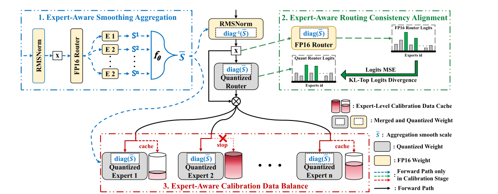

#+title:      众专家共一把尺
#+subtitle:   把各专家的平滑需求取最严的合成一个向量，并进归一化层；再补路由对齐与冷门专家校准 — EAQuant: Enhancing Post-Training Quantization for MoE Models via Expert-Aware Optimization
#+date:       [2026-10-24 Sat 10:57]
#+filetags:   :paper:
#+identifier: 20261024T105725
#+source:     https://arxiv.org/abs/2506.13329 (v3, 2026-02-01)；代码 https://github.com/darren-fzq1/EAQuant
#+authors:    Zhongqian Fu, Tianyi Zhao, Ning Ding, Xianzhi Yu, Xiaosong Li, Yehui Tang, Yunhe Wang
#+venue:      arXiv 2506.13329（v1 2025-06，v3 2026-02，ICML 模板）；Huawei Noah's Ark Lab / 北航

* 问题

一个 token 走进 OLMoE 的某一层。它先过一道归一化（RMSNorm），然后同一份向量被送去两个地方：
一个小小的路由器给 64 个专家打分，分数最高的 8 个专家被叫醒，各自算一遍，按分数加权求和。
现在要把这一层压到 4 比特权重、4 比特激活（W4A4），让整个模型省显存、跑得快。

先说为什么难。这个 token 的向量里有几个"刺头"通道，数值比别的通道大几十倍。
4 比特只有 16 个格子，格子的宽度由最大值决定，刺头一撑，普通通道全挤进一两个格子里，信息就没了。
论文的图 2(a) 说了一件要紧的事：刺头在哪几个通道，各专家之间几乎一样——OLMoE 第 0 层，64 个专家里有 60 个的最大激活都落在第 121 号通道；Mixtral 第 17 层，8 个专家全落在 3398 号。

为了讲清楚，我造一个只有两个专家、两个通道的迷你版本（这个例子是我为讲解构造并验算过的，不是论文里的）。
通道 1 是刺头，通道 2 正常。
专家 A 收到的 token，激活最大值是 (16, 1)，它的权重每个输入通道的最大值是 (1, 1)。
专家 B 收到的 token，激活最大值是 (9, 1)，权重最大值是 (4, 1)。
路由器看的是所有 token，激活最大值 (16, 1)，路由器权重最大值 (1, 1)。

稠密模型的老办法叫 SmoothQuant：激活难量化、权重好量化，那就把难度搬一部分过去——
每个通道选一个系数 s，激活除以 s，权重乘以 s，乘积不变。系数取"激活最大值和权重最大值的几何平均式配比"，
迁移强度 alpha 取 0.5 时就是 s = 根号(激活最大) / 根号(权重最大)。
对专家 A，s = (根号16 / 根号1, 1) = (4, 1)；激活变成 (16/4, 1) = (4, 1)，权重变成 (1x4, 1) = (4, 1)，两边的刺都从 16 倍降到 4 倍。
对专家 B，s = (根号9 / 根号4, 1) = (1.5, 1)；激活 (6, 1)，权重 (6, 1)，同样两边摊平。

这个老办法在稠密模型里免费，因为"激活除以 s"可以提前乘进 RMSNorm 的缩放参数 gamma 里，推理时一个算子都不多。
可在 MoE 里，A 要 (4, 1)，B 要 (1.5, 1)，而 RMSNorm 只有一个 gamma。
要么在路由之后、进每个专家之前，再各做一次逐元素除法——每个 token 多 k 次 d 维运算，还多一个要融合的算子；
要么把全层的专家拼成一个大矩阵，取全局最大值算一个 s，那就不管哪个专家更难量化。
DuQuant（本文唯一的权重-激活基线）在平滑之上再加旋转和置换，把刺头摊到所有通道，W4A4 在稠密模型上做得很好，
但它把 MoE 层当成一堆普通线性层：不知道有路由器，也不知道有的专家在校准集里几乎没见过 token。
MoEQuant 看到了后一件事，让模型自己生成文本来给冷门专家补数据，但作者认为"自己生成校准数据"让它和别人比不公平。

作者在这个两专家的例子上看到的入口很朴素：既然刺头在各专家里位置一样，那大家想要的 s 在刺头通道上本来就差不多，
何不干脆让所有专家共用一个 s——只是这个 s 要按"谁的要求最严"来定，并且把路由器的要求也算进去。

* 翻译

#+ATTR_ORG: :width 1200

*锚点：给一个 MoE 层配一把公用的尺子。* 在那个两专家的例子上，EAQuant 做的事像给一个车间所有工位发同一把量尺：
每个工位先报自己需要的刻度，车间取最严的那个，做成一把尺子，钉在入口（RMSNorm）上。
所有进门的 token 都先被这把尺子量一遍，不论它待会去哪个工位。

** 第一步：取最严的需求（专家感知平滑聚合）

专家 A 报 (4, 1)，专家 B 报 (1.5, 1)，路由器按同样的公式也报一个：根号16 / 根号1 = 4，所以是 (4, 1)。
逐通道取最大：公用尺子 s-bar = (4, 1)。论文管这个叫 expert-aware smoothing aggregation（EA-SA），
"取最大"是默认的聚合方式，也试了按专家被激活的频率加权、按路由概率加权两种。

为什么要把路由器也算进去？因为路由器吃的是所有 token，专家只吃路由给它的那部分。
只按专家算，路由器那一侧的激活可能没被压够；而路由器一旦量化不准，后面整个选人都会错。

把 s-bar 并进 RMSNorm：gamma 除以 s-bar，每个专家和路由器的权重各乘 s-bar。数学上一模一样，推理图上一个算子不多。

这时候你看专家 B 发生了什么。它本来只想要 1.5，现在被按 4 来量：
激活变成 (9/4, 1) = (2.25, 1)，比它自己的方案 (6, 1) 更平；
权重却变成 (4x4, 1) = (16, 1)，比它自己的方案 (6, 1) 尖得多，甚至比不做平滑时的 (4, 1) 还尖。
公用尺子保证了每个专家的激活都"至少被压得和它自己想要的一样狠"，代价是部分专家的权重被过量地拉尖。
论文没有讨论这个代价——它只写了激活一侧的不等式。这一点后面在审稿里再回来。

** 第二步：守住路由器的名单（路由一致性对齐）

尺子钉好以后，同一个 token 到了路由器面前。假设它的四个候选专家打分是 2.0、1.9、1.85、0.5（还是我构造的数，取 top-2）。
全精度时选的是第 1、2 号。现在路由器权重被量化，分数被推了一点：第 2 号掉 0.06，第 3 号涨 0.03，变成 2.0、1.84、1.88、0.5。
第 2、3 名换位，token 被送去了另一个专家。误差只有百分之几，后果却是离散的：整条计算路径变了。
论文的图 2(b) 画的就是这个：路由器从 W16A16 降到 W4A4、W3A3，每个专家分到的 token 数和原来差几十到几百。

作者的办法叫 routing consistency alignment（EA-RCA）。可调的东西很少：只有路由器权重的量化刻度（每个专家一列，各一个 scale 和 zero-point），
权重值本身、专家都不动。调的目标有两项：一项让量化前后路由器的原始打分尽量接近（打分差的平方），
一项让打分经过 softmax 之后的概率分布尽量接近（KL 散度）。KL 不在所有专家上算，只在全精度的前 k 名（外加可选的后面一小撮）上算，
叫 KL-Top，借自 OstQuant。附录表 8 显示只看前 k 名最好，范围放宽到全部专家，增益从 +1.28 掉到 +0.50。

这里要老实算一笔账（同样是我验算过的数）。把上面那次"导致换位"的扰动叫情形甲；再造一个情形乙：
第 1 号掉 0.06、第 4 号涨 0.03，名单不变。两种情形打分差的平方和完全一样，都是 0.0045。
全专家上的 KL，甲是 0.00063，乙是 0.00047；只在前 2 名上算的部分 KL，甲 0.0125，乙 0.0090。
也就是说，一个换了人、一个没换人，两项损失只差三四成。它们是光滑的替代目标，能让翻转变少，但不直接盯着"第 k 名和第 k+1 名之间那道缝"。
引言里那句 "guaranteeing stable top-k expert activation" 说过头了。后来的 VSRAQ 正是抓住这道缝，加了排序和间隔两个结构项。

** 第三步：给冷门专家补够样本（校准数据均衡）

回到车间：专家 A 是热门工位，校准时进来上千个 token；假设另有一个专家 C 是冷门工位，128 条校准文本里只分到几十个。
尺子、量化刻度都要靠"看过的 token"来估，C 等于在黑屋里调参。图 2(c) 是 OLMoE 第一层的真实分布：几个专家分到四千个 token，很多专家接近零。

作者的办法叫 calibration data balance（EA-CDB）：先用 128 条长 4096 的 WikiText2 序列过一遍路由器，数每个专家分到多少 token。
完全均匀时每个专家该分到"k 乘总 token 数除以 n"，作者设一个门槛：这个平均值的 r 倍，r 默认 2。
低于门槛的专家，从训练集里一批批补抽数据，只收被路由到它的 token，收满就停（图 3 里专家旁那个 "stop"）。
最后专家的权重用"基础数据 + 补来的数据"校准，注意力层和路由器只用基础数据。
和 MoEQuant 的区别是补的是真实文本，不是模型自己写的；相同点是都比基线多用了数据，用了多少论文没报。

** 结局

三件事放在 DuQuant 的代码上，权重逐通道、激活逐 token、非对称、不分组，路由器固定 W8A8。
在 OLMoE-7B、DeepSeek-MoE-16B、Mixtral-8x7B 上，五个零样本任务（ARC-C / ARC-E / BoolQ / PIQA / WinoGrande）的平均准确率：

- W4A4：OLMoE 66.69 到 68.06，DeepSeek 65.87 到 67.02，Mixtral 73.06 到 74.21（全精度分别是 70.28 / 69.44 / 76.58）。提升 1.15 到 1.37 个点，困惑度改善在 0.03 到 0.12。
- W3A4：+2.28 / +1.33 / +2.09。
- W2A4：DuQuant 在三个模型上 WikiText2 困惑度都炸到七千到一万；EAQuant 是 78.57 / 138.27 / 21.94，平均准确率 +9.66 / +9.85 / +13.81。
  这是从崩溃里爬出来，不是可用——Mixtral 的 53.40 离全精度 76.58 还差 23 个点。附录里更大的 Mixtral-8x22B 在 W2A4 上困惑度从 108.66 降到 7.07（全精度 2.83），只给了困惑度。

另有一张 weight-only 的对比（表 7）：在 Mixtral-8x7B 上，3 比特权重 EAQuant 4.49，MoEQuant-GPTQ 4.90；
DeepSeek-MoE-16B 上 MoEQuant-AWQ 的 3 比特直接发散到 5100，EAQuant 7.27。

** 最反直觉的一拍：三个组件，几乎是一个组件

把三件事拆开看（表 2，W3A4，相对 DuQuant 的平均准确率增量）：
OLMoE 上只开公用尺子 +2.12，只开路由对齐 +0.90，只开数据均衡 +0.35；尺子加路由对齐 +2.19，三者全开 +2.28。
也就是公用尺子一个人拿走了九成以上，后两件叠上去合计 0.16 个点。DeepSeek 上分得均匀一点（尺子 +0.92，全开 +1.33）。
W4A4 的 OLMoE 更有意思：只开尺子 +1.20，只开路由对齐 +1.28，只开数据均衡 +1.09，三个都开只有 +1.37。
三个"各自一个多点"的东西加起来还是一个多点。论文说它们"互补"，数据更像在说"它们大半可以互相替代"，
或者一个点本来就接近这套评测单次运行的波动。

还有一处要知道：表 2 里"只开路由对齐"那一行在 OLMoE 上印的是 +1.90，但那一行的均值 64.20 减基线 63.30 是 0.90，表 4 同一设置也写 0.90，是笔误。

故事走到这里，主角手里有三件东西：一把取最严需求的公用尺子、一个只调刻度的路由器校准、一道"补到两倍平均"的数据门槛。挨个拎出来看。

* 核心概念

*一，公用尺子为什么能"取最大"而不是"取平均"。*
一句话：所有专家和路由器共用一个平滑向量，逐通道取各方需求的最大值，并进 RMSNorm。
回到例子：A 要 4，B 要 1.5，路由器要 4，取 4。如果取平均（比如按频率加权），得到介于 1.5 和 4 之间的某个数，A 的激活就压不够——
A 恰好是那个刺头最大的专家。"取最大"保的是"没有一个专家的激活比它自己的方案更尖"。
但把 A 的尺子变形到 B 身上，你就看见代价：B 的权重从 (6, 1) 变成 (16, 1)。
所以这件道具的本质是一个取舍：激活侧零风险，权重侧由需求小的专家买单。
论文的表 3 恰好露出这个取舍的痕迹："取最大"只在 OLMoE 上最好（+1.20）；DeepSeek-MoE 上按路由概率加权最好（+1.05），取最大反而最差（+0.42）；
Mixtral 上按频率加权最好。主表到底用了哪种聚合，论文没写。
少了这件道具，要么每个专家多一次逐元素除法，要么退回全层统一平滑——前者破坏"零开销"，后者论文认为太粗。

*二，路由器只调刻度、不动权重（设计选择）。*
一句话：路由一致性对齐的可调参数只有路由器量化的 scale 和 zero-point，目标是打分 MSE 加前 k 名上的 KL。
回到例子：情形甲里第 2、3 名换位，是因为路由器权重量化的刻度让某些列的误差偏向了不该偏的方向；
调刻度能把这种系统性偏差拉回来，但调不掉随机的舍入。而且输入用的是同一个 x，量化前后一样——
上游层量化带来的输入漂移、路由器激活的量化误差，都不在这个目标里。
为什么重要：这个选择让 EA-RCA 非常便宜（一个 d x n 小矩阵、每专家两个数），也决定了它的上限。
主实验路由器是 W8A8，8 比特逐通道本来误差就小，这里还能挤出一个点，有点出乎意料；论文没写优化器、步数，也没给多种子方差。

*三，"两倍平均"的数据门槛（设计选择）。*
一句话：任何专家分到的校准 token 少于"均匀分配量的 r 倍"，就从训练集补抽，直到够数。
回到例子：冷门专家 C 原来只有几十个 token，门槛是 2 x 8 x 524288 / 64 = 131072 个 token（OLMoE 的 k = 8、n = 64，基础集 128 x 4096 = 524288 个 token），
要补到这个数，C 可能要多看几十倍的文本。门槛定得这么高，意味着长尾分布里大多数专家都会被补——这其实是"给专家层换一个大得多的校准集"。
表 5 扫了 r：0 / 1 / 2 / 4 / 8 对应 66.69 / 67.10 / 67.78 / 67.47 / 67.32，r = 0 正好是 DuQuant 基线，峰值在 2。
少了它，冷门专家的量化刻度靠几十个 token 估；有了它，论文的逐专家误差表显示第 15 层 64 个专家里大多数误差下降。

* 洞见

在 MoE 量化里，同层专家之间的相似比差异更值钱：先把它们当成一个共享入口的整体处理好，大部分精度就回来了；真正需要逐个照顾的，只是名单边界和冷门专家这些零头。

* 博导审稿

选题眼光：三个困境都是真的。共享 RMSNorm 装不下多套平滑向量，是 MoE 做 W4A4 时绕不过去的工程问题；
路由翻转、冷门专家缺数据也都有图为证。不是人造缺口。

方法成熟度：三件都是巧劲，不是蛮力，但都偏轻。最该追问的是两个没被讨论的预设。
其一，公用尺子"取最大"只论证了激活一侧（每个专家的激活都不比它自己方案更尖），完全没提权重一侧——
需求小的专家，权重被过量拉尖。这个代价在专家间需求差别大的层会显形；表 3 里不同模型最佳聚合算子不同，
很可能就是这个取舍在不同架构上倒向不同方向（这是我的猜测，论文没分析）。
而且引言批评"拼成整体取全局最大值"太粗，默认方案却同样是取最大，两者差多少没有对照实验。
其二，路由对齐的目标里，量化前后用的是同一个输入，只模拟路由器自身权重的量化误差。
实际推理时，路由器前面的注意力层、前面若干层专家都已量化，输入早就漂了；路由翻转更多来自这里，而不是来自一个 8 比特的小矩阵。
"guaranteeing stable top-k" 的说法，在这两个损失都不盯边界的情况下站不住。
还有一处小的：DeepSeek-MoE 有两个共享专家，也吃同一份 RMSNorm 输出，公式里没提它们是否参与聚合。

实验诚意：偏弱。权重-激活设置下唯一的基线是 DuQuant；QuaRot、SpinQuant、FlatQuant、OstQuant 都是同期 W4A4 的常规对照，一个没跑。
MoE 专用方法（MoEQuant、MoQa、MC-MoE）只在 weight-only 下比，而 weight-only 恰恰是本文说"别人只做这个"的设置。
消融显示三组件高度重叠，单次运行、无方差，1 个点量级的差别不好下结论。
EA-CDB 批评 MoEQuant 用生成数据不公平，自己也多用了数据，补了多少没报。
数字上有两处对不上：表 2 的 +1.90 应为 +0.90；表 6 的汇总（平均误差降 19.4%、56/64 个专家下降）与附录表 12 的 64 行逐专家数据重算的结果（降 17.5%、61/64 下降，中位数和标准差也不同）不一致。
W2A4 困惑度 78 / 138 被描述为 "stable perplexity"，措辞偏乐观。

写作功力：动机部分有图有数，清楚；方法部分最该交代的几处都省了——主表用哪种聚合、RCA 怎么优化、补了多少数据、
EA-SA 是替换还是叠加在 DuQuant 自带的平滑之上。"%" 一律是绝对百分点，读的时候别当成相对提升。

判决：weak accept。公用尺子是一个干净、零开销、可移植的小设计，W4A4 / W3A4 上的增益可信；
另外两个组件的贡献在自己的消融里就很薄，"三位一体"的叙事大于证据。

* 启发

迁移：你可以把任何"每个专家一套参数、但前面只有一个共享 norm"的做法，折成"逐通道取各专家需求的聚合值，并进 norm"。
对 Quark 这类框架，在 MoE 层做 SmoothQuant / AWQ 式缩放时，这就是一个现成的实现路线：
统计时按专家分桶算激活和权重最大值，聚合后只写一个向量进 RMSNorm，导出图不变。
动手前先在自己的模型上把 max / 频率加权 / 路由概率加权三种都跑一遍——本文自己的数据说明最佳选择随模型变。

混搭：EA-SA 管激活缩放，VSRAQ（2606.05688）管路由边界，AlphaQ（2606.04980）管位宽分配，TileQ（2605.09281）管专家间共享低秩结构，
四者正交，理论上可以叠。其中 TileQ 和 EA-SA 共享同一个前提——同层专家很像——一个用在权重表示上，一个用在激活缩放上。
如果你要做 MoE 量化的组合实验，"公用尺子 + 路由结构损失"是最便宜的一对，而 EAQuant 和 VSRAQ 之间至今没有直接对比，正好补上。

反转：别默认"专家感知"就是"每个专家单独处理"。本文最有效的一步恰恰是反过来——把专家合起来处理。
在你的 MoE 流程里，可以先试"全层共享 + 聚合统计"作为强基线，再看逐专家的特殊处理（数据补齐、路由对齐）到底还能多挣几分；
按本文的数字，在 4 比特附近多半不到半个点，值不值得为它付额外的数据和校准时间，要自己量。
