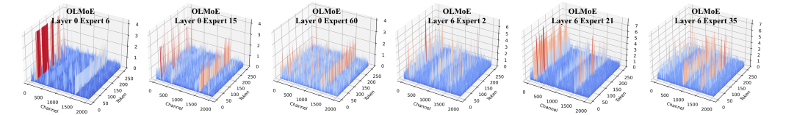
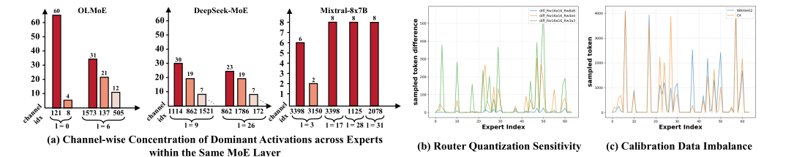
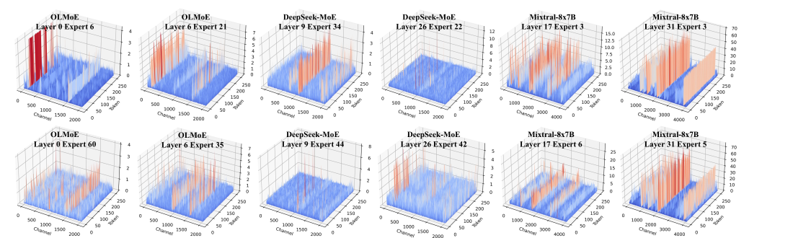
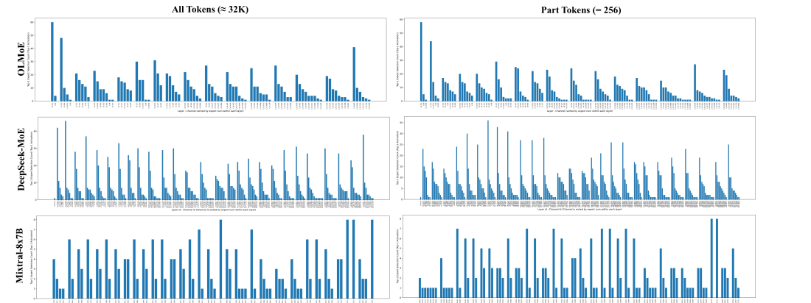
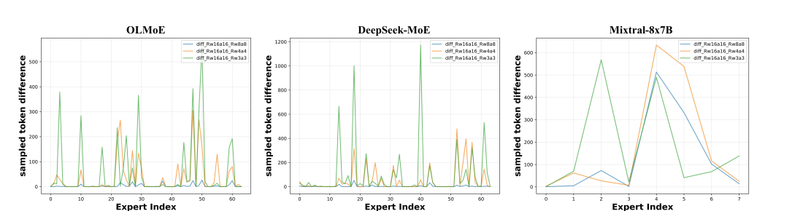
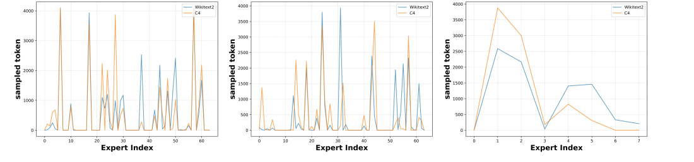

> **中文翻译（复述版）**：本文是对 arXiv:2506.13329v3 的逐节中文复述，并非逐句直译；表格、数字与公式均按原文照录，其余文字为作者用自己的话概括。原文版权归论文作者所有（arXiv 默认许可），以原文为准。

# EAQuant：通过专家感知优化提升 MoE 模型的训练后量化

- 论文：EAQuant: Enhancing Post-Training Quantization for MoE Models via Expert-Aware Optimization
- 作者：Zhongqian Fu、Tianyi Zhao、Ning Ding、Xianzhi Yu、Xiaosong Li、Yehui Tang、Yunhe Wang（华为诺亚方舟实验室；Tianyi Zhao 同属北京航空航天大学）
- 版本：arXiv:2506.13329v3 [cs.CL]，2026-02-01；关键词标注为 Machine Learning、ICML
- 代码：https://github.com/darren-fzq1/EAQuant
- PDF：https://arxiv.org/pdf/2506.13329v3

## 摘要

MoE 模型靠稀疏激活专家来扩展参数规模，但"专家稀疏激活 + 动态路由"给量化带来了麻烦。现有 PTQ 方法没有处理三件事：激活离群值、路由在量化后的不稳定、稀疏专家的校准数据不足，因此精度掉得很厉害。EAQuant 是专为 MoE 设计的 PTQ 框架，包含三个"专家感知"的设计：（1）平滑聚合（smoothing aggregation）抑制激活离群值；（2）路由一致性对齐（routing consistency alignment）让量化后的专家选择尽量不变；（3）校准数据均衡（calibration data balance）给被稀疏激活的专家补足校准数据。在 W4A4 / W3A4 / W3A3 / W2A4 等极端量化设置下，三种 MoE 架构上的平均精度提升为 1.15 - 13.81%，在推理类任务上收益尤其明显，激进量化下精度保持也更稳。作者据此称 EAQuant 为 MoE 压缩的新 SOTA。

## 1 引言

MoE 架构（OLMoE、Mixtral、OpenMoE、Qwen-MoE、DeepSeekMoE、DeepSeek-V3 等）通过动态路由让参数量增长而计算量只亚线性增长：每个 token 只激活一部分专家。但部署仍有问题：所有专家都要常驻显存，即使同一时刻只用到少数几个，因此带来显存带宽瓶颈和推理成本，需要压缩手段。

PTQ 在缩小模型体积和显存占用方面效果已被验证。作者在引言里把 MoE 量化的难点归纳为三条：

- 难点 1：不同专家、不同层里都存在严重的激活离群值（图 1）。如果对每个专家各自做通道级平滑（SmoothQuant、Outlier Suppression+、OmniQuant 一类做法），得到的缩放系数没法被前面的归一化层吸收，只能在运行时额外计算，增加开销；反过来，把所有专家拼成一个整体做"全局最大值"的粗粒度方案，虽然能兼容稠密模型的实现，却忽略了各专家量化难度的差异，收益有限。
- 难点 2：路由层对量化扰动极其敏感（图 2(b)）。门控分数的微小偏移就可能改变 top-k 选择，造成 token 被错误路由，进而级联地损害性能。
- 难点 3：专家激活本身是稀疏的（图 2(c)），导致校准数据覆盖不均，低频专家的量化参数估计不准。MoEQuant 用"专家均衡的自采样"缓解这个问题，但作者认为这种生成式校准会影响与其他基线的公平比较。

作者指出，现有 PTQ 方法（GPTQ、AWQ、MC-MoE、QuantMoE-Bench、MoQa 等）通常把路由层当被动组件，没有考虑它和专家激活的相互作用，也没有利用激活稀疏性，所以这些问题基本没解决。

EAQuant 的三个组件（引言中的概述）：

- 专家感知平滑聚合：先为每个专家单独算出细粒度的平滑系数，再聚合成一个统一的通道级平滑向量。聚合时同时考虑专家和路由器两方面的缩放需求，并通过把它融合进前置归一化层来保持数学等价。
- 专家感知路由一致性对齐：用双目标的校准过程，同时最小化全精度与量化后路由 logits 的重构误差，以及两者路由概率之间的 KL 散度，保证量化扰动下 top-k 专家激活保持稳定。
- 专家感知校准数据均衡：对被激活次数不足的专家，从扩充后的数据集里优先采样，直到其激活次数达到按计算得出的期望值。

作者声称三者合起来不引入额外计算开销。实验部分的亮点（W4A4）：相对 SOTA 方法 DuQuant，在 OLMoE-7B、DeepSeek-MoE-16B、Mixtral-8x7B 上平均准确率分别提升 1.37%、1.15%、1.15%，推理类基准上更突出（例如 Mixtral-8x7B 的 ARC-E +2.52%），困惑度也更接近全精度。在更激进的设置下，W3A4 最多提升 2.28%；在 W3A3 与 W2A4 下 DuQuant 严重退化，而 EAQuant 的困惑度保持稳定，Mixtral-8x7B 平均准确率最多 +13.81%。





## 2 方法

整体思路见图 3：针对 MoE 量化的三个核心挑战（激活离群值模式、路由器的量化敏感性、稀有专家的校准数据失衡），提出三个对应策略——（1）平滑聚合，抑制离群值并稳定专家参与；（2）路由一致性对齐，对齐量化前后的路由 logits 分布，保持选择一致；（3）校准数据均衡，解决校准时各局部专家激活频率不均的问题。这些策略都直接针对问题本身，同时保留 MoE 系统的特性。


### 2.1 动机

**难点 1：MoE 中的激活离群值模式。** 现代 MoE 模型的激活离群值在各专家、各层之间持续存在。图 1 显示，同一层内各专家的最大激活值集中在少数通道上，形成"稀疏但统计上同质"的模式；图 2(a) 进一步验证：尽管各专家参数不同，离群值在专家间仍具有一致性。作者据此认为这些空间上集中、相互关联的离群值是 MoE 动态的结构性属性，而非随机现象，因此应当用能捕捉全局离群模式的"专家感知聚合"，避免均匀聚合造成的信息损失。

**难点 2：MoE 路由器的量化敏感性。** 路由层动态地把 token 分给专家，但对量化粒度很敏感。量化会扰动路由 logits，带来两类问题：结构性不稳定（专家使用率发生不可预测的漂移）和动态负载不均衡（token 分配不均）。图 2(b) 显示位宽越低，token 分布差异越大，有些专家分到的 token 异常少，另一些则过载。这既损害精度，也破坏 MoE 的负载均衡效率。已有 MoE 量化工作（MoEQuant、MC-MoE）只关注权重/激活压缩，忽略路由层的脆弱性。作者的对策是双目标校准：最小化 logit 重构误差，以及全精度与量化路由概率之间的 KL 散度，使量化下 top-k 激活保持稳定。

**难点 3：稀有专家的校准数据失衡。** MoE 的激活分布呈幂律：少数"核心"专家处理大多数 token，"小众"专家使用不足。PTQ 校准时稀有专家的数据覆盖不够，其量化参数（如缩放系数）会过拟合到离群值或噪声。图 2(c) 画的是 OLMoE-7B 第一个 MoE 层上的样本分布，两个校准集上都呈现这种不均衡。现有方法（MoQE、MC-MoE、QuantMoE-Bench）几乎忽略这种稀疏性；MoEQuant 通过专家均衡自采样来构造均衡的校准集，但生成新的校准数据可能影响与其他方法比较的公平性。所以这个问题在 SOTA PTQ 中依旧没有解决。

### 2.2 专家感知平滑聚合（EA-SA）

已有 MoE 量化文献多数只量化权重，激活保持浮点；EAQuant 同时量化激活与权重，需要解决激活量化中的两个主要难题。

先回顾稠密模型的做法。LLM 的 PTQ 中，激活张量里少数通道会出现幅值极大的异常值。SmoothQuant、OmniQuant 使用"可合并的平滑向量"，在量化激活前缩放其动态范围。平滑向量逐通道计算：

$`s_j=\max(|\mathbf{x}_j|)^{\alpha}/\max(|\mathbf{W}_j|)^{1-\alpha}`$

并通过通道缩放 $`\mathbf{\tilde{x}}=\mathbf{x}\cdot\text{diag}^{-1}(s)`$ 缓解离群值，从而降低量化难度。该向量 $`s`$ 可以并入前面的归一化层，不产生额外计算开销。

但这个技术在 MoE 上遇到通用性问题。设 token 向量 $`\mathbf{x}\in\mathbf{R}^{d}`$ 有 $`d`$ 个通道，MoE 层有 $`n`$ 个局部专家，层输出是被选中专家输出按门控值加权求和：

```math
\mathbf{y}=\sum_{i\in\mathcal{T}}p^{i}(\mathbf{x})E^{i}(x),
```

其中 $`\mathcal{T}`$ 是门控值最高的 top-k 下标集合（式 1）。这时原始的激活平滑方法需要每个专家一个平滑向量 $`\lbrace s^{i}\in\mathbf{R}^{d}\rbrace_{i=1}^{n}`$ ，分别计算为：

```math
s^{i}_{j}=\frac{\max(|\mathbf{x}^{i}_{j}|)^{\alpha}}{\max(|\mathbf{W}^{i}_{j}|)^{1-\alpha}}\quad\forall j\in\lbrace 1,2,\cdots,d\rbrace,
```

（式 2）其中下标 $`j`$ 表示第 $`j`$ 个输入通道， $`\mathbf{W}^{i}`$ 是第 $`i`$ 个局部专家的第一个权重矩阵， $`\mathbf{x}^{i}`$ 是被路由到第 $`i`$ 个专家的输入激活。

权重变换 $`\mathbf{\tilde{W}}^{i}=\mathbf{W}^{i}\text{diag}(s^{i})`$ 通过

$`\mathbf{x}^{i}\mathbf{W}^{i}=(\mathbf{x}^{i}~\text{diag}^{-1}(s^{i}))\cdot(\text{diag}(s^{i})\mathbf{W}^{i})`$

保持数学等价，但激活缩放 $`\mathbf{x}^{i}~\text{diag}^{-1}(s^{i})`$ 必须在专家选定之后动态执行，每个 token 引入 $`\mathbf{O}(kd)`$ 的额外计算（ $`k`$ 为每个 token 路由到的专家数）。原因是前面的归一化层（RMSNorm、LayerNorm）在推理前只能吸收一个向量。

作者的核心思路是构造一个统一的平滑向量 $`\overline{s}`$ ，满足

```math
\overline{s}_{j}\gtrsim\max_{i\in[1,n]}(s_{j}^{i}),\quad\forall j\in\lbrace 1,2,\cdots,d\rbrace,
```

（式 3），这样无论路由到哪个专家，都能压制各通道的极端值。具体通过一个广义的通道级聚合算子 $`\mathbb{A}`$ （例如取最大值）对各专家的需求做聚合：

```math
\overline{s}_{j}=\mathbb{A}_{i\in[1,n]}(s_{j}^{i}).
```

（式 4）这样对任何被选中的专家 $`i`$ 都有

```math
\overline{s}_{j}\gtrsim s^{i}_{j}\Rightarrow\text{diag}^{-1}(\overline{s})\preceq\text{diag}^{-1}(s^{i}),
```

（式 5），其中 $`\preceq`$ 表示逐元素不等号，以保证对含离群通道的激活做量化时数值稳定。

MoE 前向时，路由器权重 $`\mathbf{W}^{\text{gate}}`$ 作用于原始输入激活，而每个局部专家只收到被路由过来的那部分特征。因此作者把统一平滑向量扩展到路由器权重 $`\mathbf{W}^{\text{gate}}\in\mathbb{R}^{d\times n}`$ 上，引入路由器专属的缩放向量

$`s^{\text{gate}}=\frac{\max(|\mathbf{x}_{j}|)^{\alpha}}{\max(|\mathbf{W}^{\text{gate}}_{j}|)^{1-\alpha}}`$

并纳入聚合：

```math
\overline{s}_{j}=\max\left(\underbrace{\mathbb{A}_{i\in[1,n]}\left(\frac{\max(|\mathbf{x}^{i}_{j}|)^{\alpha}}{\max(|\mathbf{W}^{i}_{j}|)^{1-\alpha}}\right)}_{\text{Expert requirements}},~\underbrace{\frac{\max(|\mathbf{x}_{j}|)^{\alpha}}{\max(|\mathbf{W}^{\text{gate}}_{j}|)^{1-\alpha}}}_{\text{Router requirement}}\right)
```

（式 6）。这个联合取最大保证 $`\overline{s}_{j}\geq\max\left(s^{\text{gate}}_{j},\lbrace s^{i}_{j}\rbrace_{i=1}^{n}\right)`$ 。统一缩放使路由器与专家的计算都保持等价变换：

```math
\text{Router~:~}\mathbf{\tilde{x}}\mathbf{\tilde{W}}^{\text{gate}}=(\mathbf{x}\text{diag}^{-1}(\overline{s}))(\text{diag}(\overline{s})\mathbf{W}^{\text{gate}})=\mathbf{x}\mathbf{W}^{\text{gate}},
```

```math
\text{Expert~i~:~}\mathbf{\tilde{x}}^{i}\mathbf{\tilde{W}}^{i}=(\mathbf{x}^{i}\text{diag}^{-1}(\overline{s}))(\text{diag}(\overline{s})\mathbf{W}^{i})=\mathbf{x}^{i}\mathbf{W}^{i}.
```

（式 7）最后， $`\overline{s}`$ 可以通过参数融合吸收进前面的 RMSNorm 层：

```math
\mathbf{\tilde{x}}=\text{RMSNorm}^{\prime}(\mathbf{x})=\frac{\gamma\oslash\overline{s}}{\sqrt{\frac{1}{d}\sum_{j=1}^{d}\mathbf{x}_{j}^{2}}}\odot\mathbf{x}.
```

（式 8）

### 2.3 专家感知路由一致性对齐（EA-RCA）

准确的专家路由对 MoE 性能至关重要，但路由决策在量化噪声下很脆弱：路由 logits 的微小扰动就可能改变 top-k 专家选择，造成 token 被误路由并引发级联退化。因此作者提出在 PTQ 过程中显式保留路由行为的策略。设 $`\mathbf{W}^{\text{gate}}\in\mathbb{R}^{d\times n}`$ 为经过 2.2 节专家感知平滑聚合之后的路由器权重矩阵， $`\mathbf{\tilde{x}}`$ 为相应的归一化后输入激活。采用均匀量化算子：

```math
\mathcal{Q}(\mathbf{W})=\mathrm{clip}\!\left(\mathrm{round}\!\left(\frac{\mathbf{W}}{\Delta}\right)+z,\;q_{\min},\;q_{\max}\right),
```

（式 9），其中 $`\Delta`$ 与 $`z`$ 是待校准的缩放与零点。校准过程求解：

```math
\min_{\theta}\underbrace{\mathbb{E}_{\mathbf{\tilde{x}}}\!\left[\|\mathbf{\tilde{x}}\mathbf{\tilde{W}}^{\text{gate}}-\mathbf{\tilde{x}}\mathcal{Q}(\mathbf{\tilde{W}}^{\text{gate}})\|_{2}^{2}\right]}_{\text{Logit MSE}}+\underbrace{\mathbb{E}_{\mathbf{\tilde{x}}}\!\left[D_{\text{KL-Top}}(p_{\text{fp}}\|p_{\text{quant}})\right]}_{\text{Routing KL Divergence}},
```

（式 10），其中 $`\theta`$ 是路由器权重 $`\mathbf{W}^{\text{gate}}`$ 的量化参数（缩放、零点等）。

这里的 KL-Top 散度来自 Hu et al. (2025b)（OstQuant），它把 KL 正则限制在与路由相关的专家子集上，而不是全部专家。具体地，对每个 token，KL-Top 作用于 top-k 专家，加上排在 top-k 之后紧接着的 $`\alpha(n-k)`$ 个专家的并集，其中 $`n`$ 为专家总数， $`\alpha\in[0,1]`$ 是控制放宽程度的超参。两个概率分布为：

```math
p_{\text{fp}}=\text{softmax}(\mathbf{\tilde{x}}\mathbf{\tilde{W}}^{\text{gate}}),
```

```math
p_{\text{quant}}=\text{softmax}(\mathbf{\tilde{x}}\mathcal{Q}(\mathbf{\tilde{W}}^{\text{gate}})).
```

（式 11、12）两项合起来既约束数值保真度，也约束分布对齐：MSE 项稳定 logit 的幅度，KL 项显式约束路由概率单纯形，使量化后的路由器保留专家选择的边界。作者认为这样即便在激进的低比特量化下，也能缓解量化引起的路由错误并保持一致的专家激活模式。

### 2.4 专家感知校准数据均衡（EA-CDB）

为了解决 MoE 在 PTQ 校准时固有的专家激活不均衡，作者利用路由统计量自适应地对各专家的校准样本重新配平：用路由统计找出激活不足的专家，通过阈值驱动的过采样让它们的激活次数达到期望水平，从而降低量化参数估计中的校准偏差。

具体流程：沿用标准 PTQ 实践，先从 WikiText2 采样 128 条长度 4096 的序列，构成基础数据集 $`\mathcal{D}_{\text{base}}`$ ，用来校准 QKV 层与门控网络等非专家部分。对 MoE 模块，先把 $`\mathcal{D}_{\text{base}}`$ 里的 $`N=128\times 4096`$ 个 token 通过 top-k 路由器前向一遍，得到 token 到专家的分配统计。对于被路由 token 数低于期望激活水平 $`{r}\frac{kN}{n}`$ （例如放大比 $`{r}=2.0`$ ）的专家，则迭代地从训练集中采样新批次来构造 $`\mathcal{D}_{\text{expert}}`$ ，直到这些专家被路由到的 token 数都超过平均水平 $`r\frac{kN}{n}`$ 。最后，用 $`\mathcal{D}_{\text{base}}\cup\mathcal{D}_{\text{expert}}`$ 中的 token 来校准各局部专家权重的量化参数。

## 3 实验

**模型与评测。** 在三个 SOTA MoE 语言模型上做了实验：DeepSeek-MoE-16B（deepseek-moe-16b-base）、OLMoE-7B（OLMoE-1B-7B-0924）、Mixtral-8x7B（Mixtral-8x7B-v0.1）。除了在 WikiText2 与 C4 上的困惑度之外，还在四个常识问答数据集上做零样本准确率评测：PIQA、ARC（含 ARC-C 与 ARC-E）、BoolQ、WinoGrande（WG）。

**基线方法。** 选用 SOTA 的 PTQ 方法 DuQuant 作为基线。校准遵循标准协议，使用从 WikiText2 采样的 128 条连续文本片段；半精度（FP16）模型结果作为参照基线，保证比较公平一致。

**实现细节。** 所有评测任务的序列长度设为 2048。采用非对称量化，权重按通道（per-channel）、激活按 token（per-token），不使用分组量化。EAQuant 作为 PTQ 方法无需对参数敏感的微调；作者在 DuQuant 官方代码仓库基础上做了适配，使其支持这三个 MoE 模型。

**表 1：** DuQuant 与 EAQuant 在 OLMoE-7B、DeepSeek-MoE-16B、Mixtral-8x7B 上各低比特设置的结果。路由层按 W8A8 量化。

| Model | Method | #Bits (W-A) | WikiText2 PPL↓ | C4 PPL↓ | ARC-C | ARC-E | BoolQ | PIQA | WG | Avg.↑ |
|---|---|---|---|---|---|---|---|---|---|---|
| OLMoE-7B | FP | 16-16 | 7.49 | 10.52 | 48.46 | 78.45 | 74.56 | 80.69 | 69.22 | 70.28 |
| | DuQuant | 4-4 | 8.64 | 11.51 | 46.25 | 74.83 | 71.28 | 77.53 | 63.54 | 66.69 |
| | EAQuant | 4-4 | 8.52 | 11.41 | 47.35 | 76.14 | 72.29 | 78.84 | 65.67 | 68.06 (+1.37) |
| | DuQuant | 3-4 | 10.77 | 13.59 | 41.64 | 70.71 | 65.75 | 75.35 | 63.06 | 63.30 |
| | EAQuant | 3-4 | 10.41 | 13.20 | 44.80 | 73.53 | 69.27 | 76.61 | 63.69 | 65.58 (+2.28) |
| | DuQuant | 3-3 | 16.88 | 19.23 | 34.64 | 61.20 | 57.22 | 67.79 | 56.12 | 55.39 |
| | EAQuant | 3-3 | 14.14 | 16.68 | 37.71 | 67.13 | 58.90 | 69.64 | 58.41 | 58.36 (+2.97) |
| | DuQuant | 2-4 | 8279.52 | 5508.23 | 24.15 | 34.01 | 41.19 | 55.28 | 51.46 | 41.22 |
| | EAQuant | 2-4 | 78.57 | 62.56 | 29.86 | 53.66 | 51.68 | 65.51 | 53.67 | 50.88 (+9.66) |
| DeepSeek-MoE-16B | FP | 16-16 | 6.51 | 9.10 | 47.70 | 75.88 | 72.81 | 80.41 | 70.40 | 69.44 |
| | DuQuant | 4-4 | 7.10 | 9.85 | 43.52 | 72.43 | 70.80 | 76.93 | 65.67 | 65.87 |
| | EAQuant | 4-4 | 7.06 | 9.78 | 44.03 | 72.90 | 71.35 | 78.89 | 67.96 | 67.02 (+1.15) |
| | DuQuant | 3-4 | 8.28 | 11.41 | 40.44 | 70.20 | 65.23 | 76.22 | 61.64 | 62.75 |
| | EAQuant | 3-4 | 8.19 | 11.14 | 42.49 | 71.17 | 65.17 | 75.35 | 66.22 | 64.08 (+1.33) |
| | DuQuant | 3-3 | 14.02 | 18.63 | 31.66 | 57.95 | 62.54 | 66.81 | 57.06 | 55.20 |
| | EAQuant | 3-3 | 11.62 | 15.31 | 35.15 | 60.82 | 61.68 | 71.44 | 57.62 | 57.34 (+2.14) |
| | DuQuant | 2-4 | 10006.75 | 4114.85 | 23.98 | 29.38 | 39.79 | 53.43 | 50.43 | 39.40 |
| | EAQuant | 2-4 | 138.27 | 82.51 | 25.94 | 45.12 | 55.99 | 64.58 | 54.62 | 49.25 (+9.85) |
| Mixtral-8x7B | FP | 16-16 | 3.84 | 6.98 | 55.80 | 83.29 | 84.56 | 83.41 | 75.85 | 76.58 |
| | DuQuant | 4-4 | 4.47 | 7.47 | 52.22 | 79.21 | 81.25 | 80.74 | 71.90 | 73.06 |
| | EAQuant | 4-4 | 4.44 | 7.42 | 52.13 | 81.73 | 82.23 | 81.07 | 73.88 | 74.21 (+1.15) |
| | DuQuant | 3-4 | 5.43 | 8.51 | 47.35 | 75.38 | 77.55 | 78.62 | 66.77 | 69.14 |
| | EAQuant | 3-4 | 5.27 | 8.23 | 50.68 | 78.45 | 78.69 | 79.05 | 69.30 | 71.23 (+2.09) |
| | DuQuant | 3-3 | 11.18 | 16.47 | 32.94 | 59.47 | 53.06 | 66.10 | 53.67 | 53.05 |
| | EAQuant | 3-3 | 7.46 | 10.98 | 40.87 | 67.21 | 67.58 | 74.76 | 61.88 | 62.46 (+9.41) |
| | DuQuant | 2-4 | 7626.38 | 6822.75 | 26.71 | 25.34 | 44.37 | 52.29 | 49.25 | 39.59 |
| | EAQuant | 2-4 | 21.94 | 25.24 | 32.00 | 57.15 | 55.90 | 67.46 | 54.46 | 53.40 (+13.81) |

**表 2：** 在 W3A4 权重-激活量化设置下对 EAQuant 各组件的消融。路由层按 W8A8 量化。EA-SA、EA-RCA、EA-CDB 分别代表专家感知平滑聚合、专家感知路由一致性对齐、专家感知校准数据均衡。（原表以对勾标示启用的模块，下表用"是/否"表示。）

| EA-SA | EA-RCA | EA-CDB | OLMoE ARC-C | ARC-E | BoolQ | PIQA | WG | Avg.↑ | DeepSeek ARC-C | ARC-E | BoolQ | PIQA | WG | Avg.↑ |
|---|---|---|---|---|---|---|---|---|---|---|---|---|---|---|
| 否 | 否 | 否 | 41.64 | 70.71 | 65.75 | 75.35 | 63.06 | 63.30 | 40.44 | 70.20 | 65.23 | 76.22 | 61.64 | 62.75 |
| 是 | 否 | 否 | 43.43 | 74.20 | 68.62 | 76.93 | 63.93 | 65.42 (+2.12) | 40.70 | 69.70 | 68.38 | 76.82 | 62.75 | 63.67 (+0.92) |
| 否 | 是 | 否 | 41.64 | 71.76 | 69.08 | 75.52 | 62.98 | 64.20 (+1.90) | 41.89 | 69.82 | 63.55 | 76.01 | 64.48 | 63.15 (+0.40) |
| 否 | 否 | 是 | 40.27 | 70.16 | 67.71 | 75.84 | 64.25 | 63.65 (+0.35) | 40.10 | 69.53 | 64.59 | 76.06 | 64.01 | 62.86 (+0.11) |
| 是 | 是 | 否 | 44.69 | 73.57 | 68.93 | 76.71 | 63.54 | 65.49 (+2.19) | 41.61 | 70.81 | 64.93 | 76.28 | 65.43 | 63.81 (+1.06) |
| 是 | 是 | 是 | 44.80 | 73.53 | 69.27 | 76.61 | 63.69 | 65.58 (+2.28) | 42.49 | 71.17 | 65.17 | 75.35 | 66.22 | 64.08 (+1.33) |

（说明：原文 HTML 中单模块各行的对勾所在列无法从文本里直接读出，上表按行顺序与数值一致性，以及后文 Table 4 中 w3a4_Rw8a8 + EA-RCA 的 64.20 (+0.90) 同 OLMoE 第 3 行的 64.20 对应，推断行 2/3/4 依次为仅 EA-SA、仅 EA-RCA、仅 EA-CDB，行 5 为 EA-SA+EA-RCA，行 6 为三者全开。）

**表 3：** 在 W4A4 设置下对 EA-SA 的聚合策略 $`\mathbb{A}`$ 的消融。比较了 maximum、expert_frequency、router_logits 三种专家感知聚合设计，DuQuant 为基线。

| Model | Method | WikiText2 PPL↓ | C4 PPL↓ | ARC-C | ARC-E | BoolQ | PIQA | WinoGrande | Avg.↑ |
|---|---|---|---|---|---|---|---|---|---|
| OLMoE-7B | FP | 7.49 | 10.52 | 48.46 | 78.45 | 74.56 | 80.69 | 69.22 | 70.28 |
| | Baseline | 8.64 | 11.51 | 46.25 | 74.83 | 71.28 | 77.53 | 63.54 | 66.69 |
| | + maximum | 8.54 | 11.43 | 47.44 | 75.04 | 72.45 | 79.27 | 65.27 | 67.89 (+1.20) |
| | + expert_frequency | 8.56 | 11.46 | 45.14 | 76.09 | 71.38 | 78.94 | 66.06 | 67.52 (+0.83) |
| | + router_logits | 8.57 | 11.47 | 45.99 | 75.63 | 71.44 | 78.45 | 65.51 | 67.40 (+0.71) |
| DeepSeek-MoE-16B | FP | 6.51 | 9.10 | 47.70 | 75.88 | 72.81 | 80.41 | 70.40 | 69.44 |
| | Baseline | 7.10 | 9.85 | 43.52 | 72.43 | 70.80 | 76.93 | 65.67 | 65.87 |
| | + maximum | 7.09 | 9.83 | 44.03 | 73.44 | 69.57 | 78.51 | 65.90 | 66.29 (+0.42) |
| | + expert_frequency | 7.08 | 9.81 | 43.17 | 73.19 | 69.39 | 78.07 | 68.51 | 66.47 (+0.60) |
| | + router_logits | 7.07 | 9.80 | 44.58 | 73.52 | 69.23 | 78.24 | 69.02 | 66.92 (+1.05) |
| Mixtral-8x7B | FP | 3.84 | 6.98 | 55.80 | 83.29 | 84.56 | 83.41 | 75.85 | 76.58 |
| | Baseline | 4.47 | 7.47 | 52.22 | 79.21 | 81.25 | 80.74 | 71.90 | 73.06 |
| | + maximum | 4.47 | 7.46 | 53.06 | 80.02 | 82.21 | 81.51 | 70.81 | 73.52 (+0.46) |
| | + expert_frequency | 4.44 | 7.43 | 53.29 | 80.43 | 82.63 | 81.07 | 72.49 | 73.98 (+0.92) |
| | + router_logits | 4.45 | 7.45 | 53.58 | 79.67 | 82.42 | 81.18 | 71.58 | 73.69 (+0.63) |

**表 4：** 在 OLMoE-7B 上，EA-RCA 在不同权重-激活量化配置下的消融（共 7 项任务指标）。Rw*a* 表示路由层的权重-激活量化配置，DuQuant 为基线方法。

| Model | Method | WikiText2 PPL↓ | C4 PPL↓ | ARC-C | ARC-E | BoolQ | PIQA | WG | Avg.↑ |
|---|---|---|---|---|---|---|---|---|---|
| OLMoE-7B | FP | 7.49 | 10.52 | 48.46 | 78.45 | 74.56 | 80.69 | 69.22 | 70.28 |
| | w3a4_Rw3a4_Baseline | 11.09 | 13.95 | 40.70 | 71.84 | 62.69 | 75.24 | 61.17 | 62.33 |
| | + EA-RCA | 11.07 | 13.94 | 40.87 | 71.51 | 67.55 | 75.73 | 62.51 | 63.63 (+1.30) |
| | w3a4_Rw4a4_Baseline | 10.94 | 13.68 | 40.70 | 71.25 | 64.98 | 75.63 | 62.43 | 63.00 |
| | + EA-RCA | 10.85 | 13.67 | 40.96 | 71.55 | 68.04 | 75.30 | 64.09 | 63.99 (+0.99) |
| | w3a4_Rw8a8_Baseline | 10.77 | 13.59 | 41.64 | 70.71 | 65.75 | 75.35 | 63.06 | 63.30 |
| | + EA-RCA | 10.71 | 13.56 | 41.64 | 71.76 | 69.08 | 75.52 | 62.98 | 64.20 (+0.90) |
| | w4a4_Rw8a8_Baseline | 8.64 | 11.51 | 46.25 | 74.83 | 71.28 | 77.53 | 63.54 | 66.69 |
| | + EA-RCA | 8.60 | 11.48 | 46.76 | 75.97 | 72.14 | 77.80 | 67.17 | 67.97 (+1.28) |

**表 5：** 在 OLMoE 上、W4A4 配置下，对 EA-CDB 中放大比 $`r`$ 的消融；路由层按 W8A8 量化。

| $`r`$ | 0.0 | 1.0 | 2.0 | 4.0 | 8.0 |
|---|---|---|---|---|---|
| Avg.↑ | 66.69 | 67.10 | 67.78 | 67.47 | 67.32 |

### 3.1 主要结果

**对比结果。** 表 1 汇总了 OLMoE-7B、DeepSeek-MoE-16B、Mixtral-8x7B 的量化结果。EAQuant 在所有评测设置下都优于 DuQuant，在低比特量化下表现稳健。W4A4 下，三个模型平均准确率分别提升 1.37%、1.15%、1.15%，推理类基准上增益明显（如 Mixtral-8x7B 的 ARC-E +2.52%），困惑度也更接近全精度模型。量化更激进（如 W3A4）时，差距进一步拉大。

更重要的是，在 W3A3 和 W2A4 这类极低比特设置下，已有 PTQ 方法出现严重退化或数值不稳定（在大规模 MoE 上尤其如此）；EAQuant 则保持困惑度稳定、保住较强的推理精度，相对 DuQuant 增益显著，Mixtral-8x7B 上平均准确率最高提升 +13.81%。作者认为，这说明在超低比特下，保持专家路由行为和均衡的专家校准更为关键。

### 3.2 消融实验

**模块级影响。** 在 W3A4 设置下做模块级消融（表 2）。结果显示各模块都对量化后的 MoE 有正向贡献，其中 EA-SA 的单独收益最大（有效缓解激活离群值）；EA-RCA 通过稳定专家路由带来额外收益；EA-CDB 通过缓解校准偏差提供互补收益。EA-SA 与 EA-RCA 组合已优于任一单模块，完整的 EAQuant 取得最佳结果，OLMoE-7B 平均准确率 +2.28，DeepSeek-MoE-16B +1.33。作者据此认为三个组件互补，共同支撑稳健的低比特 MoE 量化。

**EA-SA 的消融分析。** 表 3 研究 EA-SA 中的平滑聚合策略。相对 DuQuant 基线（困惑度和准确率都有明显下降），maximum、expert_frequency、router_logits 三种专家感知聚合都能稳定地恢复量化后性能。三者的含义：maximum 对各专家权重做最大值缩放聚合；expert_frequency 按激活频率加权；router_logits 利用路由概率。作者称 maximum 总体改善最强（平均准确率 +1.20），说明它更好保留了主导专家的信号；expert_frequency 与 router_logits 则在 ARC-E 和 WinoGrande 等任务上表现出互补收益，说明引入专家使用情况与路由动态有价值。总的来说，作者认为"任务感知、专家感知"的聚合对解决量化引起的激活不规则性至关重要。

**EA-RCA 的有效性。** 在 OLMoE-7B 上、多种权重-激活量化设置下评估（表 4）。去掉 EA-RCA 会使多数任务的性能持续下降，低比特下下降更严重。W3A4 下关闭 EA-RCA 会使平均准确率最多降低 1.30 分，并损害 BoolQ 与 WinoGrande 这类对路由敏感的任务，反映路由不稳定加剧。在不同的路由器量化配置（Rw3a4、Rw4a4、Rw8a8）下这一趋势依然存在，EA-RCA 使平均准确率提升 0.9–1.3 分。结论是 EA-RCA 能稳定路由分布、缓解量化导致的不一致，尤其在激进量化下。关于 KL-Top 的进一步消融见附录。

**EA-CDB 的有效性。** 在 OLMoE-7B 上研究 EA-CDB 中放大比 $`r`$ 的影响。 $`r`$ 控制专家校准所需的最小 token 阈值，促使使用不足的专家获得足够的校准数据，缓解量化时的激活不均衡。如表 5 所示， $`r=2.0`$ 的平均准确率最佳；关闭校准均衡（ $`r=0.0`$ ）则性能最低，说明均衡的专家感知校准对缓解量化误差很重要。

表 6 给出第 15 层下投影权重的专家级量化误差。EA-CDB 使平均误差降低 19.4%，并使 87.5% 的专家误差下降，同时通过降低最大与最小误差来抑制极端离群值。作者认为这保证了对所有专家的鲁棒性提升，而不只是部分专家。

**表 6：** OLMoE 第 15 层各专家的量化误差统计。# RE 表示应用 EA-CDB 后量化误差下降的专家数。完整的逐专家结果见附录。

| Metric | w/o EA-CDB | w/ EA-CDB | Reduction |
|---|---|---|---|
| Mean | 0.0144 | 0.0116 | ↓ 19.4% |
| Median | 0.0116 | 0.0098 | ↓ 15.5% |
| Max | 0.0381 | 0.0361 | ↓ 5.2% |
| Min | 0.0069 | 0.0032 | ↓ 53.6% |
| Std | 0.0070 | 0.0064 | ↓ 8.6% |
| # RE | – | 56 / 64 | 87.5% |

### 3.3 与其他 MoE 量化方法的比较

表 7 在不同权重-激活精度下，把 EAQuant 与代表性 MoE 量化方法在 OLMoE-7B、DeepSeek-MoE-16B、Mixtral-8x7B 上做比较。在中等（4-16）与激进（3-16）配置下，EAQuant 在 WikiText2 和 C4 上都取得最低困惑度，体现出低比特下的稳健性。值得注意的是，若干现有方法在 3 比特权重精度下出现严重退化或数值不稳定：例如 MoEQuant-AWQ 在 DeepSeek-MoE-16B 的 3-16 设置下发散，而 EAQuant 保持稳定、困惑度显著更低。在 Mixtral-8x7B 上，EAQuant 在不同精度区间都表现出良好的可扩展性，优于其他对比方法。

**表 7：** 与现有 MoE 量化方法的比较（W-A 为权重位宽-激活位宽，数值为困惑度，越低越好）。

| Model | Method | W-A | WikiText2↓ | C4↓ |
|---|---|---|---|---|
| OLMoE-7B | GPTQ | 3-16 | 11.65 | 18.86 |
| | MoEPTQ | 3.26-16 | 15.44 | 26.04 |
| | MoQa | 2.95-16 | 10.59 | 18.42 |
| | EAQuant (Ours) | 3-16 | 9.60 | 12.38 |
| DeepSeek-MoE-16B | MoEQuant-AWQ | 4-16 | 6.94 | 9.32 |
| | MoEQuant-GPTQ | 4-16 | 6.78 | 9.22 |
| | EAQuant (Ours) | 4-16 | 6.70 | 9.18 |
| | GPTQ | 3-16 | 10.47 | 15.19 |
| | MoEPTQ | 3.31-16 | 8.49 | 15.61 |
| | MoQa | 2.98-16 | 7.94 | 13.49 |
| | MoEQuant-AWQ | 3-16 | 5100 | 4924 |
| | MoEQuant-GPTQ | 3-16 | 7.55 | 10.88 |
| | EAQuant (Ours) | 3-16 | 7.27 | 10.04 |
| Mixtral-8x7B | MoEQuant-AWQ | 4-16 | 5.15 | 7.84 |
| | MoEQuant-GPTQ | 4-16 | 4.12 | 7.34 |
| | EAQuant (Ours) | 4-16 | 4.03 | 7.10 |
| | MoEQuant-AWQ | 3-16 | 8.77 | 11.44 |
| | MoEQuant-GPTQ | 3-16 | 4.90 | 8.24 |
| | EAQuant (Ours) | 3-16 | 4.49 | 7.47 |
| | MCMoE | 2.2-16 | 5.72 | – |
| | MCMoE | 2.05-16 | 5.91 | – |
| | EAQuant (Ours) | 2-16 | 5.65 | 8.56 |

## 4 结论

EAQuant 是面向 MoE 的专家感知 PTQ 框架，通过专家感知平滑聚合、路由一致性对齐和校准数据均衡，分别应对激活离群值、路由不稳定和专家稀疏。在 OLMoE-7B、DeepSeek-MoE-16B、Mixtral-8x7B 上的大量实验表明，EAQuant 稳定优于现有 PTQ 方法：W4A4 下平均准确率提升 1.15-1.37%，W3A4 下稳定提升 1.33-2.28%；在 W3A3、W2A4 等更激进设置下，它显著缓解性能崩塌，相对先前 MoE 量化方法最多提升 13.81%。作者的结论是：在稀疏专家激活下，保持专家感知的激活缩放、路由行为以及合适的校准，是实现可靠低比特 MoE 量化的关键。

### 局限与未来工作

EAQuant 在极端量化（W4A4/W3A4/W3A3/W2A4）下改进了 MoE 的 PTQ，但在更低比特（如 W1A4）下性能会退化，原因是"粒度-稀疏性"的权衡，需要 QAT 来恢复精度。然而 QAT 计算成本高且依赖训练数据，在资源受限场景下难以部署。未来可探索 PTQ 与 QAT 的混合方案，或专家特定的校准，以平衡效率与性能。

### 影响声明

EAQuant 是针对 MoE 模型训练后量化关键挑战的专家感知优化框架。通过降低量化带来的精度损失，它能让 MoE 模型在资源受限的场景中高效部署，降低 NLP、边缘计算等应用的计算与能耗成本。

### 参考文献

原文参考文献列表（Bisk 等 PIQA、Cai 等 MoE 综述、Clark 等 BoolQ/ARC、Dai 等 DeepSeekMoE、Fedus 等 Switch Transformer、Frantar 等 GPTQ、Hu 等 MoEQuant 与 OstQuant、Huang 等 MC-MoE、Jacobs 等及 Jordan 与 Jacobs 的经典 MoE、Jiang 等 Mixtral、Kim 等 MoQE、Li 等 QuantMoE-Bench、Lin 等 DuQuant 与 AWQ、Liu 等 DeepSeek-V2/V3 及 MoE 推理优化综述、Merity 等 WikiText、Muennighoff 等 OLMoE、Qwen1.5-MoE、Raffel 等 C4/T5、Sakaguchi 等 WinoGrande、Shao 等 OmniQuant、Sun 等 FlatQuant、Wei 等 Outlier Suppression+、Xiao 等 SmoothQuant、Xue 等 OpenMoE、Zheng 等 MoQa）此处不逐条抄录，详见原文。

## 附录概览

附录 A 为相关工作，附录 B 为更多实验结果，附录 C 为更多可视化示例。

## 附录 A 相关工作

### A.1 混合专家大语言模型

MoE 范式最早由 Jacobs 等（1991）和 Jordan 与 Jacobs（1994）提出，现已成为扩展 LLM 的关键架构。当代 MoE LLM 的每一层由多个专家网络加一个门控网络组成，门控通常是带 softmax 的线性层，动态地把输入路由到选定专家并聚合其输出。

围绕路由机制与专家配置有大量架构创新：Switch Transformer 推广了 top-1 门控，在大规模下取得有竞争力的表现；Mixtral-8x7B 每层只激活两个专家，在性能与计算效率间取得平衡；DeepSeekMoE 通过细分 FFN 隐藏维度引入细粒度专家切分，并配以始终被激活的共享专家来捕获通用知识、降低参数冗余，后续的 DeepSeek-V2 与 DeepSeek-V3 进一步完善了这种做法。同期的探索还有 OLMoE（以复杂的训练策略推进开放权重 MoE 模型）和 Qwen-MoE（几乎把传统 FFN 层全部替换为 MoE 层，通过从稠密模型检查点渐进适配来增强预训练表现）。

### A.2 LLM 的训练后量化

现代大模型主要基于 Transformer，训练与推理都需要大量显存。PTQ 已成为主流的压缩范式，在保持预测性能的同时显著降低显存占用。

主要的 PTQ 方法包括：GPTQ 使用基于 Hessian 的误差补偿获得高压缩率；AWQ 考虑激活分布来改善权重量化。除仅权重量化外，处理激活离群值对有效量化至关重要：SmoothQuant 通过通道级缩放把量化难度从激活迁移到权重，Outlier Suppression+ 引入最优平移来在不微调的前提下抑制离群值。更近的进展继续推进低比特量化的边界，包括使用基于 Hadamard 的分布感知变换的 DuQuant、通过自适应通道间变换来展平激活分布的 FlatQuant，以及通过与离群值相关的子网络联合优化权重和激活的 OstQuant。

### A.3 MoE 的训练后量化

MoE 的 PTQ 近年有进展：MC-MoE 利用 MoE 的结构冗余优化压缩收益；MoEQuant 引入专家均衡自采样来处理专家间与专家内的校准不均衡；MoQE 探索低比特量化与模型鲁棒性之间的互补关系；QuantMoE-Bench 提供量化性能的系统评测框架；MoQa 提出多阶段的数据-模型分布感知方法，使量化策略与专家特性对齐。

作者认为这些方法主要关注权重或激活的压缩，留下两个重要问题没被充分探索：MoE 系统中的激活分布模式，以及路由层的量化敏感性。路由 logits 的量化扰动会造成结构性不稳定与负载不均衡；而 MoE 中的激活离群值呈现通道级集中和跨专家相关性，现有策略尚未利用。这一缺口说明需要直接针对低精度 MoE 实现中"激活分布稳定性"和"路由层鲁棒性"的方法。

## 附录 B 更多实验结果

附录提供额外的实验结果与详细分析，以进一步支撑 EAQuant 的设计选择，补充主文在低比特 PTQ 下对 EA-RCA 与 EA-CDB 行为的分析。

### B.1 EA-RCA 的更多消融分析

表 8 给出 W4A4（路由层 W8A8）下对 EA-RCA 中 KL-Top 损失的详细消融，考察把 KL 散度正则限制在专家子集上，对路由稳定性和下游任务性能的影响。KL-Top 通过比例参数 $`\alpha`$ 控制参与 KL 计算的专家数： $`\alpha=0.00`$ 时仅对路由器选出的 top-$`k`$ 专家做正则（OLMoE-7B 的 $`k=8`$ ）， $`\alpha=1.00`$ 则包含全部专家。更一般地，参与 KL 项的专家数 $`m`$ 为：

```math
m=k+\lfloor\alpha\times(n-k)\rfloor,
```

（式 13），其中 $`n`$ 为专家总数。由表 8，把 KL 损失限制在 top-$`k`$ 专家（ $`\alpha=0.00`$ ）整体最优，平均准确率从 DuQuant 基线的 66.69 提升到 67.97；在 ARC-E（+1.14）与 WinoGrande（+3.63）等偏推理的基准上改进尤其明显，同时 WikiText2 与 C4 的困惑度略有下降。这说明把 KL 正则聚焦在高置信度专家上，能有效保留关键的路由决策边界。

相反，逐步把低置信度专家也纳入 KL 约束（增大 $`\alpha`$ ）会使收益下降，个别情形下性能退化。作者的解释是对弱激活专家过度正则会给路由分布引入噪声，干扰稀疏的专家选择机制。总体上该消融验证了：应当有选择地对高影响力专家对齐路由分布，而不是强制做全局分布匹配。

**表 8：** 在 W4A4 权重-激活量化配置下对 EA-RCA 中 KL-Top 损失的消融；路由层按 W8A8 量化；DuQuant 为基线。

| Model | Method | WikiText2 PPL↓ | C4 PPL↓ | ARC-C | ARC-E | BoolQ | PIQA | WG | Avg.↑ |
|---|---|---|---|---|---|---|---|---|---|
| OLMoE-7B | FP | 7.49 | 10.52 | 48.46 | 78.45 | 74.56 | 80.69 | 69.22 | 70.28 |
| | Baseline | 8.64 | 11.51 | 46.25 | 74.83 | 71.28 | 77.53 | 63.54 | 66.69 |
| | + KL-Top ($`\alpha=0.00`$) | 8.60 | 11.48 | 46.76 | 75.97 | 72.14 | 77.80 | 67.17 | 67.97 (+1.28) |
| | + KL-Top ($`\alpha=0.25`$) | 8.61 | 11.50 | 45.39 | 75.38 | 71.65 | 78.73 | 66.22 | 67.47 (+0.78) |
| | + KL-Top ($`\alpha=0.50`$) | 8.63 | 11.51 | 46.33 | 75.08 | 70.86 | 78.56 | 65.90 | 67.35 (+0.66) |
| | + KL-Top ($`\alpha=0.75`$) | 8.61 | 11.49 | 46.08 | 76.01 | 71.07 | 78.40 | 66.38 | 67.59 (+0.90) |
| | + KL-Top ($`\alpha=1.00`$) | 8.64 | 11.51 | 46.50 | 75.42 | 71.35 | 78.13 | 64.56 | 67.19 (+0.50) |

### B.2 EA-CDB 的详细分析

表 9 给出 W4A4、OLMoE-7B 下 EA-CDB 中不同放大比 $`r`$ 的完整逐任务结果（主文只报平均准确率），便于看出校准均衡对各任务的影响。 $`r`$ 控制每个专家在校准时至少要被路由到的 token 数。 $`r=0`$ 时不做显式均衡，由于严重的专家级数据不均衡而表现欠佳；增大 $`r`$ 在多数任务上提升性能， $`r=2.0`$ 平均准确率最佳（67.78），并稳定改善 ARC-E、BoolQ、PIQA 等推理与常识任务，表明对使用不足的专家的量化参数估计更可靠。继续把 $`r`$ 增大到 2.0 以上则收益递减或略有下降，作者推测过度过采样可能引入分布偏移或冗余校准数据。这些结果从经验上支持整个实验中默认采用 $`r=2.0`$ 。

**表 9：** 在 W4A4 权重-激活量化设置、OLMoE-7B 上，对 EA-CDB 中放大比 $`r`$ 的详细消融；路由层按 W8A8 量化。

| $`r`$ | ARC-C | ARC-E | BoolQ | PIQA | WG | Avg.↑ |
|---|---|---|---|---|---|---|
| 0.0 | 46.25 | 74.83 | 71.28 | 77.53 | 63.54 | 66.69 |
| 1.0 | 44.97 | 75.42 | 72.11 | 77.97 | 65.04 | 67.10 |
| 2.0 | 46.50 | 76.01 | 72.26 | 78.24 | 65.90 | 67.78 |
| 4.0 | 45.95 | 75.97 | 71.97 | 78.18 | 65.29 | 67.47 |
| 8.0 | 46.08 | 76.01 | 71.99 | 77.42 | 65.11 | 67.32 |

### B.3 扩展到更大的 MoE 模型

为评估可扩展性，表 10 在大规模 Mixtral-8x22B 上对比 EAQuant 与 DuQuant。尽管参数量大幅增加，EAQuant 在所有量化设置下的困惑度都更低。尤其在激进的低比特配置（如 W2A4）下，EAQuant 显著缓解了基线出现的灾难性发散，WikiText2 困惑度从 108.66 降到 7.07。作者据此认为 EAQuant 能稳健地扩展到参数量巨大的 MoE 架构。

**表 10：** DuQuant 与 EAQuant 在 Mixtral-8x22B 上的困惑度对比。

| Model | Method | W-ACT | WikiText2↓ | C4↓ |
|---|---|---|---|---|
| Mixtral-8x22B | FP | 16-16 | 2.83 | 6.34 |
| | DuQuant | 4-4 | 3.40 | 6.72 |
| | EAQuant | 4-4 | 3.31 (-0.09) | 6.65 (-0.07) |
| | DuQuant | 3-3 | 6.20 | 9.95 |
| | EAQuant | 3-3 | 5.39 (-0.81) | 8.70 (-1.25) |
| | DuQuant | 2-4 | 108.66 | 100.61 |
| | EAQuant | 2-4 | 7.07 (-101.59) | 10.72 (-89.89) |

### B.4 校准数据集的影响

表 11 研究在 OLMoE-7B 上用 C4 代替 WikiText2 作为校准集的效果。在 W4A4 与 W3A4 两种设置下，EAQuant 的困惑度和下游准确率都持续优于 DuQuant，说明 EAQuant 对校准语料的选择不敏感，在不同数据分布上泛化良好。

**表 11：** 以 C4 为校准数据集时，DuQuant 与 EAQuant 在 OLMoE-7B 上的表现。

| Model | Method | W-ACT | Calib. | WikiText2 PPL↓ | C4 PPL↓ | ARC-C | ARC-E | BoolQ | PIQA | WinoGrande | Avg.↑ |
|---|---|---|---|---|---|---|---|---|---|---|---|
| OLMoE-7B | FP | 16-16 | – | 7.49 | 10.52 | 48.46 | 78.45 | 74.56 | 80.69 | 69.22 | 70.28 |
| | DuQuant | 4-4 | C4 | 8.65 | 11.48 | 46.75 | 75.00 | 70.89 | 77.64 | 63.69 | 66.79 |
| | EAQuant | 4-4 | C4 | 8.57 | 11.43 | 47.61 | 75.92 | 72.51 | 77.86 | 66.93 | 68.17 (+1.38) |
| | DuQuant | 3-4 | C4 | 10.91 | 13.53 | 43.69 | 72.98 | 69.11 | 75.30 | 61.01 | 64.42 |
| | EAQuant | 3-4 | C4 | 10.52 | 13.16 | 44.71 | 73.99 | 67.86 | 76.71 | 64.01 | 65.46 (+1.04) |

### B.5 逐专家量化误差分析

表 12 给出 OLMoE-7B 第 15 层、有无 EA-CDB 时各专家完整的量化误差（QE）对比。结果显示 EA-CDB 使绝大多数专家的量化误差降低，罕被激活的专家（如专家 19、32、33）下降尤其大；少数专家的 QE 有可忽略的上升，但总体趋势明显有利于 EA-CDB，说明均衡校准显著提升了专家级的量化鲁棒性。

**表 12：** OLMoE 第 15 层各专家量化误差（QE）对比的完整表。 $`\Delta`$QE 表示应用 EA-CDB 后的 QE 变化量， $`\Delta`$QE = QE(w/ EA-CDB) − QE(w/o EA-CDB)；负值表示量化误差降低；QE 越低量化鲁棒性越好。Reduction 列为百分比。

| ID | QE (w/o EA-CDB) | QE (w/ EA-CDB) | $`\Delta`$QE | Reduction |
|---|---|---|---|---|
| 0 | 0.0195 | 0.0174 | -0.0021 | 10.8 |
| 1 | 0.0381 | 0.0303 | -0.0078 | 20.5 |
| 2 | 0.0283 | 0.0151 | -0.0132 | 46.6 |
| 3 | 0.0128 | 0.0101 | -0.0027 | 21.1 |
| 4 | 0.0179 | 0.0168 | -0.0011 | 6.1 |
| 5 | 0.0104 | 0.0090 | -0.0014 | 13.5 |
| 6 | 0.0078 | 0.0070 | -0.0008 | 10.3 |
| 7 | 0.0372 | 0.0361 | -0.0011 | 3.0 |
| 8 | 0.0075 | 0.0059 | -0.0016 | 21.3 |
| 9 | 0.0086 | 0.0058 | -0.0028 | 32.6 |
| 10 | 0.0179 | 0.0155 | -0.0024 | 13.4 |
| 11 | 0.0104 | 0.0076 | -0.0028 | 26.9 |
| 12 | 0.0151 | 0.0123 | -0.0028 | 18.5 |
| 13 | 0.0270 | 0.0187 | -0.0083 | 30.7 |
| 14 | 0.0116 | 0.0108 | -0.0008 | 6.9 |
| 15 | 0.0147 | 0.0142 | -0.0005 | 3.4 |
| 16 | 0.0096 | 0.0073 | -0.0023 | 24.0 |
| 17 | 0.0161 | 0.0108 | -0.0053 | 32.9 |
| 18 | 0.0160 | 0.0101 | -0.0059 | 36.9 |
| 19 | 0.0134 | 0.0057 | -0.0077 | 57.5 |
| 20 | 0.0089 | 0.0080 | -0.0009 | 10.1 |
| 21 | 0.0152 | 0.0134 | -0.0018 | 11.8 |
| 22 | 0.0074 | 0.0068 | -0.0006 | 8.1 |
| 23 | 0.0108 | 0.0102 | -0.0006 | 5.6 |
| 24 | 0.0111 | 0.0083 | -0.0028 | 25.2 |
| 25 | 0.0129 | 0.0121 | -0.0008 | 6.2 |
| 26 | 0.0142 | 0.0138 | -0.0004 | 2.8 |
| 27 | 0.0095 | 0.0080 | -0.0015 | 15.8 |
| 28 | 0.0223 | 0.0205 | -0.0018 | 8.1 |
| 29 | 0.0202 | 0.0205 | +0.0003 | -1.5 |
| 30 | 0.0098 | 0.0094 | -0.0004 | 4.1 |
| 31 | 0.0116 | 0.0108 | -0.0008 | 6.9 |
| 32 | 0.0132 | 0.0060 | -0.0072 | 54.5 |
| 33 | 0.0092 | 0.0032 | -0.0060 | 65.2 |
| 34 | 0.0125 | 0.0077 | -0.0048 | 38.4 |
| 35 | 0.0107 | 0.0085 | -0.0022 | 20.6 |
| 36 | 0.0257 | 0.0184 | -0.0073 | 28.4 |
| 37 | 0.0106 | 0.0064 | -0.0042 | 39.6 |
| 38 | 0.0110 | 0.0098 | -0.0012 | 10.9 |
| 39 | 0.0105 | 0.0086 | -0.0019 | 18.1 |
| 40 | 0.0134 | 0.0106 | -0.0028 | 20.9 |
| 41 | 0.0173 | 0.0162 | -0.0011 | 6.4 |
| 42 | 0.0101 | 0.0086 | -0.0015 | 14.9 |
| 43 | 0.0109 | 0.0093 | -0.0016 | 14.7 |
| 44 | 0.0091 | 0.0056 | -0.0035 | 38.5 |
| 45 | 0.0111 | 0.0102 | -0.0009 | 8.1 |
| 46 | 0.0101 | 0.0094 | -0.0007 | 6.9 |
| 47 | 0.0209 | 0.0175 | -0.0034 | 16.3 |
| 48 | 0.0083 | 0.0071 | -0.0012 | 14.5 |
| 49 | 0.0145 | 0.0139 | -0.0006 | 4.1 |
| 50 | 0.0095 | 0.0074 | -0.0021 | 22.1 |
| 51 | 0.0095 | 0.0080 | -0.0015 | 15.8 |
| 52 | 0.0258 | 0.0232 | -0.0026 | 10.1 |
| 53 | 0.0076 | 0.0066 | -0.0010 | 13.2 |
| 54 | 0.0164 | 0.0128 | -0.0036 | 22.0 |
| 55 | 0.0102 | 0.0103 | +0.0001 | -1.0 |
| 56 | 0.0205 | 0.0166 | -0.0039 | 19.0 |
| 57 | 0.0069 | 0.0064 | -0.0005 | 7.2 |
| 58 | 0.0204 | 0.0200 | -0.0004 | 2.0 |
| 59 | 0.0120 | 0.0113 | -0.0007 | 5.8 |
| 60 | 0.0262 | 0.0220 | -0.0042 | 16.0 |
| 61 | 0.0075 | 0.0073 | -0.0002 | 2.7 |
| 62 | 0.0109 | 0.0113 | +0.0004 | -3.7 |
| 63 | 0.0098 | 0.0083 | -0.0015 | 15.3 |

（原表分左右两栏，左栏专家 0-31，右栏专家 32-63，这里合并为单列排列。）

## 附录 C 专家感知设计的更多可视化证据

本附录给出与主文图 2(a)、2(b)、2(c) 对应的扩展可视化分析，为 EAQuant 的三个核心组件（EA-SA、EA-RCA、EA-CDB）的设计提供更多经验证据。

### C.1 激活分布可视化

图 4 把不同专家、不同层的各通道激活分布扩展到三个代表性 MoE 模型：OLMoE-7B、DeepSeek-MoE-16B、Mixtral-8x7B，是主文图 1（出于篇幅只展示 OLMoE-7B）的完整版。作者据此认为激活离群值在 MoE 模型中普遍存在，并在不同规模和架构上持续出现，给低比特 PTQ 带来显著挑战，这也说明需要像 EAQuant 那样的专家感知激活平滑策略，来稳健地处理所有专家与层上的通道极值。



### C.2 跨专家的通道相似性与 EA-SA

图 5 是对图 2(a) 的扩展，可视化了三个代表性 MoE 模型（OLMoE-7B、DeepSeek-MoE-16B、Mixtral-8x7B）中"所有专家"的通道级主导激活。主文图 2(a) 为清晰起见只展示部分专家，补充结果证实，该模式在各模型的全部专家和相应 MoE 层上都成立。

尽管专家激活是稀疏且依赖输入的，各专家之间仍有很强的通道级集中，主导激活维度上有大量重叠。这说明激活离群值并非随机分布，也不是某个专家独有，而是沿着共享的一小部分通道维度对齐。这种跨专家的通道相似性，为 EA-SA 提供了有力的经验依据：EA-SA 使用在专家间共享的统一通道级平滑向量，能有效压制激活离群值，并保持精确的函数等价性。



### C.3 量化下的路由敏感性与 EA-RCA

图 6 扩展图 2(b)，展示三个 MoE 模型中路由 logits 与专家选择的量化敏感性。结果显示，路由器输出里由量化引起的小扰动就可能显著改变 top-$`k`$ 专家分配，导致路由行为不稳定。这一现象在不同架构上都一致，推动了 EA-RCA 的设计：在 PTQ 中显式保持路由行为。



### C.4 专家激活不均衡与 EA-CDB

图 7 扩展图 2(c)，给出 OLMoE-7B、DeepSeek-MoE-16B、Mixtral-8x7B 的专家激活统计。所有模型的专家激活都呈高度偏斜的长尾分布：少数专家拿到大部分 token，很多专家被稀疏激活。这种不均衡使使用不足的专家得不到充分的校准数据覆盖，从而推动提出 EA-CDB，显式重新配平校准样本，提升专家级的量化鲁棒性。


