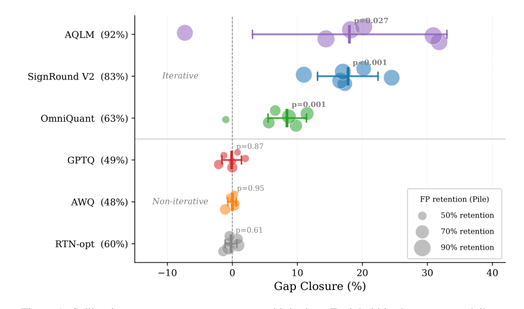
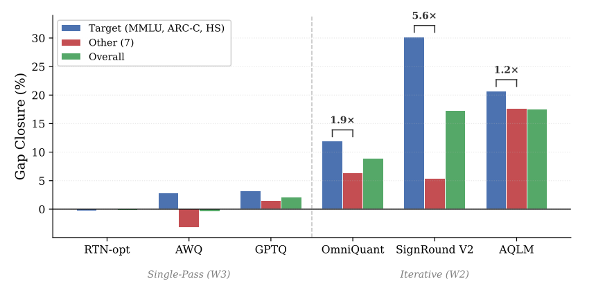
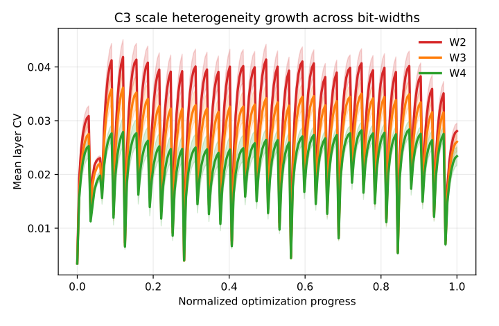
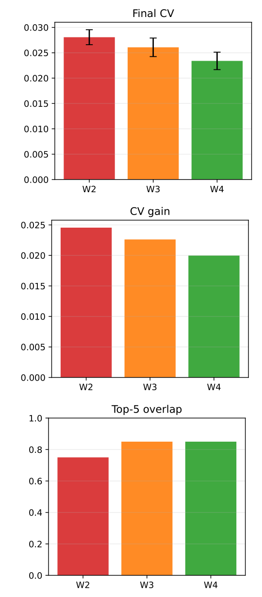
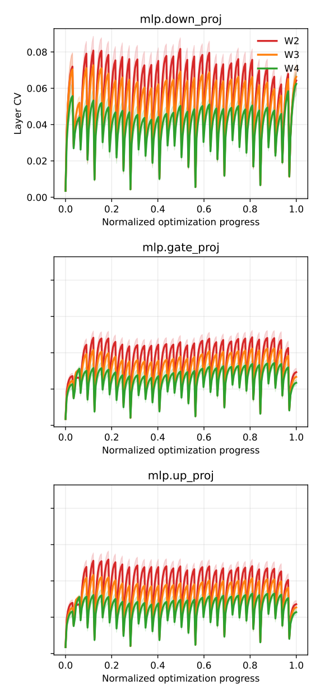

> **中文翻译（复述版）**：本文是对 arXiv:2611.11079 的逐节中文复述，并非逐字翻译（原文受 arXiv 非独占许可约束）；表格、数字、公式按原文保留，其余文字为复述者自己的中文表达。原文链接：<https://arxiv.org/abs/2611.11079>

# 当 Calibration 数据在 4 bit 以下语言模型量化中起作用：FragCal-DC

**When Calibration Data Matter in Sub-4-Bit Language Model Quantization**

作者：Yehong Jiang（MIT / Intel，通讯作者，工作于其在 Intel 实习期间）、Yen-Kuang Chen（Intel）、Xinmin Tian（Intel）。arXiv:2611.11079v1 [cs.LG]，2026-11-08。

## 摘要

低比特训练后量化（PTQ）能省显存，但可能让下游任务精度大幅下滑。校准（calibration）通常用通用文本，然而"什么时候引入任务相关数据能把精度找回来、哪些量化器受益"一直没搞清楚。作者提出 FragCal-DC：在通用文本的基础上，补充来自"在两比特扫描中全精度保留率低"的那些任务族的训练文档。他们用 2~4 bit 的扫描来界定"可用区间"（functional regime），并用 4 个随机种子的配对对比，在 6 个稠密模型（1.7B–8B）、10 个任务上评估 6 种依赖数据的量化方法。在各自最低的可用比特宽度上：迭代式的 SignRound V2 与 OmniQuant 在 2 bit 有提升，而单趟的 GPTQ、AWQ 在 3 bit 的平均响应很小。2 bit 下 SignRound V2 相对通用文本校准在 10 任务均值上涨 $`1.83`$ 个百分点（6 个模型）。在 70B 规模，GPTQ 与 SignRound V2 在 2 bit 都有提升，且通用校准基线本身可用。对 2 bit SignRound V2 的任务级对照表明，恢复集中在被纳入校准的任务族上，而把答案标错仍保留约 90% 的平均增益。重建误差的变化与精度增益并不一致。这些结果支持把"任务感知校准"作为低比特量化保持下游精度的一条设计原则。

## 1 引言

PTQ 用更少的比特表示训练好的权重来节省显存，但会损伤任务精度。主流依赖数据的 PTQ 方法（GPTQ、AWQ、OmniQuant、SignRound V2、AQLM 等）通常用通用语料作校准样本；"校准组成"指这些样本的选择与混合方式。AWQ 与 OmniQuant 都报告过：换校准语料，perplexity（困惑度）变化有限；Williams 与 Aletras 的更广泛比较则发现精度变化随任务与方法而异。作者要问的是：低于 4 bit 时，下游任务数据何时能恢复精度、哪些量化器受益、恢复发生在哪里。

FragCal-DC 是一种任务感知的校准混合：由基准的训练数据与 Pile 的通用文本组成。先在五个模型上做一次探索性的 2 bit 扫描，用"量化精度 / 全精度精度"这一比值偏低来识别"脆弱"的任务族。在此过程中保持每个量化器的更新规则不变，只改变校准组成（见第 3 节）。



在 2 bit 上，对于"带重复梯度更新"的方法（称为迭代式），改变校准文本能补回的 gap 平均百分比大于不带此类更新的方法（称为单趟式）（图 1）。不过单趟的 GPTQ/AWQ 基线基本已经崩溃——这里把"通用校准下十任务平均精度 $`\le 0.35`$"定义为崩溃，高于该阈值则为"可用"。

因此作者在三种口径下比较响应：各方法的可用工作宽度、统一的 3 bit 宽度、以及更大模型。先用 2~4 bit 扫描找出可用配置（第 4 节）；再用四次配对重复，在 6 个稠密模型（1.7–8B）、6 种依赖数据的仅权重量化器、10 个任务上对比通用校准与任务感知校准。

在各自最低的可用比特宽度上，迭代式 SignRound V2（SR-V2）和 OmniQuant 在 2 bit 有改善，单趟的 GPTQ、AWQ 在 3 bit 平均响应较小（表 3）。2 bit 下 SR-V2 相对 Pile-200（200 条请求样本的通用文本对照）在六模型十任务均值上涨 $`1.83`$ pp。3 bit 下，用各方法自己的对照，SR-V2 的 gap closure 高于 AWQ；但以共同通用对照比较精度增益并不能证明存在普适的"类别优势"（5.2 节）。在 Llama-3.1-70B 上，2 bit GPTQ 配置可用，增益 $`+2.33`$ pp（5.3 节）。

在五模型 2 bit SR-V2 对照中，增益集中在被纳入校准的任务族。把错误答案标成正确，仍保留用正确标注时约 90% 的平均增益；完全不标注答案时仍有较小的平均增益（5.4、6.1 节）。

SR-V2 的"数据依赖但无迭代更新"控制组几乎没有响应。FragCal-DC 的平均精度高于被测的无排序问答混合及其他配方（6.2 节）。而重建误差（量化与未量化块输出之差）的变化与精度增益并不一致。

贡献：在可用比特宽度上的跨方法校准证据、任务层面的恢复对照、以及文档化的 FragCal-DC 配方。结论是校准混合应围绕模型预期的下游任务来设计。

## 2 背景与相关工作

**分块量化。** 研究对象是依赖数据的分块 PTQ：把低比特权重拟合到层或 Transformer 块的输出上。设校准文本为 $`D`$ ， $`f_{\ell}`$ 为第 $`\ell`$ 个单元的计算， $`\mathbf{X}_{\ell}(D)`$ 为其输入激活， $`\mathbf{W}_{\ell}`$ 、 $`\widehat{\mathbf{W}}_{\ell}`$ 为未量化与量化权重。一个典型的损失是输出差的平方 Frobenius 范数：

```math
\mathcal{L}_{\ell}(\widehat{\mathbf{W}}_{\ell};D)=\left\|f_{\ell}(\mathbf{W}_{\ell},\mathbf{X}_{\ell}(D))-f_{\ell}(\widehat{\mathbf{W}}_{\ell},\mathbf{X}_{\ell}(D))\right\|_{F}^{2}\qquad (1)
```

也就是说校准组成决定了用于拟合低比特权重的激活。重建单元和目标函数则因方法而异。

**表示与更新。** 各方法的低比特表示和更新规则不同。在一个重建单元内，每个标量仿射权重组用尺度 $`\gamma>0`$ 、整数偏移 $`z`$ 和整数码 $`\mathbf{c}`$ 表示权重：

```math
\widehat{\mathbf{w}}=\gamma(\mathbf{c}-z)
```

GPTQ 用二阶修正；AWQ 以及零迭代的 RTN-opt 控制组则搜索尺度。这些单趟方法没有重复的梯度重建更新。AdaRound 通过连续化的舍入近似引入了局部学习的舍入。OmniQuant 迭代优化裁剪阈值，SR-V2 迭代优化舍入与尺度。AQLM 迭代学习向量码本，权重由码字之和表示。

**校准组成。** 既有研究的结论随指标和场景而变。AWQ 报告在 OPT-6.7B 3 bit 下，跨领域 perplexity 变化小于 GPTQ。OmniQuant 报告在 LLaMA-7B 的 3 bit 权重 / 16 bit 激活，以及 4 bit 权重与激活下，WikiText2、C4、Pile 之间 perplexity 方差很低。Williams 与 Aletras 在五种来源、多次抽样下发现精度变化依任务和模型而异：4 bit GPTQ/SpQR 的敏感度低于剪枝，来源之间的均值差异通常很小。这些发现并未回答"4 bit 以下任务感知校准能否恢复精度"。

**重建与任务精度。** 重建误差度量局部输出保真度。固定重建指标与参考文本，不同校准条件下的误差才可比。同时还要直接测下游精度，因为局部目标并不直接优化它。

**范围。** 主要设定是权重量化。排除 QuIP/QuIP# 变换、稀疏离群表示（SpQR/SqueezeLLM）以及无数据的 HQQ。两模型的权重-激活扩展并不比较权重-激活算法或量化感知训练。浮点量化格式、KV cache 压缩、混合精度分配、剪枝均在范围之外。整个研究只改校准组成，保持更新规则不变（第 3 节）。

## 3 实验设置

**模型与评测。** 主稠密面板包括 Qwen3-1.7B、Qwen3-8B、Llama-2-7B、Mistral-7B-v0.1、Qwen2.5-7B-Instruct、Phi-3-mini-4k-instruct。各模型未量化的全精度（FP）精度作为参照。Llama-3.1-70B 用于规模对照。

十任务面板通过 lm-eval-harness 评测：ARC-Challenge、ARC-Easy、BoolQ、HellaSwag、LAMBADA、MMLU、OpenBookQA、PIQA、TruthfulQA MC1、WinoGrande。AVG 为它们的无加权平均。比较时在每种方法内使用匹配的评测设置（附录 P）。

**量化配置。** 测试 2、3、4 bit 权重（W2、W3、W4），方法覆盖见表 1。校准响应实验中，标量权重量化器采用 group size 128（G128），位宽与分组组合成 W2G128、W3G128、W4G128。AQLM 约为每权重 2 bit（不含开销）。序列长度等实现设置因方法而异（附录 F）。

表 1：被评估的方法。❍ 表示单趟，⚫ 表示迭代。"单趟"指不含重复的梯度重建更新，不代表不依赖数据或不做搜索。RTN-opt 使用 SR-V2 的尺度搜索初始化，但不做迭代舍入更新。

| 方法 | 类别 | 评估实现 |
|---|---|---|
| RTN | 无数据参照 | Round-to-nearest |
| ❍ RTN-opt | 单趟 | 重要性加权尺度搜索，零迭代 |
| ❍ AWQ | 单趟 | 激活感知尺度搜索 |
| ❍ GPTQ | 单趟 | 基于 Hessian 的舍入修正 |
| ⚫ OmniQuant | 迭代 | 可学习权重裁剪（LWC），20 epoch |
| ⚫ SignRound V2 | 迭代 | 舍入与尺度优化，200 次迭代 |
| ⚫ AQLM | 迭代 | 学习向量码本，W2 等效 |

实现选择限制了比较的普适性。这里的 OmniQuant 用 LWC 并关闭了可学习等价变换（LET），因此结果既不代表完整流水线，也不是其可达精度的下界。RTN-opt 是依赖数据的零迭代控制组，但不能把"迭代"与其他优化器、参数化选择分离开。

**校准干预。** FragCal-DC 用"脆弱任务族"的训练文档来补充通用文本。一次探索性的五模型扫描（SR-V2、Pile 校准、2 bit、group size 16、seed 42）挑出量化/未量化精度比低的任务族（附录 D）。208 篇文档的混合包括：128 篇 Pile、32 篇 MMLU auxiliary-training、32 篇来自 ARC-Challenge/ARC-Easy/OpenBookQA 合并训练池、16 篇 HellaSwag 训练文档。短问答条目先拼接成长文档再采样。

Pile-128 与 Pile-200 是取自 Pile-10k 的通用文本对照，请求校准样本数分别为 128 与 200。有效序列数取决于 tokenizer 与加载器（附录 A）。Pile-200 是更大的通用对照，并不是文档数或 token 数严格匹配的对照。校准用训练划分，但评测集分区并不能保证条目级隔离（6.3 节）。配对响应使用四个校准种子 $`\lbrace 42,123,456,789 \rbrace`$ ，模型、量化器配置与评测设置固定。单种子扫描和探针会明确标注。

**比较地图。** 区分三种比较：统一 W2 观察（图 1）、指定宽度比较（表 3）、匹配 W3 检查（5.2 节）。指定宽度比较与匹配 W3 检查报告六模型上相对 Pile-200 的 pp 效应。OmniQuant 的 W2 比较使用基线可用的五个模型（排除 Mistral-7B）。任务级与配对答案对照分析使用五个模型的 SR-V2/RTN-opt、W2、Pile-200。另外单独报告的 Phi-3 答案对照结果被纳入六模型描述性汇总（表 16）。

**指标与不确定性。** 精度增益用百分点（pp），并报告 gap closure（GC）。设 $`A`$ 表示精度，每个模型的 GC 为

```math
\mathrm{GC}=100\,(A_{\rm FragCal}-A_{\rm ctrl})/(A_{\rm FP}-A_{\rm ctrl})\ \text{percent}
```

图 1 对每模型 GC 取平均；表 3、4 则把公式用于同一组模型的平均精度（与 pp 增益口径一致）。GC 以剩余的 FP 差距来归一化恢复量。

对每个模型先平均 4 个配对种子的精度差（FragCal 减对照），再跨模型平均。面板均值用跨模型的 95% Student $`t`$ 区间。主要对比使用精确的双侧模型级 sign-flip 检验，它不一定与小样本 $`t`$ 区间一致。种子不增加独立模型数；由于部分模型共享架构和训练谱系，模型独立性只是近似。图 1 中标注的 $`p`$ 值来自未经校正的、对"平均 gap closure 为零"的双侧单样本 $`t`$ 检验。

## 4 定位"可用区间"

操作宽度根据通用校准下的精度来选。对每个模型与量化器配置，将十任务精度在四个种子上平均。某模型的某配置若高于 $`0.35`$ 即为可用，不高于则为崩溃（附录 C）。该阈值用绝对精度而非全精度保留率，对这套任务只作描述性用途，并非对共同随机水平的检验。

可用宽度因方法而异。表 2 按方法与宽度汇总扫描结果。GPTQ 与 AWQ 在 W2 的六个模型基线都低于 $`0.35`$ ，因此这两种方法在 W3 比较。SR-V2 的六个 W2 基线、AQLM 的六个 W2 等效基线都可用。

表 2：六模型的通用校准扫描。AVG 为可用模型上十任务精度（小数）的无加权平均。FP 为未量化。除 SR-V2 W4 外均为 seed 42（见 A.1 节）。AQLM 为 W2 等效，不是标量 W2G128。面板均值标注：✗ 低（ $`\le 0.35`$ ）、✓ 可用（ $`0.35<\mathrm{AVG}\leq 0.62`$ ）、↑ 高（ $`>0.62`$ ）。0.62 这条参考线不参与选择。

| 宽度 | FP 参照 | RTN ❍ | RTN-opt ❍ | AWQ ❍ | GPTQ ❍ | OmniQuant ⚫ | SR-V2 ⚫ | AQLM ⚫ |
|---|---|---|---|---|---|---|---|---|
| W2G128 | 0.643 | 0.314 ✗ | 0.386 ✓ | 0.308 ✗ | 0.306 ✗ | 0.388 ✓ | 0.536 ✓ | 0.596 ✓ |
| W3G128 | 0.643 | 0.550 ✓ | 0.594 ✓ | 0.603 ✓ | 0.576 ✓ | 0.604 ✓ | 0.623 ↑ | — |
| W4G128 | 0.643 | 0.627 ↑ | 0.631 ↑ | 0.635 ↑ | 0.638 ↑ | 0.634 ↑ | 0.633 ↑ | — |

OmniQuant 与 RTN-opt 的模型选择规则不同。OmniQuant 的 Mistral-7B W2 基线为 $`0.320`$ ，低于阈值，其余五个基线可用。作者同时报告所得五模型子集与全六模型响应。RTN-opt 仍作为单独的零迭代控制，在六个模型上不做阈值筛选。

这些选择规则并未在各方法之间匹配比特宽度或全精度保留率。若把阈值提到 $`0.40`$ ，OmniQuant W2 只剩两个模型，不足以做广泛比较（附录 C）。因此在操作宽度比较之外，还补充匹配 W3 与保留率匹配的检查（5.2 节）。

## 5 跨方法与区间的校准敏感性

### 5.1 指定操作宽度上的响应

指定宽度上最强的平均响应来自六模型的 SR-V2，以及 W2 基线可用的五模型 OmniQuant（表 3）。它们的 W2 平均效应分别为 $`+1.83`$ 与 $`+1.78`$ pp，正向的模型均值分别为 6/6 与 5/5。AQLM 六模型估计为 $`+0.73`$ pp，有五个模型均值为正，但区间包含零。W3 的 GPTQ、AWQ 与 W2 的 RTN-opt 面板均值都小，区间跨零（正向模型分别为 3/6、4/6、2/6）。

表 3：指定操作宽度上的校准敏感性。AVG 为十任务无加权精度（小数），在四个配对种子与 $`n`$ 个模型上平均。 $`\Delta`$ 为 FragCal-DC 减 Pile-200（pp），附模型级 95% $`t`$ 区间。GC（%）由同样的平均精度算出。OmniQuant W2 排除 Mistral-7B（ $`n=5`$ ）。

| 方法 | 格式 | $`n`$ | Pile-200 AVG | FragCal-DC AVG | $`\Delta`$ (pp) | 95% CI | GC (%) |
|---|---|---|---|---|---|---|---|
| ❍ RTN-opt | W2G128 | 6 | 0.3853 | 0.3847 | $`-0.05`$ | $`[-0.29,+0.19]`$ | $`-0.2`$ |
| ❍ AWQ | W3G128 | 6 | 0.6053 | 0.6049 | $`-0.04`$ | $`[-0.36,+0.28]`$ | $`-1.0`$ |
| ❍ GPTQ | W3G128 | 6 | 0.5747 | 0.5770 | $`+0.23`$ | $`[-0.91,+1.37]`$ | $`+3.4`$ |
| ⚫ OmniQuant | W2G128 | 5 | 0.4225 | 0.4403 | $`+1.78`$ | $`[+1.28,+2.27]`$ | $`+8.2`$ |
| ⚫ SR-V2 | W2G128 | 6 | 0.5367 | 0.5550 | $`+1.83`$ | $`[+0.91,+2.75]`$ | $`+17.3`$ |
| ⚫ AQLM | W2-equiv. | 6 | 0.5906 | 0.5980 | $`+0.73`$ | $`[-0.14,+1.61]`$ | $`+14.1`$ |

OmniQuant 的结果取决于模型选择与不确定性的评估方式。若把低于阈值的 Mistral-7B 也算进来，六模型 W2 估计为 $`+1.20`$ pp，区间 $`[-0.34,+2.73]`$ 。pp 效应的精确双侧 sign-flip $`p`$ 值：SR-V2 为 $`0.03125`$ ，OmniQuant 五模型子集为 $`0.0625`$ 。 $`0.0625`$ 是五个模型所能达到的最小值，而 OmniQuant 为正的 Student $`t`$ 区间依据的是另一种抽样假设。

### 5.2 匹配宽度比较

在 W3，用各方法特定的对照参照，SR-V2 的每模型 gap closure 高于 AWQ（配对 $`t(5)=3.40`$ ，单侧 $`p=0.010`$ ，附录 B）。校准样本数并未匹配。

而用共同 Pile-200 对照比较精度增益，则不能确立普适的 W3 类别优势：SR-V2 的精度增益比 AWQ 高 $`+0.40`$ pp，95% 区间 $`[-0.10,+0.90]`$ 。把 SR-V2/OmniQuant 与 GPTQ/AWQ 作类别平均对比，得 $`+0.06`$ pp，区间 $`[-0.68,+0.80]`$ ，精确 sign-flip $`p=0.875`$ ，六个模型对比中有三个为正。

W4 的平均响应很小：SR-V2 为 $`+0.01`$ pp，OmniQuant $`-0.08`$ ，GPTQ $`-0.07`$ ，AWQ $`-0.03`$ （表 4）。

即便位宽相同，基线精度与距离崩溃的远近也不同。在指定操作宽度上做保留率匹配，在所测容差下只得到一两对模型，且都是 OmniQuant 对 RTN-opt，无法支持广泛的类别推断。现有配置网格不能把"优化器类别效应"与基线精度、码本、目标函数或初始化区分开。

表 4：FragCal-DC 相对 Pile-200 的精度增益（ $`\Delta`$ ，pp）与 FP gap closure（GC，%）。均为六模型均值，OmniQuant W2 排除 Mistral-7B（ $`n=5`$ ）。AQLM 用 W2 等效码本。破折号表示不适用的宽度。各模型结果见表 11。

| 方法 | 类型 | W2G128 $`\Delta`$ (pp) | W2G128 GC (%) | W3G128 $`\Delta`$ (pp) | W3G128 GC (%) | W4G128 $`\Delta`$ (pp) | W4G128 GC (%) |
|---|---|---|---|---|---|---|---|
| ❍ RTN-opt | 单趟 | $`-0.05`$ | $`-0.2`$ | $`-0.02`$ | $`-0.4`$ | $`-0.02`$ | $`-2.2`$ |
| ❍ AWQ | 单趟 | $`+0.02`$ | $`+0.0`$ | $`-0.04`$ | $`-1.0`$ | $`-0.03`$ | $`-4.4`$ |
| ❍ GPTQ | 单趟 | $`-0.44`$ | $`-1.3`$ | $`+0.23`$ | $`+3.4`$ | $`-0.07`$ | $`-5.7`$ |
| ⚫ OmniQuant | 迭代 | $`+1.78`$ | $`+8.2`$ | $`-0.05`$ | $`-1.4`$ | $`-0.08`$ | $`-9.7`$ |
| ⚫ SR-V2 | 迭代 | $`+1.83`$ | $`+17.3`$ | $`+0.36`$ | $`+17.3`$ | $`+0.01`$ | $`+2.4`$ |
| ⚫ AQLM | 迭代 | $`+0.73`$ | $`+14.1`$ | — | — | — | — |

### 5.3 规模与架构的边界情形

在 Llama-3.1-70B 的 W2 上，GPTQ 与 SR-V2 都有改善，两者的通用校准基线都可用。四个配对种子下，GPTQ 增益 $`+2.33`$ pp（AVG 约从 $`0.367`$ 到 $`0.390`$ ），SR-V2 增益 $`+0.86`$ pp（AVG 从 $`0.659`$ 到 $`0.668`$ ，表 5 与附录 O）。Gap closure 分别为 GPTQ $`6.6\%`$ 、SR-V2 $`13.8\%`$ ，两者在绝对增益与 gap closure 上的排名恰好相反。这把校准敏感性延伸到了更大规模，同时也限制了"小模型上的方法类别规律"可推广的范围。

表 5：Llama-3.1-70B W2G128 校准比较。精度为十任务均值（小数）。除 AWQ（seed 42）外，各行平均四个种子。未量化的 bfloat16（BF16）参照平均精度为 0.7215。 $`\Delta`$ 为 FragCal 减 Pile（pp）。GC 为 FragCal 补回的 Pile 与 BF16 精度差距的百分比。

| 方法 | 种子数 | Pile-200 | FragCal | $`\Delta`$ pp | GC (%) |
|---|---|---|---|---|---|
| ❍ RTN-opt | 4 | .3213 | .3239 | +0.26 | +0.6 |
| ❍ AWQ | 1 | .322 | .321 | $`-0.1`$ | $`-0.3`$ |
| ❍ GPTQ | 4 | .3665 | .3899 | +2.33 | +6.6 |
| ⚫ SR-V2 | 4 | .659 | .668 | +0.86 | +13.8 |

更窄的架构与格式测试中也出现了正向的迭代式响应（S.5 节）。在 Mixtral-8x7B-Instruct（一个把输入路由到部分专家网络的 MoE 模型）上，W3G128、仅 ARC-Challenge、四个种子，SR-V2 提升 $`+1.02`$ pp，GPTQ 变化 $`-1.39`$ pp。AutoRound 在 Phi-3 与 Mistral 上的 2 bit 权重 / 8 bit 激活（两种格式）也有提升。这些并不构成通用的架构或权重-激活类别比较，路由变化也没有测量。

### 5.4 精度增益发生在哪里

SR-V2 的 W2 恢复集中在三个由脆弱度选出的任务。在五模型 Pile-200 面板上，MMLU、ARC-Challenge、HellaSwag 增益 $`+3.86`$ pp，而五个"严格非目标"任务只有 $`+0.20`$ pp（表 6）。严格组不含选中的任务，也不含 ARC-Easy 和 OpenBookQA（它们的训练数据同样进入了校准）。模型内配对差为 $`+3.65`$ pp。这支持"任务对齐的恢复"，但无法把"脆弱度"与"校准来源暴露"区分开。

表 6：SR-V2 W2G128 下 FragCal 相对 Pile-200 的增益（pp），在四个配对种子与五个模型上平均，附模型级 95% $`t`$ 区间。脆弱度选中的任务是 MMLU、ARC-Challenge、HellaSwag。严格非目标任务排除这些以及 ARC-Easy、OpenBookQA。最后一行为选中任务与严格非目标任务增益的模型内差值。

| 任务组 | $`\Delta`$ pp | 95% 区间 | 正向模型数 |
|---|---|---|---|
| 脆弱度选中任务 | $`+3.86`$ | $`[+1.25,+6.46]`$ | 5/5 |
| 严格非目标任务 | $`+0.20`$ | $`[-0.78,+1.18]`$ | 4/5 |
| 模型内差值 | $`+3.65`$ | $`[+0.67,+6.64]`$ | 5/5 |

任务组 gap closure 提供了跨量化器的描述性视角（图 2）。与表 6 不同，它使用混合的操作宽度以及 SR-V2 的 Pile-128 参照；其七任务补集包含 ARC-Easy 与 OpenBookQA，因此不是独立的迁移对照。



## 6 校准对照与解释性证据

5.4 节的任务集中现象引出几个问题：答案内容、配方选择、迁移与重叠。在检验"重建"与"尺度-码"这类解释之前，先逐一考察。

### 6.1 答案标注与零迭代对照

错误的答案标注保留了 SR-V2 W2 改善的大部分，而不做标注则保留较小的平均增益（表 7）。在五模型 Pile-200 面板上，正确、错误、无标注的增益依次为 $`+1.60`$ 、 $`+1.44`$ 、 $`+0.88`$ pp。错误标注保留约 90% 的正确标注平均增益，无标注保留约 55%。另一个使用方法特定参照的六模型比较，在错误标注下保留约 91%（表 16）。

这些干预检验的是"答案被指定"，而不是"去掉全部答案信息"：MMLU、ARC、OpenBookQA 仍保留包含正确答案的全部候选项。

表 7：答案标注与零迭代对照，W2G128，五个模型，四个配对种子。AVG 为十任务平均精度（小数）。 $`\Delta`$ 为相对各方法 Pile-200 对照的增益（pp），附模型级 95% $`t`$ 区间。Gain retained 相对于"正确答案 SR-V2"的平均增益。"无标注"指不标出答案。

| 校准 | AVG | $`\Delta`$ pp | 95% 区间 | 保留增益 |
|---|---|---|---|---|
| ❍ RTN-opt FragCal | 0.3843 | $`-0.04`$ | $`[-0.35,+0.28]`$ | — |
| ❍ RTN-opt Pile-200 | 0.3846 | — | — | — |
| ⚫ SR-V2 correct | 0.5551 | $`+1.60`$ | $`[+0.66,+2.55]`$ | 100.0% |
| ⚫ SR-V2 wrong | 0.5535 | $`+1.44`$ | $`[+0.52,+2.37]`$ | 90.0% |
| ⚫ SR-V2 no designation | 0.5478 | $`+0.88`$ | $`[+0.38,+1.39]`$ | 54.9% |
| ⚫ SR-V2 Pile-200 | 0.5390 | — | — | — |

在同样五个模型上，依赖数据的零迭代 RTN-opt 控制几乎没有平均响应，为 $`-0.04`$ pp，区间 $`[-0.35,+0.28]`$ 。这表明在所测框架里迭代优化是一个合理的贡献因素，但并未单独证明其作用。迭代次数与优化器变体的探针提供了互补证据（附录 J、I）。

### 6.2 配方重要吗？

Random QA 抓到了 FragCal 的大部分平均收益，但回退更多。这个无排序的问答混合在六模型 SR-V2 W2 面板上增益 $`+1.46`$ pp，FragCal 为 $`+1.93`$ pp（S.2 节）。参照对五个模型为 Pile-128，Phi-3 为 Pile-200。Random QA 在模型-种子对上有 18/24 为正，FragCal 为 24/24。它的 200 条没有 Pile 锚点的问答条目，与 FragCal 的 208 篇文档在来源分配和通用文本覆盖上都不同，所以这个对比并不能孤立出"脆弱度排序"本身的作用。

FragCal 的平均精度高于三种被测替代方案：多样性选择、语义选择、科学文章。在五模型 SR-V2 W2 面板上，同一框架下的优势分别是：比 Diversity-DC 高 $`+2.01`$ pp，比 LSA-DC 高 $`+1.11`$ ，比 ArXiv-OOD 高 $`+2.55`$ （S.1 节）。LSA-DC 的区间包含零，这些比较并不能确立最优排序。

### 6.3 迁移与评测重叠

在被测对比中，ARC/OpenBookQA 补充带来的 MMLU 增益比 MMLU 补充更大。两种做法都是向 Pile-128 加 32 篇文档，在 SR-V2 W2 下评测 MMLU。ARC/OpenBookQA 的优势为 $`+1.50`$ pp，分层 bootstrap 区间 $`[+0.67,+2.46]`$ ，五个模型均值全为正，19/20 个种子对为正（S.3 节）。因此在此对比中，直接补充 MMLU 并非更强 MMLU 响应的必要条件。两种来源都是问答文本，激活覆盖、格式与分布对齐都可能是原因。

更远任务的评测并未确立广泛的跨任务族迁移（附录 L、N）。它们覆盖：SR-V2 与 RTN-opt 在 GSM8K 上，以及 GPTQ、AWQ、OmniQuant、AQLM 在 GPQA-Diamond、IFEval、BBH 上。方法覆盖不同，不能把它们当作单一的跨方法复现。

**条目级重叠。** 重叠检查在校准文件中找到了与规范化后的评测问题及 HellaSwag 补全相匹配的条目（表 59）。有些问题键很通用，且这些问题匹配尚未被核验为完整的"问题+选项"重复。命名上的划分分离并不意味着条目分离。完整条目核验，以及剔除匹配条目后对精度的影响，仍未解决。无论是错误答案还是外部任务测量，都不能证明增益不受污染。

### 6.4 重建代理指标与可能的机制

**重建误差是否跟踪任务恢复？** 重建比较需要共同输入。不同校准集上的损失不能直接比较，各方法特定的目标也不可互换。作者使用 seed 999 下同样的 128 条 Pile-10k 样本（附录 H）。精度取四个种子均值，相对重建误差变化在可用的配对种子上平均，覆盖度不一（表 31）。

在这个共同参照上，重建误差与精度并不一致地同步改善（表 8）。GPTQ 的误差在六个模型格中有五个上升，但精度在三个中改善；AQLM 的误差在全部六格上升，精度却在五格改善。

表 8：从 Pile-200 到 FragCal 的重建误差与精度变化，在 $`n`$ 个模型上平均。MSE 为固定参照的均方重建误差。MSE 越低、精度越高越好。Mismatch 统计两个指标一升一降的模型数。

| 方法 | $`n`$ | $`\Delta`$ MSE (%) | $`\Delta`$ accuracy (pp) | Mismatch |
|---|---|---|---|---|
| ❍ AWQ | 6 | $`+7.80`$ | $`-0.04`$ | 4/6 |
| ❍ GPTQ | 6 | $`+3.90`$ | $`+0.23`$ | 2/6 |
| ⚫ OmniQuant | 5 | $`-0.22`$ | $`+1.78`$ | 3/5 |
| ⚫ SR-V2 | 6 | $`-5.12`$ | $`+1.83`$ | 2/6 |
| ⚫ AQLM | 6 | $`+5.76`$ | $`+0.73`$ | 5/6 |

两个优化探针也显示，更低的损失不一定带来更高精度。优化器变体使校准损失下降 6–30%；而第二遍量化虽降低了自己的目标，却让 15/20 个精度格变差。第二遍是从已量化权重出发，重建问题本身已变化（附录 I）。

**别的损失能预测任务恢复吗？** 留出集的下一 token 预测损失（交叉熵）与任务恢复呈初步关联。它在 WikiText 上的下降与五个 SR-V2 W2 模型均值的精度增益相关（Pearson $`r=0.778`$ ，精确置换检验 $`p=0.083`$ ，M.3 节）。交叉熵平均降幅的区间包含零。这个小面板还不足以验证它能预测恢复。

**尺度变化能解释校准敏感性吗？** 在九个被测的模型-位宽格中，组尺度的分散程度对校准组成的敏感度，SR-V2 高于 GPTQ（表 9 与附录 R）。用变异系数（CV，即尺度标准差除以均值的绝对值）度量分散程度。SR-V2/GPTQ 敏感度比在 W4 对两个模型最大，尽管那里精度增益很小，所以这个比值本身不是精度的独立预测量。

表 9：把 Pile 换成 FragCal 对尺度的敏感度（SR-V2/GPTQ 比值）。对每组尺度 $`s`$ ，尺度 CV 为 $`\sigma(s)/(|\mu(s)|+10^{-12})`$ ，其中 $`\sigma`$ 与 $`\mu`$ 是总体标准差与均值。敏感度是 CV 的相对绝对变化，先在匹配的模块上平均，再对四个种子平均（附录 R）。Phi-3 使用 SR-V2 的带符号尺度约定。

| 模型 | W2G128 | W3G128 | W4G128 |
|---|---|---|---|
| Llama-2-7B | $`16.4\times`$ | $`68.1\times`$ | $`164.5\times`$ |
| Qwen3-1.7B | $`15.8\times`$ | $`24.8\times`$ | $`41.5\times`$ |
| Phi-3 | $`1.2\times`$ | $`4.8\times`$ | $`4.2\times`$ |

在码字固定时把学到的尺度压平，会损害保真度，这支持"学到的尺度与码配对"的重要性。至于重新优化码字能否补偿更平的尺度，尚未测试。该干预并不能证明尺度变化是 FragCal 精度增益的充分原因。

校准也会改变 GPTQ 的输入统计，但这个探针无法指出具体是哪些舍入决策发生了变化（附录 Q）。"依赖校准的优化"和"分布对齐"仍然是并存的可能解释。

## 7 讨论

校准设计应从量化配置出发。基线扫描指出每种方法在哪里还能保持有用精度（第 4 节），响应比较则衡量在这些宽度上任务感知数据的效果（第 5 节）。位宽间的差异以及 70B 上 GPTQ 的正向响应，促使人们针对目标模型、量化器与位宽来评估配方。

在给定配置下，任务覆盖指导校准组成。两比特 SR-V2 的对照支持"任务对齐的恢复"：增益集中在被纳入校准的任务族，并且在答案标错时基本保留（5.4、6.1 节）。这使任务内容与覆盖成为配方设计的有用起点。FragCal-DC 就是用"任务相关训练样本 + 通用文本"的混合来实现这一思路。

6.4 节的重建与尺度探针强化了一点：这些选择要以下游精度来评判。重建目标度量局部近似质量，任务精度则反映整个模型做出的决策。重建与尺度测量有助于刻画量化行为，而校准改动是否有用由任务精度决定。

**实际使用。** 从一个具备有用任务精度的通用校准基线出发。在保持其他量化设置不变的前提下，比较"合适的训练数据 + 通用文本"的不同混合。评估目标任务与独立对照，把配方选择与最终测试分开，并检查条目级重叠。

**局限。** 优化器类别仍与宽度、基线精度、参数化与实现耦合；面板包含相关架构，广泛迁移尚未确立；代码生成与多轮对话未测；FragCal-DC 的排序与配额需要在新的种子与目标分布上独立验证；校准与评测条目重叠对精度的影响尚未解决。

## 8 结论

校准组成可以在不改变量化器更新规则的前提下恢复下游精度。在测得的最低可用宽度上，恢复最清楚的是两比特 SignRound V2 与 OmniQuant 的五模型子集，三比特 GPTQ 与 AWQ 的平均响应较小。在 Llama-3.1-70B 上，GPTQ 与 SignRound V2 在两比特都有改善。对两比特 SignRound V2，增益集中在被纳入校准的任务族，并在错误答案标注下基本保留。FragCal-DC 只是任务感知校准的一种配方。这些发现支持把任务感知校准作为低比特量化保持下游精度的设计原则。

**社会影响。** 高效推理可降低部署成本与资源消耗，但也可能便利对现有能力的有害使用。校准可能有选择地保留或削弱某些能力，因此仅看总体精度不足以保证安全部署。本工作不涉及人类受试者研究。使用该校准协议须遵守数据集与模型的使用条款。

**致谢与披露。** 本工作未获第三方或机构资助；除上述所属机构外，作者声明无其他利益冲突。

## 参考文献

原文列有 39 条参考文献（Phi-3、HQQ、PIQA、QuIP、SignRoundV2、BoolQ、ARC、GSM8K、SpQR、AQLM、GPTQ、The Pile、lm-eval-harness、Gemma 2、Llama 3、MMLU、AutoRound、Mistral 7B、Mixtral、SqueezeLLM、AWQ、TruthfulQA、LLM-QAT、WikiText（Pointer sentinel）、OpenBookQA、AdaRound、LAMBADA、Qwen2.5、GPQA、WinoGrande、OmniQuant、BBH、Llama 2、QuIP#、Williams & Aletras 2024、SmoothQuant、Qwen3、HellaSwag、IFEval 等），此处不逐条抄录，请见原文。

附录导览：各模型结果与区间检查在附录 A、B、C；校准构造与实现细节在 D、E、F；额外的重建与尺度-码证据在 H、I、R；配方、迁移、重叠与架构对照在 S。

---

# 附录

## 附录 A 各模型的校准响应

这些表为第 4、5、6.1 节提供逐模型证据：先是四种子响应，然后是基线扫描、FP 参照、答案标注对照。表 10 的每一行都是四个种子的平均；表 6 的任务组区间就是用这五个模型的均值算出的。

表 10：五模型 W2G128 下 FragCal 相对 Pile-200 的精度增益（pp），四个种子平均。AVG 为十任务平均。任务组定义见表 6。

| 模型 | RTN-opt AVG | SR-V2 AVG | SR-V2 脆弱度选中任务 | SR-V2 严格非目标任务 |
|---|---|---|---|---|
| Llama-2-7B | $`-0.12`$ | $`+1.31`$ | $`+5.05`$ | $`-1.19`$ |
| Mistral-7B | $`+0.21`$ | $`+2.36`$ | $`+5.68`$ | $`+0.52`$ |
| Q2.5-7B-Inst | $`-0.16`$ | $`+0.54`$ | $`+0.71`$ | $`+0.47`$ |
| Qwen3-1.7B | $`-0.35`$ | $`+2.31`$ | $`+5.13`$ | $`+0.75`$ |
| Qwen3-8B | $`+0.23`$ | $`+1.50`$ | $`+2.72`$ | $`+0.46`$ |

跨方法比较全程使用 Pile-200，包括 SR-V2 的 Phi-3。OmniQuant 的 Mistral-7B W2 保留在表 11 中，但因其 Pile 基线低于 0.35，被排除在表 3、4 的均值之外。

表 11：全部 96 条跨方法模型记录的四种子十任务均值。Pile 与 FragCal 为精度（小数）。 $`\Delta`$ 为 FragCal 减 Pile（pp）。GC（%）使用未取整的各模型 FP 参照。W2-eq. 指 AQLM 的向量码本。

| 方法 | 模型 | 格式 | 参照 | Pile | FragCal | Δ pp | GC |
|---|---|---|---|---|---|---|---|
| ❍  RTN-opt | Llama-2-7B | W2G128 | Pile-200 | 0.4130 | 0.4119 | $`-0.12`$ | $`-0.6`$ |
| ❍  RTN-opt | Llama-2-7B | W3G128 | Pile-200 | 0.5886 | 0.5883 | $`-0.02`$ | $`-1.1`$ |
| ❍  RTN-opt | Llama-2-7B | W4G128 | Pile-200 | 0.6032 | 0.6033 | $`+0.01`$ | $`+1.8`$ |
| ❍  RTN-opt | Mistral-7B | W2G128 | Pile-200 | 0.4423 | 0.4444 | $`+0.21`$ | $`+1.0`$ |
| ❍  RTN-opt | Mistral-7B | W3G128 | Pile-200 | 0.6346 | 0.6342 | $`-0.05`$ | $`-1.6`$ |
| ❍  RTN-opt | Mistral-7B | W4G128 | Pile-200 | 0.6584 | 0.6586 | $`+0.03`$ | $`+5.1`$ |
| ❍  RTN-opt | Phi-3-mini | W2G128 | Pile-200 | 0.3885 | 0.3872 | $`-0.13`$ | $`-0.4`$ |
| ❍  RTN-opt | Phi-3-mini | W3G128 | Pile-200 | 0.6179 | 0.6211 | $`+0.32`$ | $`+5.9`$ |
| ❍  RTN-opt | Phi-3-mini | W4G128 | Pile-200 | 0.6673 | 0.6668 | $`-0.05`$ | $`-9.3`$ |
| ❍  RTN-opt | Q2.5-7B-Inst | W2G128 | Pile-200 | 0.3706 | 0.3690 | $`-0.16`$ | $`-0.5`$ |
| ❍  RTN-opt | Q2.5-7B-Inst | W3G128 | Pile-200 | 0.6436 | 0.6443 | $`+0.08`$ | $`+1.6`$ |
| ❍  RTN-opt | Q2.5-7B-Inst | W4G128 | Pile-200 | 0.6813 | 0.6804 | $`-0.09`$ | $`-9.0`$ |
| ❍  RTN-opt | Qwen3-1.7B | W2G128 | Pile-200 | 0.3105 | 0.3070 | $`-0.35`$ | $`-1.4`$ |
| ❍  RTN-opt | Qwen3-1.7B | W3G128 | Pile-200 | 0.4580 | 0.4553 | $`-0.26`$ | $`-2.6`$ |
| ❍  RTN-opt | Qwen3-1.7B | W4G128 | Pile-200 | 0.5358 | 0.5354 | $`-0.04`$ | $`-1.7`$ |
| ❍  RTN-opt | Qwen3-8B | W2G128 | Pile-200 | 0.3867 | 0.3890 | $`+0.23`$ | $`+0.8`$ |
| ❍  RTN-opt | Qwen3-8B | W3G128 | Pile-200 | 0.6224 | 0.6204 | $`-0.19`$ | $`-4.8`$ |
| ❍  RTN-opt | Qwen3-8B | W4G128 | Pile-200 | 0.6492 | 0.6493 | $`+0.01`$ | $`+0.4`$ |
| ❍  AWQ | Llama-2-7B | W2G128 | Pile-200 | 0.2946 | 0.2938 | $`-0.07`$ | $`-0.2`$ |
| ❍  AWQ | Llama-2-7B | W3G128 | Pile-200 | 0.5819 | 0.5826 | $`+0.07`$ | $`+2.7`$ |
| ❍  AWQ | Llama-2-7B | W4G128 | Pile-200 | 0.6056 | 0.6052 | $`-0.05`$ | $`-21.0`$ |
| ❍  AWQ | Mistral-7B | W2G128 | Pile-200 | 0.2987 | 0.2990 | $`+0.03`$ | $`+0.1`$ |
| ❍  AWQ | Mistral-7B | W3G128 | Pile-200 | 0.6365 | 0.6391 | $`+0.25`$ | $`+9.1`$ |
| ❍  AWQ | Mistral-7B | W4G128 | Pile-200 | 0.6571 | 0.6572 | $`+0.01`$ | $`+1.0`$ |
| ❍  AWQ | Phi-3-mini | W2G128 | Pile-200 | 0.3173 | 0.3185 | $`+0.12`$ | $`+0.3`$ |
| ❍  AWQ | Phi-3-mini | W3G128 | Pile-200 | 0.6334 | 0.6349 | $`+0.14`$ | $`+3.7`$ |
| ❍  AWQ | Phi-3-mini | W4G128 | Pile-200 | 0.6639 | 0.6660 | $`+0.21`$ | $`+25.5`$ |
| ❍  AWQ | Q2.5-7B-Inst | W2G128 | Pile-200 | 0.2976 | 0.2967 | $`-0.09`$ | $`-0.2`$ |
| ❍  AWQ | Q2.5-7B-Inst | W3G128 | Pile-200 | 0.6630 | 0.6581 | $`-0.49`$ | $`-17.3`$ |
| ❍  AWQ | Q2.5-7B-Inst | W4G128 | Pile-200 | 0.6842 | 0.6842 | $`+0.00`$ | $`+0.3`$ |
| ❍  AWQ | Qwen3-1.7B | W2G128 | Pile-200 | 0.3196 | 0.3199 | $`+0.04`$ | $`+0.2`$ |
| ❍  AWQ | Qwen3-1.7B | W3G128 | Pile-200 | 0.4899 | 0.4863 | $`-0.35`$ | $`-5.1`$ |
| ❍  AWQ | Qwen3-1.7B | W4G128 | Pile-200 | 0.5486 | 0.5432 | $`-0.54`$ | $`-54.0`$ |
| ❍  AWQ | Qwen3-8B | W2G128 | Pile-200 | 0.3209 | 0.3216 | $`+0.07`$ | $`+0.2`$ |
| ❍  AWQ | Qwen3-8B | W3G128 | Pile-200 | 0.6270 | 0.6285 | $`+0.15`$ | $`+4.3`$ |
| ❍  AWQ | Qwen3-8B | W4G128 | Pile-200 | 0.6530 | 0.6547 | $`+0.18`$ | $`+19.1`$ |
| ❍  GPTQ | Llama-2-7B | W2G128 | Pile-200 | 0.3187 | 0.3264 | $`+0.77`$ | $`+2.7`$ |
| ❍  GPTQ | Llama-2-7B | W3G128 | Pile-200 | 0.5743 | 0.5718 | $`-0.25`$ | $`-7.5`$ |
| ❍  GPTQ | Llama-2-7B | W4G128 | Pile-200 | 0.6018 | 0.5946 | $`-0.72`$ | $`-118.6`$ |
| ❍  GPTQ | Mistral-7B | W2G128 | Pile-200 | 0.3101 | 0.2960 | $`-1.41`$ | $`-4.0`$ |
| ❍  GPTQ | Mistral-7B | W3G128 | Pile-200 | 0.6192 | 0.6094 | $`-0.98`$ | $`-21.9`$ |
| ❍  GPTQ | Mistral-7B | W4G128 | Pile-200 | 0.6549 | 0.6557 | $`+0.08`$ | $`+8.9`$ |
| ❍  GPTQ | Phi-3-mini | W2G128 | Pile-200 | 0.2986 | 0.3018 | $`+0.32`$ | $`+0.8`$ |
| ❍  GPTQ | Phi-3-mini | W3G128 | Pile-200 | 0.5789 | 0.5909 | $`+1.21`$ | $`+12.9`$ |
| ❍  GPTQ | Phi-3-mini | W4G128 | Pile-200 | 0.6554 | 0.6564 | $`+0.11`$ | $`+6.3`$ |
| ❍  GPTQ | Q2.5-7B-Inst | W2G128 | Pile-200 | 0.3127 | 0.3148 | $`+0.21`$ | $`+0.5`$ |
| ❍  GPTQ | Q2.5-7B-Inst | W3G128 | Pile-200 | 0.6309 | 0.6372 | $`+0.63`$ | $`+10.5`$ |
| ❍  GPTQ | Q2.5-7B-Inst | W4G128 | Pile-200 | 0.6829 | 0.6853 | $`+0.24`$ | $`+27.8`$ |
| ❍  GPTQ | Qwen3-1.7B | W2G128 | Pile-200 | 0.3052 | 0.2992 | $`-0.60`$ | $`-2.4`$ |
| ❍  GPTQ | Qwen3-1.7B | W3G128 | Pile-200 | 0.4475 | 0.4391 | $`-0.84`$ | $`-7.5`$ |
| ❍  GPTQ | Qwen3-1.7B | W4G128 | Pile-200 | 0.5304 | 0.5275 | $`-0.29`$ | $`-10.3`$ |
| ❍  GPTQ | Qwen3-8B | W2G128 | Pile-200 | 0.3169 | 0.2976 | $`-1.93`$ | $`-5.6`$ |
| ❍  GPTQ | Qwen3-8B | W3G128 | Pile-200 | 0.5974 | 0.6136 | $`+1.62`$ | $`+25.0`$ |
| ❍  GPTQ | Qwen3-8B | W4G128 | Pile-200 | 0.6531 | 0.6545 | $`+0.14`$ | $`+15.1`$ |
| ⚫  OmniQuant | Llama-2-7B | W2G128 | Pile-200 | 0.3820 | 0.3947 | $`+1.27`$ | $`+5.6`$ |
| ⚫  OmniQuant | Llama-2-7B | W3G128 | Pile-200 | 0.5801 | 0.5834 | $`+0.33`$ | $`+11.8`$ |
| ⚫  OmniQuant | Llama-2-7B | W4G128 | Pile-200 | 0.6030 | 0.6021 | $`-0.08`$ | $`-17.5`$ |
| ⚫  OmniQuant | Mistral-7B | W2G128 | Pile-200 | 0.3201 | 0.3031 | $`-1.70`$ | $`-4.9`$ |
| ⚫  OmniQuant | Mistral-7B | W3G128 | Pile-200 | 0.6247 | 0.6250 | $`+0.03`$ | $`+0.9`$ |
| ⚫  OmniQuant | Mistral-7B | W4G128 | Pile-200 | 0.6536 | 0.6537 | $`+0.01`$ | $`+1.1`$ |
| ⚫  OmniQuant | Phi-3-mini | W2G128 | Pile-200 | 0.3903 | 0.4090 | $`+1.87`$ | $`+6.6`$ |
| ⚫  OmniQuant | Phi-3-mini | W3G128 | Pile-200 | 0.6193 | 0.6228 | $`+0.35`$ | $`+6.6`$ |
| ⚫  OmniQuant | Phi-3-mini | W4G128 | Pile-200 | 0.6620 | 0.6615 | $`-0.06`$ | $`-5.5`$ |
| ⚫  OmniQuant | Q2.5-7B-Inst | W2G128 | Pile-200 | 0.5147 | 0.5300 | $`+1.53`$ | $`+8.7`$ |
| ⚫  OmniQuant | Q2.5-7B-Inst | W3G128 | Pile-200 | 0.6605 | 0.6613 | $`+0.08`$ | $`+2.4`$ |
| ⚫  OmniQuant | Q2.5-7B-Inst | W4G128 | Pile-200 | 0.6837 | 0.6835 | $`-0.03`$ | $`-3.7`$ |
| ⚫  OmniQuant | Qwen3-1.7B | W2G128 | Pile-200 | 0.3658 | 0.3847 | $`+1.89`$ | $`+9.8`$ |
| ⚫  OmniQuant | Qwen3-1.7B | W3G128 | Pile-200 | 0.5156 | 0.5087 | $`-0.69`$ | $`-16.0`$ |
| ⚫  OmniQuant | Qwen3-1.7B | W4G128 | Pile-200 | 0.5497 | 0.5475 | $`-0.22`$ | $`-24.7`$ |
| ⚫  OmniQuant | Qwen3-8B | W2G128 | Pile-200 | 0.4598 | 0.4830 | $`+2.32`$ | $`+11.5`$ |
| ⚫  OmniQuant | Qwen3-8B | W3G128 | Pile-200 | 0.6314 | 0.6274 | $`-0.41`$ | $`-13.2`$ |
| ⚫  OmniQuant | Qwen3-8B | W4G128 | Pile-200 | 0.6541 | 0.6529 | $`-0.11`$ | $`-14.0`$ |
| ⚫  SR-V2 | Llama-2-7B | W2G128 | Pile-200 | 0.5224 | 0.5355 | $`+1.31`$ | $`+15.3`$ |
| ⚫  SR-V2 | Llama-2-7B | W3G128 | Pile-200 | 0.5840 | 0.5943 | $`+1.02`$ | $`+42.9`$ |
| ⚫  SR-V2 | Llama-2-7B | W4G128 | Pile-200 | 0.6067 | 0.6050 | $`-0.18`$ | $`-155.4`$ |
| ⚫  SR-V2 | Mistral-7B | W2G128 | Pile-200 | 0.5653 | 0.5889 | $`+2.36`$ | $`+23.9`$ |
| ⚫  SR-V2 | Mistral-7B | W3G128 | Pile-200 | 0.6452 | 0.6480 | $`+0.28`$ | $`+14.7`$ |
| ⚫  SR-V2 | Mistral-7B | W4G128 | Pile-200 | 0.6583 | 0.6595 | $`+0.12`$ | $`+20.2`$ |
| ⚫  SR-V2 | Phi-3-mini | W2G128 | Pile-200 | 0.5252 | 0.5549 | $`+2.97`$ | $`+20.2`$ |
| ⚫  SR-V2 | Phi-3-mini | W3G128 | Pile-200 | 0.6460 | 0.6511 | $`+0.51`$ | $`+19.6`$ |
| ⚫  SR-V2 | Phi-3-mini | W4G128 | Pile-200 | 0.6688 | 0.6685 | $`-0.04`$ | $`-11.3`$ |
| ⚫  SR-V2 | Q2.5-7B-Inst | W2G128 | Pile-200 | 0.6018 | 0.6072 | $`+0.54`$ | $`+6.0`$ |
| ⚫  SR-V2 | Q2.5-7B-Inst | W3G128 | Pile-200 | 0.6723 | 0.6729 | $`+0.06`$ | $`+2.9`$ |
| ⚫  SR-V2 | Q2.5-7B-Inst | W4G128 | Pile-200 | 0.6858 | 0.6863 | $`+0.05`$ | $`+8.4`$ |
| ⚫  SR-V2 | Qwen3-1.7B | W2G128 | Pile-200 | 0.4349 | 0.4580 | $`+2.31`$ | $`+18.7`$ |
| ⚫  SR-V2 | Qwen3-1.7B | W3G128 | Pile-200 | 0.5317 | 0.5363 | $`+0.46`$ | $`+17.0`$ |
| ⚫  SR-V2 | Qwen3-1.7B | W4G128 | Pile-200 | 0.5540 | 0.5537 | $`-0.03`$ | $`-6.6`$ |
| ⚫  SR-V2 | Qwen3-8B | W2G128 | Pile-200 | 0.5708 | 0.5858 | $`+1.50`$ | $`+16.4`$ |
| ⚫  SR-V2 | Qwen3-8B | W3G128 | Pile-200 | 0.6518 | 0.6502 | $`-0.15`$ | $`-14.8`$ |
| ⚫  SR-V2 | Qwen3-8B | W4G128 | Pile-200 | 0.6593 | 0.6606 | $`+0.13`$ | $`+45.8`$ |
| ⚫  AQLM | Llama-2-7B | W2-eq. | Pile-200 | 0.5675 | 0.5733 | $`+0.58`$ | $`+14.3`$ |
| ⚫  AQLM | Mistral-7B | W2-eq. | Pile-200 | 0.6250 | 0.6371 | $`+1.21`$ | $`+30.8`$ |
| ⚫  AQLM | Phi-3-mini | W2-eq. | Pile-200 | 0.6235 | 0.6334 | $`+0.98`$ | $`+20.2`$ |
| ⚫  AQLM | Q2.5-7B-Inst | W2-eq. | Pile-200 | 0.5946 | 0.5875 | $`-0.71`$ | $`-7.4`$ |
| ⚫  AQLM | Qwen3-1.7B | W2-eq. | Pile-200 | 0.5033 | 0.5209 | $`+1.76`$ | $`+31.8`$ |
| ⚫  AQLM | Qwen3-8B | W2-eq. | Pile-200 | 0.6299 | 0.6357 | $`+0.59`$ | $`+18.2`$ |

当基线已接近 FP 精度时，GC 的数值可能变得很大，应结合 pp 形式的绝对精度变化来解读。

**校准加载器的样本统计。** 样本数标签描述的是请求的校准规模，有效体量因实现而异。AWQ 与 OmniQuant 使用 512 token 的校准块。

- AWQ：W4 下，19 个 Pile 对照含 90–104 个块，5 个含 200 个块；所有 FragCal 运行含 208 个块。五个 200 块的对照是 Phi-3 的四个种子与 Mistral seed 456（后者在 W2/W3 用 98 块，W4 用 200 块）。
- OmniQuant：对照含 200 块，FragCal 含 208 块。
- RTN-opt：除 Phi-3 外的 20 个 W4 对照配置未记录校准样本数。
- AQLM：Llama-2-7B、Mistral-7B、Phi-3 两种条件都请求 200 个样本；三个 Qwen 模型 Pile 请求 200、FragCal 请求 208。其源文件仍含 208 篇 FragCal 文档。

所有记录到的配对都被保留。校准体量不一，因此这些比较不能被解读为 token 预算匹配或孤立的位宽消融。

### A.1 单种子基线扫描

下面各表报告 seed 42 的通用 Pile 扫描结果，含 RTN 与 W4 的覆盖。"Pile-10k"这个语料名并不说明各实现实际消耗了多少文档。阈值选择与主要响应估计使用上文的四种子配对面板。表 2 的均值使用可用的扫描行，唯独 SR-V2 W4：其单独报告的均值为 $`0.633`$ ，无逐行扫描数据。

表 12：W2G128 seed-42 基线扫描，十任务无加权平均精度（AVG，小数）。FP Ref 为未量化。AQLM 为 W2 等效，不是标量 W2G128 量化器。

| 模型 | FP Ref | RTN | RTN-opt ❍ | AWQ ❍ | GPTQ ❍ | OmniQuant ⚫ | SR-V2 ⚫ | AQLM ⚫ |
|---|---|---|---|---|---|---|---|---|
| Qwen3-1.7B | .559 | .303 | .313 | .320 | .306 | .363 | .428 | .512 |
| Llama-2-7B | .608 | .321 | .413 | .294 | .313 | .343 | .528 | .571 |
| Mistral-7B | .664 | .352 | .447 | .298 | .306 | .301 | .564 | .620 |
| Q2.5-7B-Inst | .692 | .311 | .367 | .298 | .311 | .477 | .605 | .620 |
| Qwen3-8B | .662 | .290 | .385 | .319 | .302 | .455 | .572 | .627 |
| Phi-3 | .672 | .304 | .389 | .318 | .298 | .389 | .522 | .628 |

表 13：W3G128 seed-42 基线扫描，十任务无加权平均精度（AVG，小数）。

| 模型 | FP Ref | RTN | RTN-opt ❍ | AWQ ❍ | GPTQ ❍ | OmniQuant ⚫ | SR-V2 ⚫ |
|---|---|---|---|---|---|---|---|
| Qwen3-1.7B | .559 | .417 | .455 | .488 | .443 | .507 | .527 |
| Llama-2-7B | .608 | .580 | .589 | .577 | .570 | .583 | .590 |
| Mistral-7B | .664 | .623 | .634 | .634 | .620 | .625 | .645 |
| Q2.5-7B-Inst | .692 | .615 | .644 | .667 | .635 | .658 | .675 |
| Qwen3-8B | .662 | .570 | .623 | .623 | .605 | .631 | .649 |
| Phi-3 | .672 | .494 | .618 | .631 | .583 | .622 | .649 |

表 14：W4G128 seed-42 基线扫描，十任务平均精度（小数）。GPTQ 的 Llama-2 一项因 TruthfulQA 出现异常值 1.0 而省略（†），不做替补估算。

| 模型 | FP Ref | RTN | RTN-opt ❍ | AWQ ❍ | GPTQ ❍ | OmniQuant ⚫ |
|---|---|---|---|---|---|---|
| Qwen3-1.7B | .559 | .524 | .535 | .547 | .541 | .548 |
| Llama-2-7B | .608 | .603 | .603 | .606 | — † | .603 |
| Mistral-7B | .664 | .653 | .654 | .659 | .656 | .654 |
| Q2.5-7B-Inst | .692 | .678 | .676 | .682 | .680 | .682 |
| Qwen3-8B | .662 | .648 | .649 | .652 | .656 | .654 |
| Phi-3 | .672 | .653 | .668 | .664 | .655 | .664 |

### A.2 全精度的逐任务细节

表 15：宽度扫描所用的 FP 逐任务精度（小数）。AVG 为十任务无加权平均，TruthfulQA 用 MC1。同一框架重新打分使用单独的参照。只有 Phi-3 的日志记录了 BF16，其余五个模型的加载 dtype 未记录。

| 任务 | Qwen3 1.7B | Llama-2 7B | Mistral 7B | Qwen2.5 7B-Instruct | Qwen3 8B | Phi-3 mini |
|---|---|---|---|---|---|---|
| ARC-C | .429 | .451 | .539 | .547 | .568 | .565 |
| ARC-E | .725 | .755 | .802 | .816 | .835 | .817 |
| BoolQ | .777 | .793 | .843 | .864 | .866 | .854 |
| HellaSwag | .604 | .762 | .812 | .805 | .750 | .775 |
| LAMBADA | .504 | .736 | .750 | .695 | .643 | .645 |
| MMLU | .554 | .417 | .600 | .717 | .730 | .699 |
| OpenBookQA | .362 | .442 | .460 | .486 | .416 | .476 |
| PIQA | .726 | .781 | .806 | .794 | .768 | .795 |
| TruthfulQA | .294 | .248 | .282 | .485 | .367 | .364 |
| WinoGrande | .612 | .693 | .748 | .707 | .678 | .732 |
| AVG | .559 | .608 | .664 | .692 | .662 | .672 |

### A.3 答案标注对照

表 16：SR-V2 W2G128 下 FragCal 相对 Pile-200 的十任务精度增益（pp）。前五行使用四个配对种子。Phi-3 单独报告，并被排除在表 7 的区间之外。六模型描述性均值的最后一列使用各面板均值增益之比。

| 模型 | Correct | No designation | Wrong | Wrong/correct |
|---|---|---|---|---|
| Llama-2-7B | $`+1.31`$ | $`+0.59`$ | $`+1.40`$ | 107.0% |
| Mistral-7B | $`+2.36`$ | $`+1.45`$ | $`+2.32`$ | 98.3% |
| Q2.5-7B-Inst | $`+0.54`$ | $`+0.39`$ | $`+0.30`$ | 56.2% |
| Qwen3-1.7B | $`+2.31`$ | $`+1.01`$ | $`+1.83`$ | 79.0% |
| Qwen3-8B | $`+1.50`$ | $`+0.95`$ | $`+1.37`$ | 91.2% |
| Phi-3-mini | +2.97 | +2.12 | +2.69 | 91% |
| Six-model mean | +1.83 | +1.09 | +1.65 | 90% |

若采用各自方法特定的参照（前五个模型为 Pile-128，Phi-3 为 Pile-200），六模型增益在正确标注下为 $`+1.93`$ pp，错误标注下 $`+1.75`$ ，无标注时 $`+1.19`$ 。该比较中错误标注与无标注分别保留正确答案增益的约 91% 与 62%。这些取整的描述性汇总使用了与上述 Pile-200 均值不同的对照，且模型群体也不同于五模型区间。

## 附录 B 匹配宽度比较

在 W3，用各模型的 gap closure 来比较 SR-V2 与 AWQ，并用相对 Pile-200 的精度增益评估更广的方法类别对比。这些分析对应 5.2 节的匹配宽度问题。

**归一化的配对恢复。** 对每个模型与方法，在各臂内平均四个校准种子，比较覆盖六个模型。把 FragCal、Pile 与 FP 的平均精度（小数）分别记为 $`F_{m,j}`$ 、 $`P_{m,j}`$ 与 $`R_{m}`$ ，每模型的 gap closure 为

```math
g_{m,j}=100(F_{m,j}-P_{m,j})/(R_{m}-P_{m,j})
```

在 W3 上配对 SR-V2 与 AWQ，得 $`t(5)=3.40`$ ，单侧 $`p=0.010`$ （双侧 $`p=0.019`$ ）。AWQ 用 Pile-200；SR-V2 使用被标为 Pile-128 的参照（Phi-3 除外，它用 Pile-200）。其余五个模型较早的 SR-V2 配置没有记录样本数。该计算使用表 15 中保留三位小数的 FP 平均值；用未取整的 FP 平均值，则单侧 $`p=0.0098`$ 。配对检验使用每模型 GC 之差，而表 3、4 则是由面板均值精度计算 GC。两种方法的对照样本数不同。

**共同参照下的精度增益。** 对每个模型 $`m`$ ，令 $`d_{m,j}`$ 表示方法 $`j`$ 在 W3 上 FragCal 相对对照的精度变化（pp）。类别对比定义为

```math
c_{m}=\tfrac{1}{2}(d_{m,\mathrm{SRV2}}+d_{m,\mathrm{OQ}})-\tfrac{1}{2}(d_{m,\mathrm{GPTQ}}+d_{m,\mathrm{AWQ}})
```

下面六个模型上四种方法都用 Pile-200 对照。这是一个宽度匹配的比较，不是严格控制的优化器类别干预。单独的 SR-V2/AWQ 精度增益对比为 $`+0.40`$ pp，模型级 95% $`t`$ 区间 $`[-0.10,+0.90]`$ ，精确双侧 sign-flip $`p=0.09375`$ 。

表 17：模型内 W3G128 对比：SR-V2/OmniQuant 平均响应减去 GPTQ/AWQ 平均响应（pp）。均值为 $`+0.06`$ pp，95% 模型级 $`t`$ 区间 $`[-0.68,+0.80]`$ ，精确双侧 sign-flip $`p=0.875`$ 。

| 模型 | 迭代式减单趟式 (pp) |
|---|---|
| Llama-2-7B | $`+0.77`$ |
| Mistral-7B | $`+0.52`$ |
| Phi-3-mini-4k-instruct | $`-0.24`$ |
| Q2.5-7B-Inst | $`-0.01`$ |
| Qwen3-1.7B | $`+0.48`$ |
| Qwen3-8B | $`-1.17`$ |

保留率匹配审计在所测容差下只找到一两对配对模型，所有被支持的配对都是 OmniQuant 对 RTN-opt。如此稀疏的重叠无法确定类别层面的效应。共同参照下的类别区间仍与两个方向的效应都相容。

## 附录 C 可用区间的识别

第 4 节的操作规则使用四种子均值的通用校准十任务 AVG。AVG 不高于 0.35 的格子被指定为低于可用阈值。该切点度量的是这套任务混合上的绝对精度，不同于随机水平精度，也不同于相对 FP 的保留率，并不预测校准敏感性。0.62 的上界参考线只描述较高精度的格子，不进入排除规则。

表 18：各模型四种子十任务平均精度（AVG，小数）。† 表示 AVG 不高于 0.35。所有方法使用 Pile-200。W2 的 AQLM 列为 W2 等效。

| 宽度 | 模型 | AWQ ❍ | GPTQ ❍ | OmniQuant ⚫ | SR-V2 ⚫ | AQLM ⚫ |
|---|---|---|---|---|---|---|
| W2G128 | Llama-2-7B | 0.295 † | 0.319 † | 0.382 | 0.522 | 0.568 |
| W2G128 | Mistral-7B | 0.299 † | 0.310 † | 0.320 † | 0.565 | 0.625 |
| W2G128 | Phi-3-mini | 0.317 † | 0.299 † | 0.390 | 0.525 | 0.624 |
| W2G128 | Q2.5-7B-Inst | 0.298 † | 0.313 † | 0.515 | 0.602 | 0.595 |
| W2G128 | Qwen3-1.7B | 0.320 † | 0.305 † | 0.366 | 0.435 | 0.503 |
| W2G128 | Qwen3-8B | 0.321 † | 0.317 † | 0.460 | 0.571 | 0.630 |
| W3G128 | Llama-2-7B | 0.582 | 0.574 | 0.580 | 0.584 | — |
| W3G128 | Mistral-7B | 0.637 | 0.619 | 0.625 | 0.645 | — |
| W3G128 | Phi-3-mini | 0.633 | 0.579 | 0.619 | 0.646 | — |
| W3G128 | Q2.5-7B-Inst | 0.663 | 0.631 | 0.661 | 0.672 | — |
| W3G128 | Qwen3-1.7B | 0.490 | 0.447 | 0.516 | 0.532 | — |
| W3G128 | Qwen3-8B | 0.627 | 0.597 | 0.631 | 0.652 | — |

各模型数值及其参照列于表 11。全部十二个 GPTQ/AWQ 的 W2 格子，以及 OmniQuant 的 Mistral W2 格子，都低于 0.35。因此 GPTQ 与 AWQ 在 W3 上比较，那里六个模型都高于阈值。OmniQuant 指定的 W2 面板内只有 Mistral 被排除。六个 SR-V2 W2 基线和六个 AQLM W2 等效基线都超过阈值。三个 AQLM 基线超过 0.62，因此可用组也含有较高精度的配置。

纳入 Mistral 会把 OmniQuant 的模型级估计从 $`+1.78`$ pp（95% 区间 $`[+1.28,+2.27]`$ ）改为 $`+1.20`$ pp（区间 $`[-0.34,+2.73]`$ ）。

**对阈值的敏感性。** 把阈值提高到 0.40，还会剔除 OmniQuant 的 Llama-2-7B（0.3820）、Qwen3-1.7B（0.3658）和 Phi-3（0.3903），只剩 Qwen2.5-7B-Instruct 与 Qwen3-8B。二者的平均响应约 $`+1.93`$ pp，但两个模型不足以得出稳定的概括。SR-V2、AQLM、GPTQ、AWQ 的指定面板不受该阈值调整影响。

RTN-opt 是单独的零迭代控制。表 3 中它的六模型 Pile-200 比较没有阈值筛选，包括 Qwen3-1.7B 的低基线。

## 附录 D FragCal-DC 构造细节

该配方把任务族选择与补充量大小的扫描结合起来，得到的固定配额用于响应实验（第 3 节）。

### D.1 探索性脆弱度排序（W2G16，seed=42）

任务族的选择用的是一次探索性的 SR-V2 W2G16 扫描：Pile 校准，五个模型（Llama-2-7B、Mistral-7B、Qwen2.5-7B-Instruct、Qwen3-1.7B、Qwen3-8B），Phi-3 不在该选择面板内。这个 G16 的构造诊断不同于 G128 的剂量响应与校准响应实验。全精度参照对各模型采用自动 dtype 选择。单种子排序不能确立跨种子或新模型族上的稳定性。

表 19：W2G16 构造诊断（五个模型，seed 42）。Retention（%）为"量化/全精度任务精度"模型内比值的平均乘以 100。保留率越低，越脆弱。**加粗**表示优先用于构造的三个任务族。

| 任务 | FP retention |
|---|---|
| **MMLU** | **78.2%** |
| **ARC-Challenge** | **84.3%** |
| **HellaSwag** | **86.0%** |
| OpenBookQA | 89.7% |
| LAMBADA | 91.1% |
| TruthfulQA | 91.3% |
| ARC-Easy | 92.6% |
| PIQA | 95.3% |
| WinoGrande | 95.8% |
| BoolQ | 95.9% |

### D.2 剂量-响应汇总

该扫描测试补充量大小如何影响十任务及逐任务精度。下面两张表都来自同一个五模型扫描，用 SR-V2 在 W2G128、seed 42 下评测。每个补充文件把 $`\lbrace 16,32,64 \rbrace`$ 篇训练文档追加到同样的 128 篇 Pile 对照上。请求的样本上限与文件大小一致。对照在 tokenization 与过滤后产生 110–121 个有效序列，所以文档数不等于有效序列数。

表 20：五模型十任务平均精度相对扫描中仅 Pile 对照的增益（pp）。列标题统计新增原始文档数。Best size 为观察到的汇总增益最大的规模。

| 补充数据 | +16 篇 | +32 篇 | +64 篇 | Best size |
|---|---|---|---|---|
| ARC/OBQA-train | +1.27 | +1.60 | +1.19 | 32 |
| MMLU-aux-train | +0.27 | +0.39 | +0.64 | 64 |
| HellaSwag-train | +0.77 | +0.30 | +0.49 | 16 |

### D.3 跨任务族迁移矩阵

七任务的"Other"组包含 ARC-Easy 与 OpenBookQA，不同于表 6 中的五任务严格非目标组。

表 21：SR-V2 W2G128 逐任务增益（pp，五模型均值，seed 42）。选定剂量使用表 20 中的运行与 Pile-128 对照。AVG 为十任务平均。Other (7) 排除 MMLU、ARC-C、HellaSwag，但包含 ARC-E/OBQA。

| 补充数据 | MMLU | ARC-C | HellaSwag | Other (7) | $`\Delta`$ AVG |
|---|---|---|---|---|---|
| MMLU × 32 | +5.65 † | $`-0.61`$ | +0.76 | $`-0.27`$ | +0.39 |
| ARC/OBQA × 32 | +6.87 | +2.81 † | +0.54 | +0.82 | +1.60 |
| HellaSwag × 16 | +0.30 | +1.07 | +3.30 † | +0.43 | +0.77 |

† 表示"族内"（补充数据正是针对该任务）。

在 seed 42 的比较中，五个模型里有四个在 MMLU 上更偏好 ARC/OBQA 补充而非 MMLU 补充。两种池子都含选择题问答，所以该比较无法孤立出格式或激活覆盖的作用。四种子复现见 S.3 节。

### D.4 最终配方

补充量取五个模型各自剂量推荐的跨模型中位数，由此分配 32 篇 MMLU、32 篇 ARC/OBQA、16 篇 HellaSwag 文档。这些推荐综合考虑目标任务的饱和与非目标任务的退化，而不是最大化十任务汇总均值，因此最终大小不必等于表 20 的 Best size。

表 22：FragCal-DC 的最终配额，共 208 篇原始文档（尚未 tokenize 与打包成定长序列）。

| 组成部分 | 来源 | 文档数 | 用途 |
|---|---|---|---|
| Pile 锚点 | pile-10k | 128 | 通用覆盖 |
| MMLU 补充 | auxiliary_train | 32 | 推理/知识覆盖 |
| ARC/OBQA 补充 | ARC-C/E + OBQA train | 32 | 任务对齐的问答覆盖 |
| HS 补充 | HellaSwag train | 16 | 常识覆盖 |
| 合计 | | 208 | 原始文档；有效序列数取决于 tokenizer 与加载器 |

四个种子变体为 FragCal-DC-s42、s123、s456、s789。

## 附录 E FragCal-DC 复现脚本

补充材料以 Apache-2.0 提供 prep_fragcal.py 与协议文档，不含数据集与模型权重。本附录说明如何生成并识别校准产物；构造选择详见附录 D。

### E.1 产物模式与校验和

脚本支持三种互斥的答案渲染模式（命令行开关），各自产出一族校准产物：

- FragCal-DC（默认）：每条 MMLU/ARC/OBQA 以 "Answer: X) text" 结尾，HellaSwag 行把正确结尾追加到上下文。这是正文使用的主要校准集。
- FragCal-DC（错误答案，`--wrong-answers`）：6.1 节的消融。每个 MMLU/ARC/OBQA 答案被替换为均匀采样的错误选项，HellaSwag 行追加均匀采样的错误结尾。Pile 部分不变。
- FragCal-DC（不指定答案，`--no-answers`）：6.1 节的无标注消融。MMLU/ARC/OBQA 行去掉 Answer 行，HellaSwag 行渲染为含所有结尾的"Possible continuations"列表且不作选择。Pile 部分不变。

每个种子运行一次脚本，如 `python prep_fragcal.py --seed 42`，对 123、456、789 重复；答案对照需加相应开关。公开的 HuggingFace 输入在 E.2 节固定版本。下面的 SHA-256 清单涵盖四个默认文件、seed-42 的错误标注文件以及四个无标注文件。

```text
# FragCal-DC (default)
bea2cbdc5c8cc3cdea82882bbe7b4f8e636c2ade1f0751e8896e10fc5994563e fragcal_s42.json
870cf93ec25bffd2742abee0b0200f88d75c8d756346b54465a15fa648a82cef fragcal_s123.json
06d098099a53de3c93d907ae250afb7f78f50a7d9c194fdeddffd8cb48fb0fc5 fragcal_s456.json
160ab5db52981cd73430811906b20edb09b2d8c170b7284d3d7937acb5cae1d5 fragcal_s789.json

# FragCal-DC (wrong answers) -- --wrong-answers
60d7262c288cfaa589125ea4b35fd13e98fa4e2aa76e31862ac5f0030945eafe fragcal_s42_wrong.json

# FragCal-DC (no answer designated) -- --no-answers
718eb37515f4b62d513b272cd4e3f6c9b983dce6456ab940fc1837d607ccc99a fragcal_s42_noans.json
17b551ff80545152bcd8f9aafbcad5dc1bdf1089fdab3ddf1d2b0082e71a76a6 fragcal_s123_noans.json
e2b11882ffa9710b4c9388865ff06fb64a88a694070f7d6f3627b402b275913a fragcal_s456_noans.json
1bde0be5b9c2201fe4bada32eda4e840fc93df2e7932cdaa5025ebaa01eaba53 fragcal_s789_noans.json
```

每个文件含 208 个形如 `{"text": "..."}` 的条目。Pile 条目整篇保留，至少 8,000 字符。问答打包采用 12,000 字符的滚动目标；计入末尾分隔符可能使拼接后的文本少两个字符（所列文件中最小为 11,998）。字符数并不保证得到 2048 token 的序列。配方、种子与上游数据集版本（E.2 节）定义了构造输入，哈希则标识研究中用到的校准产物。

### E.2 依赖与固定版本

脚本需要 datasets 2.14 或更高版本，运行时拉取以下公开 HuggingFace 数据集。`load_dataset` 的 revision 参数把每个来源固定到 hub 上的具体 commit SHA，使数据内容不受上游后续改动影响：

```text
NeelNanda/pile-10k 127bfedcd5047750df5ccf3a12979a47bfa0bafa
cais/mmlu c30699e8356da336a370243923dbaf21066bb9fe
allenai/ai2_arc 210d026faf9955653af8916fad021475a3f00453
allenai/openbookqa 388097ea7776314e93a529163e0fea805b8a6454
Rowan/hellaswag 218ec52e09a7e7462a5400043bb9a69a41d06b76
```

校准文件由这些来源派生，其使用与再分发仍受各来源条款约束。来源固定并不冻结 Python 与 datasets 的执行环境，生成的文件应与上列哈希核对。

### E.3 补充实现

补充文件 prep_fragcal.py 含完整源码。互斥开关 `--wrong-answers` 与 `--no-answers` 选择上面记录的两种答案消融。逐行格式化函数（format_mmlu、format_arc、format_obqa、format_hellaswag）通过共享的 mode 参数构造每行的渲染文本。函数 `_concat_to_long_docs` 在子采样到目标数量之前，用 12,000 字符的滚动目标打包短问答条目。

### E.4 资产来源与条款

补充文件 asset_terms.csv 列出模型、数据集与主要软件的来源及其声明的条款。Qwen3、Qwen2.5-7B-Instruct、Mistral-7B-v0.1、Mixtral-8x7B-Instruct-v0.1 声明 Apache-2.0；Phi-3 声明 MIT；Llama-2 与 Llama-3.1 使用各自的 Community License Agreement，Gemma-2 使用 Gemma Terms of Use。这些模型各自的条款不能被描述成统一的无限制开源许可。

固定版本的校准数据卡声明：MMLU 与 HellaSwag 为 MIT，ARC 为 CC-BY-SA-4.0，Pile-10k 分发为 bigscience-bloom-rail-1.0。OpenBookQA 的固定数据卡将许可标为 unknown，而其上游仓库提供 Apache-2.0 条款。PIQA 作者分发声明 AFL-3.0，GPQA 数据卡声明 CC BY 4.0，OmniQuant 上游实现声明 MIT。

作者确认所报告的研究遵守了适用的资产许可与条款，未发现许可冲突。补充的构造代码与文档以 Apache-2.0 发布，该许可只涵盖作者自己的贡献，上游资产保留各自条款。补充材料不含数据集或模型权重。

## 附录 F 硬件与实现细节

### F.1 平台

所有实验使用 Intel Data Center GPU Max 1550（Ponte Vecchio，PVC），每节点 6 块 GPU，每块 GPU 128 GB HBM2e（每个 tile 64 GB，双 stack）。软件版本：PyTorch 2.10.0+xpu、transformers 5.5.0、lm-eval 0.4.11。

平台使用了 copy-engine（BCS）驱动变通方案，通过 `ZE_AFFINITY_MASK=0` 做单 tile 执行，并使用原生内存分配器。各方法的特定改动：

- GPTQModel：因 XPU 上的 NaN 故障，把 Cholesky 分解卸载到 CPU，关闭 torch.compile，并调整后端选择。
- AWQ：CUDA 到 XPU 的设备抽象，以及对 Mistral/Qwen3 的支持。
- OmniQuant：为 XPU 编写独立的仅 LWC 的 harness。
- AQLM：把码本训练移植到 PVC tile。

### F.2 实现与评测设置

记录到的校准序列长度：AWQ/OmniQuant 为 512 token，GPTQ/SR-V2/RTN-opt 为 2048。

稠密 GPTQ 检查点标识为 GPTQModel 6.1.0-dev，使用对称整数量化、无激活排序、顺序量化、damping 0.05（以 0.01 递增）、非静态分组，以及激活分组感知的处理。AWQ 使用零点和 fake-quantized 检查点后端。Phi-3 用 BF16，其余五个稠密模型用 FP16。OmniQuant 使用仅 LWC 的 fake-quantized 后端，20 个 epoch，裁剪学习率 0.01。

SR-V2 使用 AutoRound 0.12.0（启用算法扩展），200 次迭代。对于 Pile-200 与 FragCal，144 个稠密配置中有 72 个保存了 batch-size 字段，取值为 1 或 4，这些记录不定义一个统一的 batch size。RTN-opt 的 W3/W4 配置标识同样的包版本与零迭代。AQLM 的 $`1{\times}16g8`$ 表示使用一个 16 bit 索引码本，输入/输出分组为 8/1，`scale_nbits=0`，序列长度 2048，最多 100 个优化 epoch，beam size 1，相对 MSE 停止容差 0.01，最多 5 个微调 epoch。校准数量的差异见附录 A。

十任务评测封装对 ARC-Challenge、HellaSwag、OpenBookQA 选用长度归一化精度，其余任务用精度。TruthfulQA 用 MC1。评测框架的随机种子不同于校准种子：记录的设置为 Python 0，NumPy、Torch 与 few-shot 采样为 1234。封装使用所选框架的任务定义，不做全局 few-shot 覆盖。Llama 的 SR-V2 评测显式启用序列起始（BOS）token。包版本标签无法唯一标识本地 XPU 补丁。补充发布提供了校准生成器与协议，但不包含完整的方法特定 XPU 实现及执行环境。

### F.3 端到端复现流程

主要比较分四个阶段。上述设置以及第 3 节、附录 A 规定了依方法而异的配置与样本统计。

1. **准备校准样本。** 对 $`\lbrace 42,123,456,789 \rbrace`$ 中每个校准种子，准备指定的 Pile 对照，并用补充的 prep_fragcal.py 脚本生成 FragCal-DC（附录 E）。共同参照的宽度比较使用 Pile-200，其他分析保留明确标出的 Pile-128 对照。保持 208 篇文档的 FragCal 配方、来源划分与打包规则。按文档所述应用各方法的序列长度与样本上限；有效加载器计数见附录 A。
2. **运行配对量化。** 对每个模型、方法、位宽、种子，让两种校准条件从同一个未量化模型出发。只改校准样本，保持量化器配置固定。标量量化器用 group size 128，AQLM 用所述 W2 等效表示。保留仅 LWC 的 OmniQuant 设置、SR-V2 的算法扩展及上述其他选项。保存每个检查点，同时记录其校准条件与量化配置。
3. **评测检查点。** 用与方法兼容的后端加载每个检查点，用 lm-eval 0.4.11 跑第 3 节的十个任务。在每个校准配对内，保持 tokenizer、模型加载精度、BOS 处理、任务定义与评测种子固定。使用框架任务定义中的 few-shot 设置及上述任务特定精度指标。未量化参照用相应的任务与打分设置评测。
4. **聚合配对结果。** 计算每次运行的十任务无加权精度，再算每个种子内 FragCal 减对照的差值。先在每个模型内平均四个配对差，再跨模型汇总。对 OmniQuant 应用所述可用模型选择，并单独报告全模型敏感性。使用第 3 节的模型级区间与 sign-flip 检验；对匹配宽度与原始描述性比较（5.2 节与附录 B），保留各自不同的参照与 gap closure 定义。

### F.4 计算预算

近似的单次运行耗时使用单个 PVC tile 与一个 7B 模型、W2G128（AQLM 为 W2 等效存储）。分别为：RTN 小于 1 分钟，RTN-opt 约 5 分钟，AWQ 约 20 分钟，GPTQ 约 45 分钟，OmniQuant 约 35 分钟，SignRound V2 约 35 分钟，AQLM 约 6–24 小时。应用 FragCal 需要一次再量化。7B 模型上 SignRound V2 的预算约为 1 小时。

**总计算估计。** 作者估计整个研究的计算预算约为 3,000 PVC tile 小时，含预备实验。一个 tile 小时指一个 PVC tile 使用一小时；每块物理 PVC GPU 有两个 tile。这是近似的资源使用预算，上文各方法的代表性单次成本描述了方法间的差异。下面的评测小计只覆盖该工作量的一部分，且已包含在总估计内。

**已记录的评测小计。** 对稠密 W4 比较，匹配的计时记录覆盖 144 次评测中的 142 次，包括 48 次 AWQ、46 次 GPTQ、48 次 OmniQuant。评测进程的墙钟时间总和分别为 21.93、108.82、24.05 小时（合计 154.80 小时）。单次运行范围分别为 16.0–34.2、46.5–189.7、18.4–42.5 分钟。这些包含评测器内的加载与 I/O，而不仅是设备 kernel；它们不是 GPU 利用率小时数，也不是项目的实际历时。小计排除了两次没有明确匹配计时行的 GPTQ 运行、所有量化时间、其他宽度与方法、规模/架构扩展，以及失败或探索性运行，所以不是整个研究的计算估计。

### F.5 Gemma-2-9B 架构探针

Gemma-2-9B 是单独的架构探针，被排除在所有主要汇总之外。以下实现结果限制了对它的解读。

AQLM 没有扩展到 Gemma-2-9B：其 beam-search 校准（ $`k`$-means 码本初始化加 100 个 beam epoch × 7 个线性层 × 42 层）预计每个（模型，校准）对需约 270 GPU 小时，超过 24 小时的 PBS 作业上限。减少 beam epoch 会改变其他五种架构所用的协议。

AWQ（AutoAWQ 0.2.8）在三个宽度、两种校准条件、四个种子上都得到退化的 Gemma 评测。TruthfulQA MC1 反复得分 1.0 且 LAMBADA 精度为零，使这些输出不适合评估量化模型精度。尚未查明是实现还是架构交互所致。

OmniQuant 有 W2/W3/W4 四种子覆盖。其标准 W2 五任务诊断均值从 Pile 的 0.6332 降到 FragCal 的 0.5770，响应为 $`-5.62`$ pp。这个负面结果限制了向主面板之外的推广。

SignRound V2、GPTQ、RTN-opt 在 Gemma 上同样处于主要汇总之外，无论它们各自的兼容性如何。

七个 LWC 超参数探针使用 FragCal seed 42。在序列长度 512 下，训练从 5 增加到 40 个 epoch，五任务均值从 0.5079 升到 0.5712。在 20 个 epoch 时，上下文从 1024 增加到 2048，均值从 0.5537 升到 0.5698。这些探针支持"对优化设置敏感"，但并未与标准四种子参照配对，也没有对 soft-capping、归一化布局或滑窗注意力进行干预。


## 附录 G 配对响应与种子变异

种子层面的结果展示了重复校准运行之间的变异。第一张表报告五模型 Pile-200 的完整逐任务面板：SR-V2 与 RTN-opt 在 W2G128 下共四十条配对记录，每个方法-模型组合有种子 42、123、456、789。主文的区间是先在每个方法-模型对内平均四个差值后计算的。种子变异与跨模型不确定性是不同的量，种子变异小并不能确立类别效应。

表 23：按校准种子给出的 W2G128 十任务平均精度（AVG，小数）。Pile 指 Pile-200。 $`\Delta`$ 为 FragCal 减 Pile（pp）。

| 方法 | 模型 | 种子 | Pile | FragCal | Δ pp |
|---|---|---|---|---|---|
| ❍  RTN-opt | Llama-2-7B | 42 | 0.4130 | 0.4125 | $`-0.04`$ |
| ❍  RTN-opt | Llama-2-7B | 123 | 0.4150 | 0.4130 | $`-0.20`$ |
| ❍  RTN-opt | Llama-2-7B | 456 | 0.4112 | 0.4101 | $`-0.11`$ |
| ❍  RTN-opt | Llama-2-7B | 789 | 0.4129 | 0.4118 | $`-0.11`$ |
| ❍  RTN-opt | Mistral-7B | 42 | 0.4467 | 0.4515 | $`+0.48`$ |
| ❍  RTN-opt | Mistral-7B | 123 | 0.4474 | 0.4490 | $`+0.16`$ |
| ❍  RTN-opt | Mistral-7B | 456 | 0.4253 | 0.4269 | $`+0.16`$ |
| ❍  RTN-opt | Mistral-7B | 789 | 0.4499 | 0.4503 | $`+0.04`$ |
| ❍  RTN-opt | Q2.5-7B-Inst | 42 | 0.3666 | 0.3679 | $`+0.12`$ |
| ❍  RTN-opt | Q2.5-7B-Inst | 123 | 0.3742 | 0.3665 | $`-0.77`$ |
| ❍  RTN-opt | Q2.5-7B-Inst | 456 | 0.3701 | 0.3728 | $`+0.27`$ |
| ❍  RTN-opt | Q2.5-7B-Inst | 789 | 0.3714 | 0.3688 | $`-0.26`$ |
| ❍  RTN-opt | Qwen3-1.7B | 42 | 0.3131 | 0.3075 | $`-0.57`$ |
| ❍  RTN-opt | Qwen3-1.7B | 123 | 0.3099 | 0.3046 | $`-0.54`$ |
| ❍  RTN-opt | Qwen3-1.7B | 456 | 0.3081 | 0.3072 | $`-0.09`$ |
| ❍  RTN-opt | Qwen3-1.7B | 789 | 0.3109 | 0.3087 | $`-0.21`$ |
| ❍  RTN-opt | Qwen3-8B | 42 | 0.3850 | 0.3872 | $`+0.21`$ |
| ❍  RTN-opt | Qwen3-8B | 123 | 0.3858 | 0.3913 | $`+0.55`$ |
| ❍  RTN-opt | Qwen3-8B | 456 | 0.3875 | 0.3894 | $`+0.19`$ |
| ❍  RTN-opt | Qwen3-8B | 789 | 0.3885 | 0.3881 | $`-0.04`$ |
| ⚫  SR-V2 | Llama-2-7B | 42 | 0.5212 | 0.5355 | $`+1.43`$ |
| ⚫  SR-V2 | Llama-2-7B | 123 | 0.5207 | 0.5353 | $`+1.46`$ |
| ⚫  SR-V2 | Llama-2-7B | 456 | 0.5264 | 0.5404 | $`+1.39`$ |
| ⚫  SR-V2 | Llama-2-7B | 789 | 0.5213 | 0.5308 | $`+0.95`$ |
| ⚫  SR-V2 | Mistral-7B | 42 | 0.5643 | 0.5869 | $`+2.26`$ |
| ⚫  SR-V2 | Mistral-7B | 123 | 0.5662 | 0.5876 | $`+2.15`$ |
| ⚫  SR-V2 | Mistral-7B | 456 | 0.5671 | 0.5948 | $`+2.76`$ |
| ⚫  SR-V2 | Mistral-7B | 789 | 0.5635 | 0.5863 | $`+2.28`$ |
| ⚫  SR-V2 | Q2.5-7B-Inst | 42 | 0.5968 | 0.6075 | $`+1.07`$ |
| ⚫  SR-V2 | Q2.5-7B-Inst | 123 | 0.6051 | 0.6078 | $`+0.26`$ |
| ⚫  SR-V2 | Q2.5-7B-Inst | 456 | 0.6065 | 0.6075 | $`+0.09`$ |
| ⚫  SR-V2 | Q2.5-7B-Inst | 789 | 0.5987 | 0.6060 | $`+0.73`$ |
| ⚫  SR-V2 | Qwen3-1.7B | 42 | 0.4370 | 0.4552 | $`+1.82`$ |
| ⚫  SR-V2 | Qwen3-1.7B | 123 | 0.4345 | 0.4593 | $`+2.48`$ |
| ⚫  SR-V2 | Qwen3-1.7B | 456 | 0.4331 | 0.4622 | $`+2.91`$ |
| ⚫  SR-V2 | Qwen3-1.7B | 789 | 0.4349 | 0.4552 | $`+2.04`$ |
| ⚫  SR-V2 | Qwen3-8B | 42 | 0.5701 | 0.5865 | $`+1.64`$ |
| ⚫  SR-V2 | Qwen3-8B | 123 | 0.5757 | 0.5867 | $`+1.10`$ |
| ⚫  SR-V2 | Qwen3-8B | 456 | 0.5665 | 0.5865 | $`+2.00`$ |
| ⚫  SR-V2 | Qwen3-8B | 789 | 0.5708 | 0.5834 | $`+1.26`$ |

表 11 中的跨方法表报告了其他方法的四种子汇总。

### G.1 额外的种子面板

下面的额外种子面板是单独的测量。其 GPTQ 基线分数不同于配对面板均值，不用来替代那些对照。均值、种子标准差与 CV 都是描述性汇总，不是校准效应的置信区间。取整后的种子分数并不指明这些面板共用的标准差除数。

表 24：额外的 GPTQ W3G128 通用 Pile 种子面板。条目为十任务平均精度（小数）。SD 为种子标准差，CV 为 $`100\,\mathrm{SD}/\mathrm{Mean}`$ （%）。

| 模型 | s42 | s123 | s456 | s789 | Mean | SD | CV |
|---|---|---|---|---|---|---|---|
| Qwen3-1.7B | 0.4431 | 0.4479 | 0.4547 | 0.4401 | 0.4465 | 0.0056 | 1.25% |
| Llama-2-7B | 0.5700 | 0.5710 | 0.5728 | 0.5694 | 0.5708 | 0.0013 | 0.22% |
| Mistral-7B | 0.6201 | 0.6228 | 0.6251 | 0.6189 | 0.6217 | 0.0024 | 0.38% |
| Q2.5-7B-Inst | 0.6345 | 0.6352 | 0.6378 | 0.6329 | 0.6351 | 0.0018 | 0.28% |
| Qwen3-8B | 0.6053 | 0.6021 | 0.6085 | 0.6019 | 0.6045 | 0.0028 | 0.46% |
| Phi-3 | 0.5829 | 0.5767 | 0.5799 | 0.5759 | 0.5788 | 0.0032 | 0.55% |

表 25：额外的 SR-V2 W2G128 FragCal 十任务平均精度（小数），不是配对差值。SD 为种子标准差，CV 为 $`100\,\mathrm{SD}/\mathrm{Mean}`$ （%）。

| 模型 | s42 | s123 | s456 | s789 | Mean | SD | CV |
|---|---|---|---|---|---|---|---|
| Qwen3-1.7B | 0.4552 | 0.4593 | 0.4622 | 0.4552 | 0.4580 | 0.0030 | 0.66% |
| Llama-2-7B | 0.5355 | 0.5357 | 0.5404 | 0.5310 | 0.5356 | 0.0038 | 0.71% |
| Mistral-7B | 0.5869 | 0.5880 | 0.5948 | 0.5857 | 0.5888 | 0.0041 | 0.70% |
| Q2.5-7B-Inst | 0.6075 | 0.6078 | 0.6074 | 0.6060 | 0.6072 | 0.0007 | 0.12% |
| Qwen3-8B | 0.5865 | 0.5867 | 0.5865 | 0.5834 | 0.5858 | 0.0014 | 0.24% |
| Phi-3 | 0.5564 | 0.5535 | 0.5510 | 0.5586 | 0.5549 | 0.0033 | 0.59% |

低于阈值的 OmniQuant Mistral 配置含有一个异常的 TruthfulQA 分数。其表 11 中的四种子均值按观察值报告，不做替代分数补全，并且该配置被排除在 OmniQuant 的五模型响应估计之外。下面的描述性面板另外报告 Pile 的三种子汇总。

表 26：OmniQuant W2G128 跨种子的十任务精度。SD 为标准差，CV 为百分比，Range 为最大减最小。Mistral 的 Pile 行（†）排除了异常的 seed 456，使用三个种子而非表 11 中的四个。

| 模型 | Pile Mean | Pile SD | Pile CV | Pile Range | FragCal Mean | FragCal SD | FragCal CV | FragCal Range |
|---|---|---|---|---|---|---|---|---|
| Qwen3-1.7B | .3658 | .0039 | 1.07% | .0093 | .3847 | .0031 | 0.81% | .0072 |
| Llama-2-7B | .3820 | .0061 | 1.60% | .0141 | .3947 | .0049 | 1.24% | .0117 |
| Mistral-7B † | .3067 | .0005 | 0.17% | .0010 | .3031 | .0042 | 1.39% | .0084 |
| Q2.5-7B-Inst | .5147 | .0105 | 2.04% | .0212 | .5300 | .0051 | 0.96% | .0117 |
| Qwen3-8B | .4598 | .0022 | 0.48% | .0047 | .4830 | .0013 | 0.27% | .0032 |
| Phi-3 | .3903 | .0013 | 0.33% | .0031 | .4090 | .0024 | 0.59% | .0046 |

表 27：按方法与位宽的典型种子标准差（十任务平均精度，小数）。这些是变异性汇总，不是校准效应的不确定性区间。

| 方法 | W2G128 | W3G128 | W4G128 |
|---|---|---|---|
| ❍  GPTQ | — | 0.0024 | — |
| ⚫  OmniQuant | 0.0031 | 0.0023 | 0.0011 |
| ⚫  SR-V2 | 0.0030 | — | — |

## 附录 H 校准目标与重建误差

各方法特定的目标描述的是在各自校准集上的优化。固定参照面板让评测输入保持不变，以便把重建变化与任务精度作比较（6.4 节）。

对记录到的目标，相对变化定义为

```math
\Delta(\%)=100(L_{\rm FragCal}/L_{\rm Pile}-1)
```

所以负值表示目标更低。显示的损失已取整，它们的比值不必精确复现所报告的 delta。目标汇总与详细面板的覆盖范围不同，不做合并。

表 28：各操作宽度下方法特定的校准目标变化。各校准的输入不同，因此这些不是共同参照损失。RTN-opt 报告的是校准 perplexity 的变化。固定参照结果见表 31。

| 方法 | 宽度 | 记录的目标变化 (%) |
|---|---|---|
| ❍  RTN-opt | W2G128 | $`-0.05`$ |
| ❍  AWQ | W3G128 | $`+7.80`$ |
| ❍  GPTQ | W3G128 | $`-75.13`$ |
| ⚫  OmniQuant | W2G128 | $`-9.31`$ |
| ⚫  SR-V2 | W2G128 | $`-3.74`$ |
| ⚫  AQLM | W2-equivalent | $`+5.63`$ |

### H.1 GPTQ 重建误差（Hessian 加权）

表 29：GPTQ Hessian 加权校准损失，group size 128。 $`\Delta`$ 为从 Pile-200 到 FragCal 的相对变化（%，负值表示更低）。各损失使用的校准输入不同。

| 模型 | 位宽 | Pile-200 损失 | FragCal 损失 | Δ (%) |
|---|---|---|---|---|
| Qwen3-1.7B | W2G128 | 8.892 | 2.639 | -70.3% |
| Qwen3-1.7B | W3G128 | 2.007 | 0.528 | -73.7% |
| Qwen3-1.7B | W4G128 | 0.463 | 0.122 | -73.7% |
| Llama-2-7B | W2G128 | 0.249 | 0.064 | -74.2% |
| Mistral-7B | W2G128 | 0.074 | 0.000 | -99.4% |
| Q2.5-7B-Inst | W2G128 | 0.640 | 0.173 | -73.0% |
| Qwen3-8B | W2G128 | 0.758 | 0.267 | -64.8% |

### H.2 GPTQ W3 重建误差（Hessian 加权）

表 30：按模型的 GPTQ W3G128 Hessian 加权校准损失。 $`\Delta`$ 为从 Pile-200 到 FragCal 的相对变化（%，负值表示更低）。Mistral 一项只涵盖非 fallback 模块。

| 模型 | 位宽 | Pile-200 损失 | FragCal 损失 | Δ (%) |
|---|---|---|---|---|
| Qwen3-1.7B | W3G128 | 2.007 | 0.528 | -73.7% |
| Llama-2-7B | W3G128 | 0.043 | 0.012 | -72.5% |
| Mistral-7B | W3G128 | 0.008 | 0.000 | -96.9% † |
| Q2.5-7B-Inst | W3G128 | 0.114 | 0.031 | -72.7% |
| Qwen3-8B | W3G128 | 0.162 | 0.058 | -64.4% |
| Phi-3 | W3G128 | 0.103 | 0.030 | -70.5% |

† Mistral-7B 在 W3 上，每个种子有 11–91%（Pile）和 71–91%（FragCal）的层模块触发 Hessian 崩溃后的 RTN 回退；剩余的 GPTQ 损失只涵盖非回退的行。排除 Mistral 后，面板范围为 -64% 到 -74%（稠密，五个模型）。

### H.3 固定参照的重建比较

该比较在种子 999 下固定的 128 个 Pile 样本参照上评估重建。MSE 变化为负更好，精度变化为正更好。因此当两个非零 delta 的代数符号相同时，就出现方向不一致（mismatch）。所有对照都使用 Pile-200。MSE 变化在每个模型内对可用的配对量化种子取平均：GPTQ 与 AWQ 为 42/123/456/789，SR-V2 为 seed 123，OmniQuant 与 AQLM 为 seed 42（它们的 Phi-3 格使用全部四个种子）。精度变化使用相应的四种子模型均值。这是描述性的模型级比较，不是运行级相关。该参照使用留出的 Pile 文本，在独立的分布外语料上的行为未测试。

表 31：固定参照重建变化（%）与下游精度变化（pp），均为 FragCal 减 Pile。GPTQ/AWQ 用 W3G128，SR-V2/OmniQuant 用 W2G128，AQLM 为 W2 等效。OmniQuant 低于阈值的 Mistral 格被省略。精度变化由配对分数记录取整得到。

| 方法 | 模型 | ΔMSE (%) | Δ accuracy (pp) |
|---|---|---|---|
| ❍  AWQ | Qwen3-1.7B | +4.36 | -0.35 |
| ❍  AWQ | Llama-2-7B | +10.12 | +0.07 |
| ❍  AWQ | Mistral-7B | +5.95 | +0.25 |
| ❍  AWQ | Qwen2.5-7B | +22.77 | -0.49 |
| ❍  AWQ | Qwen3-8B | +2.24 | +0.15 |
| ❍  AWQ | Phi-3 | +1.33 | +0.14 |
| ❍  GPTQ | Qwen3-1.7B | +12.12 | -0.84 |
| ❍  GPTQ | Llama-2-7B | +9.91 | -0.25 |
| ❍  GPTQ | Mistral-7B | +5.02 | -0.98 |
| ❍  GPTQ | Qwen2.5-7B | +1.53 | +0.63 |
| ❍  GPTQ | Qwen3-8B | -6.34 | +1.62 |
| ❍  GPTQ | Phi-3 | +1.18 | +1.21 |
| ⚫  OmniQuant | Qwen3-1.7B | +1.47 | +1.89 |
| ⚫  OmniQuant | Llama-2-7B | -6.04 | +1.27 |
| ⚫  OmniQuant | Qwen2.5-7B | +3.21 | +1.53 |
| ⚫  OmniQuant | Qwen3-8B | -1.58 | +2.32 |
| ⚫  OmniQuant | Phi-3 | +1.82 | +1.87 |
| ⚫  SR-V2 | Qwen3-1.7B | -2.81 | +2.31 |
| ⚫  SR-V2 | Llama-2-7B | -11.48 | +1.31 |
| ⚫  SR-V2 | Mistral-7B | +0.33 | +2.36 |
| ⚫  SR-V2 | Qwen2.5-7B | +8.82 | +0.54 |
| ⚫  SR-V2 | Qwen3-8B | -1.31 | +1.50 |
| ⚫  SR-V2 | Phi-3 | -24.25 | +2.97 |
| ⚫  AQLM | Qwen3-1.7B | +6.18 | +1.76 |
| ⚫  AQLM | Llama-2-7B | +1.42 | +0.58 |
| ⚫  AQLM | Mistral-7B | +3.43 | +1.21 |
| ⚫  AQLM | Qwen2.5-7B | +20.58 | -0.71 |
| ⚫  AQLM | Qwen3-8B | +0.47 | +0.59 |
| ⚫  AQLM | Phi-3 | +2.46 | +0.98 |

### H.4 SignRound V2 收敛损失

表 32：SR-V2 W2G128 最终校准损失。 $`\Delta`$ 为从 Pile-200 到 FragCal 的相对变化（%，负值表示更低）。

| 模型 | 位宽 | Pile-200 最终 | FragCal 最终 | Δ (%) |
|---|---|---|---|---|
| Qwen3-1.7B | W2G128 | 939.08 | 872.90 | -7.0% |
| Llama-2-7B | W2G128 | 2.16 | 2.52 | +16.7% |
| Mistral-7B | W2G128 | 0.11 | 0.11 | 0.0% |
| Q2.5-7B-Inst | W2G128 | 17.92 | 17.39 | -3.0% |
| Qwen3-8B | W2G128 | 76.80 | 73.07 | -4.9% |

### H.5 OmniQuant LWC 损失（20 epoch 最终值）

表 33：OmniQuant W2G128 LWC 校准损失（20 个 epoch 之后）。 $`\Delta`$ 为从 Pile-200 到 FragCal 的相对变化（%，负值表示更低）。

| 模型 | 位宽 | Pile-200 损失 | FragCal 损失 | Δ (%) |
|---|---|---|---|---|
| Qwen3-1.7B | W2G128 | 741.5 | 629.6 | -15.1% |
| Llama-2-7B | W2G128 | 2.54 | 2.34 | -7.7% |
| Mistral-7B | W2G128 | 0.187 | 0.215 | +15.0% ∗ |
| Q2.5-7B-Inst | W2G128 | 19.6 | 17.3 | -11.7% |
| Qwen3-8B | W2G128 | 68.5 | 60.6 | -11.5% |

∗ Mistral 含有异常的 Pile seed-456 记录。其低于阈值的 W2 基线使它被排除在五模型响应估计之外。记录到的损失保留，不做补全。

## 附录 I 优化器改动与重复量化

两项干预检验"进一步降低重建损失是否改善任务精度"（6.4 节）。

### I.1 DM-SignSGD 对 SignSGD

作者把 SignRound V2 默认的 SignSGD 换成双动量变体（DM-SignSGD），保持量化配置不变。

表 34：在各模型与配置内，DM-SignSGD 相对 SignSGD 的变化。AVG 为十任务精度（小数）， $`\Delta`$ AVG 单位为 pp， $`\Delta`$ Loss 为相对百分比。GC 为 DM-SignSGD 补回的"SignSGD 与全精度精度之差"的百分比。

| 配置 | 模型 | 优化器 | Loss | Δ Loss | AVG | Δ AVG | GC% |
|---|---|---|---|---|---|---|---|
| W2G16 | Q3-1.7B | SignSGD | 465.8 | — | .5025 | — | — |
| | | DM-SignSGD | 360.3 | -22.6% | .5082 | +0.57 | +5.9% |
| W2G16 | Q2.5-7B | SignSGD | 9.72 | — | .6920 | — | — |
| | | DM-SignSGD | 6.83 | -29.7% | .6901 | -0.19 | -3.8% |
| W2G128 | Q3-1.7B | SignSGD | 790.1 | — | .4295 | — | — |
| | | DM-SignSGD | 639.8 | -19.0% | .4297 | +0.02 | +0.2% |
| W2G128 | Q2.5-7B | SignSGD | 14.2 | — | .6031 | — | — |
| | | DM-SignSGD | 13.3 | -6.3% | .5962 | -0.69 | -8.0% |

四种配置中校准损失都下降 6–30%，而精度变化范围为 $`-0.69`$ 到 $`+0.57`$ pp。Qwen2.5-7B 在 W2G128 上尽管损失降低 6.3%，精度却下降 $`0.69`$ pp。这种不一致支持在更换优化器时直接检查精度。这些测量既不能确定过拟合机制，也没有检验梯度方向是否得以保持。

### I.2 多遍精炼

第二遍量化从第一遍的量化检查点出发，改变了重建问题。该面板含五个模型（Llama-2-7B、Mistral-7B、Qwen2.5-7B-Instruct、Qwen3-1.7B、Qwen3-8B）、两种校准、两种位宽，共二十个比较。不含 Phi-3。

表 35：SR-V2 第二遍精炼，五个模型、两种校准、两种位宽（ $`n=20`$ 格）。损失相对第 1 遍归一化。 $`\Delta`$ AVG 为第 2 遍减第 1 遍的十任务精度（pp）。

| 量 | 第 1 遍 | 第 2 遍 |
|---|---|---|
| 平均重建损失（相对） | $`1.0\times`$ | $`\sim 10^{-4}\times`$ |
| 下游 $`\Delta`$ AVG (pp)，20 格中位数 | — | $`-0.26`$ |
| $`\Delta`$ AVG $`<0`$ 的格数 | — | 15/20 |
| $`\Delta`$ AVG $`\geq+0.5`$ pp 的格数 | — | 1/20 |

第 2 遍使记录到的重建损失降低 $`10{,}000`$ – $`12{,}000\times`$ ，而 20 个下游 delta 中有 15 个为负（中位数 $`-0.26`$ pp）。只有一格提升至少 $`0.5`$ pp。这些结果表明，对这些配置而言，第二遍更低的目标并不是可靠的选择准则。

## 附录 J 迭代次数比较

该扫描考察 SignRound V2 的精度与校准响应如何随迭代预算变化（6.1 节）。覆盖迭代次数 $`i\in\lbrace 10,50,100,200 \rbrace`$ ，涉及全部 6 个模型、两种校准条件、4 个种子。模型为 Llama-2-7B、Mistral-7B、Qwen2.5-7B-Inst、Qwen3-1.7B、Qwen3-8B、Phi-3-mini-4k-instruct。

可用的五模型 10/50/100 步检查点是 W2G128。其展示的离散度使用样本标准差（方差除数为 $`4-1=3`$ ）。它们的历史指标选择还对 ARC-Easy、PIQA、WinoGrande 在可用时偏好归一化精度，否则回退到普通精度，这不同于主面板。200 步的参照与 Phi-3 的结果尚未与这一选择完全对齐。因此这些表是历史汇总，不是跨所有迭代次数的协议统一比较。

### J.1 通用校准精度

表 36：SR-V2 Pile-128 各迭代次数下的十任务平均精度（小数），报告为四种子均值 ± 种子 SD。 $`\Delta`$ 为最终减初始精度，同样以小数表示。

| 模型 | i=10 | i=50 | i=100 | i=200 | Δ(10→200) |
|---|---|---|---|---|---|
| Q3-1.7B | .290 ± .002 | .408 ± .003 | .419 ± .007 | .430 ± .004 | +.139 |
| Q2.5-7B | .322 ± .033 | .568 ± .004 | .589 ± .002 | .603 ± .002 | +.282 |
| Ll2-7B | .374 ± .033 | .502 ± .003 | .513 ± .002 | .526 ± .002 | +.153 |
| Mi-7B | .428 ± .016 | .541 ± .007 | .553 ± .005 | .560 ± .002 | +.132 |
| Q3-8B | .304 ± .021 | .547 ± .004 | .559 ± .002 | .570 ± .002 | +.266 |
| Phi-3 | .340 ± .028 | .494 ± .005 | .519 ± .001 | .521 ± .004 | +.181 |

从迭代 10 到 50 所展示的增益，约占 10 到 200 总改进的 84–91%。指标选择上的差异使这些占比不能被解读为协议统一的优化速率，也不是拟合出的对数规律。

### J.2 各迭代次数下的校准响应

表 37：SR-V2 在 FragCal 相对 Pile-128 下的十任务平均精度增益（pp），每个迭代次数下对四个种子取平均。Trend 总结所展示的序列。

| 模型 | i=10 | i=50 | i=100 | i=200 | 趋势 |
|---|---|---|---|---|---|
| Q3-1.7B | +0.2 | +1.8 | +2.6 | +2.9 | ↗ monotonic |
| Q2.5-7B | +0.6 | +0.0 | -0.2 | +0.4 | ↔ flat |
| Ll2-7B | +2.2 | +1.5 | +1.8 | +0.9 | ↘ shrinks |
| Mi-7B | -3.5 | +2.6 | +2.8 | +3.0 | ↗ grows |
| Q3-8B | +1.8 | +1.2 | +1.6 | +1.6 | ↔ flat |
| Phi-3 | -2.0 | +2.7 | +2.7 | +3.4 | ↗ grows |

校准响应随迭代次数和模型而变：对一些模型是增长的，对 Llama-2-7B 是缩小的，对 Qwen2.5-7B-Instruct 则很小。这些 SR-V2 内部的比较，并不能在不同的单趟与迭代算法之间连续插值。

### J.3 50 次迭代时的精度增益占比

表 38：Pile-128 在各迭代次数之间的精度增益（小数）。最后一列是到第 50 步时所达到的、迭代 10 到 200 总增益的占比，即 $`100\,\Delta_{10\to 50}/\Delta_{10\to 200}`$ 。

| 模型 | 10→50 增益 | 50→200 增益 | i=50 时的增益占比 (%) |
|---|---|---|---|
| Q3-1.7B | +.117 | +.022 | 84% |
| Q2.5-7B | +.247 | +.035 | 88% |
| Ll2-7B | +.129 | +.024 | 84% |
| Mi-7B | +.113 | +.020 | 85% |
| Q3-8B | +.243 | +.023 | 91% |
| Phi-3 | +.154 | +.027 | 85% |

这些扫描汇总与主要的配对校准面板是分开的，其差值在显示取整之前计算。

## 附录 K 指令微调变体的响应

Qwen2.5-7B-Instruct 与 Phi-3-mini 是主面板中经过指令微调的成员，其中 Qwen2.5-7B-Instruct 的主要 SR-V2 pp 响应最小。这里在 Mistral-Instruct 与 Llama-2-chat 上比较 FragCal 与通用校准，并以它们的 base 版本作背景。

表 39：SR-V2 W2G128 十任务平均精度（小数）。 $`\Delta`$ 为 FragCal 相对 Pile-128 的精度增益（pp）。GC 为 FragCal 补回的"到全精度精度差距"的百分比。Delta 在显示取整之前计算。

| 模型 | 类型 | Pile-128 † | FragCal | FP Ref | Δ (pp) | GC |
|---|---|---|---|---|---|---|
| Mistral-7B | Base | .5603 | .5888 | .6623 | +2.85 | +27.9% |
| Mistral-7B-Instruct | Instruct | .5650 | .5817 | .6397 | +1.68 | +22.5% |
| Llama-2-7B | Base | .5263 | .5356 | .6080 | +0.93 | +11.4% |
| Llama-2-7b-chat | Instruct | .5382 | .5536 | .6073 | +1.54 | +22.3% |

† 本表全程以 Pile-128 为对照。另有单独的 Pile-200 参照均值：Mistral-Instruct 为 .5657，Llama-2-chat 为 .5356，它们不用于所显示的 delta。

两个额外的指令微调变体都表现出正向响应。这些比较并不估计一般的指令微调效应，gap closure 也依赖于每个模型剩余的全精度差距。

## 附录 L 迁移到 GSM8K

GSM8K（8-shot，exact-match）评测生成式数学推理，用来检验校准增益是否延伸到主任务套件之外。该基准未用于配方构造，也不在主要十任务面板中。

评测含 200 个 方法/模型/位宽/校准/种子 格子。Pile-128 只对 SR-V2 可用，对应的四十个 RTN-opt 格子没有评测。Pile-200 与 FragCal-DC 在这个五模型、两位宽的面板内有完整的配对覆盖。

### L.1 跨校准均值

表 40：GSM8K 8-shot strict exact-match 精度（小数），按每种校准在五个模型与四个种子上取平均。破折号表示未评测的对照。

| 方法 | 位宽 | Pile-128 | Pile-200 | FragCal-DC |
|---|---|---|---|---|
| ❍  RTN-opt | W2G128 | — | .0006 | .0008 |
| ❍  RTN-opt | W3G128 | — | .098 | .097 |
| ⚫  SR-V2 | W2G128 | .056 | .058 | .048 |
| ⚫  SR-V2 | W3G128 | .139 | .135 | .142 |

**两比特精度。** 在 W2 上，RTN-opt 在 GSM8K 上接近零，而 SR-V2 根据校准不同得分为 0.048–0.058。

**三比特精度。** 在 W3 上，SR-V2 在两种共享的校准条件下都高于 RTN-opt。SR-V2 的均值在各校准间为 0.135 到 0.142。这些是描述性的模型面板均值，不是对校准效应的等价性检验。

**校准迁移。** 在 W2 上，使用 FragCal-DC 的 SR-V2 在 GSM8K 上低于 Pile-200（0.048 对 0.058）。因此主面板中的改善并未延伸到这个任务。这些结果只覆盖 SR-V2 与 RTN-opt，既不能确立多方法的迁移效应，也不能排除主任务套件中的条目重叠。

## 附录 M 体量对照与 WikiText-2 perplexity

先检验校准体量能否解释精度响应，再报告留出的语言建模得分及其与任务精度的关系（6.4 节）。

### M.1 体量对照

FragCal 写入 208 篇文档，而 Pile 对照为 128 或 200 篇。主要的六模型 SR-V2 比较和五模型任务分析使用 Pile-200（表 3 与表 10）。两者都显示正的平均响应，但文档数与 token 预算并未拉齐。若没有体量对照与 FragCal 比较之间等价的参照分数及种子配对，表 41 中很小的精度差异无法消除这一混杂。

表 41：SR-V2 十任务精度从 Pile-128 到 Pile-200 的变化（pp），按模型及五模型均值给出。参照分数和种子配对未被核验是否与主要的 FragCal 面板匹配。

| 模型 | W2G128 | W3G128 | W4G128 |
|---|---|---|---|
| Q3-1.7B | +0.54pp | +0.32pp | -0.06pp |
| Llama-2-7B | -0.52pp | -0.43pp | +0.04pp |
| Mistral-7B | +0.17pp | +0.13pp | +0.15pp |
| Q2.5-7B-Inst | -0.33pp | -0.11pp | +0.03pp |
| Q3-8B | -0.12pp | +0.19pp | -0.04pp |
| Mean | $`-0.05`$ | $`+0.02`$ | $`+0.02`$ |

**Phi-3 的 perplexity 体量对照。** 记录到的四种子 WikiText-2 均值，Pile-128 对 Pile-200：W2 为 20.10 对 20.03，W3 为 11.19 对 11.17，W4 为 9.90 对 9.84。单个模型上这些很小的 perplexity 差异不同于十任务精度效应。

### M.2 WikiText-2 perplexity

#### M.2.1 SignRound V2 五模型面板

表 42：SR-V2 WikiText-2 perplexity（PPL，越低越好），G128。 $`\Delta=`$ Pile-200 减 FragCal（perplexity 单位，正值更好）。FP Ref 为未量化。Delta 在显示取整之前计算。

| 模型 | FP Ref | W2G128 Pile-200 | W2G128 FragCal | W2G128 Δ | W3G128 Pile-200 | W3G128 Δ |
|---|---|---|---|---|---|---|
| Qwen3-1.7B | 25.3 | 70.9 | 63.4 | +7.6 | 31.7 | +0.9 |
| Llama-2-7B | 7.8 | 12.4 | 12.4 | -0.0 | 8.6 | +0.1 |
| Mistral-7B | 7.6 | 13.1 | 12.5 | +0.6 | 8.3 | +0.1 |
| Qwen2.5-7B-Instruct | 11.1 | 23.1 | 23.0 | +0.1 | 12.9 | -0.1 |
| Qwen3-8B | 14.6 | 29.8 | 28.7 | +1.1 | 16.5 | -0.0 |

有三个 W2 模型在使用 FragCal 后 perplexity 明显更低。其余模型的差异在所显示的精度下很小。W3 的变化更小。

#### M.2.2 多方法面板

表 43：多方法 WikiText-2 perplexity（PPL，越低越好）。 $`\Delta=`$ Pile 减 FragCal（perplexity 单位）。FP Ref 为未量化。标量方法用 G128，AQLM 用 W2 等效码本。

| 方法 | 位宽 | 模型 | FP Ref | Pile | Δ PPL |
|---|---|---|---|---|---|
| ❍  AWQ | W3G128 | Qwen3-1.7B | 25.3 | 34.2 | -0.5 |
| ❍  AWQ | W3G128 | Llama-2-7B | 7.8 | 9.0 | -0.0 |
| ❍  AWQ | W3G128 | Mistral-7B | 7.6 | 8.7 | -0.0 |
| ❍  AWQ | W3G128 | Qwen2.5-7B-Instruct | 11.1 | 13.4 | -0.1 |
| ❍  AWQ | W3G128 | Qwen3-8B | 14.6 | 16.9 | +0.2 |
| ❍  GPTQ | W3G128 | Qwen3-1.7B | 25.3 | 53.0 | -18.5 |
| ❍  GPTQ | W3G128 | Llama-2-7B | 7.8 | 9.4 | -0.2 |
| ❍  GPTQ | W3G128 | Mistral-7B | 7.6 | 9.7 | -0.3 |
| ❍  GPTQ | W3G128 | Qwen2.5-7B-Instruct | 11.1 | 14.3 | -0.1 |
| ❍  GPTQ | W3G128 | Qwen3-8B | 14.6 | 18.9 | +1.6 |
| ⚫  OmniQuant | W3G128 | Qwen3-1.7B | 25.3 | 37.2 | +1.1 |
| ⚫  OmniQuant | W3G128 | Llama-2-7B | 7.8 | 9.0 | +0.1 |
| ⚫  OmniQuant | W3G128 | Mistral-7B | 7.6 | 9.0 | +0.0 |
| ⚫  OmniQuant | W3G128 | Qwen2.5-7B-Instruct | 11.1 | 13.5 | -0.1 |
| ⚫  OmniQuant | W3G128 | Qwen3-8B | 14.6 | 18.1 | -0.1 |
| ⚫  AQLM | W2-equiv. | Qwen3-1.7B | 25.3 | 31.4 | -0.2 |
| ⚫  AQLM | W2-equiv. | Llama-2-7B | 7.8 | 9.6 | +0.1 |
| ⚫  AQLM | W2-equiv. | Mistral-7B | 7.6 | 9.2 | +0.1 |
| ⚫  AQLM | W2-equiv. | Qwen2.5-7B-Instruct | 11.1 | 28.7 | +2.1 |
| ⚫  AQLM | W2-equiv. | Qwen3-8B | 14.6 | 17.4 | -0.2 |

GPTQ 的 Qwen3-1.7B 在 W3 上恶化 18.5 个 perplexity 单位，而 GPTQ 的 Qwen3-8B 改善 1.6。该面板混合了不同位宽（包括 OmniQuant 在 W3 而非其指定的 W2 比较），因此不能独立复现类别效应。这些异质的结果无法确定是 Hessian 还是格式对齐所致。

### M.3 以留出集交叉熵作为候选代理指标

SR-V2 W2G128 的代理比较在五个模型、四个校准种子上配对 Pile-200 与 FragCal。每对中的两个检查点都在同样的 WikiText 输入上以序列长度 2048 评估。正的交叉熵降低表示 FragCal 的损失更低；正的精度变化表示十任务 AVG 更高。

表 44：SR-V2 W2G128 的 WikiText 代理指标与下游响应，每个模型对四个配对种子相对 Pile-200 取平均。交叉熵降低为 Pile 减 FragCal（nats/token）。精度变化为 FragCal 减 Pile（pp）。

| 模型 | 交叉熵降低 | 精度变化 (pp) |
|---|---|---|
| Llama-2-7B | $`-0.00138`$ | $`+1.31`$ |
| Mistral-7B | $`+0.04614`$ | $`+2.36`$ |
| Q2.5-7B-Inst | $`+0.00333`$ | $`+0.54`$ |
| Qwen3-1.7B | $`+0.11028`$ | $`+2.31`$ |
| Qwen3-8B | $`+0.03733`$ | $`+1.50`$ |

平均交叉熵降低为 $`0.03914`$ nats/token，五个模型均值里有四个为正。其分层 bootstrap 95% 区间为 $`[-0.00115,+0.08759]`$ 。使用 20,000 次抽样，先重采样模型，再在被采样的模型内重采样种子，随机种子 20260727。在五个模型均值上，Pearson $`r=0.778`$ ，对精度均值的全部 $`5!`$ 种排列做精确双侧置换检验， $`p=0.083`$ 。描述性的 20 格相关为 $`r=0.234`$ ，这些格子并不是 20 个独立的模型观测。区间跨零且只有五个模型，因此这只是一个候选代理，不是已验证的预测量，也不是恢复的因果解释。

## 附录 N 外部基准覆盖

作者考察了向研究生级科学问题（GPQA-Diamond）、指令遵循（IFEval）与困难推理任务（BIG-Bench Hard，BBH）的迁移。面板涵盖 AWQ、GPTQ、OmniQuant、AQLM，不含 SR-V2。BBH 仅保留 Llama-2-7B 与 Mistral-7B，因为其余被测参照模型在 exact-match 解析器下返回零。这种过滤限制了对汇总面板的解读。

表 45：汇总的外部基准精度变化（小数）。计数是跨异质模型、位宽、任务与种子的配对评测格子，不是独立模型。

| 方法 | FragCal 减 Pile-200 的均值 | 配对格子数 |
|---|---|---|
| ❍  AWQ | $`+0.008`$ | 48 |
| ❍  GPTQ | $`+0.002`$ | 72 |
| ⚫  OmniQuant | $`-0.005`$ | 62 |
| ⚫  AQLM | $`-0.002`$ | 20 |

四种方法的平均响应符号不一。这 202 个配对格子不是独立的模型重复，异质汇总也不支持模型级的类别推断。这些描述性均值既不检验校准等价性，也不度量 SR-V2 的响应，更无法消解主任务套件中的条目重叠。

## 附录 O Llama-3.1-70B 逐任务细节

这些表按任务和种子展开 5.3 节的 70B 比较。四种子 W2 结果在前，单种子扩展在后。所有任务分数均为精度小数，AVG 为其无加权平均。ARC-C/E 表示 ARC-Challenge/Easy，OBQA 为 OpenBookQA，TQA MC1 为 TruthfulQA MC1。汇总的离散度报告的是种子标准差。

### O.1 两比特的 SR-V2

表 46：Llama-3.1-70B SR-V2 W2G128 逐任务精度（小数）。各列为校准种子。Pile-128 只有 seed 42。AVG 为十任务平均。最后一行报告种子均值 ± SD。

| 任务 | Pile-200 s42 | Pile-200 s123 | Pile-200 s456 | Pile-200 s789 | FragCal s42 | FragCal s123 | FragCal s456 | FragCal s789 | Pile-128 s42 |
|---|---|---|---|---|---|---|---|---|---|
| ARC-C | .543 | .550 | .543 | .524 | .562 | .567 | .558 | .550 | .537 |
| ARC-E | .813 | .817 | .813 | .814 | .810 | .819 | .802 | .815 | .808 |
| BoolQ | .819 | .845 | .850 | .821 | .836 | .831 | .831 | .831 | .841 |
| HellaSwag | .770 | .773 | .772 | .768 | .790 | .792 | .795 | .787 | .762 |
| LAMBADA | .760 | .753 | .758 | .750 | .749 | .749 | .761 | .753 | .764 |
| MMLU | .643 | .645 | .643 | .644 | .676 | .680 | .669 | .668 | .626 |
| OBQA | .432 | .440 | .440 | .446 | .448 | .464 | .448 | .446 | .424 |
| PIQA | .783 | .794 | .791 | .785 | .797 | .801 | .800 | .791 | .784 |
| TQA MC1 | .245 | .253 | .246 | .242 | .238 | .257 | .230 | .251 | .238 |
| WinoGrande | .767 | .749 | .754 | .766 | .759 | .772 | .757 | .766 | .754 |
| AVG | .657 | .662 | .661 | .656 | .667 | .673 | .665 | .666 | .654 |
| Mean AVG | .659 ± .003 (Pile-200) | | | | .668 ± .004 (FragCal) | | | | — |

SR-V2 的 FragCal 减 Pile-200 的响应在四个种子上为 $`\Delta=+0.86`$ pp（FragCal $`=0.6676\pm 0.0037`$ ，Pile-200 $`=0.6590\pm 0.0029`$ ）。单个 Pile-128 分数 0.654 是单独的参照，不是四种子的体量对照实验。

MMLU 在 70B 上的 SR-V2 任务增益最大，与 7B 的模式一致：四个种子上增益 +2.95 pp，seed 42 上为 +3.24 pp。

### O.2 参照与其他两比特方法

表 47：Llama-3.1-70B 未量化 BF16 与无数据 RTN W2G128 的参照精度（小数，各评测一次）。除 MMLU（5-shot）外均为 0-shot 评测。AVG 为十任务平均。

| 任务 | BF16 Ref | RTN W2G128 |
|---|---|---|
| ARC-C | .613 | .235 |
| ARC-E | .851 | .285 |
| BoolQ | .872 | .400 |
| HellaSwag | .857 | .264 |
| LAMBADA | .793 | .003 |
| MMLU | .763 | .231 |
| OBQA | .480 | .264 |
| PIQA | .826 | .545 |
| TQA MC1 | .341 | .242 |
| WinoGrande | .818 | .503 |
| AVG | .7215 | .2972 |

表 48：Llama-3.1-70B RTN-opt W2G128 逐任务精度（小数）。RTN-opt 使用尺度搜索而无迭代的权重调优。AVG 为十任务平均。最后一行给出种子均值 ± SD。

| 任务 | Pile-200 s42 | Pile-200 s123 | Pile-200 s456 | Pile-200 s789 | FragCal s42 | FragCal s123 | FragCal s456 | FragCal s789 |
|---|---|---|---|---|---|---|---|---|
| ARC-C | .220 | .213 | .230 | .221 | .219 | .224 | .227 | .226 |
| ARC-E | .334 | .341 | .344 | .327 | .348 | .343 | .344 | .342 |
| BoolQ | .502 | .498 | .500 | .494 | .498 | .515 | .503 | .513 |
| HellaSwag | .283 | .276 | .281 | .280 | .282 | .281 | .282 | .279 |
| LAMBADA | .054 | .057 | .060 | .054 | .058 | .056 | .057 | .057 |
| MMLU | .233 | .229 | .233 | .231 | .238 | .237 | .236 | .237 |
| OBQA | .250 | .254 | .252 | .262 | .256 | .264 | .260 | .270 |
| PIQA | .567 | .569 | .574 | .563 | .565 | .566 | .569 | .558 |
| TQA MC1 | .261 | .262 | .263 | .257 | .252 | .260 | .267 | .263 |
| WinoGrande | .511 | .507 | .500 | .504 | .498 | .504 | .505 | .499 |
| AVG | .322 | .321 | .324 | .319 | .322 | .325 | .325 | .324 |
| Mean AVG | .3213 ± .0019 (Pile-200) | | | | .3239 ± .0016 (FragCal) | | | |

表 49：Llama-3.1-70B GPTQ W2G128 逐任务精度（小数）。AVG 为十任务平均。最后一行给出种子均值 ± SD。FragCal 相对 Pile 精度提高 $`+2.33`$ pp，补回了 BF16 差距的 $`6.6\%`$ 。

| 任务 | Pile-200 s42 | Pile-200 s123 | Pile-200 s456 | Pile-200 s789 | FragCal s42 | FragCal s123 | FragCal s456 | FragCal s789 |
|---|---|---|---|---|---|---|---|---|
| ARC-C | .271 | .267 | .273 | .257 | .311 | .276 | .285 | .271 |
| ARC-E | .392 | .399 | .435 | .412 | .460 | .476 | .509 | .444 |
| BoolQ | .534 | .562 | .536 | .520 | .502 | .497 | .557 | .562 |
| HellaSwag | .405 | .428 | .427 | .390 | .481 | .466 | .481 | .446 |
| LAMBADA | .147 | .166 | .141 | .137 | .201 | .205 | .196 | .146 |
| MMLU | .234 | .234 | .238 | .237 | .260 | .251 | .263 | .248 |
| OBQA | .264 | .266 | .284 | .244 | .274 | .272 | .296 | .282 |
| PIQA | .605 | .615 | .610 | .622 | .639 | .640 | .652 | .627 |
| TQA MC1 | .266 | .241 | .257 | .247 | .256 | .239 | .263 | .241 |
| WinoGrande | .519 | .513 | .539 | .527 | .544 | .528 | .537 | .514 |
| AVG | .364 | .369 | .374 | .359 | .393 | .385 | .404 | .378 |
| Mean AVG | .3665 ± .0064 (Pile-200) | | | | .3899 ± .0110 (FragCal) | | | |

FragCal 校准后各方法的均值约为：RTN-opt 0.324、GPTQ 0.390、SR-V2 0.668，对比无数据 RTN 的 0.297 与未量化参照的 0.7215。这些是不同的方法，而非隔离出每个组件加性贡献的嵌套干预。

GPTQ 的 W2 配置高于操作阈值 0.35，但其正向响应并不意味着接近全精度的恢复。

### O.3 单种子扩展

额外的 seed-42 格子覆盖 W2 与 W3 的 AWQ、W3 的 GPTQ 以及 W3 的 SR-V2，作为点估计报告，不附种子变异估计。

**两比特的 AWQ。** AWQ 在 Pile 下 AVG 为 0.322，FragCal 下为 0.321，seed 42 上响应为 $`-0.11`$ pp，且 LAMBADA 精度为零。GPTQ 的 W2 配置则有可用的基线与正向响应。

**三比特的响应。** W3 面板在 seed 42 下比较 AWQ、GPTQ 与 SR-V2。

表 50：Llama-3.1-70B W3G128 单种子（s42）精度（小数）。Pile 指 Pile-200。 $`\Delta`$ 为 FragCal 减 Pile（pp），在取整前计算。AVG 为十任务平均。

| 任务 | AWQ ❍ Pile | AWQ ❍ FragCal | AWQ ❍ Δ | GPTQ ❍ Pile | GPTQ ❍ FragCal | GPTQ ❍ Δ | SR-V2 ⚫ Pile | SR-V2 ⚫ FragCal | SR-V2 ⚫ Δ |
|---|---|---|---|---|---|---|---|---|---|
| ARC-C | .584 | .597 | $`+1.28`$ | .573 | .585 | $`+1.28`$ | .603 | .624 | $`+2.05`$ |
| ARC-E | .824 | .834 | $`+0.93`$ | .815 | .819 | $`+0.38`$ | .838 | .843 | $`+0.50`$ |
| BoolQ | .850 | .847 | $`-0.34`$ | .823 | .815 | $`-0.76`$ | .864 | .852 | $`-1.16`$ |
| HellaSwag | .832 | .833 | $`+0.02`$ | .818 | .815 | $`-0.31`$ | .827 | .837 | $`+0.99`$ |
| LAMBADA | .768 | .763 | $`-0.54`$ | .755 | .748 | $`-0.60`$ | .790 | .787 | $`-0.29`$ |
| MMLU | .728 | .736 | $`+0.86`$ | .685 | .684 | $`-0.18`$ | .741 | .746 | $`+0.54`$ |
| OBQA | .476 | .474 | $`-0.20`$ | .436 | .452 | $`+1.60`$ | .464 | .474 | $`+1.00`$ |
| PIQA | .820 | .816 | $`-0.49`$ | .829 | .823 | $`-0.59`$ | .821 | .824 | $`+0.32`$ |
| TQA MC1 | .295 | .291 | $`-0.34`$ | .294 | .308 | $`+1.36`$ | .322 | .320 | $`-0.24`$ |
| WinoGrande | .796 | .804 | $`+0.79`$ | .777 | .766 | $`-1.10`$ | .806 | .800 | $`-0.55`$ |
| AVG | .6975 | .6994 | $`+0.19`$ | .6804 | .6815 | $`+0.12`$ | .7074 | .7106 | $`+0.32`$ |

三个 W3 的 Pile 基线都超过 0.62 的描述性上界，三个校准响应的幅度都低于 0.5 pp。这些点估计不能确立统计等价。结合 W2 的情形，这些结果说明同一个模型在不同量化器与位宽下可处于不同的精度区间。它们不构成对类别对比的跨模型复现。

## 附录 P 与已发表 SignRound V2 结果的比较

作者把自己的 Llama-2-7B W2G128 评测与 SignRound V2 第 1 版的表 8 作对比。两种设置都用 Pile 校准、128 个样本、group size 128、序列长度 2048，但优化 batch size 是否匹配并未确认。作者的头条 AVG 使用十个任务，而该文献报告的是 ARC-C、ARC-E、HellaSwag、PIQA、WinoGrande 的五任务均值。这个 Pile-128 比较与 F.2 节中 Pile-200/FragCal 的配置清单是分开的。

两条流水线在 HellaSwag 打分与实现上也有差异：已发表的比较使用原始 HellaSwag 精度，作者的评测使用长度归一化精度。研究所用的 AutoRound 实现允许在两种两比特网格之间做逐组带符号尺度选择；已发表的 v1 实现以及被评估的仅 LWC 的 OmniQuant 配置并不是完全匹配的对照。

表 51：Llama-2-7B W2G128 任务平均精度（%）。 $`\Delta`$ 为 Ours 减 Pub.（pp），取整前计算。四任务均值排除 HellaSwag（HS）。实现差异仍然存在。"Pub." 指 SignRound V2 第 1 版。

| 方法 | 五任务 Ours | 五任务 Pub. | 五任务 Δ | 四任务（不含 HS）Ours | 四任务 Pub. | 四任务 Δ |
|---|---|---|---|---|---|---|
| Unquantized | 68.59 | 64.66 | +3.94 | 66.76 | 66.50 | +0.26 |
| ❍ AWQ | 35.89 | 34.74 | +1.15 | 38.34 | 37.00 | +1.34 |
| ❍ GPTQ | 39.08 | 41.56 | -2.47 | 40.76 | 43.80 | -3.04 |
| ⚫ OmniQuant | 45.22 | 46.98 | -1.76 | 45.51 | 48.65 | -3.14 |
| ⚫ SR-V2 | 64.73 | 57.88 | +6.85 | 63.51 | 60.30 | +3.21 |

四任务上 SR-V2 的 $`+3.21`$ pp 差距，若没有孤立的实现消融，就不能完全归因于码本变化。FragCal 的响应是在固定实现与参照条件下测得的；跨论文比较绝对分数，同样需要对齐这些条件。

## 附录 Q 校准引起的 Hessian 变化

为检验小规模稠密面板里 GPTQ 的微弱响应是否对应着相似的校准统计，作者计算了输入二阶矩矩阵

```math
\mathbf{H}=\frac{1}{n}\sum_{i=1}^{n}\mathbf{X}_{i}\mathbf{X}_{i}^{\top}
```

分别取自 seed 42 下的 Pile-128 与 FragCal。该抽查覆盖三个模型，每个模型三层（早、中、末），每层两个模块——query 投影（q_proj）与前馈 gate 投影（gate_proj），共十八个比较。

表 52：从 Pile 到 FragCal 的 Hessian 变化。 $`\|\Delta H\|_{F}/\|H_{\text{Pile}}\|_{F}`$ 是相对 Frobenius 散度。 $`\cos\theta_{1}`$ 与 $`\cos\theta_{3}`$ 是第 1 与第 3 特征向量的余弦相似度。

| 模型 | 层 | 模块 | ‖ΔH‖_F/‖H_Pile‖_F | cos θ1 | cos θ3 |
|---|---|---|---|---|---|
| Qwen3-1.7B | 0 (early) | gate_proj | 15.2% | 0.995 | 0.943 |
| Qwen3-1.7B | 0 (early) | q_proj | 14.8% | 0.988 | 0.983 |
| Qwen3-1.7B | 13 (mid) | gate_proj | 28.2% | 0.980 | 0.249 |
| Qwen3-1.7B | 13 (mid) | q_proj | 16.6% | 0.994 | 0.489 |
| Qwen3-1.7B | 27 (final) | gate_proj | 23.0% | 0.987 | 0.896 |
| Qwen3-1.7B | 27 (final) | q_proj | 30.4% | 0.977 | 0.112 |
| Llama-2-7B | 0 (early) | gate_proj | 21.6% | 0.989 | 0.337 |
| Llama-2-7B | 0 (early) | q_proj | 7.0% | 0.999 | 0.991 |
| Llama-2-7B | 15 (mid) | gate_proj | 52.4% | 0.931 | 0.437 |
| Llama-2-7B | 15 (mid) | q_proj | 23.7% | 0.987 | 0.922 |
| Llama-2-7B | 31 (final) | gate_proj | 41.2% | 0.956 | 0.159 |
| Llama-2-7B | 31 (final) | q_proj | 41.8% | 0.955 | 0.505 |
| Qwen3-8B | 0 (early) | gate_proj | 43.4% | 0.936 | 0.386 |
| Qwen3-8B | 0 (early) | q_proj | 19.5% | 0.992 | 0.914 |
| Qwen3-8B | 18 (mid) | gate_proj | 33.4% | 0.972 | 0.653 |
| Qwen3-8B | 18 (mid) | q_proj | 20.5% | 0.988 | 0.973 |
| Qwen3-8B | 35 (final) | gate_proj | 26.0% | 0.983 | 0.773 |
| Qwen3-8B | 35 (final) | q_proj | 24.4% | 0.985 | 0.657 |
| 平均（18 个比较） | | | 26.8% | 0.977 | 0.632 |

校准确实改变了测得的 Hessian。平均相对 Frobenius 散度为 26.8%（范围 7.0–52.4%）。顶部特征向量保持良好（18/18 个比较中 $`\cos\theta_{1}>0.93`$ ），但第 3 特征向量发散明显（7/18 个比较中 $`\cos\theta_{3}<0.5`$ ）。变化最大的是 Llama-2-7B 第 15 层的 gate_proj（52.4%）。这些统计量并不意味着 GPTQ 的舍入决策相同：GPTQ 使用带阻尼的逆 Hessian 更新，其行为并非只由主特征向量决定。第 5 节的下游结果也未确定 Hessian 稳健性是普适机制。

## 附录 R 机制探针与解释

作者考察组尺度如何随校准与优化而变，以及把学到的尺度压平后会怎样。这些探针展开了 6.4 节的尺度分析。方法类别、量化器参数化与操作区间并未被独立变化。

### R.1 跨模型与位宽的尺度变化

对固定的模型、方法、位宽与种子，把每个线性模块内保存的逐组尺度展平成一个向量 $`s`$ 。定义

```math
c(s)=\frac{\sigma(s)}{|\mu(s)|+10^{-12}}
```

```math
d_{\ell k}=\frac{|c(s_{\mathrm{FragCal},\ell k})-c(s_{\mathrm{Pile},\ell k})|}{|c(s_{\mathrm{Pile},\ell k})|+10^{-9}}
```

这里 $`\mu`$ 与 $`\sigma`$ 是模块内各尺度的均值与总体标准差，不是跨种子的。对每个种子 $`k`$ ，在两个校准臂都存在的模块 $`\ell`$ 上对 $`d_{\ell k}`$ 取平均，再对种子 42、123、456、789 的这些种子均值等权平均。表 9 报告的是这些方法均值之比（SR-V2 除以 GPTQ），而不是模块级方法比值的均值。带符号的尺度在计算 $`\mu`$ 或 $`\sigma`$ 前不转换为幅值；分母使用均值的绝对值，而非绝对尺度的均值。带符号尺度中的抵消（尤其是 Phi-3）限制了不同尺度约定之间的可比性。

九个已记录的格子中比值全部大于 1，但 Llama-2-7B 与 Qwen3-1.7B 最大的比值出现在 W4，而不是精度提升最大的位宽。因此敏感度比值不是精度的独立预测量。

### R.2 优化轨迹

SR-V2 尺度轨迹探针（图中标为 C3）使用 Llama-2-7B、Pile-10k 校准，覆盖 W2G128、W3G128、W4G128，每个四个种子。图例把它们缩写为 W2、W3、W4。表 53 报告最终 CV、净 CV 增长，以及优化早期与晚期最高 CV 的五层之间的重叠。这些数值描述尺度统计，并不能确定这些层对某个任务的因果重要性。图 3 至 5 依次展示平均轨迹、汇总指标和代表性投影。

表 53：每个位宽四个种子的尺度轨迹汇总。最终 CV 与 CV 增长报告为跨种子的均值 ± 标准差（方差除数 $`n=4`$ ）。Overlap 是优化早期与晚期最高 CV 的五层之间的平均重叠。

| 位宽 | 运行数 | 最终 CV | $`\Delta`$ CV | Top-5 overlap |
|---|---|---|---|---|
| W2G128 | 4 | 0.0281 ± 0.0015 | 0.0246 ± 0.0015 | 0.75 |
| W3G128 | 4 | 0.0261 ± 0.0018 | 0.0226 ± 0.0018 | 0.85 |
| W4G128 | 4 | 0.0234 ± 0.0017 | 0.0200 ± 0.0017 | 0.85 |







### R.3 固定码的尺度压平

从一个经 FragCal 校准的检查点出发，该探针把尺度替换为

```math
s_{\alpha}[g,c]=\mathrm{sign}(s[g,c])\left((1-\alpha)|s[g,c]|+\frac{\alpha}{G}\sum_{g^{\prime}=1}^{G}|s[g^{\prime},c]|\right)
```

下标分别表示组与通道。求和是对该通道内所有组的尺度幅值取平均。整数码与零点保持固定。在 $`\alpha=1`$ 时，通道内的尺度幅值被拉平，与原有的码产生失配。由于采用带符号尺度约定，这一操作未必消除所有形式的带符号尺度变化。

表 54：Llama-2-7B SR-V2 W3G128 固定码压平。LAMBADA 精度及 FragCal 相对 Pile 的变化均为小数，报告为四种子均值 ± 样本 SD（带标注的单种子行除外）。破折号表示未报告的差值。

| 条件 | LAMBADA | FragCal 减 Pile |
|---|---|---|
| $`\alpha=0`$ | $`0.7082\pm 0.0034`$ | $`-0.0115\pm 0.0037`$ |
| $`\alpha=0.1`$ | $`0.7072\pm 0.0040`$ | $`-0.0126\pm 0.0042`$ |
| $`\alpha=0.25`$ | $`0.6982\pm 0.0028`$ | — |
| $`\alpha=0.5`$ ，seed 42 | 0.6499 | — |
| $`\alpha=1`$ | $`0.0000\pm 0.0000`$ | — |
| Pile control | $`0.7197\pm 0.0042`$ | — |

另一个独立的 Llama-3.1-70B W2 探针报告：完全压平后 AVG 从 $`0.6683\pm 0.0029`$ 降到 $`0.2954\pm 0.0009`$ 。两个探针都表明，在码保持不变时，事后压平尺度会损害保真度。重新优化码以作补偿尚未测试，因此该干预并不能确立"尺度变化足以解释任务特异性增益"。

### R.4 证据地图

表 55：现有探针确立了什么、留下了什么未决问题。

| 探针 | 观察 | 解释边界 |
|---|---|---|
| 错误答案标注 | 大部分增益保留 | 选项与任务暴露仍在 |
| RTN-opt | 响应小，对比 SR-V2 的增益 | 迭代仍与其他方法差异耦合 |
| 相同 W3 | 配对 GC 偏向 SR-V2 对 AWQ | GC 使用方法特定对照；Pile-200 的 pp 类别区间跨零 |
| 70B | GPTQ 与 SR-V2 在 W2 都改善 | 扩展了敏感性；规模与余量仍耦合 |
| 尺度压平 | 固定码保真度下降 | 码的重新优化尚未测试 |
| Hessian 抽查 | 校准统计量不同 | 舍入决策的变化未测量 |
| 固定参照损失 | 误差下降与精度增益并不一致同步 | 在这些比较中是不完整的代理 |

"分布对齐"与"受校准塑造的优化"仍是相容的解释。

## 附录 S 配方比较与扩展评测

这些检查为 6.2、6.3 节补充了配方比较、迁移复现与条目重叠证据。作者还考察了一个混合专家（MoE）模型以及权重-激活联合量化（5.3 节）。

### S.1 替代校准配方

SR-V2 W2 的替代配方面板使用四个种子和配对任务分析中的五个模型（表 10）。Diversity-DC 依多样性选样，LSA-DC 使用潜在语义选择准则，ArXiv-OOD 提供科学文章文本。该表对这些比较使用对校准后检查点的同框架重新打分。这些实验不包含高 perplexity 的 Pile 选择或激活空间的多样性选择，也无法确立最优配方。

表 56：SR-V2 W2G128 下，FragCal 相对替代校准配方的十任务平均精度增益（pp），每个模型对四个种子取平均。区间为五个模型均值上的模型级 95% $`t`$ 区间。

| 替代方案 | $`\Delta`$ pp | 95% 区间 | 正向模型数 |
|---|---|---|---|
| Diversity-DC | $`+2.01`$ | $`[+0.08,+3.94]`$ | 4/5 |
| LSA-DC | $`+1.11`$ | $`[-0.17,+2.38]`$ | 4/5 |
| ArXiv-OOD | $`+2.55`$ | $`[+1.32,+3.77]`$ | 5/5 |

独立的 OmniQuant 仅 LWC 比较覆盖 Qwen3-1.7B、Qwen2.5-7B-Instruct 与 Phi-3。FragCal 相对 Diversity-DC、LSA-DC、ArXiv-OOD 的优势分别为 $`+1.42`$ 、 $`+1.01`$ 、 $`+2.65`$ pp。分层 bootstrap 区间分别为 $`[+0.67,+2.40]`$ 、 $`[+0.56,+1.62]`$ 、 $`[+2.17,+3.10]`$ 。这些区间所用的程序不同于 SR-V2 的模型级 $`t`$ 区间。

### S.2 无排序的 Random-QA 对照

Random QA 从合并后的 MMLU、ARC/OpenBookQA 与 HellaSwag 来源池中均匀抽取 200 条，不做任务族均衡，也没有 Pile 锚点。由于各池大小不同，记录到的混合含 66–69% MMLU、26–28% HellaSwag、5.2–6.3% ARC/OpenBookQA。FragCal 则保留通用文本并均衡其任务补充。该比较同时改变了来源分配与通用文本覆盖，不能孤立出脆弱度排序的作用。

表 57：SR-V2 W2G128 的十任务精度增益（pp），使用四种子模型均值。参照对五个模型为 Pile-128，Phi-3 为 Pile-200。Random QA 使用 200 条问答条目。FragCal 写入 208 篇含 Pile 锚点的文档。该面板与五模型 Pile-200 答案对照是分开的。

| 模型 | Random QA 减 Pile | FragCal 减 Pile |
|---|---|---|
| Llama-2-7B | $`+1.91`$ | $`+0.92`$ |
| Mistral-7B | $`+3.45`$ | $`+2.86`$ |
| Q2.5-7B-Inst | $`-0.86`$ | $`+0.41`$ |
| Qwen3-1.7B | $`+1.37`$ | $`+2.85`$ |
| Qwen3-8B | $`+0.03`$ | $`+1.59`$ |
| Phi-3-mini | $`+2.84`$ | $`+2.97`$ |
| 六模型均值 | $`+1.46`$ | $`+1.93`$ |

Random QA 使六个模型均值中的五个提升，但 Qwen2.5-7B-Instruct 损失 0.86 pp，Qwen3-8B 几乎不变。记录到的模型-种子比较中，Random QA 为正的有 18/24，FragCal 为 24/24。FragCal 的面板均值更高、回退更少，但 Random QA 在 Llama-2 与 Mistral 上增益更大，优势依模型而异。

### S.3 从 ARC/OBQA 到 MMLU 的迁移

这个四种子比较扩展了表 21 的 seed-42 结果。每个臂向 Pile-128 添加 32 篇补充文档，两个臂的区别在于补充来自 ARC/OBQA 还是 MMLU。结果指标是 SR-V2 W2 下的 MMLU 精度。五个模型、两个臂、四个种子共四十次评测、二十个配对对比。

表 58：SR-V2 W2G128 下，向 Pile-128 添加 ARC/OBQA32 与 MMLU32 补充的 MMLU 精度增益（每个模型四个配对种子）。模型均衡均值 $`+1.50`$ pp，分层 bootstrap 95% 区间 $`[+0.67,+2.46]`$ 。五个模型均值与 19/20 个种子对均为正。

| 模型 | 均值 $`\Delta`$ pp | 正向种子数 |
|---|---|---|
| Llama-2-7B | $`+3.08`$ | 4/4 |
| Mistral-7B | $`+0.37`$ | 3/4 |
| Qwen2.5-7B-Instruct | $`+1.10`$ | 4/4 |
| Qwen3-1.7B | $`+2.05`$ | 4/4 |
| Qwen3-8B | $`+0.93`$ | 4/4 |

这一比较不同于在 MMLU 内部匹配 STEM 与人文领域（该方面现有证据尚无定论）。共同的问答格式、话题以及可能的来源重叠，使跨任务族结果无法给出唯一的机制性解释。

### S.4 条目重叠审计

该检查在被命名的训练与评测划分之间搜索内容重叠。

表 59：实验用 FragCal-DC 文件中，规范化后的留出集问题键/补全匹配数。这些计数不能确立完整的"问题+选项"重复，也无法量化其对精度的影响。

| 种子 | MMLU | ARC-C | ARC-E | OBQA | HellaSwag |
|---|---|---|---|---|---|
| 42 | 1 | 1 | 1 | 3 | 2 |
| 123 | 0 | 4 | 1 | 7 | 0 |
| 456 | 0 | 2 | 1 | 6 | 0 |
| 789 | 3 | 3 | 2 | 6 | 0 |

已记录的问题键匹配来自合并的 ARC/OBQA 槽位；两个 HellaSwag 补全匹配来自 HellaSwag 槽位。部分 MMLU 问题键比较通用。在把精度效应归因于这些匹配之前，需要来源层面的完整条目核验以及匹配条目剔除的敏感性分析。本文既不声称零重叠，也不声称有去污染调整后的增益。

### S.5 MoE 与权重-激活扩展

Mixtral-8x7B-Instruct 在 W3G128、仅 ARC-Challenge 上评测。SR-V2 从 0.6305 变为 0.6408，即 $`+1.02`$ pp，配对种子 SD 为 0.39 pp；GPTQ 从 0.6165 变为 0.6026，即 $`-1.39`$ pp，SD 为 0.30 pp。每种方法四个种子的方向一致。BF16 分数为 0.6502。这是单模型、单任务的结果，路由行为未测量。

表 60：用 AutoRound 对权重与激活同时量化时，FragCal 相对 Pile-200 的精度增益（十任务平均，pp）。区间为四个种子上模型内配对种子的 95% $`t`$ 区间。

| 模型 | 格式 | $`\Delta`$ pp | 95% 区间 |
|---|---|---|---|
| Phi-3 | W2A8G128 | $`+3.00`$ | $`[+0.99,+5.01]`$ |
| Mistral-7B | W2A8G128 | $`+2.25`$ | $`[+1.93,+2.57]`$ |
| Phi-3 | MXINT W2A8G32 | $`+3.29`$ | $`[+1.44,+5.15]`$ |
| Mistral-7B | MXINT W2A8G32 | $`+3.10`$ | $`[+1.59,+4.62]`$ |

MXINT 使用整数两比特权重、整数八比特激活，以及 E8M0 块尺度（8 位指数、无尾数）。从 G128 改为这个 G32 配置会同时改变组大小与尺度表示，因此它不是孤立的尺度格式消融，不是浮点 FP4 的结果，也不是 kernel 速度测量。未包含单趟的权重-激活对比方法。

---

## NeurIPS 论文检查清单（复述要点）

原文附有 16 项 NeurIPS checklist，作者的回答与理由概括如下。

1. **主张**：是。方法类别的结论被明确限定为描述性、与区间相关的；匹配宽度、尺度、任务针对性与重叠的局限在第 1、5、7 节说明；不声称孤立的因果机制。
2. **局限**：是。第 7 节讨论比较的混杂、模型与任务覆盖有限、配方选择未经验证、重叠效应未解决；方法特定的不确定性在第 5 节给出。
3. **理论假设与证明**：不适用（纯实证）。
4. **实验可复现性**：是。F.3 节描述校准构造、配对量化、检查点评测与结果聚合；第 3、F.2、A、E 节规定了模型、方法设置、种子、任务指标、样本统计与构造代码。
5. **数据与代码开放**：否。补充材料提供构造脚本与协议文档，但没有包含复现主要量化与评测结果所需的完整方法特定 XPU 实现与执行环境。
6. **实验设置细节**：是。第 3、D、F.2、A 节描述了模型、任务、指标、校准划分与选择、种子、位宽、组大小、优化设置与加载器计数差异；这些细节并非完整可执行的复现包。
7. **统计显著性**：是。主要比较报告模型级 95% $`t`$ 区间与精确 sign-flip 检验（种子先在模型内平均）；配对种子与分层 bootstrap 区间分别标注；相关模型与小面板的局限被明确说明；轨迹汇总报告跨种子标准差（除数 $`n=4`$ ，R.2 节）。
8. **计算资源**：是。附录 F 给出加速器硬件与内存、代表性单次量化时间、评测耗时范围，以及作者估计的总研究预算约 3,000 PVC tile 小时。
9. **伦理准则**：是。作者确认遵守 NeurIPS 伦理准则；研究不涉及人类参与者；第 8 节讨论社会与两用问题。
10. **更广泛影响**：是。第 8 节同时讨论降低部署成本与资源使用，以及两用风险和能力的选择性保留或削弱。
11. **安全措施**：不适用。补充资产只有代码与协议文档，不含数据集或模型权重。
12. **现有资产的许可**：是。来源均已注明，E.4 节与补充的条款清单标明许可及模型特定条件；作者确认遵守适用许可，未发现冲突；补充发布只含代码与文档。
13. **新资产**：是。构造代码与协议作为补充文件以 Apache-2.0 提供，附完整许可文本、使用说明、依赖、局限与来源条款清单；附录 E 提供来源版本与产物校验和。
14. **众包与人类受试者研究**：不适用，未招募人类参与者。
15. **IRB 审批**：不适用，没有人类受试者实验。
16. **LLM 使用声明**：不适用。LLM 是被评估的模型，没有任何基于 LLM 的流程被引入为量化或校准方法的组成部分。
