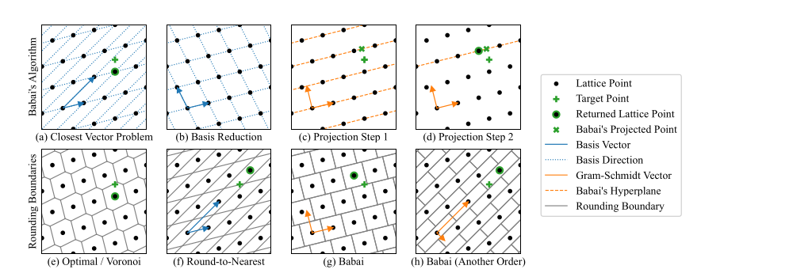
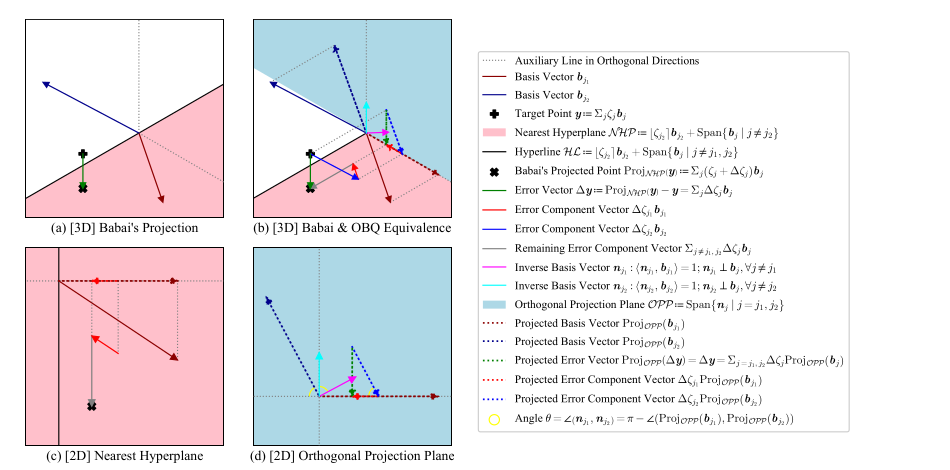
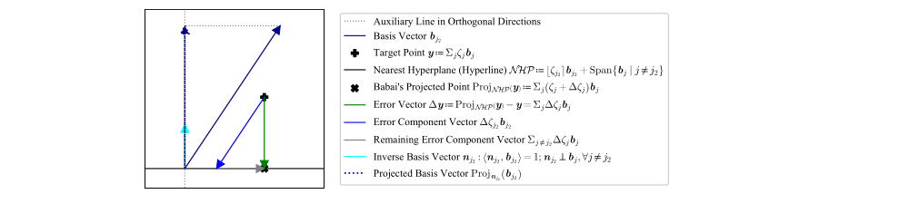
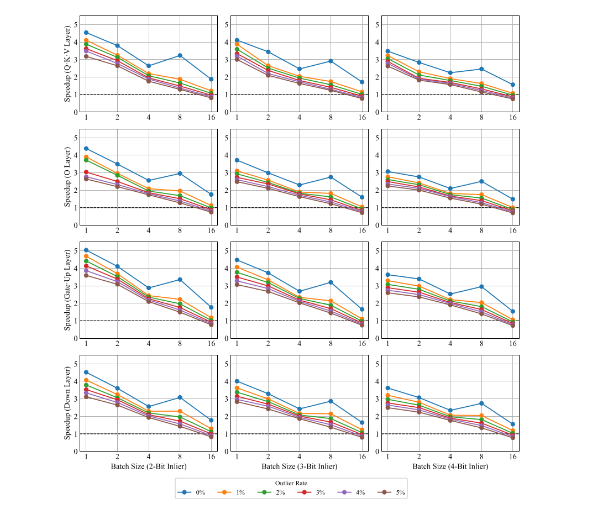

# 大模型量化的几何：GPTQ 即 Babai 最近平面算法（中文翻译）

> The Geometry of LLM Quantization: GPTQ as Babai's Nearest Plane Algorithm
>
> 本文为 arXiv:2507.18553（v4）全文的中文翻译。原文：https://arxiv.org/abs/2507.18553 ，以 CC-BY 4.0 协议发布，本译文依该协议署名转载并翻译，版权归原作者所有。

日期：2026-10-19。作者：Jiale Chen、Yalda Shabanzadeh、Elvir Crnčević、Torsten Hoefler、Dan Alistarh。单位：ISTA（奥地利科学技术研究所）、ETH Zürich、Red Hat, Inc.。通讯邮箱：jiale.chen@ist.ac.at。代码开源：https://github.com/IST-DASLab/GPTQ-Babai 。

本文是原文的忠实中文翻译，覆盖正文与全部附录；表格数值原样保留、表头译为中文并保留原表号，公式以 LaTeX 给出，图保留原图号并给出中文图注。术语首次出现时附英文原词。

## 摘要

把大语言模型（LLM）的权重从 16 比特量化到更低位宽，是将庞大 Transformer 部署到更廉价加速器上的事实标准做法。GPTQ 已成为 LLM 规模一次性训练后量化的标准方法之一，但它的内部机制被描述成一串代数更新，掩盖了其几何含义，也缺乏最坏情形的保证。本文证明：对一个线性层，当 GPTQ 从后往前（从最后一维到第一维）执行时，它在数学上等同于 Babai 最近平面算法（Babai's nearest plane algorithm）——该算法求解的是经典的最近向量问题（closest vector problem, CVP），所在格由该层输入的 Hessian 矩阵定义。这一等价性依赖于一个精巧的数学论证，并带来两个分析性结论：其一，GPTQ 的误差传播步骤获得了直观的几何解释；其二，在不裁剪（no clipping）任何权重的假设下，GPTQ 继承了 Babai 算法的误差上界。利用这一上界，我们设计出避免裁剪、且优于原版 GPTQ 的训练后量化方法，并为所得表示提供高效的 GPU 推理 kernel。总之，这些结果为 GPTQ 奠定了坚实的理论基础，也为把数十年的格算法成果引入面向十亿参数模型的未来量化算法设计打开了大门。源码见 https://github.com/IST-DASLab/GPTQ-Babai 。

## 1 引言

生成式预训练 Transformer（GPT）模型含有数千亿参数，计算与内存开销巨大（Luccioni et al., 2024）。训练后量化（post-training quantization, PTQ）已成为缩小其占用的实用方案（Gholami et al., 2021）。在众多方法中，GPTQ（Frantar et al., 2023）是第一个把一次性量化推进到 4 比特区间且保持接近基线精度的方法。时至今日 GPTQ 依然非常流行，并在某些区间给出最先进的结果（Kurtic et al., 2025）。

尽管经验上很成功，GPTQ 算法只被呈现为一系列贪心施用的代数操作：每次挑一个权重，通过舍入或裁剪量化它，然后最优地更新尚未量化的权重，以补偿该层剩余的损失；接着处理下一个权重，如此往复。这留下一个明显的问题：为什么一个局部的贪心规则在全局上效果如此之好？现有文献并未回答，使得原则性的扩展与失败案例分析缺少指引。

**我们的贡献。** 本文首次[^1]给出 GPTQ 的几何解释，并由此得到逐层的全局误差界。主要理论结果（第 4 节）为：(i) GPTQ 的优化问题，即以输出的 L2 为目标的线性层量化，等价于关于 L2 距离的最近向量问题（CVP）；(ii) 从最后一维到第一维执行的 GPTQ 算法，与作用在分解后 Hessian 矩阵所给基上、不做 LLL 基约化的 Babai 最近平面算法完全相同，且该结论与是否把大权重裁剪到量化网格（即权重裁剪，weight clipping）无关；(iii) 在不裁剪情形下，逐层最坏误差被 Hessian 矩阵 LDL 分解中对角矩阵的迹紧致地界定。

此外（第 5 节），我们把理论发现与实际量化联系起来：提出精度优于原版 GPTQ 的新型不裁剪方法，并为所得表示提供高效 GPU 推理 kernel。

[^1]: 并行工作 Birnick (2025) 在 arXiv 上出现的时间略晚于我们的预印本（Chen et al., 2025）。

## 2 相关工作

**二阶压缩（剪枝与量化）。** 用 Hessian 信息指导参数删除的想法可追溯到 Optimal Brain Damage（LeCun et al., 1989）和 Optimal Brain Surgeon（OBS）（Hassibi et al., 1993）。Optimal Brain Compression（OBC）（Frantar and Alistarh, 2022）把 OBS 推广到训练后场景，并把结构化剪枝与量化（亦称 Optimal Brain Quantizer, OBQ）统一在同一个精确求解器之下。GPTQ（Frantar et al., 2023）继承了 OBQ 的误差传播方法，但按固定顺序施用，从而逆 Hessian 可被共享、只需算一次。GPTQ 在行/列维度上只有三次方的计算复杂度，因而适用于 LLM。QuIP（Chee et al., 2023）证明了 GPTQ 的一个误差保证，并提出 LDLQ 方法作为 GPTQ 的等价变体。

**格、CVP 算法与难度。** 最近向量问题（CVP）在多项式时间归约下，即使近似到任意常数因子也是 NP 完全的（van Emde Boas, 1981；Micciancio and Goldwasser, 2002；Dinur et al., 2003），这催生了数十年的近似算法研究。Babai 最近平面启发式（Babai, 1986）可在多项式时间内给出解，且若先做 LLL 基约化（Lenstra et al., 1982），则享有 $`2^{O(n)}`$ 的近似比。BKZ 基约化（Kannan, 1987）以指数时间求解器为代价进一步收紧了常数。

## 3 预备知识与记号

我们使用 Python 风格的方括号索引来选取张量的元素和子矩阵，例如 $`[j,:]`$ 选第 $`j`$ 行向量， $`[:,j]`$ 选第 $`j`$ 列向量， $`[j:,j]`$ 选第 $`j`$ 列中自第 $`j`$ 行（含）之后的子列， $`[:,J]`$ 选由集合 $`J`$ 索引的列组成的子矩阵，等等[^2]。

[^2]: 详见 NumPy 文档：https://numpy.org/doc/stable/user/basics.indexing.html 。

### 3.1 线性层量化问题

**问题。** 设 $`\bm{X}=[\bm{x}_1,\dots,\bm{x}_n]^\top\in\mathbb{R}^{n\times c}`$ 为采样得到的校准输入数据，批大小为 $`n`$ 、输入维度为 $`c`$ ，其中 $`\bm{x}_i\in\mathbb{R}^c`$ ，且 $`n\geq c=\mathrm{rank}(\bm{X})`$ 。设 $`\bm{W}=[\bm{w}_1,\dots,\bm{w}_r]\in\mathbb{R}^{c\times r}`$ 为线性层权重，输入维度 $`c`$ 、输出维度 $`r`$ ， $`\bm{w}_i\in\mathbb{R}^c`$ 。设 $`\bm{S}=[\bm{s}_1,\dots,\bm{s}_r]\in\mathbb{R}_{\neq 0}^{c\times r}`$ 为非零量化 scale， $`\bm{s}_i\in\mathbb{R}_{\neq 0}^c`$ 。这里考虑适用于任意分组模式的一般情形：每个权重元素 $`\bm{w}_i[j]`$ 有自己的缩放因子 $`\bm{s}_i[j]`$ 。假设 $`\bm{S}`$ 在任何权重更新之前，已用 AbsMax 或 MSE 等方法静态算好。

设 $`\mathbb{Z}_\dagger\subseteq\mathbb{Z}`$ 为量化网格（可表示的整数）。在裁剪情形下，例如 INT4 格式， $`\mathbb{Z}_\dagger=\lbrace-8,\dots,-1,0,1,\dots,7\rbrace`$ 。在不裁剪情形下， $`\mathbb{Z}_\dagger=\mathbb{Z}`$ ，即允许任意整数作为量化结果。

设 $`\bm{Z}=[\bm{z}_1,\dots,\bm{z}_r]\in\mathbb{Z}_\dagger^{c\times r}`$ 为（未知的）量化整数， $`\bm{z}_i\in\mathbb{Z}_\dagger^c`$ 。记 $`\bm{Q}=[\bm{q}_1,\dots,\bm{q}_r]\in\mathbb{R}^{c\times r}`$ 为反量化权重， $`\bm{q}_i=\mathrm{diag}(\bm{s}_i)\bm{z}_i\in\mathbb{R}^c`$ 。目标是最小化层输出 $`\bm{X}\bm{W}\in\mathbb{R}^{n\times r}`$ 上的 L2 误差：

```math
\|\bm{X}\bm{Q}-\bm{X}\bm{W}\|_{\mathrm{F}}^{2}=\sum_{i=1}^{r}\|\bm{X}\,\mathrm{diag}(\bm{s}_{i})\bm{z}_{i}-\bm{X}\bm{w}_{i}\|^{2}
```

即对所有 $`1\leq i\leq r`$ 求解

```math
\arg\min_{\bm{z}_{i}\in\mathbb{Z}_{\dagger}^{c}}\|\bm{X}\,\mathrm{diag}(\bm{s}_{i})\bm{z}_{i}-\bm{X}\bm{w}_{i}\|^{2}
```

**OBQ 算法。** 令集合 $`J_i`$ 初始化为 $`\lbrace 1,\dots,c\rbrace`$ ，表示 $`\bm{w}_i`$ 中尚未量化的下标集合；以下把 $`J_i`$ 简记为 $`J`$ 。对每个权重向量 $`\bm{w}_i`$ ，OBQ 选择

```math
j\leftarrow\arg\min_{j\in J}\frac{(\bm{q}_{i}[j]-\bm{w}_{i}[j])^{2}}{(\bm{X}[:,J]^{\top}\bm{X}[:,J])^{-1}[j,j]}\qquad(1)
```

作为下一个要量化的维度。OBQ 将选中的元素 $`\bm{w}_i[j]`$ 量化为 $`\bm{q}_i[j]\leftarrow\bm{s}_i[j]\cdot\textsc{Round}(\bm{w}_i[j]/\bm{s}_i[j],\mathbb{Z}_\dagger)`$ ，其中 $`\textsc{Round}(\cdot,\mathbb{Z}_\dagger)`$ 把输入舍入到 $`\mathbb{Z}_\dagger`$ 中最近的值。随后，OBQ 通过一个误差传播步骤最优地更新权重子集 $`\bm{w}_i[J]`$ ：对所有 $`j'\in J`$ ，令 $`\bm{w}_i[j']\leftarrow\bm{w}_i[j']+\Delta\bm{w}_i[j']`$ ，其中

```math
\Delta\bm{w}_{i}[j']\leftarrow\frac{(\bm{X}[:,J]^{\top}\bm{X}[:,J])^{-1}[j',j]}{(\bm{X}[:,J]^{\top}\bm{X}[:,J])^{-1}[j,j]}(\bm{q}_{i}[j]-\bm{w}_{i}[j])\qquad(2)
```

OBQ 令 $`J\leftarrow J\setminus\lbrace j\rbrace`$ 继续迭代，直到 $`J`$ 为空。

**GPTQ 算法。** GPTQ 通过按固定的维度顺序（例如从第一维到最后一维， $`j\leftarrow 1\text{ to }c`$ ）施用 OBQ 的量化与误差传播步骤，而不是动态决定顺序（式 1），降低了 OBQ 的计算复杂度。该固定顺序与输出通道 $`i`$ 无关，因此 Hessian 信息 $`(\bm{X}[:,J]^\top\bm{X}[:,J])^{-1}[:,j]`$ 可在所有 $`\bm{w}_i`$ 之间共享而无需重算。进一步，所有 $`j`$ 对应的 Hessian 信息可通过对 Hessian 矩阵 $`\bm{X}^\top\bm{X}`$ 做 Cholesky 或 LDL 分解一次性预先算出。

算法 1 是 GPTQ 的伪代码。该算法与原始 GPTQ 论文（Frantar et al., 2023）一致，只是省去了分块机制——分块只影响访存模式和计算速度，不影响数值结果。附加记号如下。 $`\bm{P}\in\lbrace 0,1\rbrace^{c\times c}`$ 是改变 GPTQ 量化维度顺序的置换矩阵，默认顺序是从前到后（从第一维到最后一维），即 $`\bm{P}=\mathbf{I}`$ 。 $`\lambda\in\mathbb{R}_+`$ 是计算 Hessian 时用的小阻尼因子，保证矩阵满秩，典型取值为 $`\lambda=\frac{1}{100c}\sum_{j=1}^{c}(\bm{X}^\top\bm{X})[j,j]=\frac{1}{100c}\|\bm{X}\|_{\mathrm{F}}^2`$ 。函数 LDL 返回 LDL 分解中的下三角矩阵。符号 $`*`$ 与 $`/`$ 分别表示逐元素乘法和除法。

**算法 1：GPTQ**

输入：原始权重 $`\bm{W}\in\mathbb{R}^{c\times r}`$ ；逐坐标 scale $`\bm{S}\in\mathbb{R}_{\neq0}^{c\times r}`$ ；校准激活 $`\bm{X}\in\mathbb{R}^{n\times c}`$ ；置换 $`\bm{P}\in\lbrace0,1\rbrace^{c\times c}`$ ；阻尼比 $`\lambda>0`$ ；整数网格 $`\mathbb{Z}_\dagger\subseteq\mathbb{Z}`$ 。

输出：量化权重 $`\bm{Z}\in\mathbb{Z}_\dagger^{c\times r}`$ ；反量化权重 $`\bm{Q}\in\mathbb{R}^{c\times r}`$ 。

```text
1   H ← P^T (X^T X + λI) P          // 加阻尼并重排 Hessian
2   L ← LDL(H^{-1})                 // 分解逆 Hessian（取 LDL 的 L 矩阵），作为误差传播的共享系数
3   W, S ← P^{-1} W, P^{-1} S       // 重排权重与 scale
4   Q, Z ← W, 0                     // 初始化反量化与量化权重
5   for j ← 1 to c do
6       ζ ← W[j,:] / S[j,:]         // 当前行逐元素除以其 scale
7       Z[j,:] ← Round(ζ, Z_†)      // 量化到目标网格
8       Q[j,:] ← Z[j,:] * S[j,:]    // 当前行反量化回权重空间
9       ε ← Q[j,:] - W[j,:]         // 当前行的量化误差
10      W[j:,:] ← W[j:,:] + L[j:,j] ε   // 把误差传播到尚未量化的行；沿列广播
11  end for
12  Z, Q ← P Z, P Q                 // 撤销重排，恢复原输入顺序；返回整数与反量化权重
```

### 3.2 最近向量问题（CVP）

**问题。** 设 $`\bm{B}=[\bm{b}_1,\dots,\bm{b}_c]\in\mathbb{R}^{n\times c}`$ 为 $`c`$ 个 $`n`$ 维基向量， $`\bm{b}_j\in\mathbb{R}^n`$ ，且 $`n\geq c=\mathrm{rank}(\bm{B})`$ 。设 $`\bm{y}\in\mathbb{R}^n`$ 为待逼近的外部目标向量。设 $`\bm{z}\in\mathbb{Z}^c`$ 为（未知的）整数向量，表示格向量的基组合系数。目标是在由基 $`\bm{B}`$ 定义的格上，找到离目标向量 $`\bm{y}`$ 最近的向量，即求解

```math
\arg\min_{\bm{z}\in\mathbb{Z}^{c}}\|\bm{B}\bm{z}-\bm{y}\|^{2}
```

二维 CVP 的图示见图 1(a)。



**Babai 最近平面算法。** Babai 算法迭代地把目标向量投影到 LLL 约化后格的最近超平面，并对相应系数做舍入。图 1(b) 展示了基约化步骤，图 1(c-d) 展示了投影步骤。

算法 2 是求解 CVP 的 Babai 最近平面算法的伪代码。为提高计算效率，伪代码采用了概念上等价的做法：它不是把目标向量投影到最近超平面，而是沿基方向把目标向量移向原点所在的超平面。投影误差保留在更新后的目标向量中，因为它与该超平面正交，不会影响后续的投影。附加记号如下。函数 LLL 返回 LLL 约化的变换矩阵，参数 delta 默认为 $`\frac34`$ 。函数 QR 返回 QR 分解中的正交矩阵，等同于归一化的 Gram-Schmidt 正交化过程。 $`\langle\cdot,\cdot\rangle`$ 表示向量内积。函数 Round 的定义同 GPTQ 算法。

**算法 2：Babai 最近平面算法**

输入：格基（列向量） $`\bm{B}\in\mathbb{R}^{n\times c}`$ ，目标向量 $`\bm{y}\in\mathbb{R}^n`$ 。输出：最近格向量的基系数 $`\bm{z}\in\mathbb{Z}^c`$ 。

```text
1   T ← LLL(B)                      // LLL 基约化给出的幺模变换矩阵
2   A ← B T                         // 约化基
3   Φ ← QR(A)                       // 归一化 Gram-Schmidt 过程（取 QR 分解的 Q 矩阵）
4   y', z ← y, 0                    // 初始化残差目标与约化基下的整数解
5   for j ← c to 1 do
6       ζ ← <Φ[:,j], y'> / <Φ[:,j], A[:,j]>   // 沿未归一化 Gram-Schmidt 向量的精确系数：残差与约化基在 Gram-Schmidt 方向上投影之比
7       z[j] ← Round(ζ, Z)          // 舍入到最近平面
8       y' ← y' - A[:,j] z[j]       // 更新残差
9   end for
10  z ← T z                         // 把整数解映回原基并返回
```

**Babai 误差界。** 图 1 展示了最优（e）、就近舍入 RTN（f）以及不做基约化的 Babai 算法（g-h）的舍入边界。与 RTN 相比，Babai 算法产生矩形划分，因而最坏情形误差更小。该误差界已由 Babai (1986) 证明。形式化地，设 $`\bm{\Phi}=[\bm{\phi}_1,\dots,\bm{\phi}_c]`$ 为 LLL 约化基 $`\bm{A}=[\bm{a}_1,\dots,\bm{a}_c]`$ 的归一化 Gram-Schmidt 向量集合。令 $`\tilde{\bm{A}}=[\tilde{\bm{a}}_1,\dots,\tilde{\bm{a}}_c]`$ 表示未归一化的 Gram-Schmidt 向量， $`\tilde{\bm{a}}_j=\langle\bm{\phi}_j,\bm{a}_j\rangle\bm{\phi}_j`$ 。在第 $`j`$ 次迭代，算法用最近的整数替换精确系数 $`\zeta`$ ，故偏差满足

```math
|\zeta-\bm{z}[j]|\leq\frac12
```

于是沿 $`\tilde{\bm{a}}_j`$ 的误差分量范数至多为 $`\frac12\|\tilde{\bm{a}}_j\|`$ 。由于 $`\tilde{\bm{A}}`$ 正交，这些误差分量按欧氏范数相加，给出残差（误差）向量 $`\bm{y}'`$ 的界：

```math
\|\bm{y}'\|^{2}\leq\frac14\sum_{j=1}^{c}\|\tilde{\bm{a}}_{j}\|^{2}=\frac14\sum_{j=1}^{c}\langle\bm{\phi}_{j},\bm{a}_{j}\rangle^{2}
```

Babai 算法保证返回目标 $`\bm{y}`$ 所在的、由未归一化 Gram-Schmidt 向量 $`\tilde{\bm{A}}`$ 构成的超长方体（图 1(g)）的中心向量。当目标 $`\bm{y}`$ 位于超长方体的角点时取等号，因此该界是紧的。Babai (1986) 还证明了关于 $`\gamma`$ 的相对误差界，其中 $`\|\bm{B}\bm{z}-\bm{y}\|\leq\gamma\cdot\min_{\bm{z}'\in\mathbb{Z}^c}\|\bm{B}\bm{z}'-\bm{y}\|`$ 。该界为

```math
1\leq\gamma\leq\sqrt{1+\max_{1\leq j\leq c}\frac{\sum_{j'=1}^{j}\|\tilde{\bm{a}}_{j'}\|^{2}}{\|\tilde{\bm{a}}_{j}\|^{2}}}\leq\sqrt{c+1}\cdot\max_{1\leq j'\leq j\leq c}\frac{\|\tilde{\bm{a}}_{j'}\|}{\|\tilde{\bm{a}}_{j}\|}
```

## 4 理论结果

我们首先在 4.1 节说明权重量化是经典最近向量问题（CVP）的一个实例，这使我们能在由 Hessian 定义的格中工作。然后在 4.2 节把 OBQ（等价地，GPTQ）的误差传播步骤重新解释为向最近超平面的投影，并在 4.3 节建立主要等价性：从后往前运行的 GPTQ 与 Babai 最近平面算法完全一致。这一等价性使我们能在 4.4 节引入 Babai 的保证，得到不裁剪情形下紧致的逐层误差界。最后，4.5 节分析量化顺序如何影响该界。

### 4.1 L2 量化与 CVP 的等价性

带 L2 目标 $`\arg\min_{\bm{z}_i\in\mathbb{Z}_\dagger^c}\|\bm{X}\mathrm{diag}(\bm{s}_i)\bm{z}_i-\bm{X}\bm{w}_i\|^2`$ 的量化问题，与带 L2 距离 $`\arg\min_{\bm{z}\in\mathbb{Z}^c}\|\bm{B}\bm{z}-\bm{y}\|^2`$ 的 CVP，只要满足结构条件 $`\bm{B}=\bm{X}\mathrm{diag}(\bm{s}_i)`$ 、 $`\bm{y}=\bm{X}\bm{w}_i`$ 且解域一致，就有相同的解（ $`\bm{z}=\bm{z}_i`$ ）。要保证解域一致，我们既可以在量化设定中关闭裁剪（令 $`\mathbb{Z}_\dagger=\mathbb{Z}`$ ），也可以在 CVP 设定中开启裁剪（令 $`\bm{z}\in\mathbb{Z}_\dagger^c`$ ）。表 1 是对应关系的速查字典，列出量化与 CVP 概念之间的对应。

**表 1：输出通道 $`i`$ 的量化-CVP 字典。**

| 量化符号 | CVP 解释 |
|---|---|
| 输入激活 $`\bm{X}\in\mathbb{R}^{n\times c}`$ | 基方向（各列为生成元） |
| Scale $`\bm{s}_i\in\mathbb{R}_{\neq0}^c`$ | 基的拉伸 |
| $`\bm{B}_{(i)}=\bm{X}\mathrm{diag}(\bm{s}_i)\in\mathbb{R}^{n\times c}`$ | 格基（各列为生成元） |
| 权重 $`\bm{w}_i\in\mathbb{R}^c`$ | 未拉伸基上的浮点坐标 |
| 整数权重表示 $`\bm{z}_i\in\mathbb{Z}_\dagger^c`$ | 格基上的整数坐标 |
| 反量化权重 $`\bm{q}_i=\mathrm{diag}(\bm{s}_i)\bm{z}_i\in\mathbb{R}^c`$ | 未拉伸基上的反量化坐标 |
| 目标输出激活 $`\bm{y}_{(i)}=\bm{X}\bm{w}_i\in\mathbb{R}^n`$ | 待逼近的外部目标向量 |

我们可以引入 Hessian 矩阵的一个因子 $`\bm{\mathcal{X}}=[\bm{\chi}_1,\dots,\bm{\chi}_c]`$ ，满足 $`\bm{X}^\top\bm{X}=\bm{\mathcal{X}}^\top\bm{\mathcal{X}}`$ 。损失于是可改写为 $`\|\bm{\mathcal{X}}\mathrm{diag}(\bm{s}_i)\bm{z}_i-\bm{\mathcal{X}}\bm{w}_i\|^2`$ 。

**定理 1（量化与 CVP）** 使用 Hessian 矩阵 $`\bm{X}^\top\bm{X}`$ 任意可能因子 $`\bm{\mathcal{X}}`$ 所得的 CVP，在对格和外部目标向量作正交变换（旋转与反射）后彼此等价。

*证明。* 设 $`\bm{\mathcal{X}}`$ 与 $`\bm{\mathcal{X}}'`$ 是 Hessian 矩阵的两个可能因子，满足 $`\bm{\mathcal{X}}^\top\bm{\mathcal{X}}=\bm{\mathcal{X}}'^\top\bm{\mathcal{X}}'`$ 。则对所有 $`1\leq j_1,j_2\leq c`$ ，内积 $`\langle\bm{\chi}_{j_1},\bm{\chi}_{j_2}\rangle`$ 与 $`\langle\bm{\chi}'_{j_1},\bm{\chi}'_{j_2}\rangle`$ 必须相等。换言之，对所有 $`1\leq j_1,j_2\leq c`$ ，长度 $`\|\bm{\chi}_{j_1}\|=\|\bm{\chi}'_{j_1}\|`$ ，夹角 $`\angle(\bm{\chi}_{j_1},\bm{\chi}_{j_2})=\angle(\bm{\chi}'_{j_1},\bm{\chi}'_{j_2})`$ 。

按定理 1，Hessian 矩阵 $`\bm{X}^\top\bm{X}`$ 的任何分解因子 $`\bm{\mathcal{X}}`$ 都可以代替 $`\bm{X}`$ ，而不改变该 CVP 及其对应量化问题的几何性质。这有助于降低计算成本，例如可以用方阵 $`\bm{\mathcal{X}}\in\mathbb{R}^{c\times c}`$ 代替矩形矩阵 $`\bm{X}\in\mathbb{R}^{n\times c}`$ 。

### 4.2 OBQ 的几何解释

我们先展示 OBQ（GPTQ 较慢的前身）的几何解释，为 4.3 节 GPTQ 与 Babai 算法的等价性证明做铺垫。



**定理 2（误差传播与 Babai 投影）** Babai 最近平面算法迭代地把目标向量投影到最近超平面并舍入系数。OBQ 的误差传播步骤（式 2）恰好就是在原始基 $`\bm{B}=\bm{X}\mathrm{diag}(\bm{s}_i)`$ 上（不做基约化）的这一投影。

*证明。* 设 $`\bm{B}=[\bm{b}_1,\dots,\bm{b}_c]`$ 为基， $`\bm{b}_j`$ 为基向量。设 $`J`$ 为未投影下标的集合， $`j_1,j_2\in J`$ 且 $`j_1\neq j_2`$ 。设 $`\bm{y}=\sum_{j\in J}\zeta_j\bm{b}_j`$ 为当前残差目标，其中 $`\zeta_j\in\mathbb{R}`$ 是待舍入为整数的实数。令

```math
\mathcal{NHP}:=\lfloor\zeta_{j_2}\rceil\bm{b}_{j_2}+\mathrm{Span}\lbrace\bm{b}_{j}\;|\;j\neq j_2\rbrace
```

为与 Gram-Schmidt 向量 $`\bm{b}_{j_2}-\sum_{j\neq j_2}\mathrm{Proj}_{\bm{b}_j}(\bm{b}_{j_2})`$ 正交的最近超平面。

图 2(a) 是三维图，展示投影误差向量 $`\Delta\bm{y}=\mathrm{Proj}_{\mathcal{NHP}}(\bm{y})-\bm{y}`$ 。我们关注由基 $`\bm{b}_{j_2}`$ 的投影在基 $`\bm{b}_{j_1}`$ 方向上引发的误差传播，并如超线所示把其余基向量张成的空间压缩为单一维度，该超线为

```math
\mathcal{HL}:=\lfloor\zeta_{j_2}\rceil\bm{b}_{j_2}+\mathrm{Span}\lbrace\bm{b}_{j}\;|\;j\neq j_1,j_2\rbrace
```

图 2(b) 是三维图，展示误差 $`\Delta\bm{y}=\sum_{j\in J}\Delta\zeta_j\bm{b}_j`$ 沿各基方向分解的误差分量向量。图 2(c) 是二维图，展示平面 $`\mathcal{NHP}`$ 上的向量。数 $`\zeta_j`$ 将被更新为 $`\zeta_j+\Delta\zeta_j`$ ，使得 $`\mathrm{Proj}_{\mathcal{NHP}}(\bm{y})=\sum_{j\in J}(\zeta_j+\Delta\zeta_j)\bm{b}_j`$ 。接着，令 $`\bm{N}=\bm{B}^{-\top}=[\bm{n}_1,\dots,\bm{n}_c]`$ 为逆基。则有 $`\langle\bm{n}_j,\bm{b}_j\rangle=1`$ ，且对所有 $`j\neq j'`$ 有 $`\bm{n}_j\perp\bm{b}_{j'}`$ 。

我们把图 2(b) 中的所有向量投影到与超线 $`\mathcal{HL}`$ 正交的正交投影平面 $`\mathcal{OPP}:=\mathrm{Span}\lbrace\bm{n}_j\;|\;j=j_1,j_2\rbrace`$ 上，并在图 2(d) 的二维几何中继续证明。记夹角

```math
\theta=\angle(\bm{n}_{j_1},\bm{n}_{j_2})=\pi-\angle(\mathrm{Proj}_{\mathcal{OPP}}(\bm{b}_{j_1}),\mathrm{Proj}_{\mathcal{OPP}}(\bm{b}_{j_2}))
```

则

```math
\frac{\Delta\zeta_{j_1}\|\mathrm{Proj}_{\mathcal{OPP}}(\bm{b}_{j_1})\|}{\Delta\zeta_{j_2}\|\mathrm{Proj}_{\mathcal{OPP}}(\bm{b}_{j_2})\|}=\cos\theta=\frac{\langle\bm{n}_{j_1},\bm{n}_{j_2}\rangle}{\|\bm{n}_{j_1}\|\|\bm{n}_{j_2}\|}=\frac{\|\bm{n}_{j_2}\|}{\|\bm{n}_{j_1}\|}\frac{\langle\bm{n}_{j_1},\bm{n}_{j_2}\rangle}{\langle\bm{n}_{j_2},\bm{n}_{j_2}\rangle}
```

对 $`j=j_1,j_2`$ ，

```math
\|\mathrm{Proj}_{\mathcal{OPP}}(\bm{b}_{j})\|\|\bm{n}_{j}\|=\frac{\langle\mathrm{Proj}_{\mathcal{OPP}}(\bm{b}_{j}),\bm{n}_{j}\rangle}{\cos(\frac{\pi}{2}-\theta)}=\frac{\langle\bm{b}_{j},\bm{n}_{j}\rangle}{\cos(\frac{\pi}{2}-\theta)}=\frac{1}{\cos(\frac{\pi}{2}-\theta)}
```

对 $`j,j'\in\lbrace j_1,j_2\rbrace`$ ，

```math
\langle\bm{n}_{j},\bm{n}_{j'}\rangle=(\bm{N}^{\top}\bm{N})[j,j']=(\bm{B}^{\top}\bm{B})^{-1}[j,j']
```

综合以上各式，

```math
\Delta\zeta_{j_1}=\frac{\|\mathrm{Proj}_{\mathcal{OPP}}(\bm{b}_{j_2})\|\|\bm{n}_{j_2}\|}{\|\mathrm{Proj}_{\mathcal{OPP}}(\bm{b}_{j_1})\|\|\bm{n}_{j_1}\|}\frac{\langle\bm{n}_{j_1},\bm{n}_{j_2}\rangle}{\langle\bm{n}_{j_2},\bm{n}_{j_2}\rangle}\Delta\zeta_{j_2}=\frac{\langle\bm{n}_{j_1},\bm{n}_{j_2}\rangle}{\langle\bm{n}_{j_2},\bm{n}_{j_2}\rangle}\Delta\zeta_{j_2}=\frac{(\bm{B}^{\top}\bm{B})^{-1}[j_1,j_2]}{(\bm{B}^{\top}\bm{B})^{-1}[j_2,j_2]}\Delta\zeta_{j_2}
```

最后，代入 $`\bm{B}=(\bm{X}\mathrm{diag}(\bm{s}_i))[:,J]`$ 和 $`\zeta_j=\bm{w}_i[j]/\bm{s}_i[j]`$ ，证明完成。



**推论 3（OBQ 的维度选择）** 在每一步维度选择（式 1）中，OBQ 选择的尚未量化维度 $`j`$ 满足：维度 $`j`$ 的最近超平面离目标残差向量最近。

*证明。* 沿用定理 2 中的记号。图 3 是二维图，展示目标残差向量 $`\bm{y}`$ 与基 $`\bm{b}_{j_2}`$ 的最近超平面 $`\mathcal{NHP}`$ 之间的距离（投影误差，即量化误差）。为便于图示，我们把 $`\mathcal{NHP}`$ 压缩为单一维度。距离 $`\|\Delta\bm{y}\|`$ 可表示为

```math
\|\Delta\bm{y}\|=\|\mathrm{Proj}_{\bm{n}_{j_2}}(\Delta\bm{y})\|=|\Delta\zeta_{j_2}|\|\mathrm{Proj}_{\bm{n}_{j_2}}(\bm{b}_{j_2})\|=\frac{|\Delta\zeta_{j_2}||\langle\bm{b}_{j_2},\bm{n}_{j_2}\rangle|}{\|\bm{n}_{j_2}\|}=\frac{|\Delta\zeta_{j_2}|}{\|\bm{n}_{j_2}\|}
```

对每个 $`\bm{w}_i`$ ，OBQ 独立地选择

```math
j=\arg\min_{j\in J}\frac{(\bm{q}_{i}[j]-\bm{w}_{i}[j])^{2}}{(\bm{X}[:,J]^{\top}\bm{X}[:,J])^{-1}[j,j]}=\arg\min_{j\in J}\frac{(\Delta\zeta_{j})^{2}}{\langle\bm{n}_{j},\bm{n}_{j}\rangle}=\arg\min_{j\in J}\frac{|\Delta\zeta_{j}|}{\|\bm{n}_{j}\|}
```

作为下一个要量化的维度，这恰好就是在最小化该距离。

### 4.3 GPTQ 与 Babai 算法

原版 GPTQ（算法 1）从第一维到最后一维运行（ $`j\leftarrow 1\text{ to }c`$ ），而 Babai 算法（算法 2）从最后一维到第一维运行（ $`j\leftarrow c\text{ to }1`$ ）。这是两个算法之间唯一（表面上）的差异，形式化如下。

**定理 4（GPTQ 与 Babai）** 若对齐两个算法的维度顺序，例如让 GPTQ 从最后一维到第一维运行，则 GPTQ 与不做基约化的 Babai 算法将给出相同的结果。

*证明。* 我们从几何与代数两方面证明该定理。先给出几何证明。定理 2 表明，OBQ（等价地，GPTQ）产生的每个中间权重向量，都可以视为激活空间中 Babai 的残差向量。在第 $`j`$ 步（从最后一维到第一维， $`j\leftarrow c\text{ to }1`$ ），GPTQ 的误差传播更新恰好就是 Babai 在第 $`j`$ 步的投影，即把目标向量的当前残差投影到与第 $`j`$ 个 Gram-Schmidt 向量正交的超平面上。

另一种是更严格的代数证明。附录 B 更详细地描述了用 Babai 算法做量化的确切流程，伪代码见算法 4。附录 C 包含等价性证明，分三步进行。第一，改写 GPTQ 以跟踪累计量化误差，并证明该形式与标准实现代数等价。第二，让 GPTQ 以从后往前的顺序运行，并用上三角因子替换下三角因子，使每次更新只影响尚未量化的坐标。第三，证明从后往前的 GPTQ 逐步的舍入决策与 Babai 算法的一致。

**GPTQ 的几何解释。** 定理 4 表明，若把激活视为格基，并把浮点权重向量变换为激活空间中的目标向量，则 GPTQ 是按预先算好的维度顺序，穿过一列嵌套仿射子空间的一次正交行走。

**组合算法的无效性。** 一个看似有吸引力的想法是：取任何 Babai 迭代返回的解，再在激活空间中对权重做一步 GPTQ 式误差传播，希望把近似推得更接近最优。然而，如 C.4 节所证，这一额外更新会消失： $`\bm{Z}`$ 与 $`\bm{Q}`$ 的最终结果不变。换言之，一旦执行过 Babai 投影，任何后续的 GPTQ 式修正在代数上都是冗余的。这证实了定理 4 中的等价性已经是紧的；两个算法都无法通过组合得到加强。

### 4.4 GPTQ 的误差界

建立了 GPTQ 与 Babai 最近平面算法的对应关系之后，我们现在可以引入 Babai 的近似保证，得到不裁剪情形下逐层量化误差的上界。

**定理 5（GPTQ 误差界）** 假设不裁剪（ $`\mathbb{Z}_\dagger=\mathbb{Z}`$ ），令 $`\bm{T}`$ 为 GPTQ 量化顺序反转后的置换矩阵（等价地，列顺序反转的 $`\bm{P}`$ ）。令 $`\bm{D}`$ 为置换后 Hessian 矩阵 $`\bm{T}^\top\bm{X}^\top\bm{X}\bm{T}`$ 的 LDL 分解中的对角矩阵。对于 Babai 算法（或等价地，从后往前执行的 GPTQ 算法）产生的每个输出通道 $`i`$ （ $`1\leq i\leq r`$ ），（绝对）量化误差有如下紧致上界：

```math
\|\bm{X}\mathrm{diag}(\bm{s}_{i})\bm{z}_{i}-\bm{X}\bm{w}_{i}\|^{2}\leq\frac14(\bm{T}^{-1}\bm{s}_{i})^{\top}\bm{D}(\bm{T}^{-1}\bm{s}_{i})
```

对于关于 $`\gamma`$ 的相对界，其中 $`\|\bm{X}\mathrm{diag}(\bm{s}_i)\bm{z}_i-\bm{X}\bm{w}_i\|\leq\gamma\cdot\min_{\bm{z}'_i\in\mathbb{Z}^c}\|\bm{X}\mathrm{diag}(\bm{s}_i)\bm{z}'_i-\bm{X}\bm{w}_i\|`$ ，有

```math
1\leq\gamma\leq\sqrt{1+\max_{1\leq j\leq c}\frac{\sum_{j'=1}^{j}d_{j'}^{2}}{d_{j}^{2}}}\leq\sqrt{c+1}\cdot\max_{1\leq j'\leq j\leq c}\frac{d_{j'}}{d_{j}}
```

其中 $`d_j=\sqrt{\bm{D}[j,j]}\,|(\bm{T}^{-1}\bm{s}_i)[j]|`$ 。

*证明。* 定理 5 的完整证明见 D.1 节。

如果 scale $`\bm{s}_i`$ 足够小，我们可以假设权重 $`\bm{w}_i`$ 近似均匀地分布在由 Babai 正交化基向量构成的超长方体内，此时期望绝对误差将是最坏情形界的 $`\frac13`$ 。证明见 D.2 节。

### 4.5 量化顺序在 GPTQ 中的作用

定理 5 中绝对误差界右端的二次型，对 Hessian 矩阵 LDL 分解的主元顺序（即量化顺序）敏感。重排维度会改变对角矩阵 $`\bm{D}`$ 的各项，而 scale $`\bm{s}_i`$ 正是在这之前被它们“加权”的。糟糕的顺序可能把 $`\bm{D}`$ 的大项配上 $`\bm{s}_i`$ 的大项，从而抬高该界。对于像 GPTQ 这样的批量量化算法，顺序应与输出通道 $`i`$ 无关。要得到一个好的启发式顺序，一个合理的近似（尤其对大的量化分组而言）是认为对所有 $`1\leq j\leq c`$ ， $`\bm{s}_i[j]`$ 的各元素相等。于是我们可以专注于为 Hessian 矩阵 $`\bm{X}^\top\bm{X}`$ 的 LDL 分解寻找最优主元顺序，以最小化 $`\mathrm{tr}(\bm{D})`$ 。

寻找最优顺序是 NP 难的（Rose et al., 1976）。不过，启发式方法在实践中常能有效减小迹项。即使在有裁剪时，启发式也能降低误差。GPTQ 引入了 act-order，即按 Hessian 对角线降序；应用于 Babai 算法时，则是 Hessian 对角线升序。

为改进 act-order，我们提出 min-pivot 顺序，本质上是在 LDL（或 Cholesky）分解的每一步取最小的对角元。该顺序可用算法 3 计算，其时间复杂度为三次方，不会增加量化的整体时间复杂度。这一顺序也有几何解释：它是基的 Gram-Schmidt 正交化过程的顺序——始终取最短的残差向量作为下一个要正交化的向量，这与 Babai 的相对误差界吻合。在我们的初步实验中（D.3 节），min-pivot 相比 act-order 一致地降低了 $`\mathrm{tr}(\bm{D})`$ ，但下游精度提升有限。我们仍然把 min-pivot 作为有原则的选择报告，并把 act-order 视为只考虑 Hessian 对角线的廉价近似，在 Hessian 矩阵条件良好时它已能获得大部分收益。

**算法 3：Min-Pivot**

输入：Hessian $`\bm{H}\in\mathbb{R}^{c\times c}`$ 。输出：以置换矩阵 $`\bm{T}\in\lbrace0,1\rbrace^{c\times c}`$ 编码的顺序。

```text
1   J ← {1, …, c}                   // 初始化尚未选作主元的下标
2   T ← 0                           // 初始化输出置换矩阵
3   for j ← 1 to c do
4       j' ← argmin_{j' ∈ J} H[j', j']          // 选当前对角元最小的下标作为下一个
5       H ← H - H[:,j'] H[j',:] / H[j',j']      // 用秩 1 Schur 补更新剩余元素
6       T[j', j] ← 1                // 记录该下标
7       J ← J \ {j'}                // 标记该主元已使用
8   end for
```

## 5 应用

原版 GPTQ 算法在舍入步骤中会裁剪溢出的整数，引入很大的误差，违反了定理 5 的误差界。本节探索在不裁剪情形下运行、带误差保证的 GPTQ 变体。

我们注意到，仅靠增大 scale 来强制不裁剪是适得其反的：更大的 scale 会放大误差界，所得误差甚至可能超过 MSE 之类带裁剪的方案。因此，任何实用的不裁剪设计都必须考虑权重分布中众所周知的重尾离群值（Li et al., 2025）。我们仍希望采用小 scale，对占大多数的内点使用小位宽，同时以更多存储预算处理溢出的离群值而不裁剪它们。为此我们提出两种容溢出（overflow-tolerant）方案。

**Scale 调整版 SpQR（SSQR）。** SpQR（Dettmers et al., 2024）把一小部分离群值保留为全精度，但仍保留了裁剪：权重被分组，离群值与共享 scale 在 GPTQ 更新之前按组选定，并且无法保证更新后的内点权重仍落在可表示范围内。我们设计的 SSQR 带有一个 scale 调整机制来解决这个问题。为简单起见，我们舍弃了 SpQR 对 scale 的二级量化。对于权重向量 $`\bm{w}_i\in\mathbb{R}^c`$ ，我们把量化权重 $`\bm{q}_i\in\mathbb{R}^c`$ 表示为 $`\mathrm{diag}(\bm{s}_i)\bm{z}_i+\bm{\xi}_i`$ ，其中 $`\bm{z}\in\mathbb{Z}_\dagger^c`$ 为低位宽整数权重向量， $`\bm{s}_i\in\mathbb{R}_{\neq0}^c`$ 为浮点 scale 向量，每个 scale 在组内共享（实际每组只存一个数）， $`\bm{\xi}_i\in\mathbb{R}^c`$ 为稀疏浮点离群值向量（以压缩稀疏行格式 CSR 存储），捕获 GPTQ 误差传播之后所有溢出的权重。

scale 调整机制不断调节 scale $`\bm{s}_i`$ ，直到 $`\bm{\xi}_i`$ 的密度满足指定比率。由于对大层中每组 scale 做穷举试错不可行，该机制只按比例整体改变 $`\bm{s}_i`$ ，从而把搜索空间降到一维。观察到离群值比率与 scale 总体上呈负相关，这可通过二分搜索实现：用 MSE 初始化 $`\bm{s}_i`$ ，用指定格式不裁剪地以 GPTQ 量化 $`\bm{w}_i`$ ，计算 $`\bm{\xi}_i`$ 的密度，调整 $`\bm{s}_i`$ 并迭代。E.1 节算法 9 为伪代码。

**Huffman 编码的训练后量化（HPTQ）。** 为更好地匹配 CVP 中无限、无约束的格，我们设计了 HPTQ，把内点和离群值统一表示在一个等间距整数网格中。思路是使用 Huffman 编码，Choi et al. (2017) 也曾把它用于网络压缩。我们把权重矩阵 $`\bm{W}\in\mathbb{R}^{c\times r}`$ 量化为 $`\bm{Q}=s\bm{Z}`$ ，其中 $`s\in\mathbb{R}_{\neq0}`$ 是单个标量， $`\bm{Z}\in\mathbb{Z}^{c\times r}`$ 为整数。我们通过熵引导的二分搜索选取 $`s`$ ：初始化一个与最大权重成比例的范围，用 GPTQ 量化为不裁剪的整数，测量 $`\bm{Z}`$ 的 Huffman 编码开销，并调整 $`s`$ 直到编码后的比特数达到目标平均位宽。这得到不等位宽的表示，在满足压缩预算的同时保持精度。E.1 节算法 11 为伪代码。

实验比较了就近舍入（RTN）、原版 GPTQ、HPTQ，以及离群值比例为 1~5% 的 SSQR。我们还纳入 Huffman 编码的 RTN（HRTN）作为 HPTQ 的基线，它与 HPTQ 相同，只是把 GPTQ 换成 RTN（伪代码：E.1 节算法 12）。所有方法的量化顺序均为 act-order。RTN、GPTQ 和 SSQR 使用分组大小 128。RTN 和 GPTQ 用 MSE 方法计算 scale。图 4(a-b) 表明，HPTQ 在 Qwen3-8B 上以更低位宽仍能保持低困惑度，并在不同模型规模上表现良好，其中 3.125 比特在困惑度与压缩率的权衡上是 Pareto 最优的。更多信息见附录 E，包括实验设置（E.2 节）、基准测试结果等更多指标（Qwen3 模型：E.3 节；Llama 模型：E.4 节），以及与其他方法的比较（E.5 节）。


**CUDA 推理 kernel。** 我们用 CUDA/C++ 实现了 SSQR 的推理 kernel，针对低批大小延迟做了优化，同时处理稠密内点和稀疏离群值，面向 Ampere 平台。该 kernel 支持 2-4 比特范围的分组量化内点权重（scale 为 16 比特），并支持用于避免权重裁剪的非结构化稀疏。图 4(c) 展示了 LLM 解码阶段相对 PyTorch BF16 kernel 的端到端加速。在批大小为 1、生成 128 个新 token 时，我们的 kernel 在不同位宽和离群值比例设置下取得约 2 倍的加速。技术细节与逐层加速见 E.6 节。

## 6 结语

**总结。** 我们证明了：GPTQ 从后往前执行时，在数学上等同于作用在层 Hessian 所定义的格上、不做基约化的 Babai 最近平面算法。基于该理论，我们提出带误差保证的实用方法，并提供优化的 CUDA kernel 以实现低延迟推理。更广泛地说，格的视角打开了一条双向通道：数十年的最近向量问题（CVP）启发式可以改进实用量化器，而庞大神经网络的行为反过来也可能为格理论提出新问题。

**未来工作。** 展望未来，把分析扩展到裁剪网格，并探索（感知 scale 的）基约化，是眼下的下一步。不过我们强调，最先进的 4 比特浮点格式（如 MXFP4 和 NVFP4）本质上是不裁剪的（Egiazarian et al., 2025；Chen et al., 2026）：由于它们使用非常小的量化分组（分别为 32 和 16），近乎最优的 scale 选择是逐组 AbsMax，这使得没有任何权重被裁剪。因此，针对这些格式的不裁剪分析可以直接适用于实际应用。我们还将把格的视角扩展到纯权重线性层之外，覆盖激活与 KV cache 量化。

## 伦理声明

在整个工作中，我们严格遵守 ICLR 伦理准则。实验中使用的所有数据集均公开可得，并在科学界广为认可。我们确保这些数据集不含任何个人身份信息或敏感内容。本工作不涉及人类受试者、动物或任何形式的个人数据收集。我们已充分考虑潜在的双重用途问题，预见不到任何有害应用。没有需要声明的利益冲突，也没有外部资助影响研究结果。所有实验均在诚信与透明的前提下进行。

## 可复现性声明

我们致力于确保工作的透明与可复现。为此，主文与附录中已包含对各项假设的清晰说明及主张的完整证明。我们还以补充材料形式分享了源代码。代码有文档说明，包含搭建环境、运行模拟和复现论文结果的指引。通过公开我们的资源并提供详细说明，我们希望使研究社区能够验证并在我们的发现基础上继续研究。

## 致谢

本研究获得 ISTA 科学服务单元（SSU）通过 Scientific Computing（SciComp）提供的资源支持。ISTA 团队得到 Google 和 NVIDIA 慷慨资助的支持。作者感谢 Vage Egiazarian 就本工作进行的讨论。

## 参考文献

原文参考文献列表共数十条，此处不逐条翻译，请见原文（https://arxiv.org/abs/2507.18553）。正文中提及的主要文献包括：Babai (1986)；Birnick (2025)；Chee et al. (2023, QuIP)；Chen et al. (2025, 2026)；Choi et al. (2017)；Dettmers et al. (2024, SpQR)；Egiazarian et al. (2025)；Frantar and Alistarh (2022, OBC)；Frantar et al. (2023, GPTQ)；Hassibi et al. (1993, OBS)；Kannan (1987)；Kurtic et al. (2025)；LeCun et al. (1989)；Lenstra et al. (1982, LLL)；Li et al. (2025)；Luccioni et al. (2024)；Micciancio and Goldwasser (2002)；Rose et al. (1976)；van Emde Boas (1981)；Dinur et al. (2003)；Gholami et al. (2021)。

## 附录

### 附录 A：附录目录

附录 B：用于批量量化的 Babai 算法；附录 C：GPTQ 与 Babai 算法的代数等价性证明（C.1 第一步、C.2 第二步、C.3 第三步、C.4 对 Babai 算法追加 GPTQ 修正无效性的证明）；附录 D：量化误差界的进一步讨论（D.1 绝对与相对 GPTQ 量化误差界的证明、D.2 均匀超长方体上的期望量化误差、D.3 量化顺序与误差界的实证验证）；附录 E：更多应用与实验结果（E.1 容溢出量化算法、E.2 实验设置、E.3 Qwen3 模型的精度结果、E.4 Llama 模型的精度结果、E.5 与其他量化方法的比较、E.6 SSQR CUDA kernel 的技术细节与性能）；附录 F：LLM 使用说明。

### 附录 B：用于批量量化的 Babai 算法

有了 4.1 节所示的等价性，量化问题可以转化为 CVP，从而可以在量化场景中应用 Babai 最近平面算法。一种朴素做法是计算 $`\bm{B}_{(i)}=\bm{\mathcal{X}}\mathrm{diag}(\bm{s}_i)`$ 和 $`\bm{y}_{(i)}=\bm{\mathcal{X}}\bm{w}_i`$ ，并对所有 $`1\leq i\leq r`$ 独立运行 Babai 算法。然而这在计算上效率低下，因为需要为基 $`\bm{B}_{(i)}`$ 计算昂贵的（ $`O(c^4)`$ ）LLL 基约化变换 $`\bm{T}_{(i)}`$ ，以及对 $`\bm{A}_{(i)}=\bm{B}_{(i)}\bm{T}_{(i)}`$ 做昂贵的（ $`O(c^3)`$ ）QR 分解，且要重复 $`r`$ 次。不过，可以做几处调整来简化计算并支持批处理。

**禁用基约化。** LLL 基约化遗憾地对 scale 敏感：不同的 scale $`\bm{s}_i`$ 会产生不同的变换 $`\bm{T}_{(i)}`$ （除非所有 $`\bm{s}_i`$ 向量彼此平行），这使得 QR 分解结果无法复用。此外，LLL 基约化与裁剪不兼容，因为舍入是在另一组基下进行的，没有简便的办法在原基上做裁剪。

**改变量化顺序。** 量化顺序是 GPTQ 的一个特性，控制各维度的舍入与裁剪次序。如 4.5 节所讨论，该顺序会影响量化误差。在 Babai 算法的语境下，它对应 Gram-Schmidt 正交化与超平面投影中基的顺序，如图 1(g-h) 所示。为此，我们可以把 Babai 算法中的 LLL 基约化替换为一个置换：令变换矩阵 $`\bm{T}`$ 为与 $`i`$ 无关的置换矩阵。

**定理 6（Babai 的量化顺序）** 若 $`\bm{T}`$ 是不依赖于 $`i`$ 的置换矩阵，则正交矩阵 $`\bm{\Phi}`$ 可以复用，无需对每个 $`i`$ 重新计算 QR 分解。

*证明。* 置换矩阵 $`\bm{T}\in\lbrace0,1\rbrace^{c\times c}`$ 每行每列恰有一个非零元素。缩放 $`\bm{T}`$ 的行也可以解释为缩放 $`\bm{T}`$ 的列，因此它与对角矩阵的乘法有性质：

```math
\mathrm{diag}(\bm{s}_{i})\bm{T}=\bm{T}\,\mathrm{diag}(\bm{T}^{-1}\bm{s}_{i})
```

令 $`\bm{A}=\bm{\mathcal{X}}\bm{T}`$ ， $`\bm{A}_{(i)}=\bm{\mathcal{X}}\mathrm{diag}(\bm{s}_i)\bm{T}`$ 。把 $`\bm{A}`$ 的 QR 分解记为 $`\bm{A}=\bm{\Phi}\bm{R}`$ ，其中 $`\bm{\Phi}`$ 为正交矩阵， $`\bm{R}`$ 为上三角矩阵。则 $`\bm{A}_{(i)}`$ 的 QR 分解变为

```math
\bm{A}_{(i)}=\bm{\mathcal{X}}\mathrm{diag}(\bm{s}_{i})\bm{T}=\bm{\mathcal{X}}\bm{T}\mathrm{diag}(\bm{T}^{-1}\bm{s}_{i})=\bm{A}\,\mathrm{diag}(\bm{T}^{-1}\bm{s}_{i})=\bm{\Phi}\left(\bm{R}\,\mathrm{diag}(\bm{T}^{-1}\bm{s}_{i})\right)
```

因此，对所有 $`1\leq i\leq r`$ ， $`\bm{A}_{(i)}`$ 的 QR 分解共享同一个正交矩阵 $`\bm{\Phi}`$ 。

如定理 6 所示，改变量化顺序不需要重复计算 QR 分解。注意，我们还需要把 scale $`\bm{S}`$ 相应地置换为 $`\bm{T}^{-1}\bm{S}`$ 。

**算法 4：Babai 量化（Babai's Quantize）**

输入： $`\bm{W},\bm{S},\bm{X},\bm{T},\lambda,\mathbb{Z}_\dagger`$ 。输出： $`\bm{Z},\bm{Q}`$ 。

```text
1   H ← T^T (X^T X + λI) T
2   A ← Cholesky(H)^T
3   W, S ← T^{-1} W, T^{-1} S
4   Y, Q, Z ← A W, W, 0
5   for j ← c to 1 do
6       ω ← Y[j,:] / A[j,j]
7       ζ ← ω / S[j,:]
8       Z[j,:] ← Round(ζ, Z_†)
9       Q[j,:] ← Z[j,:] * S[j,:]
10      Y ← Y - A[:,j] Q[j,:]
11  end for
12  Z, Q ← T Z, T Q
```

**选择基。** 综合以上考虑，我们关心的是 $`\bm{A}=\bm{\mathcal{X}}\bm{T}`$ 及其 QR 分解 $`\bm{\Phi}`$ 。定理 1 允许我们在保持结果不变的前提下选择任意 Hessian 因子 $`\bm{\mathcal{X}}`$ 。不失一般性，我们可以选择 $`\bm{\mathcal{X}}`$ 使 $`\bm{A}`$ 为上三角矩阵，此时 QR 分解变得平凡： $`\bm{\Phi}=\mathbf{I}`$ ，计算得到简化。上三角矩阵 $`\bm{A}`$ 可直接由置换后 Hessian 矩阵 $`\bm{A}^\top\bm{A}=\bm{T}^\top\bm{X}^\top\bm{X}\bm{T}`$ 的 Cholesky 分解得到。

应用上述全部考虑，我们构造出使用 Babai 算法做批量量化的算法 4。

### 附录 C：GPTQ 与 Babai 算法的代数等价性证明

本节证明定理 4：若维度顺序相反，则 GPTQ（算法 1）与 Babai 算法（算法 4）等价。

由于置换矩阵只起到重排坐标的作用，我们可以在开头（对 $`\bm{W}`$ 、 $`\bm{S}`$ 、 $`\bm{X}`$ ）和结尾（对 $`\bm{Z}`$ 与 $`\bm{Q}`$ ）各施用一次置换，而不影响任何中间算术。因此，两个算法内部的全部代数都可以在置换矩阵为单位阵的基上分析。在该基上，GPTQ 与 Babai 算法的唯一区别是迭代方向。只需证明从后往前运行（ $`j\leftarrow c\text{ to }1`$ ）的 GPTQ 复现了 Babai 默认迭代方向上的更新，等价性证明便告完成。

我们采用三步证明方案。

- **第一步。** 证明使用相对量化误差行向量 $`\bm{\varepsilon}\in\mathbb{R}^{1\times r}`$ 的原版 GPTQ 算法（算法 5），等价于使用绝对量化误差矩阵 $`\bm{\Delta}\in\mathbb{R}^{c\times r}`$ 的新算法（算法 6）。
- **第二步。** 反转算法 6 的迭代，把反向迭代的算法写成算法 7。
- **第三步。** 证明反向迭代算法（算法 7）与 Babai 算法（算法 8）等价。

算法 5、6、7、8 有意写成线性代数形式。 $`\mathbf{e}_j\in\mathbb{R}^c`$ 是标准基向量，除第 $`j`$ 个元素为 1 外其余元素均为 0，用作矩阵的行或列选择器。括号内的上标表示变量在迭代过程中的版本。 $`\bm{\omega},\bm{\zeta}\in\mathbb{R}^{1\times r}`$ 是中间行向量。此外， $`\bm{L}`$ 是 Hessian 逆的 LDL 分解 $`\bm{H}^{-1}=\bm{L}\bm{D}_{\mathrm{L}}^{1/2}\bm{D}_{\mathrm{L}}^{1/2}\bm{L}^\top`$ ，其中 $`\bm{L}`$ 是对角元全为 1 的下三角矩阵， $`\bm{D}_{\mathrm{L}}^{1/2}`$ 是非负对角矩阵。类似地， $`\bm{U}`$ 是 Hessian 逆的“UDU”分解 $`\bm{H}^{-1}=\bm{U}\bm{D}_{\mathrm{U}}^{1/2}\bm{D}_{\mathrm{U}}^{1/2}\bm{U}^\top`$ ，其中 $`\bm{U}`$ 是对角元全为 1 的上三角矩阵， $`\bm{D}_{\mathrm{U}}^{1/2}`$ 是非负对角矩阵。

注：算法 5、6、7、8 中符号存在重载，即使算法的输入相同，使用相同符号的变量也可能取不同的值。

**算法 5：GPTQ 原版（从前往后）**。输入： $`\bm{W},\bm{S},\bm{X},\lambda,\mathbb{Z}_\dagger`$ 。输出： $`\bm{Z},\bm{Q}`$ 。

```text
1   H ← X^T X + λI
2   L ← LDL(H^{-1})
3   W^(0) ← W
4   Q^(0), Z^(0) ← W^(0), 0
5   for j ← 1 to c do
6       ω^(j) ← e_j^T W^(j-1)
7       ζ^(j) ← ω^(j) diag(S^T e_j)^{-1}
8       Z^(j) ← Z^(j-1) + e_j ( Round(ζ^(j), Z_†) - e_j^T Z^(j-1) )
9       Q^(j) ← Q^(j-1) + e_j ( e_j^T Z^(j) diag(S^T e_j) - e_j^T Q^(j-1) )
10      ε^(j) ← e_j^T Q^(j) - ω^(j)
11      W^(j) ← W^(j-1) + L e_j ε^(j)
12  end for
13  Z, Q ← Z^(c), Q^(c)
```

**算法 6：GPTQ 第二型（从前往后）**。输入、输出同上。第 1-9 行与算法 5 相同，只有第 10-11 行不同（标注“new”）：

```text
1-9  （同算法 5）
10   Δ^(j) ← Q^(j) - W^(0)          // new
11   W^(j) ← W^(0) - L^{-1} Δ^(j)   // new
12  end for
13  Z, Q ← Z^(c), Q^(c)
```

**算法 7：GPTQ 第二型（从后往前）**。输入、输出同上。

```text
1   H ← X^T X + λI
2   U ← UDU(H^{-1})                 // new
3   W^(c+1) ← W
4   Q^(c+1), Z^(c+1) ← W^(c+1), 0
5   for j ← c to 1 do
6       ω^(j) ← e_j^T W^(j+1)
7       ζ^(j) ← ω^(j) diag(S^T e_j)^{-1}
8       Z^(j) ← Z^(j+1) + e_j ( Round(ζ^(j), Z_†) - e_j^T Z^(j+1) )
9       Q^(j) ← Q^(j+1) + e_j ( e_j^T Z^(j) diag(S^T e_j) - e_j^T Q^(j+1) )
10      Δ^(j) ← Q^(j) - W^(c+1)
11      W^(j) ← W^(c+1) - U^{-1} Δ^(j)  // new
12  end for
13  Z, Q ← Z^(1), Q^(1)
```

**算法 8：Babai-Quantize（默认顺序）**。输入： $`\bm{W},\bm{S},\bm{X},\lambda,\mathbb{Z}_\dagger`$ 。输出： $`\bm{Z},\bm{Q}`$ 。

```text
1   H ← X^T X + λI
2   A ← Cholesky(H)^T
3   Y^(c+1), Q^(c+1), Z^(c+1) ← A W, W, 0
4   for j ← c to 1 do
5       ω^(j) ← (e_j^T Y^(j+1)) / (e_j^T A e_j)
6       ζ^(j) ← ω^(j) diag(S^T e_j)^{-1}
7       Z^(j) ← Z^(j+1) + e_j ( Round(ζ^(j), Z_†) - e_j^T Z^(j+1) )
8       Q^(j) ← Q^(j+1) + e_j ( e_j^T Z^(j) diag(S^T e_j) - e_j^T Q^(j+1) )
9       Y^(j) ← Y^(j+1) - A e_j e_j^T Q^(j)
10  end for
11  Z, Q ← Z^(1), Q^(1)
```

#### C.1 第一步

为区分算法 5 与算法 6 中使用相同符号的变量，用不带 $`\hat{\ }`$ 的符号表示算法 5 中的符号，用带 $`\hat{\ }`$ 的符号表示算法 6 中的符号。

**命题。**

```math
\bm{\omega}_{j}=\hat{\bm{\omega}}_{j},\quad 1\leq j\leq c\qquad(3)
```

因而

```math
\bm{Z}^{(j)}=\hat{\bm{Z}}^{(j)},\quad 0\leq j\leq c\qquad(4)
```

以及

```math
\bm{Q}^{(j)}=\hat{\bm{Q}}^{(j)},\quad 0\leq j\leq c\qquad(5)
```

**式 3 的归纳证明。** 由算法 5 与 6 的设计，下列等式成立：

```math
\bm{Q}^{(0)}=\hat{\bm{Q}}^{(0)}=\bm{W}^{(0)}=\hat{\bm{W}}^{(0)}\qquad(6)
```

```math
\bm{\omega}^{(j)}=\mathbf{e}_{j}^{\top}\bm{W}^{(j-1)},\quad \hat{\bm{\omega}}^{(j)}=\mathbf{e}_{j}^{\top}\hat{\bm{W}}^{(j-1)},\quad 1\leq j\leq c\qquad(7,8)
```

```math
\bm{Q}^{(j)}=\bm{Q}^{(j-1)}+\mathbf{e}_{j}\left(\mathbf{e}_{j}^{\top}\bm{Z}^{(j)}\mathrm{diag}(\bm{S}^{\top}\mathbf{e}_{j})-\mathbf{e}_{j}^{\top}\bm{Q}^{(j-1)}\right),\quad 1\leq j\leq c\qquad(9)
```

```math
\hat{\bm{Q}}^{(j)}=\hat{\bm{Q}}^{(j-1)}+\mathbf{e}_{j}\left(\mathbf{e}_{j}^{\top}\hat{\bm{Z}}^{(j)}\mathrm{diag}(\bm{S}^{\top}\mathbf{e}_{j})-\mathbf{e}_{j}^{\top}\hat{\bm{Q}}^{(j-1)}\right),\quad 1\leq j\leq c\qquad(10)
```

```math
\bm{\varepsilon}^{(j)}=\mathbf{e}_{j}^{\top}\bm{Q}^{(j)}-\bm{\omega}^{(j)},\quad \bm{W}^{(j)}=\bm{W}^{(j-1)}+\bm{L}\mathbf{e}_{j}\bm{\varepsilon}^{(j)}\qquad(11,13)
```

```math
\bm{\Delta}^{(j)}=\hat{\bm{Q}}^{(j)}-\hat{\bm{W}}^{(0)},\quad \hat{\bm{W}}^{(j)}=\hat{\bm{W}}^{(0)}-\bm{L}^{-1}\bm{\Delta}^{(j)},\quad 1\leq j\leq c\qquad(12,14)
```

把 $`\bm{\Delta}^{(j)}`$ 的定义（式 12）扩展到 $`j=0`$ ：

```math
\bm{\Delta}^{(j)}=\hat{\bm{Q}}^{(j)}-\hat{\bm{W}}^{(0)},\quad 0\leq j\leq c\qquad(15)
```

于是 $`\bm{\Delta}^{(0)}=\hat{\bm{Q}}^{(0)}-\hat{\bm{W}}^{(0)}=\hat{\bm{W}}^{(0)}-\hat{\bm{W}}^{(0)}=\bm{0}`$ ，从而式 14 也可扩展到 $`j=0`$ ：

```math
\hat{\bm{W}}^{(j)}=\hat{\bm{W}}^{(0)}-\bm{L}^{-1}\bm{\Delta}^{(j)},\quad 0\leq j\leq c\qquad(16)
```

(1) 式 3 对 $`j=1`$ 成立。利用式 6、7、8，

```math
\bm{\omega}^{(1)}=\mathbf{e}_{1}^{\top}\bm{W}^{(0)}=\mathbf{e}_{1}^{\top}\hat{\bm{W}}^{(0)}=\hat{\bm{\omega}}^{(1)}\qquad(17)
```

(2) 假设式 3 对所有 $`j\leq j_*`$ （ $`1\leq j_*<c`$ ）成立。

因为 $`\bm{L}`$ 是对角元全为 1 的下三角矩阵，所以 $`\bm{L}^{-1}`$ 也是对角元全为 1 的下三角矩阵。对 $`1\leq j<k\leq c`$ ，

```math
\mathbf{e}_{j}^{\top}\bm{L}\mathbf{e}_{k}=\mathbf{e}_{j}^{\top}\bm{L}^{-1}\mathbf{e}_{k}=0\qquad(18)
```

对 $`1\leq j\leq c`$ ，

```math
\mathbf{e}_{j}^{\top}\bm{L}\mathbf{e}_{j}=\mathbf{e}_{j}^{\top}\bm{L}^{-1}\mathbf{e}_{j}=1\qquad(19)
```

对 $`1\leq j<c`$ ，利用式 18 与 19 把求和拆分并合并，可得

```math
\mathbf{e}_{j+1}^{\top}\bm{L}\left(\sum_{k=1}^{j}\mathbf{e}_{k}\mathbf{e}_{k}^{\top}\right)=\mathbf{e}_{j+1}^{\top}(\bm{L}-\mathbf{I})\qquad(20)
```

由式 9，对 $`1\leq j,k\leq c`$ 且 $`j\neq k`$ ，因 $`\mathbf{e}_k^\top\mathbf{e}_j=0`$ ，有

```math
\mathbf{e}_{k}^{\top}\bm{Q}^{(j)}=\mathbf{e}_{k}^{\top}\bm{Q}^{(j-1)}\qquad(21)
```

递归应用式 21，对 $`1\leq j,k\leq c`$ ，

```math
\mathbf{e}_{k}^{\top}\bm{Q}^{(j)}=\begin{cases}\mathbf{e}_{k}^{\top}\bm{Q}^{(k)}&\text{若 }1\leq k\leq j\leq c,\\ \mathbf{e}_{k}^{\top}\bm{Q}^{(0)}=\mathbf{e}_{k}^{\top}\bm{W}^{(0)}&\text{若 }1\leq j<k\leq c.\end{cases}\qquad(22)
```

与式 22 类似，由式 10，

```math
\mathbf{e}_{k}^{\top}\hat{\bm{Q}}^{(j)}=\begin{cases}\mathbf{e}_{k}^{\top}\hat{\bm{Q}}^{(k)}&\text{若 }1\leq k\leq j\leq c,\\ \mathbf{e}_{k}^{\top}\hat{\bm{Q}}^{(0)}=\mathbf{e}_{k}^{\top}\hat{\bm{W}}^{(0)}&\text{若 }1\leq j<k\leq c.\end{cases}\qquad(23)
```

利用式 23 与式 15，对 $`1\leq j,k\leq c`$ ，

```math
\mathbf{e}_{k}^{\top}\bm{\Delta}^{(j)}=\begin{cases}\mathbf{e}_{k}^{\top}\bm{\Delta}^{(k)}&\text{若 }1\leq k\leq j\leq c,\\ \mathbf{e}_{k}^{\top}\bm{\Delta}^{(0)}=\bm{0}&\text{若 }1\leq j<k\leq c.\end{cases}\qquad(24)
```

对 $`1\leq k\leq j\leq c`$ ，把 $`\mathbf{I}=\sum_{k'}\mathbf{e}_{k'}\mathbf{e}_{k'}^\top`$ 插入并按 $`k'\leq k`$ 与 $`k'>k`$ 拆分，再利用式 18 与 24 知 $`k'>k`$ 的项为零、且 $`\mathbf{e}_{k'}^\top\bm{\Delta}^{(j)}=\mathbf{e}_{k'}^\top\bm{\Delta}^{(k)}`$ （对 $`k'\leq k`$ ），得

```math
\mathbf{e}_{k}^{\top}\bm{L}\bm{\Delta}^{(j)}=\mathbf{e}_{k}^{\top}\bm{L}\bm{\Delta}^{(k)}\qquad(25)
```

对 $`1\leq j\leq c`$ ，同样插入 $`\mathbf{I}`$ ，按 $`k<j`$ 、 $`k=j`$ 、 $`k>j`$ 拆分，利用式 18、24（使 $`k>j`$ 的项与 $`\mathbf{e}_j^\top\bm{\Delta}^{(j-1)}`$ 项为零）以及式 19、24（把 $`\bm{\Delta}^{(j-1)}`$ 换成 $`\bm{\Delta}^{(j)}`$ ，并补上 $`\mathbf{e}_j^\top\bm{L}^{-1}\mathbf{e}_j\mathbf{e}_j^\top\bm{\Delta}^{(j)}-\mathbf{e}_j^\top\bm{\Delta}^{(j)}=0`$ ），可得

```math
\mathbf{e}_{j}^{\top}\bm{L}^{-1}\bm{\Delta}^{(j-1)}=\mathbf{e}_{j}^{\top}(\bm{L}^{-1}-\mathbf{I})\bm{\Delta}^{(j)}\qquad(26)
```

按归纳假设，对 $`1\leq k\leq j_*<c`$ ，有

```math
\mathbf{e}_{k}^{\top}\bm{W}^{(k-1)}=\bm{\omega}^{(k)}=\hat{\bm{\omega}}^{(k)}=\mathbf{e}_{k}^{\top}\hat{\bm{W}}^{(k-1)}\qquad(27)
```

以及

```math
\bm{Q}^{(k)}=\hat{\bm{Q}}^{(k)}\qquad(28)
```

对 $`1\leq k\leq j_*`$ ，依次使用式 11、27、28、16、15、26，得

```math
\bm{\varepsilon}^{(k)}=\mathbf{e}_{k}^{\top}\bm{Q}^{(k)}-\bm{\omega}^{(k)}=\mathbf{e}_{k}^{\top}\left(\hat{\bm{Q}}^{(k)}-\hat{\bm{W}}^{(k-1)}\right)=\mathbf{e}_{k}^{\top}\left(\bm{\Delta}^{(k)}+\bm{L}^{-1}\bm{\Delta}^{(k-1)}\right)=\mathbf{e}_{k}^{\top}\bm{L}^{-1}\bm{\Delta}^{(k)}=\mathbf{e}_{k}^{\top}\bm{L}^{-1}\bm{\Delta}^{(j_{*})}\qquad(29)
```

其中末两步用到式 26 与式 25（后者以 $`\bm{L}^{-1}`$ 的类似性质成立）。于是

```math
\bm{\omega}^{(j_{*}+1)}=\mathbf{e}_{j_{*}+1}^{\top}\bm{W}^{(j_{*})}=\mathbf{e}_{j_{*}+1}^{\top}\left(\bm{W}^{(0)}+\sum_{k=1}^{j_{*}}\bm{L}\mathbf{e}_{k}\bm{\varepsilon}^{(k)}\right)\qquad(30)
```

代入式 29 并利用式 20，

```math
\bm{\omega}^{(j_{*}+1)}=\mathbf{e}_{j_{*}+1}^{\top}\left(\hat{\bm{W}}^{(0)}+\bm{L}\left(\sum_{k=1}^{j_{*}}\mathbf{e}_{k}\mathbf{e}_{k}^{\top}\right)\bm{L}^{-1}\bm{\Delta}^{(j_{*})}\right)=\mathbf{e}_{j_{*}+1}^{\top}\left(\hat{\bm{W}}^{(0)}+(\bm{L}-\mathbf{I})\bm{L}^{-1}\bm{\Delta}^{(j_{*})}\right)
```

再由 $`(\bm{L}-\mathbf{I})\bm{L}^{-1}=\mathbf{I}-\bm{L}^{-1}`$ 及式 24（ $`\mathbf{e}_{j_*+1}^\top\bm{\Delta}^{(j_*)}=\bm{0}`$ ）、式 16、式 8，

```math
\bm{\omega}^{(j_{*}+1)}=\mathbf{e}_{j_{*}+1}^{\top}\left(\hat{\bm{W}}^{(0)}-\bm{L}^{-1}\bm{\Delta}^{(j_{*})}\right)=\mathbf{e}_{j_{*}+1}^{\top}\hat{\bm{W}}^{(j_{*})}=\hat{\bm{\omega}}^{(j_{*}+1)}
```

故式 3 对 $`j=j_*+1`$ 成立。 $`\blacksquare`$

（译注：原文以逐行展开的求和链给出式 20、25、26、29、30 的推导，上面保留了每一步的结论与所依据的式号，省去了纯机械的求和拆分与合并。）

#### C.2 第二步

算法 7（从后往前的顺序）由反转算法 6 的迭代方向得到。除了改变下标 $`j`$ 的方向，我们还需要把 LDL 分解改为所谓“UDU”分解，以使误差传播正确地作用于前面维度中尚未量化的权重。

**论证。** 令 $`\mathbf{P}`$ 为反对角置换矩阵， $`\mathbf{P}=\mathbf{P}^\top=\mathbf{P}^{-1}`$ 。令 $`\hat{\bm{L}}`$ 为置换后 Hessian 逆的 LDL 分解

```math
\mathbf{P}\bm{H}^{-1}\mathbf{P}=\hat{\bm{L}}\hat{\bm{D}}_{\mathrm{L}}^{1/2}\hat{\bm{D}}_{\mathrm{L}}^{1/2}\hat{\bm{L}}^{\top}
```

其中 $`\hat{\bm{L}}`$ 为对角元全为 1 的下三角矩阵， $`\hat{\bm{D}}_{\mathrm{L}}^{1/2}`$ 为非负对角矩阵。

由于我们改变的是迭代方向而不是施用置换，所以把矩阵 $`\hat{\bm{L}}`$ 置换回去，得 $`\bm{U}=\mathbf{P}\hat{\bm{L}}\mathbf{P}`$ 。另一种等价做法是用如下分解计算 $`\bm{U}`$ ：

```math
\bm{H}^{-1}=\mathbf{P}\hat{\bm{L}}\mathbf{P}\mathbf{P}\hat{\bm{D}}_{\mathrm{L}}^{1/2}\mathbf{P}\mathbf{P}\hat{\bm{D}}_{\mathrm{L}}^{1/2}\mathbf{P}\mathbf{P}\hat{\bm{L}}^{\top}\mathbf{P}=\bm{U}\bm{D}_{\mathrm{U}}^{1/2}\bm{D}_{\mathrm{U}}^{1/2}\bm{U}^{\top}
```

其中 $`\bm{U}`$ 是对角元全为 1 的上三角矩阵， $`\bm{D}_{\mathrm{U}}^{1/2}=\mathbf{P}\hat{\bm{D}}_{\mathrm{L}}^{1/2}\mathbf{P}`$ 是非负对角矩阵。

由 $`\bm{H}^{-1}`$ 计算 $`\bm{U}`$ 的这种分解就是我们所说的“UDU”分解，可视为 LDL 分解的一个变体。

#### C.3 第三步

为区分算法 7 与算法 8 中使用相同符号的变量，用带 $`\hat{\ }`$ 的符号表示算法 7 中的符号，用带 $`\tilde{\ }`$ 的符号表示算法 8 中的符号。

我们有 $`\bm{H}`$ 的 Cholesky 分解：

```math
\bm{H}=(\bm{H}^{-1})^{-1}=\left(\bm{U}\bm{D}_{\mathrm{U}}^{1/2}\bm{D}_{\mathrm{U}}^{1/2}\bm{U}^{\top}\right)^{-1}=\left(\bm{D}_{\mathrm{U}}^{-1/2}\bm{U}^{-1}\right)^{\top}\bm{D}_{\mathrm{U}}^{-1/2}\bm{U}^{-1}
```

因此 $`\bm{A}=\bm{D}_{\mathrm{U}}^{-1/2}\bm{U}^{-1}`$ 。

**命题。**

```math
\hat{\bm{\omega}}_{j}=\tilde{\bm{\omega}}_{j},\quad 1\leq j\leq c\qquad(31)
```

因而

```math
\hat{\bm{Z}}^{(j)}=\tilde{\bm{Z}}^{(j)},\quad 1\leq j\leq c+1\qquad(32)
```

以及

```math
\hat{\bm{Q}}^{(j)}=\tilde{\bm{Q}}^{(j)},\quad 1\leq j\leq c+1\qquad(33)
```

**式 31 的归纳证明。** 对 $`1\leq j\leq c`$ ，由算法 8 第 5 行及 $`\bm{A}=\bm{D}_{\mathrm{U}}^{-1/2}\bm{U}^{-1}`$ 、 $`\bm{U}^{-1}`$ 对角元为 1，

```math
\tilde{\bm{\omega}}^{(j)}=\frac{\mathbf{e}_{j}^{\top}\bm{Y}^{(j+1)}}{\mathbf{e}_{j}^{\top}\bm{D}_{\mathrm{U}}^{-1/2}\bm{U}^{-1}\mathbf{e}_{j}}=\frac{\mathbf{e}_{j}^{\top}\bm{Y}^{(j+1)}}{\bm{D}_{\mathrm{U}}^{-1/2}[j,j]}=\mathbf{e}_{j}^{\top}\bm{D}_{\mathrm{U}}^{1/2}\bm{Y}^{(j+1)}\qquad(34)
```

由算法 7 与 8 的设计，下列等式成立：

```math
\hat{\bm{Q}}^{(c+1)}=\tilde{\bm{Q}}^{(c+1)}=\hat{\bm{W}}^{(c+1)}=\tilde{\bm{W}}\qquad(35)
```

```math
\bm{Y}^{(c+1)}=\bm{A}\tilde{\bm{W}}=\bm{D}_{\mathrm{U}}^{-1/2}\bm{U}^{-1}\tilde{\bm{W}}\qquad(36)
```

```math
\hat{\bm{\omega}}^{(j)}=\mathbf{e}_{j}^{\top}\hat{\bm{W}}^{(j+1)},\quad 1\leq j\leq c\qquad(37)
```

```math
\hat{\bm{Q}}^{(j)}=\hat{\bm{Q}}^{(j+1)}+\mathbf{e}_{j}\left(\mathbf{e}_{j}^{\top}\hat{\bm{Z}}^{(j)}\mathrm{diag}(\bm{S}^{\top}\mathbf{e}_{j})-\mathbf{e}_{j}^{\top}\hat{\bm{Q}}^{(j+1)}\right),\quad 1\leq j\leq c\qquad(38)
```

```math
\tilde{\bm{Q}}^{(j)}=\tilde{\bm{Q}}^{(j+1)}+\mathbf{e}_{j}\left(\mathbf{e}_{j}^{\top}\tilde{\bm{Z}}^{(j)}\mathrm{diag}(\bm{S}^{\top}\mathbf{e}_{j})-\mathbf{e}_{j}^{\top}\tilde{\bm{Q}}^{(j+1)}\right),\quad 1\leq j\leq c\qquad(39)
```

```math
\bm{\Delta}^{(j)}=\hat{\bm{Q}}^{(j)}-\hat{\bm{W}}^{(c+1)},\quad \hat{\bm{W}}^{(j)}=\hat{\bm{W}}^{(c+1)}-\bm{U}^{-1}\bm{\Delta}^{(j)},\quad 1\leq j\leq c\qquad(40,41)
```

```math
\bm{Y}^{(j)}=\bm{Y}^{(j+1)}-\bm{A}\mathbf{e}_{j}\mathbf{e}_{j}^{\top}\tilde{\bm{Q}}^{(j)}=\bm{Y}^{(j+1)}-\bm{D}_{\mathrm{U}}^{-1/2}\bm{U}^{-1}\mathbf{e}_{j}\mathbf{e}_{j}^{\top}\tilde{\bm{Q}}^{(j)},\quad 1\leq j\leq c\qquad(42)
```

因为 $`\bm{U}`$ 是对角元全为 1 的上三角矩阵，所以 $`\bm{U}^{-1}`$ 也是对角元全为 1 的上三角矩阵。对 $`1\leq k<j\leq c`$ ，

```math
\mathbf{e}_{j}^{\top}\bm{U}\mathbf{e}_{k}=\mathbf{e}_{j}^{\top}\bm{U}^{-1}\mathbf{e}_{k}=0\qquad(43)
```

```math
\mathbf{e}_{c}^{\top}\bm{U}=\mathbf{e}_{c}^{\top}\qquad(44)
```

对 $`1\leq j\leq c`$ ，

```math
\mathbf{e}_{j}^{\top}\bm{U}\mathbf{e}_{j}=\mathbf{e}_{j}^{\top}\bm{U}^{-1}\mathbf{e}_{j}=1\qquad(45)
```

(1) 式 31 对 $`j=c`$ 成立。利用式 34、35、36、37、44，

```math
\tilde{\bm{\omega}}^{(c)}=\mathbf{e}_{c}^{\top}\bm{D}_{\mathrm{U}}^{1/2}\bm{Y}^{(c+1)}=\mathbf{e}_{c}^{\top}\bm{U}^{-1}\tilde{\bm{W}}=\mathbf{e}_{c}^{\top}\tilde{\bm{W}}=\mathbf{e}_{c}^{\top}\hat{\bm{W}}^{(c+1)}=\hat{\bm{\omega}}^{(c)}\qquad(46)
```

(2) 假设式 31 对所有 $`j\geq j_*`$ （ $`1<j_*\leq c`$ ）成立。

由式 38，对 $`j\neq k`$ 有 $`\mathbf{e}_k^\top\hat{\bm{Q}}^{(j)}=\mathbf{e}_k^\top\hat{\bm{Q}}^{(j+1)}`$ （式 47），递归得

```math
\mathbf{e}_{k}^{\top}\hat{\bm{Q}}^{(j)}=\begin{cases}\mathbf{e}_{k}^{\top}\hat{\bm{Q}}^{(k)}&\text{若 }1\leq j\leq k\leq c,\\ \mathbf{e}_{k}^{\top}\hat{\bm{Q}}^{(c+1)}=\mathbf{e}_{k}^{\top}\hat{\bm{W}}^{(c+1)}&\text{若 }1\leq k<j\leq c.\end{cases}\qquad(48)
```

与式 48 类似，由式 39，

```math
\mathbf{e}_{k}^{\top}\tilde{\bm{Q}}^{(j)}=\begin{cases}\mathbf{e}_{k}^{\top}\tilde{\bm{Q}}^{(k)}&\text{若 }1\leq j\leq k\leq c,\\ \mathbf{e}_{k}^{\top}\tilde{\bm{Q}}^{(c+1)}=\mathbf{e}_{k}^{\top}\tilde{\bm{W}}&\text{若 }1\leq k<j\leq c.\end{cases}\qquad(49)
```

对 $`1\leq j\leq c`$ ，反复展开式 42 并代入式 36，

```math
\bm{Y}^{(j)}=\bm{Y}^{(c+1)}-\sum_{k=j}^{c}\bm{D}_{\mathrm{U}}^{-1/2}\bm{U}^{-1}\mathbf{e}_{k}\mathbf{e}_{k}^{\top}\tilde{\bm{Q}}^{(k)}=\bm{D}_{\mathrm{U}}^{-1/2}\bm{U}^{-1}\left(\tilde{\bm{W}}-\left(\sum_{k=j}^{c}\mathbf{e}_{k}\mathbf{e}_{k}^{\top}\right)\tilde{\bm{Q}}^{(j)}\right)\qquad(50)
```

对 $`1\leq j<c`$ ，由式 34、50，再利用式 43、45 与式 49，

```math
\tilde{\bm{\omega}}^{(j)}=\mathbf{e}_{j}^{\top}\bm{U}^{-1}\left(\tilde{\bm{W}}-\left(\sum_{k=j+1}^{c}\mathbf{e}_{k}\mathbf{e}_{k}^{\top}\right)\tilde{\bm{Q}}^{(j+1)}\right)=\mathbf{e}_{j}^{\top}\left(\tilde{\bm{W}}-\bm{U}^{-1}\left(\tilde{\bm{Q}}^{(j+1)}-\tilde{\bm{W}}\right)\right)\qquad(51)
```

因为 $`\mathbf{e}_c^\top(\tilde{\bm{W}}-\bm{U}^{-1}(\tilde{\bm{Q}}^{(c+1)}-\tilde{\bm{W}}))=\mathbf{e}_c^\top\tilde{\bm{W}}=\tilde{\bm{\omega}}^{(c)}`$ ，式 51 可扩展到 $`j=c`$ ：

```math
\tilde{\bm{\omega}}^{(j)}=\mathbf{e}_{j}^{\top}\left(\tilde{\bm{W}}-\bm{U}^{-1}\left(\tilde{\bm{Q}}^{(j+1)}-\tilde{\bm{W}}\right)\right),\quad 1\leq j\leq c\qquad(52)
```

按假设，对 $`1<j_*\leq k\leq c`$ ，

```math
\hat{\bm{Q}}^{(k)}=\tilde{\bm{Q}}^{(k)}\qquad(53)
```

于是依次使用式 52、53、40、41、37，

```math
\tilde{\bm{\omega}}^{(j_{*}-1)}=\mathbf{e}_{j_{*}-1}^{\top}\left(\tilde{\bm{W}}-\bm{U}^{-1}\left(\tilde{\bm{Q}}^{(j_{*})}-\tilde{\bm{W}}\right)\right)=\mathbf{e}_{j_{*}-1}^{\top}\left(\hat{\bm{W}}^{(c+1)}-\bm{U}^{-1}\bm{\Delta}^{(j_{*})}\right)=\mathbf{e}_{j_{*}-1}^{\top}\hat{\bm{W}}^{(j_{*})}=\hat{\bm{\omega}}^{(j_{*}-1)}\qquad(54)
```

故式 31 对 $`j=j_*-1`$ 成立。 $`\blacksquare`$

#### C.4 对 Babai 算法追加 GPTQ 修正无效性的证明

我们可以尝试在 Babai 算法中追加 GPTQ 更新，把算法 8 第 8 行改为

```math
{\bm{Y}'}^{(j)}\leftarrow\bm{Y}^{(j)}+\bm{A}\bm{U}\mathbf{e}_{j}\bm{\varepsilon}^{(j)}=\bm{Y}^{(j+1)}-\bm{A}\mathbf{e}_{j}\mathbf{e}_{j}^{\top}\tilde{\bm{Q}}^{(j)}+\bm{A}\bm{U}\mathbf{e}_{j}\bm{\varepsilon}^{(j)}\qquad(55)
```

然而，由于 $`\bm{A}=\bm{D}_{\mathrm{U}}^{-1/2}\bm{U}^{-1}`$ ， $`\tilde{\bm{\omega}}^{(j-1)}`$ 保持不变：

```math
\tilde{\bm{\omega}'}^{(j-1)}=\mathbf{e}_{j-1}^{\top}\bm{D}_{\mathrm{U}}^{1/2}{\bm{Y}'}^{(j)}=\mathbf{e}_{j-1}^{\top}\bm{D}_{\mathrm{U}}^{1/2}\bm{Y}^{(j)}+\mathbf{e}_{j-1}^{\top}\bm{D}_{\mathrm{U}}^{1/2}\bm{D}_{\mathrm{U}}^{-1/2}\bm{U}^{-1}\bm{U}\mathbf{e}_{j}\bm{\varepsilon}^{(j)}=\mathbf{e}_{j-1}^{\top}\bm{D}_{\mathrm{U}}^{1/2}\bm{Y}^{(j)}+\mathbf{e}_{j-1}^{\top}\mathbf{e}_{j}\bm{\varepsilon}^{(j)}=\tilde{\bm{\omega}}^{(j-1)}\qquad(56)
```

末步用到 $`\mathbf{e}_{j-1}^\top\mathbf{e}_j=0`$ ，并回到式 34。 $`\blacksquare`$

### 附录 D：量化误差界的进一步讨论

#### D.1 绝对与相对 GPTQ 量化误差界的证明

我们如下证明定理 5。

如 4.1 节，记基 $`\bm{B}_{(i)}=\bm{\mathcal{X}}\mathrm{diag}(\bm{s}_i)`$ 、 $`\bm{y}_{(i)}=\bm{\mathcal{X}}\bm{w}_i`$ ，使量化问题成为最小化 $`\|\bm{B}_{(i)}\bm{z}_i-\bm{y}_{(i)}\|^2`$ 的 CVP。施用置换 $`\bm{T}`$ 得置换基

```math
\bm{A}_{(i)}=\bm{B}_{(i)}\bm{T}=\bm{\mathcal{X}}\mathrm{diag}(\bm{s}_{i})\bm{T}=\bm{\mathcal{X}}\bm{T}\mathrm{diag}(\bm{T}^{-1}\bm{s}_{i})
```

把 $`\bm{A}_{(i)}`$ 的未归一化 Gram-Schmidt 向量记为 $`\tilde{\bm{A}}_{(i)}=[\tilde{\bm{a}}_{(i)1},\dots,\tilde{\bm{a}}_{(i)c}]`$ 。Babai 保证因此给出紧致的界：

```math
\|\bm{B}_{(i)}\bm{z}_{i}-\bm{y}_{(i)}\|^{2}=\|\bm{A}_{(i)}(\bm{T}^{-1}\bm{z}_{i})-\bm{y}_{(i)}\|^{2}\leq\frac14\sum_{j=1}^{c}\|\tilde{\bm{a}}_{(i)j}\|^{2}
```

不失一般性，可以用定理 1 旋转 $`\bm{\mathcal{X}}`$ ，使 $`\bm{A}_{(i)}`$ 为上三角。这时范数 $`\|\tilde{\bm{a}}_{(i)j}\|`$ 化简为 $`|\bm{A}_{(i)}[j,j]|`$ 。令 $`\bm{D}_{(i)}`$ 为 $`\bm{A}_{(i)}^\top\bm{A}_{(i)}`$ 的 LDL 分解中的对角矩阵，使得 $`\bm{D}_{(i)}[j,j]=|\bm{A}_{(i)}[j,j]|^2=\|\tilde{\bm{a}}_{(i)j}\|^2`$ 。求和 $`\sum_{j=1}^c\|\tilde{\bm{a}}_{(i)j}\|^2`$ 于是可以表示为 $`\mathrm{tr}(\bm{D}_{(i)})`$ 。令 $`\bm{\mathcal{L}}`$ 为 $`\bm{T}^\top\bm{X}^\top\bm{X}\bm{T}=\bm{\mathcal{L}}\bm{\mathcal{D}}\bm{\mathcal{L}}^\top`$ 的 LDL 分解中的下三角矩阵，则

```math
\bm{A}_{(i)}^{\top}\bm{A}_{(i)}=\mathrm{diag}(\bm{T}^{-1}\bm{s}_{i})\bm{T}^{\top}\bm{X}^{\top}\bm{X}\bm{T}\,\mathrm{diag}(\bm{T}^{-1}\bm{s}_{i})=\bm{\mathcal{L}}_{(i)}\bm{D}_{(i)}\bm{\mathcal{L}}_{(i)}^{\top}
```

的 LDL 分解具有

```math
\bm{D}_{(i)}=\mathrm{diag}(\bm{T}^{-1}\bm{s}_{i})\bm{D}\,\mathrm{diag}(\bm{T}^{-1}\bm{s}_{i}),\qquad \bm{\mathcal{L}}_{(i)}=\mathrm{diag}(\bm{T}^{-1}\bm{s}_{i})\bm{\mathcal{L}}\,\mathrm{diag}(\bm{T}^{-1}\bm{s}_{i})^{-1}
```

因此，绝对的不裁剪误差界为

```math
\frac14\sum_{j=1}^{c}\|\tilde{\bm{a}}_{(i)j}\|^{2}=\frac14\mathrm{tr}(\bm{D}_{(i)})=\frac14(\bm{T}^{-1}\bm{s}_{i})^{\top}\bm{D}(\bm{T}^{-1}\bm{s}_{i})
```

对于相对的不裁剪量化误差界，可以把

```math
\|\tilde{\bm{a}}_{(i)j}\|=|\bm{A}_{(i)}[j,j]|=\sqrt{\bm{D}_{(i)}[j,j]}=\sqrt{\bm{D}[j,j]}\,|(\bm{T}^{-1}\bm{s}_{i})[j]|=:d_{j}
```

代入 3.2 节 Babai 的相对误差界。

#### D.2 均匀超长方体上的期望量化误差

我们已经证明，禁用裁剪时，Babai 最近平面算法（因而从后往前的 GPTQ）保证如下紧致的最坏情形界：

```math
\|\bm{X}\mathrm{diag}(\bm{s}_{i})\bm{z}_{i}-\bm{X}\bm{w}_{i}\|^{2}\leq\frac14\sum_{j=1}^{c}\|\tilde{\bm{a}}_{j}\|^{2},\quad\tilde{\bm{A}}=[\tilde{\bm{a}}_{1},\dots,\tilde{\bm{a}}_{c}]\qquad(57)
```

其中 $`\tilde{\bm{a}}_j`$ 是置换后格基 $`\bm{A}`$ 的未归一化 Gram-Schmidt 向量。

引入半边长

```math
a_{j}=\frac12\|\tilde{\bm{a}}_{j}\|,\quad j=1,\dots,c\qquad(58)
```

使 Babai 残差始终落在轴对齐的超长方体 $`\prod_{j=1}^{c}[-a_j,a_j]`$ 内，式 57 可改写为

```math
\epsilon_{\mathrm{worst}}=\sum_{j=1}^{c}a_{j}^{2}\qquad(59)
```

**对未知权重向量的均匀先验。** 现在假设连续的、尚未量化的权重偏移 $`\bm{u}=\bm{X}(\bm{w}_i-\mathrm{diag}(\bm{s}_i)\bm{z}_i)`$ 在该超长方体内均匀分布，即每个坐标 $`u_j\sim\mathrm{Uniform}(-a_j,a_j)`$ ，且各坐标相互独立。平方误差成为随机变量

```math
\epsilon=\sum_{j=1}^{c}u_{j}^{2}\qquad(60)
```

**引理 7** 对标量 $`u\sim\mathrm{Uniform}(-a,a)`$ ，有 $`\mathbb{E}[u^2]=a^2/3`$ 。

*证明。*

```math
\mathbb{E}[u^{2}]=\frac{1}{2a}\int_{-a}^{a}u^{2}\,\mathrm{d}u=\frac{1}{2a}\left[\frac13x^{3}\right]_{-a}^{a}=\frac{a^{2}}{3}\qquad(61)
```

**期望残差范数。** 利用引理 7，

```math
\mathbb{E}[\epsilon]=\sum_{j=1}^{c}\mathbb{E}[u_{j}^{2}]=\frac13\sum_{j=1}^{c}a_{j}^{2}\qquad(62)
```

**与最坏情形界之比。** 比较式 62 与式 59，得

```math
\mathbb{E}[\epsilon]=\frac13\epsilon_{\mathrm{worst}}\quad\Longrightarrow\quad\mathbb{E}\left[\|\bm{X}\mathrm{diag}(\bm{s}_{i})\bm{z}_{i}-\bm{X}\bm{w}_{i}\|^{2}\right]=\frac1{12}\sum_{j=1}^{c}\|\tilde{\bm{a}}_{j}\|^{2}\qquad(63)
```

因此，在 Babai 正交超长方体内对权重取均匀先验的假设下，平均逐层量化误差恰好是定理 5 所述最坏情形保证的 $`\frac13`$ 。

#### D.3 量化顺序与误差界的实证验证

改变量化顺序会改变置换后 Hessian 的 LDL 分解中的对角矩阵 $`\bm{D}`$ ，进而改变不裁剪情形下 GPTQ/Babai 的界（见 4.5 节）。当各组 scale 近似均匀时，最小化 $`\mathrm{tr}(\bm{D})`$ 是收紧该界的良好代理。为评估不同顺序（从后往前、从前往后、随机顺序、GPTQ 的 act-order 和我们的 min-pivot 顺序），我们把 E.2 节的校准数据集送入全精度 Qwen3-8B 模型，计算逐层 Hessian 并计算 $`\mathrm{tr}(\bm{D})`$ 。对随机顺序，我们对 100 次运行取平均。表 2 报告了第 18 个 Transformer 块各层的 $`\mathrm{tr}(\bm{D})`$ ；其他块和模型呈现类似规律。在第 18 块中，act-order 相比从后往前/从前往后/随机基线已经降低了 $`\mathrm{tr}(\bm{D})`$ ，尤其在 Q·K·V 和 Gate·Up 层（低约 35-50%）。我们的 min-pivot 启发式一致地取得最小的迹。实践中，这收紧了理论逐层误差界，并带来虽小但一致的提升。我们可以把 act-order 作为廉价选项，在需要更紧的界时再使用 min-pivot。

**表 2：Qwen3-8B 第 18 块各层在不同量化顺序下的 $`\mathrm{tr}(\bm{D})`$ 。**

| 顺序 | Q·K·V | O | Gate·Up | Down |
|---|---|---|---|---|
| 从后往前（back-to-front） | 1.169e+08 | 1.824e+08 | 1.181e+08 | 1.323e+09 |
| 从前往后（front-to-back） | 1.161e+08 | 1.841e+08 | 1.202e+08 | 1.320e+09 |
| 随机（取平均） | 1.168e+08 | 1.856e+08 | 1.194e+08 | 1.322e+09 |
| act-order | 7.400e+07 | 1.786e+08 | 6.052e+07 | 1.222e+09 |
| min-pivot | 7.323e+07 | 1.772e+08 | 5.990e+07 | 1.221e+09 |

### 附录 E：更多应用与实验结果

#### E.1 容溢出量化算法

算法 9、11 和 12 分别是第 5 节中提出的 SSQR、HPTQ 和 HRTN 算法的伪代码。附加记号如下。 $`\rho\in[0,1]`$ 是 SSQR 的目标离群值比率。 $`\bm{\Xi}=[\bm{\xi}_1,\dots,\bm{\xi}_r]\in\mathbb{R}^{c\times r}`$ 是 SSQR 中的稀疏权重矩阵。 $`h\in\mathbb{R}_{>0}`$ 是 HPTQ 和 HRTN 的目标平均位宽。

**算法 9：SSQR**。输入： $`\bm{W},\bm{X},\bm{P},\lambda,\mathbb{Z}_\dagger,\rho`$ 。输出： $`\bm{Z},\bm{S},\bm{\Xi},\bm{Q}`$ 。

```text
1   S_MSE ← 用 W 和 Z_† 计算 MSE scale
2   s_min, s_max ← 0^r, 2^r          // 逐输出通道初始化二分搜索边界
3   s ← (s_min + s_max) / 2          // “scale 的 scale”
4   while s 未收敛 do
5       S ← S_MSE diag(s)            // 逐输出通道按比例调整 scale
6       Z, Ξ, Q ← SSQRInnerProcedure(W, S, X, P, λ, Z_†)   // 算法 10
7       对 i ∈ {1, …, r}：
            若 ||Ξ[:,i]||_0 < ρc：  s_min[i], s_max[i] ← s_min[i], s[i]
            否则：                  s_min[i], s_max[i] ← s[i], s_max[i]
8       s ← (s_min + s_max) / 2
9   end while
```

**算法 10：SSQR 内部过程（溢出元素以浮点保留的 GPTQ）**。输入： $`\bm{W},\bm{S},\bm{X},\bm{P},\lambda,\mathbb{Z}_\dagger`$ 。输出： $`\bm{Z},\bm{\Xi},\bm{Q}`$ 。

```text
1   H ← P^T (X^T X + λI) P
2   L ← LDL(H^{-1})
3   W, S ← P^{-1} W, P^{-1} S
4   Q, Z ← W, 0
5   for j ← 1 to c do
6       ζ ← W[j,:] / S[j,:]
7       Z[j,:] ← Round(ζ, Z_†)
8       Ξ[j,i] ← W[j,i] - Z[j,i] * S[j,i]   若 Z[j,i] ≠ Round(ζ[i], Z)，否则为 0     // new
9       Q[j,:] ← Z[j,:] * S[j,:] + Ξ[j,:]                                          // new
10      ε ← Q[j,:] - W[j,:]
11      W[j:,:] ← W[j:,:] + L[j:,j] ε
12  end for
13  Z, Ξ, Q ← P Z, P Ξ, P Q                                                         // new
```

**算法 11：HPTQ**。输入： $`\bm{W},\bm{X},\bm{P},\lambda,h`$ 。输出： $`\bm{Z},s,\bm{Q}`$ 。

```text
1   s_min, s_max ← 0, ||W||_∞        // 初始化二分搜索边界
2   s ← (s_min + s_max) / 2          // scale
3   while s 未收敛 do
4       S ← s · 1^{c×r}              // 广播 scale
5       Z, Q ← GPTQ(W, S, X, P, λ, Z)   // 算法 1
6       h' ← Z 的平均 Huffman 编码位宽
7       if h' < h then
8           s_max ← s                // 比特太少，尝试更小的 scale
9       else
10          s_min ← s                // 比特太多，尝试更大的 scale
11      s ← (s_min + s_max) / 2
12  end while
```

**算法 12：HRTN**。输入： $`\bm{W},h`$ 。输出： $`\bm{Z},s,\bm{Q}`$ 。

```text
1   s_min, s_max ← 0, ||W||_∞        // 以最小值和最大值初始化二分搜索边界
2   s ← (s_min + s_max) / 2          // scale
3   while s 未收敛 do
4       Z ← Round(W / s, Z)          // 就近舍入
5       Q ← s Z
6       h' ← Z 的平均 Huffman 编码位宽
7       if h' < h then
8           s_max ← s                // 比特太少，尝试更小的 scale
9       else
10          s_min ← s                // 比特太多，尝试更大的 scale
11      s ← (s_min + s_max) / 2
12  end while
```

#### E.2 实验设置

我们使用 Qwen3 系列模型，该系列有多种规模。我们以 Qwen3-8B 模型做详细的正面比较，而其他变体 Qwen3-0.6B、Qwen3-1.7B、Qwen3-4B 和 Qwen3-14B 帮助我们评估方法在不同模型规模上的表现。

我们使用 FineWeb-Edu 数据集（HuggingFaceFW/fineweb-edu，子集 sample-10BT）构建 GPTQ 算法的校准数据集。数据集以流式方式读取，并用固定种子打乱以保证可复现。对文本样本分词后，我们的 256 条序列被累积成不重叠的、长度为 2048 的序列。

我们使用 WikiText-2 和 C4 做困惑度评估。对 WikiText-2，先把整个测试集用两个换行符作分隔拼接起来，再用各模型默认的 HuggingFace 分词器分词。对 C4，我们从选定的分片中采样单篇文档，分词后随机截取所需长度的序列。两种情形下，短于目标长度（2048 个 token）的序列均被丢弃，长于目标长度的序列则裁剪到指定窗口。

#### E.3 Qwen3 模型的精度结果

我们在表 3 中用 Qwen3-8B 模型比较 RTN、GPTQ、HRTN、HPTQ 和 SSQR 的困惑度结果。此外，Qwen3 其他变体在 HPTQ 下的困惑度结果见表 4。

表 5 给出 Qwen3-8B 模型上 RTN、GPTQ、HRTN 和 HPTQ 的额外零样本结果。HPTQ 在其他 Qwen3 模型上的额外结果见表 9、6、7、8 和 10。

**表 3：Qwen3-8B 模型在 HPTQ、GPTQ、HRTN、RTN 和 SSQR 下、不同位宽的困惑度。**

| 方法 | 平均位宽 | WikiText-2 困惑度 | C4 困惑度 |
|---|---|---|---|
| BF16 基线 | 16.000 | 9.73 | 13.55 |
| HPTQ | 4.125 | 9.81 | 13.64 |
| HPTQ | 3.125 | 10.34 | 14.23 |
| HPTQ | 2.125 | 13.97 | 16.89 |
| GPTQ | 4.125 | 10.10 | 13.92 |
| GPTQ | 3.125 | 12.77 | 15.61 |
| GPTQ | 2.125 | 57.51 | 36.14 |
| HRTN | 4.125 | 9.90 | 13.80 |
| HRTN | 3.125 | 10.75 | 14.63 |
| HRTN | 2.125 | 593.05 | 503.00 |
| RTN | 4.125 | 10.30 | 15.20 |
| RTN | 3.125 | 16.30 | 21.08 |
| RTN | 2.125 | 2e10 | 2e10 |
| SSQR-1% | 4.445 | 10.00 | 13.83 |
| SSQR-1% | 3.445 | 10.64 | 14.71 |
| SSQR-1% | 2.445 | 22.30 | 27.07 |
| SSQR-2% | 4.765 | 9.96 | 13.76 |
| SSQR-2% | 3.765 | 10.57 | 14.56 |
| SSQR-2% | 2.765 | 16.55 | 20.80 |
| SSQR-3% | 5.085 | 9.92 | 13.76 |
| SSQR-3% | 4.085 | 10.42 | 14.32 |
| SSQR-3% | 3.085 | 14.05 | 18.57 |
| SSQR-4% | 5.405 | 9.84 | 13.71 |
| SSQR-4% | 4.405 | 10.34 | 14.29 |
| SSQR-4% | 3.405 | 13.12 | 17.60 |
| SSQR-5% | 5.725 | 9.80 | 13.67 |
| SSQR-5% | 4.725 | 10.32 | 14.22 |
| SSQR-5% | 3.725 | 12.88 | 16.85 |

**表 4：Qwen3 各模型在 HPTQ 下、不同位宽的困惑度。**

| 模型 | 平均位宽 | WikiText-2 困惑度 | C4 困惑度 |
|---|---|---|---|
| 0.6B | 16.000 | 20.96 | 26.37 |
| 0.6B | 4.125 | 22.72 | 28.35 |
| 0.6B | 3.125 | 31.43 | 37.92 |
| 0.6B | 2.125 | 156.45 | 171.38 |
| 1.7B | 16.000 | 16.72 | 19.92 |
| 1.7B | 4.125 | 18.18 | 20.99 |
| 1.7B | 3.125 | 19.72 | 23.15 |
| 1.7B | 2.125 | 46.94 | 51.96 |
| 4B | 16.000 | 13.66 | 17.07 |
| 4B | 4.125 | 14.26 | 17.39 |
| 4B | 3.125 | 14.55 | 18.17 |
| 4B | 2.125 | 24.40 | 26.46 |
| 8B | 16.000 | 9.73 | 13.55 |
| 8B | 4.125 | 9.81 | 13.64 |
| 8B | 3.125 | 10.34 | 14.23 |
| 8B | 2.125 | 13.97 | 16.89 |
| 14B | 16.000 | 8.65 | 12.23 |
| 14B | 4.125 | 8.76 | 12.12 |
| 14B | 3.125 | 9.06 | 13.97 |
| 14B | 2.125 | 11.36 | 15.50 |

**表 5：Qwen3-8B 在不同量化方法下、六项基准上的零样本评估结果（%）。** TQA 即 TruthfulQA，含 MC1 与 MC2 两列。

| 方法 | 平均位宽 | Wino | MMLU | PiQA | SciQ | TQA MC1 | TQA MC2 |
|---|---|---|---|---|---|---|---|
| BF16 基线 | 16.000 | 68.11 | 73.02 | 77.80 | 95.7 | 36.35 | 54.50 |
| HPTQ | 4.125 | 67.17 | 72.28 | 77.42 | 95.6 | 35.01 | 53.36 |
| HPTQ | 3.125 | 66.93 | 70.96 | 77.53 | 95.4 | 36.11 | 54.73 |
| HPTQ | 2.125 | 59.19 | 52.99 | 72.52 | 86.8 | 31.09 | 49.01 |
| GPTQ | 4.125 | 68.82 | 71.76 | 77.58 | 95.3 | 36.35 | 54.55 |
| GPTQ | 3.125 | 68.35 | 65.80 | 75.46 | 75.46 | 36.11 | 55.21 |
| GPTQ | 2.125 | 52.25 | 34.25 | 57.83 | 57.83 | 28.40 | 46.91 |
| HRTN | 4.125 | 67.56 | 72.15 | 76.99 | 94.2 | 36.47 | 56.46 |
| HRTN | 3.125 | 66.22 | 67.85 | 76.12 | 93.7 | 35.13 | 53.68 |
| HRTN | 2.125 | 51.22 | 33.91 | 65.78 | 76.8 | 30.48 | 51.78 |
| RTN | 4.125 | 67.17 | 69.71 | 75.90 | 94.5 | 36.84 | 55.77 |
| RTN | 3.125 | 57.93 | 47.90 | 70.89 | 87.1 | 34.03 | 52.76 |
| RTN | 2.125 | 49.08 | 22.95 | 51.63 | 21.2 | 24.11 | 47.33 |
| SSQR-1% | 4.445 | 68.43 | 72.12 | 77.04 | 95.2 | 37.58 | 55.81 |
| SSQR-1% | 3.445 | 68.11 | 68.46 | 75.84 | 95.5 | 38.19 | 55.95 |
| SSQR-1% | 2.445 | 51.85 | 26.71 | 61.64 | 69.8 | 28.40 | 43.88 |
| SSQR-2% | 4.765 | 67.25 | 72.27 | 77.97 | 95.5 | 35.62 | 53.47 |
| SSQR-2% | 3.765 | 67.40 | 69.66 | 76.22 | 95.1 | 33.90 | 53.05 |
| SSQR-2% | 2.765 | 55.72 | 37.48 | 66.76 | 83.8 | 27.54 | 45.54 |
| SSQR-3% | 5.085 | 67.72 | 71.89 | 77.53 | 95.6 | 36.47 | 54.46 |
| SSQR-3% | 4.085 | 65.59 | 69.88 | 77.31 | 94.3 | 37.82 | 55.34 |
| SSQR-3% | 3.085 | 59.19 | 49.32 | 69.59 | 86.4 | 29.50 | 48.53 |
| SSQR-4% | 5.405 | 69.53 | 72.63 | 77.31 | 95.1 | 36.23 | 53.60 |
| SSQR-4% | 4.405 | 67.48 | 69.51 | 76.61 | 94.9 | 37.21 | 54.81 |
| SSQR-4% | 3.405 | 61.25 | 54.07 | 72.80 | 89.5 | 31.33 | 50.46 |
| SSQR-5% | 5.725 | 68.27 | 72.23 | 77.42 | 95.2 | 35.86 | 53.76 |
| SSQR-5% | 4.725 | 67.48 | 70.76 | 76.71 | 95.5 | 35.37 | 52.91 |
| SSQR-5% | 3.725 | 62.59 | 58.67 | 73.23 | 90.8 | 31.21 | 50.25 |

（译注：表 5 中 GPTQ 在 3.125/2.125 位宽下 PiQA 与 SciQ 两列数值相同，此为原文印刷，照录。）

**表 6：Qwen3 各模型经 HPTQ 量化后的 TruthfulQA（%）零样本结果（MC1/MC2）。**

| 平均位宽 | 0.6B | 1.7B | 4B | 8B | 14B |
|---|---|---|---|---|---|
| 16.000 | 27.17/42.80 | 29.50/45.88 | 37.33/54.83 | 36.35/54.50 | 40.76/58.62 |
| 4.125 | 26.19/41.56 | 28.76/45.17 | 36.72/54.46 | 35.01/53.36 | 40.51/58.28 |
| 3.125 | 25.34/41.95 | 29.62/46.13 | 35.25/53.83 | 36.11/54.73 | 39.90/58.33 |
| 2.125 | 23.99/46.39 | 28.15/48.25 | 31.70/50.67 | 31.09/49.01 | 36.84/54.93 |

**表 7：Qwen3 各模型经 HPTQ 量化后的 MMLU（%）零样本结果。**

| 平均位宽 | 0.6B | 1.7B | 4B | 8B | 14B |
|---|---|---|---|---|---|
| 16.000 | 40.34 | 55.44 | 68.38 | 73.02 | 77.10 |
| 4.125 | 29.84 | 53.95 | 67.45 | 72.28 | 76.27 |
| 3.125 | 32.92 | 47.49 | 62.70 | 70.96 | 75.53 |
| 2.125 | 24.58 | 23.87 | 40.83 | 52.99 | 64.31 |

**表 8：Qwen3 各模型经 HPTQ 量化后的 PiQA（%）零样本结果。**

| 平均位宽 | 0.6B | 1.7B | 4B | 8B | 14B |
|---|---|---|---|---|---|
| 16.000 | 67.30 | 72.31 | 74.92 | 77.80 | 79.87 |
| 4.125 | 66.00 | 70.78 | 75.30 | 77.42 | 79.54 |
| 3.125 | 62.08 | 68.44 | 73.01 | 77.53 | 78.78 |
| 2.125 | 54.13 | 57.40 | 66.76 | 72.52 | 75.46 |

**表 9：Qwen 各模型经 HPTQ 量化后的 WinoGrande（%）零样本结果。**

| 平均位宽 | 0.6B | 1.7B | 4B | 8B | 14B |
|---|---|---|---|---|---|
| 16.000 | 56.43 | 61.48 | 65.27 | 68.11 | 72.53 |
| 4.125 | 54.38 | 59.67 | 64.09 | 67.17 | 73.01 |
| 3.125 | 52.72 | 58.72 | 64.80 | 66.93 | 71.19 |
| 2.125 | 49.80 | 49.96 | 53.04 | 59.19 | 66.06 |

**表 10：Qwen3 各模型经 HPTQ 量化后的 SciQ（%）零样本结果（关闭内部推理）。**

| 平均位宽 | 0.6B | 1.7B | 4B | 8B | 14B |
|---|---|---|---|---|---|
| 16.000 | 83.5 | 91.2 | 93.5 | 95.7 | 96.8 |
| 4.125 | 80.7 | 88.9 | 93.3 | 95.6 | 97.1 |
| 3.125 | 76.6 | 89.9 | 92 | 95.4 | 96.8 |
| 2.125 | 40.8 | 62.8 | 81.2 | 86.8 | 93.8 |

#### E.4 Llama 模型的精度结果

表 11 至表 15 报告了 Llama-3.2-3B-Instruct、Llama-3.1-8B-Instruct 和 Llama-2-7B 模型在与 E.3 节相同设置下的评估结果。

**表 11：Llama-3.2-3B-Instruct 模型在 HPTQ、GPTQ 和 SSQR 下、不同位宽的困惑度。**

| 方法 | 平均位宽 | WikiText-2 困惑度 | C4 困惑度 |
|---|---|---|---|
| BF16 基线 | 16.000 | 11.01 | 13.49 |
| HPTQ | 4.125 | 11.27 | 14.64 |
| HPTQ | 3.125 | 12.51 | 15.81 |
| HPTQ | 2.125 | 22.58 | 29.82 |
| GPTQ | 4.125 | 11.96 | 15.37 |
| GPTQ | 3.125 | 15.20 | 18.99 |
| GPTQ | 2.125 | 357.69 | 172.89 |
| SSQR-1% | 4.445 | 11.38 | 14.95 |
| SSQR-1% | 3.445 | 13.48 | 18.38 |
| SSQR-1% | 2.445 | 83.41 | 67.19 |
| SSQR-2% | 4.765 | 11.50 | 14.77 |
| SSQR-2% | 3.765 | 13.20 | 16.65 |
| SSQR-2% | 2.765 | 45.93 | 41.69 |
| SSQR-3% | 5.085 | 11.39 | 14.64 |
| SSQR-3% | 4.085 | 12.50 | 16.10 |
| SSQR-3% | 3.085 | 37.41 | 30.74 |
| SSQR-4% | 5.405 | 11.53 | 14.69 |
| SSQR-4% | 4.405 | 12.33 | 15.96 |
| SSQR-4% | 3.405 | 23.74 | 27.59 |
| SSQR-5% | 5.725 | 11.47 | 14.69 |
| SSQR-5% | 4.725 | 12.29 | 15.81 |
| SSQR-5% | 3.725 | 22.94 | 25.44 |

**表 12：Llama-3.1-8B-Instruct 模型在 HPTQ、GPTQ 和 SSQR 下、不同位宽的困惑度。**

| 方法 | 平均位宽 | WikiText-2 困惑度 | C4 困惑度 |
|---|---|---|---|
| BF16 基线 | 16.000 | 7.20 | 9.09 |
| HPTQ | 4.125 | 7.37 | 9.99 |
| HPTQ | 3.125 | 7.84 | 11.04 |
| HPTQ | 2.125 | 11.89 | 16.37 |
| GPTQ | 4.125 | 7.56 | 10.46 |
| GPTQ | 3.125 | 9.44 | 13.16 |
| GPTQ | 2.125 | 148.15 | 71.33 |
| SSQR-1% | 4.445 | 7.50 | 10.30 |
| SSQR-1% | 3.445 | 8.67 | 12.35 |
| SSQR-1% | 2.445 | 57.26 | 39.96 |
| SSQR-2% | 4.765 | 7.48 | 10.20 |
| SSQR-2% | 3.765 | 8.32 | 11.75 |
| SSQR-2% | 2.765 | 25.18 | 25.21 |
| SSQR-3% | 5.085 | 7.41 | 10.11 |
| SSQR-3% | 4.085 | 8.16 | 11.54 |
| SSQR-3% | 3.085 | 17.27 | 20.03 |
| SSQR-4% | 5.405 | 7.39 | 10.05 |
| SSQR-4% | 4.405 | 8.01 | 11.31 |
| SSQR-4% | 3.405 | 13.22 | 17.77 |
| SSQR-5% | 5.725 | 7.38 | 10.03 |
| SSQR-5% | 4.725 | 7.98 | 11.13 |
| SSQR-5% | 3.725 | 12.12 | 16.13 |

**表 13：Llama-2-7B 模型在 HPTQ、GPTQ 和 SSQR-1% 下、不同位宽的困惑度。**

| 方法 | 平均位宽 | WikiText-2 困惑度 | C4 困惑度 |
|---|---|---|---|
| FP16 基线 | 16.000 | 5.50 | 6.24 |
| HPTQ | 4.125 | 5.53 | 6.73 |
| HPTQ | 3.125 | 5.77 | 7.04 |
| HPTQ | 2.125 | 7.45 | 9.43 |
| GPTQ | 4.125 | 5.70 | 6.90 |
| GPTQ | 3.125 | 6.75 | 8.08 |
| GPTQ | 2.125 | 28.07 | 26.13 |
| SSQR-1% | 4.445 | 5.60 | 6.81 |
| SSQR-1% | 3.445 | 6.09 | 7.52 |
| SSQR-1% | 2.445 | 14.58 | 15.85 |

**表 14：Llama-3.2-3B-Instruct 在不同量化方法下的零样本评估结果（%）。** HSwag 即 HellaSwag，含 acc 与 acc_norm 两列。

| 方法 | 平均位宽 | Wino | MMLU | PiQA | SciQ | HSwag acc | HSwag acc_norm |
|---|---|---|---|---|---|---|---|
| BF16 基线 | 16.000 | 68.75 | 62.18 | 76.17 | 95.4 | 53.27 | 71.65 |
| HPTQ | 4.125 | 68.03 | 61.57 | 76.55 | 95.0 | 53.02 | 71.28 |
| HPTQ | 3.125 | 68.35 | 58.50 | 7497 | 95.5 | 51.76 | 70.00 |
| HPTQ | 2.125 | 60.85 | 42.75 | 69.15 | 89.9 | 44.54 | 60.29 |
| GPTQ | 4.125 | 68.11 | 59.81 | 75.73 | 95.5 | 52.29 | 70.54 |
| GPTQ | 3.125 | 66.06 | 49.13 | 72.58 | 94.0 | 47.25 | 63.93 |
| GPTQ | 2.125 | 50.59 | 22.96 | 53.65 | 63.4 | 28.06 | 30.58 |
| SSQR-1% | 4.445 | 68.19 | 60.94 | 76.12 | 95.7 | 52.37 | 70.88 |
| SSQR-1% | 3.445 | 66.93 | 54.10 | 74.92 | 95.6 | 50.55 | 68.86 |
| SSQR-1% | 2.445 | 51.70 | 23.97 | 58.22 | 64.5 | 31.14 | 36.90 |
| SSQR-2% | 4.765 | 68.03 | 61.17 | 76.33 | 95.2 | 52.49 | 70.99 |
| SSQR-2% | 3.765 | 65.51 | 56.37 | 74.43 | 94.4 | 50.88 | 68.85 |
| SSQR-2% | 2.765 | 53.12 | 23.91 | 60.01 | 78.3 | 34.12 | 42.99 |
| SSQR-3% | 5.085 | 68.27 | 61.68 | 76.82 | 95.4 | 53.03 | 71.29 |
| SSQR-3% | 4.085 | 66.69 | 57.65 | 75.03 | 95.0 | 50.98 | 69.00 |
| SSQR-3% | 3.085 | 58.48 | 34.20 | 65.61 | 90.5 | 39.87 | 52.43 |
| SSQR-4% | 5.405 | 68.90 | 61.11 | 76.28 | 95.5 | 52.80 | 71.03 |
| SSQR-4% | 4.405 | 66.77 | 57.73 | 75.03 | 95.3 | 51.08 | 68.79 |
| SSQR-4% | 3.405 | 57.85 | 33.74 | 66.49 | 90.1 | 40.66 | 54.44 |
| SSQR-5% | 5.725 | 68.35 | 61.67 | 75.57 | 95.3 | 52.88 | 70.97 |
| SSQR-5% | 4.725 | 66.69 | 57.02 | 75.52 | 95.3 | 51.32 | 69.70 |
| SSQR-5% | 3.725 | 57.38 | 37.24 | 65.56 | 91.5 | 41.37 | 54.96 |

（译注：表 14 中 HPTQ 3.125 位宽的 PiQA 在原文印为“7497”，疑为 74.97 的排版错误，此处照录。）

**表 15：Llama-3.1-8B-Instruct 在不同量化方法下的零样本评估结果（%）。**

| 方法 | 平均位宽 | Wino | MMLU | PiQA | SciQ | HSwag acc | HSwag acc_norm |
|---|---|---|---|---|---|---|---|
| BF16 基线 | 16.000 | 73.72 | 68.31 | 80.14 | 97.3 | 59.81 | 79.59 |
| HPTQ | 4.125 | 73.56 | 67.90 | 79.49 | 97.7 | 59.57 | 79.25 |
| HPTQ | 3.125 | 72.77 | 64.58 | 79.16 | 96.9 | 58.42 | 78.21 |
| HPTQ | 2.125 | 63.69 | 45.01 | 69.15 | 90.8 | 49.84 | 67.98 |
| GPTQ | 4.125 | 73.80 | 65.68 | 79.27 | 97.2 | 58.61 | 78.36 |
| GPTQ | 3.125 | 72.45 | 58.19 | 77.37 | 95.5 | 55.21 | 74.57 |
| GPTQ | 2.125 | 54.93 | 24.67 | 54.46 | 75.1 | 31.77 | 37.79 |
| SSQR-1% | 4.445 | 74.43 | 66.78 | 79.65 | 96.9 | 59.18 | 78.93 |
| SSQR-1% | 3.445 | 72.45 | 60.14 | 77.97 | 96.3 | 56.74 | 76.24 |
| SSQR-1% | 2.445 | 52.80 | 23.07 | 58.49 | 74.1 | 33.25 | 40.05 |
| SSQR-2% | 4.765 | 73.80 | 67.21 | 79.49 | 97.2 | 58.94 | 78.53 |
| SSQR-2% | 3.765 | 73.24 | 63.13 | 78.78 | 96.4 | 57.63 | 77.22 |
| SSQR-2% | 2.765 | 54.30 | 27.08 | 61.04 | 82.5 | 38.41 | 50.41 |
| SSQR-3% | 5.085 | 72.93 | 67.38 | 79.54 | 96.9 | 59.64 | 79.07 |
| SSQR-3% | 4.085 | 73.09 | 63.77 | 79.11 | 96.6 | 57.62 | 77.40 |
| SSQR-3% | 3.085 | 54.54 | 26.15 | 58.81 | 83.6 | 38.34 | 49.52 |
| SSQR-4% | 5.405 | 73.24 | 66.95 | 79.92 | 96.9 | 59.32 | 79.06 |
| SSQR-4% | 4.405 | 73.24 | 62.92 | 78.73 | 96.5 | 57.61 | 77.47 |
| SSQR-4% | 3.405 | 54.54 | 29.95 | 54.95 | 82.3 | 39.80 | 51.87 |
| SSQR-5% | 5.725 | 74.03 | 67.91 | 80.52 | 97.2 | 59.49 | 79.39 |
| SSQR-5% | 4.725 | 73.40 | 64.14 | 79.05 | 97.0 | 58.16 | 77.63 |
| SSQR-5% | 3.725 | 64.25 | 42.59 | 72.58 | 88.7 | 49.94 | 68.20 |

#### E.5 与其他量化方法的比较

我们在 Llama-2-7B 上，把我们的方法（HPTQ、SSQR）与 GPTQ 以及最先进的训练后纯权重量化器 AQLM（Egiazarian et al., 2024）、QuIP#（Tseng et al., 2024a）和 QTIP（Tseng et al., 2024b）比较零样本 WinoGrande 与 PiQA 准确率。结果在表 16 中给出，按平均位宽排序。AQLM、QuIP# 和 QTIP 的指标取自各自论文。

如表 16 所示，平均位宽 $`\geq4`$ 时，所有方法的准确率都接近全精度基线。在 3-4 比特区间，原版 GPTQ 落后于近期方法；然而 HPTQ 与 SSQR 弥补了这一差距，使标量量化方法与向量量化方法（AQLM、QuIP#、QTIP）持平。在 2-3 比特区间，HPTQ 与最先进水平相比仍有竞争力。

**表 16：Llama-2-7B 上不同量化方法零样本结果的比较。**

| 方法 | 平均位宽 | WinoGrande | PiQA |
|---|---|---|---|
| FP16 基线 | 16.000 | 69.46 | 78.13 |
| AQLM | 5.020 | 67.40 | 78.29 |
| SSQR-1% | 4.445 | 68.82 | 78.35 |
| HPTQ | 4.125 | 69.61 | 77.75 |
| GPTQ | 4.125 | 68.82 | 77.97 |
| AQLM | 4.040 | 67.32 | 78.24 |
| QuIP# | 4.000 | 67.60 | 78.40 |
| QTIP | 4.000 | 67.10 | 78.40 |
| SSQR-1% | 3.445 | 65.43 | 77.15 |
| HPTQ | 3.125 | 67.72 | 77.80 |
| GPTQ | 3.125 | 64.96 | 73.88 |
| AQLM | 3.040 | 66.93 | 76.88 |
| QuIP# | 3.000 | 66.50 | 77.30 |
| QTIP | 3.000 | 66.90 | 78.10 |
| SSQR-1% | 2.445 | 50.04 | 56.15 |
| AQLM | 2.290 | 65.67 | 74.92 |
| HPTQ | 2.125 | 65.82 | 73.56 |
| GPTQ | 2.125 | 49.64 | 56.20 |
| AQLM | 2.020 | 65.67 | 74.76 |
| QuIP# | 2.000 | 64.90 | 75.10 |
| QTIP | 2.000 | 64.70 | 75.90 |

#### E.6 SSQR CUDA kernel 的技术细节与性能

该 kernel 专门针对两种场景：在低批大小场景中，kernel 只使用 SIMT GPU 核心；当批大小 $`\geq8`$ （无需填充即可使用 tensor core 的最小外层维度）时则使用 tensor core，操作数为 16 比特，累加器为 32 位浮点。两种场景下，稀疏离群值都由 SIMT 核心处理。

为处理稠密内点，我们采用两种重排方案。第一，对权重重排以适配涉及 tensor core 的内存搬运。第二，我们再施加一种重排方案，以支持把 2-4 比特整数批量转换为对应的 16 比特数。

为处理稀疏离群值，我们按 16 行一组（与 tensor core 的外层维度匹配）对稀疏离群值分组，然后按列主序的行顺序存储，并加填充以应对同组各行非零元个数的差异。

图 5 展示了 SSQR kernel 在 NVIDIA RTX 6000 GPU 上相对于 PyTorch BF16 矩阵乘法基线的逐层加速，覆盖 Qwen3-8B 模型中不同的层形状（输入相同的层合并）、内点位宽、离群值比率和批大小。我们观察到低批大小场景下收益最大：当离群值少于 1% 时，加速最高可达 4 倍。随着离群值比率增大，加速有所减弱，但该 kernel 在所有设置下都始终优于 BF16 基线。



（译注：正文写作 RTX 6000 GPU，图注写作 A6000 GPU，均照原文。）

### 附录 F：LLM 使用说明

LLM 被用于辅助和润色本文写作，例如纠正语法与改写句子。
