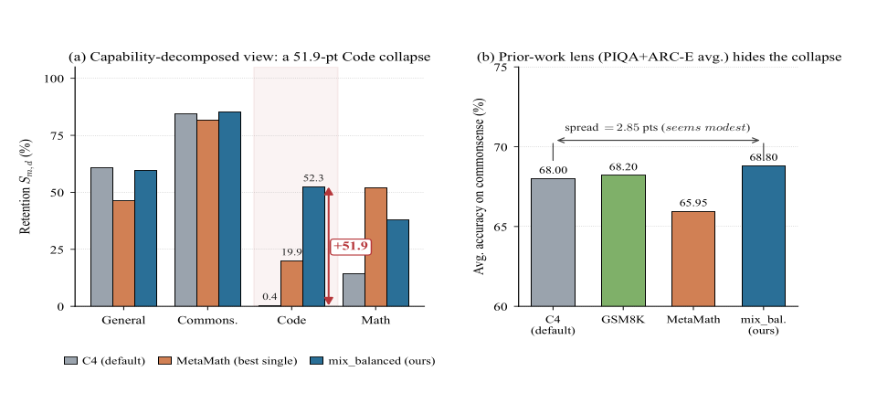

#+title:      喂谁的料，留谁的本事
#+subtitle:   剪枝校准集不是"随便一段文本"，是在投票决定哪种能力活下来；剪得越狠，越要四种料都喂 — Calibration Data Trade-offs Across Capability Dimensions: Why Multi-Source Mixing Matters for High-Sparsity LLM Pruning
#+date:       [2026-11-24 Tue 01:06]
#+filetags:   :paper:
#+identifier: 20261124T010639
#+source:     https://arxiv.org/abs/2606.03328 (v1, 2026-06-02)
#+authors:    Hu Xu, Zhaolong Xing, Congcong Liu, Jiaxing Wang, Zhida Jiang, Junshi Huang, Zhen Chen, Jianfeng Xu
#+venue:      arXiv 2606.03328 (v1, 2026-06, cs.LG；作者注"under review")；上海交通大学 / 京东

* 问题

你手上有一个 LLaMA-3.1-8B，要把它剪掉 60% 的权重好塞进更小的卡。你用的是 SparseGPT，
按惯例拿 128 段 C4 网页文本当"校准集"跑一遍，剪完测一下：维基、问答类的能力还剩六成，常识题几乎没掉——
然后你跑 HumanEval 和 MBPP，写代码的能力只剩原来的 0.4%。不是掉了一截，是没了。

先说校准集是干什么的。剪枝不重新训练，只拿一小批没标注的文本喂进模型，看每一层实际收到什么样的输入，
再据此决定哪些权重可以砍、砍完剩下的怎么补。SparseGPT 会用这些输入算一个"哪些输入方向常出现"的统计（Hessian 近似），
每砍一个权重，就按这个统计把误差摊给还活着的权重。所以校准集长什么样，直接决定了剪完的模型擅长什么。
128 段 C4 里几乎没有代码，SparseGPT 就照着"网页文本的样子"去补偿，代码要用的那些通路被当成不重要的砍光了。

奇怪的是，前人研究过这件事，结论是"校准数据选什么影响不大"。Williams & Aletras（2024）比了六种校准来源，
在一堆常识题（ARC、HellaSwag、BoolQ、PIQA）上取平均，差距很小。这篇论文复现了这个印象：
同样在 SparseGPT 60% 下，C4、GSM8K、MetaMath、四源混合四种校准，PIQA + ARC-Easy 的平均准确率是 68.00、68.20、65.95、68.80，
全落在 2.85 分的窄窗里。看这把尺子，确实"选什么都差不多"。可就在这四种校准之间，代码能力从 0.4% 到 52.3%。

后来的人想过换个思路。Self-Cal（Williams et al. 2025）不用外部语料，让模型自己生成校准文本，效果追平或超过 C4、维基；
SGS（Ji et al. 2025）在自生成文本上再筛一道：挑用词熵高的，并让困惑度落在一个目标分布里。
这两条路都在回答同一个问题："哪一种校准文本最好？"——默认存在一种最好的、单一的来源，只要找到它，或者把它造出来、筛干净。

这篇论文的作者换了一把尺子：不取平均，把剪完的能力拆成通用、常识、代码、数学四维分别看。
一拆开，他们看到的不是"哪种最好"，而是"每种料都在偏袒某一维"——而且偏袒的方向，和校准文本的困惑度挂钩。
这就意味着，"找一种最好的来源"这个问题本身问错了。

* 翻译

#+ATTR_ORG: :width 1200

*锚点：校准集像一张选票，128 张票投给谁，剪刀就替谁留路。*
回到那个代码只剩 0.4% 的 LLaMA-3.1-8B：C4 的 128 张票全投给了"网页文本"，代码一票没拿到。
这篇论文做的事，一句话：先证明不存在一种能同时投好四维的料，再把票匀给四维；没有现成的四维语料时，让模型按四维分头自己写。

** 第一步：把一个平均分拆成四个

他们先定一把新尺子。拿没剪的模型当满分，剪完的模型每个任务得分除以原模型得分，叫"保留率"；
再按维度归组：通用（LAMBADA 两版、TriviaQA）、常识（PIQA、ARC-Easy）、代码（HumanEval、MBPP）、数学（GSM8K、Minerva），
每维取平均，四维再平均就是总保留率。

拿这把尺子看 SparseGPT 60% 下几个单一来源，矛盾一下子摆在桌面上：

#+begin_example
                 通用    常识    代码    数学    总
  C4            60.74   84.35    0.41   14.47   39.99
  GSM8K         50.82   84.59   11.07   49.06   48.88
  MetaMath      46.20   81.83   19.87   52.16   50.02
#+end_example

C4 保通用最好，代码和数学最差；MetaMath 数学最好、代码也是单源里最好，通用却最差。
GSM8K 相对 C4，通用让出 9.92，数学换回 34.59。没有哪一行四格都高。

** 第二步：为什么偏——困惑度是那根杠杆

这时候你会问：是偶然几种语料碰巧这样，还是有规律？
他们拿 15 种校准来源（C4、DCLM、维基、WikiText-2、arXiv、Alpaca、Dolly、TinyStories、HellaSwag、OpenBookQA、WinoGrande、MBPP、Code-Alpaca、GSM8K、MetaMath），
每种算六个描述数据的指标，再算它们和四维保留率的秩相关（Spearman，只看排序是否一致）。
指标借自"客观信息论"（OIT，Xu et al.）的一套词汇：覆盖范围、多样性、粒度、重复度、失真（就是原模型看这段文本的困惑度）、错配（这段文本像不像预训练见过的）。

六个指标里只有两个站得住：

- *失真，也就是困惑度。* 困惑度高（模型读着"意外"的文本，比如 C4 约 8.3）和通用保留率正相关，ρ = +0.71；
  困惑度低（模型读着"顺手"的结构化文本，比如 MetaMath 约 2.2）和数学、代码保留率负相关，ρ = -0.53、-0.59。
  同一根杠杆，往一边推保通用，往另一边推保数学和代码。这就是论文说的"反号权衡"。
- *重复度。* 按 4 个词一组数重复片段，重复越多，通用保留率越低（ρ = -0.79，全表最强）。
  直觉上：同一个片段出现十遍，它在统计里就被算了十遍，剪刀以为这种输入格外重要。

覆盖范围和错配完全不预测；多样性和粒度只在 8 个格子里零星显著一两次。

推到这一步，结论差一步你就能自己说出来：既然一种料只能落在困惑度的一端，那任何单一来源——不管是真实语料，
还是 Self-Cal、SGS 那样从一个提示分布里自己写、再按一个困惑度目标筛——都只能顾一端。SGS 筛得再精，也是在一端里挑。

** 第三步：把票匀开——mix_balanced

解法朴素到近乎无聊：四个能力池各出 32 条，凑够同样的 128 条。通用池来自维基、C4 这类，代码池来自 MBPP、Code-Alpaca，数学池来自 GSM8K、MetaMath，常识池来自 HellaSwag 这类。

回到那个代码只剩 0.4% 的模型：

#+begin_example
                    通用    常识    代码    数学    总
  C4               60.74   84.35    0.41   14.47   39.99
  MetaMath         46.20   81.83   19.87   52.16   50.02
  mix_balanced     59.69   85.32   52.34   37.76   58.78
#+end_example

代码从 0.41 到 52.34，涨 51.9；通用只比 C4 低 1.05；总分比 C4 高 18.8，比最好的单源 MetaMath 高 8.8。
注意数学那一格：mix_balanced 的 37.76 比 MetaMath 的 52.16 低 14.4。混合不是每一维都赢，它赢在不让任何一维塌掉。

再看剪的力度。SparseGPT 下，mix_balanced 比 C4 的领先随稀疏度单调放大：

#+begin_example
  稀疏度        30%     40%     50%     60%
  比 C4         +4.62   +9.62   +17.17  +18.79
  比 MetaMath   +0.07   +1.04   +4.13   +8.76
#+end_example

剪 30% 时选什么料几乎无所谓，剪到 60% 时选料能差出 18.8 分。前人"影响不大"的结论，一半来自平均，另一半来自他们只看到 50% 稀疏。

两组消融把"匀"字钉死。一是偏着喂：按 4:3:3 往数学或代码倾斜（mix_4_3_3_math / _code），总分 53.46、55.90，都输给均匀的 58.78；
再极端一点 3:1:1:1 偏向任一维，总分落在 53.59 到 55.36。二是去掉一池：拿掉代码池，代码从 52.34 掉到 19.87；
拿掉数学池，数学从 37.76 掉到 18.64；拿掉任何一池，总分都降，没有哪一池是多余的。比例在均匀附近上下浮 15%，总分都还在 57.28 以上——要紧的是四池都在，不是比例调多准。

** 第四步：没有现成四池时——IGSP

mix_balanced 依赖你手里正好有按能力分好的真实语料。没有的时候怎么办——他们想到的是：让模型自己按四维分头写。
这就是 IGSP（Information-Guided Self-Calibration for Pruning，信息引导的剪枝自校准），三个零件：

1. *按能力分头出题。* 不像 Self-Cal 用一个提示一路续写，而是四套提示：通用写"维基风格的文章"，常识写"一个日常场景"，代码写"一个 Python 函数"，数学写"一道应用题和解答"。
2. *每维一个困惑度区间。* 生成出来的文本，按原模型的困惑度过闸：通用要 5 到 12，常识 4 到 8，代码 2 到 4.5，数学 2 到 4（附录表 11）。
   这样每池的料都落在它那一维"该在"的困惑度段，整体横跨高低两端。
3. *贪心去重。* 每池在区间内挑 32 条时，一条一条挑，每次挑那条让新出现的 4 词片段最多的，压低重复度。

结果，SparseGPT 60% 下：

#+begin_example
  Self-Cal              46.67
  SGS                   44.29
  IGSP 去掉分头出题      44.04
  IGSP 去掉困惑度区间    47.04
  IGSP 去掉贪心去重      48.03
  IGSP 完整             49.08
  mix_balanced(真实)    58.78
#+end_example

比 Self-Cal 高 2.41，比 SGS 高 4.79，是自生成这条线里最好的。三个零件里分头出题贡献最大（+5.04），区间 +2.04，去重 +1.05。
但离真实四池还差 9.70，差距几乎全在代码（差 20.8）和数学（差 16.0），通用、常识只差 1.3 以内（附录表 12）。
作者的解释：8B 模型自己写的代码不一定能跑，自己写的推导不一定对；困惑度只看"读着顺不顺"，看不出"对不对"。

** 最反直觉的一处：同一堆料，换把剪刀就不在乎了

同样 60% 稀疏、同样那一排校准方案，在 SparseGPT 下总分从 39.99 到 58.78，跨 18.79 分；
换成 Wanda，从 34.01 到 37.76，只跨 3.75 分，窄了五倍。三种自生成方案在 Wanda 下挤在 35.95 到 36.60，基本是噪声。

原因在两把剪刀怎么用校准数据。Wanda 只拿它算每个输入通道的激活大小，权重绝对值乘激活大小打分，低分的砍掉，剩下的原样不动。
剪到 60% 时，留下的前 40% 和砍掉的后 60% 分数差得够开，激活大小估得准不准，几乎不改名单。
SparseGPT 不只靠校准数据打分，还靠它算出的 Hessian 去改写剩下的每个权重来补偿——校准数据既决定砍谁，又决定怎么补，偏差被放大写进了最终权重。

所以"校准数据重不重要"没有统一答案：剪刀把校准数据耦合得越深，它越重要。只在 Wanda、只在中等稀疏度上报校准改进，会把这件事系统性地低估。

到这里，故事里有三件东西在动：一把拆开看的尺子、一根叫困惑度的杠杆、一套按维度分票的配方。

* 核心概念

*一，按能力拆开的保留率。* 一句话：剪完每个任务的分数除以原模型分数，按通用、常识、代码、数学分组平均。
回到那个模型：只看常识平均，C4 校准的 68.00 和混合校准的 68.80 几乎一样，你会放心用 C4 上线；
拆开看，代码一格是 0.41 对 52.34。少了这把尺子，后面所有发现都看不见——前人的"影响不大"正是在没有这把尺子时得出的。
它也有代价：除以原模型分数，原模型本身就弱的任务（8B 的 HumanEval、Minerva），几题之差会被放大成十几个点的保留率波动。

*二，困惑度当作杠杆，而不是当作质量分。* 一句话：校准文本的困惑度不是越低越好或越高越好，它决定剪刀偏向哪一维。
这是本文和 SGS 的分水岭。SGS 把困惑度当质量过滤，定一个目标分布往里筛；本文说同一根困惑度轴的两端分别养着不同的能力。
把 SGS 的"一个目标分布"变形一下：把它拆成四段，每段对准一维，四段拼起来横跨整根轴——这就是 IGSP 的每维困惑度区间。
在那个模型上：C4 的 8.3 站在高端，代码要的东西在 2 到 4.5 那段，一条都没有，于是代码塌了。

*三，均匀分票（一个设计选择，不是组件）。* 一句话：四池各 32 条，不按你关心哪维去倾斜。
直觉是"我关心代码，就多喂代码"。论文的数字说：多喂代码（4:3:3 偏代码）确实把代码推到 59.77，比均匀的 52.34 还高，
但总分 55.90 输给均匀；3:1:1:1 的偏法更亏。因为反号权衡在配比这一层又出现了一次——你往一维倾斜，就在困惑度轴上往一端挪，另一端的能力跟着掉。
少了这个选择，"混合"就会退化成"换一种单源"，问题原样回来。

三件道具合起来，指向的是同一件事。

* 洞见

校准集不是语言的一份抽样，是一张选票：剪刀按它决定谁的通路留下。用一种料，就是只给一种能力投票；剪得越狠，没拿到票的能力死得越干净。

* 博导审稿

选题眼光：困境是真的，也打在痛处。"128 段 C4 当校准"是剪枝和量化圈子里沿用多年的默认值，没人认真问过它对代码、数学意味着什么。
0.4% 的代码保留率是一张很有说服力的照片。拆维度看这个动作本身，就值一篇 workshop 论文。

方法成熟度：mix_balanced 朴素，IGSP 是三个启发式拼起来的，这都不是问题。问题在支撑整篇论文的那条"反号权衡"背后，有一个没被讨论的预设：
*困惑度是原因，而不只是领域的影子。* 15 种来源里，低困惑度的恰好就是 GSM8K、MetaMath、MBPP、Code-Alpaca——也就是数学和代码语料本身。
"低困惑度保数学和代码"和"数学代码语料保数学和代码"在这 15 个点上分不开。论文没有做"同领域、不同困惑度"或"同困惑度、不同领域"的对照。
如果真正起作用的是领域，IGSP 的困惑度区间就只是领域标签的替身，"按困惑度筛"这件事的价值要打折扣——9.7 分的差距恰好落在代码、数学上，也和这个猜测对得上。

另一个预设：*校准和评测不重叠。* GSM8K、MBPP 同时是校准池的来源和评测基准。正文没说校准用的是训练集还是测试集，也没做去重。
即便是训练集，用同分布、同格式的题校准，再用 3-shot 在同一基准上考，代码、数学那几十分的涨幅里有多少是"在考试题型上校准"，说不清。
对一个想要通用代码能力的部署来说，这一点决定了数字能不能直接搬。

还有一处统计上的拼接：摘要里的"通用 +0.71、数学 -0.53、代码 -0.59"不是同一把剪刀下的数。
附录表 6 显示 +0.71 和 -0.53 来自 Wanda，-0.59 来自 SparseGPT；在 SparseGPT 下数学是 -0.436（p = 0.104，不显著），在 Wanda 下代码是 -0.307（不显著）。
每把剪刀内部，"反号"只在一对维度上显著。15 个点、48 个检验、没做多重比较校正，"只有两个指标站得住"这类排序要谨慎看。

实验诚意：主表（8B、SparseGPT、30% 到 60%）是完整的，结论方向在 Wanda 和 SparseGPT 下一致，这是诚实的。但文内有多处对不上：
- 正文说 60% 的 Magnitude 和大多数 70B 配置"尚未跑完、表中标为横线"，可表 1 里 70B 和 Magnitude 的格子全有数字。
- IGSP 在 SparseGPT 60% 的四维分数，表 1 是 54.09 / 85.51 / 37.34 / 19.36，附录表 12 是 58.4 / 84.6 / 31.5 / 21.8，总分都写 49.1。
- 困惑度区间，附录表 11 写常识 4 到 8、代码 2 到 4.5，紧接着的正文列表写常识 5 到 13、代码 2 到 5；表题说区间来自"评测任务的困惑度分布"，正文又说来自"对齐语料的困惑度范围"。
- 去掉代码池后代码分 19.87，恰好等于单源 MetaMath 的代码分；去掉数学池后数学分 18.64，恰好等于单源维基的数学分。可能是巧合，但不确定。
- 附录 Wanda 40% 下，SGS（83.50）高于 mix_balanced（82.69），IGSP v2（84.19）也高于它——"混合占优"其实只在高稀疏、SparseGPT 下成立，正文的措辞比数据更满。
- 跨架构只有 OPT-6.7B，而且只测了通用和常识两维，恰好没测本文最关心的代码和数学。
另外，论文提到 GPTQ、AWQ 也用校准集，但一个量化实验都没做，结论能否搬到量化是空白。

写作功力：主线讲得清楚，图 1 一图说完动机。附录里"IGSP v2""de-circularized"之类字样透露出方法改过几轮，正文和附录没对齐。

判决：borderline。诊断有用、配方便宜、Wanda 与 SparseGPT 的对比是真洞察；但核心机制（困惑度是因）没和领域拆开，校准-评测重叠没交代，表间数字互相打架，需要作者清一轮账。

* 启发

迁移：你在 Quark 里用 GPTQ 做权重量化，GPTQ 和 SparseGPT 是同一家子——都拿校准数据算 Hessian，再按它去补偿剩下的权重。
按本文 Wanda/SparseGPT 的机制推，GPTQ 对校准数据的敏感度应该更像 SparseGPT，而 AWQ 只用激活大小找缩放，更像 Wanda（推测，论文没测量化）。
所以你可以：在 GPTQ 低比特（W4 以下、或 W4A8 这类压力大的配置）上，把默认的 128 段 WikiText/C4 换成四池各 32 段，
代码池和数学池用和评测不重叠的来源（比如代码用 The Stack 的片段而不是 MBPP，数学用 MetaMath 的训练部分而不是 GSM8K 测试题），
然后在 HumanEval / MBPP / GSM8K 上分维度报分，和 C4 校准对比。成本是一次重跑。

混搭：本文的"按能力分票"和 MoEQuant 那类"按专家均衡出题"管的是同一件事的两层——一个管能力维度，一个管专家路由。
在 MoE 模型上可以叠：四池各取一份，每池内部再按专家覆盖去挑。

反转：停下"用 WikiText 困惑度或常识平均分比较校准方案"这个习惯。本文最直接的教训是，常识平均 2.85 分的窄窗里藏着代码 0.4 到 52.3 的差距。
做校准相关的对比时，评测里至少要有一个代码任务和一个数学任务。如果客户只关心代码，别直接把校准全换成代码：
4:3:3 偏代码能把代码保留率推到 59.77，但通用和数学会让出去——先确认那部分能力客户真的不要。
