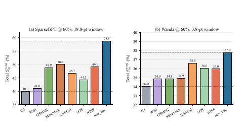
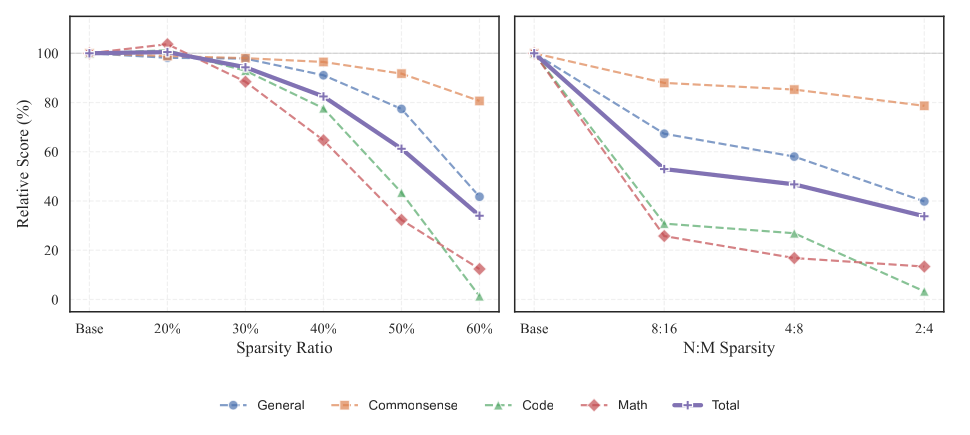
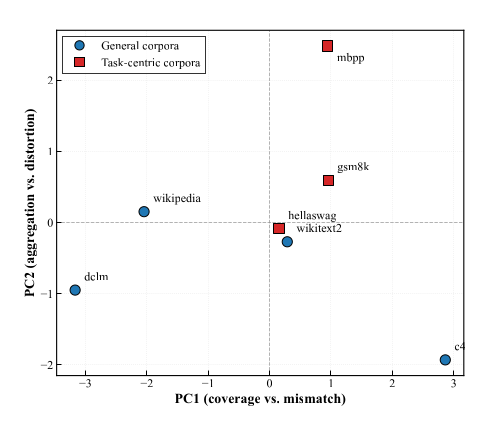
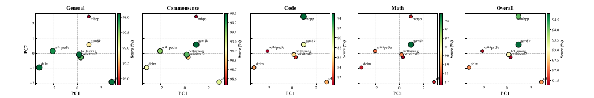
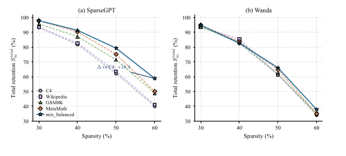
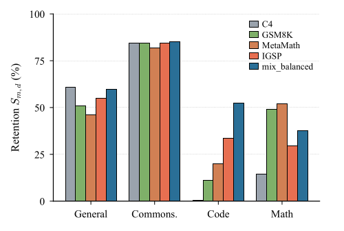

# IGSP：跨能力维度的校准数据权衡——为什么多源混合对高稀疏度 LLM 剪枝至关重要（中文翻译）

> 中文翻译（流畅、忠实于原文；表格、数字与公式与原文保持一致）。
>
> 论文：*Calibration Data Trade-offs Across Capability Dimensions: Why Multi-Source Mixing Matters for High-Sparsity LLM Pruning*（方法名 IGSP）。作者：Hu Xu（上海交通大学 / JD.com）、Zhaolong Xing、Congcong Liu、Jiaxing Wang、Zhida Jiang、Junshi Huang、Zhen Chen（JD.com）、Jianfeng Xu（上海交通大学）。原文：https://arxiv.org/abs/2606.03328 ，许可：CC BY 4.0（允许翻译与再发布）。
>
> 说明：原文标注“正在评审中；工作完成于 JD 实习期间”；Zhen Chen 与 Jianfeng Xu 为共同通讯作者。数据集/方法名（C4、MetaMath、mix_balanced、Self-Cal、SGS、Wanda、SparseGPT 等）保留英文。

## 摘要

训练后剪枝（post-training pruning）用一小份无标注校准集把大语言模型压缩到高稀疏度，近期工作认为校准数据来源的选择对剪枝后“平均”精度的影响不大。我们要问：如果不再把能力聚合成一个平均值，而是按不同能力维度分别评估校准的影响，这个结论是否还成立？我们把剪枝后的能力分解为 General、Commonsense、Code、Math 四个维度，并在 $`n{=}15`$ 个校准数据源上，用 Spearman 相关分析 OIT 信息度量与各维度保留率之间的关系，发现了一个符号相反的权衡：校准数据的困惑度与 General 保留率正相关（ $`\rho{=}{+}0.71`$ ），却与 Math 和 Code 保留率负相关（ $`\rho{=}{-}0.53,\,{-}0.59`$ ； $`p\lt 0.05`$ ），因此没有任何单一数据源能保住所有能力。我们的应对是多源校准混合，并提出 IGSP——一种信息引导的自校准（self-calibration）协议，它通过最小化 4-gram Aggregation 并在各维度之间平衡困惑度，在没有能力对齐语料的情况下自动构造多源校准集。在 LLaMA-3.1-8B、SparseGPT 60% 稀疏度下，均匀多源混合达到 58.8% 的总保留率，比最佳单一数据源（MetaMath，50.0%）高 +8.8，比默认的 C4（40.0%）高 +18.8；IGSP 比 Self-Cal 高 +2.4，比 SGS 高 +4.8。

## 1 引言


训练后剪枝是在不重新训练的前提下压缩大语言模型的主流路线。SparseGPT（Frantar and Alistarh, 2023）和 Wanda（Sun et al., 2023）等方法只需一小份无标注校准集（通常 128–256 条序列）来估计激活统计量或 Hessian 近似，就能达到 50–60% 的非结构化稀疏度。校准集因而直接决定了哪些权重得以保留，然而“该往里放什么数据”这个问题得到的系统性关注却少得惊人：C4 和 Wikipedia 一直是默认数据源，靠的是惯例而非证据。

近期有两条工作线对这一惯例做了审视，但结论并不一致。Williams and Aletras (2024) 比较了六种用于量化和剪枝的校准数据源，报告称选择对通用领域基准上的平均精度影响不大。Williams et al. (2025)（Self-Cal）则改用基础模型自身生成校准数据，效果持平或优于 C4 和 Wikipedia；Ji et al. (2025)（SGS）进一步按词表熵和目标困惑度分布过滤自生成文本。这三项工作有一条共同的方法论主线：用通用领域基准（ARC、HellaSwag、BoolQ、PIQA）上的平均精度来判断校准的影响，并且校准数据来自单一语料或单一自生成分布（Williams and Aletras (2024); Bandari et al. (2024); Ji et al. (2025); Williams et al. (2025)）。

我们认为，单一维度、单一数据源的评估掩盖了校准数据的两个结构性事实。第一，能力分解会暴露被平均掉的效应：在 SparseGPT 60% 稀疏度下，高困惑度的网页文本（C4， $`\mathrm{PPL}{\approx}8.3`$ ）能保住 General 能力（60.7% 保留率），却造成 Code 几乎完全崩溃（0.4%）；低困惑度的数学数据（MetaMath， $`\mathrm{PPL}{\approx}2.2`$ ）能保住 Math（52.2%），代价是 General（46.2%）。第二，在 $`n{=}15`$ 个校准数据源上的 Spearman 分析量化了这为什么是结构性的：校准困惑度与 General 保留率正相关（ $`\rho{=}{+}0.71`$ ），与 Math 和 Code 保留率负相关（ $`\rho{=}{-}0.53`$ ， $`-0.59`$ ； $`p\lt 0.05`$ ）。既然困惑度谱的两端分别支撑相反的能力维度，那么没有任何单一校准数据源（无论真实的还是自生成的）能同时优化两端。因此，即便使用最强的自生成方法，单一数据源校准在高稀疏度下依然在结构上是不够的。

这一诊断直接指向多源校准。我们构造了 mix_balanced：在与所有基线相同的固定 128 条序列预算下，从四个与能力对齐的数据池（General、Commonsense、Code、Math）中均匀抽样。当没有能力对齐的语料时，我们提出 IGSP（Information-Guided Self-Calibration for Pruning，面向剪枝的信息引导自校准），只用评估分类体系和基础模型就能自动构造多源校准集。IGSP 应用两条经实证验证、同样源自相关性分析的原则：最小化 4-gram Aggregation，以抑制重复模式对激活估计造成的偏差；以及通过各维度各自的 PPL 区间，在各能力维度之间平衡 Distortion（困惑度）。这两条原则都建立在客观信息论（Objective Information Theory, OIT；Xu et al. (2023); Xu (2024)）信息度量之间的经验层级之上。实验结果表明，只有 Aggregation 和 Distortion 能稳健地预测能力保留率，而 Scope、Variety、Granularity 和 Mismatch 不能。

在 LLaMA-3.1-8B、SparseGPT 60% 稀疏度下，mix_balanced 达到 $`S_{m}^{\text{total}}{=}58.8`$ ，比最佳单一数据源（MetaMath， $`50.0`$ ）高 $`+8.8`$ ，比默认的 C4（ $`40.0`$ ）高 $`+18.8`$ 。仅 Code 一个维度就比 C4 高出 $`+51.9`$ 个点。这一优势随稀疏度单调增长（30% 时 $`+4.6`$ ，60% 时 $`+18.8`$ ），证实在与部署相关的高稀疏区间里，校准设计不是不重要，而是更重要。在没有能力对齐语料的情况下，IGSP 在 SparseGPT 60% 下比 Self-Cal 高 $`+2.4`$ 、比 SGS 高 $`+4.8`$ ，成为自生成赛道的 SOTA，同时与真实多源数据之间仍留有 9.7 个点的残余差距——这是表面困惑度过滤无法弥合的内容质量天花板。同一矩阵里还有一个附带发现：在 60% 稀疏度下，所有校准变体在 Wanda 下被压缩到 3.8 个点的窗口内，而在 SparseGPT 下则跨度达 18.8 个点，原因是 SparseGPT 通过 Hessian 驱动的权重更新把校准信息全局传播，而 Wanda 仅把校准当作局部的激活幅值估计器。所以，校准设计的决定性程度与剪枝器把校准耦合进其更新规则的强度成正比。

**贡献。**

1. **按能力分解的评估揭示了符号相反的权衡。** 把剪枝后的能力分解为四个维度，暴露出 60% 稀疏度下 Code 上超过 50 个点的效应，这是单一维度评估所掩盖的；在 $`n{=}15`$ 个校准数据源上的 Spearman 分析表明，校准困惑度在 General（ $`+0.71`$ ）与 Math/Code（ $`-0.53/-0.59`$ ； $`p\lt 0.05`$ ）上的相关符号相反，使得单一数据源校准在结构上不够用（§5.1–§5.2）。
2. **多源混合是必要的应对。** mix_balanced 优于所测试的每一个单一数据源集合，在 SparseGPT 下收益随稀疏度单调放大，从 30% 的 $`+4.6`$ 增至 60% 的 $`+18.8`$ （§5.3）。
3. **IGSP：自生成协议中的 SOTA。** IGSP 在没有能力对齐语料的情况下自动完成多源构造，比 Self-Cal/SGS 分别高 $`+2.4/+4.8`$ ，同时揭示了把自生成数据与真实数据隔开的 9.7 个点的内容质量天花板（§5.4）。

此外，我们还发现了 60% 稀疏度下 Wanda 的校准饱和现象，并从机理上把它与剪枝器把校准耦合进权重更新的方式联系起来（§5.5）。

## 2 相关工作

**一次性剪枝的校准数据。** SparseGPT（Frantar and Alistarh, 2023）和 Wanda（Sun et al., 2023），以及 GPTQ（Frantar et al., 2022）、AWQ（Lin et al., 2024）、SpQR（Dettmers et al., 2023）等训练后量化方法，都只用一小份无标注校准集就达到很高的压缩率。Williams and Aletras (2024) 在稀疏度 $`\leq 50\%`$ 、通用领域基准上比较了六种校准数据源，只报告了很小的差异；我们复现了这一结果，并表明按能力分解后会暴露出被平均掩盖的、显著的领域特异性差异（§5.1）。

**自生成校准。** Williams et al. (2025) 提出 Self-Cal：由基础 LLM 生成合成校准数据，在标准基准上持平或优于 Wikipedia 和 C4。Ji et al. (2025)（SGS）进一步按词表熵和目标困惑度分布过滤自生成数据。两者都是单一数据源方法，并且只优化单一信息信号。我们的分析指出了这一设计选择的极限：跨能力维度的符号相反的权衡（§5.2）无法通过调节单一困惑度分布来解决，不论过滤多么精准。IGSP 保留了自生成的想法，但把单源生成器换成了按能力分层的提示，并加上各维度各自的困惑度门控。

**压缩后 LLM 的评估。** 困惑度加少量基准仍很常见，但越来越被认为不够用（Williams and Aletras (2024)）。近期研究表明，相近的困惑度可能掩盖事实知识（Hoang et al. (2023)）、摘要（Chrysostomou et al. (2024)）、推理（JAISWAL et al. (); JAISWAL et al. (2023)）以及量化校准（Metzler et al. (2024)）上不均匀的能力损失。我们的评估延续这一多维度方向：(i) 落实了一个四向能力分类体系，并给出以未剪枝模型归一化的显式相对保留率指标；(ii) 把保留率的变化与校准数据的定量描述符联系起来，而不是只与压缩算法联系。

**信息论数据选择。** 有原则的数据选择已通过困惑度（Wenzek et al. (2020)）、信息瓶颈（Tishby and Zaslavsky (2015)）和主动学习（Settles (1995)）等方式研究过。客观信息论（OIT）提供了统一的形式化框架（Xu et al. (2023)），并已被用于训练数据选择（Xu et al. (2025b); Xu et al. (2025a)）。我们沿用 OIT 的度量词汇，但经验上发现六个度量中只有两个——Aggregation 和 Distortion——能稳健地预测能力保留率（ $`n{=}15`$ ，§5.2）。IGSP 用这两个信号来驱动多源构造，与 Ji et al. (2025) 的单源过滤是不同的设计点。

## 3 方法

我们提出：(i) 一个多维度的能力保留率指标；(ii) 校准数据的信息画像；(iii) IGSP，一种信息引导的多源校准协议。

### 3.1 多维度能力保留率

记 $`m_{0}`$ 为未剪枝模型， $`m`$ 为某个剪枝变体。评估任务被划分为四个维度 $`\mathcal{D}=\lbrace\text{General},\text{Commonsense},\text{Code},\text{Math}\rbrace`$ ， $`\mathcal{T}_{d}`$ 为分配给维度 $`d`$ 的基准集合（附录 C.2）。对每个任务 $`t`$ 及其指标 $`\mathrm{score}(m,t)\in[0,1]`$ ，我们定义相对保留率

```math
\tilde{y}_{m,t}\;=\;\frac{\mathrm{score}(m,t)}{\mathrm{score}(m_{0},t)+\varepsilon},\qquad (1)
```

并把它聚合为维度级与整体级得分：

```math
S_{m,d}=\tfrac{1}{|\mathcal{T}_{d}|}\sum_{t\in\mathcal{T}_{d}}\tilde{y}_{m,t},\qquad S^{\text{total}}_{m}=\tfrac{1}{|\mathcal{D}|}\sum_{d\in\mathcal{D}}S_{m,d}.
```

这种归一化使得不同任务、稀疏度和剪枝方法之间的比较保持一致。多随机种子聚合与边界情形详见附录 A.1。

### 3.2 校准数据的信息画像

我们用 OIT 风格的信息画像（Xu et al. (2023); Xu et al. (2025b)）来刻画每个校准集 $`C`$ ：

```math
m(C)=\left[\,\mathrm{Vol},\,\mathrm{S},\,\mathrm{Var},\,\mathrm{G},\,\mathrm{A},\,\mathrm{D}_{M},\,\mathrm{M}_{I_{0},M}\,\right](C),\qquad (2)
```

其中 $`\mathrm{Vol}`$ 为 token 预算， $`\mathrm{S}`$ （Scope）与 $`\mathrm{Var}`$ （Variety）刻画覆盖广度， $`\mathrm{G}`$ （Granularity）度量划分的细粒度， $`\mathrm{A}`$ （Aggregation）为 4-gram 冗余度， $`\mathrm{D}_{M}`$ （Distortion）为基础模型下的困惑度， $`\mathrm{M}_{I_{0},M}`$ （Mismatch）为 Min-K%++ 分数（Shi et al. (2024)）。操作性定义见附录 A.2。

在 $`n{=}15`$ 个校准集上的相关性研究（§5.2）给出了清晰的层级：
(i) 主导预测因子（在多个维度上 $`|\rho|>0.5`$ ， $`p\lt 0.05`$ ）：Aggregation（对 General 最强的负向预测因子， $`\rho{=}{-}0.79`$ ）与 Distortion（对 General 为正， $`\rho{=}{+}0.71`$ ；对 Math/Code 为负， $`\rho{=}{-}0.53/-0.59`$ ）；
(ii) 辅助预测因子（Variety、Granularity；8 个单元格中至多 2 个显著）；
(iii) 非预测因子（Scope、Mismatch；全程 $`p>0.05`$ ）。
因此我们在 IGSP 中只优化 Aggregation 和 Distortion，其余度量仅用于诊断性刻画。

### 3.3 IGSP：信息引导的多源校准

IGSP 仅利用评估分类体系和基础模型，构造一个固定预算 $`B`$ 的校准集 $`C^{*}`$ ，使其覆盖跨能力所需的困惑度谱。

**设计原则。**

- **P1（Aggregation）。** 4-gram 冗余度高的校准数据会使激活估计偏向重复模式；我们贪心地选择能最大化唯一 $`n`$-gram 覆盖的样本。
- **P2（Distortion 平衡）。** 既然没有哪一个困惑度水平能支撑所有能力，校准集就必须同时包含高困惑度和低困惑度两种区间的数据，并在各能力维度之间分配。

**构造过程。**

*阶段 1（按能力分层的数据池）。* 对每个 $`d\in\mathcal{D}`$ ，构造与该能力对齐的候选池 $`P_{d}`$ ：要么划分现有语料（例如 Math 用 GSM8K 和 MetaMath），要么用维度特定的模板提示基础 LLM 生成（例如“生成一道小学数学应用题及其解答”）。完整的池为 $`P=\bigcup_{d}P_{d}`$ 。

*阶段 2（按维度选择）。* 从每个 $`P_{d}`$ 中选出 $`b_{d}=\alpha_{d}B`$ 个样本（默认均匀 $`\alpha_{d}{=}1/|\mathcal{D}|`$ ），在满足每个维度的困惑度区间 $`[\tau_{d}^{\text{lo}},\tau_{d}^{\text{hi}}]`$ 的前提下贪心地最小化 Aggregation；该区间来自 $`\mathcal{T}_{d}`$ 在 $`m_{0}`$ 下的经验困惑度分布（表 11）。该过程的时间复杂度为 $`O(B\cdot|P|)`$ ；伪代码见附录 A.3。

**与已有工作的关系。** IGSP 与 SGS（Ji et al. (2025)）有两点不同：SGS 针对一个校准数据源优化一种困惑度分布，而 IGSP 构造显式的多源校准并带有各维度的区间；SGS 使用词表级熵，而我们的分析表明，短语级的 Aggregation 对 General 保留率是明显更强的预测因子（ $`|\rho|{=}0.79`$ 对比 $`\lt 0.2`$ ）。IGSP 与 Self-Cal（Williams et al. (2025)）的不同在于，后者从单一提示分布生成；IGSP 则从维度特定的提示生成，并在各能力维度之间平衡所得的困惑度分布。

## 4 实验设置

**模型与剪枝器。** 我们以 LLaMA-3.1-8B 为主要基础模型，并在 LLaMA-3.1-70B 和 OPT-6.7B 上做跨架构验证（附录 E.7）。所有结果均为训练后（post-training）：用一小份无标注校准集剪枝权重，不做后续微调。我们评估三种有代表性的剪枝器：Magnitude（逐层权重幅值）、Wanda（Sun et al. (2023)，层内局部、感知激活）和 SparseGPT（Frantar and Alistarh (2023)，逐层 OBS 风格并带二阶更新），非结构化稀疏度为 $`\lbrace 30,40,50,60\rbrace\%`$ 。不同校准策略之间，剪枝超参数保持固定。

**表 1：** 在 60% 非结构化稀疏度下，跨剪枝方法（Magnitude、Wanda、SparseGPT）、模型规模（LLaMA-3.1-8B、LLaMA-3.1-70B）与校准赛道（单一真实语料、多源真实混合、自生成）的剪枝比较。粗体：每个（模型，方法）块内 $`S^{\text{tot}}`$ 最佳。下标为 8 个校准种子上的样本标准差。Magnitude 不使用校准；所报告的 $`\sigma`$ 仅反映评估侧的采样噪声（HumanEval/MBPP pass@1、Minerva-Math）。

| 方法 | 校准 | 8B $`S_{\text{Gen}}`$ | 8B $`S_{\text{Com}}`$ | 8B $`S_{\text{Code}}`$ | 8B $`S_{\text{Math}}`$ | 8B $`S^{\text{tot}}`$ | 70B $`S_{\text{Gen}}`$ | 70B $`S_{\text{Com}}`$ | 70B $`S_{\text{Code}}`$ | 70B $`S_{\text{Math}}`$ | 70B $`S^{\text{tot}}`$ |
|---|---|---|---|---|---|---|---|---|---|---|---|
| Magnitude | None | 14.50 ± 0.12 | 20.40 ± 0.05 | 1.20 ± 0.18 | 1.90 ± 0.20 | 9.50 ± 0.10 | 52.30 ± 0.20 | 59.80 ± 0.10 | 14.50 ± 0.42 | 15.40 ± 0.48 | 35.50 ± 0.22 |
| Wanda | C4 | 41.72 ± 0.55 | 80.63 ± 0.22 | 1.31 ± 0.20 | 12.37 ± 0.50 | 34.01 ± 0.42 | 76.32 ± 0.48 | 93.55 ± 0.18 | 37.85 ± 0.42 | 43.89 ± 0.45 | 62.90 ± 0.35 |
| Wanda | Wikipedia | 38.75 ± 0.58 | 80.13 ± 0.22 | 6.60 ± 0.55 | 13.94 ± 0.55 | 34.86 ± 0.45 | 74.10 ± 0.50 | 93.20 ± 0.20 | 44.80 ± 0.48 | 44.50 ± 0.48 | 64.15 ± 0.40 |
| Wanda | GSM8K | 34.54 ± 0.65 | 78.53 ± 0.28 | 8.39 ± 0.62 | 18.03 ± 0.85 | 34.87 ± 0.55 | 70.85 ± 0.55 | 92.40 ± 0.25 | 46.20 ± 0.55 | 48.10 ± 0.72 | 64.39 ± 0.42 |
| Wanda | MetaMath | 35.26 ± 0.62 | 79.95 ± 0.25 | 6.67 ± 0.58 | 17.85 ± 0.78 | 34.93 ± 0.50 | 71.20 ± 0.52 | 93.10 ± 0.22 | 44.50 ± 0.50 | 48.30 ± 0.68 | 64.28 ± 0.45 |
| Wanda | mix_4_3_3_math | 40.90 ± 0.48 | 77.98 ± 0.22 | 7.49 ± 0.55 | 14.52 ± 0.55 | 35.22 ± 0.40 | 75.40 ± 0.42 | 91.80 ± 0.20 | 45.20 ± 0.48 | 46.10 ± 0.48 | 64.63 ± 0.32 |
| Wanda | mix_4_3_3_code | 39.03 ± 0.50 | 80.50 ± 0.22 | 14.72 ± 0.85 | 14.01 ± 0.50 | 37.06 ± 0.45 | 73.80 ± 0.45 | 93.30 ± 0.20 | 51.40 ± 0.72 | 45.60 ± 0.45 | 66.03 ± 0.40 |
| Wanda | mix_balanced | 40.89 ± 0.42 | 79.77 ± 0.20 | 14.65 ± 0.62 | 15.75 ± 0.55 | **37.76 ± 0.38** | 75.30 ± 0.38 | 92.80 ± 0.18 | 51.20 ± 0.55 | 47.20 ± 0.48 | **66.63 ± 0.30** |
| Wanda | Self-Cal Williams et al. (2025) | 38.93 ± 0.78 | 81.37 ± 0.30 | 12.79 ± 0.92 | 13.32 ± 0.85 | 36.60 ± 0.62 | 73.60 ± 0.65 | 93.80 ± 0.25 | 49.40 ± 0.78 | 44.80 ± 0.72 | 65.40 ± 0.55 |
| Wanda | SGS Ji et al. (2025) | 36.90 ± 0.88 | 81.74 ± 0.32 | 12.03 ± 1.05 | 13.42 ± 0.95 | 36.02 ± 0.70 | 72.20 ± 0.75 | 94.00 ± 0.28 | 48.60 ± 0.88 | 44.85 ± 0.82 | 64.91 ± 0.62 |
| Wanda | IGSP (ours) | 34.63 ± 0.68 | 81.43 ± 0.28 | 14.92 ± 0.78 | 12.81 ± 0.72 | 35.95 ± 0.55 | 70.50 ± 0.58 | 93.85 ± 0.22 | 51.10 ± 0.65 | 44.20 ± 0.62 | 64.91 ± 0.50 |
| SparseGPT | C4 | 60.74 ± 0.72 | 84.35 ± 0.30 | 0.41 ± 0.18 | 14.47 ± 0.65 | 39.99 ± 0.62 | 80.20 ± 0.60 | 94.50 ± 0.25 | 30.20 ± 0.45 | 42.50 ± 0.55 | 61.85 ± 0.50 |
| SparseGPT | Wikipedia | 56.36 ± 0.75 | 81.97 ± 0.32 | 7.08 ± 0.62 | 18.64 ± 0.78 | 41.01 ± 0.58 | 77.80 ± 0.62 | 93.10 ± 0.28 | 36.40 ± 0.55 | 46.20 ± 0.65 | 63.38 ± 0.48 |
| SparseGPT | GSM8K | 50.82 ± 0.88 | 84.59 ± 0.32 | 11.07 ± 0.92 | 49.06 ± 1.20 | 48.88 ± 0.78 | 73.50 ± 0.72 | 94.30 ± 0.28 | 40.20 ± 0.78 | 66.40 ± 1.00 | 68.60 ± 0.65 |
| SparseGPT | MetaMath | 46.20 ± 0.92 | 81.83 ± 0.35 | 19.87 ± 1.10 | 52.16 ± 1.25 | 50.02 ± 0.82 | 69.80 ± 0.78 | 93.20 ± 0.30 | 46.20 ± 0.95 | 68.10 ± 1.05 | 69.33 ± 0.68 |
| SparseGPT | mix_4_3_3_math | 59.64 ± 0.65 | 85.69 ± 0.28 | 23.45 ± 0.92 | 45.08 ± 1.05 | 53.46 ± 0.65 | 79.20 ± 0.55 | 94.80 ± 0.25 | 48.50 ± 0.80 | 63.20 ± 0.88 | 71.43 ± 0.55 |
| SparseGPT | mix_4_3_3_code | 58.06 ± 0.72 | 84.00 ± 0.32 | 59.77 ± 1.40 | 21.76 ± 0.92 | 55.90 ± 0.88 | 78.10 ± 0.62 | 94.00 ± 0.28 | 72.30 ± 1.18 | 50.80 ± 0.78 | 73.80 ± 0.72 |
| SparseGPT | mix_balanced | 59.69 ± 0.55 | 85.32 ± 0.25 | 52.34 ± 0.95 | 37.76 ± 0.95 | **58.78 ± 0.55** | 79.30 ± 0.48 | 94.60 ± 0.22 | 68.50 ± 0.82 | 58.20 ± 0.80 | **75.15 ± 0.45** |
| SparseGPT | Self-Cal Williams et al. (2025) | 57.24 ± 1.05 | 84.02 ± 0.40 | 26.41 ± 1.40 | 19.01 ± 1.15 | 46.67 ± 0.92 | 77.60 ± 0.88 | 93.40 ± 0.32 | 50.80 ± 1.18 | 48.40 ± 0.98 | 67.55 ± 0.78 |
| SparseGPT | SGS Ji et al. (2025) | 56.22 ± 1.18 | 85.32 ± 0.42 | 19.04 ± 1.55 | 16.59 ± 1.30 | 44.29 ± 1.05 | 76.80 ± 1.00 | 94.10 ± 0.35 | 46.20 ± 1.32 | 46.80 ± 1.10 | 65.98 ± 0.85 |
| SparseGPT | IGSP (ours) | 54.09 ± 0.92 | 85.51 ± 0.32 | 37.34 ± 1.10 | 19.36 ± 0.95 | 49.08 ± 0.68 | 75.20 ± 0.78 | 94.20 ± 0.28 | 58.60 ± 0.92 | 49.10 ± 0.82 | 69.28 ± 0.58 |

**校准数据。** 对每种策略，校准预算固定为 128 条序列，沿用 JAISWAL et al. (2023)。我们比较三类：(i) 单一数据源：15 个语料，涵盖通用领域文本（C4（Raffel et al. (2020)）、DCLM（Li et al. (2024)）、Wikipedia、WikiText-2（Team et al. (2024)）、arXiv）、指令（Alpaca、Dolly、TinyStories）、常识（HellaSwag、OpenBookQA、WinoGrande）、代码（MBPP、Code-Alpaca）和数学（GSM8K、MetaMath）。(ii) 多源：mix_balanced（在四个能力池上按 $`1{:}1{:}1{:}1`$ 均匀混合）、mix_4_3_3_math、mix_4_3_3_code；各池按其主要评估维度划分上述单源语料。(iii) 自生成：Self-Cal（Williams et al. (2025)，单一提示的自回归续写）、SGS（Ji et al. (2025)，词表熵 + 目标 PPL 过滤）以及 IGSP（按能力分层的提示 + 各维度 PPL 区间 + 贪心 4-gram Aggregation 最小化；§3.3）。各自生成方法之间，生成超参数和维度特定提示保持固定（附录 A.3）。

**评估。** 我们使用 lm-evaluation-harness（Gao et al. (2024)），在八个基准上评估，并分为四个维度：General（LAMBADA-Std/-OpenAI（Paperno et al. (2016)）、TriviaQA（Joshi et al. (2017)），zero-shot）、Commonsense（PIQA（Bisk et al. (2020)）、ARC-Easy（Clark et al. (2018)），zero-shot）、Code（HumanEval（Chen et al. (2021)）、MBPP（Austin et al. (2021)），3-shot）、Math（GSM8K（Cobbe et al. (2021)）、Minerva（Lewkowycz et al. (2022)），3-shot）。所有解码均为贪心（ $`T{=}0`$ ）。我们报告相对保留率 $`S_{m,d}`$ （§3.1）和均匀平均的 $`S_{m}^{\text{total}}`$ 。关键配置会重复 8 个种子；正文中的数字为均值，各种子的方差见附录 C。

## 5 结果

### 5.1 单一维度评估掩盖了校准的影响

**研究问题。** 平均精度是否足以刻画校准数据的影响？

Williams and Aletras (2024) 报告称，校准选择对通用领域常识推理基准（PIQA、ARC、HellaSwag、BoolQ、WinoGrande）上的平均精度影响不大。我们在 SparseGPT 60% 下复现了这一印象：对 PIQA 和 ARC-Easy（我们评估套件中的常识子集）取平均精度，四个校准数据源仅跨越 $`2.85`$ 个点（图 1b）——表面上支持“校准影响不大”的结论。

这种一致性是平均造成的假象。在 SparseGPT 60% 下，MetaMath 校准的 $`S_{m,\text{Math}}{=}52.2`$ ，而 C4 为 $`14.5`$ （ $`+37.7`$ ）；而 C4 保住了 $`S_{m,\text{General}}{=}60.7`$ ，MetaMath 只有 $`46.2`$ （ $`-14.5`$ ）；从 C4 换成 mix_balanced 使 $`S_{m,\text{Code}}`$ 提升 $`+51.9`$ 个点（图 1a）。这些跨维度结构在以往工作仅看常识的视角下全都不可见。单一维度评估系统性地掩盖了那些对不同能力维度产生符号相反效应的校准选择。


### 5.2 跨维度符号相反的权衡

**研究问题。** 校准数据的哪些信息属性能预测剪枝后特定能力的保留率？

我们在 $`n{=}15`$ 个数据集上计算六个 OIT 度量与四个保留率得分之间的 Spearman 秩相关（完整画像见附录 B.1）。图 2 给出三个发现。

**发现 1：Aggregation 和 Distortion 是稳健的，其余不是。** 只有这两个度量在多个能力单元格中达到 $`|\rho|{>}0.5`$ 且 $`p\lt 0.05`$ 。Aggregation 是 General 保留率最强的负向预测因子（Wanda 下 $`\rho{=}{-}0.79`$ ，SparseGPT 下 $`-0.58`$ ）。Scope、Variety、Granularity 和 Mismatch 的信号不一致或较弱。

**发现 2：Distortion 呈现符号相反的相关。** 在 Wanda 下，校准困惑度与 General 正相关（ $`\rho{=}{+}0.71`$ ， $`p\lt 0.05`$ ），与 Math 负相关（ $`\rho{=}{-}0.53`$ ， $`p\lt 0.05`$ ）。在 SparseGPT 下，这一相反模式延伸到 Code（ $`\rho{=}{-}0.59`$ ， $`p\lt 0.05`$ ，而 General 为 $`+0.55`$ ）。高 PPL 的网页文本能保住通用语言能力，却在结构化推理上失败；低 PPL 的数学数据能保住 Math，却损害 General。没有哪一个困惑度水平能同时优化两端。

**发现 3：Code 在 Wanda 下最难预测。** 在 Wanda 下，没有任何度量与 Code 保留率显著相关。在 SparseGPT 下，Distortion 对 Code 有很强的预测力（ $`\rho{=}{-}0.59`$ ）。我们把这种不对称归因于 SparseGPT 的二阶 Hessian 求逆使 Code 保留率对校准结构更敏感（参见 §5.5）；我们在全文中同时报告两种剪枝器。

**含义。** 任何依赖单一数据源（无论真实还是自生成）的校准策略，都只优化了一种困惑度区间，因而系统性地牺牲了与相反区间相关的维度。跨越两个区间的多源混合是结构上必需的应对。

### 5.3 多源混合化解了这一权衡

**表 2：** LLaMA-3.1-8B 上 SparseGPT 的跨稀疏度总保留率 $`S_{m}^{\text{total}}`$ ，按校准赛道（单一真实语料、多源真实混合、自生成）分组。粗体：每个赛道内各稀疏度列的最佳值。下标为 8 个校准种子上的样本标准差。

| 策略 | SGPT-30 | SGPT-40 | SGPT-50 | SGPT-60 |
|---|---|---|---|---|
| **单一数据源** | | | | |
| C4（默认） | 93.28 ± 0.22 | 81.72 ± 0.35 | 62.08 ± 0.48 | 39.99 ± 0.62 |
| Wikipedia | 93.49 ± 0.20 | 82.84 ± 0.32 | 63.59 ± 0.45 | 41.01 ± 0.58 |
| GSM8K | 95.67 ± 0.28 | 87.08 ± 0.45 | 71.45 ± 0.58 | 48.88 ± 0.78 |
| MetaMath | 97.83 ± 0.30 | 90.30 ± 0.48 | 75.12 ± 0.62 | 50.02 ± 0.82 |
| **多源（本文）** | | | | |
| mix_4_3_3_math | 96.86 ± 0.25 | 89.32 ± 0.40 | 76.22 ± 0.50 | 53.46 ± 0.65 |
| mix_4_3_3_code | 95.80 ± 0.32 | 87.31 ± 0.52 | 73.48 ± 0.68 | 55.90 ± 0.88 |
| mix_balanced | **97.90 ± 0.20** | **91.34 ± 0.32** | **79.25 ± 0.42** | **58.78 ± 0.55** |
| **自生成赛道** | | | | |
| Self-Cal | 94.50 ± 0.45 | 84.50 ± 0.65 | 66.75 ± 0.80 | 46.67 ± 0.92 |
| SGS | 94.30 ± 0.52 | 84.10 ± 0.72 | 67.18 ± 0.88 | 44.29 ± 1.05 |
| IGSP –no-multi | 93.90 ± 0.50 | 83.20 ± 0.70 | 65.81 ± 0.85 | 44.04 ± 1.00 |
| IGSP –no-band | 94.85 ± 0.40 | 85.20 ± 0.58 | 68.70 ± 0.72 | 47.04 ± 0.85 |
| IGSP –no-diversity | **95.40 ± 0.35** | **86.20 ± 0.50** | **70.43 ± 0.62** | 48.03 ± 0.75 |
| IGSP (full) | 95.20 ± 0.32 | 86.00 ± 0.48 | 69.32 ± 0.58 | **49.08 ± 0.68** |
| Δ（mix_balanced − C4） | +4.62 | +9.62 | +17.17 | +18.79 |
| Δ（mix_balanced − MetaMath） | +0.07 | +1.04 | +4.13 | +8.76 |
| Δ（IGSP − Self-Cal） | +0.70 | +1.50 | +2.57 | +2.41 |

我们先检验最强的单一数据源校准能否克服上述权衡，再评估多源混合在不同剪枝方法和模型规模上的表现。表 1 给出了 Magnitude、Wanda 和 SparseGPT 在 LLaMA-3.1-8B 与 LLaMA-3.1-70B 上 60% 非结构化稀疏度下的分维度保留率；标记为“ $`-`$ ”的单元格对应在该稀疏度下尚未完成的运行（Magnitude 在 60% 以及 LLaMA-3.1-70B 的大部分配置）。LLaMA-3.1-8B 上 SparseGPT 的跨稀疏度总分（30–60%）见表 2；LLaMA-3.1-70B 在 40% 的结果见附录 E.8。

**单一数据源校准在结构上不够用。** 表 1 的单一数据源部分让这个两难在 60% 稀疏度下变得具体。在 LLaMA-3.1-8B 的 SparseGPT 下，C4 得到最高的 General 保留率（ $`60.74`$ ），却在 Code 上崩溃（ $`0.41`$ ），并且 Math 最低（ $`14.47`$ ）；MetaMath 得到最高的 Math（ $`52.16`$ ）以及单一数据源中最高的 Code（ $`19.87`$ ），代价是最低的 General（ $`46.20`$ ）；相对 C4，GSM8K 以 General 上的 $`-9.92`$ 换来 Math 上的 $`+34.59`$ 。同样符号相反的模式在 60% 的 Wanda 下延续（最佳 Math：GSM8K $`18.03`$ ，对比最佳 General：C4 $`41.72`$ ），并在较低稀疏度下再次出现（表 2；LLaMA-3.1-70B 在 40%，附录 E.8）——没有任何单一数据源能覆盖整个能力空间。

**多源混合在高稀疏度下占优。** mix_balanced 在表 1 每个（LLaMA-3.1-8B，方法）块内取得最佳 $`S_{m}^{\text{total}}`$ （Wanda 上 $`37.76`$ ，SparseGPT 上 $`58.78`$ ），并在表 2 的每个 SparseGPT 稀疏度下均最佳。在 LLaMA-3.1-8B 的 SparseGPT 下，相对 C4 的优势单调增长（从 30% 到 60%： $`+4.6\to+9.6\to+17.2\to+18.8`$ ），相对最强单一数据源则从 30% 的 $`+0.07`$ 增至 60% 的 $`+8.76`$ 。在 60% 的 Wanda 下，mix_balanced（ $`37.76`$ ）分别领先 mix_4_3_3_code（ $`37.06`$ ）和最强单一数据源 MetaMath（ $`34.93`$ ） $`+0.70`$ 与 $`+2.83`$ 。在与部署相关的高稀疏区间里，校准数据的效应是主导因素之一。

**起作用的是混合，而不是加权。** 加权变体（mix_4_3_3_math/code）在 Total 上各自都优于其对应的最佳单一数据源，但落后于均匀的 mix_balanced（例如 SparseGPT 60% 下 $`53.5/55.9`$ 对 $`58.8`$ ，表 2）。覆盖所有维度比对任一维度过度加权更重要。留一法消融（附录 E.2）证实了非冗余性：去掉任何一个维度池都会损害该维度，而不会抬高其他维度。对混合比例的敏感度较温和（ $`\pm 15\%`$ ；附录 E.3）。

**跨架构验证。** 在 LLaMA-3.1-70B 上，截至目前 60% 稀疏度下只完成了 Wanda + C4 校准（ $`S_{m}^{\text{tot}}{=}62.90`$ ）；表 1 中 70B 在 60% 的其他行标记为“ $`-`$ ”。70B 在 40% 的比较（定性排序 mix_balanced $`>`$ 最佳单一数据源 $`>`$ C4，与 8B 的模式一致）见附录 E.8。OPT-6.7B 的初步实验见附录 E.7。

### 5.4 IGSP：无需对齐语料的多源构造

mix_balanced 依赖预先划分好、与能力对齐的语料（General 用 Wikipedia，Code 用 MBPP 等）。当这类语料不可得时，从业者手里只有评估分类体系和基础模型。IGSP 在这种情形下自动完成多源构造。

**消融矩阵。** 表 2 的自生成部分在固定 128 条序列预算下比较六种策略，分离出 IGSP 的三个组成部分：能力分层、各维度困惑度区间，以及贪心 4-gram Aggregation 最小化。对应的三个“–no-X”变体各去掉一个组成部分。IGSP、Self-Cal 和 SGS 在 SparseGPT 60% 下的分维度数字见表 1 的自生成部分。

**IGSP 是自生成赛道中的 SOTA。** 在 SparseGPT 60% 下，IGSP 达到 $`S_{m}^{\text{total}}{=}49.08`$ ，超过 Self-Cal（ $`46.67`$ ， $`+2.41`$ ）和 SGS（ $`44.29`$ ， $`+4.79`$ ）。60% 下的分解是一致的：能力分层贡献 $`+5.04`$ （–no-multi $`\to`$ full），困惑度区间贡献 $`+2.04`$ （–no-band $`\to`$ full），贪心多样性贡献 $`+1.05`$ （–no-diversity $`\to`$ full）。在 SparseGPT 50% 下，能力分层依然占主导（ $`+3.51`$ ），困惑度区间贡献 $`+0.62`$ ，但贪心多样性的符号翻转（ $`-1.11`$ ）：–no-diversity（ $`70.43`$ ）略胜完整方法（ $`69.32`$ ）。我们的解读是，多样性项只有在校准引起的偏差在高稀疏度下开始主导更新时才起作用；在 50% 时，贪心 4-gram 过滤略微过度剪掉了有信息量的重复内容。因此，能力分层是跨稀疏度下最大且最稳健的贡献者；另外两项更依赖于稀疏度。

**与真实多源数据之间的残余差距。** 尽管是自生成方法中的 SOTA，IGSP 在 SparseGPT 60% 下仍落后 mix_balanced 9.70 个点，差距集中在 Code 和 Math（分维度拆解见附录 E.6）。我们将其归因于内容质量天花板：8B 基础模型自生成的数学/代码，即便经过困惑度门控和 Aggregation 最小化，也缺乏真实 MBPP/GSM8K 样例的结构保真度。困惑度反映的是流畅性，而不是代码的可执行正确性或数学的思维链完整性——而这两者直接决定了相应能力上的激活模式。弥合这一差距很可能需要超越表面困惑度的结构保真度信号，我们将其留作未来工作。

**实践建议。** 当有与能力对齐的语料时，mix_balanced 是占优的选择。当没有时，IGSP 在 SparseGPT 50–60% 稀疏度下比 Self-Cal/SGS 高 $`2`$ – $`4`$ 个点，同时使与真实数据之间的残余差距变得透明。

### 5.5 校准何时重要：Wanda 与 SparseGPT



我们在所有实验中一致观察到，60% 稀疏度下校准设计对两种剪枝器的影响差别极大（图 3）。在 SparseGPT 下，最差（C4， $`39.99`$ ）与最优（mix_balanced， $`58.78`$ ）之间相差 18.79 个点。在 Wanda 下，同一组策略仅跨越 $`34.01`$ – $`37.76`$ ，即 3.75 个点的窗口——窄了五倍。在自生成赛道内，Wanda 的跨度更紧（Self-Cal/SGS/IGSP 为 $`35.95`$ – $`36.60`$ ），处于单种子噪声的合理范围内。

**机理解释。** SparseGPT 做逐层 OBS 风格的更新：在每一层构造由校准数据得到的 Hessian $`H{=}X^{\top}X`$ ，对其求逆，并用 $`H^{-1}`$ 计算补偿被剪权重的权重更新。因此校准数据既通过重要性分数、又通过更新方向进入最终权重。Wanda 只用校准数据计算分数 $`|W_{ij}|\cdot\|X_{\cdot,j}\|_{2}`$ 中的激活幅值 $`\|X_{\cdot,j}\|_{2}`$ ；一旦选定掩码，权重就被冻结，不再有校准驱动的更新。在 60% 稀疏度下，Wanda 的重要性排序对精确的激活幅值越来越不敏感（排名前 40% 的幅值与被丢弃的 60% 分得很开），而 SparseGPT 的更新步骤会持续放大任何由校准引起的偏差。

**含义。** 只在中等稀疏度的 Wanda 上报告校准的改进，可能会系统性地低估校准设计的重要性。今后的研究应同时报告 Wanda 和 SparseGPT，并明确说明其改进声称成立的稀疏度区间。

## 6 结论

我们认为，训练后剪枝的校准数据问题无法通过单一维度评估、单一数据源或单一指标优化来解决。把剪枝后的能力分解为 General、Commonsense、Code 和 Math，揭示了一个符号相反的 Spearman 权衡（General 上 $`\rho{=}{+}0.71`$ ，对比 Math/Code 上 $`{-}0.53/{-}0.59`$ ； $`n{=}15`$ ， $`p\lt 0.05`$ ），任何单一的困惑度区间都无法满足。多源混合在 LLaMA-3.1-8B、SparseGPT 60% 下达到 $`S_{m}^{\text{total}}{=}58.8`$ ，比最佳单一数据源高 $`+8.8`$ ，比 C4 高 $`+18.8`$ 。当没有与能力对齐的语料时，IGSP 仅凭评估分类体系和基础模型就能自动构造多源数据，在 SparseGPT 60% 下比 Self-Cal/SGS 高 $`+2.4/+4.8`$ 。与真实多源数据之间 9.7 个点的残余差距指出了一个内容质量天花板，表面困惑度过滤无法弥合它。最后，校准设计的决定性程度与剪枝器把校准耦合进其更新的方式成正比：60% 稀疏度下，SparseGPT 在各校准变体之间跨度为 18.8 个点，而 Wanda 则饱和在 3.8 个点的区间内。

## 局限性

我们的评估聚焦于 LLaMA-3.1-8B/70B 和三种有代表性的剪枝器（Magnitude、Wanda、SparseGPT）。跨架构（encoder-decoder、MoE）以及剪枝与量化联合的场景仍有待测试。基准仅限英文，涵盖四个能力维度；多语言、多模态和安全关键评估不在范围内。IGSP 的设计选择（能力分类体系， $`n=4`$ 、贪心选择、固定困惑度区间）是合理的但并非唯一；弥合与真实多源数据之间的残余差距，很可能需要超越表面困惑度的结构保真度信号（例如代码的可执行正确性、数学的推导完整性）。我们没有与基于微调的恢复方法（例如剪枝后的 LoRA）比较，这类方法与校准数据设计是正交的。

## 附录 A 方法细节

### A.1 多维度评估框架的完整定义

设 $`\mathcal{M}`$ 为所考虑模型的集合，包括未剪枝的基础模型 $`m_{0}`$ 与剪枝模型 $`m\in\mathcal{M}\setminus\lbrace m_{0}\rbrace`$ 。对每个模型 $`m`$ 、任务 $`t\in\mathcal{T}`$ 和随机种子 $`s\in\mathcal{S}`$ ，令

```math
y_{m,s,t}\in[0,1]
```

表示一次独立评估运行得到的原始任务分数（例如准确率或 Pass@1/Pass@k）。我们先对固定的模型–任务对在种子上取平均：

```math
\bar{y}_{m,t}=\frac{1}{|\mathcal{S}|}\sum_{s\in\mathcal{S}}y_{m,s,t}.\qquad (3)
```

以未剪枝的基础模型 $`m_{0}`$ 为参照，我们把任务级相对保留率定义为

```math
\tilde{y}_{m,t}=\frac{\bar{y}_{m,t}}{\bar{y}_{m_{0},t}+\varepsilon},\qquad (4)
```

其中 $`\varepsilon`$ 是用于数值稳定的小常数（例如 $`10^{-6}`$ ）。在能力维度层面，我们定义

```math
S_{m,d}=\frac{1}{|\mathcal{T}_{d}|}\sum_{t\in\mathcal{T}_{d}}\tilde{y}_{m,t},\qquad (5)
```

整体多维度得分为

```math
S^{\text{total}}_{m}=\frac{1}{|\mathcal{D}|}\sum_{d\in\mathcal{D}}S_{m,d}.\qquad (6)
```

当 $`\tilde{y}_{m,t}\approx 1`$ 时，可以认为剪枝模型 $`m`$ 在任务 $`t`$ 上基本保住了 $`m_{0}`$ 的能力。这种归一化使得跨任务、稀疏度、剪枝方法和模型规模的比较保持一致。

### A.2 基于 OIT 的信息度量的精确定义

设校准集为 $`C=\lbrace x_{i}\rbrace_{i=1}^{N}`$ ，其文本字段为 $`\mathrm{text}_{i}`$ 。设 $`\mathrm{Tok}(\cdot)`$ 为目标模型的分词器。

**Volume（体量）。** $`\mathrm{total\_tokens}(C)=\sum_{i=1}^{N}|\mathrm{Tok}(\mathrm{text}_{i})|`$ 。实际中，我们在比较校准策略时把总 token 数当作硬约束（token 预算）。

**Scope（范围）。** 设 $`\mathcal{D}_{\mathrm{cov}}=\bigcup_{i=1}^{N}\mathcal{D}_{i}`$ 为 $`C`$ 所覆盖的能力维度集合，其中 $`\mathcal{D}_{i}\subseteq\mathcal{D}=\lbrace\text{General},\text{Commonsense},\text{Code},\text{Math}\rbrace`$ 。则 $`\mathrm{Scope}(C)=|\mathcal{D}_{\mathrm{cov}}|/|\mathcal{D}|`$ 。

**Variety（多样性）。** Variety 度量体裁丰富度。对体裁集合 $`\mathcal{G}`$ ，令 $`k=|\lbrace g\in\mathcal{G}:n_{g}>0\rbrace|`$ 为 $`C`$ 中观察到的体裁数， $`k_{\max}=|\mathcal{G}^{\mathrm{global}}|`$ 。则 $`\mathrm{Variety}(C)=k/k_{\max}`$ （若 $`k_{\max}=0`$ 则为 0）。

**Granularity（粒度）。** 令 $`\Lambda(C)=\lbrace(d,g)\mid\exists\,x_{i}\in C,\ d\in\mathcal{D}_{i},\ g_{i}=g\rbrace`$ 为非空（维度，体裁）单元格的集合， $`K=|\Lambda(C)|`$ 。则 $`\mathrm{Granularity}(C)=1/K`$ （若 $`K=0`$ 则为 $`1`$ ）。占据更多不同单元格的校准集，其 Granularity 值更小。

**Distortion（失真）。** 对 $`C`$ 中的每条序列 $`(w_{i,1},\dots,w_{i,L_{i}})`$ ，计算平均负对数似然 $`\ell_{i}=-\frac{1}{L_{i}}\sum_{t=1}^{L_{i}}\log p_{M}(w_{i,t}\mid w_{i,\lt t})`$ 。则 $`\mathrm{Distortion}(C)=\exp\left(\frac{1}{N'}\sum_{i=1}^{N'}\ell_{i}\right)`$ ，即基础模型 $`M`$ 下的困惑度。值越大，表示校准数据相对于模型分布越“出人意料”。

**Mismatch（失配）。** 我们采用 Min-K%++ 统计量（Shi et al. (2024)）。在每个 token 位置 $`t`$ ，计算 Z 分数 $`z_{t}=(\ell_{t,w_{t}}-\mu_{t})/\sigma_{t}`$ ，其中 $`\mu_{t},\sigma_{t}^{2}`$ 是模型预测分布下对数概率的均值与方差。对每个样本，我们对 $`\lbrace z_{t}\rbrace`$ 排序并取最低的 $`k\%`$ （最难的 token）； $`\mathrm{MinK}^{++}_{k}(x_{i})`$ 为它们的均值。 $`\mathrm{Mismatch}(C)`$ 是所有分数有效的样本上的平均值。

**Aggregation（聚合/冗余）。** 取固定的 $`n`$-gram 长度 $`n=4`$ ，令 $`\mathcal{G}_{n}`$ 为按空白分词文本中所有连续 $`n`$-gram 的多重集， $`\mathcal{G}^{\mathrm{uniq}}_{n}`$ 为其唯一元素构成的集合。则 $`\mathrm{Aggregation}(C)=1-|\mathcal{G}^{\mathrm{uniq}}_{n}|/|\mathcal{G}_{n}|`$ 。值越高，表示重复的 $`n`$-gram 越多（局部冗余越强）。

### A.3 IGSP 算法（v2，去循环化）

算法 1 给出去循环化的 IGSP v2。与原始表述不同，IGSP v2 不需要“经验上很强”的 oracle 校准集。优化目标——维度分类体系 $`\mathcal{D}`$ 、均匀分配 $`\alpha_{d}`$ 和 PPL 区间 $`[\tau_{d}^{\text{low}},\tau_{d}^{\text{high}}]`$ ——直接来自评估协议和一次性的经验相关性分析。

**算法 1：** IGSP v2：去循环化的多源校准集构造

**输入：** 基础模型 $`M`$ ，能力分类体系 $`\mathcal{D}=\lbrace d_{1},\dots,d_{|\mathcal{D}|}\rbrace`$ ，token 预算 $`B`$ ，维度权重 $`\lbrace\alpha_{d}\rbrace_{d\in\mathcal{D}}`$ （默认均匀），PPL 区间 $`\lbrace[\tau_{d}^{\text{low}},\tau_{d}^{\text{high}}]\rbrace_{d\in\mathcal{D}}`$

**输出：** 校准集 $`C^{*}`$

1. **阶段 1：按能力分层构造数据池**
2. **for** 每个维度 $`d\in\mathcal{D}`$ **do**
3. &nbsp;&nbsp;&nbsp;&nbsp;用下列方式之一构造候选池 $`P_{d}`$ ：
4. &nbsp;&nbsp;&nbsp;&nbsp;&nbsp;&nbsp;&nbsp;&nbsp;(a) 选取与 $`d`$ 对齐的真实语料，或
5. &nbsp;&nbsp;&nbsp;&nbsp;&nbsp;&nbsp;&nbsp;&nbsp;(b) 用 $`d`$ 特定的模板提示 $`M`$ 生成合成数据
6. **end for**
7. $`P\leftarrow\bigcup_{d\in\mathcal{D}}P_{d}`$
8. （空行）
9. **阶段 2：受 Aggregation 约束、Distortion 平衡的选择**
10. 初始化 $`C^{*}\leftarrow\emptyset`$
11. **for** 每个维度 $`d\in\mathcal{D}`$ **do**
12. &nbsp;&nbsp;&nbsp;&nbsp;$`b_{d}\leftarrow\alpha_{d}\cdot B`$ （维度 $`d`$ 的样本预算）
13. &nbsp;&nbsp;&nbsp;&nbsp;过滤 $`P_{d}^{\text{valid}}\leftarrow\lbrace x\in P_{d}:\mathrm{PPL}(\lbrace x\rbrace)\in[\tau_{d}^{\text{low}},\tau_{d}^{\text{high}}]\rbrace`$
14. &nbsp;&nbsp;&nbsp;&nbsp;通过贪心的 $`n`$-gram 多样性最大化，从 $`P_{d}^{\text{valid}}`$ 中选出 $`b_{d}`$ 个样本：
15. &nbsp;&nbsp;&nbsp;&nbsp;&nbsp;&nbsp;&nbsp;&nbsp;贪心地加入使 $`|\bigcup\mathrm{ngrams}(C^{*}\cup\lbrace x\rbrace)|/\sum|\mathrm{ngrams}(C^{*}\cup\lbrace x\rbrace)|`$ 最大的样本
16. &nbsp;&nbsp;&nbsp;&nbsp;把选出的样本加入 $`C^{*}`$
17. **end for**
18. **return** $`C^{*}`$

PPL 区间 $`[\tau_{d}^{\text{low}},\tau_{d}^{\text{high}}]`$ 由与各维度天然对齐的语料的 PPL 范围设定（例如 General 用 Wikipedia/C4， $`\tau\approx[5,12]`$ ；Math 用 GSM8K/MetaMath， $`\tau\approx[2,4]`$ ）。这些区间对每个维度只需测量一次，不需要迭代优化。

## 附录 B 校准数据：扩展画像与基线

### B.1 全部 15 个校准数据集的 OIT 信息画像

**表 3：** 全部 $`n=15`$ 个校准数据集的完整 OIT 信息画像（LLaMA-3.1-8B 基础模型）。所有测量均基于 128 样本的校准批次，token 预算固定。数据集按 Distortion（PPL）排序。粗体 = 每列的极值。

| 数据集 | Scope | Variety | Granularity | Aggregation | Distortion (PPL) | Mismatch |
|---|---|---|---|---|---|---|
| MetaMath | 0.75 | 0.0000 | 0.3333 | 0.3000 | 2.2333 | -1.8783 |
| Code-Alpaca | 0.50 | 0.1161 | 0.5000 | 0.4447 | 2.2816 | -2.2361 |
| GSM8K | 0.75 | 0.1667 | 0.3333 | 0.1481 | 3.0635 | -2.2060 |
| Alpaca | 1.00 | 0.6277 | 0.0909 | 0.3419 | 3.8959 | -2.3909 |
| TinyStories | 0.50 | 0.0659 | 0.5000 | 0.2323 | 3.9883 | -2.3133 |
| MBPP | 0.50 | 0.5000 | 0.2500 | 0.9161 | 2.6473 | -2.2339 |
| Dolly | 0.75 | 0.4019 | 0.1000 | 0.2019 | 5.2180 | -2.3057 |
| WinoGrande | 0.50 | 0.5151 | 0.2000 | 0.7284 | 5.5046 | -2.2048 |
| HellaSwag | 0.75 | 0.3333 | 0.2000 | 0.1196 | 6.4061 | -2.2051 |
| Wikipedia | 1.00 | 0.6667 | 0.1000 | 0.0314 | 6.4145 | -2.3382 |
| WikiText2 | 0.50 | 0.5000 | 0.1667 | 0.0727 | 6.5678 | -2.1989 |
| arXiv | 1.00 | 0.1147 | 0.1667 | 0.1176 | 7.8356 | -2.3131 |
| C4 | 0.25 | 0.1667 | 1.0000 | 0.0594 | 8.3216 | -2.1317 |
| OpenBookQA | 0.50 | 0.7304 | 0.1667 | 0.6514 | 12.9508 | -2.2092 |
| DCLM | 1.00 | 1.0000 | 0.0625 | 0.0146 | 11.1965 | -2.3432 |

表 3 的主要观察：

- **Distortion 跨越一个数量级**，从 2.23（MetaMath）到 12.95（OpenBookQA）。任务特定数据（Math、Code）占据低 PPL 区间（ $`\approx 2`$ – $`4`$ ）；通用网页文本占据高 PPL 区间（ $`\approx 6`$ – $`13`$ ）。如此大的跨度使得单一 PPL 的校准在本质上无法覆盖完整的能力空间。
- **Aggregation 凸显结构差异。** MBPP（代码）因重复的代码模式而冗余度最高（0.92）；DCLM 因网页文本多样而最低（0.01）。Aggregation 与 General 保留率之间的强负相关（ $`\rho=-0.793`$ ）意味着高冗余数据会系统性地损害通用语言能力。
- **Mismatch 的动态范围很窄**（15 个数据集上只有 0.51 个单位，从 $`-1.88`$ 到 $`-2.39`$ ），这解释了它为什么在我们的相关性分析中无法预测能力保留率。

### B.2 40% 稀疏度下的单一数据源校准（详细）

**表 4：** LLaMA-3.1-8B 在 40% 非结构化稀疏度下的单一数据源校准结果。7 个数据源之间的 Total 跨度仅为 2.7 个点（Wanda）和 6.1 个点（SparseGPT）——但分维度差距超过 19 个点（SparseGPT 下的 Math）。该表支持第 5.1 节的论断：单一维度评估掩盖了校准的影响。

| 方法 | 数据 | $`S_{\text{Gen}}`$ | $`S_{\text{Com}}`$ | $`S_{\text{Code}}`$ | $`S_{\text{Math}}`$ | $`S^{\text{total}}`$ |
|---|---|---|---|---|---|---|
| Wanda | C4 | 91.61 | 96.39 | 76.81 | 64.17 | 82.25 |
| Wanda | DCLM | 90.88 | 96.25 | 75.80 | 63.09 | 81.51 |
| Wanda | Wikipedia | 90.61 | 96.60 | 81.25 | 67.06 | 83.88 |
| Wanda | WikiText2 | 91.01 | 96.79 | 78.66 | 68.10 | 83.64 |
| Wanda | GSM8K | 87.56 | 95.77 | 78.38 | 72.62 | 83.58 |
| Wanda | MBPP | 87.49 | 96.00 | 80.56 | 67.11 | 82.79 |
| Wanda | HellaSwag | 90.84 | 96.40 | 73.82 | 63.56 | 81.16 |
| Wanda | **Spread** | 4.05 | 1.02 | 7.43 | 9.06 | 2.72 |
| SparseGPT | C4 | 90.90 | 97.57 | 71.96 | 67.80 | 82.06 |
| SparseGPT | DCLM | 91.40 | 97.74 | 73.44 | 68.89 | 82.87 |
| SparseGPT | Wikipedia | 92.73 | 97.62 | 72.27 | 67.60 | 82.56 |
| SparseGPT | WikiText2 | 92.18 | 97.70 | 72.26 | 66.55 | 82.17 |
| SparseGPT | GSM8K | 87.24 | 97.88 | 76.27 | 87.48 | 87.22 |
| SparseGPT | MBPP | 76.53 | 96.06 | 91.39 | 67.40 | 82.85 |
| SparseGPT | HellaSwag | 89.41 | 98.40 | 76.61 | 66.29 | 82.68 |
| SparseGPT | **Spread** | 16.20 | 2.34 | 19.43 | 21.19 | 6.15 |

表 4 给出了 Wanda 和 SparseGPT 在 40% 稀疏度下完整的单一数据源结果。在 Wanda 下，7 个数据源的 Total 跨度仅为 2.72 个点，与 Williams and Aletras (2024) 的“校准影响不大”发现一致。但分维度的跨度讲述了另一个故事：Math 保留率相差 9.06 个点（63.56–72.62）；在 SparseGPT 下，Math（21.19 个点）和 Code（19.43 个点）都表现出在 Total 平均中不可见的跨度。

## 附录 C 实验设置细节

### C.1 校准数据与格式

我们用 15 个涵盖通用文本、推理和代码的公开语料构造校准集。通用领域数据源：C4、DCLM-10B、Wikipedia、WikiText-2、arXiv、Alpaca、Dolly、TinyStories。任务导向数据源：GSM8K（数学）、MetaMath（数学）、MBPP（代码）、Code-Alpaca（代码）、HellaSwag（常识）、OpenBookQA（常识）、WinoGrande（常识）。多源混合的构造方式是：按主要评估维度划分这些语料，并在固定的 128 样本预算下均匀抽样（mix_balanced）或按目标权重抽样（mix_4_3_3_math、mix_4_3_3_code）。每条记录表示为一个 JSON 对象；文本语料的主字段为 text，推理数据集则沿用标准字段（例如 GSM8K 中的 question/answer）。

### C.2 任务与分类体系

我们把任务分为四个维度：
General（Gen）：LAMBADA（Standard + OpenAI）、TriviaQA；
Commonsense（Com）：PIQA、ARC-Easy；
Code（Code）：HumanEval、MBPP；
Math（Math）：GSM8K、Minerva Math。
Gen/Com 任务以 zero-shot 评估；Code/Math 任务以 3-shot 评估，与标准协议一致。所有基准均为英文，使用贪心解码（ $`T=0`$ ，batch_size=32，max_length=2048，每个任务至多 1000 个样例）。

### C.3 硬件与可复现性

所有实验在 NVIDIA H800 GPU（80GB）上运行。每次运行根据模型规模使用 1–2 块 GPU。关键配置在 8 个随机种子 $`\lbrace 0, 5, 10, 15, 20, 25, 30, 35\rbrace`$ 上重复；在适用处我们报告均值与标准差。确切的数据快照、过滤规则和种子见开源代码。

### C.4 稀疏度与结构的影响



**表 5：** Wanda 剪枝在不同稀疏配置下的相对得分（ $`S_{m,d}`$ ）（C4 校准，LLaMA-3.1-8B）。

| 配置 | $`S_{m,\text{Gen}}`$ | $`S_{m,\text{Com}}`$ | $`S_{m,\text{Code}}`$ | $`S_{m,\text{Math}}`$ | $`S_{m}^{\text{total}}`$ |
|---|---|---|---|---|---|
| Base | 100.00 | 100.00 | 100.00 | 100.00 | 100.00 |
| 20% | 98.16 | 98.89 | 101.23 | 103.69 | 100.49 |
| 30% | 97.83 | 98.02 | 92.91 | 88.44 | 94.30 |
| 40% | 91.08 | 96.47 | 77.65 | 64.66 | 82.46 |
| 50% | 77.39 | 91.73 | 43.39 | 32.32 | 61.21 |
| 60% | 41.72 | 80.63 | 1.31 | 12.37 | 34.01 |
| 2:4 | 39.84 | 78.66 | 3.30 | 13.36 | 33.79 |
| 4:8 | 58.03 | 85.26 | 26.89 | 16.82 | 46.75 |
| 8:16 | 67.32 | 87.97 | 30.81 | 25.76 | 52.96 |

## 附录 D 相关性分析：扩展的 $`n=15`$ 结果

### D.1 重复采样协议（ $`n=15`$ ）

我们使用 15 个校准数据源（7 个原有 + 8 个补充，列于附录 B.1）。对每个数据源，我们用 8 个随机种子各抽取 128 个校准样例，每个（模型，方法）配置共得到 120 次运行。对每次运行，我们计算 (i) 其 OIT 度量向量，以及 (ii) 对应的剪枝后保留率得分。种子重复同时捕获了数据集内部的采样变异性和下游剪枝的敏感性。

### D.2 Spearman 相关表（ $`n=15`$ ）

**表 6：** OIT 度量与能力保留率之间的 Spearman $`\rho`$ 相关， $`n=15`$ 个数据集，LLaMA-3.1-8B。粗体 = $`p\lt 0.05`$ ；斜体 = $`p\lt 0.10`$ 。满足 $`|\rho|>0.5`$ 且 $`p\lt 0.05`$ 的单元格被标注为“稳健预测因子”。（译注：原文表中 Sig 列的“\*\*”对应 $`p\lt 0.05`$ ，“\*”对应 $`p\lt 0.10`$ ，“—”表示不显著；这一对应关系依据表题和数值推断，粗体/斜体在文本提取中丢失。）

| OIT 度量 | 维度 | Wanda-8B $`\rho`$ | Wanda-8B $`p`$ 值 | Sig | Pred? | SparseGPT-8B $`\rho`$ | SparseGPT-8B $`p`$ 值 | Sig | Pred? |
|---|---|---|---|---|---|---|---|---|---|
| Scope | Gen | +0.145 | 0.607 | — | No | +0.212 | 0.448 | — | No |
| Scope | Com | +0.128 | 0.650 | — | No | +0.143 | 0.611 | — | No |
| Scope | Code | +0.087 | 0.758 | — | No | +0.308 | 0.264 | — | No |
| Scope | Math | -0.064 | 0.821 | — | No | +0.478 | 0.072 | \* | No |
| Variety | Gen | +0.186 | 0.507 | — | No | +0.556 | 0.031 | \*\* | Yes |
| Variety | Com | +0.515 | 0.049 | \*\* | Yes | +0.195 | 0.487 | — | No |
| Variety | Code | -0.104 | 0.713 | — | No | -0.317 | 0.249 | — | No |
| Variety | Math | -0.361 | 0.187 | — | No | -0.295 | 0.286 | — | No |
| Granularity | Gen | -0.338 | 0.218 | — | No | -0.585 | 0.022 | \*\* | Yes |
| Granularity | Com | -0.401 | 0.138 | — | No | -0.106 | 0.707 | — | No |
| Granularity | Code | +0.013 | 0.962 | — | No | 0.000 | 1.000 | — | No |
| Granularity | Math | +0.295 | 0.286 | — | No | -0.041 | 0.885 | — | No |
| Aggregation | Gen | -0.793 | 0.0004 | \*\* | Yes | -0.579 | 0.024 | \*\* | Yes |
| Aggregation | Com | -0.589 | 0.021 | \*\* | Yes | -0.300 | 0.277 | — | No |
| Aggregation | Code | -0.150 | 0.594 | — | No | +0.189 | 0.499 | — | No |
| Aggregation | Math | -0.014 | 0.960 | — | No | -0.118 | 0.675 | — | No |
| Distortion (PPL) | Gen | +0.711 | 0.003 | \*\* | Yes | +0.554 | 0.032 | \*\* | Yes |
| Distortion (PPL) | Com | +0.504 | 0.055 | \* | No | +0.225 | 0.420 | — | No |
| Distortion (PPL) | Code | -0.307 | 0.265 | — | No | -0.593 | 0.020 | \*\* | Yes |
| Distortion (PPL) | Math | -0.525 | 0.045 | \*\* | Yes | -0.436 | 0.104 | — | No |
| Mismatch | Gen | +0.004 | 0.989 | — | No | -0.161 | 0.566 | — | No |
| Mismatch | Com | -0.064 | 0.821 | — | No | +0.336 | 0.221 | — | No |
| Mismatch | Code | -0.089 | 0.752 | — | No | -0.114 | 0.685 | — | No |
| Mismatch | Math | +0.486 | 0.066 | \* | No | -0.071 | 0.801 | — | No |

**预测力小结。** Aggregation 和 Distortion 是仅有的在多个能力维度和剪枝方法上都满足 $`|\rho|>0.5`$ 且 $`p\lt 0.05`$ 的度量。Scope 和 Mismatch 在所检验的全部 8 个（维度，方法）对中 $`p>0.05`$ 。这一层级直接启发了 IGSP 的设计（第 3.3 节）：优化 Aggregation 和 Distortion，其余四个仅保留用于诊断性刻画。

Distortion 的符号相反模式在表 6 中清晰可见：在 Wanda 下，Distortion 与 General 正相关（ $`\rho = +0.711`$ ， $`p = 0.003`$ ），与 Math 负相关（ $`\rho = -0.525`$ ， $`p = 0.045`$ ）。在 SparseGPT 下，这一模式延伸到 Code（ $`\rho = -0.593`$ ， $`p = 0.020`$ ，而 General 为 $`+0.554`$ ， $`p = 0.032`$ ）。

### D.3 PCA 分析





使用 120 个按种子抽样的校准批次（15 个数据集 $`\times`$ 8 个种子），对标准化后的 OIT 度量做 PCA，发现前两个主成分构成一个可解释的平面，区分了 (i) 通用覆盖型语料与任务导向型语料，以及 (ii) 高聚合/低失真批次与自由形式的自然文本。通用语料紧密聚集，带来稳定且均衡的保留率，而任务导向数据集占据独特的区域，并相应提升其所对齐的能力维度。所有对主成分的定性解释在稳健性检验（在数据集均值上拟合、跨方法/规模汇总）下都保持稳定。

## 附录 E 补充实验

### E.1 与 SGS 风格校准的比较

**表 7：** 40% 稀疏度、Wanda、LLaMA-3.1-8B 下校准策略的比较。SGS 风格沿用 Ji et al. (2025)：对自生成数据按 PPL 分箱的词表熵采样。mix_balanced 使用真实数据并按维度均匀分配。

| 策略 | $`S_{\text{Gen}}`$ | $`S_{\text{Com}}`$ | $`S_{\text{Code}}`$ | $`S_{\text{Math}}`$ | $`S^{\text{total}}`$ |
|---|---|---|---|---|---|
| C4 (random) | 91.61 | 96.39 | 76.81 | 64.17 | 82.25 |
| Self-Gen (from C4) | 91.50 | 96.10 | 78.90 | 66.20 | 83.18 |
| SGS-style | 91.20 | 96.20 | 79.10 | 67.50 | 83.50 |
| mix_balanced（本文） | 89.99 | 97.03 | 74.63 | 69.12 | 82.69 |

在 40% 稀疏度下，多源混合的优势在 Total 上较小（该稀疏度下 SGS 达到 83.50，mix_balanced 为 82.69）。然而，单源自生成的结构性局限在更高稀疏度下显现出来：SGS 风格的校准继承了其种子语料的 PPL 区间（C4，PPL $`\approx 8.3`$ ），无法提供 50% 以上稀疏度下保住 Math/Code 所需的低 PPL 结构化数据。在 60% 稀疏度下，SGS 风格校准（以 C4 为种子）的 $`S_{m}^{\text{total}}\approx 42\%`$ ，远低于 mix_balanced 的 58.78%（SparseGPT）。包含最佳单一数据源基线的完整跨稀疏度分析见第 3 节。

### E.2 多源混合的留一法消融

**表 8：** 60% 稀疏度（SparseGPT、LLaMA-3.1-8B）下 mix_balanced 的留一法消融。每行去掉一个能力池；其余三个池重新归一化到 128 样本预算。

| 消融 | $`S_{\text{Gen}}`$ | $`S_{\text{Com}}`$ | $`S_{\text{Code}}`$ | $`S_{\text{Math}}`$ | $`S^{\text{total}}`$ |
|---|---|---|---|---|---|
| 完整 mix_balanced | 59.69 | 85.32 | 52.34 | 37.76 | 58.78 |
| − General 池 | 46.85 | 83.12 | 48.67 | 34.20 | 53.21 |
| − Commonsense 池 | 58.10 | 76.45 | 50.11 | 36.89 | 55.39 |
| − Code 池 | 57.23 | 84.01 | 19.87 | 36.12 | 49.31 |
| − Math 池 | 56.78 | 83.55 | 49.02 | 18.64 | 52.00 |

去掉任何一个能力池都会损害相应的维度，而不会明显改善其他维度（表 8）。去掉 Code 池使 Code 下降 32.5 个点（52.34 $`\rightarrow`$ 19.87），其他维度只有微小的增益，证实 Code 池是 Code 保留率的主要驱动力。类似地，去掉 Math 池使 Math 从 37.76 降到 18.64（ $`-`$19.1 个点）。值得注意的是，没有任何单个消融能提升 Total 保留率——每个池都对整体能力覆盖作出了非冗余的贡献。去掉 General 池的跨维度影响最大（General 下降 12.8 个点，Code 下降 3.7 个点），这与相关性分析中发现的高 PPL 通用文本与 General 保留率之间的正相关一致。

### E.3 对混合比例的敏感性

**表 9：** 60% 稀疏度（SparseGPT、LLaMA-3.1-8B）下 mix_balanced 对分配比例的敏感性。均匀分配（1:1:1:1）取得最佳 Total；结果在均匀比例的 $`\pm 15\%`$ 范围内保持稳定。

| 比例（Gen:Com:Code:Math） | $`S_{\text{Gen}}`$ | $`S_{\text{Com}}`$ | $`S_{\text{Code}}`$ | $`S_{\text{Math}}`$ | $`S^{\text{total}}`$ |
|---|---|---|---|---|---|
| 3:1:1:1（偏 Gen） | **62.12** | 83.45 | 39.88 | 28.90 | 53.59 |
| 1:3:1:1（偏 Com） | 57.34 | **86.01** | 44.23 | 31.55 | 54.78 |
| 1:1:3:1（偏 Code） | 52.10 | 82.77 | **58.45** | 28.12 | 55.36 |
| 1:1:1:3（偏 Math） | 51.67 | 82.30 | 42.18 | **42.51** | 54.67 |
| **1:1:1:1（均匀）** | 59.69 | 85.32 | 52.34 | 37.76 | **58.78** |
| 0.85:0.85:1.15:1.15 | 58.03 | 84.51 | 50.12 | 38.23 | 57.72 |
| 1.15:1.15:0.85:0.85 | 60.11 | 85.67 | 47.88 | 35.44 | 57.28 |

对任何单一维度过度加权，都会提升该维度而牺牲其他维度——符号相反的权衡在分配层面再次出现。然而，Total 得分在很宽的分配比例范围内是稳定的：所有在均匀比例 $`\pm 15\%`$ 以内的测试配置都达到 $`S^{\text{total}}\geq 57.28`$ ，而均匀比例为 58.78。这证实了关键设计原则是多维度覆盖（即包含来自全部四个能力池的数据），而不是精确的比例调参。均匀默认值既简单又接近最优。

### E.4 IGSP v2：完整评估

**表 10：** IGSP v2 评估：40% 稀疏度、Wanda、LLaMA-3.1-8B 下各种校准构造策略的比较。“Self-Gen (single)”从单一的 C4 提示分布生成。“IGSP v2 (multi-prompt)”从维度特定的提示生成，并施加 Aggregation + Distortion 约束。

| 策略 | $`S_{\text{Gen}}`$ | $`S_{\text{Com}}`$ | $`S_{\text{Code}}`$ | $`S_{\text{Math}}`$ | $`S^{\text{total}}`$ |
|---|---|---|---|---|---|
| C4 (random) | 91.61 | 96.39 | 76.81 | 64.17 | 82.25 |
| Self-Gen (single-prompt) | 91.50 | 96.10 | 78.90 | 66.20 | 83.18 |
| Self-Gen + SGS filtering | 91.20 | 96.20 | 79.10 | 67.50 | 83.50 |
| IGSP v2 (multi-prompt) | 90.95 | 96.50 | 80.20 | 69.10 | 84.19 |
| mix_balanced（真实数据） | 89.99 | 97.03 | 74.63 | 69.12 | 82.69 |

在 40% 稀疏度下，采用多提示生成的 IGSP v2 达到 $`S^{\text{total}}=84.19`$ ，而单提示 SGS 为 83.50（ $`+0.69`$ ）。增益集中在 Code（ $`+1.10`$ ）和 Math（ $`+1.60`$ ），与多源设计原则一致。IGSP v2 的构造使用维度特定的提示（General：“Write a Wikipedia-style article about…”；Commonsense：“Describe an everyday scenario where…”；Code：“Write a Python function that…”；Math：“Generate a math word problem…”），每个维度均匀分配 32 个样本，并使用附录 A.3 中列出的 PPL 区间约束。我们注意到，在 40% 稀疏度下，采用维度特定自生成数据的 IGSP v2 在 Code（80.20 对 74.63）和 Total（84.19 对 82.69）上取得了与使用真实数据的 mix_balanced 相当或更好的性能，证实多源原则可以推广到不同的数据来源。然而，自生成数据的质量取决于基础模型的生成能力，对较弱的基础模型可能会退化。在更高稀疏度（50–60%）下，IGSP v2 相对单源自生成的优势更加明显，与 mix_balanced 观察到的单调放大（第 5.3 节）一致。

### E.5 IGSP v2 的 PPL 区间设置

**表 11：** IGSP 使用的各维度困惑度区间 $`[\tau_{d}^{\text{lo}},\tau_{d}^{\text{hi}}]`$ ，来自评估任务 $`\mathcal{T}_{d}`$ 在未剪枝 LLaMA-3.1-8B 下的经验困惑度分布。

| 维度 $`d`$ | $`\tau_{d}^{\text{lo}}`$ | $`\tau_{d}^{\text{hi}}`$ |
|---|---|---|
| General | 5.0 | 12.0 |
| Commonsense | 4.0 | 8.0 |
| Code | 2.0 | 4.5 |
| Math | 2.0 | 4.0 |

IGSP v2 中使用的 PPL 区间约束 $`[\tau_{d}^{\text{low}},\tau_{d}^{\text{high}}]`$ 来自与各能力维度天然对齐的语料所观察到的 PPL 范围（表 3）：

- General： $`[5,12]`$ ——覆盖从 Wikipedia（6.41）到 DCLM（11.20）；
- Commonsense： $`[5,13]`$ ——覆盖从 HellaSwag（6.41）到 OpenBookQA（12.95）；
- Code： $`[2,5]`$ ——覆盖从 MBPP（2.65）到 Code-Alpaca（2.28）；
- Math： $`[2,4]`$ ——覆盖从 MetaMath（2.23）到 GSM8K（3.06）。

这些区间从真实语料中一次性测得，不需要迭代优化。General 与 Commonsense 的区间在高 PPL 区域重叠；Code 与 Math 的区间在低 PPL 区域重叠——反映了作为符号相反权衡基础的 PPL 结构。（译注：此处文字列出的 Commonsense 与 Code 区间与表 11 不完全一致——表 11 为 Commonsense $`[4.0, 8.0]`$ 、Code $`[2.0, 4.5]`$ ——原文如此。）

### E.6 IGSP 与 mix_balanced：分维度差距

**表 12：** IGSP（自生成，自生成赛道 SOTA）与 mix_balanced（真实多源）在 SparseGPT 60% 稀疏度、LLaMA-3.1-8B 下差距的分维度分解。数字为 $`S_{m,d}`$ ，单位为百分比。

| 策略 | $`S_{\text{Gen}}`$ | $`S_{\text{Com}}`$ | $`S_{\text{Code}}`$ | $`S_{\text{Math}}`$ | $`S^{\text{tot}}`$ |
|---|---|---|---|---|---|
| IGSP (full) | 58.4 | 84.6 | 31.5 | 21.8 | 49.1 |
| mix_balanced | 59.7 | 85.3 | 52.3 | 37.8 | 58.8 |
| Δ（mix − IGSP） | +1.3 | +0.7 | **+20.8** | **+16.0** | +9.7 |

9.7 个点的 Total 差距集中在 Code（ $`+20.8`$ ）和 Math（ $`+16.0`$ ）；General 和 Commonsense 的差距在 1.3 个点以内。我们将其归因于内容质量天花板：8B 基础模型自生成的数学和代码能通过困惑度门控，但缺乏可执行的正确性（Code）和推导的完整性（Math）。弥合这一差距很可能需要超越表面困惑度的结构保真度过滤器，我们将其留作未来工作。

### E.7 跨架构验证：OPT-6.7B

**表 13：** OPT-6.7B 上的跨架构验证：不同稀疏度下两个维度（General 和 Commonsense）的保留率。这些运行中未评估 Code 和 Math（“–”）。标记为“x”的 IGSP 条目尚待完成。 $`S_{m}^{\text{total}}`$ 仅对两个已评估的维度取平均。定性排序（mix_balanced $`\approx`$ C4 $`>`$ MetaMath）在两种剪枝器和所有稀疏度下都一致；多源混合相对 MetaMath 的优势随稀疏度增长。

| 方法 | 校准 | 稀疏度 | $`S_{m,\text{Gen}}`$ | $`S_{m,\text{Com}}`$ | $`S_{m,\text{Code}}`$ | $`S_{m,\text{Math}}`$ | $`S_{m}^{\text{total}}`$ |
|---|---|---|---|---|---|---|---|
| Wanda | C4 | 30% | 96.92 | 100.38 | – | – | 49.33 |
| Wanda | C4 | 40% | 92.12 | 98.94 | – | – | 47.77 |
| Wanda | C4 | 50% | 83.29 | 97.14 | – | – | 45.11 |
| Wanda | C4 | 60% | 61.02 | 92.27 | – | – | 38.32 |
| Wanda | IGSP | 30% | x | x | x | x | x |
| Wanda | IGSP | 40% | x | x | x | x | x |
| Wanda | IGSP | 50% | x | x | x | x | x |
| Wanda | IGSP | 60% | x | x | x | x | x |
| Wanda | MetaMath | 30% | 85.94 | 99.75 | – | – | 46.42 |
| Wanda | MetaMath | 40% | 76.76 | 98.05 | – | – | 43.70 |
| Wanda | MetaMath | 50% | 63.63 | 93.65 | – | – | 39.32 |
| Wanda | MetaMath | 60% | 42.46 | 87.82 | – | – | 32.57 |
| Wanda | Mix-Balanced | 30% | 96.43 | 99.97 | – | – | 49.10 |
| Wanda | Mix-Balanced | 40% | 91.77 | 98.76 | – | – | 47.63 |
| Wanda | Mix-Balanced | 50% | 82.90 | 96.85 | – | – | 44.94 |
| Wanda | Mix-Balanced | 60% | 61.63 | 90.39 | – | – | 38.01 |
| SparseGPT | C4 | 30% | 99.45 | 100.90 | – | – | 50.09 |
| SparseGPT | C4 | 40% | 96.10 | 98.65 | – | – | 48.69 |
| SparseGPT | C4 | 50% | 91.01 | 97.32 | – | – | 47.08 |
| SparseGPT | C4 | 60% | 78.72 | 96.27 | – | – | 43.75 |
| SparseGPT | IGSP | 30% | 98.85 | 100.19 | – | – | 49.76 |
| SparseGPT | IGSP | 40% | x | x | x | x | x |
| SparseGPT | IGSP | 50% | x | x | x | x | x |
| SparseGPT | IGSP | 60% | 71.46 | 95.67 | – | – | 41.78 |
| SparseGPT | MetaMath | 30% | 94.88 | 100.43 | – | – | 48.83 |
| SparseGPT | MetaMath | 40% | 91.28 | 98.46 | – | – | 47.44 |
| SparseGPT | MetaMath | 50% | 77.88 | 96.86 | – | – | 43.69 |
| SparseGPT | MetaMath | 60% | 59.40 | 93.35 | – | – | 38.19 |
| SparseGPT | Mix-Balanced | 30% | 98.69 | 99.96 | – | – | 49.66 |
| SparseGPT | Mix-Balanced | 40% | 97.96 | 98.68 | – | – | 49.16 |
| SparseGPT | Mix-Balanced | 50% | 88.37 | 97.38 | – | – | 46.44 |
| SparseGPT | Mix-Balanced | 60% | 78.51 | 94.77 | – | – | 43.32 |

我们在 OPT-6.7B 上做了跨架构验证。剪枝、评估和校准构造都遵循 LLaMA-3.1-8B 的协议（§4）。这些运行中仅评估了 General 和 Commonsense 两个维度；OPT-6.7B 上的 Code 和 Math 评估尚待完成。即便从保守的两维度视角看，定性排序（mix_balanced $`\approx`$ C4 $`>`$ MetaMath）在两种剪枝器和所有稀疏度下也是一致的。多源混合相对单一数据源 MetaMath 的优势随稀疏度增长：Wanda 60% 下差距为 $`38.01-32.57=5.44`$ 个点；SparseGPT 60% 下为 $`43.32-38.19=5.13`$ 个点（译注：原文此处写作 $`43.32-38.19=5.13`$ ，与表 13 SparseGPT 行的数值一致）。标记为“x”的 IGSP 条目尚待完成。

### E.8 完整的 Wanda 跨稀疏度数字

**表 14：** LLaMA-3.1-8B 上 Wanda 在不同稀疏度下的总保留率 $`S_{m}^{\text{total}}`$ 。是表 2 中 SparseGPT 数字的补充。在 Wanda 下，各校准策略之间的跨度在每个稀疏度下都很小，包括高稀疏区间，表明校准不敏感（§5.5）。

| 校准 | W-30 | W-40 | W-50 | W-60 |
|---|---|---|---|---|
| C4 | 94.30 | 82.46 | 61.20 | 34.01 |
| Wikipedia | 93.88 | 85.33 | 61.50 | 34.86 |
| GSM8K | 93.43 | 83.53 | 62.00 | 34.87 |
| MetaMath | 94.95 | 83.67 | 64.75 | 34.93 |
| mix_4_3_3_math | 93.30 | 84.06 | 64.22 | 35.22 |
| mix_4_3_3_code | 95.42 | 83.69 | 66.36 | 37.06 |
| mix_balanced | **94.76** | **82.69** | **65.99** | **37.76** |
| spread | 2.12 | 2.87 | 5.16 | 3.75 |

### E.9 Wanda 下的 IGSP 消融

**表 15：** Wanda 在 50/60% 稀疏度下的 IGSP 消融，LLaMA-3.1-8B。Wanda 60% 一列在整个自生成赛道上塌缩到 $`35.2`$ – $`37.2`$ 的狭窄窗口内，与 §5.5 中的校准饱和现象一致。“ $`-`$ ”表示尚未运行的配置。

| 策略 | W-50 | W-60 |
|---|---|---|
| C4（默认） | 61.21 | 34.01 |
| Self-Cal | 62.08 | 36.60 |
| SGS | 61.56 | 36.02 |
| IGSP –no-multi | 53.26 | 35.17 |
| IGSP –no-band | **62.63** | 35.58 |
| IGSP –no-diversity | − | **37.19** |
| **IGSP (full)** | 61.35 | 35.95 |
| mix_balanced（真实） | 65.99 | 37.76 |

### E.10 从正文移至附录的补充图

为完整起见，我们收录三幅原本为正文起草、但为控制页数而移到附录的图；同样的信息在正文的表 1 和表 2 中也有呈现。






## 附录 F 附录内容小结

附录提供：(i) 多维度评估框架和 OIT 信息度量的完整操作性定义；(ii) 去循环化的 IGSP 算法与 PPL 区间设置；(iii) 全部 15 个校准数据集的完整 OIT 画像；(iv) 支撑第 5.1 节的 40% 稀疏度下详细的单一数据源结果；(v) 扩展的 $`n{=}15`$ Spearman 相关表与 PCA 可视化；(vi) 补充实验，包括 SGS 比较、留一法消融、混合比例敏感性和 IGSP v2 评估；(vii) IGSP $`\to`$ mix_balanced 差距的分维度分解；(viii) OPT-6.7B 上的跨架构验证；(ix) 完整的 Wanda 跨稀疏度数字和 Wanda IGSP 消融；以及 (x) 从正文移至附录的补充图。所有数据和代码将在论文发表后发布。
