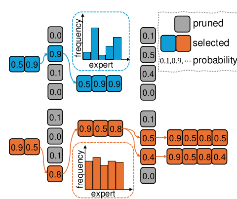

#+title:      题要匀着出，分要按权算
#+subtitle:   MoE 量化补两笔账：校准文本让模型自己写、写得照顾冷门专家；误差按门控分数加权 — MoEQuant: Enhancing Quantization for Mixture-of-Experts Large Language Models via Expert-Balanced Sampling and Affinity Guidance
#+date:       [2026-10-24 Sat 10:54]
#+filetags:   :paper:
#+identifier: 20261024T105410
#+source:     https://arxiv.org/abs/2505.03804 (v1, 2025-05-02)
#+authors:    Xing Hu, Zhixuan Chen, Dawei Yang, Zukang Xu, Chen Xu, Zhihang Yuan, Sifan Zhou, Jiangyong Yu
#+venue:      arXiv 2505.03804 (v1, 2025-05, cs.LG, ICML 模板)；Houmo AI（后摩智能）/ 东南大学

* 问题

Qwen1.5-MoE 的第一层里有 60 个"路由专家"，外加 4 个共享专家。每读一个词，一个叫路由器的小网络给 60 个专家打分，
只叫醒分数最高的 4 个干活，再把它们的输出按分数加权求和。这就是 MoE（混合专家）：参数多，但每次只用一小部分。
14B 的参数全得放进显存，真正干活的只有 2.7B。所以大家想把它压到 4 bit。

压缩的标准做法叫训练后量化：不重新训练，只拿一小批"校准文本"（通常是 WikiText2 里挑 128 段）跑一遍模型，
看每一层实际收到什么样的输入，然后据此决定每个权重怎么取整误差最小。
GPTQ 是其中最常用的一种：它统计每层输入的协方差（叫 Hessian，可以理解成"哪些输入方向常出现、哪个方向上的误差最疼"），
一列一列取整，把每次取整的误差摊给还没取整的权重。

现在把镜头对准第一层里的某一个专家，叫它"17 号"。它恰好擅长处理代码之类的文本，而 WikiText2 是维基百科。
128 段维基文本跑下来，热门专家分到了上千个词，17 号只分到十几个。
GPTQ 要用这十几个词给 17 号估一个几千维的协方差——好比拿十几道题给一个学生定一整年的教学计划。
论文的图 2 显示，WikiText2 和 C4 在这一层上都呈长尾：少数专家吃掉大半的词，很多专家几乎饿着。

还有第二个更隐蔽的问题。就算 17 号分到了足够多的词，这些词对它的"分量"也不一样。
有的词路由器给 17 号打了 0.9 分，最终输出几乎全靠它；有的词 17 号只是第 4 名，分数 0.05，它算出来的结果在加权求和时被打了大折扣。
可 GPTQ 统计协方差时，这两个词一词一票。

旧路就卡在这里：GPTQ、AWQ 都是为稠密模型设计的，那里每个词都流过全部权重、分量一样，"一词一票"天然正确。
搬到 MoE 上，两条默认都破了——每个专家看到的词数不一样多，看到的词分量不一样重。
想修第一条，直觉是换一个多领域均衡的校准集，可领域是数不完的；论文的图 4 还显示，现成的高质量数据集在 DeepSeek-MoE 上困惑度也不低，说明外部文本本来就不太像模型自己"习惯说的话"。

这篇论文的作者从 17 号的处境里看出了两个入口：题不够，就让模型自己出题，出题时盯着谁被冷落；
分量不同，就按路由器本来就给的分数记分。

* 翻译

#+ATTR_ORG: :width 1200

*锚点：17 号专家像一个偏科班里被老师冷落的学生。* MoEQuant 做两件事：
重新出一套考卷，保证每个学生都被点到名（EBSS，专家均衡自采样）；
阅卷时按每道题对这个学生的"占分"记分，而不是每题等分（AGQ，亲和度引导量化）。
两件事都不碰量化器本身——GPTQ 照常取整，AWQ 照常找缩放——只改它们看到的数据和数据的权重。
接在 AWQ 上叫 MoEQuant+，接在 GPTQ 上叫 MoEQuant++。

** 第一件：让模型自己出考卷

既然外部文本不像模型自己说的话，最像的就是模型自己写出来的。早先 LLM-QAT 就用过"让模型自己生成训练文本"的办法。
EBSS 在这上面多加一个要求：写的时候，盯着每一层每个专家被叫醒了几次。

具体怎么写？他们用的是束搜索：同时保留 w 条草稿（论文取 w = 4）。每一步，每条草稿都试着往后接词表里的每一个词，
给所有"草稿 + 新词"打分，只留分最好的 4 条。分数由两部分加起来：
- 通顺度：这条草稿平均每个词的负对数概率，越小越通顺（就是困惑度取对数）。
- 偏科度：这条草稿到目前为止，各层专家被叫醒次数的标准差，再除以一个系数 tau（论文取 1.2）。越偏科分越差。

这里有一个省钱的设计，作者叫它"延迟计算不均衡度"。要知道"接上某个新词后专家分布怎样"，得把词表里每个候选词都单独过一遍模型，代价是词表大小那么多倍。
所以偏科度只按已经写好的草稿算，不管候选词。后果是：同一条草稿接出来的所有候选，偏科分都一样，
下一个词写什么完全由模型的语言概率决定，不会为了凑均衡写出不通顺的字；
偏科分只在"草稿和草稿之间"起作用——偏科的草稿整条被淘汰。

放到 17 号身上看一个缩小版（这个例子是我为讲解构造并验算过的，不是论文里的）：
假设某层只有 4 个专家，两条草稿各写了 8 个词。
草稿甲把专家叫醒的次数是 (5, 2, 1, 0)，17 号是最后那个 0；草稿乙是 (2, 2, 2, 2)。
甲的标准差：均值 2，偏差 3、0、-1、-2，平方和 14，除以 3 再开方，约 2.16；乙是 0。
如果甲更通顺（平均负对数概率 1.0），乙差一点（1.5），那么
甲的总分 = 1.0 + 2.16 / 1.2 = 2.80，乙的总分 = 1.5 + 0 = 1.50，乙胜出，17 号被点到了名。

但这个小例子也暴露了一处论文没说清的地方：标准差是按"次数"算，还是按"占比"算？
如果按占比，甲是 (0.625, 0.25, 0.125, 0)，标准差约 0.27，除以 1.2 约 0.225，甲的总分 1.225，反而赢过乙的 1.5。
同一个 tau = 1.2，换个口径，结论就翻了；而按次数算时，序列越长偏科分越大。论文的定义只写了"使用频次"。

** 第二件：阅卷时按占分记分

现在 17 号分到足够的词了。下一步，GPTQ 要给它的每个线性层统计输入协方差。
原来是把每个词的输入外积加起来，一词一票；AGQ 改成每个词乘上路由器给它的分数 c 再加，一词 c 票。
对 GPTQ 来说，改动就是一行。对 AWQ 来说，是在搜索缩放系数时，用按 c 加权的输出误差来打分。

为什么这么改？因为 17 号对某个词的输出，最终要乘上 c 才进入下游。c 只有 0.05 的词，这里出再大的错，传下去也被压扁了；
c 是 0.9 的词，错一点就是真错。作者还推了一步：专家内部基本是线性的（up、gate、down 三个投影加一个激活函数），
所以 c 可以看作"乘在这个词的输入上"，一路传到每一层。

放大镜下看一个两权重的小例子（同样是我构造并验算过的）：17 号某个输出通道有两个权重 (0.4, 0.4)，只能取整数。
两个词路由到它：词 A 输入 (1, 1)，分数 0.9；词 B 输入 (1, -1)，分数 0.1。
原始输出：A 上 0.8，B 上 0。
- 一词一票时，协方差是 [[2, 0], [0, 2]]，两个权重互不牵扯，GPTQ 就是就近取整，得 (0, 0)：A 错 0.8，B 不错。
- 按分数记票时，协方差变成 [[1, 0.8], [0.8, 1]]，两个权重绑在了一起。GPTQ 先把第一个 0.4 取成 0，偏差 -0.4；
  补偿给第二个权重 +0.32，变成 0.72，取成 1。结果 (0, 1)：A 输出 1，只错 0.2；B 输出 -1，错 1。
- 按分数加权的总误差：(0, 0) 是 0.9 x 0.64 = 0.576；(0, 1) 是 0.9 x 0.04 + 0.1 x 1 = 0.136。
AGQ 主动牺牲了那个只占 0.1 的词，换来占 0.9 的词误差缩到四分之一。这就是"按占分阅卷"在取整上的样子。

** 结局：数字

论文测了三个 base 模型和两个对话模型，都是 4-bit、每输出通道一个缩放、对称量化。
基线 RTN、AWQ、GPTQ 都用 WikiText2 的 128 段校准；GPTQ 还先做了一次 QuaRot 式的离线 Hadamard 旋转来压离群值。

- 7 个任务的平均分，GPTQ 对 MoEQuant++：Qwen-MoE-14B 49.00 对 49.59（原模型 51.20），
  DeepSeek-MoE-16B 39.01 对 40.01（原模型 40.86），Mixtral-8x7B 53.42 对 55.58（原模型 56.80）。
  六组"基线对加挂后"全部是加挂后更高，幅度 0.45 到 2.55 个点。
- 生成类任务上幅度最大。Qwen-MoE-14B-Chat 写代码（HumanEval）：原模型 21.34，GPTQ 掉到 15.24，MoEQuant++ 回到 21.95；
  DeepSeek-MoE-16B-Chat 同一任务从 13.41 到 21.95。Mixtral 接 AWQ 时，小学数学题（GSM8K）从 38.67 到 50.66。
- 3-bit 下 Mixtral：GPTQ 45.03，MoEQuant++ 49.75，其中 GSM8K 从 22.59 翻到 43.21。

*最反直觉的一处：困惑度在"自己的考卷"上变差了。* 每个模型上，MoEQuant 在 WikiText2 上的困惑度都比 GPTQ 高
（Qwen 7.43 对 7.55，Mixtral 4.03 对 4.12），在 C4 上却更低（10.11 对 9.62，7.67 对 7.34）。
作者的解释是：基线用 WikiText2 校准，等于在考卷原题上测分；MoEQuant 没见过 WikiText2，原题分自然低一些，但换一套题就更好。
这件事的含义比论文说的还大：量化界惯用的"WikiText2 困惑度"在这里会把更好的方法排在后面。

第二个副发现藏在消融表里，论文自己的文字反而说错了：两件事里，"换考卷"比"按占分"更值钱。
DeepSeek-MoE-16B 上，单开 AGQ 只涨 0.49，单开 EBSS 涨 0.86，两个都开涨 1.00；Qwen 上单开 AGQ 只涨 0.02。
正文把这两个数说反了（说 EBSS 约 1.3%、AGQ 约 2%），还说 Mixtral 上 AGQ 不如 GPTQ，而表里 Mixtral 单开 AGQ 是 54.24，高于 GPTQ 的 53.42。

到这里，手里有三件东西在转：一套模型自己写的考卷，一条只在草稿之间起作用的偏科分，一个按门控分数加权的协方差。

* 核心概念

*一，自采样的校准集（EBSS 的底座）。*
是什么：不用外部数据，让被量化的模型自己写校准文本，写时用"通顺 + 不偏科"挑草稿。
回到 17 号：它在 WikiText2 里只见到十几个词；模型自己写的、按专家均衡挑过的文本，会把它叫醒得更多。
消融里这一件贡献最大。但论文没给"自己写但不管偏科"这一档对照，所以说不清功劳是"自己写"的还是"不偏科"的；
附录里 w 从 2 调到 50、tau 从 1.0 调到 1.5，平均分只在 0.3 个点内晃，这也像是在说偏科分的作用有限。

*二，延迟计算的偏科分（一个设计选择，不是组件）。*
是什么：偏科度只按已写好的草稿算，不按候选词算，所以它只淘汰整条草稿，不左右下一个词。
回到那两条草稿：甲和乙接下来写什么，全由语言概率定；偏科分只决定甲和乙谁留下。
没有这个选择，要么每步多跑词表大小倍的前向，要么为了叫醒 17 号硬塞一个不通顺的词，写出来的文本又不像模型自己的话了，第一件就白做。
代价是：偏科是按单条草稿算的，而真正要均衡的是整套 128 条考卷；每条都不偏科，合起来也可能漏掉同一批专家。

*三，门控加权的协方差（AGQ）。*
是什么：GPTQ 统计每个专家输入协方差时，每个词乘上它对这个专家的门控分数 c。
回到两权重的例子：一词一票得 (0, 0)，按分数记票得 (0, 1)，高分量的词 A 误差从 0.8 降到 0.2。
少了它，GPTQ 会把同样多的力气花在"本来就被打了折"的词上。
这里有一处推导没对齐：如果 c 真是乘在输入上，输出误差平方后应按 c 的平方加权，论文却用 c 的一次方（式 19 特意写成 X 乘根号 c）。
在上面的例子里两种加权选出的是同一个解（按平方算，(0, 0) 是 0.518，(0, 1) 是 0.042），但一般情况下不保证。

三件东西拼起来，故事就剩一句话要说。

* 洞见

给稀疏模型做校准，先问"每个部件实际看到了多少数据、这些数据对它有多重"，再谈怎么取整；
数据怎么分、怎么记分，往往比取整算法本身更值钱。

* 博导审稿

选题眼光：困境是真的。MoE 的专家分配长尾、门控分数不等，都是结构上必然的事，
GPTQ、AWQ 的"一词一票"在稠密模型上对、在 MoE 上错，这个诊断干净。2025 年 5 月时这块几乎空白，作者说自己是"最早一批"，基本属实。

方法成熟度：两个方法都便宜、都即插即用，这是优点。最该追问的是两个没讨论的预设。
其一，EBSS 假设"困惑度低的文本就是好的校准文本"。束搜索产出的文本以重复、模板化著称，困惑度低正是因为它在模型最舒服的那一小块区域打转；
论文没给一条生成样例，也没测多样性，也没说生成了多少条、每条多长、怎么让 128 条彼此不同、花了多少时间。
其二，偏科分按单条草稿算，和目标函数里"整个校准集均衡"之间差了一步，没有论证。偏科度按次数还是按占比算也没交代，而这会改变 tau 的含义。
AGQ 那边，c 用一次方还是平方、取归一化前还是后的门控分数、共享专家的 c 取多少，都没写——
Mixtral 的 top-2 分数会重新归一化，DeepSeekMoE 和 Qwen1.5-MoE 默认不归一化，三个模型上 AGQ 实际做的事并不一样。
符号上也有毛病：式 1 让共享专家也乘门控分数，图 3 标题把共享和路由专家说反，式 12 漏了 log，式 14 把"取最小"写成"取最大"。

实验诚意：数字普遍偏小但方向一致，这一点诚实。问题在对照设计和文字。
基线只用 WikiText2 校准，没有"基线换 C4 或多领域混合"一档，等于拿"换了数据的方法"去比"没换数据的基线"，
而消融恰恰显示收益主要来自换数据。HumanEval 只有 164 题，一题约 0.61 分，DeepSeek base 上 22.56 到 25.00 是 37 题到 41 题，没有多种子。
文字与表格有多处对不上：摘要说 DeepSeek-MoE-16B 的 HumanEval 提升"超过 10 个点"，表里最大是对话模型的 +8.54；
"超过原模型 1%"实际是"比 GPTQ 高约 1 个点"，三个模型都没超过原模型；消融的 EBSS / AGQ 数字说反；
表 2 和附录表 8 里对话模型 MoEQuant+ 的同一组数不一致（如 Qwen-Chat HumanEval 18.92 对 13.60）；表 1 和表 5 同一配置的 C4 困惑度也有出入。
3-bit 下 AWQ 一系已经崩了（DeepSeek WikiText2 困惑度上千），MoEQuant+ 在崩溃区里"平均分更高"没有意义。
速度和显存表（1.17-2.08 倍、约 3.3 倍）是 4-bit 本身的收益，与 EBSS/AGQ 无关，kernel 也没说明。
没有与任何 MoE 专用量化方法对比，只比了 RTN、AWQ、GPTQ。

写作功力：动机部分讲得清楚；方法细节和实验文字的校对明显不足。

后来者怎么看它：本仓库里的三篇 2026 年工作都把它当作 MoE 量化的参照点。
TileQ（2605.09281）把它当基线跑了 2/3-bit，第三方复现下 2-bit 多个模型困惑度上千（Qwen1.5-MoE 达 5e5），Qwen3-30B-A3B 的 3-bit 也有 28.1，说明它在更低比特下不稳（不过 TileQ 表里 GPTQ 带分组缩放、MoEQuant 只按通道，口径不完全对等）；
AlphaQ（2606.04980）把它归入"修校准采样"一派，自己走"完全不用校准数据决定位宽"；
VSRAQ（2606.05688）把它放在"MoE 要特殊对待，但没碰路由选择本身"这一格，之后才有 EAQuant 等去保路由分数、VSRAQ 去保路由排序。
它的位置是这条线的起点：第一个把"校准数据对专家公平吗"摆上桌面的工作。

判决：weak accept。诊断对、方法便宜、方向被后续工作普遍沿用；但功劳归属（换数据还是均衡）没拆清，文字和表格的错漏多到需要读者自己校对。

* 启发

迁移：在你现有的 MoE 量化流程里，先做一件几乎零成本的事——跑一遍校准集，统计每层每个专家分到多少 token，画出长尾。
如果有专家只分到几十个 token，它的 Hessian 基本不可信；这时可以给 GPTQ 的阻尼加大，或干脆对这些专家退回就近取整，或补充数据。
AGQ 本身是 GPTQ 里一行改动（累计 Hessian 时乘门控分数），也可以直接试，但先决定用归一化前还是归一化后的分数，并对 c 和 c 的平方各跑一次。

混搭：EBSS 管"喂什么"，AGQ 管"怎么记分"，都只改校准阶段，可以和管"量化后路由是否保住"的方法（VSRAQ 一类的路由损失）、
管"每个专家给几个 bit"的方法（AlphaQ 一类的位宽分配）叠加。冷门专家分到的 token 少，也可以反过来当作"这个专家可以少给 bit"的信号。

反转：别默认 WikiText2 困惑度能比较校准数据不同的方法。这篇论文里，更好的方法在 WikiText2 上更差。
做对比时，评估集要和所有方法的校准集都无关，至少同时报 C4 和下游生成任务。

在 AMD / 生产推理上的具体检查项：MoEQuant 产出的是普通的 per-channel 4-bit 权重，不需要新 kernel；
但论文的 GPTQ 版本依赖离线 Hadamard 旋转，若部署栈不支持把旋转融进相邻层，需要单独确认去掉旋转后的精度。
另外实际生产常用分组量化（如每 128 个权重一组），论文只测了每通道，收益在分组下是否保持需要重测。
