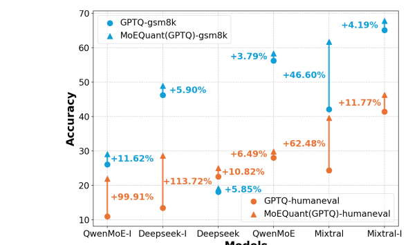
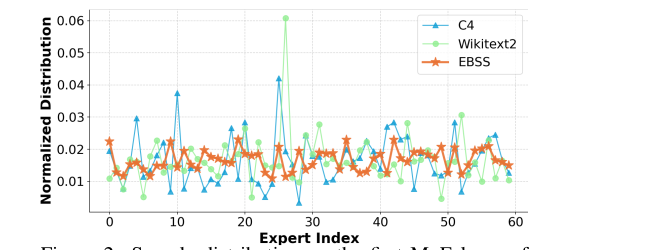
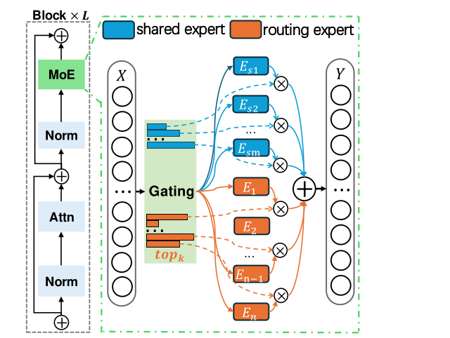
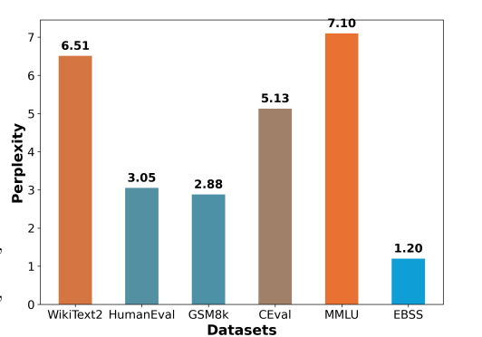

> **中文翻译（E 角度）**：本文是对 arXiv:2505.03804 的逐节中文复述（paraphrase），并非逐句原文翻译。论文版权为 arXiv 默认许可，因此文字用自己的话重述，公式、表格与数字则与原文保持一致。原文：[MoEQuant: Enhancing Quantization for Mixture-of-Experts Large Language Models via Expert-Balanced Sampling and Affinity Guidance](https://arxiv.org/abs/2505.03804)（PDF：https://arxiv.org/pdf/2505.03804v1，ICML 2025 格式，Houmo AI / 东南大学）。

# MoEQuant：通过专家均衡采样与亲和度引导增强 MoE 大模型的量化

作者：Xing Hu, Zhixuan Chen, Dawei Yang（通讯作者，dawei.yang@houmo.ai）, Zukang Xu, Chen Xu, Zhihang Yuan, Sifan Zhou, Jiangyong Yu（Houmo AI；Sifan Zhou 同时隶属东南大学）。Xing Hu 与 Zhixuan Chen 为共同第一作者。

## 摘要

MoE（Mixture-of-Experts）大语言模型依靠动态路由和稀疏激活，在降低计算开销的同时取得了更高的性能，但它的显存开销很大，限制了落地。后训练量化（PTQ）是压缩 LLM 的常用手段，可是直接用在 MoE 上会出现严重的精度下降和泛化变差。作者研究了 MoE 的稀疏、动态特性对量化的影响，归纳出两个主要问题：

1. **专家间不均衡（inter-expert imbalance）**：校准样本在各专家上分布不均，使得被调用较少的专家得到的校准既不充分又有偏。
2. **专家内不均衡（intra-expert imbalance）**：MoE 特有的加权聚合机制使得不同样本与其所分配专家之间的相关程度不同。

对应地，论文提出量化框架 MoEQuant，包含两项技术：

- **Expert-Balanced Self-Sampling（EBSS）**：一种高效的采样方法，用 token 的累积概率和专家均衡度量作为引导，构造专家分布均衡的校准集。
- **Affinity-Guided Quantization（AGQ）**：把专家与样本之间的亲和度引入量化过程，从而准确评估每个样本对 MoE 层中不同专家的影响。

实验显示 MoEQuant 带来明显提升（4-bit 量化下 DeepSeekMoE-16B 的 HumanEval 准确率提升超过 10 个点），同时提升了效率。关键词：Machine Learning, ICML。

## 1 引言

大语言模型的进步深刻影响了自然语言处理。其中 MoE LLM 借助 MoE 层的动态路由与可扩展性，已取得最先进的结果（Mixtral、Qwen-MoE、DeepSeek-V3 等）。

部署 MoE LLM 时，除了与普通 LLM 一样受内存带宽限制外，还有更高的存储需求。例如 Qwen-MoE-A2.7B-14B 生成时只激活 27 亿参数，但全部 140 亿参数都得常驻内存。MoE 层占 Transformer 块参数的大头：只算被激活的专家约占 80%，算上所有专家则高达 97%。因此压缩 MoE LLM，尤其是其 MoE 层，对降低推理成本、在内存容量/带宽受限的设备上部署非常关键。



PTQ 把权重量化成低精度格式，在传统 LLM 上很成功：AWQ 与 GPTQ 可在无需额外训练的情况下把权重压缩到约 1/4，同时几乎无损。但直接用到 MoE LLM 上常出现过拟合和显著的性能（尤其是泛化）下降。原因在于它们按层量化，忽略了 MoE 的特殊结构：样本只被路由到少数专家，输出再加权汇总；同时它们没有考虑 MoE 结构带来的固有稀疏性与异质性。

作者分析了影响 MoE 量化的关键因素，指出结构内部两种不均衡是主因：

**第一，样本在各专家间的分布不均衡。** DeepSeek 等工作为了训练时的负载均衡设计了多种技术，这在校准阶段同样重要。但校准集通常是领域特定的，门控机制会让一些专家过载、另一些欠载；欠载专家得不到充分校准，量化误差显著。图 2 表明，最常用的两个校准集都有这个问题。

**第二，样本与其所分配专家之间的亲和度不均衡。** 传统 LLM 中所有样本都走同一个 FFN；MoE 则通过门控把输出表示为多个专家结果的加权和。所以从某个专家的角度看，不同样本的亲和度（样本与所分配专家的相关性）不同。已有 PTQ 方法（SmoothQuant、AWQ、QuaRot）在量化专家时没有考虑这一点。比如 GPTQ 在收集 Hessian 信息时无视门控单元的影响，导致无法正确评估各样本对每个专家的重要性，Hessian 被扭曲，量化后模型性能显著下降。



为此论文提出两种方法：

- **EBSS**：基于 LLM 的自采样能力构造校准集，并以累积概率与专家均衡度量引导采样过程，大幅降低搜索复杂度，同时保证校准样本均匀分布在各专家上，并与预训练数据分布一致。
- **AGQ**：在逐层校准中引入亲和度并构造加权量化误差，以适应 MoE 的动态特性，更准确地计算量化误差与敏感度。

两者结合即 MoEQuant，一个把现有量化技术与 MoE 架构衔接起来的框架。如图 1 所示，MoEQuant 在不同模型上均带来不同程度的提升。

主要贡献：

- 指出 MoE 量化中的两个关键不均衡：专家间（样本分布不均衡）与专家内（token-专家亲和度不均衡）。
- 提出 EBSS，高效生成均衡的校准数据集，使所有专家被公平使用；提出 AGQ，把 token-专家亲和度引入量化过程，使权重更新更准确、量化误差更小。
- 构建 MoEQuant，可无缝与现有 PTQ 方法结合，显著提升 MoE LLM 的量化性能。作者称本工作是该方向最早的研究之一，并承诺开源代码。

## 2 相关工作

### 2.1 Mixture-of-Experts 大语言模型

MoE 最早由 Jacobs 等（1991）和 Jordan & Jacobs（1994）提出，已在多种场景下被广泛探索。MoE LLM 的每个 MoE 层包含多个专家网络和一个门控网络；门控通常是带 softmax 的线性层，负责把输入路由给合适的专家并汇总输出。不同模型的配置各不相同：

- SwitchTransformer 采用 top-1 门控，在特定规模上取得有竞争力的结果；
- Mixtral-8x7B 把 MoE 与基础设施创新结合，每层用两个专家，在低计算成本下表现优异；
- DeepSeekMoE 细分了 FFN 的中间隐藏维度，增加专家数量并激活更多专家，以改善知识的分解与捕获；同时引入始终被激活的共享专家，用于沉淀跨上下文的公共知识，减少路由专家间的参数冗余。DeepSeek-V2 与 DeepSeek-V3 进一步精化设计；
- Qwen-MoE 把传统 FFN 层完全替换为 MoE 层，从 60 个专家池中选取 4 个非共享专家，并配有 4 个共享专家。训练时先把已有的 Qwen-1.8B 模型改造成 Qwen1.5-MoE-A2.7B-16B，获得更好的整体预训练表现。

### 2.2 面向 LLM 的后训练量化

大多数 LLM 基于 Transformer，天然占用大量内存。PTQ 已成为压缩 LLM 的主流方式，能在保持精度的同时降低内存占用。两个代表性方法：GPTQ 用基于 Hessian 的误差补偿来最小化量化误差、实现高压缩率；AWQ 则考虑激活分布对权重量化的影响，改善量化效果。此外还有：QuaRot 用 Hadamard 变换去除离群值而不改变输出，从而增强 GPTQ 的效果；GPTVQ 从向量角度探索非均匀量化方案，对权重分布适应性更好。

然而这些方法忽视了 MoE 架构带来的独特挑战，造成显著精度下降。MoEQuant 立足于校准样本与专家之间的关系，与现有 PTQ 方法正交，可无缝集成以量化 MoE LLM。

## 3 预备知识



如图 3，一个 MoE 层包含 $`m`$ 个共享专家和 $`n`$ 个路由专家，以及一个为每个 token 指派专家及相应概率的门控网络。只有亲和度最高的 top-$`k`$ 个专家会被使用。对输入 token $`\boldsymbol{x}`$ ，输出 $`\boldsymbol{y}`$ 是 top-$`k`$ 路由专家与所有共享专家输出的加权和：

```math
y=\underbrace{\sum_{i=1}^{m}E^{s}_{i}(\boldsymbol{x})g_{i}(\boldsymbol{x})}_{\text{shared experts}}+\underbrace{\sum_{j\in\mathcal{K}}E^{r}_{j}(\boldsymbol{x})g_{j}(\boldsymbol{x})}_{\mathrm{top~}k\text{ routing experts}},
```

其中 $`\mathcal{K}=\mathrm{top}k\left(\lbrace g_{i}(\boldsymbol{x})\mid i\in\lbrace 1,\ldots,m\rbrace\rbrace\right)`$ ， $`g_{i}(\boldsymbol{x})`$ 表示分配给第 $`i`$ 个专家的权重。（公式 1）

**困惑度（PPL）** 是衡量语言模型质量的常用指标，越低说明预测越准、越贴近模型真实分布。对由 $`n`$ 个 token 组成的序列 $`\mathcal{D}=(d_{1},d_{2},...d_{n})`$ ，模型 $`\mathcal{M}`$ 下的困惑度定义为：

```math
\mathrm{PPL}(\mathcal{D}\mid\mathcal{M})=\exp\left(-\frac{1}{N}\sum_{i=1}^{N}\log P_{\mathcal{M}}\left(d_{i}\mid d_{1},d_{2},\dots,d_{i-1}\right)\right)
```

其中 $`P\left(d_{i}\mid d_{1},d_{2},\ldots,d_{i-1}\right)`$ 是模型在给定上下文 $`d_{1},d_{2},\ldots,d_{i-1}`$ 时对 $`d_{i}`$ 的预测概率。（公式 2）

**专家均衡度** 用跨所有层的专家使用频率的标准差来衡量：

```math
\sigma =\frac{\sum_{l=1}^{L}\sigma_{l}}{L}
```

```math
\sigma_{l} =\sqrt{\frac{1}{E-1}\sum_{e=1}^{E}(u_{l}^{e}-\hat{u}_{l})^{2}}
```

（公式 3、4）其中 $`L`$ 是 MoE 模型的层数， $`E`$ 是每层专家总数， $`\sigma_l`$ 是第 $`l`$ 层的标准差，由每个专家的使用频率 $`u_{l}^{e}`$ 与平均频率 $`\hat{u}_{l}`$ 算出。

**量化**：通常是把浮点数用整数映射到离散区间。权重量化关注最常用的逐通道对称均匀量化：

```math
\mathcal{Q}(\boldsymbol{W})=\mathrm{clamp}\left(\left\lfloor\frac{\boldsymbol{W}}{\boldsymbol{s}}\right\rceil,q_{\min},q_{\max}\right),
```

其中 $`\boldsymbol{W}\in\mathbb{R}^{o\times c}`$ 为权重矩阵， $`\boldsymbol{s}\in\mathbb{R}^{o}`$ 是逐通道量化步长， $`q_{min},q_{max}`$ 为量化边界。（公式 5）为方便评估量化误差，一般做反量化：

```math
\hat{\boldsymbol{W}}=\mathcal{Q}(\boldsymbol{W})\cdot\boldsymbol{s}
```

（公式 6）对线性层，量化 $`\boldsymbol{W}`$ 造成的损失可写成：

```math
\mathcal{L}(\hat{\boldsymbol{W}})=\left\|\boldsymbol{W}\boldsymbol{X}-\hat{\boldsymbol{W}}\boldsymbol{X}\right\|_{F}^{2},
```

其中 $`\boldsymbol{X}\in\mathbb{R}^{b\times c}`$ 是该层校准数据的激活。（公式 7）AWQ 利用公式 7 指导平滑系数的选择与权重剪枝；GPTQ 沿用 OBQ 的思路（论文引用了 LeCun 等 1989），用 Hessian 补偿量化误差。结合公式 7，Hessian 可有效计算为：

```math
\boldsymbol{H}=\boldsymbol{X}\boldsymbol{X}^{\top}
```

（公式 8）

## 4 方法

### 4.1 MoEQuant 总览

MoEQuant 是为高效量化 MoE 架构 LLM 设计的框架，针对量化过程中专家间与专家内两种不均衡，从两个角度入手：生成专家均衡的校准数据集，以及在专家校准时处理 token 与专家的相关性。对应的两个方案是 EBSS 与 AGQ。EBSS 生成的校准样本能让 MoE 中所有专家都得到均衡参与；AGQ 则处理由 MoE 层门控单元带来的样本间相关度差异。两者都是即插即用，可与其他量化技术无缝结合。细节见 4.2 与 4.3 节。

### 4.2 Expert-Balanced Self-Sampling（EBSS）

现有 PTQ 通常依赖 WikiText-2 之类的领域特定校准集。对普通 LLM 来说这样做泛化尚可，但直接用到 MoE LLM 上常导致明显性能下降，因为领域特定数据会使样本在专家间分布不均；如图 2 所示，只用单一校准集往往得到专家间样本的长尾分布。

一个直观办法是从多个领域采样构造领域均衡的校准集，但领域数量几乎无穷，真正的领域均衡既复杂又不现实。而且如图 4 所示，即使是高质量数据集也常有较高的困惑度，说明所选数据与模型内在分布不对齐。



**问题定义。** 目标是找到一个数据集 $`\mathcal{D}^{*}`$ ，满足两点：

- **低困惑度**： $`\mathcal{D}^{*}`$ 中样本应与模型 $`\mathcal{M}`$ 的内在分布贴近，对应于最小化困惑度；
- **专家均衡**：样本应均匀分布于各专家，避免专家被过度或不足使用。

这一双重要求被写成联合优化问题：

```math
\mathcal{D}^{*}=\mathop{\mathrm{arg\,min}}_{\mathcal{D}}\left\lbrace\mathrm{PPL}(\mathcal{M},\mathcal{D})\cdot\exp\left(\frac{\sigma(\mathcal{M},\mathcal{D})}{\tau}\right)\right\rbrace,
```

（公式 9）其中 $`\exp\left(\frac{\sigma(\mathcal{M},\mathcal{D})}{\tau}\right)`$ 被论文称为"归一化不均衡度的倒数"， $`\exp`$ 用来对 $`\sigma`$ 归一化， $`\tau`$ 是控制专家不均衡影响程度的超参数。

困惑度优化对应最优子集选择问题，专家均衡类似负载均衡问题，二者都是 NP-hard，无法直接求解。为便于分析，结合公式 2 可改写为：

```math
\mathcal{D}^{*}=\mathop{\mathrm{arg\,min}}_{\mathcal{D}}\left\lbrace\frac{-1}{N}\sum_{i=1}^{n}\left(\log\left(P(\mathcal{D}_{i}|\mathcal{D}_{1:i-1})\right)\right)+\frac{\sigma(\mathcal{M},\mathcal{D})}{\tau}\right\rbrace,
```

```math
\text{subject to }\mathcal{D}\in\underbrace{\mathcal{V}\otimes\mathcal{V}\otimes\cdots\otimes\mathcal{V}}_{n\text{ times}},
```

（公式 10）其中 $`\mathcal{V}=\lbrace v_{1},v_{2},\dots,v_{m}\rbrace`$ 是含 $`m`$ 个 token 的词表， $`P`$ 为 $`\mathcal{M}`$ 预测的概率， $`n`$ 为序列长度， $`\otimes`$ 为笛卡尔积。此时优化可视为在 $`n`$ 维词表空间中寻找最优路径。

**挑战。** 其一是可用数据有限：校准通常只能获得少量数据，很难保证理想的领域均衡或与预训练分布对齐，会损害最终量化效果。其二是搜索代价：暴力搜索需要探索 $`m^{n}`$ 种可能，不可行；贪心搜索虽高效，却可能陷入局部最优，需要更精细而又高效的搜索方法。

**自采样（Self-Sampling）。** 针对数据可得性，作者利用 LLM 的自采样能力构造校准数据。这是一种无数据（data-free）方式，仅依赖模型词表，天然与模型学到的语言分布一致（参考 LLM-QAT）。而且自采样过程中会缓存历史概率与专家分布，免去困惑度和专家均衡度的重复计算。序列 $`S`$ 的历史累积对数概率定义为：

```math
R_{S}=\sum_{i=1}^{n}\log(P(S_{i}|S_{1:i-1}),
```

（公式 11）其中 $`n`$ 为 $`S`$ 的长度。采样阶段，困惑度可由 $`R_{S}`$ 与预测概率 $`P(v|S)`$ 轻松算出：

```math
\mathrm{PPL}(\mathcal{M},S\|v)=\exp\left(\frac{-1}{n+1}(R_{\boldsymbol{s}}+P(v|S))\right)
```

（公式 12）其中 $`\|`$ 表示拼接。

**概率引导的路径剪枝。** 自采样预测下一个 token 时，输出头给出所有候选的概率，通常呈多峰分布。低概率 token 往往产生不连贯或语义错误的序列。基于这一观察，作者提出概率引导的路径剪枝：搜索时忽略低概率分支。具体而言，只保留 $`w`$ 个分支 $`\mathcal{S}=\left\lbrace S^{1},S^{2},...,S^{w}\right\rbrace`$ ，各长度为 $`l`$ 。生成长度为 $`l+1`$ 的候选序列时，每个分支 $`S^{t}`$ 扩展到空间 $`S^{t}\otimes V`$ 中的潜在序列，剪枝评价指标为：

```math
\mathrm{score}(S\|v)=\frac{-1}{l+1}(R_{S}+\log P(v|S))+\frac{\sigma(\mathcal{M},S)}{\tau},
```

```math
\text{subject to }v\in V,
```

（公式 13）其中 $`S`$ 是 $`\mathcal{S}`$ 中的一个分支， $`R_{S}`$ 即公式 11 的累积概率。生成新的 $`w`$ 个候选序列 $`\hat{S}=\left\lbrace\hat{S}^{1},...,\hat{S}^{w}\right\rbrace`$ 的过程为：

```math
\hat{\mathcal{S}}=\underset{S\|v}{\mathrm{arg\,top}\text{k}}\left(w,\mathrm{score}(S\|v)\right),
```

```math
\text{subject to }v\in V\text{ and }S\in\left\lbrace S^{1},S^{2},...,S^{w}\right\rbrace,
```

（公式 14）其中 $`\mathrm{arg\,top\,k}_{x}(f(w,x))`$ 表示使 $`f(x)`$ 最大的 $`w`$ 个 $`x`$ 的集合。


由公式 14 与图 5 可知，由同一输入序列 $`S`$ 生成的各候选序列的得分受 LLM 输出概率分布影响，而专家均衡度量则作用于 $`S`$ 派生的所有候选序列。引入这种高效的校准集搜索方法后，搜索复杂度从 $`O(m^{n})`$ 显著降到 $`O(wn)`$ ，并有效缓解了局部最优风险。

**延迟专家不均衡计算（Deferred Expert Imbalance Calculation）。** 如公式 14，剪枝过程中的评价指标并没有把候选 token $`v`$ 计入专家均衡的评估。理由有三：

- 困惑度可直接由 LLM 输出的概率分布算出，而要得到词表中每个 token 的专家分布需要遍历所有可能 token，代价高昂。当前序列的分布本来就已知，延迟计算几乎不增加成本。
- 剪枝主要依赖 LLM 的预测概率而非专家均衡；在下一个 token 的剪枝中引入专家分布不合适，可能造成语义错位或不连贯。
- 如公式 14 所示，延迟计算实际上执行的是分支级剪枝，在维持困惑度的前提下保证生成专家均衡的校准集。

### 4.3 Affinity-Guided Quantization（AGQ）

MoE 层中，门控网络依据输入给每个专家打一个概率分数，选出最相关的专家并按概率加权其输出。传统逐层量化用公式 1（原文如此，按上下文应指公式 7）统一最小化量化误差，却忽略了样本与专家之间的概率。作者把这种修正定义为亲和度，认为它同样重要，量化时应予考虑。

设 $`E`$ 是某个专家，路由到它的 $`b`$ 个 token 记为 $`\boldsymbol{X}=\left\lbrace\boldsymbol{x_{1}},\boldsymbol{x_{2}},...,\boldsymbol{x}_{b}\right\rbrace`$ ，门控网络给出的亲和度为 $`\boldsymbol{c}=\left\lbrace c_{1},c_{2},...,c_{b}\right\rbrace`$ 。该专家处理第 $`i`$ 个 token 的输出为：

```math
\boldsymbol{y}_{i}=c_{i}E(\boldsymbol{x_{i}}).
```

（公式 15） $`E`$ 是 FFN，可展开为若干线性层加激活函数。取一种典型 FFN 结构：

```math
\boldsymbol{y_{i}}=c_{i}\left\lbrace\left((\boldsymbol{x}\boldsymbol{W}^{up})\odot f(\boldsymbol{x}\boldsymbol{W}^{gate})\right)\boldsymbol{W}^{down}\right\rbrace,
```

（公式 16）其中 $`f`$ 为激活函数， $`\boldsymbol{W}`$ 为参数矩阵。由于 FFN 主要是线性的、且 $`f`$ 具有准线性性质，上式可重写为：

```math
\boldsymbol{y_{i}}=\left((c_{i}\boldsymbol{x}\boldsymbol{W}^{up})\odot f(\boldsymbol{x}\boldsymbol{W}^{gate})\right)\boldsymbol{W}^{down}
```

```math
\boldsymbol{y_{i}}=\left((\boldsymbol{x}\boldsymbol{W}^{up})\odot f(\boldsymbol{x}\boldsymbol{W}^{gate})\right)(c_{i}\boldsymbol{W}^{down})
```

```math
\boldsymbol{y_{i}}\approx\left((\boldsymbol{x}\boldsymbol{W}^{up})\odot f(c_{i}\boldsymbol{x}\boldsymbol{W}^{gate})\right)\boldsymbol{W}^{down}
```

（公式 17）这表明 token-专家亲和度 $`c_{i}`$ 会贯穿专家网络的每一层。聚焦到某个线性层时， $`c_{i}`$ 可直接并入该层的运算。也就是说，不同 token 对同一专家的权重施加的是"门控感知"的影响， $`c_{i}`$ 起到缩放因子的作用，调节每个 token 的输入特征对线性层的贡献。

**亲和度感知的量化误差。** 传统 LLM 量化方法没有考虑这种亲和度感知性质。作者首次把门控系数引入逐层校准，把 $`\boldsymbol{W}`$ 的量化损失重新定义为：

```math
\mathcal{L}(\hat{\boldsymbol{W}})=\sum_{i=0}^{n}c_{i}\cdot\left\|\boldsymbol{W}\boldsymbol{x}_{i}-\hat{\boldsymbol{W}}\boldsymbol{x}_{i}\right\|_{F}^{2}.
```

（公式 18）对于 AWQ 这类基于量化误差的 PTQ 方法，公式 18 把 token-专家亲和度带入量化过程：原实现对校准中所有 token 一视同仁，而亲和度感知的度量强调高亲和度 token，从而降低对重要 token 的整体量化误差。

**门控感知的 Hessian 统计。** 公式 7 假设所有 token 对 Hessian 贡献相同，而亲和度感知损失（公式 18）导出更合理的 Hessian：

```math
\boldsymbol{H}=(\boldsymbol{X\cdot\sqrt{c}})(\boldsymbol{X\cdot\sqrt{c}})^{\top}=(\boldsymbol{X}\cdot{\boldsymbol{c}})\boldsymbol{X}^{\top}.
```

（公式 19）对 GPTQ 这类基于 Hessian 的 PTQ 方法，改进后的 Hessian 引入了逐 token 加权，更好地刻画 MoE 层的运行特性：门控系数较高的 token 在计算敏感度指标时影响更大，这些指标指导权重更新、帮助降低量化误差。

## 5 实验

### 5.1 实验设置

采用逐通道对称均匀权重量化。所有实验在 NVIDIA A6000 GPU 上进行。MoEQuant 是高效的 PTQ 框架，无需任何微调。

**模型与数据集。** 在 DeepSeek-MoE-16B、Qwen-MoE-14B 和 Mixtral-8x7B 上实验，另外对比指令微调版本以说明方法有效性。除了 Wikitext2 与 C4 上的标准困惑度评估外，还在 MMLU、BoolQ、HellaSwag、Openbookqa、MathQA 等推理任务上评测，并用 HumanEval（代码生成）和 GSM8k（多步数学推理）评估。

**基线。** 主要基线为朴素 RTN 以及 LLM 的 PTQ 方法 AWQ 与 GPTQ。校准用 Wikitext2 的 128 段样本；浮点结果作为参照。

**实现细节。** MMLU、GSM8k、HumanEval 三个复杂推理任务按其官方仓库评测；其余 zero-shot 任务用 lm-evaluation-harness（0.4.4 版）。AWQ 实验中，作者调整其官方仓库以支持这三个 MoE 模型。GPTQ 则先用等价的 Hadamard 变换消除权重离群值，与 QuaRot 的实现一致，但避免任何在线变换。

### 5.2 结果

**对比结果。** 在多种 LLM 和数据集上进行全面对比。如表 1，九个任务的结果显示 MoEQuant 在 MoE LLM 上优于其他方法。值得注意的是，GPTQ 在 Wikitext2 上困惑度较低（可能是用 Wikitext2 校准导致的过拟合），但在 C4 及其他任务上明显更弱；MoEQuant 在多数任务上超过 GPTQ 与 AWQ，困惑度和任务得分都有显著提升。文中说在三个模型上，以七个任务的平均分衡量，MoEQuant 平均超过原始（浮点）性能 1%。特别是在 HumanEval 与 GSM8k 上，其他方法量化后推理能力下降，而结合 MoEQuant 能有效保留这种生成任务能力，结果与全精度模型相当。作者强调，HumanEval 这类复杂任务中的推理能力对现实应用很关键。

**表 1**：RTN、AWQ、GPTQ 与 MoEQuant 在 Qwen-MoE-14B、DeepSeek-MoE-16B、Mixtral-8x7B 上 4-bit 权重量化、九个任务的结果。+ 表示基于 AWQ 的 MoEQuant，++ 表示基于 GPTQ 的 MoEQuant。除 MoEQuant 外，其他方法均用 Wikitext2 作校准集，导致在 Wikitext2 上过拟合；C4 上的困惑度更能反映各方法的真实表现。

| model | method | ppl wikitext2 | ppl c4 | mmlu | humaneval | gsm8k | boolq | hellaswag | openbookqa | mathqa | avg. |
|---|---|---|---|---|---|---|---|---|---|---|---|
| Qwen-MoE-14b | fp | 7.22 | 9.30 | 59.60 | 32.32 | 62.55 | 79.82 | 57.96 | 30.40 | 35.77 | 51.20 |
| | RTN | 10.83 | 12.49 | 48.10 | 14.63 | 16.07 | 72.11 | 51.42 | 25.80 | 30.08 | 36.89 |
| | AWQ | 8.59 | 10.93 | 51.63 | 20.73 | 36.77 | 71.96 | 54.78 | 30.40 | 31.39 | 42.52 |
| | MoEQuant+ | 8.77 | 10.67 | 52.33 | 22.10 | 42.22 | 74.52 | 54.92 | 30.40 | 33.44 | 44.27 |
| | GPTQ | 7.43 | 10.11 | 57.90 | 28.05 | 56.25 | 78.77 | 56.54 | 29.00 | 36.48 | 49.00 |
| | MoEQuant++ | 7.55 | 9.62 | 58.30 | 29.87 | 58.38 | 78.04 | 56.87 | 30.20 | 35.50 | 49.59 |
| deepseek-MoE-16b | fp | 6.51 | 9.04 | 44.60 | 26.83 | 20.16 | 72.72 | 58.06 | 32.20 | 31.49 | 40.86 |
| | RTN | 7.47 | 10.01 | 36.10 | 18.90 | 10.54 | 70.21 | 55.76 | 30.60 | 28.87 | 35.85 |
| | AWQ | 6.80 | 9.50 | 40.57 | 25.00 | 17.06 | 71.65 | 56.42 | 32.20 | 31.76 | 39.23 |
| | MoEQuant+ | 6.94 | 9.32 | 41.20 | 25.00 | 18.90 | 71.98 | 56.79 | 32.12 | 31.82 | 39.68 |
| | GPTQ | 6.66 | 9.39 | 40.60 | 22.56 | 19.18 | 72.17 | 57.03 | 30.60 | 30.95 | 39.01 |
| | MoEQuant++ | 6.78 | 9.22 | 42.20 | 25.00 | 19.18 | 73.49 | 57.20 | 31.40 | 31.66 | 40.01 |
| mixtral-8x7b | fp | 3.84 | 6.87 | 70.50 | 32.93 | 65.88 | 85.23 | 64.88 | 35.80 | 42.41 | 56.80 |
| | RTN | 5.41 | 8.13 | 62.20 | 28.05 | 27.90 | 80.85 | 61.73 | 32.20 | 37.35 | 47.18 |
| | AWQ | 5.01 | 7.98 | 62.75 | 25.00 | 38.67 | 79.97 | 62.11 | 33.60 | 38.43 | 48.64 |
| | MoEQuant+ | 5.15 | 7.84 | 64.66 | 25.45 | 50.66 | 81.03 | 62.73 | 34.00 | 39.77 | 51.19 |
| | GPTQ | 4.03 | 7.67 | 68.50 | 27.60 | 57.92 | 84.22 | 64.08 | 30.60 | 41.07 | 53.42 |
| | MoEQuant++ | 4.12 | 7.34 | 69.60 | 32.15 | 61.79 | 84.98 | 64.05 | 33.60 | 42.95 | 55.58 |

**表 2**：RTN、AWQ、GPTQ 与 MoEQuant 在 Qwen、DeepSeek、Mixtral 的 MoE 指令微调模型上 4-bit 权重量化、三个任务的结果。+ 表示基于 AWQ 的 MoEQuant，++ 表示基于 GPTQ 的 MoEQuant。

| model | method | mmlu | humaneval | gsm8k |
|---|---|---|---|---|
| Qwen-MoE-14b-chat | fp | 59.00 | 21.34 | 30.71 |
| | RTN | 43.00 | 7.32 | 9.70 |
| | AWQ | 52.06 | 12.20 | 17.74 |
| | MoEQuant+ | 53.22 | 18.92 | 22.34 |
| | GPTQ | 57.30 | 15.24 | 26.08 |
| | MoEQuant++ | 58.00 | 21.95 | 29.11 |
| deepseek-MoE-16b-chat | fp | 48.90 | 24.39 | 54.28 |
| | RTN | 41.40 | 10.41 | 28.88 |
| | AWQ | 46.33 | 18.90 | 39.88 |
| | MoEQuant+ | 46.80 | 19.20 | 47.42 |
| | GPTQ | 46.60 | 13.41 | 47.08 |
| | MoEQuant++ | 47.60 | 21.95 | 48.97 |

**指令微调模型的实验。** 指令微调能显著提升模型的应用能力，已是 LLM 面向不同场景部署的必要流程；其量化往往比基础模型更难。作者在 Qwen-MoE-14B-Chat 与 DeepSeek-MoE-16B-Chat 上做了三个任务的基准测试。对 Qwen-MoE-14B-Chat，MoEQuant++ 始终保持 94% 以上的全精度性能，大部分原有推理能力被有效恢复。如表 2，以往方法在指令微调模型的代码生成与数学推理任务上精度下降更显著，例如 GPTQ 在 Qwen-MoE-14B-Chat 的 HumanEval 上掉了 29%；结合 MoEQuant++ 后，精度甚至超过全精度模型，进一步说明 EBSS 与 GAQ（原文拼写，指 AGQ）的有效性。更详细的困惑度与推理任务结果见附录表 8。

**消融结果。** MoEQuant 通过 EBSS 与 AGQ 两种方法增强泛化与推理能力，作者做了分解实验。对 EBSS，考察两个关键超参：温度 $`\tau`$ 与分支数 $`w`$ 。 $`\tau`$ 取 1.2 时效果最好； $`w`$ 取 4 以平衡效果与效率。详细结果见附录 A.1。

**表 3**：DeepSeek 与 Mixtral MoE 模型 3-bit 的平均分。+ 表示基于 AWQ 的 MoEQuant，++ 表示基于 GPTQ 的 MoEQuant。

| Model | bitwidth | Method | AVG. |
|---|---|---|---|
| DeepSeek-MoE-16b | fp | | 40.86 |
| | 3 | RTN | 20.17 |
| | 3 | AWQ | 22.20 |
| | 3 | MoEQuant+ | 26.65 |
| | 3 | GPTQ | 35.85 |
| | 3 | MoEQuant++ | 36.47 |
| Mixtral-8x7B | fp | | 56.80 |
| | 3 | RTN | 18.64 |
| | 3 | AWQ | 36.05 |
| | 3 | MoEQuant+ | 39.30 |
| | 3 | GPTQ | 45.03 |
| | 3 | MoEQuant++ | 49.75 |

**更低比特宽度。** 在 DeepSeek-MoE-16B 与 Mixtral-8x7B 上评估更低比特的泛化性。如表 3，在被测方法中 MoEQuant+ 与 MoEQuant++ 始终取得最高平均分，说明 MoEQuant 即使在更低比特下也能保持更高精度。完整结果见附录（原文写作"Appendix 3"，实为附录表 9）。

**表 4**：3 个 MoE LLM 上，4-bit 实现与 FP16 的加速和显存节省对比。所有测试在 Nvidia A6000 GPU 上进行。

| Model | decoder speed (tokens/sec) FP | Quantized | Speedup |
|---|---|---|---|
| Qwen-moe-14B | 8.35 | 10.60 | 1.27 |
| DeepSeek-moe-16b | 20.81 | 24.45 | 1.17 |
| Mixtral-8x7B | 10.24 | 21.25 | 2.08 |

| Model | Memory use (GB) FP | Quantized | Memory saving |
|---|---|---|---|
| Qwen-moe-14B | 27.88 | 8.51 | 3.28 |
| DeepSeek-moe-16b | 32.23 | 9.87 | 3.27 |
| Mixtral-8x7B | 89.64 | 23.97 | 3.74 |

**加速与显存节省。** MoEQuant 的动机是把 MoE LLM 压缩到更低比特，在尽可能保持精度的前提下降低推理时延与 GPU 显存占用，保证实用性。如表 4，MoEQuant 平均推理加速超过 1.2×，显存节省超过 3.2×，使得 MoE LLM 可以部署在 Nvidia 4090 这类消费级设备上。

## 6 结论

论文提出 MoEQuant，用来应对 MoE LLM 量化的独特挑战。通过 Expert-Balanced Self-Sampling 与 Affinity-Guided Quantization，MoEQuant 把传统量化方法扩展到同时处理校准样本在专家间的不均匀分布，以及门控单元引入的 token-专家亲和度差异。实验表明，MoEQuant 在低比特量化下也能接近浮点精度，并显著提升泛化能力，尤其是在指令微调模型上。这些结果凸显了它在缩小模型体积、降低计算需求方面的潜力，使 MoE LLM 更适合在资源受限环境下部署。

## 影响声明（Impact Statement）

MoEQuant 通过解决专家间与专家内的不均衡，应对 MoE LLM 的量化挑战，保证高效低比特量化的同时保持模型精度。整合 EBSS 与 AGQ 后，校准均衡性与 token-专家交互建模显著增强，在泛化与推理任务上优于现有 PTQ 方法。实验显示 MoEQuant 实现 3.2× 显存节省、1.2× 推理加速以及可观的精度提升，使 MoE LLM 更适合在 Nvidia RTX 4090 等消费级 GPU 上部署。这项工作推进了 MoE 模型的可扩展性与可及性，弥合了高性能语言建模与高效部署之间的差距。

## 附录

### A.1 消融研究

本节给出 EBSS 与 AGQ 的完整对比结果。以 DeepSeek-MoE-16B 为例，如表 5，单独使用 EBSS 约带来 1.3% 的提升，AGQ 约带来 2%；两者结合则明显提升 2.6%，Qwen-MoE-14B 上情况类似。这说明联合使用 EBSS 与 AGQ 的好处：组合方法优于任一单独方法。对于 Mixtral-8x7B，AGQ 的结果不可避免地没有优于传统 GPTQ，但组合结果依然最优。

**表 5**：在 Qwen、DeepSeek、Mixtral MoE 模型上、九个任务的方法消融完整对比，基线方法为 GPTQ。

| model | EBSS | AGQ | ppl wikitext2 | ppl c4 | mmlu | humaneval | gsm8k | boolq | hellaswag | openbookqa | mathqa | avg. |
|---|---|---|---|---|---|---|---|---|---|---|---|---|
| Qwen-MoE-14B | fp | | 7.22 | 9.30 | 59.60 | 32.32 | 62.55 | 79.82 | 57.96 | 30.40 | 35.77 | 51.20 |
| | × | × | 7.43 | 10.11 | 57.90 | 28.05 | 56.25 | 78.77 | 56.54 | 29.00 | 36.48 | 49.00 |
| | × | ✓ | 7.44 | 10.09 | 57.30 | 29.27 | 56.41 | 76.45 | 56.86 | 31.00 | 35.87 | 49.02 |
| | ✓ | × | 7.56 | 9.62 | 58.80 | 27.44 | 56.71 | 78.77 | 56.73 | 30.80 | 35.27 | 49.21 |
| | ✓ | ✓ | 7.55 | 9.68 | 58.30 | 29.87 | 58.38 | 78.04 | 56.87 | 30.20 | 35.50 | 49.59 |
| DeepSeek-MoE-16B | fp | | 6.51 | 9.04 | 44.60 | 26.83 | 20.16 | 72.72 | 58.06 | 32.20 | 31.49 | 40.86 |
| | × | × | 6.66 | 9.39 | 40.60 | 22.56 | 19.18 | 72.17 | 57.03 | 30.60 | 30.95 | 39.01 |
| | × | ✓ | 6.66 | 9.38 | 41.60 | 23.17 | 17.89 | 74.52 | 57.30 | 31.20 | 30.88 | 39.50 |
| | ✓ | × | 6.77 | 9.22 | 44.00 | 23.78 | 18.19 | 73.24 | 57.21 | 31.80 | 30.92 | 39.87 |
| | ✓ | ✓ | 6.78 | 9.25 | 42.20 | 25.00 | 19.18 | 73.49 | 57.20 | 31.40 | 31.66 | 40.01 |
| Mixtral-8x7B | fp | | 3.84 | 6.87 | 70.50 | 32.93 | 65.88 | 85.23 | 64.88 | 35.80 | 42.41 | 56.80 |
| | × | × | 4.03 | 7.67 | 68.50 | 27.60 | 57.92 | 84.22 | 64.08 | 30.60 | 41.07 | 53.42 |
| | × | ✓ | 4.04 | 7.64 | 68.30 | 29.54 | 60.12 | 83.36 | 64.04 | 32.80 | 41.54 | 54.24 |
| | ✓ | × | 4.10 | 7.38 | 69.10 | 31.19 | 60.50 | 84.83 | 64.21 | 34.20 | 42.01 | 55.15 |
| | ✓ | ✓ | 4.12 | 7.38 | 69.60 | 32.15 | 61.79 | 84.98 | 64.05 | 33.60 | 42.95 | 55.58 |

对 EBSS 的两个关键超参做消融： $`\tau`$ 控制专家均衡在句子概率分布中的重要程度， $`w`$ 决定生成句子的多样性。增大 $`w`$ 能提高句子多样性，但计算成本也更高。实验在 DeepSeek-MoE-16B 的七个任务上进行，见表 6 与表 7。 $`\tau`$ 设为 1.2 时各数据集平均分最高；类似地， $`w`$ 设为 4 取得最优结果，继续增大 $`w`$ 只带来边际分数提升，却显著增加生成时间。

**表 6**：DeepSeek-MoE-16B 上使用 MoEQuant++，不同 $`\tau`$ 在 7 个任务上的平均分。

| $`\tau`$ | 1.0 | 1.1 | 1.2 | 1.3 | 1.4 | 1.5 |
|---|---|---|---|---|---|---|
| AVG. | 39.82 | 39.89 | 40.01 | 39.98 | 39.69 | 39.71 |

**表 7**：DeepSeek-MoE-16B 上使用 MoEQuant++，不同分支数 $`w`$ 在 7 个任务上的平均分。

| $`w`$ | 2 | 3 | 4 | 5 | 6 | 7 | 8 | 9 | 10 | 20 | 30 | 40 | 50 |
|---|---|---|---|---|---|---|---|---|---|---|---|---|---|
| AVG. | 39.77 | 39.80 | 40.01 | 39.98 | 40.01 | 40.00 | 40.00 | 40.01 | 40.00 | 40.10 | 40.07 | 40.08 | 40.11 |

### A.2 完整结果

本节补充主文的完整结果，包括：（1）指令微调 MoE LLM（Qwen-MoE-14B-chat 与 DeepSeek-MoE-16B-chat）在两个困惑度任务与七个精度任务上的完整对比；（2）DeepSeek-MoE-16B 与 Mixtral-8x7B 在更低比特下、两个困惑度与七个精度任务上的完整对比。

**表 8**：RTN、AWQ、GPTQ 与 MoEQuant 在 Qwen、DeepSeek、Mixtral MoE 指令微调模型上 4-bit 权重量化、九个任务的完整对比。+ 表示基于 AWQ 的 MoEQuant，++ 表示基于 GPTQ 的 MoEQuant。

| model | method | ppl wikitext2 | ppl c4 | mmlu | humaneval | gsm8k | boolq | hellaswag | openbookqa | mathqa | avg. |
|---|---|---|---|---|---|---|---|---|---|---|---|
| Qwen-MoE-14B-chat | FP | 8.07 | 9.74 | 59.0 | 21.34 | 30.71 | 81.31 | 59.33 | 31.00 | 34.91 | 45.37 |
| | RTN | 12.81 | 14.03 | 43.00 | 7.32 | 9.70 | 71.13 | 51.41 | 24.40 | 28.81 | 33.68 |
| | AWQ | 9.97 | 11.90 | 52.06 | 12.20 | 17.74 | 74.74 | 55.37 | 30.40 | 31.46 | 39.14 |
| | MoEQuant+ | 10.12 | 11.55 | 55.34 | 13.60 | 20.87 | 76.22 | 56.64 | 30.60 | 32.50 | 40.82 |
| | GPTQ | 8.38 | 10.78 | 57.30 | 15.24 | 26.08 | 78.92 | 58.72 | 31.40 | 34.17 | 43.19 |
| | MoEQuant++ | 8.65 | 10.21 | 58.00 | 21.95 | 29.11 | 79.11 | 58.53 | 33.20 | 34.77 | 44.95 |
| DeepSeek-MoE-16B-chat | FP | 7.35 | 9.96 | 48.90 | 24.39 | 54.28 | 79.81 | 60.69 | 33.40 | 34.27 | 47.96 |
| | RTN | 8.63 | 11.06 | 41.40 | 10.41 | 28.88 | 75.84 | 57.59 | 31.40 | 29.04 | 39.22 |
| | AWQ | 7.72 | 10.49 | 46.33 | 18.90 | 39.88 | 78.20 | 58.97 | 33.80 | 32.86 | 44.13 |
| | MoEQuant+ | 7.85 | 10.23 | 46.40 | 18.90 | 45.41 | 78.20 | 59.03 | 33.60 | 33.14 | 44.95 |
| | GPTQ | 7.55 | 10.24 | 46.60 | 13.41 | 47.08 | 78.87 | 59.64 | 33.20 | 32.76 | 44.50 |
| | MoEQuant++ | 7.70 | 10.08 | 47.60 | 21.95 | 48.97 | 79.20 | 59.30 | 33.80 | 32.60 | 46.20 |

**表 9**：DeepSeek 与 Mixtral MoE 模型更低比特的九任务完整结果。+ 表示基于 AWQ 的 MoEQuant，++ 表示基于 GPTQ 的 MoEQuant。

| model | bitwidth | method | ppl wikitext2 | ppl c4 | mmlu | humaneval | gsm8k | boolq | hellaswag | openbookqa | mathqa | avg. |
|---|---|---|---|---|---|---|---|---|---|---|---|---|
| DeepSeek-MoE-16B | FP | | 6.51 | 9.04 | 44.60 | 26.83 | 20.16 | 72.72 | 58.06 | 32.20 | 31.49 | 40.86 |
| | 3 bit | RTN | 26352 | 32357 | 24.8 | 0.00 | 1.59 | 51.62 | 26.18 | 15.60 | 21.44 | 20.17 |
| | 3 bit | AWQ | 4622 | 5505 | 27.80 | 1.90 | 2.88 | 53.20 | 27.97 | 17.80 | 23.86 | 22.20 |
| | 3 bit | MoEQuant+ | 5100 | 4924 | 33.20 | 8.72 | 10.44 | 59.24 | 29.22 | 20.60 | 25.14 | 26.65 |
| | 3 bit | GPTQ | 7.17 | 11.66 | 37.30 | 17.68 | 11.60 | 72.31 | 53.68 | 27.80 | 29.72 | 35.85 |
| | 3 bit | MoEQuant++ | 7.55 | 10.88 | 40.00 | 20.12 | 12.81 | 69.72 | 54.09 | 29.00 | 29.61 | 36.47 |
| Mixtral-8x7B | FP | | 3.84 | 6.87 | 70.50 | 32.93 | 65.88 | 85.23 | 64.88 | 35.80 | 42.41 | 56.80 |
| | 3 bit | RTN | 44944 | 51241 | 25.30 | 0.00 | 0.00 | 41.52 | 25.61 | 18.40 | 19.66 | 18.64 |
| | 3 bit | AWQ | 7.38 | 13.13 | 45.80 | 10.37 | 10.39 | 75.23 | 53.04 | 28.00 | 29.55 | 36.05 |
| | 3 bit | MoEQuant+ | 8.77 | 11.44 | 49.40 | 14.44 | 17.29 | 77.22 | 54.29 | 30.10 | 32.34 | 39.30 |
| | 3 bit | GPTQ | 4.64 | 9.12 | 57.80 | 22.56 | 22.59 | 79.82 | 61.30 | 30.40 | 40.80 | 45.04 |
| | 3 bit | MoEQuant++ | 4.90 | 8.24 | 64.10 | 28.05 | 43.21 | 82.81 | 60.07 | 31.20 | 38.82 | 49.75 |
