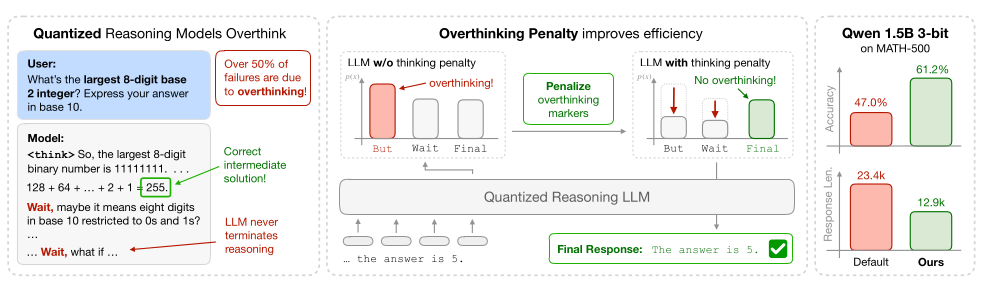
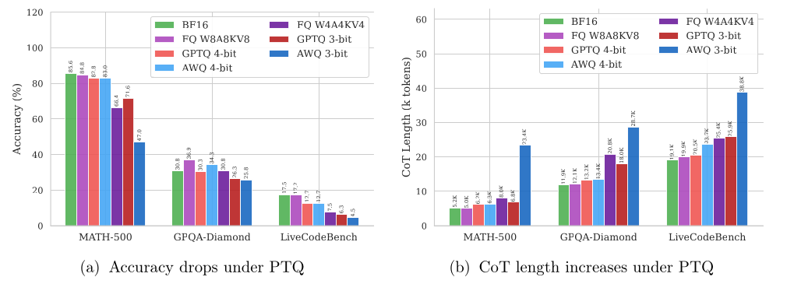
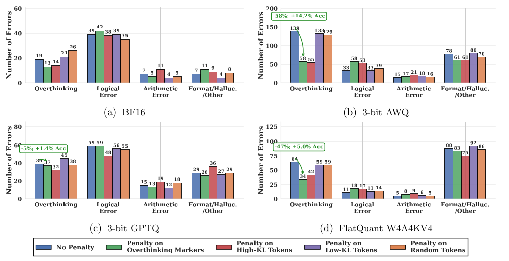
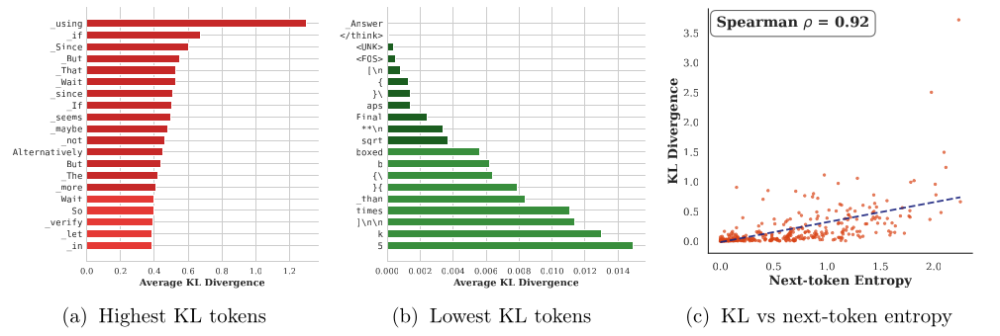
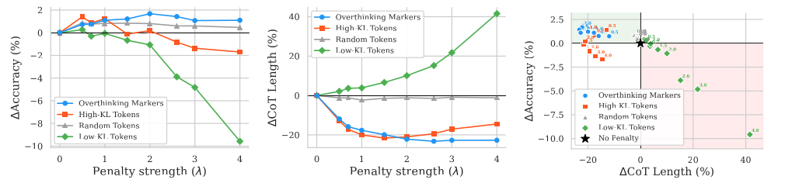
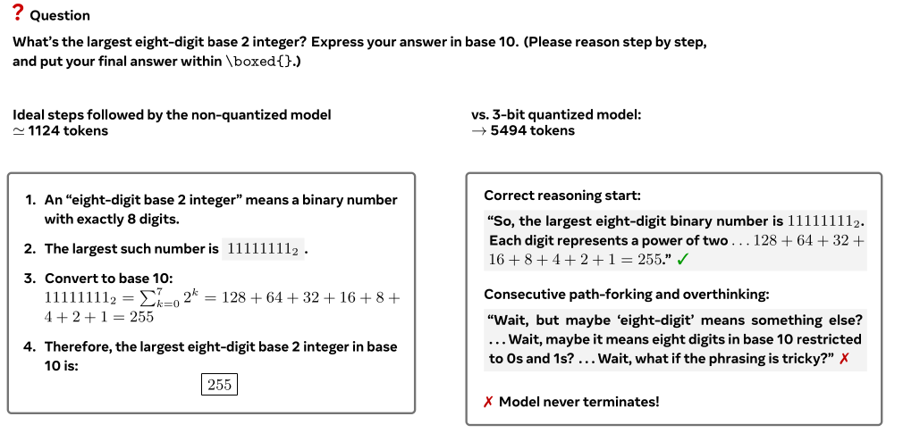
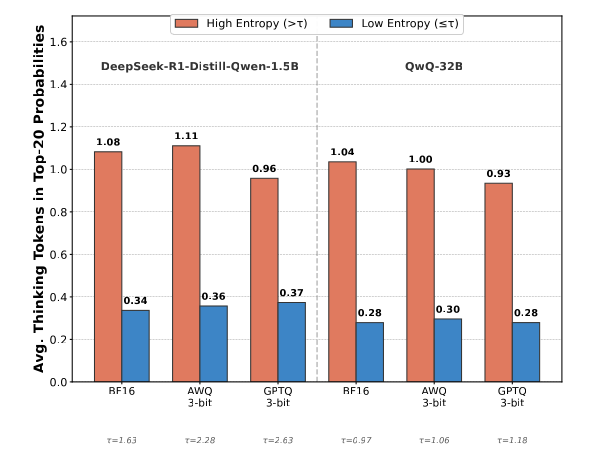
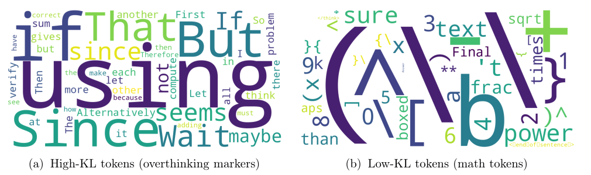
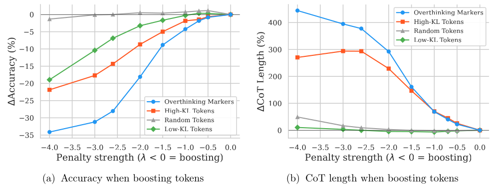
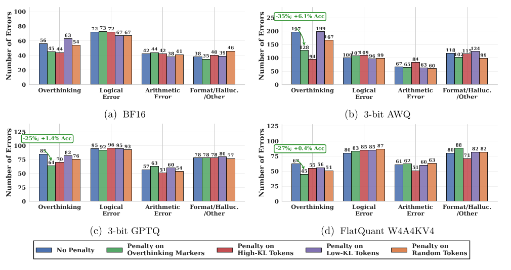

# 量化推理模型以为自己需要想得更久，但其实不需要（中文翻译）

> 本文是 arXiv:2606.00206 的中文翻译（原文许可：CC BY 4.0）。
> 原文：*Quantized Reasoning Models Think They Need to Think Longer, but They Do Not*，作者 Sanae Lotfi、Polina Kirichenko（FAIR at Meta），Steven Li、Zechun Liu（Meta AI）。
> 摘要页：<https://arxiv.org/abs/2606.00206>　PDF：<https://arxiv.org/pdf/2606.00206>
> 通讯作者：sanaelotfi@meta.com　博客：<https://sanaelotfi.github.io/blog/quantized-reasoning-models/>
> 版本：arXiv:2606.00206v1 [cs.LG]，2026 年 5 月 29 日。术语（CoT、PTQ、KL 散度、logit 等）保留英文常用写法。

## 摘要

训练后量化（post-training quantization，PTQ）被广泛用于高效部署大语言模型，但它对推理模型的影响尚未被充分理解。在数学、代码和科学问答任务上，我们发现激进的 PTQ 会降低准确率，同时增加思维链（chain-of-thought，CoT）长度。令人意外的是，我们发现在量化模型的失败案例中，最多有 $`52\%`$ 的情形是模型在中间推理步骤里已经得到了正确答案，却没有把它作为最终答案输出。为了理解量化为何会导致这种过度思考（overthinking）错误，我们度量了量化模型与全精度模型输出分布之间的 token 级 KL 散度。KL 散度高的位置与下一个 token 的高熵强相关，而在这些位置上，量化模型会不成比例地采样“wait”、“but”、“alternatively”等过度思考标记（overthinking markers）。我们表明，仅需对一组精选的过度思考标记施加一个免训练的 logit 惩罚，就能在 5 个模型（1.5B–32B 参数）、3 种量化方法和 5 个基准上，将 CoT 长度降低 12–23%，同时保持或提升准确率；与惩罚其他 token 集合相比，它在准确率—推理成本上给出更有利的 Pareto 前沿。量化模型产生的过度思考错误最多可被减少 58%。



**图 1：** 量化加剧了推理模型的过度思考。**（左）** 即使量化推理模型已得到中间的正确答案，它们也会自我怀疑、开启过多新的推理分支，并且从不产出最终回答。**（中）** 我们对开启新推理分支的思考标记（即“but”或“wait”）施加 logit 惩罚。**（右）** 过度思考惩罚在平均意义上显著提升了效率（推理长度），同时在不同模型、数据集和量化方法上保持或提升准确率。

## 1 引言

训练后量化（PTQ）是高效部署大语言模型被广泛采用的范式（Lin et al., 2024；Frantar et al., 2022；Xiao et al., 2023；Yao et al., 2022）：它不需要梯度更新，不需要接触训练流程，只需少量校准数据即可应用。当一个量化后的推理模型解题失败时，人们很自然地假设量化侵蚀了模型的能力，模型已经找不到正确答案了。在这项工作中，我们发现：在最多 52% 的失败案例中，量化模型其实在某个中间推理步骤产生了正确答案，但随后又把它抛弃了。模型没有坚持一个正确的结论，而是开启新的推理分支、质疑自己的假设，并陷入冗余的反复斟酌，把它已经找到的答案挤掉。**量化推理模型并非因为不会思考而失败；它们失败是因为停不下来。**

这种失败模式，我们称之为**过度思考（overthinking）**，在训练后量化（PTQ）的推理模型中表现为一种一致的模式。全精度模型中也存在过度思考错误，但量化会大幅放大其出现频率：在 AWQ 3-bit 下，过度思考占全部错误的 52%，而在 BF16 下为 26%，过度思考错误的绝对数量增加了 $`7.3\times`$ 。

受这一差距启发，我们把全精度模型当作参照，在相同的生成前缀下分析量化模型与全精度模型输出分布之间的 token 级 KL 散度，以隔离量化的影响。

由此得到两个关键发现。

（1）量化与全精度模型之间平均 KL 散度最高的 token 中包含“Wait,”、“But,”、“Alternatively”等过度思考标记。KL 散度最低的 token 是数学和格式 token，它们编码了推理的计算内容。位置级别的 KL 散度也与全精度模型的下一个 token 熵强相关，证实量化对模型本来就不确定的位置影响最大。

（2）过度思考标记集中在高熵解码位置：在高熵步骤的 top-20 预测中，它们出现的频率是低熵步骤的 $`2`$ – $`4\times`$ 。由于这些位置本身就不确定，量化噪声对输出分布的影响更大，进一步提高了采样到这类 token 的可能性。这反过来触发了虚假的推理分支，覆盖正确的中间答案并推迟终止。

为了验证这一诊断，我们应用了一个简单的免训练干预：在每个解码步骤，对一个精选的 token 集合 $`\mathcal{S}`$ 施加固定的 logit 惩罚。该惩罚没有任何计算开销，只有一个超参数，却非常有针对性。所选 token 对应过度思考标记，它们与高 KL 散度和高熵位置密切相关，在词汇上对应犹豫和回溯。

在所有配置下，该惩罚平均一致地将 CoT 长度降低 12–23%。准确率得到保持，甚至常常提升，这反映了过度思考错误的减少。在少数情形中准确率略有下降，但 CoT 长度仍显著缩短，使效率—性能的 Pareto 前沿发生有利移动。

受控消融进一步凸显了该干预的特异性：惩罚随机选取的 token 没有一致的效果，而惩罚 KL 散度最低的 token 会导致灾难性退化——CoT 长度最多增加 41%，准确率最多下降 9.5%。这种特异性反映出量化如何损害推理：它放大了路径分叉 token，而且恰恰是在最容易引发反复分支的高不确定性位置。

我们的贡献如下：

1. 我们表明 PTQ 加剧了推理模型的过度思考。在激进量化下，最多 52% 的失败案例中，模型在中间步骤已得到正确答案，却未能坚持它。
2. 我们通过量化模型与全精度模型输出分布之间的 KL 散度分析，找出了驱动这种失败的 token。散度最高的 token 之中有犹豫和分支 token，它们集中在高熵位置；散度最低的 token 是承载推理计算内容的数学 token。
3. 我们用一个针对过度思考标记集合的免训练 logit 惩罚验证了这一诊断。该惩罚平均一致地将 CoT 长度降低 12–23%，同时保持或提升准确率。受控消融确认，惩罚过度思考标记给出了准确率—推理成本最有利的 Pareto 前沿。

## 2 相关工作

**LLM 的训练后量化。** 训练后量化可以在保持困惑度和下游性能的同时大幅减小模型占用。早期工作通过感知离群值的混合精度策略，展示了大型 Transformer 模型稳健的 8-bit 推理（Dettmers et al., 2022）。较新的 PTQ 方法面向 Transformer 块的 4-bit 和 3-bit 权重，包括 GPTQ（Frantar et al., 2022）——它使用对损失曲面的二阶近似逐层量化以修正量化误差——以及 AWQ（Lin et al., 2024）——它利用校准数据的激活统计量识别并保护重要的权重通道，从而降低量化失真。其他方法将量化难度从激活迁移到权重，如 SmoothQuant（Xiao et al., 2023），或针对降低量化与反量化开销进行优化，如 ZeroQuant（Yao et al., 2022）。

除这些方法之外，近期一些工作通过迭代式误差修正来改进低比特 PTQ。QuIP 和 QuIP# 提出有原则的低比特量化目标，以在 2–4 bit 下保持准确率（Chee et al., 2023；Tseng et al., 2024）。基于旋转的方法能减少离群值并改进量化，包括 QuaRot（Ashkboos et al., 2024）和 SpinQuant（Liu et al., 2024）。FlatQuant 使用包括旋转和逐通道缩放在内的最优仿射变换来增强权重与激活的平坦性（Sun et al., 2024）。在我们的实验中，我们关注使用 AWQ 和 GPTQ 的 3-bit 与 4-bit 仅权重量化，以及使用 FlatQuant 的 4-bit 与 8-bit 权重、激活和 KV 缓存量化。

**高效推理。** 推理模型中的过度思考现在已是一种有充分记录的现象。Chen et al.（2024）首次量化了 o1 类 LLM 中的过度思考，表明模型会系统性地为简单问题过度分配计算，并提出自训练策略，在不损失准确率的情况下将 token 用量减少近 45%。Pipis et al.（2025）将重复循环确定为一种失败模式，尤其出现在较小模型和蒸馏模型中。Su et al.（2025）表明推理长度与正确性之间的关系是非单调的：更长的推理轨迹并不总能带来更好的答案。缓解方法包括：微调模型使其在生成冗余步骤之前自我刹车（Zhao et al., 2025）、动态提前退出（Yang et al., 2025），以及在多个样本中偏好最短的正确链（Hassid et al., 2025）。综述见 Sui et al.（2025）。我们的方法的不同之处在于：聚焦于理解量化如何恶化这种过度思考行为，以及如何在无需任何训练的前提下缓解它，因为 PTQ 本身就是免训练的。

**量化对推理的影响。** 近期工作表明，量化的影响取决于度量和任务，压缩可以保持聚合性能，却不成比例地损害更难的样本和能力（Hooker et al., 2020；Lotfi et al., 2024；Hua et al., 2026）。若干近期研究报告称，推理模型在低比特 PTQ 下会急剧退化，表现为准确率下降和思维链长度增加（Liu et al., 2025；Mekala et al., 2025；Li et al., 2025）。我们的工作与这一新兴方向一致，但关注点不同：我们不只是在 PTQ 下对准确率做基准测试，而是在 token 层面研究量化如何改变推理轨迹，识别出过度思考错误的增加，并提出一种能解决该问题的免训练干预。

## 3 实验设置

**量化方法。** 我们在两种设定下评估训练后量化。对仅权重量化，我们使用 GPTQ（Frantar et al., 2022）和 AWQ（Lin et al., 2024），精度为 3-bit 和 4-bit，分组大小 $`g{=}128`$ 。GPTQ 使用二阶信息逐层量化，以最小化输出重构误差。AWQ 使用校准激活统计量识别重要的权重通道，并应用逐通道重缩放来降低量化失真。对于权重、激活和 KV 缓存的端到端量化，我们使用 FlatQuant（Sun et al., 2024），配置为 W4A4KV4 和 W8A8KV8。我们用记号 W$`b`$A$`c`$KV$`d`$ 表示 $`b`$-bit 权重、 $`c`$-bit 激活和 $`d`$-bit KV 缓存。更多细节见附录 A。

**模型。** 我们评估 5 个专门用于推理的 LLM，参数规模从 1.5B 到 32B。来自 DeepSeek-R1-Distill 系列的有 DeepSeek-R1-Distill-Qwen 1.5B、7B 和 14B，以及 DeepSeek-R1-Distill-Llama 8B。这些模型分别从 DeepSeek-R1 蒸馏到 Qwen-2.5 和 Llama-3.1 架构（Yang et al., 2024）。此外我们还评估 QwQ-32B（Team, 2025），它通过带可验证奖励的强化学习而非蒸馏来获得推理能力。

**基准。** 我们在涵盖数学、代码和科学的五个基准上评估。数学方面，使用 GSM8K（Cobbe et al., 2021）作为较短的算术链，MATH-500（Hendrycks et al., 2021）作为竞赛风格的多步问题，以及 AIME-120（由 AIME-90 脚注 1 和 AIME-2025（Dekoninck et al., 2026）组成）作为更难、倾向于诱发更长推理轨迹的子集。代码方面使用 LiveCodeBench（Jain et al., 2024）。科学方面使用 GPQA-Diamond（Rein et al., 2024）。所有实验使用默认解码， $`T{=}0.6`$ 、top-$`p{=}0.95`$ ，遵循此前关于推理模型量化的工作所用设置（Liu et al., 2025）。

> 脚注 1：<https://huggingface.co/datasets/xiaoyuanliu/AIME90>



**图 2：** 量化推理模型产生更长的思维链，同时准确率更低。我们在 MATH-500、GPQA-Diamond 和 LiveCodeBench 上评估全精度（BF16）以及量化后的 DeepSeek-R1-Distill-Qwen-1.5B。**(a)** 量化越激进，准确率越低，3-bit AWQ 使 MATH-500 准确率从 85.6% 降至 47.0%。**(b)** 激进量化下 CoT 长度显著增加：3-bit AWQ 使 MATH-500 的 CoT 从 5.2K 增加到 23.4K token，增加了 $`4.5\times`$ 。全部五个模型的结果见附录 B。

（子图：(a) 准确率在 PTQ 下下降；(b) CoT 长度在 PTQ 下增加。）

## 4 量化加剧推理模型的过度思考

### 4.1 PTQ 下准确率下降而 CoT 长度增加

首先，我们研究 PTQ 如何同时影响推理任务上的准确率和 CoT 长度。图 2 展示了越来越激进的量化对 DeepSeek-R1-Distill-Qwen-1.5B 在三个基准上的影响。轻度量化（FlatQuant W8A8KV8 以及 4-bit 仅权重 AWQ 和 GPTQ）基本保持准确率，CoT 长度与 BF16 基线接近。随着精度进一步降低，准确率和推理效率会一并退化。在 MATH-500 上，3-bit AWQ 使准确率从 85.6% 降至 47.0%，同时平均 CoT 从 5.2K 增加到 23.4K token，增加了 $`4.5\times`$ 。同一数据集上 3-bit GPTQ 更稳健，保持了 71.6% 的准确率、6.8K token，但推理轨迹仍比 BF16 长 32%。同时量化权重、激活和 KV 缓存的 FlatQuant W4A4KV4 介于两者之间：准确率降至 66.4%，CoT 增长到 8.0K token。

我们在另外四个模型（Qwen-7B、Qwen-14B、Llama-8B、QwQ-32B）上观察到相同的模式，完整结果见附录 B。激进量化（3-bit 仅权重和 W4A4KV4）一致地导致更长的推理轨迹，对更小的模型和更难的基准，这种效应最为明显。在 LiveCodeBench 上，3-bit AWQ 使 Qwen-1.5B 的 CoT 从 19.1K 增加到 38.8K token，同时准确率从 17.5% 降至 4.5%。更大的模型更有韧性：Qwen-14B 在 3-bit AWQ 下平均准确率仅损失 4.0%，其 CoT 增幅相比之下也较为温和。

我们在全部 28 个模型—量化组合上计算准确率下降与 CoT 长度增加之间的 Spearman 相关系数 $`\rho`$ ，得到 $`\rho=-0.73`$ 。换言之，准确率损失最大的量化模型往往也生成最长的推理轨迹。鉴于这一强相关性，我们假设：量化引发的额外推理不仅仅是低准确率的伴随现象，而是更长的思维链在主动助长性能退化。我们接下来检验这一假设。



**图 3：** 量化增加过度思考错误，惩罚过度思考标记可将其减少。我们将 DeepSeek-R1-Distill-Qwen-1.5B 在 MATH-500 上的错误分为四类。每个子图展示无惩罚以及四种惩罚配置下的错误数量。量化下过度思考错误增加。惩罚过度思考标记和高 KL token 能一致地将过度思考错误减少，在 AWQ 3-bit 上最多减少 58%，同时准确率最多提升 14.2%。惩罚随机 token 或低 KL token 并不能减少过度思考错误，甚至可能使这类错误增加。

（子图：(a) BF16；(b) 3-bit AWQ；(c) 3-bit GPTQ；(d) FlatQuant W4A4KV4。图例：No Penalty / Penalty on Overthinking Markers / Penalty on High-KL Tokens / Penalty on Low-KL Tokens / Penalty on Random Tokens。）

### 4.2 量化增加过度思考错误

为了理解量化导致了哪类错误，我们对 DeepSeek-R1-Distill-Qwen-1.5B 在 MATH-500 上的错误答案进行分类。我们先人工标注一个错误子集，然后使用 GPT-5（Singh et al., 2025）作为 LLM 评判来扩展分类规模，并调优提示词使其与人工标注的一致性超过 95%。提示词见附录 D。

我们把每个失败恰好归入以下类别之一：（i）**过度思考（Overthinking）。** 模型在思维链的某个时刻得到了正确解，但没有将其作为最终答案。相反，模型开启新的推理路径、过度质疑自己的假设，或推翻一个正确的结论。图 6 给出了一个典型例子；（ii）**逻辑错误（Logical error）。** 模型遵循了错误的计划，或者从一开始就误解了问题，以至于在得到任何正确解之前推理轨迹就已是错的；（iii）**算术错误（Arithmetic error）。** 整体思路和计划正确，但模型出现具体的计算或演算错误，导致最终答案错误；（iv）**格式、幻觉及其他错误。** 模型给出了不符合格式的答案、引入了题目中并不存在的幻觉约束，或表现出上述类别未涵盖的其他失败。

图 3 展示了 BF16 和三种激进量化方法的错误构成。在 BF16 下，模型在 500 道题中出错 72 次，其中只有 19 次归因于过度思考（26%）。量化使三种方法下的过度思考错误全都增加。在 3-bit AWQ 下，过度思考错误从 19 增加到 139，增加 $`7.3\times`$ ，使过度思考成为占全部 265 个错误 52% 的主导失败模式。3-bit GPTQ 使过度思考计数翻倍，从 19 到 39。FlatQuant 则增加到三倍多，从 19 到 64。在这三种情形中，量化都导致了“模型已得到正确答案却未能坚持它”类错误的增加。我们在图 10 中给出 GSM8K 上的类似结果。

过度思考错误在量化下的增加支持了我们在 4.1 节的假设。量化模型产生的更长推理轨迹包含过度的犹豫和自我怀疑，常常把正确的中间答案变成错误的最终答案。



**图 4：** 量化不成比例地影响高熵位置上的思考与犹豫 token。我们在 MATH-500 上，对每个出现至少 50 次的 token，计算 BF16 与 3-bit AWQ 输出分布之间的平均 KL 散度。**(a)** KL 最高的 20 个 token 是思考与分支 token。**(b)** KL 最低的 20 个 token 是数学与格式 token。以“\_”为前缀的 token 在分词器中包含一个前导空格。**(c)** 位置级 KL 散度与 BF16 模型的下一 token 熵强相关（Spearman $`\rho = 0.92`$ ），证实量化对模型本来就不确定的位置影响最大。

（子图：(a) 最高 KL token；(b) 最低 KL token；(c) KL 与下一 token 熵。）

### 4.3 量化模型在分支位置上与未量化模型发生分歧

为了理解量化如何增加过度思考错误，我们度量 BF16 与 3-bit AWQ 模型输出分布之间的 token 级 KL 散度。我们把全精度模型当作参照，并让两个模型在相同的 MATH-500 提示上、使用相同的生成前缀运行，以隔离量化的影响。在每个解码位置 $`t`$ ，我们计算 KL 散度 $`D_{\mathrm{KL}}(p_{t}\|q_{t})=\sum_{v\in\mathcal{V}}p_{t}(v)\log\frac{p_{t}(v)}{q_{t}(v)}`$ ，其中 $`p_{t}`$ 和 $`q_{t}`$ 分别是全精度模型和量化模型的下一 token 分布。然后我们把每个 KL 值与量化模型在该位置采样到的 token 关联起来，并对词表中的每个唯一 token，计算它在所有被采样位置上的平均 KL 散度。我们只保留在所有生成中至少出现 50 次的 token。

图 4 展示了关联平均 KL 散度最高和最低的 20 个 token。量化模型与全精度模型分歧最大的 token 是“Wait”、“But”、“Alternatively”、“if”、“maybe”、“verify”、“think”等思考和分支 token。这些 token 中很多会开启新的推理路径，表达模型的犹豫。两个模型最为一致的 token 是数学和格式 token。量化几乎不改变模型对这些执行类 token 的采样方式。我们在 B.3 节提供了 50 个最高 KL 与 50 个最低 KL token 完整集合的词云可视化。

我们还计算了高 KL 与低 KL token 相对于总 CoT 长度的密度。在 BF16 中，低 KL 数学 token 的出现率高于高 KL 犹豫 token，比值为 0.57。在 3-bit AWQ 下，这个比值翻转为 1.15：高 KL token 的数量超过低 KL token，意味着量化模型每单位推理产生的思考与犹豫 token 多于数学内容。这种 token 构成的变化解释了量化为何导致推理效率降低。

## 5 惩罚过度思考标记

4.3 节的分析表明，量化不成比例地影响与犹豫和转向相关的 token，而数学 token 基本不变。我们现在检验一种简单的推理时干预：在解码期间降低这些 token 的概率。

### 5.1 过度思考惩罚

我们精选了一个包含 50 个**过度思考标记（overthinking markers）**的集合 $`\mathcal{S}`$ ：表达犹豫、自我怀疑或推理转向的 token。其中包括“Wait”、“But”、“Alternatively”、“perhaps”、“maybe”、“however”、“reconsider”、“backtrack”和“wrong”等。完整列表见附录 C。

我们通过挑选那些表明模型正在开启新推理分支、或质疑其已得出结论的 token 来构造 $`\mathcal{S}`$ 。若干近期工作已将类似 token 识别为语言模型中冗余推理的指示（Zhao et al., 2025；Fan et al., 2025）。我们有意将 4.3 节分析的高 KL 列表中那些与过度思考无关的 token 排除在外，例如“so”，它实际上有助于模型结束推理。

在每个解码步骤 $`t`$ ，我们对过度思考标记列表中每个 token $`v\in\mathcal{S}`$ 的 logit $`z_{t}(v)`$ 减去一个固定惩罚 $`\lambda>0`$ ：

```math
z^{\prime}_{t}(v)=\begin{cases}z_{t}(v)-\lambda&\text{if }v\in\mathcal{S},\\ z_{t}(v)&\text{otherwise}.\end{cases}
```

（式 1）

该惩罚不需要额外的前向传播，也不增加任何计算开销。唯一的超参数是 $`\lambda`$ ，它控制过度思考惩罚的强度。



**图 5：** 惩罚过度思考标记能一致地缩短 CoT 长度，同时保持准确率。我们在 Qwen-1.5B 上比较四种 token 列表（各 50 个 token）的 logit 惩罚，结果是对六种量化配置和五个基准取平均。**(a)** 惩罚过度思考标记在所有 $`\lambda`$ 值下都保持或提升准确率，而惩罚低 KL token 会降低准确率。**(b)** 过度思考标记一致地将 CoT 长度缩短 12% 到 23%。低 KL token 使 CoT 最多增加 41%。惩罚随机 token 的影响可忽略。**(c)** 在所有 $`\lambda`$ 值下，过度思考标记都位于左上区域（更短的 CoT、更好的准确率），给出最佳的效率—准确率权衡。黑色星号标记无惩罚基线，惩罚随机 token 的点仍接近该基线。注意标记上的数字表示惩罚强度。

（子图：(a) 准确率 vs $`\lambda`$ ；(b) CoT 长度 vs $`\lambda`$ ；(c) Pareto 前沿。）

**表 1：** 在极端量化下，惩罚过度思考标记能显著缩短 CoT 长度，同时在平均意义上保持或提升准确率。对每种配置，上一行（Base）给出无惩罚时的准确率（%）和 CoT 长度（千 token），下一行（+Pen）给出使用最优 $`\lambda`$ 时的结果； $`\Delta`$ 列中报告关于 $`\lambda`$ 的标准差。我们的过度思考惩罚在所有配置下一致地缩短 CoT 长度，相比基线给出准确率—推理成本上更好的 Pareto 前沿。在若干情形中准确率也有提升。当惩罚使准确率或 CoT 长度变化 $`\geq`$ 2% 时，各基准的单元格会被着色（此处 Markdown 版本无着色）。我们展示最激进的量化设置，其余见附录 B。列含义：各基准单元格为“Acc (%) / Len (k)”；Avg. 为“Acc / Len”； $`\Delta`$ Acc 与 $`\Delta`$ Len% 为 mean ± std。

| 模型 | 量化 | 行 | AIME | MATH | GSM8K | GPQA | LCB | Avg. | ΔAcc | ΔLen% |
|---|---|---|---|---|---|---|---|---|---|---|
| Qwen-1.5B | BF16 | Base | 24.4 / 17.5 | 85.6 / 5.2 | 84.2 / 2.7 | 30.8 / 11.9 | 17.5 / 19.1 | 48.5 / 11.2 |  |  |
| Qwen-1.5B | BF16 | +Pen | 25.6 / 14.8 | 85.8 / 4.5 | 85.1 / 2.6 | 39.4 / 10.5 | 17.5 / 18.3 | 50.7 / 10.1 | +2.1 ± 1.6 | −9.2 ± 5.7 |
| Qwen-1.5B | GPTQ W3 | Base | 8.9 / 20.5 | 71.6 / 6.8 | 76.1 / 4.0 | 26.3 / 18.0 | 6.3 / 25.9 | 37.8 / 15.0 |  |  |
| Qwen-1.5B | GPTQ W3 | +Pen | 11.1 / 15.6 | 73.0 / 5.8 | 77.5 / 2.8 | 28.8 / 12.5 | 8.2 / 22.2 | 39.7 / 11.8 | +1.9 ± 1.1 | −22.6 ± 6.2 |
| Qwen-1.5B | AWQ W3 | Base | 4.4 / 33.0 | 47.0 / 23.4 | 63.5 / 16.3 | 25.8 / 28.7 | 4.5 / 38.8 | 29.0 / 28.0 |  |  |
| Qwen-1.5B | AWQ W3 | +Pen | 8.9 / 29.3 | 61.2 / 12.9 | 69.5 / 7.6 | 30.3 / 22.7 | 6.3 / 35.3 | 35.2 / 21.6 | +6.2 ± 1.7 | −28.0 ± 7.5 |
| Qwen-1.5B | FQ W4A4KV4 | Base | 7.8 / 17.5 | 66.4 / 8.0 | 78.5 / 3.4 | 30.8 / 20.8 | 7.5 / 25.4 | 38.2 / 15.0 |  |  |
| Qwen-1.5B | FQ W4A4KV4 | +Pen | 12.2 / 16.8 | 71.4 / 6.2 | 78.9 / 2.1 | 31.3 / 17.6 | 8.6 / 23.8 | 40.5 / 13.3 | +2.3 ± 1.3 | −17.6 ± 4.9 |
| Qwen-7B | BF16 | Base | 45.6 / 12.7 | 93.2 / 3.9 | 91.1 / 1.9 | 50.0 / 9.9 | 37.7 / 16.5 | 63.5 / 9.0 |  |  |
| Qwen-7B | BF16 | +Pen | 52.2 / 11.2 | 94.2 / 3.5 | 91.6 / 1.6 | 56.6 / 9.4 | 38.8 / 14.9 | 66.7 / 8.1 | +3.2 ± 1.9 | −10.0 ± 2.7 |
| Qwen-7B | GPTQ W3 | Base | 30.0 / 17.0 | 91.0 / 4.8 | 90.1 / 2.5 | 41.9 / 11.4 | 27.2 / 19.1 | 56.0 / 11.0 |  |  |
| Qwen-7B | GPTQ W3 | +Pen | 34.4 / 14.8 | 91.2 / 4.2 | 90.8 / 1.8 | 48.5 / 10.3 | 26.5 / 19.2 | 58.3 / 10.1 | +2.2 ± 1.5 | −13.1 ± 3.0 |
| Qwen-7B | AWQ W3 | Base | 30.0 / 16.1 | 91.2 / 4.8 | 90.4 / 2.1 | 48.0 / 10.7 | 26.9 / 21.3 | 57.3 / 11.0 |  |  |
| Qwen-7B | AWQ W3 | +Pen | 28.9 / 14.6 | 90.2 / 4.0 | 90.5 / 1.8 | 49.0 / 10.1 | 28.7 / 18.9 | 57.5 / 9.9 | +0.2 ± 1.4 | −12.0 ± 3.9 |
| Qwen-7B | FQ W4A4KV4 | Base | 23.3 / 20.4 | 83.6 / 5.4 | 87.7 / 2.1 | 50.0 / 18.0 | 12.3 / 23.9 | 51.4 / 14.0 |  |  |
| Qwen-7B | FQ W4A4KV4 | +Pen | 22.2 / 19.7 | 86.4 / 4.7 | 88.5 / 2.1 | 51.5 / 14.9 | 14.2 / 23.2 | 52.6 / 12.9 | +1.2 ± 2.4 | −7.7 ± 4.8 |
| Qwen-14B | BF16 | Base | 57.8 / 13.1 | 94.6 / 3.7 | 94.1 / 1.7 | 57.6 / 9.5 | 49.6 / 14.4 | 70.7 / 8.5 |  |  |
| Qwen-14B | BF16 | +Pen | 63.3 / 10.7 | 95.6 / 3.5 | 94.5 / 1.7 | 62.6 / 8.8 | 54.5 / 13.4 | 74.1 / 7.6 | +3.4 ± 1.7 | −8.5 ± 2.3 |
| Qwen-14B | GPTQ W3 | Base | 44.4 / 12.4 | 94.4 / 3.6 | 92.8 / 1.6 | 53.5 / 9.1 | 42.2 / 14.6 | 65.5 / 8.3 |  |  |
| Qwen-14B | GPTQ W3 | +Pen | 47.8 / 11.9 | 93.8 / 3.4 | 92.5 / 1.5 | 56.1 / 8.7 | 47.4 / 14.6 | 67.5 / 8.0 | +2.0 ± 1.7 | −4.8 ± 2.3 |
| Qwen-14B | AWQ W3 | Base | 48.9 / 14.3 | 93.0 / 4.3 | 93.0 / 2.1 | 56.6 / 10.5 | 42.2 / 17.5 | 66.7 / 9.7 |  |  |
| Qwen-14B | AWQ W3 | +Pen | 47.8 / 14.1 | 94.2 / 3.9 | 92.9 / 1.7 | 56.1 / 10.2 | 45.9 / 16.2 | 67.4 / 9.2 | +0.6 ± 1.7 | −7.5 ± 3.5 |
| Qwen-14B | FQ W4A4KV4 | Base | 52.2 / 12.7 | 95.0 / 3.7 | 93.5 / 1.8 | 63.6 / 8.8 | 49.3 / 15.2 | 70.7 / 8.4 |  |  |
| Qwen-14B | FQ W4A4KV4 | +Pen | 53.3 / 12.6 | 94.6 / 3.6 | 93.9 / 1.6 | 61.6 / 8.8 | 49.3 / 14.3 | 70.5 / 8.2 | −0.2 ± 1.3 | −4.5 ± 3.5 |
| Llama-8B | BF16 | Base | 44.4 / 14.5 | 89.0 / 4.6 | 89.0 / 2.2 | 49.0 / 10.2 | 35.1 / 16.2 | 61.3 / 9.6 |  |  |
| Llama-8B | BF16 | +Pen | 42.2 / 13.8 | 91.0 / 4.2 | 88.6 / 2.0 | 50.5 / 10.1 | 38.4 / 15.3 | 62.1 / 9.1 | +0.8 ± 2.0 | −5.6 ± 2.7 |
| Llama-8B | GPTQ W3 | Base | 26.7 / 18.2 | 82.2 / 6.2 | 85.4 / 2.4 | 29.8 / 12.8 | 24.6 / 24.1 | 49.7 / 12.7 |  |  |
| Llama-8B | GPTQ W3 | +Pen | 28.9 / 16.2 | 83.4 / 5.6 | 85.8 / 2.0 | 39.9 / 12.7 | 26.9 / 23.0 | 53.0 / 11.9 | +3.2 ± 1.9 | −7.9 ± 3.9 |
| Llama-8B | AWQ W3 | Base | 12.2 / 14.8 | 80.4 / 5.4 | 82.6 / 2.4 | 35.9 / 9.6 | 23.1 / 18.1 | 46.8 / 10.1 |  |  |
| Llama-8B | AWQ W3 | +Pen | 16.7 / 13.6 | 77.6 / 4.7 | 83.7 / 2.0 | 36.9 / 8.6 | 23.1 / 15.9 | 47.6 / 9.0 | +0.7 ± 1.5 | −12.2 ± 2.7 |
| Llama-8B | FQ W4A4KV4 | Base | 22.2 / 15.4 | 86.4 / 5.0 | 87.6 / 2.4 | 40.9 / 10.2 | 35.1 / 17.8 | 54.4 / 10.2 |  |  |
| Llama-8B | FQ W4A4KV4 | +Pen | 22.2 / 14.7 | 84.2 / 4.9 | 86.1 / 2.2 | 48.5 / 9.8 | 31.7 / 17.3 | 54.5 / 9.8 | +0.1 ± 1.7 | −4.1 ± 3.0 |
| QwQ-32B | BF16 | Base | 76.7 / 15.3 | 97.2 / 4.5 | 95.7 / 1.9 | 63.1 / 10.1 | 62.3 / 17.9 | 79.0 / 9.9 |  |  |
| QwQ-32B | BF16 | +Pen | 81.1 / 12.3 | 98.0 / 4.0 | 96.0 / 1.8 | 66.7 / 9.5 | 61.9 / 17.3 | 80.7 / 9.0 | +1.7 ± 1.2 | −9.6 ± 2.6 |
| QwQ-32B | GPTQ W3 | Base | 64.4 / 16.1 | 96.8 / 4.9 | 95.4 / 2.0 | 56.1 / 9.3 | 50.4 / 19.1 | 72.6 / 10.3 |  |  |
| QwQ-32B | GPTQ W3 | +Pen | 65.6 / 15.0 | 96.4 / 4.3 | 95.9 / 1.8 | 60.1 / 9.5 | 51.9 / 18.0 | 74.0 / 9.7 | +1.3 ± 1.4 | −5.9 ± 3.9 |
| QwQ-32B | AWQ W3 | Base | 60.0 / 16.7 | 96.0 / 4.6 | 95.9 / 1.8 | 61.1 / 10.1 | 51.5 / 19.5 | 72.9 / 10.5 |  |  |
| QwQ-32B | AWQ W3 | +Pen | 62.2 / 14.5 | 96.6 / 4.2 | 95.5 / 1.7 | 60.6 / 8.7 | 53.4 / 18.7 | 73.7 / 9.5 | +0.7 ± 1.2 | −9.6 ± 2.9 |

### 5.2 惩罚过度思考标记在平均意义上缩短 CoT 并保持准确率

我们比较惩罚四种等大小（各 50 个 token）token 列表的效果：我们的过度思考标记、BF16 与 AWQ 3-bit 之间 KL 散度最高的 token（高 KL token）、KL 散度最低的 token（低 KL token），以及 50 个随机选择的 token。我们在 Qwen-1.5B 上、六种量化配置和五个基准下，对每个列表按式（1）施加 logit 惩罚， $`\lambda`$ 从 0.5 扫描到 4.0。

图 5 展示了在所有配置和基准上平均的结果。惩罚过度思考标记在所有 $`\lambda`$ 值下一致地将 CoT 长度缩短 12% 到 23%，同时保持或略微提升准确率。惩罚随机 token 对准确率和 CoT 长度的影响都可忽略。惩罚高 KL token 在较低的 $`\lambda`$ 下缩短 CoT，但在较高值下会降低准确率，因为该列表包含了实际上可能有助于终止推理的 token。惩罚低 KL token 是灾难性的：CoT 最多增加 41%，准确率最多下降 9.5%，证实这些 token 并不是造成量化后退化的原因。

我们还通过一次使用负 $`\lambda`$ 值的对称扫描来验证惩罚的方向性，即增强而非抑制目标 token，如图 9 所示。增强过度思考标记会使 CoT 长度最多增加 445%，准确率最多下降 34%。高 KL token 表现出相当的效果，而随机 token 保持中性。这些结果证实，过度思考标记和高 KL token 是在两个方向上控制推理长度的 token。

图 5(c) 表明，在所有 $`\lambda`$ 值下，过度思考标记都位于 Pareto 前沿的左上区域，在不牺牲准确率的情况下获得更短的 CoT。没有其他 token 列表做到这一点：随机 token 聚集在无惩罚的原点附近，高 KL token 在强惩罚下向更差的准确率漂移，低 KL token 则进入右下区域，准确率和效率都退化。我们还注意到，过度思考惩罚对 $`\lambda`$ 的选择是稳健的：在 Qwen-1.5B 上，所测试的每个 $`\lambda`$ 值平均都使各配置的 CoT 长度至少缩短 12%，同时保持性能，如图 5(a) 和 5(b) 所示。在表 1 中，我们报告每种配置下最优 $`\lambda`$ 的结果，以及所有 $`\lambda`$ 值上的标准差。

### 5.3 过度思考惩罚在各模型上提升效率

表 1 展示了过度思考惩罚在五个模型和最激进量化设置上的效果。该惩罚在各基准上平均将 CoT 长度缩短 4.1% 到 28.0%。在大多数情形中，准确率被保持或略有提升。值得注意的是，有少数情形准确率变差而 CoT 长度改善。在 Qwen-1.5B 的 AWQ 3-bit 上，准确率提升 6.2%，同时 CoT 缩短 28.0%。更大的模型 CoT 缩减较小但一致，提升了量化模型的效率，并部分逆转了被量化加剧的过度思考行为。全部量化方法的完整结果见附录 B。

图 3 表明，对过度思考标记的惩罚减少了模型已得到正确答案却未能坚持的案例数。在 AWQ 3-bit 上，过度思考错误从 139 降至 58，减少 58%，总错误从 265 降至 194。在 FlatQuant W4A4KV4 上，过度思考错误从 64 降至 34（减少 47%），总错误从 168 降至 143。惩罚随机 token 或低 KL token 实际上可能导致过度思考错误增加，这说明了对我们精选的过度思考标记列表施加惩罚的有效性。我们在 GSM8K 上观察到同样的模式：惩罚过度思考标记使三种极端量化配置下的过度思考错误从 344 降至 237，减少 31%，见 B.5 节。

过度思考惩罚也缩短了 BF16 模型的 CoT 长度，平均缩减幅度视模型而定，在 5.6% 到 10.0% 之间。量化并没有把过度思考作为一种新的失败模式引入，而是加剧了全精度模型中本已存在的倾向，这既体现为量化后 CoT 的增加，也体现为过度思考错误尤其是增加。

## 6 为什么量化会加剧过度思考？

在前面几节中，我们证明了量化增加过度思考错误和 CoT 长度，而惩罚过度思考标记同时解决了两者。我们现在讨论并通过实验验证一个关于量化为何恶化推理模型过度思考的假设。

Yayla and Kumar（2026）表明，量化神经网络对参数扰动的鲁棒性由输出层 logit 间隔（margin）决定：top-1 与 top-2 logit 之间的差距 $`m=z_{(1)}-z_{(2)}`$ 。当该间隔很大时，对模型权重的扰动不太可能翻转 argmax；当间隔很小时，即使是适度的扰动也可能改变所选输出。他们的分析针对的是确定性比特翻转错误下的分类网络，但同样的结构性论证适用于随机量化噪声下的自回归设定（Widrow et al., 1996；Défossez et al., 2021）：局部不确定的位置会受到量化噪声更强烈的影响。

我们在自回归设定中验证这一直觉。图 4(c) 表明，在 MATH-500 上相同生成前缀下计算的 KL 散度与全精度模型的下一 token 熵之间，在所有位置上的相关系数为 $`\rho=0.92`$ ，证实模型最不确定的位置（logit 差距小、熵高）正是量化模型与全精度模型分歧最大的位置。

与过度思考的联系来自第二个经验观察：如图 7 所示，与低熵位置相比，过度思考标记在高熵位置的 top-20 最可能 token 中出现的可能性高 2 到 $`4\times`$ 。在这些不确定位置，量化噪声可能把采样到的 token 推向“Wait”或“But”等过度思考标记，使模型开启新的推理分支而不是沿当前路径继续。我们指出，这一论证只为一种特定的失败模式提供直觉，而不是对 PTQ 造成的所有类型退化的完整因果解释。

## 7 结论、局限与未来工作

在这项工作中，我们研究了训练后量化对推理模型的影响，发现激进量化会加剧过度思考：模型得到了正确的中间答案却未能坚持它们，导致更长的思维链和更低的准确率。通过量化模型与全精度模型之间的 token 级 KL 散度分析，我们发现犹豫和分支 token 受量化的影响不成比例，而数学 token 保持稳定。对 50 个精选过度思考标记施加的简单免训练 logit 惩罚，在 5 个模型、3 种量化方法和 5 个基准上一致地将 CoT 长度降低 12–23%，带来更好的准确率—推理成本 Pareto 前沿。

过度思考并非量化模型独有。BF16 模型同样会产生过度思考错误，而惩罚使全精度模型的 CoT 长度缩短 5.6% 到 10.0%，视模型而定。**量化放大了推理模型中本已存在的一种失败模式。** 我们的 KL 散度分析也并非专属于量化：对模型权重或激活的任何扰动——来自剪枝、蒸馏或低秩近似——都可能同样影响不确定位置。比较参考模型与其压缩变体之间的 token 级散度，可以作为一种通用诊断，用来识别生成的哪些方面最易受压缩影响。

仍有若干方向有待探索。我们的惩罚在每个解码步骤使用固定的 $`\lambda`$ 。虽然消融表明它对 $`\lambda`$ 的取值稳健，但根据局部熵动态调整 $`\lambda`$ 是一个自然的扩展。过度思考标记列表是针对英文推理模型人工精选的。为每个模型自动构建该列表将使我们的方法适用面更广。最后，我们的评估集中在数学、代码和科学基准上。相同的过度思考模式是否出现在其他推理与规划领域，仍是一个开放问题。

## 参考文献

（保持原文英文条目；方括号内为原文标注的被引章节。）

- Ashkboos et al. (2024). S. Ashkboos, A. Mohtashami, M. L. Croci, B. Li, P. Cameron, M. Jaggi, D. Alistarh, T. Hoefler, J. Hensman. QuaRot: outlier-free 4-bit inference in rotated LLMs. *Advances in Neural Information Processing Systems 37*, pp. 100213–100240. [§2]
- Chee et al. (2023). J. Chee, Y. Cai, V. Kuleshov, C. M. De Sa. QuIP: 2-bit quantization of large language models with guarantees. *Advances in Neural Information Processing Systems 36*, pp. 4396–4429. [§2]
- Chen et al. (2024). X. Chen, J. Xu, T. Liang, Z. He, J. Pang, D. Yu, L. Song, Q. Liu, M. Zhou, Z. Zhang, et al. Do not think that much for 2+3=? On the overthinking of o1-like LLMs. arXiv:2412.21187. [§2]
- Cobbe et al. (2021). K. Cobbe, V. Kosaraju, M. Bavarian, M. Chen, H. Jun, L. Kaiser, M. Plappert, J. Tworek, J. Hilton, R. Nakano, et al. Training verifiers to solve math word problems. arXiv:2110.14168. [§3]
- Défossez et al. (2021). A. Défossez, Y. Adi, G. Synnaeve. Differentiable model compression via pseudo quantization noise. arXiv:2104.09987. [§6]
- Dekoninck et al. (2026). J. Dekoninck, N. Jovanović, T. Gehrunger, K. Rögnvaldsson, I. Petrov, C. Sun, M. Vechev. Beyond benchmarks: MathArena as an evaluation platform for mathematics with LLMs. arXiv:2605.00674. [§3]
- Dettmers et al. (2022). T. Dettmers, M. Lewis, Y. Belkada, L. Zettlemoyer. GPT3.int8(): 8-bit matrix multiplication for transformers at scale. *Advances in Neural Information Processing Systems 35*, pp. 30318–30332. [§2]
- Fan et al. (2025). C. Fan, M. Li, L. Sun, T. Zhou. Missing premise exacerbates overthinking: are reasoning models losing critical thinking skill? arXiv:2504.06514. [§5.1]
- Frantar et al. (2022). E. Frantar, S. Ashkboos, T. Hoefler, D. Alistarh. GPTQ: accurate post-training quantization for generative pre-trained transformers. arXiv:2210.17323. [§A.2, §1, §2, §3]
- Gao et al. (2020). L. Gao, S. Biderman, S. Black, L. Golding, T. Hoppe, C. Foster, J. Phang, H. He, A. Thite, N. Nabeshima, et al. The Pile: an 800GB dataset of diverse text for language modeling. arXiv:2101.00027. [§A.1]
- Hassid et al. (2025). M. Hassid, G. Synnaeve, Y. Adi, R. Schwartz. Don't overthink it. Preferring shorter thinking chains for improved LLM reasoning. arXiv:2505.17813. [§2]
- Hendrycks et al. (2021). D. Hendrycks, C. Burns, S. Kadavath, A. Arora, S. Basart, E. Tang, D. Song, J. Steinhardt. Measuring mathematical problem solving with the MATH dataset. arXiv:2103.03874. [§3]
- Hooker et al. (2020). S. Hooker, N. Moorosi, G. Clark, S. Bengio, E. Denton. Characterising bias in compressed models. arXiv:2010.03058. [§2]
- Hua et al. (2026). S. Z. Hua, S. Lotfi, I. Y. Chen. Uncertainty drives social bias changes in quantized large language models. arXiv:2602.06181. [§2]
- Jain et al. (2024). N. Jain, K. Han, A. Gu, W. Li, F. Yan, T. Zhang, S. Wang, A. Solar-Lezama, K. Sen, I. Stoica. LiveCodeBench: holistic and contamination free evaluation of large language models for code. arXiv:2403.07974. [§3]
- Li et al. (2024). J. Li, E. Beeching, L. Tunstall, B. Lipkin, R. Soletskyi, S. Huang, K. Rasul, L. Yu, A. Q. Jiang, Z. Shen, et al. NuminaMath: the largest public dataset in AI4Maths with 860k pairs of competition math problems and solutions. Hugging Face repository 13(9), p. 9. [§A.1]
- Li et al. (2025). Z. Li, Y. Su, R. Yang, C. Xie, Z. Wang, Z. Xie, N. Wong, H. Yang. Quantization meets reasoning: exploring LLM low-bit quantization degradation for mathematical reasoning. arXiv:2501.03035. [§2]
- Lin et al. (2024). J. Lin, J. Tang, H. Tang, S. Yang, W. Chen, W. Wang, G. Xiao, X. Dang, C. Gan, S. Han. AWQ: activation-aware weight quantization for on-device LLM compression and acceleration. *Proceedings of Machine Learning and Systems 6*, pp. 87–100. [§A.2, §1, §2, §3]
- Liu et al. (2025). R. Liu, Y. Sun, M. Zhang, H. Bai, X. Yu, T. Yu, C. Yuan, L. Hou. Quantization hurts reasoning? An empirical study on quantized reasoning models. arXiv:2504.04823. [§A.1, §A.2, §A.3, §2, §3]
- Liu et al. (2024). Z. Liu, C. Zhao, I. Fedorov, B. Soran, D. Choudhary, R. Krishnamoorthi, V. Chandra, Y. Tian, T. Blankevoort. SpinQuant: LLM quantization with learned rotations. arXiv:2405.16406. [§2]
- Lotfi et al. (2024). S. Lotfi, Y. Kuang, M. Finzi, B. Amos, M. Goldblum, A. G. Wilson. Unlocking tokens as data points for generalization bounds on larger language models. *Advances in Neural Information Processing Systems 37*, pp. 9229–9256. [§2]
- Mekala et al. (2025). A. Mekala, A. Atmakuru, Y. Song, M. Karpinska, M. Iyyer. Does quantization affect models' performance on long-context tasks? arXiv:2505.20276. [§2]
- Merity et al. (2016). S. Merity, C. Xiong, J. Bradbury, R. Socher. Pointer sentinel mixture models. arXiv:1609.07843. [§A.1]
- Pipis et al. (2025). C. Pipis, S. Garg, V. Kontonis, V. Shrivastava, A. Krishnamurthy, D. Papailiopoulos. Wait, wait, wait… why do reasoning models loop? arXiv:2512.12895. [§2]
- Rein et al. (2024). D. Rein, B. L. Hou, A. C. Stickland, J. Petty, R. Y. Pang, J. Dirani, J. Michael, S. R. Bowman. GPQA: a graduate-level Google-proof Q&A benchmark. In *First Conference on Language Modeling*. [§3]
- Singh et al. (2025). A. Singh, A. Fry, A. Perelman, A. Tart, A. Ganesh, A. El-Kishky, A. McLaughlin, A. Low, A. Ostrow, A. Ananthram, et al. OpenAI GPT-5 system card. arXiv:2601.03267. [§4.2]
- Su et al. (2025). J. Su, J. Healey, P. Nakov, C. Cardie. Between underthinking and overthinking: an empirical study of reasoning length and correctness in LLMs. arXiv:2505.00127. [§2]
- Sui et al. (2025). Y. Sui, Y. Chuang, G. Wang, J. Zhang, T. Zhang, J. Yuan, H. Liu, A. Wen, S. Zhong, N. Zou, et al. Stop overthinking: a survey on efficient reasoning for large language models. arXiv:2503.16419. [§2]
- Sun et al. (2024). Y. Sun, R. Liu, H. Bai, H. Bao, K. Zhao, Y. Li, J. Hu, X. Yu, L. Hou, C. Yuan, et al. FlatQuant: flatness matters for LLM quantization. arXiv:2410.09426. [§A.2, §2, §3]
- Team (2025). Q. Team. QwQ-32B: embracing the power of reinforcement learning. March. [§3]
- Tseng et al. (2024). A. Tseng, J. Chee, Q. Sun, V. Kuleshov, C. De Sa. QuIP#: even better LLM quantization with Hadamard incoherence and lattice codebooks. arXiv:2402.04396. [§2]
- Wang et al. (2025). S. Wang, L. Yu, C. Gao, C. Zheng, S. Liu, R. Lu, K. Dang, X. Chen, J. Yang, Z. Zhang, et al. Beyond the 80/20 rule: high-entropy minority tokens drive effective reinforcement learning for LLM reasoning. arXiv:2506.01939. [图 7]
- Widrow et al. (1996). B. Widrow, I. Kollar, M. Liu. Statistical theory of quantization. *IEEE Transactions on Instrumentation and Measurement 45*(2), pp. 353–361. [§6]
- Xiao et al. (2023). G. Xiao, J. Lin, M. Seznec, H. Wu, J. Demouth, S. Han. SmoothQuant: accurate and efficient post-training quantization for large language models. In *International Conference on Machine Learning*, pp. 38087–38099. [§1, §2]
- Yang et al. (2025). C. Yang, Q. Si, Y. Duan, Z. Zhu, C. Zhu, Q. Li, M. Chen, Z. Lin, W. Wang. Dynamic early exit in reasoning models. arXiv:2504.15895. [§2]
- Yang et al. (2024). Q. A. Yang, B. Yang, B. Zhang, B. Hui, B. Zheng, B. Yu, C. Li, D. Liu, F. Huang, G. Dong, H. Wei, H. Lin, J. Yang, J. Tu, J. Zhang, J. Yang, J. Yang, J. Zhou, J. Lin, K. Dang, K. Lu, K. Bao, K. Yang, L. Yu, M. Li, M. Xue, P. Zhang, Q. Zhu, R. Men, R. Lin, T. Li, T. Xia, X. Ren, X. Ren, Y. Fan, Y. Su, Y. Zhang, Y. Wan, Y. Liu, Z. Cui, Z. Zhang, Z. Qiu, S. Quan, Z. Wang. Qwen2.5 technical report. arXiv:2412.15115. [§3]
- Yao et al. (2022). Z. Yao, R. Yazdani Aminabadi, M. Zhang, X. Wu, C. Li, Y. He. ZeroQuant: efficient and affordable post-training quantization for large-scale transformers. *Advances in Neural Information Processing Systems 35*, pp. 27168–27183. [§1, §2]
- Yayla and Kumar (2026). M. Yayla, A. Kumar. MCEL: margin-based cross-entropy loss for error-tolerant quantized neural networks. arXiv:2603.05048. [§6]
- Zhao et al. (2025). H. Zhao, Y. Yan, Y. Shen, H. Xu, W. Zhang, K. Song, J. Shao, W. Lu, J. Xiao, Y. Zhuang. Let LLMs break free from overthinking via self-braking tuning. arXiv:2505.14604. [附录 C, §2, §5.1]

## 附录 A 实验细节

### A.1 校准数据

GPTQ 在推理数据上校准以缓解领域偏移：我们使用模型在 NuminaMath-1.5（Li et al., 2024）上生成的推理轨迹，采样 128 条长度为 2048 的序列。对 AWQ，我们遵循标准 AWQ 配方，从 Pile uncopyrighted 数据集（脚注 2；Gao et al., 2020；Liu et al., 2025）中采样 128 条长度为 512 的序列。对 FlatQuant，我们默认使用来自 WikiText2（Merity et al., 2016）的 128 条长度为 2048 的文本序列。遵循 Liu et al.（2025），我们对 DeepSeek-R1-Distill-Qwen-1.5B 和 7B 将校准序列长度增加到 4096，以避免 K 缓存中的极端离群值。

> 脚注 2：<https://huggingface.co/datasets/monology/pile-uncopyrighted>

### A.2 量化方法

**非对称分组量化。** 我们使用沿输入维度、分组大小 $`g=128`$ 的分组非对称量化，这在 GPTQ 和 AWQ 量化中是标准做法。对每个输出通道 $`i`$ 以及该通道内每一个连续的 $`g`$ 个权重的分组，我们将权重向量 $`w\in\mathbb{R}^{g}`$ 量化为 $`\widehat{w}=s\,(q-z)`$ ，其中

```math
q=\mathrm{clip}\!\left(\left\lfloor\frac{w}{s}+z\right\rceil,\;0,\;2^{b}-1\right),
```

$`b\in\lbrace 4,3\rbrace`$ 为比特宽度， $`s>0`$ 为学习得到的逐组缩放， $`z\in\mathbb{Z}`$ 为逐组零点， $`\lfloor\cdot\rceil`$ 表示四舍五入到最近整数， $`\mathrm{clip}`$ 将值截断到可表示的整数范围。

**GPTQ（仅权重，3/4-bit）。** GPTQ 逐层量化来构造 $`\widehat{W}`$ ，同时使用二阶信息补偿量化误差（Frantar et al., 2022）。给定校准激活 $`X`$ ，目标是最小化输出重构误差：

```math
\min_{\widetilde{W}\in\mathcal{Q}_{b}}\;\;\|X\widetilde{W}^{\top}-XW^{\top}\|_{F}^{2},
```

其中 $`\mathcal{Q}_{b}`$ 表示所选 $`b`$-bit 分组量化器可表示的矩阵集合。GPTQ 使用分块顺序过程以及由校准数据估计的近似逆 Hessian 来近似求解，并通过基于 Cholesky 的更新高效实现（Frantar et al., 2022）。我们使用分组大小 $`g=128`$ ，评估 3-bit 和 4-bit 仅权重 GPTQ。

**AWQ（仅权重，3/4-bit）。** AWQ 是激活感知的仅权重 PTQ：它利用校准激活识别重要通道，并在量化前施加逐通道重缩放以降低输出失真（Lin et al., 2024）。对作用于输入特征的对角缩放矩阵 $`S`$ ，线性层可改写为

```math
XW^{\top}=(XS)\,(WS^{-1})^{\top}.
```

AWQ 根据校准统计量选择 $`S`$ ，使得重缩放后的权重 $`WS^{-1}`$ 更易量化，同时保持原有函数。重缩放被折叠进存储的权重，因此 AWQ 在推理时仍是仅权重的。我们使用分组大小 $`g=128`$ ，评估 3-bit 和 4-bit 仅权重 AWQ。

**FlatQuant（W4A4KV4 和 W8A8KV8）。** 仅权重 PTQ 减小了模型占用，但没有解决其他主导长文本生成的推理瓶颈，例如激活内存、带宽和 KV 缓存存储。为研究这些效应，我们额外使用 FlatQuant（Sun et al., 2024），它以轻量校准量化权重、激活和 KV 缓存，实现无需基于梯度重训练的端到端低精度推理。我们评估两种配置：W4A4KV4（4-bit 权重、激活和 KV 缓存）和 W8A8KV8（8-bit 权重、激活和 KV 缓存）。

**比特宽度。** 我们的基线模型的权重、激活和 KV 缓存使用 BF16。对仅权重 PTQ，我们对 GPTQ 和 AWQ 都评估 $`b\in\lbrace 4,3\rbrace`$ ，与关于量化推理模型的已有工作所研究的低比特设置一致（Liu et al., 2025）。对 FlatQuant，我们评估 W4A4KV4 和 W8A8KV8。

### A.3 惩罚扫描

在所有实验中，我们使用温度 $`T{=}0.6`$ 和 nucleus 采样 top-$`p{=}0.95`$ 作为默认解码超参数，遵循此前工作（Liu et al., 2025）。

**完整模型扫描（V1 过度思考标记）。** 我们在全部五个模型和所有量化配置上评估过度思考标记惩罚（50 个 token，列于附录 C）。我们将惩罚强度扫描 $`\lambda\in\lbrace 0.5,0.7,1.0,1.5,2.0,2.6,3.0,4.0\rbrace`$ ，并在全部五个基准上评估。在表 1 中，我们报告 $`\lambda`$ 扫描后的最佳准确率及其对应的 CoT 长度，以及所有 $`\lambda`$ 值上准确率和 CoT 长度的标准差。图 5 展示了每个 $`\lambda`$ 值下、在所有数据集和量化配置上的平均性能变化。

**token 列表消融（Qwen-1.5B）。** 我们在 Qwen-1.5B 上，对六种量化配置（GPTQ W3、GPTQ W4、AWQ W3、AWQ W4、FlatQuant W4A4KV4、FlatQuant W8A8KV8）和五个基准，比较四个等大小（各 50 个 token）的 token 列表。我们对每个列表扫描 $`\lambda\in\lbrace 0.5,0.7,1.0,1.5,2.0,2.6,3.0,4.0\rbrace`$ 。这四个列表为：过度思考标记（50 个手工精选的犹豫与转向 token）、高 KL token（BF16 与 AWQ W3 之间平均 KL 最高、频次 $`\geq`$ 50 的前 50 个 token）、随机 token（50 个不在其他列表中的随机选取 token），以及低 KL token（平均 KL 散度最低、频次 $`\geq`$ 50 的 50 个 token）。所有列表见附录 C。该消融共计 $`4\times 6\times 5\times 8=960`$ 次惩罚运行，外加 30 次基线运行。结果见图 5。

**负惩罚扫描（Qwen-1.5B）。** 为验证干预的方向很重要，我们用与正向扫描对称的负 $`\lambda`$ 值做了一次额外扫描： $`\lambda\in\lbrace -0.5,-0.7,-1.0,-1.5,-2.0,-2.6,-3.0,-4.0\rbrace`$ 。负惩罚会增强而非抑制目标 token 的 logit。我们在 Qwen-1.5B 上对相同的六种量化配置和五个基准运行相同的四个 token 列表，总计额外 960 次运行。结果见附录 B。

## 附录 B 补充结果

### B.1 来自 MATH-500 的过度思考定性示例

图 6 展示了一个真实的 MATH-500 提示，以及 BF16 版本与 3-bit AWQ 量化版本的 DeepSeek-R1-Distill-Qwen-1.5B 的对应输出。量化模型起初得到了正确的中间结果，随后却反复采样思考/路径分叉 token（如“wait”、“but”），分支进入其他推理路径，导致 CoT 过长且无法终止。这是我们错误分析中一个具有代表性的过度思考失败模式示例。



图中文字翻译：

- 问题：最大的八位二进制（base 2）整数是多少？请用十进制表示你的答案。（请一步一步推理，并把最终答案放在 \boxed{} 中。）
- 未量化模型遵循的理想步骤 $`\simeq`$ 1124 token，对比 3-bit 量化模型： $`\rightarrow`$ 5494 token。
- 左：1. “八位二进制整数”指恰好有 8 位的二进制数。2. 最大的这样的数是 $`11111111_{2}`$ 。3. 转换为十进制： $`11111111_{2}=\sum_{k=0}^{7}2^{k}=128+64+32+16+8+4+2+1=255`$ 。4. 因此，最大的八位二进制整数用十进制表示为： $`\boxed{255}`$ 。
- 右，正确的推理开头：“So, the largest eight-digit binary number is $`11111111_{2}`$. Each digit represents a power of two … $`128+64+32+16+8+4+2+1=255`$.” ✓（勾号）
- 右，连续的路径分叉与过度思考：“Wait, but maybe ‘eight-digit’ means something else? … Wait, maybe it means eight digits in base 10 restricted to 0s and 1s? … Wait, what if the phrasing is tricky?” ✗（叉号）
- ✗ 模型从未终止！

**图 6：** 单条轨迹中量化引起的过度思考。我们展示了一个真实的 MATH-500 问题，以及 BF16 版本与 3-bit AWQ 量化版本的 DeepSeek-R1-Distill-Qwen-2.5-1.5B 的回答。BF16 模型遵循简短、简洁的解法，而 3-bit 量化模型虽然较早得到了正确的推理，随后却注入了路径分叉的“wait”类 token，触发分支并可能使终止停滞。

### B.2 思考 token 在下一 token 概率分布中的位置

我们分析思考/犹豫 token 在模型下一 token 概率分布中出现的位置，以及它在高熵与低熵解码位置之间如何变化。具体来说，对每个生成步骤 $`t`$ ，我们计算下一 token 熵 $`H_{t}`$ ，按预测概率对词表所有项排序，并记录思考 token 词表（定义于附录 C）中是否至少有一个 token 出现在概率最高的 top-20 下一 token 中。然后我们比较高熵位置（ $`H_{t}>\tau`$ ）与低熵位置（ $`H_{t}\leq\tau`$ ）的 top-20 包含率，其中 $`\tau`$ 对每个模型设为其熵分布的第 80 百分位。

图 7 表明，在 DeepSeek-R1-Distill-Qwen-1.5B 和 QwQ-32B 上，包括它们的 3-bit 量化变体（AWQ 和 GPTQ），思考 token 在高熵位置被排入 top-20 的可能性一致地高出约 $`2`$ – $`4\times`$ 。重要的是，尽管词表规模非常大（DeepSeek-R1-Distill-Qwen-1.5B 为 151,936 个 token，QwQ-32B 为 152,064 个 token），这些包含率仍然很高。高熵位置恰恰是思考 token 在采样下变得更可能出现的位置，使它们成为分支和过度思考的天然触发点。



**图 7：** 思考 token 在高熵位置出现在 top-20 下一 token 预测中的可能性高 $`2`$ – $`4\times`$ 。在每个解码步骤，我们度量表 8 中 50 个 token 列表里的某个思考 token 是否出现在概率最高的 top-20 下一 token 中，并比较高熵位置（熵 $`>\tau`$ ）与低熵位置（熵 $`\leq\tau`$ ）。我们将 $`\tau`$ 设为每个模型熵分布的第 80 百分位，与 Wang et al.（2025）类似， $`\tau`$ 的取值在每根柱子下方标出。在 DeepSeek-R1-Distill-Qwen-1.5B 和 QwQ-32B 上，包括它们的 3-bit 量化变体（AWQ 和 GPTQ），思考 token 在模型局部不确定时恰恰显著更可能被排在最高预测之列。值得注意的是，尽管词表规模很大（DeepSeek-R1-Distill-Qwen-1.5B 为 151,936；QwQ-32B 为 152,064），思考 token 在高熵位置的 top-20 采样率仍然很高，表明高熵位置把概率质量集中到了可能触发过度思考的 token 上。实验在 MATH-500 上进行。

### B.3 高 KL 与低 KL token 的词云可视化

图 8 展示了 BF16 与 3-bit AWQ 输出分布之间平均 KL 散度最高和最低的 50 个 token 在 MATH-500 上的词云可视化。token 的大小与平均 KL 散度成正比。高 KL 词云以开启新推理分支的犹豫和转向 token 为主，而低 KL 词云由数学符号、数字和承载推理轨迹计算内容的格式 token 构成。



**图 8：** BF16 与 AWQ 3-bit 在 MATH-500 上 KL 最高的 50 个和最低的 50 个 token 的词云。token 大小反映平均 KL 散度。高 KL token 表达思考与分支。低 KL token 代表数学内容。（子图：(a) 高 KL token（过度思考标记）；(b) 低 KL token（数学 token）。）

### B.4 负惩罚扫描：增强过度思考标记

为验证惩罚的方向很重要，我们用负 $`\lambda`$ 值（增强而非抑制目标 token）做了一次额外扫描。图 9 展示了在 Qwen-1.5B 上增强每个 token 列表时准确率和 CoT 长度的变化，结果对全部六种量化配置和我们的五个基准取平均。增强过度思考标记和高 KL token 会在准确率和 CoT 长度上都造成严重退化：在 $`\lambda=-3.0`$ 时，过度思考标记使准确率下降 31%，同时 CoT 增加 395%；高 KL token 表现出类似效果，准确率下降 18%，CoT 增加 294%。这两个列表之间的相似性进一步证实，高 KL token 是量化下驱动过度思考的 token 的良好代理。随机 token 在所有负 $`\lambda`$ 值下几乎保持中性，与正 $`\lambda`$ 的结果一致。低 KL token 在强增强下会降低准确率，但几乎不增加 CoT 长度，即使在 $`\lambda=-4.0`$ 也仅达 +10%。结合图 5 中的正 $`\lambda`$ 结果，这些结果证实过度思考标记和高 KL token 是控制 CoT 长度的 token：抑制它们会缩短 CoT，增强它们会增加 CoT。



**图 9：** 增强过度思考标记会增加 CoT 长度并降低准确率。负 $`\lambda`$ 是增强而非抑制目标 token。过度思考标记和高 KL token 造成 CoT 的严重增加（最多 +445%）和准确率下降（最多 $`-`$34%）。随机 token 和低 KL token 对 CoT 长度的影响极小。结果是在 Qwen-1.5B 上对六种量化配置和五个基准取平均。（子图：(a) 增强 token 时的准确率；(b) 增强 token 时的 CoT 长度；横轴为惩罚强度（ $`\lambda < 0`$ = 增强）。）

### B.5 GSM8K 上的错误分析

我们在 GSM8K（1,319 道题）上重复 4.2 节的错误分析，以验证过度思考模式的泛化性不限于 MATH-500。图 10 展示了 BF16 和三种极端量化配置的错误构成。同样的模式成立：量化增加过度思考错误，而惩罚过度思考标记会将其减少。在 AWQ 3-bit 上，过度思考错误从 197 降至 128（ $`-`$35%），同时准确率提升 6.1%。与 MATH-500 上一样，惩罚随机 token 或低 KL token 并不能一致地减少过度思考错误，实际上还可能使其增加。



**图 10：** GSM8K 上的错误分析证实了过度思考模式。设置与图 3 相同，但在 GSM8K 上进行。惩罚过度思考标记在 AWQ 3-bit 上将过度思考错误最多减少 35%，同时准确率提升 6.1%。

### B.6 完整量化评估

我们在表 2 中给出了跨模型规模、数据集和量化方法的 PTQ 综合评估。对每个基础模型，我们将 BF16 检查点与多种仅权重量化设置（GPTQ、AWQ，4-bit 与 3-bit 精度）以及量化权重、激活和 KV 缓存的 FlatQuant 配置进行比较。我们用两个指标汇总结果：任务准确率（Acc）和以 token 数计的平均思维链长度（Tok）。

在所有模型和基准上，我们观察到相同的模式：**更激进的量化通常会降低准确率，同时增加 CoT 长度**。这种效应在 3-bit 精度下尤为明显，模型往往表现出 CoT 的大幅增加，同时损失大量准确率。相比之下，4-bit 量化通常破坏性较小：若干 W4A16KV16 配置的准确率仍接近 BF16，CoT 仅有适度增加。FlatQuant W8A8KV8 总体上是最稳定的设置，常常与 BF16 准确率持平且 CoT 变化很小，而 W4A4KV4 则可能重新引入同样的更长推理加准确率退化的模式。

**表 2：** 量化对各模型和基准上准确率与 CoT 长度的影响。我们报告 BF16 与每种量化配置的准确率（%）和平均 CoT 长度（token 数）。更激进的量化通常降低准确率并增加 CoT 长度。（原文表头为 Model、Quantization、MATH-500、GSM8K、AIME-120、LiveCodeBench、GPQA-Diamond、Avg.、 $`\Delta`$ vs BF16，每项下分 Acc / Tok 两列。）

| 模型 | 量化 | MATH-500 Acc | MATH-500 Tok | GSM8K Acc | GSM8K Tok | AIME-120 Acc | AIME-120 Tok | LiveCodeBench Acc | LiveCodeBench Tok | GPQA-Diamond Acc | GPQA-Diamond Tok | Avg. Acc | Avg. Tok | Δ vs BF16 Acc | Δ vs BF16 Tok |
|---|---|---|---|---|---|---|---|---|---|---|---|---|---|---|---|
| Qwen 1.5B | BF16 | 85.6 | 5156 | 84.2 | 2664 | 24.4 | 17465 | 17.5 | 19066 | 30.8 | 11887 | 48.5 | 11248 | 0.0 | 0 |
| Qwen 1.5B | GPTQ W4A16KV16 | 82.8 | 6192 | 82.4 | 3979 | 17.8 | 17770 | 12.7 | 20529 | 30.3 | 13202 | 45.2 | 12334 | −3.3 | +1087 |
| Qwen 1.5B | GPTQ W3A16KV16 | 71.6 | 6813 | 76.1 | 3996 | 8.9 | 20458 | 6.3 | 25854 | 26.3 | 18010 | 37.8 | 15026 | −10.7 | +3779 |
| Qwen 1.5B | AWQ W4A16KV16 | 83.0 | 6321 | 83.5 | 3732 | 17.8 | 18123 | 12.7 | 23711 | 34.3 | 13422 | 46.3 | 13062 | −2.2 | +1814 |
| Qwen 1.5B | AWQ W3A16KV16 | 47.0 | 23444 | 63.5 | 16263 | 4.4 | 33015 | 4.5 | 38793 | 25.8 | 28726 | 29.0 | 28048 | −19.5 | +16801 |
| Qwen 1.5B | FlatQuant W8A8KV8 | 84.8 | 5008 | 84.3 | 2719 | 22.2 | 17727 | 17.2 | 19947 | 36.9 | 12083 | 49.1 | 11497 | +0.6 | +249 |
| Qwen 1.5B | FlatQuant W4A4KV4 | 66.4 | 8041 | 78.5 | 3409 | 7.8 | 17515 | 7.5 | 25383 | 30.8 | 20813 | 38.2 | 15032 | −10.3 | +3785 |
| Qwen 7B | BF16 | 93.2 | 3937 | 91.1 | 1882 | 45.6 | 12733 | 37.7 | 16478 | 50.0 | 9911 | 63.5 | 8988 | 0.0 | 0 |
| Qwen 7B | GPTQ W4A16KV16 | 92.6 | 4584 | 91.1 | 2233 | 45.6 | 14306 | 38.4 | 16048 | 58.1 | 10903 | 65.2 | 9615 | +1.6 | +627 |
| Qwen 7B | GPTQ W3A16KV16 | 91.0 | 4831 | 90.1 | 2525 | 30.0 | 16969 | 27.2 | 19139 | 41.9 | 11417 | 56.0 | 10976 | −7.5 | +1988 |
| Qwen 7B | AWQ W4A16KV16 | 93.4 | 3977 | 90.6 | 1959 | 43.3 | 14359 | 36.2 | 15787 | 47.5 | 10636 | 62.2 | 9344 | −1.3 | +355 |
| Qwen 7B | AWQ W3A16KV16 | 91.2 | 4842 | 90.4 | 2142 | 30.0 | 16148 | 26.9 | 21288 | 48.0 | 10656 | 57.3 | 11015 | −6.2 | +2027 |
| Qwen 7B | FlatQuant W8A8KV8 | 93.0 | 3840 | 90.4 | 1919 | 40.0 | 13412 | 35.4 | 15526 | 49.5 | 9880 | 61.7 | 8915 | −1.9 | −73 |
| Qwen 7B | FlatQuant W4A4KV4 | 83.6 | 5444 | 87.7 | 2120 | 23.3 | 20409 | 12.3 | 23862 | 50.0 | 17957 | 51.4 | 13958 | −12.1 | +4970 |
| Qwen 14B | BF16 | 94.6 | 3735 | 94.1 | 1734 | 57.8 | 13116 | 49.6 | 14435 | 57.6 | 9489 | 70.7 | 8502 | 0.0 | 0 |
| Qwen 14B | GPTQ W4A16KV16 | 95.6 | 3437 | 93.3 | 1641 | 62.2 | 11193 | 52.6 | 15313 | 60.1 | 9387 | 72.8 | 8194 | +2.0 | −308 |
| Qwen 14B | GPTQ W3A16KV16 | 94.4 | 3607 | 92.8 | 1592 | 44.4 | 12397 | 42.2 | 14643 | 53.5 | 9130 | 65.5 | 8274 | −5.3 | −228 |
| Qwen 14B | AWQ W4A16KV16 | 95.0 | 3626 | 92.6 | 1646 | 56.7 | 12426 | 48.1 | 14751 | 59.6 | 9340 | 70.4 | 8358 | −0.3 | −144 |
| Qwen 14B | AWQ W3A16KV16 | 93.0 | 4277 | 93.0 | 2064 | 48.9 | 14331 | 42.2 | 17533 | 56.6 | 10458 | 66.7 | 9733 | −4.0 | +1231 |
| Qwen 14B | FlatQuant W8A8KV8 | 94.8 | 3826 | 94.2 | 1728 | 61.1 | 11895 | 51.9 | 14008 | 57.6 | 9402 | 71.9 | 8172 | +1.2 | −330 |
| Qwen 14B | FlatQuant W4A4KV4 | 95.0 | 3675 | 93.5 | 1802 | 52.2 | 12667 | 49.3 | 15221 | 63.6 | 8752 | 70.7 | 8423 | −0.0 | −78 |
| Llama 8B | BF16 | 89.0 | 4629 | 89.0 | 2192 | 44.4 | 14533 | 35.1 | 16176 | 49.0 | 10225 | 61.3 | 9551 | 0.0 | 0 |
| Llama 8B | GPTQ W4A16KV16 | 89.6 | 4640 | 88.6 | 2327 | 41.1 | 14123 | 35.1 | 15467 | 48.0 | 10727 | 60.5 | 9457 | −0.8 | −94 |
| Llama 8B | GPTQ W3A16KV16 | 82.2 | 6181 | 85.4 | 2362 | 26.7 | 18230 | 24.6 | 24081 | 29.8 | 12819 | 49.7 | 12735 | −11.6 | +3184 |
| Llama 8B | AWQ W4A16KV16 | 89.2 | 4763 | 88.0 | 2206 | 30.0 | 15470 | 35.1 | 16893 | 48.0 | 10458 | 58.1 | 9958 | −3.2 | +407 |
| Llama 8B | AWQ W3A16KV16 | 80.4 | 5357 | 82.6 | 2428 | 12.2 | 14787 | 23.1 | 18136 | 35.9 | 9631 | 46.8 | 10068 | −14.5 | +517 |
| Llama 8B | FlatQuant W8A8KV8 | 88.8 | 4595 | 89.6 | 2144 | 37.8 | 14410 | 37.3 | 15641 | 48.5 | 10611 | 60.4 | 9480 | −0.9 | −71 |
| Llama 8B | FlatQuant W4A4KV4 | 86.4 | 4988 | 87.6 | 2355 | 22.2 | 15405 | 35.1 | 17833 | 40.9 | 10239 | 54.4 | 10164 | −6.9 | +613 |
| QwQ 32B | BF16 | 97.2 | 4494 | 95.7 | 1913 | 76.7 | 15345 | 62.3 | 17914 | 63.1 | 10071 | 79.0 | 9947 | 0.0 | 0 |
| QwQ 32B | GPTQ W4A16KV16 | 97.4 | 4450 | 95.6 | 1855 | 78.9 | 15710 | 58.6 | 19034 | 59.6 | 9914 | 78.0 | 10193 | −1.0 | +245 |
| QwQ 32B | GPTQ W3A16KV16 | 96.8 | 4902 | 95.4 | 1973 | 64.4 | 16073 | 50.4 | 19090 | 56.1 | 9252 | 72.6 | 10258 | −6.4 | +311 |
| QwQ 32B | AWQ W4A16KV16 | 97.4 | 4486 | 95.8 | 1936 | 75.6 | 15733 | 59.0 | 19111 | 62.6 | 10767 | 78.1 | 10407 | −0.9 | +459 |
| QwQ 32B | AWQ W3A16KV16 | 96.0 | 4612 | 95.9 | 1815 | 60.0 | 16687 | 51.5 | 19493 | 61.1 | 10121 | 72.9 | 10546 | −6.1 | +598 |

### B.7 过度思考惩罚的效果

我们在表 3、4、5、6 和 7 中分别报告过度思考惩罚对每个模型的效果。对每种量化配置，我们给出基线准确率和 CoT 长度（Base 行）以及使用最优惩罚 $`\lambda`$ 的结果（+Pen 行）。 $`\Delta`$ 列报告五个基准上的平均变化，以及整个扫描中所有 $`\lambda`$ 值上的标准差。

该惩罚在所有模型和量化配置上一致地缩短 CoT 长度。CoT 缩减在最激进量化的配置（3-bit 仅权重和 W4A4KV4）上最大，这些配置的过度思考最严重；在轻度量化（4-bit 仅权重和 W8A8KV8）上最小。在大多数配置中准确率被保持或提升。少数准确率略有下降的情形仍然显示出可观的 CoT 缩减，使效率—准确率权衡获得净改善。更大的模型（Qwen-14B、QwQ-32B）的绝对 CoT 缩减较小，但惩罚仍然有效，证实该干预可泛化到不同模型规模。

**表 3：** 过度思考惩罚对 Qwen-1.5B 的效果。对每种量化配置，上一行（Base）给出无惩罚时的准确率（%）和 CoT 长度（千 token），下一行（+Pen）给出使用最优惩罚 $`\lambda`$ 的结果。当惩罚使准确率或 CoT 长度变化 $`\geq`$ 2% 时，各基准的单元格会被着色（此处无着色）。 $`\Delta`$ Acc 与 $`\Delta`$ Len% 报告五个基准上的平均变化及跨 $`\lambda`$ 值的标准差。单元格格式为 Acc (%) / Len (k)。

| 模型 | 量化 | 行 | AIME | MATH | GSM8K | GPQA | LCB | Avg. | ΔAcc | ΔLen% |
|---|---|---|---|---|---|---|---|---|---|---|
| Qwen-1.5B | BF16 | Base | 24.4 / 17.5 | 85.6 / 5.2 | 84.2 / 2.7 | 30.8 / 11.9 | 17.5 / 19.1 | 48.5 / 11.2 |  |  |
| Qwen-1.5B | BF16 | +Pen | 25.6 / 14.8 | 85.8 / 4.5 | 85.1 / 2.6 | 39.4 / 10.5 | 17.5 / 18.3 | 50.7 / 10.1 | +2.1 ± 1.6 | −9.2 ± 5.7 |
| Qwen-1.5B | GPTQ W4 | Base | 17.8 / 17.8 | 82.8 / 6.2 | 82.4 / 4.0 | 30.3 / 13.2 | 12.7 / 20.5 | 45.2 / 12.3 |  |  |
| Qwen-1.5B | GPTQ W4 | +Pen | 24.4 / 15.3 | 84.8 / 4.8 | 83.2 / 2.8 | 34.8 / 10.7 | 14.6 / 16.4 | 48.4 / 10.0 | +3.2 ± 1.2 | −20.9 ± 7.2 |
| Qwen-1.5B | GPTQ W3 | Base | 8.9 / 20.5 | 71.6 / 6.8 | 76.1 / 4.0 | 26.3 / 18.0 | 6.3 / 25.9 | 37.8 / 15.0 |  |  |
| Qwen-1.5B | GPTQ W3 | +Pen | 11.1 / 15.6 | 73.0 / 5.8 | 77.5 / 2.8 | 28.8 / 12.5 | 8.2 / 22.2 | 39.7 / 11.8 | +1.9 ± 1.1 | −22.6 ± 6.2 |
| Qwen-1.5B | AWQ W4 | Base | 17.8 / 18.1 | 83.0 / 6.3 | 83.5 / 3.7 | 34.3 / 13.4 | 12.7 / 23.7 | 46.3 / 13.1 |  |  |
| Qwen-1.5B | AWQ W4 | +Pen | 23.3 / 16.7 | 84.0 / 4.9 | 84.2 / 3.2 | 38.4 / 12.0 | 14.9 / 19.4 | 49.0 / 11.2 | +2.7 ± 1.5 | −14.8 ± 5.2 |
| Qwen-1.5B | AWQ W3 | Base | 4.4 / 33.0 | 47.0 / 23.4 | 63.5 / 16.3 | 25.8 / 28.7 | 4.5 / 38.8 | 29.0 / 28.0 |  |  |
| Qwen-1.5B | AWQ W3 | +Pen | 8.9 / 29.3 | 61.2 / 12.9 | 69.5 / 7.6 | 30.3 / 22.7 | 6.3 / 35.3 | 35.2 / 21.6 | +6.2 ± 1.7 | −28.0 ± 7.5 |
| Qwen-1.5B | FQ W8A8 | Base | 22.2 / 17.7 | 84.8 / 5.0 | 84.3 / 2.7 | 36.9 / 12.1 | 17.2 / 19.9 | 49.1 / 11.5 |  |  |
| Qwen-1.5B | FQ W8A8 | +Pen | 26.7 / 15.3 | 85.4 / 4.6 | 85.1 / 2.2 | 38.9 / 10.6 | 15.7 / 18.4 | 50.4 / 10.2 | +1.3 ± 1.5 | −11.8 ± 4.5 |
| Qwen-1.5B | FQ W4A4 | Base | 7.8 / 17.5 | 66.4 / 8.0 | 78.5 / 3.4 | 30.8 / 20.8 | 7.5 / 25.4 | 38.2 / 15.0 |  |  |
| Qwen-1.5B | FQ W4A4 | +Pen | 12.2 / 16.8 | 71.4 / 6.2 | 78.9 / 2.1 | 31.3 / 17.6 | 8.6 / 23.8 | 40.5 / 13.3 | +2.3 ± 1.3 | −17.6 ± 4.9 |

**表 4：** 过度思考惩罚对 Qwen-7B 的效果。对每种量化配置，上一行（Base）给出无惩罚时的准确率（%）和 CoT 长度（千 token），下一行（+Pen）给出使用最优惩罚 $`\lambda`$ 的结果。当惩罚使准确率或 CoT 长度变化 $`\geq`$ 2% 时，各基准的单元格会被着色（此处无着色）。 $`\Delta`$ Acc 与 $`\Delta`$ Len% 报告五个基准上的平均变化及跨 $`\lambda`$ 值的标准差。单元格格式为 Acc (%) / Len (k)。

| 模型 | 量化 | 行 | AIME | MATH | GSM8K | GPQA | LCB | Avg. | ΔAcc | ΔLen% |
|---|---|---|---|---|---|---|---|---|---|---|
| Qwen-7B | BF16 | Base | 45.6 / 12.7 | 93.2 / 3.9 | 91.1 / 1.9 | 50.0 / 9.9 | 37.7 / 16.5 | 63.5 / 9.0 |  |  |
| Qwen-7B | BF16 | +Pen | 52.2 / 11.2 | 94.2 / 3.5 | 91.6 / 1.6 | 56.6 / 9.4 | 38.8 / 14.9 | 66.7 / 8.1 | +3.2 ± 1.9 | −10.0 ± 2.7 |
| Qwen-7B | GPTQ W4 | Base | 45.6 / 14.3 | 92.6 / 4.6 | 91.1 / 2.2 | 58.1 / 10.9 | 38.4 / 16.0 | 65.2 / 9.6 |  |  |
| Qwen-7B | GPTQ W4 | +Pen | 46.7 / 13.3 | 93.4 / 3.8 | 91.5 / 1.9 | 51.5 / 10.6 | 35.8 / 15.4 | 63.8 / 9.0 | −1.4 ± 1.7 | −9.3 ± 2.8 |
| Qwen-7B | GPTQ W3 | Base | 30.0 / 17.0 | 91.0 / 4.8 | 90.1 / 2.5 | 41.9 / 11.4 | 27.2 / 19.1 | 56.0 / 11.0 |  |  |
| Qwen-7B | GPTQ W3 | +Pen | 34.4 / 14.8 | 91.2 / 4.2 | 90.8 / 1.8 | 48.5 / 10.3 | 26.5 / 19.2 | 58.3 / 10.1 | +2.2 ± 1.5 | −13.1 ± 3.0 |
| Qwen-7B | AWQ W4 | Base | 43.3 / 14.4 | 93.4 / 4.0 | 90.6 / 2.0 | 47.5 / 10.6 | 36.2 / 15.8 | 62.2 / 9.3 |  |  |
| Qwen-7B | AWQ W4 | +Pen | 46.7 / 13.0 | 93.8 / 3.9 | 91.2 / 1.9 | 50.5 / 9.9 | 34.7 / 15.2 | 63.4 / 8.8 | +1.2 ± 1.7 | −5.0 ± 2.9 |
| Qwen-7B | AWQ W3 | Base | 30.0 / 16.1 | 91.2 / 4.8 | 90.4 / 2.1 | 48.0 / 10.7 | 26.9 / 21.3 | 57.3 / 11.0 |  |  |
| Qwen-7B | AWQ W3 | +Pen | 28.9 / 14.6 | 90.2 / 4.0 | 90.5 / 1.8 | 49.0 / 10.1 | 28.7 / 18.9 | 57.5 / 9.9 | +0.2 ± 1.4 | −12.0 ± 3.9 |
| Qwen-7B | FQ W8A8 | Base | 40.0 / 13.4 | 93.0 / 3.8 | 90.4 / 1.9 | 49.5 / 9.9 | 35.4 / 15.5 | 61.7 / 8.9 |  |  |
| Qwen-7B | FQ W8A8 | +Pen | 47.8 / 12.3 | 93.8 / 3.6 | 91.2 / 1.6 | 53.0 / 9.9 | 38.1 / 14.6 | 64.8 / 8.4 | +3.1 ± 2.4 | −7.8 ± 2.5 |
| Qwen-7B | FQ W4A4 | Base | 23.3 / 20.4 | 83.6 / 5.4 | 87.7 / 2.1 | 50.0 / 18.0 | 12.3 / 23.9 | 51.4 / 14.0 |  |  |
| Qwen-7B | FQ W4A4 | +Pen | 22.2 / 19.7 | 86.4 / 4.7 | 88.5 / 2.1 | 51.5 / 14.9 | 14.2 / 23.2 | 52.6 / 12.9 | +1.2 ± 2.4 | −7.7 ± 4.8 |

**表 5：** 过度思考惩罚对 Qwen-14B 的效果。对每种量化配置，上一行（Base）给出无惩罚时的准确率（%）和 CoT 长度（千 token），下一行（+Pen）给出使用最优惩罚 $`\lambda`$ 的结果。当惩罚使准确率或 CoT 长度变化 $`\geq`$ 2% 时，各基准的单元格会被着色（此处无着色）。 $`\Delta`$ Acc 与 $`\Delta`$ Len% 报告五个基准上的平均变化及跨 $`\lambda`$ 值的标准差。单元格格式为 Acc (%) / Len (k)。

| 模型 | 量化 | 行 | AIME | MATH | GSM8K | GPQA | LCB | Avg. | ΔAcc | ΔLen% |
|---|---|---|---|---|---|---|---|---|---|---|
| Qwen-14B | BF16 | Base | 57.8 / 13.1 | 94.6 / 3.7 | 94.1 / 1.7 | 57.6 / 9.5 | 49.6 / 14.4 | 70.7 / 8.5 |  |  |
| Qwen-14B | BF16 | +Pen | 63.3 / 10.7 | 95.6 / 3.5 | 94.5 / 1.7 | 62.6 / 8.8 | 54.5 / 13.4 | 74.1 / 7.6 | +3.4 ± 1.7 | −8.5 ± 2.3 |
| Qwen-14B | GPTQ W4 | Base | 62.2 / 11.2 | 95.6 / 3.4 | 93.3 / 1.6 | 60.1 / 9.4 | 52.6 / 15.3 | 72.8 / 8.2 |  |  |
| Qwen-14B | GPTQ W4 | +Pen | 56.7 / 11.3 | 95.8 / 3.1 | 94.2 / 1.5 | 65.2 / 9.5 | 51.1 / 14.5 | 72.6 / 8.0 | −0.2 ± 1.8 | −4.7 ± 2.7 |
| Qwen-14B | GPTQ W3 | Base | 44.4 / 12.4 | 94.4 / 3.6 | 92.8 / 1.6 | 53.5 / 9.1 | 42.2 / 14.6 | 65.5 / 8.3 |  |  |
| Qwen-14B | GPTQ W3 | +Pen | 47.8 / 11.9 | 93.8 / 3.4 | 92.5 / 1.5 | 56.1 / 8.7 | 47.4 / 14.6 | 67.5 / 8.0 | +2.0 ± 1.7 | −4.8 ± 2.3 |
| Qwen-14B | AWQ W4 | Base | 56.7 / 12.4 | 95.0 / 3.6 | 92.6 / 1.6 | 59.6 / 9.3 | 48.1 / 14.8 | 70.4 / 8.4 |  |  |
| Qwen-14B | AWQ W4 | +Pen | 56.7 / 11.8 | 96.0 / 3.3 | 94.2 / 1.5 | 62.6 / 9.5 | 52.2 / 13.7 | 72.3 / 8.0 | +1.9 ± 1.6 | −5.9 ± 2.7 |
| Qwen-14B | AWQ W3 | Base | 48.9 / 14.3 | 93.0 / 4.3 | 93.0 / 2.1 | 56.6 / 10.5 | 42.2 / 17.5 | 66.7 / 9.7 |  |  |
| Qwen-14B | AWQ W3 | +Pen | 47.8 / 14.1 | 94.2 / 3.9 | 92.9 / 1.7 | 56.1 / 10.2 | 45.9 / 16.2 | 67.4 / 9.2 | +0.6 ± 1.7 | −7.5 ± 3.5 |
| Qwen-14B | FQ W8A8 | Base | 61.1 / 11.9 | 94.8 / 3.8 | 94.2 / 1.7 | 57.6 / 9.4 | 51.9 / 14.0 | 71.9 / 8.2 |  |  |
| Qwen-14B | FQ W8A8 | +Pen | 62.2 / 11.2 | 95.8 / 3.6 | 94.2 / 1.6 | 64.6 / 8.8 | 51.9 / 13.0 | 73.7 / 7.6 | +1.8 ± 2.1 | −7.1 ± 2.9 |
| Qwen-14B | FQ W4A4 | Base | 52.2 / 12.7 | 95.0 / 3.7 | 93.5 / 1.8 | 63.6 / 8.8 | 49.3 / 15.2 | 70.7 / 8.4 |  |  |
| Qwen-14B | FQ W4A4 | +Pen | 53.3 / 12.6 | 94.6 / 3.6 | 93.9 / 1.6 | 61.6 / 8.8 | 49.3 / 14.3 | 70.5 / 8.2 | −0.2 ± 1.3 | −4.5 ± 3.5 |

**表 6：** 过度思考惩罚对 Llama-8B 的效果。对每种量化配置，上一行（Base）给出无惩罚时的准确率（%）和 CoT 长度（千 token），下一行（+Pen）给出使用最优惩罚 $`\lambda`$ 的结果。当惩罚使准确率或 CoT 长度变化 $`\geq`$ 2% 时，各基准的单元格会被着色（此处无着色）。 $`\Delta`$ Acc 与 $`\Delta`$ Len% 报告五个基准上的平均变化及跨 $`\lambda`$ 值的标准差。单元格格式为 Acc (%) / Len (k)。

| 模型 | 量化 | 行 | AIME | MATH | GSM8K | GPQA | LCB | Avg. | ΔAcc | ΔLen% |
|---|---|---|---|---|---|---|---|---|---|---|
| Llama-8B | BF16 | Base | 44.4 / 14.5 | 89.0 / 4.6 | 89.0 / 2.2 | 49.0 / 10.2 | 35.1 / 16.2 | 61.3 / 9.6 |  |  |
| Llama-8B | BF16 | +Pen | 42.2 / 13.8 | 91.0 / 4.2 | 88.6 / 2.0 | 50.5 / 10.1 | 38.4 / 15.3 | 62.1 / 9.1 | +0.8 ± 2.0 | −5.6 ± 2.7 |
| Llama-8B | GPTQ W4 | Base | 41.1 / 14.1 | 89.6 / 4.6 | 88.6 / 2.3 | 48.0 / 10.7 | 35.1 / 15.5 | 60.5 / 9.5 |  |  |
| Llama-8B | GPTQ W4 | +Pen | 36.7 / 13.8 | 89.2 / 4.3 | 88.6 / 2.1 | 52.0 / 10.2 | 35.8 / 15.8 | 60.5 / 9.2 | +0.0 ± 2.2 | −4.7 ± 2.1 |
| Llama-8B | GPTQ W3 | Base | 26.7 / 18.2 | 82.2 / 6.2 | 85.4 / 2.4 | 29.8 / 12.8 | 24.6 / 24.1 | 49.7 / 12.7 |  |  |
| Llama-8B | GPTQ W3 | +Pen | 28.9 / 16.2 | 83.4 / 5.6 | 85.8 / 2.0 | 39.9 / 12.7 | 26.9 / 23.0 | 53.0 / 11.9 | +3.2 ± 1.9 | −7.9 ± 3.9 |
| Llama-8B | AWQ W4 | Base | 30.0 / 15.5 | 89.2 / 4.8 | 88.0 / 2.2 | 48.0 / 10.5 | 35.1 / 16.9 | 58.1 / 10.0 |  |  |
| Llama-8B | AWQ W4 | +Pen | 32.2 / 13.2 | 86.2 / 4.4 | 88.1 / 1.8 | 50.5 / 10.4 | 35.4 / 15.7 | 58.5 / 9.1 | +0.4 ± 1.6 | −9.3 ± 2.5 |
| Llama-8B | AWQ W3 | Base | 12.2 / 14.8 | 80.4 / 5.4 | 82.6 / 2.4 | 35.9 / 9.6 | 23.1 / 18.1 | 46.8 / 10.1 |  |  |
| Llama-8B | AWQ W3 | +Pen | 16.7 / 13.6 | 77.6 / 4.7 | 83.7 / 2.0 | 36.9 / 8.6 | 23.1 / 15.9 | 47.6 / 9.0 | +0.7 ± 1.5 | −12.2 ± 2.7 |
| Llama-8B | FQ W8A8 | Base | 37.8 / 14.4 | 88.8 / 4.6 | 89.6 / 2.1 | 48.5 / 10.6 | 37.3 / 15.6 | 60.4 / 9.5 |  |  |
| Llama-8B | FQ W8A8 | +Pen | 40.0 / 13.9 | 89.6 / 4.3 | 89.2 / 2.0 | 50.0 / 9.8 | 39.9 / 15.7 | 61.7 / 9.1 | +1.3 ± 1.7 | −4.7 ± 2.6 |
| Llama-8B | FQ W4A4 | Base | 22.2 / 15.4 | 86.4 / 5.0 | 87.6 / 2.4 | 40.9 / 10.2 | 35.1 / 17.8 | 54.4 / 10.2 |  |  |
| Llama-8B | FQ W4A4 | +Pen | 22.2 / 14.7 | 84.2 / 4.9 | 86.1 / 2.2 | 48.5 / 9.8 | 31.7 / 17.3 | 54.5 / 9.8 | +0.1 ± 1.7 | −4.1 ± 3.0 |

**表 7：** 过度思考惩罚对 QwQ-32B 的效果。对每种量化配置，上一行（Base）给出无惩罚时的准确率（%）和 CoT 长度（千 token），下一行（+Pen）给出使用最优惩罚 $`\lambda`$ 的结果。当惩罚使准确率或 CoT 长度变化 $`\geq`$ 2% 时，各基准的单元格会被着色（此处无着色）。 $`\Delta`$ Acc 与 $`\Delta`$ Len% 报告五个基准上的平均变化及跨 $`\lambda`$ 值的标准差。单元格格式为 Acc (%) / Len (k)。

| 模型 | 量化 | 行 | AIME | MATH | GSM8K | GPQA | LCB | Avg. | ΔAcc | ΔLen% |
|---|---|---|---|---|---|---|---|---|---|---|
| QwQ-32B | BF16 | Base | 76.7 / 15.3 | 97.2 / 4.5 | 95.7 / 1.9 | 63.1 / 10.1 | 62.3 / 17.9 | 79.0 / 9.9 |  |  |
| QwQ-32B | BF16 | +Pen | 81.1 / 12.3 | 98.0 / 4.0 | 96.0 / 1.8 | 66.7 / 9.5 | 61.9 / 17.3 | 80.7 / 9.0 | +1.7 ± 1.2 | −9.6 ± 2.6 |
| QwQ-32B | GPTQ W4 | Base | 78.9 / 15.7 | 97.4 / 4.5 | 95.6 / 1.9 | 59.6 / 9.9 | 58.6 / 19.0 | 78.0 / 10.2 |  |  |
| QwQ-32B | GPTQ W4 | +Pen | 76.7 / 13.9 | 97.8 / 4.2 | 96.1 / 1.7 | 64.1 / 9.4 | 61.2 / 17.7 | 79.2 / 9.4 | +1.2 ± 1.1 | −7.7 ± 2.7 |
| QwQ-32B | GPTQ W3 | Base | 64.4 / 16.1 | 96.8 / 4.9 | 95.4 / 2.0 | 56.1 / 9.3 | 50.4 / 19.1 | 72.6 / 10.3 |  |  |
| QwQ-32B | GPTQ W3 | +Pen | 65.6 / 15.0 | 96.4 / 4.3 | 95.9 / 1.8 | 60.1 / 9.5 | 51.9 / 18.0 | 74.0 / 9.7 | +1.3 ± 1.4 | −5.9 ± 3.9 |
| QwQ-32B | AWQ W4 | Base | 75.6 / 15.7 | 97.4 / 4.5 | 95.8 / 1.9 | 62.6 / 10.8 | 59.0 / 19.1 | 78.1 / 10.4 |  |  |
| QwQ-32B | AWQ W4 | +Pen | 80.0 / 14.2 | 96.8 / 4.2 | 95.9 / 1.8 | 65.7 / 11.0 | 60.8 / 18.8 | 79.8 / 10.0 | +1.8 ± 1.1 | −4.8 ± 2.8 |
| QwQ-32B | AWQ W3 | Base | 60.0 / 16.7 | 96.0 / 4.6 | 95.9 / 1.8 | 61.1 / 10.1 | 51.5 / 19.5 | 72.9 / 10.5 |  |  |
| QwQ-32B | AWQ W3 | +Pen | 62.2 / 14.5 | 96.6 / 4.2 | 95.5 / 1.7 | 60.6 / 8.7 | 53.4 / 18.7 | 73.7 / 9.5 | +0.7 ± 1.2 | −9.6 ± 2.9 |

## 附录 C 实验中使用的 token 列表

我们报告实验中使用的四个 token 列表（各 50 个 token）。过度思考标记列表用于主要的惩罚干预。其余三个列表在消融研究（5.2 节）中作为对照。以“\_”为前缀的 token 在分词器中包含一个前导空格，使其成为与无空格变体不同的 token ID。

**过度思考标记（50 个 token）。** 在语义上表达犹豫、转向或局部回溯的词汇项。该列表基于我们对高 KL 解码位置上频繁被采样 token 的检视构建，并与已有定义了类似犹豫 token 类别的工作一致（Zhao et al., 2025）。

**表 8：** 惩罚干预中使用的过度思考标记。全部 50 个 token 都带有前导空格（记作“\_”）。

```text
_perhaps , _maybe , _wait , _Wait , _actually , _hold , _Hmm , _hmm , _Alternatively , _alternatively , _However , _however , _instead , _Instead , _But , _but , _though , _although , _yet , _rather , _unless , _otherwise , _nonetheless , _nevertheless , _regardless , _still , _anyway , _Or , _or , _either , _whether , _uncertain , _unsure , _possibly , _might , _could , _another , _different , _reconsider , _rethink , _backtrack , _retry , _recheck , _revisit , _doubt , _confused , _wrong , _mistake , _error , _incorrect .
```

**高 KL token（50 个 token）。** BF16 与 AWQ 3-bit 在 MATH-500 上平均 KL 散度最高的 50 个 token，筛选自出现至少 50 次的 token。该列表与过度思考标记部分重叠，但也包含“\_So”和“\_The”等与过度思考无关的功能性 token。

**表 9：** BF16 与 AWQ 3-bit 之间平均 KL 散度最高的 50 个 token。带“\_”的 token 有前导空格。

```text
_using , _if , _Since , _But , _That , _Wait , _since , _If , _seems , _maybe , _not , Alternatively , But , _The , _more , Wait , So , _verify , _let , _in , _So , First , _problem , _each , _another , _but , _\n\n , _Then , _think , _it , _all , _Let , _at , _I , _there , _sum , _compute , _other , _gives , _Therefore , _then , _make , _must , _see , _correct , _how , _the , _adding , _because , _have .
```

**低 KL token（50 个 token）。** 平均 KL 散度最低的 50 个 token，筛选自出现至少 50 次的 token。它们主要是数学符号、数字和格式 token。

**表 10：** 平均 KL 散度最低的 50 个 token。这些数学和格式 token 在量化下保持稳定。

```text
_Answer , </think> , <EOS> , [\n , { , }\ , aps , Final , **\n , sqrt , boxed , b , {\ , }{ , _than , times , ]\n\n , k , 5 , frac , (x , text , 6 , x , __ , 3 , 8 , } , 2 , ) ˆ , 9 , 0 , 1 , a , _< , _sure , ’t , ) , _power , 4 , }\n , \[ , _\ , _- , _+ , _b , ˆ , \ , (\ .
```

**随机 token（50 个 token）。** 50 个随机选取的 token，作为空白对照。

**表 11：** 作为空白对照使用的 50 个随机选取 token。全部 50 个都带有前导空格（“\_”）。

```text
_Course , _Examples , _Entity , _teacher , _"); , _-type , _James , _softly , _"; , _yat , _:The , _Mend , _Proposed , _.ident , _elda , _(_;, , _preseason , _ID , _sort , _fn , _eng , _Emoji , _accessing , _urniture , _Normally , _REUTERS , _notifying , _ResourceManager , _delayed , _Applying , _supporter , _Hot , _build , _PERTIES , _noticing , _crops , _goalie , _Petr , __commit , _.validators , _.Trace , _cut , _propose , _Porno , _point , _zend , _Call , _(pass , _UserId , _picture .
```

## 附录 D 用于错误分类的 GPT-5 提示词

我们提供用于把错误生成结果分类为图 3 和图 10 中报告的四种错误类型的提示词。该提示词实例化三个字段：（i）原始问题，（ii）模型生成的推理轨迹和最终答案，（iii）标准答案。评判模型被要求在四个类别中恰好分配一个标签，并且只要标准答案出现在中间推理中但没有作为最终答案给出，就选择过度思考。否则，模型必须将错误归入另外 3 个类别之一。在使用 GPT-5 作为评判的所有实验中，该模型从未出现过没有恰好选出一个类别并返回的情况。该评判模型与人工标注在一部分错误题目上的一致率 >95%。

**表 12：** 用于 GPT-5 错误分类的提示词模板。（以下为原文英文提示词，保持原样。）

```text
You are an expert at analyzing mathematical reasoning traces from a given model to identify error types.
Classify the error into exactly ONE of these categories:
(A) overthinking: The model reaches the correct solution at some point but does NOT commit to it. It instead opens new reasoning paths or excessively questions the assumptions that it made.
(B) logical_error: The model follows an incorrect plan or misunderstands the problem from early on.
(C) arithmetic_error: The overall approach/plan is correct, but the model makes concrete computational/calculation mistakes.
(D) formatting_hallucination_other: The model produces an off-format answer, introduces hallucinated constraints, or exhibits other behavioral failures not covered above.
Problem:
{problem}
Model's Reasoning and Final Answer:
{model_output}
Correct (Gold) Answer:
{gold_answer}
If at any point in the chain-of-thought, the model finds the correct (gold) answer but does not commit to it as the final answer, choose overthinking (A). Otherwise, analyze the reasoning and determine if the error is a logical error (B), an arithmetic error (C), or a formatting/hallucination/other error (D). Respond with your final answer as a single letter: A, B, C, or D.
```
