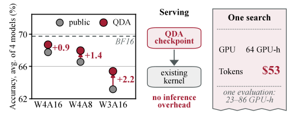
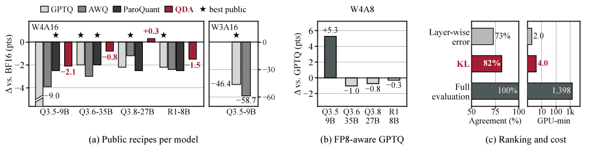
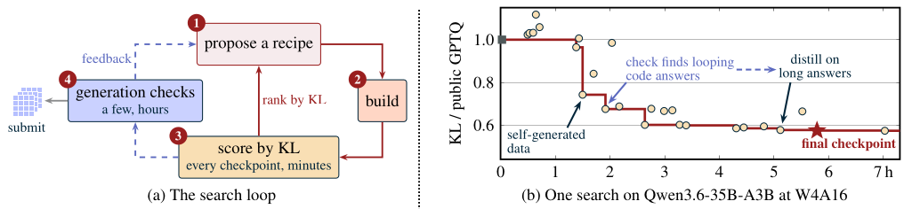
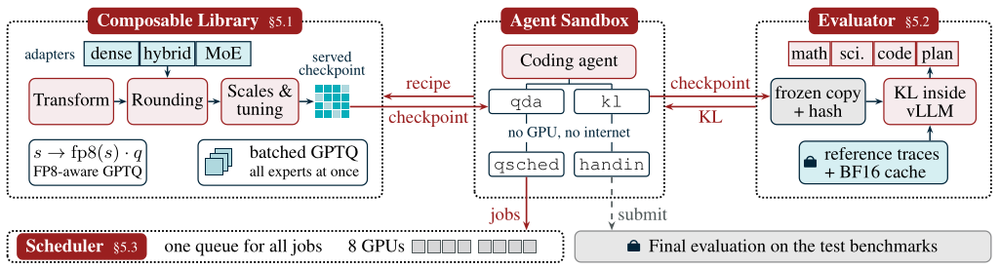
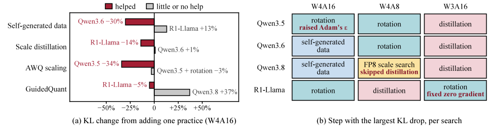
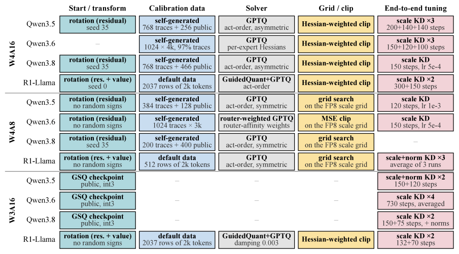
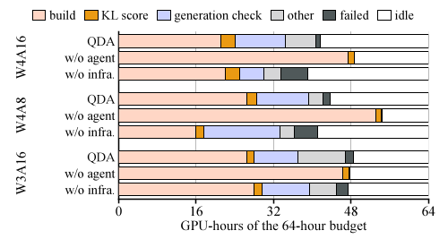

> **中文翻译**：本文是 arXiv:2611.23388 的中文翻译（原文采用 CC-BY 4.0 许可，按节忠实翻译，表格、数字、公式按原文保留；References 部分未收录，附录全部收录）。原文链接：<https://arxiv.org/abs/2611.23388>

# QDA：用 Agent 实现闭环式 LLM 量化设计

**QDA: Closed-Loop LLM Quantization Design with Agents**

作者：Xingyang Li\*（MIT）、Tianlang Zhao\*（MIT）、Song Han（MIT / NVIDIA）、Ligeng Zhu（NVIDIA）。\*共同第一作者。arXiv:2611.23388v1 [cs.LG]，2026-11-17。

## 摘要

训练后量化（post-training quantization）是低成本部署大语言模型的标准手段。然而，最优的量化 recipe 随模型和精度而变，因此每遇到一个新模型，专家都要重新设计一遍，既耗时又往往不是最优。所幸 LLM agent 可以接手这项设计：在一轮轮"构建候选、评估候选"中不断改进 recipe，轮数越多，recipe 越好。但评估一个量化后的推理模型要花几十 GPU 小时，而把来自不同代码库的方法组合起来，意味着要手工把每个方法移植到新架构上。我们提出 QDA，一个由 agent 为每个模型和精度设计 recipe 的系统。为了让评估变快，QDA 用候选模型相对原模型的输出 KL 散度来打分，在 agent 看不到的推理轨迹上只需几分钟，并对有希望的候选做长文本生成检查，以捕获重复循环之类的失败。为了让构建变快，QDA 提供了一个公开 PTQ 方法库，这些方法彼此兼容，也兼容新的模型架构。在四个推理模型上，QDA 在 W4A16、W4A8 和 W3A16 下的平均精度分别比最强公开 recipe 高 0.9、1.4 和 2.2 个百分点，每次搜索用 64 GPU 小时。在 320B 参数的 MoE 模型 GLM-5.3-Flash 的 NVFP4 W4A4 下，QDA 恢复了 FP8 模型 98.3% 的精度，而最好的厂商 checkpoint 为 96.9%。每个 QDA checkpoint 都能跑在现有的推理 kernel 上，没有任何额外的推理开销。我们将发布该库、评估器和 harness。

## 1 引言

大语言模型（LLM）擅长数学、科学和编程，而推理模型更进一步，在回答之前会思考数千个 token（Guo et al., 2025；Yang et al., 2025a；Chen et al., 2026）。然而，部署它们在显存和算力上都很昂贵。训练后量化（PTQ）是同时降低这两项成本的标准做法（Frantar et al., 2023；Lin et al., 2024b）。例如，权重用 NVFP4 表示时，320B 参数的 GLM-5.3-Flash（Z.ai, 2026）只需一块 GB300 GPU，而 FP8 需要两块。如果同时量化激活，矩阵乘法就能跑在低精度 tensor core 上，其速度是 BF16 的数倍（Xiao et al., 2023；Lin et al., 2025；Alvarez et al., 2025）。

现有 PTQ 方法修复的是不同来源的量化误差（Xiao et al., 2023；Frantar et al., 2023；Lin et al., 2024b），因此可以叠加使用，组合往往比任何单一方法都好（Ashkboos et al., 2024；Liu et al., 2025b）。一个量化 checkpoint 由此是由一个 recipe 产生的，recipe 由叠加的方法、它们的设置以及校准数据构成（§ 2.2）。但我们发现，最优 recipe 随模型和精度而异。例如，在 4 bit 仅权重量化下，最准确的公开 recipe 在 Qwen3.5-9B（Qwen Team, 2026）上是 ParoQuant（Liang et al., 2026），而在 DeepSeek-R1-Distill-Llama-8B 上却是 GPTQ（Frantar et al., 2023）（图 2(a)）。仅在 Qwen3.5-9B 上，AWQ（Lin et al., 2024b）在 4 bit 下胜过 GPTQ，但在 3 bit 仅权重量化下反而输给它。



**图 1.** QDA 以低成本胜过最强公开 recipe。左：四个推理模型在各精度下的平均精度，分别为最强公开 recipe 和 QDA。中：QDA checkpoint 跑在现有 kernel 上，没有推理开销。右：一次搜索的 GPU 小时数和 agent token 花费。

每个方法只在少数模型和精度上评估过，所以新模型的最佳 recipe 只能靠在它上面试候选来找。专家因此仍要手工决定组合哪些方法、用什么设置和数据。例如，NVIDIA 的 ModelOpt 为 28 个模型各自维护一份手写 recipe，其中记录了诸如哪些模块保留 BF16 之类与模型相关的决定（NVIDIA, 2024）。这种手工设计无法扩展，因为每个新模型都需要自己的 recipe，而新模型层出不穷。2025 年 10 月到 2026 年 9 月之间，发布了 90 多个参数量超过 10B 的开源权重模型（Epoch AI, 2026），在我们的四种精度下需要 360 多份 recipe。

LLM 编码 agent 已经在写代码来改进算法、GPU kernel 和计算机系统（Novikov et al., 2025；Cao et al., 2026；Cheng et al., 2025）。recipe 设计天然适合这类 agent，因为它同样是试错式的，像专家那样一个接一个地构建并评估候选。但有两个问题挡在前面。第一，评估候选很贵。推理模型每个回答要写数千 token，每个问题还要采样多次，完整评估一个量化 checkpoint 最多要 86 GPU 小时（§ 3.2）。在这样的成本下，一次搜索只能试少数几个候选，所以要想搜得更广，就需要一个便宜得多的精度代理指标。第二，构建候选也很贵。大多数 PTQ 方法是以独立的研究代码发布的，因此混合多个方法的 recipe 必须手工移植到每个新架构上，例如线性注意力混合架构（Yang et al., 2025b；Kimi Team et al., 2025）和细粒度专家混合（DeepSeek-AI et al., 2024；OpenAI et al., 2025）。即便某个方法已被工具包支持，它对一次搜索来说也可能太慢（§ 3.3）。如果让 agent 自己填补这些空缺，每次搜索约要写 3k 行量化代码，最后得到的 checkpoint 还更不准（§ 6.3）。

为此，我们提出 QDA，一个由 agent 为每个模型和精度设计量化 recipe 的系统（图 3）。针对第一个问题，我们以候选模型的 next-token 分布相对原模型的 KL 散度作为代理指标，在参考轨迹（reference traces，即原模型自己写出的推理轨迹）上测量。由于原模型的分布已被缓存，给一个候选打分只需几分钟，比完整评估便宜 350–990 倍。agent 还会为少数有希望的候选生成完整回答，以暴露重复循环之类的罕见失败。针对第二个问题，我们在一个库里以统一接口实现了 21 种 PTQ 方法。每个方法的输入是一个量化 checkpoint，输出也是一个，因此 agent 可以按任意顺序叠加方法。最后，一个 harness 在无人监督的情况下运行搜索，并把测试基准和参考轨迹放在 agent 够不到的地方，因为在它们上面调出来的 recipe 分数会更高，却并不真的更好（Kapoor et al., 2025；Xu et al., 2024）。

在涵盖稠密 Transformer、线性注意力混合架构和专家混合（MoE）模型的四个推理模型上，QDA 在 W4A16、W4A8 和 W3A16 下的平均精度分别比最强公开 recipe 高 0.9、1.4 和 2.2 个点（图 1）。每次搜索用 64 GPU 小时。在 MoE 模型上，当它们在相同库、相同预算下搜索时，QDA 在 W4A8 和 W3A16 下还比 greedy search 和 ASHA（Li et al., 2020）最多高 1.2 个点；而同一个 agent 如果拿到 ModelOpt 及其 recipe-search skill，即使在测试基准上做选择，也落后 0.5–1.3 个点。在 320B 参数的 GLM-5.3-Flash 的 NVFP4 下，一次 6.5 小时的搜索恢复了 FP8 模型 98.3% 的精度，而 NVIDIA 和 Red Hat AI 发布的 checkpoint 分别为 96.9% 和 96.3%（NVIDIA, 2026a；Red Hat AI, 2026）。此外，每个 QDA checkpoint 都跑在其格式对应的现有推理 kernel 上，不增加任何推理开销。

**表 1.** 评测的精度。前三种在 GH200 上用 vLLM 0.27.1 跑四个主要模型，NVFP4 在 GB300 上用 vLLM 0.31 跑 GLM-5.3-Flash。

| 精度 | 权重 | 激活 | Kernel |
|---|---|---|---|
| W4A16 | INT4 g128 asym | BF16 | Marlin |
| W3A16 | INT3 g128 sym；head + embeddings 为 INT4 g64 | BF16 | Humming |
| W4A8 | INT4 g128 sym | FP8 (E4M3) per-token | CUTLASS W4A8 |
| NVFP4 W4A4 | FP4 (E2M1) g16，FP8 scales | FP4 (E2M1) g16 | NVFP4 GEMM |

## 2 背景

### 2.1 量化 LLM 的部署

量化同时降低部署的显存和计算量。更小的权重让模型能放进更少的 GPU，也加速受权重读取限制的 decoding（Lin et al., 2025；2024b）。量化激活则进一步让矩阵乘法使用更快的 tensor core，从而加速 compute-bound 的 prefill 和大 batch decoding。

**量化。** 量化用 scale $`s`$ 和 zero point $`z`$ 把一组值 $`x`$ 映射为 $`b`$ bit 的码：

```math
Q(x) = s\left(\mathrm{clamp}\left(\left\lfloor \frac{x}{s} \right\rceil + z,\ 0,\ 2^{b}-1\right) - z\right).
```

对称格式使用不带 $`z`$ 的有符号码，NVFP4（Alvarez et al., 2025）则舍入到 4 bit 浮点值而不是整数。我们用 WxAy 表示 x bit 权重和 y bit 激活，表 1 列出了我们使用的四种格式。

**量化矩阵乘法。** 线性层计算 $`\mathbf{Y} = \mathbf{X}\mathbf{W}^{\top}`$ ，其量化 kernel 计算

```math
\mathbf{Y} \approx Q(\mathbf{X})\, Q(\mathbf{W})^{\top},
```

其中 $`Q(\mathbf{W})`$ 存在 checkpoint 里， $`Q(\mathbf{X})`$ （如果有）则在运行时即时计算。不同格式的差别在于 tensor core 乘的是哪些操作数。在 W4A16 和 W3A16 下，kernel 在寄存器里把权重反量化为 BF16，这省了访存但不省算术（Frantar et al., 2025；Lin et al., 2024b）。在 W4A8 下，激活也被逐 token 量化为 FP8（Micikevicius et al., 2022），这是 vLLM 的 W4A8 kernel 唯一接受的类型。在 NVFP4 W4A4 下，两个操作数都是 4 bit 浮点，每 16 个值共用一个 scale，Blackwell tensor core 可以直接对它们做乘法（Alvarez et al., 2025；Rouhani et al., 2023）。每个 kernel 还规定了 scale 的精度，例如 W4A8 下是 FP8，量化器必须与之精确匹配。



**图 2.** 最优 recipe 随模型和精度而变，完整评估的成本是一次 KL 打分的数百倍。(a) 三种公开 recipe 与 QDA 在四个模型上 W4A16 的精度相对 BF16 的变化。星号标记最准的公开 recipe。在 Q3.5-9B 的 W3A16 下，AWQ 与 GPTQ 的次序互换。(b) FP8-aware GPTQ 在 W4A8 下的精度变化，它把 GPTQ 的码拟合到 kernel 使用的 FP8 scale 而不是 BF16 scale。这对 Q3.5-9B 有帮助，但对其余三个模型有害。(c) 左：每种度量与精度排序一致的 checkpoint 对所占的比例（共 44 对）。右：在一个 R1-8B checkpoint 上计算每种度量的 GPU 分钟数。Q3.5-9B、Q3.6-35B、Q3.8-27B 和 R1-8B 分别表示 Qwen3.5-9B、Qwen3.6-35B-A3B、Qwen3.8-27B 和 DeepSeek-R1-Distill-Llama-8B。

### 2.2 训练后量化方法

训练后量化（PTQ）在不重新训练的情况下量化一个已训练好的模型，只用一小批校准文本。大多数方法一次处理一个线性层，在校准输入 $`\mathbf{X}`$ 上最小化该层的输出误差：

```math
\min_{Q(\mathbf{W})} \left\| \mathbf{X}\mathbf{W}^{\top} - \mathbf{X}\, Q(\mathbf{W})^{\top} \right\|_{F}^{2}.
```

一个 recipe 要做四个选择：变换、舍入方法、scale 及其调优、校准数据。

**变换（Transformations）。** 由于对任意可逆矩阵 $`\mathbf{T}`$ 都有 $`\mathbf{X}\mathbf{W}^{\top} = (\mathbf{X}\mathbf{T}^{-1})(\mathbf{W}\mathbf{T}^{\top})^{\top}`$ ，变换可以在不改变输出的前提下重塑两个操作数，例如抑制少数激活通道中的 outlier（Xiao et al., 2023）。对角 $`\mathbf{T}`$ 对通道做缩放：SmoothQuant 把 outlier 从激活转移到权重（Xiao et al., 2023），AWQ 则放大那些遇到大激活的权重通道，使其免受舍入影响（Lin et al., 2024b）。正交 $`\mathbf{T}`$ （例如 Hadamard 旋转）混合所有通道，使没有哪个通道突出（Ashkboos et al., 2024；Liu et al., 2025b；Xi et al., 2023）。ParoQuant 把学习得到的成对旋转与通道缩放结合起来（Liang et al., 2026）。

**舍入（Rounding）。** 把每个权重舍入到最近的码，忽略了不同权重的误差在输出中如何累加。GPTQ（Frantar et al., 2023）近似求解式 (3)：它一次舍入一列，并更新尚未舍入的列来抵消误差，用到校准输入的二阶统计量 $`\mathbf{X}^{\top}\mathbf{X}`$ 。学习式舍入，如 AutoRound（Cheng et al., 2024）和 GSQ（Dadgarnia et al., 2026），则用梯度下降学习每个权重的舍入方式，代价更高。

**Scale 与调优。** 较大的 scale 能覆盖极端值，但对其他值舍入得更粗，因此 clipping 会搜索最能平衡两者的 scale。由于式 (3) 看不到跨层累积的误差，调优方法训练 scale，使量化模型与原模型逐 block 地对齐（Shao et al., 2024；Chen et al., 2025），或通过蒸馏对齐（Malinovskii et al., 2024）。

**校准数据。** 上面所有统计量都来自校准输入，因此仅仅改变校准数据的选择就会改变结果的精度（Williams & Aletras, 2024）。通用文本是默认选择，而由原模型自己生成的文本（自生成数据，self-generated data）可能效果更好（Williams et al., 2025）。

**组合各个步骤。** 由于每个选择消除的是不同的误差，按顺序应用它们（例如先旋转再 GPTQ）往往比任何单一方法都更准（Ashkboos et al., 2024；Liu et al., 2025b）。但处理同一种误差的步骤会彼此重叠，因此无法仅凭各个方法本身预测最佳组合。

## 3 动机

### 3.1 最优 recipe 随模型和精度而变

在 W4A16 下，没有哪个公开 recipe 在所有模型上都最准（图 2(a)）。ParoQuant 在 Qwen3.5-9B 上最好，AWQ 在 Qwen3.8-27B 上最好，GPTQ 在 DeepSeek-R1-Distill-Llama-8B 上最好。对同一个模型，排名也会随精度改变。在 Qwen3.5-9B 上，AWQ 在 W4A16 下比 GPTQ 准 5.1 个点，但在 W3A16 下反而低 12.3 个点。即使是单一技术，也可能对一个模型有帮助而对其他模型有害。例如，W4A8 kernel 把每个 scale 存成 FP8，而 GPTQ 是用 BF16 scale 计算的。改用 FP8 scale 运行 GPTQ（FP8-aware GPTQ），使 Qwen3.5-9B 的精度提高了 5.3 个点，却让其余三个模型的精度下降（图 2(b)）。因此，为某个模型和精度找到的 recipe 不能直接迁移，每个新的组合都需要自己的搜索。

### 3.2 评估 recipe 很昂贵

早先对量化 recipe 的搜索可以在几分钟内评估一个候选。面向卷积网络的 AutoML 在一个小验证集上测量精度（He et al., 2018；Wang et al., 2019），之前的 LLM 量化方法则用只需每题生成几个 token 的短基准来评判（Frantar et al., 2023；Lin et al., 2024b）。

推理模型打破了这一假设。它们是在一条长思维链之后，按最终答案来评分的，思维链常常长达数万 token，而仅仅一个 token 的不同就可能改变后续整个推理和答案（Yuan et al., 2025）。因此，可靠的估计需要对每道题平均多次采样，尤其是 AIME 只有几十道题（Hochlehnert et al., 2025），所以完整评估一个量化 checkpoint 会生成约一万个长回答，在 DeepSeek-R1-Distill-Llama-8B 上耗费 23 GPU 小时，在我们的 Qwen 模型上耗费 60–86 GPU 小时（图 2(c)）。题目或采样更少，估计就太噪；而在测试集上给每个候选打分又会过拟合它们（Blum & Hardt, 2015）。因此，搜索需要一个只需几分钟、却能反映整个被部署模型的代理指标。

### 3.3 构建候选很昂贵

构建候选的昂贵体现在两个方面。第一，recipe 只能使用其代码能在该模型架构上运行的方法。大多数 PTQ 方法是针对其论文中的模型家族发布的研究代码。llm-compressor、AutoRound 和 ModelOpt 这类工具包只运行它们自己重新实现的方法，并且每遇到一个新模型就要手工扩展按架构划分的表格（Red Hat AI & vLLM Project, 2024；Cheng et al., 2024；NVIDIA, 2024），例如 Qwen3-Next 发布后，llm-compressor 花了三周才支持在它上面做校准（Sikka, 2025）。第二，一次构建对搜索来说可能太慢。例如，用 llm-compressor 0.13 对 256 专家的 Qwen3.6-35B-A3B 做一次 GPTQ 构建，大约需要 16 GPU 小时，占到我们每次搜索 64 GPU 小时预算的四分之一。没有我们的库，agent 就得自己填补这些空缺，每次搜索写约 3k 行量化代码，最后得到的 checkpoint 还不够准（§ 6.3）。我们的库一次性为所有搜索填补了这些空缺。它从模型本身推导出哪些层馈入哪些层，因此像 GLM-5.3-Flash 这样的新架构无需对每个方法做改动，并且它构建同样的 GPTQ 只需 0.42 GPU 小时（§ 5.1）。

## 4 QDA：由 LLM Agent 设计 recipe

如图 3(a) 所示，agent 在一个四步循环中设计 recipe。每一轮中：(1) agent 提出一个 recipe；(2) 库把它构建成一个候选 checkpoint；(3) 评估器用它相对原模型的 KL 散度给 checkpoint 打分，只需几分钟。对少数有希望的候选，(4) agent 还会生成长回答来找出重复循环之类的失败。预算用完时，agent 提交它认为最好的 checkpoint，只有这个 checkpoint 会在测试基准上评估。§ 5 介绍系统本身。



**图 3.** QDA 循环。每个候选在几分钟内得到一个 KL 分数，少数有希望的候选还会得到一次长生成检查，agent 综合两者来决定下一步改什么。(a) 一轮的四个步骤，编号对应 § 4 中的步骤 (1)–(4)。(b) 一次搜索中每个 checkpoint 的 KL，相对于公开 GPTQ checkpoint。折线表示到目前为止最低的 KL。蓝色标签标记一次长生成检查，黑色标签标记 agent 做出的两个改动（§ 4.3）。

### 4.1 问题设定

一个 recipe 是由 § 2.2 中的方法组成的有序列表，每个方法带有自己的设置和校准数据，把原模型 $`M`$ 变成一个量化 checkpoint。

**目标。** 目标是找到最能保留原模型通用能力的 checkpoint。我们用完整评估在数学、科学、代码和指令遵循上的平均精度 $`A`$ 来衡量这些能力，这些类别是模型发布时通常报告的（Guo et al., 2025；Yang et al., 2025a），并像近期量化工作一样对各类别取平均（Liang et al., 2026）。在 GPU 预算 $`B`$ 之内，搜索求解

```math
\max_{i} A\left(x^{(i)}\right) \quad \text{s.t.} \quad \sum_{i} c^{(i)} \le B,
```

其中 $`x^{(i)}`$ 是第 $`i`$ 个候选， $`c^{(i)}`$ 是其数据、构建、打分和检查所用的 GPU 时间。对一个 checkpoint 测量一次 $`A`$ 在我们的模型上需要 23–86 GPU 小时（§ 3.2），所以如果搜索对每个候选都测量 $`A`$ ，就只能负担很少几个候选。因此，搜索用 KL（步骤 3）和生成检查（步骤 4）对候选排序，只对最终 checkpoint 测量 $`A`$ 。

**可接受的 recipe。** checkpoint 必须保持公开基线所量化的模块、位宽和格式（表 1），并能在它们的 kernel 上运行，不引入新算子。公开 checkpoint 可以被改进，但不能原样提交。

**Agent。** 在步骤 (1) 中，agent 编写 recipe。它在一个沙箱里工作，沙箱中有库、每个方法对应的一张卡片（说明它做什么、什么时候会失败）和一份任务说明（附录 E），它还可以编写自己的代码，例如用原模型生成校准数据。在两次提议之间，它阅读自己的分数日志、检查结果和自己的笔记，据此决定下一步改哪个步骤或设置。

### 4.2 用 KL 为候选打分

在步骤 (3) 中，评估器根据 checkpoint 的 next-token 预测与原模型的差异程度给它打分。

**为什么用 KL。** 我们从大多数 PTQ 方法本来就在计算的信号出发，即式 (3) 的逐层误差，GPTQ 和 AWQ 都在最小化它。但它一次只看一层，看不到跨层累积的误差。例如，在 Qwen3.5-9B 的 W4A16 下，逐层误差偏好 GPTQ 而非 AWQ，尽管 AWQ 的 $`A`$ 高 5.1 个点。因此，我们改为用两者 next-token 分布之间的 KL 散度来比较整个量化模型与原模型。评估器是在 vLLM 所部署的那个量化 checkpoint 上计算这些分布的，所以 KL 也包含只有部署 kernel 才会引入的误差，例如 W4A8 kernel 的 FP8 scale（§ 3.1）。为验证这个选择，我们取了三种精度下的 44 对公开基线和简单 recipe（图 2(c)）。KL 把 82% 的 checkpoint 对排成与精度一致的顺序，而逐层误差为 73%。

**分数。** 评估器持有一组固定的参考轨迹，它们是原模型针对数学、科学、代码以及写作与规划类提示写出的，这些提示与测试基准不重叠。评估器把每条轨迹送入 checkpoint，并在所有生成位置 $`\mathcal{T}`$ 上平均逐 token 的 KL 散度：

```math
\mathrm{KL}(x) = \frac{1}{|\mathcal{T}|} \sum_{(s,t)\in\mathcal{T}} D_{\mathrm{KL}}\left( p_{M}(\cdot \mid s_{<t}) \,\|\, p_{x}(\cdot \mid s_{<t}) \right),
```

其中 $`s_{<t}`$ 是轨迹 $`s`$ 在位置 $`t`$ 之前的前缀。在单个 domain 内取平均就得到该 domain 的 KL。

**用 top token 估计 KL。** 在每个位置保存原模型的完整分布，每组参考轨迹在 BF16 下需要 0.21–0.56 TB，因为 128k–248k 的词表要面对 49 万到 113 万个位置。因此，评估器在每个位置 $`t`$ 只保留原模型概率最高的 $`k=128`$ 个 token $`\mathcal{K}_t`$ 以及一个装其余所有 token 的桶，于是每个位置的贡献为

```math
\sum_{v\in\mathcal{K}_t} p_{M}(v) \log \frac{p_{M}(v)}{p_{x}(v)} + \bar{p}_{M} \log \frac{\bar{p}_{M}}{\bar{p}_{x}},
```

其中 $`\bar{p} = 1 - \sum_{v\in\mathcal{K}_t} p(v)`$ 。

**命题 1。** 式 (6) 的估计永远不超过式 (5) 的完整 KL，并且当 $`p_{M}(v)/p_{x}(v)`$ 对每个 $`v \notin \mathcal{K}_t`$ 都相同时，两者相等。

该估计就是把 $`\mathcal{K}_t`$ 之外所有 token 合并成一个桶之后，两个分布之间的 KL；由 log-sum 不等式（Cover & Thomas, 2006），合并 token 只会让 KL 变小。稀疏 logit 蒸馏把同样的桶称为 ghost token（Anshumann et al., 2025）。实际中，该桶平均占原模型概率的 0.015–0.048%，在我们用两种方式都打过分的九个 checkpoint 上，该估计比完整 KL 低 0–0.4%。原模型在参考轨迹上的 top-$`k`$ 分布只计算一次并缓存，因此给一个候选打分只需运行它的量化 checkpoint，只要几分钟（§ 5.2）。

**标记平局。** 当两个 checkpoint 的 KL 相差小于 $`\sigma`$ 时，评估器在 agent 的日志里把它们标记为平局，避免 agent 对偶然差异做出反应。这里 $`\sigma`$ 是同一个 recipe 在另一随机子集的校准数据上重建时 KL 的相对标准差，在我们的模型上为 0.5–1.6%（附录 C）。对同一个 checkpoint 再次打分会返回完全相同的值，所以这种波动来自构建而不是评估器。

### 4.3 检查长回答

只有思考之后的答案才被评分，因此一个出现循环或始终没有结束推理的模型会丢掉整道题。量化可能使这种情况更容易出现，因为量化后的推理模型可能比原模型思考得更久（Lotfi et al., 2026）。这类失败往往出现在长回答的后段，所以只有当 checkpoint 自己写出完整回答时才会暴露。因此在步骤 (4) 中，agent 挑选一个候选，让它为 agent 自己选定的难题写出完整回答，这些题都不来自测试基准。agent 统计其中答错、循环或被截断的回答数，并把这些计数与 KL 一起权衡，以决定改什么。

例如，在 Qwen3.6-35B-A3B 的 W4A16 下，用自生成数据校准 GPTQ 使 KL 降低了 30%（图 3(b)）。然而在一次长生成检查中，这个 checkpoint 有 191 个回答里的 12 个在长度上限处被截断，而原模型只有 3 个。其中多数是在调试步骤里循环的代码回答。agent 记录道"截断数是我关注的信号"，并在检查评分一分钟后，开始为长回答生成 600 条难题提示。它保留了在原模型轨迹上的校准，并在量化模型自己的 1,200 个长回答上加了 scale 蒸馏，其最终 checkpoint 比最佳公开 recipe 高 1.3 个点。

## 5 QDA 系统

一次搜索必须在预算内、安全地、无需人工干预地构建并打分几十个 checkpoint。QDA 通过三个组件做到这一点：一个可组合的库、一个位于推理引擎内部的评估器，以及一个运行搜索的 harness（图 4）。agent 可以在沙箱里写任何代码，但每个 GPU 作业（包括它自己的代码）都要经过 harness，这样一个调度器就能共享一次搜索的所有 GPU 并遵守预算（§ 5.3）。agent 通过四条命令访问这三个组件：`qda` 构建 recipe，`kl` 给 checkpoint 打分，`qsched` 提交其他任何 GPU 作业，`handin` 提交其最终 checkpoint。



**图 4.** QDA 的系统架构。QDA 有三个组件：可组合库（§ 5.1）、隔离的评估器（§ 5.2）和 harness（§ 5.3），后者在沙箱中运行 agent 并调度它的 GPU 作业。在沙箱里，agent 只能通过四条命令访问系统的其余部分：(1) `qda` 在库中构建 recipe 并返回其 checkpoint，(2) `kl` 把 checkpoint 发给评估器并返回其 KL，(3) `qsched` 把其他作业（例如长生成检查）提交给调度器，(4) `handin` 提交最终 checkpoint，它们在搜索结束后在测试基准上评估。

### 5.1 可组合库

我们的库把 llm-compressor（Red Hat AI & vLLM Project, 2024）扩展到 21 种覆盖 § 2.2 的方法（表 8）。

**跨架构组合方法。** 把任意方法应用于 vLLM 能加载的 checkpoint，会产生一个 vLLM 同样能加载的新 checkpoint。因此，方法可以作为 recipe 的步骤叠加，方法也可以改进一个公开 checkpoint 或 agent 自己构建的 checkpoint。AWQ 和旋转这类方法必须知道哪个归一化层馈入哪些线性层，而研究代码为每个模型家族硬编码了这些模块名。我们的库则从模型本身推导这些关系，并逐一做数值检验，所以一个方法只需写一次就能在新架构上运行。库建成之后，支持 GLM-5.3-Flash（一个 288 专家、在我们的主要搜索中未见过的模型）只需要一个 72 行的 adapter，外加对其 FP8 发布版和 multi-token-prediction 层的一个扩展。随后每个方法都能在它上面运行，搜索无需其他开发（§ 6.2，附录 D）。

**匹配部署 kernel。** kernel 存储某个量时，精度可能比量化器假定的更低。例如，vLLM 的 W4A8 kernel 把每个 scale 转成 FP8，而 llm-compressor 是针对 BF16 scale 来挑选码的。我们的库则针对 kernel 实际存储的 scale 来挑选码。

**快速构建。** 在 llm-compressor 0.13 中，GPTQ 逐个求解每个线性层，所以 256 个专家的一层要依次运行 768 次小规模求解。一层中的各个专家是形状相同的独立问题，所以库把它们的二阶统计量堆叠起来，用一次批量分解求解所有问题。这样，对 Qwen3.6-35B-A3B 做一次 GPTQ 构建只需 0.42 GPU 小时，而不是约 16 小时，KL 与 llm-compressor 的相差在 1% 以内。

### 5.2 评估器

式 (5) 需要两个模型在约一百万个位置上的全词表 next-token 分布。朴素的评估器每次打分都要运行两个模型。此外，vLLM 这样的推理引擎在每个位置只返回少数最大的概率。因此，评估器把原模型的 top-$`k`$ 分布一次性缓存下来（约 1 GB），并在引擎内部计算候选模型这一侧。

**在引擎内部做规约。** 评估器钩住 vLLM workers 内部的 prompt log-probabilities，并就地把每个全词表分布规约成式 (6) 中的各项，所以只有累加和会离开引擎。于是一次打分只运行该 checkpoint，使用的是最终评估所用的 kernel，并且比完整评估便宜 350–990 倍（附录 C）。

### 5.3 Harness

搜索在无人干预下运行，所以 harness 本身必须保证评估诚实、并让 GPU 保持忙碌。

**隔离评估器。** 如果 agent 能读到评估器，它就可以在不改进模型的情况下降低 KL，例如直接在参考轨迹上做校准（Lin et al., 2024b）。因此 harness 把参考轨迹和测试基准放在 agent 够不到的地方。agent 在一个没有 GPU、除模型 API 外没有网络的沙箱里工作，沙箱之外的一个 supervisor 检查并记录每次工具调用（附录 E）。评估器在沙箱之外、基于其代码的只读副本运行。每个打分作业读取 checkpoint 的一份冻结副本，并且只返回 KL 值，即总体 KL、各 domain 的 KL 以及人工撰写文本上的 KL。agent 能读到的每个文件事先都会被扫描是否含有测试题，使得没有任何测试题能通过校准数据或提示词流到 agent 手里（附录 C）。

**调度。** 一次搜索要运行几十个 GPU 作业，从几分钟的 KL 打分到几小时的构建，agent 在工作中逐个提交它们。agent 在下一步之前要等待每个 KL 分数，但打分和构建运行在同一批 GPU 上。由于 agent 的沙箱里没有 GPU，harness 在整个预算期内持有这些 GPU，并通过一个优先级队列运行每一个作业。作业会声明它需要多少块 GPU、预计运行多久以及它要等待哪些作业。作业提交时 harness 会复制它的脚本，所以 agent 可以在作业排队或运行期间继续编辑自己的文件；harness 在一个容器里、在没有其他作业使用的 GPU 上运行该作业。KL 打分排在已排队的构建之前，但不会中断正在运行的作业，并且如果某个作业预计的时长会超过截止时间，就不会启动它。在 12 次搜索中，KL 打分在 agent 提出请求后的中位数 5 秒启动，作业让 GPU 保持忙碌的时间占 72%。

## 6 评估

### 6.1 设置

**模型与精度。** 我们评估四个推理模型（表 6），在图和表 5b 中称之为 Qwen3.5、Qwen3.6、Qwen3.8 和 R1-Llama。其中两个是稠密的 Gated DeltaNet 混合架构（Qwen3.5-9B、Qwen3.8-27B），一个是有 256 个专家的混合架构 MoE（Qwen3.6-35B-A3B），还有一个是稠密的 DeepSeek-R1-Distill-Llama-8B。我们量化与公开基线相同的模块（附录 B）。我们在 GH200 GPU 上使用表 1 的格式和 vLLM kernel，另外还在 GLM-5.3-Flash 上以 NVFP4 W4A4 跑了一次搜索，这个组合在任何主搜索中都没见过（§ 6.2）。

**基准。** 测试基准有四个类别，我们报告它们的均值。它们是数学（AIME 2025 和 HMMT Feb 2026）、科学（GPQA-Diamond（Rein et al., 2024））、代码（LiveCodeBench v6（Jain et al., 2025））和指令遵循（IFBench（Pyatkin et al., 2025）），每题分别采样 32、16、4 和 16 次（附录 B）。DeepSeek-R1-Distill-Llama-8B 用 IFEval（Zhou et al., 2023）代替 IFBench，因为它在 IFBench 上的精度只有 20%，太低而无法区分各 recipe。模型按其 model card 的采样设置最多生成 81,920 个 token（附录 B）。一个始终没有结束思考的样本记 0 分。

**基线。** 公开 recipe 包括：用 llm-compressor 默认设置的 GPTQ（Frantar et al., 2023）和 AWQ（Lin et al., 2024b）；W4A8 下的 QuaRot 离线旋转后接默认 GPTQ（QuaRot+GPTQ）（Ashkboos et al., 2024）；以及两个报告了 state-of-the-art 精度的近期方法，W4A16 下的 ParoQuant（Liang et al., 2026）和 W3A16 下的 GSQ（Dadgarnia et al., 2026）。GPTQ 在 W4A16 下是非对称的。ParoQuant 使用其发布的 checkpoint。GSQ 在 Qwen3.8-27B 上使用其发布的 checkpoint，在其余三个模型上我们自己运行它的官方代码（附录 A）。ParoQuant 和 GSQ 都要训练量化模型。ParoQuant 在 8B 模型上约需 9 GPU 小时（Liang et al., 2026），GSQ 在我们的 GPU 上每个模型耗时 30–52 GPU 小时，接近一次搜索的 64 GPU 小时。

**Agent 与预算。** agent 是 Claude Code v2.1.303，模型为 Claude Opus 5.5、high effort，一份任务说明适用于每个模型和精度（附录 E）。每个模型—精度组合有一次搜索，使用 8 块 GH200 GPU、8 小时（64 GPU 小时）和 19–75 美元的 agent token 费用，使用 vLLM 0.27.1（Kwon et al., 2023）的最终评估不计入其中。在消融实验也会用到的 Qwen3.6-35B-A3B 上，每个精度做三次搜索，我们报告它们的均值（标准差 0.1–0.2 个点）。和人类专家一样，agent 可以从一个公开 checkpoint 出发（§ 4.1）。

### 6.2 精度结果

如表 2 所示，QDA 在 W4A16、W4A8 和 W3A16 下的平均精度分别比每个组合中最强的公开 recipe 高 0.9、1.4 和 2.2 个点。

**表 2.** 主要结果。QDA 在 W4A16、W4A8 和 W3A16 下的平均精度分别比最强公开 recipe 高 0.9、1.4 和 2.2 个点，最多高 6.1 个点（DeepSeek-R1-Distill-Llama-8B 的 W3A16）。表中为四个推理模型在数学、GPQA-Diamond（GPQA）、LiveCodeBench（LCB）和 IFBench（IFB；R1-Llama 用 IFEval）上的精度（%），以及它们的平均值（Avg）。每个 QDA 行是一次 64 GPU 小时搜索的最终 checkpoint，Qwen3.6-35B-A3B 的各行是三次搜索的均值。在每个 Avg 列中，最好的量化结果为加粗，第二好的加下划线（下表中因逐行重排，此处未保留加粗与下划线标记）。在每个精度之内，除了增加在线旋转的 ParoQuant 外，所有行都运行在同一个 kernel 上（表 1）。QuaRot+GPTQ 只使用 QuaRot 的离线旋转（Qwen 模型用 R1，R1-Llama 用 R1 和 R2）。在 W3A16 下，除 Qwen3.6-35B-A3B 上的一次搜索外，所有 Qwen 搜索都从本表中的 GSQ checkpoint 出发并加以改进。

Qwen3.5-9B

| 精度 | 方法 | Math | GPQA | LCB | IFB | Avg |
|---|---|---|---|---|---|---|
| BF16 | – | 77.0 | 82.3 | 70.9 | 66.7 | 74.2 |
| W4A16 | GPTQ | 62.5 | 78.6 | 53.2 | 66.7 | 65.3 |
| W4A16 | AWQ | 72.8 | 79.6 | 63.5 | 65.5 | 70.4 |
| W4A16 | ParoQuant | 73.9 | 80.2 | 68.7 | 64.2 | 71.8 |
| W4A16 | QDA | 74.5 | 80.0 | 68.3 | 65.7 | 72.1 |
| W4A8 | GPTQ | 52.3 | 68.7 | 42.0 | 65.8 | 57.2 |
| W4A8 | AWQ | 57.0 | 68.9 | 36.2 | 62.8 | 56.2 |
| W4A8 | QuaRot+GPTQ | 71.5 | 73.6 | 59.7 | 63.4 | 67.1 |
| W4A8 | QDA | 74.6 | 81.3 | 68.5 | 65.1 | 72.3 |
| W3A16 | GPTQ | 19.3 | 41.9 | 9.2 | 40.6 | 27.8 |
| W3A16 | AWQ | 2.4 | 26.7 | 1.7 | 31.2 | 15.5 |
| W3A16 | GSQ | 67.5 | 70.5 | 59.3 | 63.7 | 65.2 |
| W3A16 | QDA | 70.7 | 73.5 | 63.5 | 59.3 | 66.8 |

Qwen3.6-35B-A3B

| 精度 | 方法 | Math | GPQA | LCB | IFB | Avg |
|---|---|---|---|---|---|---|
| BF16 | – | 86.1 | 85.4 | 81.6 | 66.0 | 79.8 |
| W4A16 | GPTQ | 82.8 | 83.9 | 79.8 | 64.5 | 77.7 |
| W4A16 | AWQ | 80.9 | 83.5 | 79.5 | 63.1 | 76.8 |
| W4A16 | ParoQuant | 82.7 | 84.0 | 79.2 | 65.1 | 77.7 |
| W4A16 | QDA | 84.5 | 85.0 | 81.0 | 65.3 | 79.0 |
| W4A8 | GPTQ | 81.7 | 83.0 | 78.7 | 66.1 | 77.4 |
| W4A8 | AWQ | 77.8 | 81.0 | 74.2 | 64.7 | 74.4 |
| W4A8 | QuaRot+GPTQ | 81.4 | 82.4 | 79.5 | 64.6 | 77.0 |
| W4A8 | QDA | 82.2 | 83.6 | 79.3 | 65.0 | 77.5 |
| W3A16 | GPTQ | 61.2 | 76.6 | 65.7 | 53.0 | 64.1 |
| W3A16 | AWQ | 26.1 | 56.1 | 14.6 | 46.5 | 35.8 |
| W3A16 | GSQ | 80.5 | 82.4 | 76.4 | 64.5 | 75.9 |
| W3A16 | QDA | 81.8 | 82.2 | 77.0 | 62.0 | 75.7 |

Qwen3.8-27B

| 精度 | 方法 | Math | GPQA | LCB | IFB | Avg |
|---|---|---|---|---|---|---|
| BF16 | – | 80.1 | 82.7 | 87.2 | 67.9 | 79.5 |
| W4A16 | GPTQ | 79.2 | 81.3 | 81.6 | 66.8 | 77.2 |
| W4A16 | AWQ | 78.3 | 82.1 | 85.2 | 67.6 | 78.3 |
| W4A16 | ParoQuant | 75.6 | 80.9 | 83.5 | 67.6 | 76.9 |
| W4A16 | QDA | 82.7 | 81.9 | 86.3 | 68.2 | 79.8 |
| W4A8 | GPTQ | 76.7 | 82.0 | 83.6 | 67.6 | 77.5 |
| W4A8 | AWQ | 73.9 | 80.6 | 82.8 | 67.4 | 76.2 |
| W4A8 | QuaRot+GPTQ | 80.6 | 80.6 | 86.2 | 68.1 | 78.9 |
| W4A8 | QDA | 81.8 | 80.3 | 86.0 | 68.3 | 79.1 |
| W3A16 | GPTQ | 75.1 | 75.3 | 82.7 | 66.8 | 75.0 |
| W3A16 | AWQ | 67.5 | 67.5 | 69.5 | 64.6 | 67.3 |
| W3A16 | GSQ | 81.9 | 78.6 | 83.6 | 66.7 | 77.7 |
| W3A16 | QDA | 85.9 | 79.1 | 84.7 | 66.8 | 79.1 |

DeepSeek-R1-Distill-Llama-8B（IFB 列为 IFEval）

| 精度 | 方法 | Math | GPQA | LCB | IFB | Avg |
|---|---|---|---|---|---|---|
| BF16 | – | 30.5 | 49.0 | 38.9 | 63.8 | 45.6 |
| W4A16 | GPTQ | 28.3 | 47.5 | 36.8 | 60.9 | 43.3 |
| W4A16 | AWQ | 28.1 | 48.1 | 36.6 | 59.8 | 43.1 |
| W4A16 | ParoQuant | 28.3 | 46.7 | 34.9 | 62.4 | 43.0 |
| W4A16 | QDA | 27.6 | 48.1 | 37.8 | 62.7 | 44.1 |
| W4A8 | GPTQ | 28.0 | 46.9 | 36.3 | 60.8 | 43.0 |
| W4A8 | AWQ | 25.7 | 45.2 | 33.9 | 59.2 | 41.0 |
| W4A8 | QuaRot+GPTQ | 25.6 | 43.5 | 36.5 | 60.6 | 41.6 |
| W4A8 | QDA | 27.5 | 46.7 | 36.5 | 61.5 | 43.1 |
| W3A16 | GPTQ | 20.3 | 35.9 | 27.8 | 51.4 | 33.9 |
| W3A16 | AWQ | 10.2 | 27.4 | 17.2 | 41.5 | 24.1 |
| W3A16 | GSQ | 14.7 | 33.0 | 22.9 | 38.7 | 27.3 |
| W3A16 | QDA | 25.1 | 42.5 | 32.4 | 60.2 | 40.0 |

**跨模型。** QDA 在稠密模型和两个 Gated DeltaNet 混合模型上、在每个精度下都是最准的 recipe。在 Qwen3.8-27B 的 W4A16 下，它甚至比 BF16 高 0.3 个点；在 DeepSeek-R1-Distill-Llama-8B 的 W3A16 下，它比 GPTQ 高 6.1 个点。在 MoE 模型 Qwen3.6-35B-A3B 上，QDA 在 W4A16 和 W4A8 下分别领先 1.3 和 0.1 个点，在 W3A16 下比 GSQ 低 0.2 个点。

**跨精度。** 在 W4A8 下，增益在 Qwen3.5-9B 上最大，那里默认的 GPTQ 和 AWQ 比 BF16 低 17–18 个点。QuaRot+GPTQ 用一次 Hadamard 旋转补回了其中 9.9 个点，FP8-aware GPTQ 补回了 5.3 个点（图 2(b)）。QDA 的 recipe 在旋转的基础上加入了自生成数据、一次 FP8 scale 搜索和 scale 蒸馏，比 QuaRot+GPTQ 准 5.2 个点。

**表 3.** GLM-5.3-Flash 在 NVFP4 下的结果。QDA 平均恢复了 FP8 精度的 98.3%，而 NVIDIA 和 Red Hat AI 发布的 NVFP4 版本分别为 96.9% 和 96.3%。括号中给出题目数和每题采样数。加粗和下划线标记最好和第二好的 NVFP4 结果（此处未保留标记）。

| Benchmark | FP8 | NVIDIA | Red Hat AI | QDA |
|---|---|---|---|---|
| Math (93, ×16) | 84.8 | 80.9 | 78.8 | 83.3 |
| GPQA-D (198, ×12) | 86.1 | 83.3 | 84.0 | 83.9 |
| LCB v6 (454, ×4) | 71.3 | 69.3 | 69.2 | 70.4 |
| SuperGPQA (9k, ×1) | 68.7 | 67.8 | 67.4 | 67.9 |
| Avg | 77.7 | 75.3 | 74.8 | 76.4 |
| % of FP8 | 100 | 96.9 | 96.3 | 98.3 |

**表 4.** 在 Qwen3.6-35B-A3B 上，使用相同的 64 GPU 小时，QDA 比使用 ModelOpt 的工作流和工具的同一个 agent 高 0.5–1.3 个点。数值为四类别平均精度（%）。

| 精度 | Best public | Agent + ModelOpt | QDA |
|---|---|---|---|
| W4A16 | 77.7 | 78.5 | 79.0 |
| W4A8 | 77.4 | 76.2 | 77.5 |
| W3A16 | 75.9 | 74.5 | 75.7 |

**光有强大的 agent 还不够。** 我们让同一个 agent 使用 NVIDIA 的 ModelOpt 及其 recipe-search skill（NVIDIA, 2026b），而不是我们的库、评估器和调度器（附录 E）。尽管它是直接在测试基准上选择候选的，它仍比 QDA 低 0.5–1.3 个点，并且在 W4A8 和 W3A16 下甚至低于最好的公开 recipe（表 4）。QDA 的收益来自它的搜索流程和基础设施，而不仅仅是 agent。

**扩展到 320B 模型和 NVFP4。** NVIDIA（2026a）和 Red Hat AI（2026）各自发布了 GLM-5.3-Flash（Z.ai, 2026）的 NVFP4 checkpoint。QDA 平均恢复了 FP8 精度的 98.3%，而这两个发布版为 96.9% 和 96.3%（表 3），并且除 GPQA-Diamond（比 Red Hat AI 低 0.1 个点）之外，它在每个基准上都是三者中最准的。它量化的模块也比任何一个发布版都多，所以它的 checkpoint 最小，为 183.6 GiB，而另两个为 190.4 和 184.3 GiB。我们从其 FP8 发布版出发，对这个 288 专家的模型做了一次搜索，用的 agent、库和评估器都与主搜索相同，没有任何公开 recipe。它在 16 块 GB300 GPU 上花了约 6.5 小时和 69 美元的 agent token。三个 NVFP4 checkpoint 使用相同的引擎、GPU 和采样设置评估（附录 B）。

**效率。** QDA 不增加推理开销，因为每个 checkpoint 都保持其精度下 GPTQ 和 AWQ 的格式和 vLLM kernel，在 GLM-5.3-Flash 上则是标准 NVFP4 格式。相比之下，ParoQuant 增加了一个在线旋转，需要为每种格式和引擎适配 kernel，所以 QDA 在 W4A16 下 decode 快 1.30–1.75 倍（表 7）。此外，在 12 个组合上，QDA 的回答比最强公开 recipe 的短 4%，触及长度上限的少 1.7 个点。



**图 5.** 搜索发现了什么。没有哪种已发表的做法对每个模型都有效，而且使 KL 下降最多的那一步在不同搜索之间也不同。(a) 在 W4A16 下，向 recipe 中加入一种已发表做法时 KL 的变化，取自同一次搜索中仅在该做法上不同的两个 checkpoint。越低越好。每种做法在一个模型上降低了 KL，在另一个模型上则不然。(b) 12 个最终 recipe 中各自 KL 下降最大的那一步。加粗的注记标出 agent 自己诊断出的问题。

**表 5.** 消融与固定 recipe。(a) 在 Qwen3.6-35B-A3B 上，用相同的 64 GPU 小时、KL 打分和提交规则，把 agent 换成预定义的搜索算法（greedy search、ASHA），或者把库和调度器换成公开工具和一个普通的 GPU 队列（w/o infra.）。QDA 和 w/o infra. 是三次搜索的均值。(b) 一个出自 QDA 搜索的固定 recipe：五个最终 recipe 所遵循的模式，以固定设置应用且不做搜索。它先在原模型写出的 640 个回答上校准 GPTQ，再做两轮 scale 蒸馏。数值为四类别平均精度（%）。每一行中最好的量化结果加粗，第二好的加下划线（此处未保留标记）。

(a) Qwen3.6-35B-A3B 上的消融

| 精度 | BF16 | Greedy | ASHA | w/o infra. | QDA |
|---|---|---|---|---|---|
| W4A16 | 79.8 | 78.9 | 78.9 | 78.8 | 79.0 |
| W4A8 | 79.8 | 76.5 | 76.3 | 77.0 | 77.5 |
| W3A16 | 79.8 | 75.0 | 75.5 | 75.5 | 75.7 |

(b) 固定 recipe

| 模型 | 精度 | Best public | Fixed recipe | QDA |
|---|---|---|---|---|
| Qwen3.5 | W4A16 | 71.8 | 71.8 | 72.1 |
| Qwen3.6 | W4A16 | 77.7 | 78.6 | 79.0 |
| Qwen3.8 | W4A16 | 78.3 | 78.4 | 79.8 |
| R1-Llama | W4A16 | 43.3 | 43.7 | 44.1 |
| Qwen3.5 | W4A8 | 67.1 | 70.1 | 72.3 |
| Qwen3.5 | W3A16 | 65.2 | 61.8 | 66.8 |

### 6.3 消融研究

表 5 在 Qwen3.6-35B-A3B 上每次替换 QDA 的一个组件，那里构建成本最高。

**替换 agent。** 为检验 agent 是否重要，我们把它换成两种搜索算法，greedy search 和 ASHA（Li et al., 2020），它们搜索同一个库（附录 E）。QDA 在 W4A8 和 W3A16 下比两者高 0.2–1.2 个点，而在 W4A16 下它们与 QDA 相差在 0.1 个点以内。

**替换基础设施。** 为检验我们的库和 harness，我们给 agent 公开库和一个普通的 GPU 队列，其余代码由它自己写（附录 E）。在三次搜索中，QDA 平均精度高 0.2–0.5 个点，并且波动更小（标准差 0.1–0.2，对比 0.2–0.4 个点）。没有库时，agent 会重建其中的一部分，例如 FP8-aware GPTQ，并且写出三倍的代码（平均 3.1k 行，对比 1.1k 行）。它从未尝试旋转，而旋转正是 QDA 在 W4A8 下最大差距背后的那一步。它启动的作业多 50%，并且因失败或取消的作业而损失的 GPU 小时是两倍（6.6%，对比 3.1%）。

**固定 recipe。** QDA 的 12 个最终 recipe 中有五个遵循同一种模式：在自生成数据上校准 GPTQ，然后做 scale 蒸馏。为单独检验这个模式，我们固定它的设置，把它当作无需搜索的固定 recipe 来应用（表 5b，附录 A）。这个模式是由 QDA 的搜索发现的，所以该固定 recipe 不是一个独立的基线。在 W4A16 下，它在全部四个模型上持平或超过最佳公开 recipe，但在每个模型上都低于 QDA。在 Qwen3.5-9B 上，它在 W4A8 和 W3A16 下分别比 QDA 低 2.2 和 5.0 个点，所以即使是这个固定 recipe 也无法迁移。

### 6.4 搜索发现了什么

12 个最终 recipe 在每个阶段都各不相同（图 6），搜索日志显示有两个原因。

**没有哪种已发表的做法对每个模型和精度都有效。** 如图 5(a) 所示，搜索尝试过的四种已发表做法，每一种都在一个模型上降低了 KL，而在另一个模型上没有。在 W4A16 下，用自生成数据校准（Williams et al., 2025）使 Qwen3.6-35B-A3B 的 KL 降低了 30%，却使 R1-Llama 的 KL 升高；而在默认校准文本上做 scale 蒸馏对 R1-Llama 有帮助，对 Qwen3.6-35B-A3B 没有。AWQ 的缩放使 Qwen3.5-9B 的 KL 降低了三分之一，但在 Hadamard 旋转之后几乎没有增益，因为旋转处理的是同一批 outlier 通道。一个合理的原因是，每种做法修复一种误差来源，只在该来源占主导的地方才有帮助。就整个 recipe 而言，使 KL 下降最多的那一步也不同：五次搜索中是旋转，四次中是蒸馏，两次中是自生成数据，一次中是 FP8 scale 搜索（图 5(b)）。

**agent 自己构建数据和代码。** 每个最终 recipe 都在 agent 自己选定提示词的自生成数据上做校准或蒸馏。此外，12 个中有 10 个在量化模型自己写出的回答上训练。还有五个保留了 agent 为训练或合并而写的代码。例如，在码固定的情况下，agent 的蒸馏还会训练格式中保留为 BF16 的参数，如归一化增益以及 Gated DeltaNet 的 gate 和卷积参数，并且它们都不增加推理成本。在这十个中的五个里，agent 是在一次生成检查发现循环或被截断的回答之后立即加入这种训练的（§ 4.3）。它还能根据日志诊断问题（图 5(b) 中的加粗注记）。在 Qwen3.5-9B 的 W4A16 下，它把蒸馏损失中的尖峰追溯到 BF16 scale 同时越过了某个舍入边界，这使 Adam 的步长发生跳变，于是它调大了 Adam 的 $`\epsilon`$ 。在 DeepSeek-R1-Distill-Llama-8B 的 W3A16 下，它发现自己的舍入代码让 scale 的梯度为零，并修复了它。在 Qwen3.8-27B 的 W4A8 下，它跳过了蒸馏，因为 kernel 把每个 scale 存成 FP8，对一个 FP8 scale 做最小的改动都会让它整个权重组至少缩放 6%，这个步子对微调来说太大了。

## 7 相关工作

**LLM 量化。** 仅权重方法（Frantar et al., 2023；Lin et al., 2024b；Dettmers et al., 2024；Tseng et al., 2024a;b；Egiazarian et al., 2024；Liang et al., 2026；Dadgarnia et al., 2026）加速受访存限制的 decoding。权重—激活方法（Xiao et al., 2023；Ashkboos et al., 2024；Liu et al., 2025b；Lin et al., 2024a；Zhao et al., 2024；Lin et al., 2025）还让矩阵乘法在低精度下运行，近期工作把量化扩展到 4 bit 微缩放（microscaling）格式（Rouhani et al., 2023；Alvarez et al., 2025）以及线性注意力的循环状态（Pan et al., 2026）。基准（Gong et al., 2024）和大规模研究（Kurtic et al., 2025；Liu et al., 2025a；Lian et al., 2026）比较固定 recipe 以提炼最佳实践。校准数据（Williams & Aletras, 2024；Williams et al., 2025）以及相对原模型的调优（Shao et al., 2024；Chen et al., 2025；Malinovskii et al., 2024）会进一步改变结果，而相对原模型的 KL 散度是比较量化 checkpoint 的常用方式（Dutta et al., 2024；Kawrakow, 2024）。QDA 则为每个模型和精度搜索这些方法、设置和数据的组合。

**自动量化搜索。** AMC（He et al., 2018）、HAQ（Wang et al., 2019）和 APQ（Wang et al., 2020）在硬件在环下搜索 CNN 的逐层剪枝比例、位宽和架构。对于 LLM，AMQ（Lee et al., 2025）和 EvoPress（Sieberling et al., 2025）搜索逐层位宽，OptiKIT（Santavas et al., 2026）在若干校准样本上运行用户选定的 recipe 并调节部署参数，HAQA（Deng et al., 2026）用 LLM agent 调节微调超参数和 kernel 设置，但它们都没有在固定精度下搜索 PTQ 方法、其设置和校准数据的组合。ModelOpt 的 recipe-search skill（NVIDIA, 2026b）让一个编码 agent 在 ModelOpt 内置的格式、校准算法和被量化模块之间做选择，它不会编写新的方法或数据。EvoPress 同样用 KL 打分，但是针对由预计算的层拼接而成的模型，而不是被部署的 checkpoint。

**作为优化器的 LLM agent。** LLM agent 优化提示词（Yang et al., 2024）、算法（Romera-Paredes et al., 2024；Novikov et al., 2025）、post-training recipe（Liu et al., 2026）、GPU kernel（Ouyang et al., 2025；Baronio et al., 2026；Cao et al., 2026；Xing et al., 2026）以及计算机系统的机制（Cheng et al., 2025；Hamadanian et al., 2026；Zhao et al., 2026）。ML 工程和研究 agent 追随验证分数（Chan et al., 2025；Toledo et al., 2025），并可能对它过拟合或钻空子（Von Arx et al., 2025；Zhong et al., 2026），AIRA2（Hambardzumyan et al., 2026）通过对 agent 隐藏其搜索划分来应对这一点。QDA 则是用 agent 看不到的 KL 评估器在几分钟内给候选打分，只在测试基准上评估最终 checkpoint。

## 8 结论

我们提出 QDA，一个由 LLM agent 为每个模型和精度设计量化 recipe 的系统，因为最优 recipe 随二者而变。QDA 在 agent 从未见过的参考轨迹上，用输出相对原模型的 KL 散度在几分钟内给每个候选打分，用长生成检查少数有希望的候选，并用一个公开 PTQ 方法库来构建它们，这些方法可以组合并运行在新架构上。在四个推理模型上，它把平均精度比最强公开 recipe 提高了 0.9–2.2 个点。如果给同一个 agent 的是 ModelOpt 的工作流和工具，它就落后 0.5–1.3 个点。在 320B 参数的 GLM-5.3-Flash 的 NVFP4 下，它恢复了 FP8 精度的 98.3%，而最好的厂商 checkpoint 为 96.9%。每个 QDA checkpoint 都不增加推理开销。

## 致谢

我们感谢 Han Cai、Yi Pan、Haocheng Xi、Yujun Lin 和 Ziyi Xu 的宝贵意见。感谢 SK Telecom 和 MIT Generative AI Impact Consortium（MGAIC）对本研究的支持。感谢 Jenia Jitsev 和 LAION 提供计算资源。我们衷心感谢 Gauss Centre for Supercomputing e.V.（GCS）在 Jülich Supercomputing Centre（JSC）的超级计算机 JUPITER 上提供的计算时间。

## 附录

### A 基线

**默认设置。** GPTQ 使用 llm-compressor 的 GPTQModifier 及其针对各精度的预设。该预设是对称的， $`g=128`$ ，damping 比例 0.01，静态 activation order，并使用 min-max observer。在 W4A16 下，表 2 报告的是非对称变体。AWQ 使用 AWQModifier 的默认设置（duo scaling，网格为 20），之后接 round-to-nearest，W4A16 下为非对称，W3A16 下为对称。W4A8 使用带动态逐 token scale 的 FP8（E4M3）激活。在同一个模型和精度之内，表 2 的每一行都以相同位宽量化相同的模块。在 W3A16 下，输出 head 和 token embedding 在每一行中都是 INT4、 $`g=64`$ ，与 GSQ 的发布版一致。

**ParoQuant 和 GSQ。** ParoQuant 使用其作者发布的 checkpoint，在 vLLM 0.27.1 上用其官方旋转 kernel 部署。它的 vLLM 后端原本不支持 MoE，所以我们用 176 行代码为 Qwen3.6-35B-A3B 添加了支持。GSQ 在 Qwen3.8-27B 上使用发布的 checkpoint，在 Qwen3.5-9B、Qwen3.6-35B-A3B 和 DeepSeek-R1-Distill-Llama-8B 上使用官方代码和配置。在 Qwen3.6-35B-A3B 上，官方代码需要六个总计约 220 行的补丁。它的 MoE 路径跳过了 attention 层，所以我们把它稠密路径中的 attention 阶段移植过来，使 attention 像其他行一样被量化。其余补丁修复了层名以及一个与模型和库不再匹配的 compressed-tensors 调用。在 DeepSeek-R1-Distill-Llama-8B 上，我们使用其 README 为 Llama 模型给出的配置。

**QuaRot+GPTQ。** 我们离线把 QuaRot 的 Hadamard 旋转（Ashkboos et al., 2024）融合进 BF16 权重，然后原封不动地运行 W4A8 一行的默认 GPTQ recipe，使用相同的校准数据。在 DeepSeek-R1-Distill-Llama-8B 上，我们对残差流应用 R1，对每个 attention head 的 value 和 output 投影应用 R2。在 Qwen 模型上，我们只应用 R1，因为每个 attention output 投影之前的 gate 以及 Gated DeltaNet 层使 R2 不再精确。QuaRot 的在线旋转（R3 和 R4）会增加推理算子，而表 1 的格式不允许这样做，所以我们没有使用它们。

**FP8-aware GPTQ 与固定 recipe。** FP8-aware GPTQ（图 2(b)，§ 3.1）是用默认校准数据在每个模型上从头构建的，它在 Qwen3.5-9B、Qwen3.6-35B-A3B、Qwen3.8-27B 和 DeepSeek-R1-Distill-Llama-8B 上的 W4A8 平均值分别为 62.5、76.4、76.7 和 42.7。表 5b 的固定 recipe 是五次 QDA 搜索发现的那个模式（§ 6.3）。它在自生成数据上运行 GPTQ，数据是 BF16 模型写出的 640 个回答的池（2,048 个样本，每个 2,048 token）。随后它在同一个池上做两轮、每轮 200 步的 scale 蒸馏，学习率分别为 $`3\times 10^{-4}`$ 和 $`10^{-4}`$ ，在每个组合上都从头运行。

### B 评估协议

**表 6.** 主要模型集。混合模型把 full-attention 层与线性注意力（Gated DeltaNet）层交错排列。

| 模型 | Attention | MLP |
|---|---|---|
| Qwen3.5-9B | hybrid, Gated DeltaNet | dense |
| Qwen3.6-35B-A3B | hybrid, Gated DeltaNet | MoE, 8 of 256 |
| Qwen3.8-27B | hybrid, Gated DeltaNet | dense |
| DeepSeek-R1-Distill-Llama-8B | full | dense |

**被量化的模块。** 我们量化与公开基线相同的模块，即每一个 decoder 线性层，除了每个 DeltaNet 层的两个小 gate 投影，这些模型的大多数公开 checkpoint 也让它们保持 BF16。在 Qwen3.6-35B-A3B 上，我们还让 router、shared expert 及其 gate 保持 BF16，与 ParoQuant 的发布版一致。

**主要测试集。** 数学有 63 道题（AIME 2025 和 HMMT Feb 2026），每题 32 个样本；GPQA-Diamond 有 198 道题，每题 16 个。LiveCodeBench v6 有 454 道题，每题 4 个；IFBench 有 300 条提示，每条 16 个；IFEval 有 541 条提示，每条 16 个。IFEval 按 prompt 级 strict 评分，IFBench 按 prompt 级 loose 评分。在 Qwen3.5-9B 和 Qwen3.6-35B-A3B 上，生成在 81,920 token 处停止。在 Qwen3.8-27B 上，数学和代码在 81,920 处停止，GPQA 和 IFBench 在 32,768 处停止，这只截断了它 3% 的 GPQA 回答。在 DeepSeek-R1-Distill-Llama-8B 上，它在 32,768 处停止，这是其 model card 规定的上限。每个 checkpoint 由 vLLM 0.27.1 部署，在四块 GPU 上每块 GPU 一个引擎，每道题的第 $`j`$ 个样本使用随机种子 $`17+j`$ 。答案取第一个结束思考标签之后的文本。数学和 GPQA 的答案先由严格抽取器读取，只有严格抽取器什么也没找到时才用宽松抽取器。LiveCodeBench 在无网络的沙箱中运行每个测试，每个用例限时 8 秒。在 DeepSeek-R1-Distill-Llama-8B 上，GPQA-Diamond 使用 DeepSeek-R1 所报告的 simple-evals 提示词（Guo et al., 2025），因为它对默认提示词的回答有 4.9% 的样本解析失败。

**GLM-5.3-Flash。** 表 3 的全部四列都由 vLLM 0.31 在四块 GB300 GPU 上以 tensor parallelism 4 部署，temperature 为 1.0，top-p 为 0.95，每个模型使用相同的种子。数学和 LiveCodeBench 的生成在 65,536 token 处停止，其余在 32,768 处停止。数学汇集了 AIME 2026、HMMT Feb 2026 和 HMMT Nov 2025（93 道题）。LiveCodeBench v6 覆盖 2024-08 至 2025-05，SuperGPQA 使用三个各 3,000 道题的子集。NVIDIA 的 checkpoint 是它的第二版发布（revision 1d00738）。与 Red Hat AI 的 checkpoint 不同，我们的还量化了第 0–2 层的稠密 MLP。与 NVIDIA 的不同，它把 multi-token-prediction head 量化为 FP8。

### C 数据、污染与评估器

**校准数据。** 基线在 2,048 条文本（0.91–0.96M token）上校准，其中 1,536 条来自 llm-compressor 的默认混合，512 条来自 UltraChat。这些文本中没有任何一个 20-gram 出现在任何测试基准里。agent 只能用允许列表中的公开数据集构建自己的数据，搜索开始前，这些数据集中每一行含有测试题的内容都已通过 20-gram 匹配移除。然后 agent 容器能读到的每个文件都要与测试题对照扫描，每个基准有一个阳性对照，一次命中就会终止搜索。本文中的每次搜索都通过了，没有命中。

**参考轨迹。** 参考轨迹是针对 48 条提示各写两段 BF16 续写，这些提示来自 AIME 2000–2020、SuperGPQA、OpenThoughts 和 OpenHermes。它们按 id、归一化文本哈希和 13-gram 匹配与每个测试基准以及校准数据做过核对，没有命中。噪声 $`\sigma`$ 是两个 W4A16 recipe 的 $`\ln \mathrm{KL}`$ 的合并 recipe 内标准差，每个 recipe 在默认校准文件的三个随机子集上重建。它在 Qwen3.5-9B 上为 0.0159，Qwen3.6-35B-A3B 上为 0.0047，Qwen3.8-27B 上为 0.0093，DeepSeek-R1-Distill-Llama-8B 上为 0.0063。对一个 checkpoint 打两次分得到相同的值，两个节点对同一 checkpoint 打分相差在 0.2% 以内。

**信号对比。** 图 2(c) 的 36 个 checkpoint 包括表 2 的 31 个公开基线、Qwen3.8-27B 在 W4A16 下的一个对称 GPTQ，以及 DeepSeek-R1-Distill-Llama-8B 在 W4A16 下的四个脚本化 recipe。这 31 个基线是表 2 中除四行 QuaRot+GPTQ 和 DeepSeek-R1-Distill-Llama-8B 上的 GSQ 之外的所有基线，那几个是后来才评估的。四个 recipe 是 RTN、对称 GPTQ、AWQ 后接 GPTQ，以及在原模型输出上校准的 GPTQ，每个 checkpoint 都按表 2 的协议评估。同一模型和精度内精度相差不到 0.05 个点的 checkpoint 对被舍去，剩下 44 对。逐层误差是线性层在 BF16 输入上的相对输出误差的中位数。

**打分的成本。** 在一块 GH200 上，一次 KL 打分在 DeepSeek-R1-Distill-Llama-8B 上需要 3.2–4.0 GPU 分钟，Qwen3.5-9B 上 4.7–6.1，Qwen3.6-35B-A3B 上 5.6–7.6，Qwen3.8-27B 上 8.0–11.7。同样这些模型上的一次完整评估分别需要 23.3–26.0、74.7–82.1、59.9–86.2 和 65.1–71.7 GPU 小时。我们搜索所用参考轨迹覆盖 0.49–1.13 百万个位置。它们的 top-$`k`$ 缓存占 0.47–1.09 GiB，而完整的 BF16 分布则需要 0.21–0.56 TB，式 (6) 的桶平均占原模型概率的 0.015–0.048%。在 Qwen3.8-27B 和 DeepSeek-R1-Distill-Llama-8B 的九个 checkpoint 上，我们同时用全词表上的精确 KL 和 top-$`k`$ 估计打了分，估计值偏低 0–0.4%。

### D 库、recipe 与效率

表 8 列出了库中的方法以及每个方法所处理的架构，图 6 给出了每次搜索的最终 recipe。库从模型推导出每一层的角色，模型专属的 adapter 只覆盖它推导不出的部分。DeepSeek-R1-Distill-Llama-8B、Qwen3.5-9B 和 Qwen3.8-27B 的 adapter 为 0 行，Qwen3.6-35B-A3B 的融合专家为 14 行，GLM-5.3-Flash 为 72 行，后者的 FP8 发布版和 multi-token-prediction 层还要求对库做扩展。表 7 测量了 Qwen3.8-27B 在 W4A16 下的 decoding，其中 ParoQuant 在与 QDA 相同的 Marlin GEMM 之前，对每个线性层的输入做在线旋转。每次运行使用 CUDA graph，每个请求 1,024 个输入 token 和 4,096 个输出 token，我们报告三次运行的中位数。

**表 7.** Qwen3.8-27B 的 W4A16 checkpoint 的 decode 吞吐（输出 token/s），在一块 GH200 上用 vLLM 0.27.1 一起测量。QDA 与 GPTQ 运行在同一个 kernel 上，decode 速度与它相差在 0.2% 以内，而 ParoQuant 增加了一个在线旋转。Speedup 为 QDA 相对 ParoQuant 的加速。

| Batch | ParoQuant | GPTQ | QDA | Speedup |
|---|---|---|---|---|
| 1 | 60 | 105 | 105 | 1.75× |
| 16 | 805 | 1,262 | 1,263 | 1.57× |
| 64 | 1,789 | 2,330 | 2,333 | 1.30× |



**图 6.** 12 次搜索的最终 recipe。每一行是一个最终 checkpoint，从左往右阅读。"Self-generated"校准是把 BF16 模型写出的推理轨迹与公开文本混合；scale KD 通过调节 scale（在标注处还包括 norm）把 BF16 模型蒸馏到量化模型中，×n 表示做了 n 轮。



**图 7.** 每次消融搜索的 64 GPU 小时用在哪里（Qwen3.6-35B-A3B）。"w/o agent"是表 5 的 greedy search，"w/o infra."是没有基础设施的 agent。"Generation check"是 agent 对自己 checkpoint 的检查，"other"主要是 agent 生成的校准和训练数据，"failed"是所有报错、显存不足或被取消的作业。

### E Agent、任务说明与消融变体

**Agent。** 每次搜索都运行 Claude Code v2.1.303，模型为 claude-opus-5-5（1M token 上下文、high effort、extended thinking）。没有任何一次搜索填满上下文窗口，所以 Claude Code 从未需要对某个 agent 的上下文做摘要。

**变体。** 表 5 中无基础设施的变体收到的任务说明去掉了关于库的那几行，没有库的开发提示词和答案检查器，并且把 GPU 作业提交到只有四条命令（add、list、log、cancel）的普通队列，而不是完整的调度器。它保留了方法卡片、评估器、提交规则和默认校准文件。ModelOpt 变体对每个精度运行一次搜索，使用 commit 1ca8bd1 的 ModelOpt 及其 quant-recipe-search 和 ptq skill，且不能访问我们的库或评估器。它的任务说明给出了该 skill 要求的三项输入：固定格式下的精度、格式本身，以及四个测试基准（由一个工具以比最终评估更少的样本数运行）。ModelOpt 的导出器拒绝 3 bit 权重以及 Qwen3.6-35B-A3B 的 MoE block，所以我们提供了一个转换器，把 ModelOpt 的整数码和 scale 原样存入各精度对应的格式。图 7 按各作业运行的程序，拆分了表 5 各次搜索的预算。

**预定义搜索。** greedy search 和 ASHA 不使用 LLM。一个 recipe 最多包含两个变换、一个 solver 和最多两个 refinement，均取自库的方法表（表 9），或者是对一个公开 checkpoint 做一两个 refinement。它还要选择自己的校准数据，可以是默认文件、搜索前由原模型写出的 640 个回答的固定池，或两者的混合。最后，它选择 512 或 2,048 个样本、每个 2,048 或 4,096 token，以及蒸馏的最大长度和学习率。greedy search 从 KL 最低的公开 checkpoint 出发，反复随机尝试一个与目前最优者只差一次编辑、且尚未试过的 recipe。ASHA 采样从零开始或从 KL 最低的公开 checkpoint 出发的 recipe，并在蒸馏步数上做 successive halving，rung 设在 23、67 和 200 步，前三分之一晋级。两者都提交各自 KL 最低的三个 checkpoint，生成该池所用的 GPU 时间计入它们的预算。池中的回答最长为 12,288 token。

**任务说明。** 每次搜索以一条指令开始，它告诉 agent 完整阅读任务说明、遵照执行，并在截止时间之前保留最佳的已提交 checkpoint。表 10 概述了 Qwen3.6-35B-A3B 在 W4A16 下的任务说明。它没有指明要使用或要避免任何方法，其完整文本随 artifact 一起发布。在不同模型之间，任务说明的变化在于模型名、默认校准文件、关于 expert kernel 的条款，以及在 DeepSeek-R1-Distill-Llama-8B 上长生成检查的长度（32,768 token）。在不同精度之间，它还会在目标句、基线列表和格式一节上有所变化。

**表 8.** 库中的 21 种方法，按 § 2.2 的决策分组（三种 clipping 搜索共用一行），以及它们的代码所处理的架构：full-attention（DeepSeek-R1-Distill-Llama-8B）、Gated DeltaNet 混合（Qwen3.5-9B、Qwen3.8-27B）和混合 MoE（Qwen3.6-35B-A3B）。

| 方法 | 来源 | Full-attn. | Hybrid | Hybrid MoE |
|---|---|---|---|---|
| **Transformations（变换）** | | | | |
| Hadamard rotation (residual) | QuaRot | ✓ | ✓ | ✓ |
| Hadamard rotation (value heads)$`^{\dagger}`$ | QuaRot | ✓ | – | – |
| Channel permutation | deepcompressor | ✓ | ✓ | ✓ |
| Activation-aware scaling | AWQ | ✓ | ✓ | ✓ |
| **Rounding（舍入）** | | | | |
| Round-to-nearest | – | ✓ | ✓ | ✓ |
| GPTQ | GPTQ | ✓ | ✓ | ✓ |
| GPTAQ | GPTAQ | ✓ | ✓ | dense part |
| Learned rounding | GSQ | ✓ | ✓ | ✓ |
| Sign gradient rounding | AutoRound | ✓ | ✓ | ✓ |
| Output-gradient token weights | GuidedQuant | ✓ | ✓ | ✓ |
| Fisher-trace token weights | ours | ✓ | ✓ | ✓ |
| Router-weighted expert Hessian | MoEQuant | – | – | ✓ |
| **Scales and end-to-end tuning（scale 与端到端调优）** | | | | |
| Min-max, MSE, importance-weighted MSE | llm-compressor | ✓ | ✓ | ✓ |
| Hessian-weighted MSE | ours | ✓ | ✓ | ✓ |
| FP8 scale grid (W4A8) | CUTLASS W4A8 | ✓ | ✓ | ✓ |
| Scale-only distillation | KD | ✓ | ✓ | ✓ |
| **Calibration data（校准数据）** | | | | |
| Calibration mixing and self-generation | – | ✓ | ✓ | ✓ |
| **Composition（组合）** | | | | |
| Module splicing | – | ✓ | ✓ | ✓ |
| Head and embedding format | GSQ release | ✓ | ✓ | ✓ |

$`^{\dagger}`$ value head 旋转需要一条没有 output gate 的 value 路径，而混合模型没有这样的路径。

**表 9.** greedy search 和 ASHA 在 Qwen3.6-35B-A3B、W4A16 下的搜索空间，取自库的方法表。其方法不支持该精度或架构的步骤已被略去。

| Slot | Steps (grids) |
|---|---|
| Start | BF16 模型；公开的 AWQ 和 GPTQ checkpoint |
| Transform | AWQ scale 搜索并写出新的 BF16 base；channel permutation；残差流的 Hadamard 旋转 |
| Solver | RTN，两种实现（min-max、MSE、importance-weighted MSE）；GPTQ（min-max、MSE、Hessian-weighted MSE、importance-weighted MSE）；带 router-weighted expert Hessian 的 GPTQ（同样四种）；AWQ 后接 RTN（min-max、MSE、importance-weighted MSE）；MSE 与 importance-weighted clip 搜索加 RTN；AutoRound（min-max） |
| Refinement | 从 BF16 模型蒸馏的端到端 scale 调优（码和 zero point 冻结） |

**表 10.** Qwen3.6-35B-A3B 在 W4A16 下的任务说明（节选）。表 5 的每个变体收到相同的文本，只是无基础设施的变体收到的版本去掉了关于库的那几行。

| 部分 | 内容 |
|---|---|
| Goal | 截止时间前得到最好的 W4A16 checkpoint。它之后会在数学、代码、科学和指令遵循上评分，四者权重相同，而工作区里没有任何可测量的东西就是那次评估。 |
| Clock and resources | 到截止时间前使用两个各有四块 GH200 的节点，截止时所有任务都会被取消。最后一小时要为 GPU 空闲做好计划。提交前，在 top checkpoint 上跑四个 domain 的长生成检查（最长 81,920 token）。训练数据可以包含量化模型自己的、由 BF16 模型评分的回答。当当前这条 recipe 路线最新的几个 checkpoint 在 KL 上打平时，换一条路线。每隔几小时重读一次笔记和失败日志。 |
| Workspace and tools | 量化与部署环境、离线数据集、一个不含任何量化方法的格式兼容包，以及 qda 库：可叠加的原子变换、solver 和 refinement，外加测量（proxy、profiler）、诊断（probe）和 mix。方法卡片以 Claude Code skill 形式加载。允许新方法和 subagent。 |
| Prior | BF16 模型和公开 checkpoint 及其方法。ParoQuant 仅供参考，因为它需要额外 kernel。公开 checkpoint 不能原样提交。 |
| Format | INT4， $`g=128`$ ，非对称，使用 Marlin kernel；与公开 checkpoint 相同的模块和位宽；推理时不增加任何东西。禁止：其他位宽或逐模块位宽，来自外部 checkpoint 的模块，混用对称与非对称模块。 |
| Data | 任何构建数据都不得包含评估题或参考轨迹中的文本。 |
| KL | `kl DIR` 检查一个 checkpoint 并返回它相对 BF16 模型的 KL，包括总体、各 domain 以及人工撰写文本上的 KL。`kl log` 列出过往 KL 值，`kl sens` 估计哪些模块组能缩小 KL 差距。参考轨迹是隐藏的。 |
| Submission | `handin submit` 接收一个排序列表；评估器检查每个 checkpoint 的格式和一次简短推理，而不检查答案。如果没有提交的 checkpoint 通过，则评估最接近 BF16 模型的公开 checkpoint。提交的 checkpoint 必须由队列中的作业写出。 |
| Notes | 保存报告和笔记以便恢复工作，并从文件中读取长输出。 |
| Scope | 不要寻找或重建评估题，不要编辑评估、评分、部署或评估器的代码。 |
