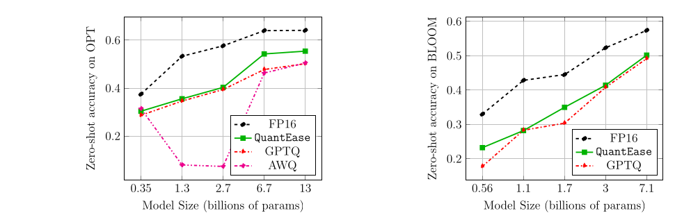
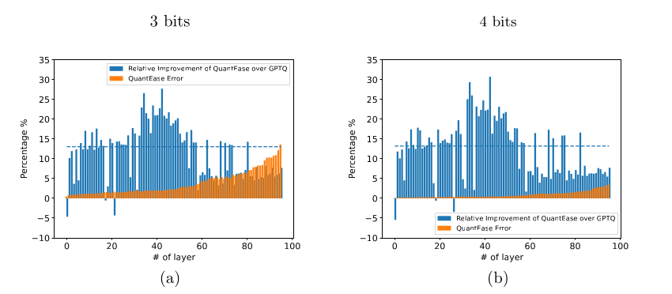
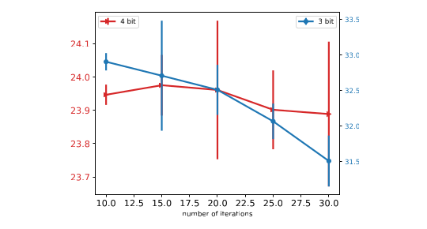
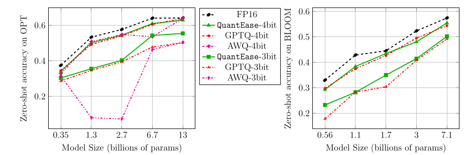

# QuantEase：面向语言模型的基于优化的量化（中文翻译）

> QuantEase: Optimization-based Quantization for Language Models
>
> 中文翻译（复述）：本文是对 arXiv:2309.01885（v2）全文的中文复述，用自己的话逐节转述，并非逐句逐字的原文翻译。原文：https://arxiv.org/abs/2309.01885 ，arXiv 非独占永久许可（arXiv.org perpetual non-exclusive license），版权归原作者所有。

作者：Kayhan Behdin、Ayan Acharya、Aman Gupta、Qingquan Song、Siyu Zhu、Sathiya Keerthi、Rahul Mazumder。单位：LinkedIn（加州 Sunnyvale）；Behdin 与 Mazumder 同时隶属麻省理工学院（MIT）。版本：v2，2023 年 12 月 1 日，分类 stat.ML。

本文覆盖正文与全部附录（A、B、C）；表格数值原样保留，公式以 LaTeX 给出，图保留原图号并给出中文图注。术语首次出现时附英文原词。

## 摘要

随着大语言模型（LLM）越来越流行，人们对能够高效部署它们的压缩技术兴趣日增。本文聚焦 LLM 的训练后量化（Post-Training Quantization, PTQ）。借鉴近期进展，作者提出 QuantEase：一个逐层量化的框架，每一层被单独量化。该问题被表述为一个带离散结构的非凸优化问题，并据此设计了基于坐标下降（Coordinate Descent, CD）的算法，能给出这类非凸逐层量化问题的高质量解。这套 CD 方法的更新形式很简单，只用矩阵和向量运算，不需要矩阵求逆或矩阵分解。作者还研究了一个感知离群值（outlier）的变体，允许把重要权重（离群值）保留为全精度。实验表明，在多种 LLM 和数据集上，QuantEase 在困惑度和零样本准确率上达到当前最优，相对 GPTQ 等方法最多提升 15%。借助细致的线性代数优化，QuantEase 能在单张 NVIDIA A100 上用约 3 小时量化 Falcon-180B 这样的模型。尤其值得一提的是，其感知离群值的算法可以在精度损失可接受的前提下做到接近 3 比特乃至 3 比特以下的量化，既不需要非均匀量化也不需要分组技巧，在困惑度上比 SpQR 等方法最多好两倍。

## 1 引言

近年来 LLM 大量涌现（Devlin et al., 2018；Radford et al., 2019；Brown et al., 2020；Zhang et al., 2022；Laurençon et al., 2022；Touvron et al., 2023a,b），它们能在零样本或指令微调等设定下解决复杂的语言建模任务（OpenAI, 2023；Wei et al., 2022a），因此人们越发想把 LLM 用到真实场景里。

LLM 的成功要归功于训练数据量和参数量的增长（Kaplan et al., 2020；Hoffmann et al., 2022），现代 LLM 已膨胀到数千亿参数（Brown et al., 2020；Zhang et al., 2022）。这些模型解决任务的能力令人惊叹，但高效地提供服务仍是巨大挑战。例如 GPT-3（Brown et al., 2020）约有 1750 亿参数，内存占用超过 300GB，已无法放进单张当代 GPU（如 A6000、A100、H100）做推理。另一个难题是推理延迟升高，这对实际应用有害（Frantar et al., 2023）。

模型压缩已成为应对存储占用和推理速度这两大难题的可行途径（Hoefler et al., 2021）。当前深度学习研究里有大量利用权重稀疏化或量化来压缩大模型的技术（Rastegari et al., 2016；Bulat and Tzimiropoulos, 2019；Agustsson et al., 2017）。由于训练现代 LLM 需要巨大算力、时间乃至数百万美元，带压缩感知的重新训练一般不现实，于是训练后量化（PTQ）成为有吸引力的选择。虽然已有不少实用的 PTQ 算法（Frantar and Alistarh, 2022；Hubara et al., 2021a；Nagel et al., 2020），但直到最近才出现能有效且高效地量化和/或稀疏化超大 LLM 的算法，代表包括 GPTQ（Frantar et al., 2023）、SpQR（Dettmers et al., 2023）和 AWQ（Lin et al., 2023）。这些方法试图把 16 比特模型压到 3 或 4 比特并尽量保住预测精度。尽管进展可喜，量化模型与未量化模型相比仍存在明显精度落差。本文就是要为 LLM 网络权重的 PTQ 设计一个新算法。



### 1.1 我们的方法

本文提出 QuantEase：一个为 LLM 逐层 PTQ 求取高质量可行（即已量化）解的新算法。QuantEase 使用循环式（cyclic）坐标下降（CD）（Tseng, 2001）。CD 类方法传统上用于统计问题（Chang and Lin, 2011；Mazumder and Hastie, 2012；Friedman et al., 2010；Hazimeh and Mazumder, 2020；Shevade and Keerthi, 2003；Behdin et al., 2023）。作者论证：与 GPTQ 等方法相比，QuantEase 是更有原则的优化方法，只要初始解可行，就能保证目标值序列不增。QuantEase 在每一层里逐个坐标循环，在其他权重固定的条件下，让每个权重各自去最小化目标，从而得到简单的闭式更新。经验上，在 4 比特和 3 比特量化中，相对量化误差比 GPTQ 最多改善 30%（见图 2）。

QuantEase 的简单性带来多方面优势，使它极具可扩展性且易于使用。与其他方法不同，它不需要昂贵的矩阵求逆或 Cholesky 分解，既避开数值问题，又降低内存需求；它实现起来极其容易，可以直接替换大多数其他方法。值得一提的是，QuantEase 能在单张 NVIDIA V100 上高效量化 660 亿参数模型，而 GPTQ、AWQ 等方法会内存溢出。QuantEase 的时间效率也很高，能在几小时内量化 Falcon-180b（Penedo et al., 2023）这样的超大模型，且每次迭代的速度与精心优化过的 GPTQ 实现相当。

更低的量化误差也转化为语言建模基准上的提升。在多个 LLM 系列（Laurençon et al., 2022；Zhang et al., 2022；Penedo et al., 2023）和语言任务上，QuantEase 在困惑度和零样本准确率（Paperno et al., 2016）两方面，于 4 比特和 3 比特区间都优于 GPTQ、AWQ 等最先进的均匀量化方法（见表 1、2、3 与图 1、4）。在 3 比特区间，它对零样本准确率尤其有效，相对 GPTQ 的相对提升可达 15%（见图 1）。

作者还提出处理权重离群值的变体：把一层的权重分成一组被量化的权重和极少数不量化的权重。该离群值感知版本基于迭代硬阈值（iterative hard thresholding）（Blumensath and Davies, 2009）的块坐标下降。它能超过 SpQR 这类基于离群值的方法，尤其在低于 3 比特的区间也能获得可接受精度，困惑度上比 SpQR 最多好 2.5 倍。作者希望 QuantEase 的简单有效能启发该领域的后续研究。

贡献归纳如下：

1. 有原则的优化：提出 QuantEase，一个基于最小化逐层（最小二乘）重构误差的 LLM 训练后量化优化框架。采用逐个更新权重的 CD 框架，避免占内存的矩阵求逆/分解；利用问题结构使 CD 更新高效，得到权重的闭式更新。
2. 离群值感知：提出一个保留少量（离群）权重不量化的离群值感知版本，算法基于块坐标下降和迭代硬阈值。
3. 精度提升：在十亿参数规模的 LLM 上，QuantEase 在 3 和 4 比特量化的文本生成与零样本任务上超过 GPTQ、AWQ 等近期 PTQ 方法，常常大幅领先；额外实验表明，离群值感知版 QuantEase 在近 3 比特或 3 比特以下区间，困惑度比 SpQR 最多好 2.5 倍。

### 1.2 相关工作

近来人们对 LLM 的逐层量化兴趣高涨。一类代表方法是 GPTQ（Frantar et al., 2023），它扩展了 Optimal Brain Surgeon（OBS）框架（LeCun et al., 1989；Hassibi and Stork, 1992；Frantar and Alistarh, 2022），并吸收了逐层压缩的策略（Dong et al., 2017）。GPTQ 的实证结果令人鼓舞：在文本生成和零样本基准上精度只有轻微下降。另一条逐层量化 LLM 的路线是 Lin et al.（2023）的 AWQ，其核心是保护对激活影响最大的那些权重。GPTQ 与 AWQ 是两个有代表性的基础技术，本文在数值实验里与它们对比。

人们普遍承认，包括 LLM 在内的 Transformer 模型在量化到更低位宽时会遇到离群值带来的难题（Wei et al., 2022b；Bondarenko et al., 2021；Kim et al., 2023）：极大或极小的权重会显著拉大量化范围，进而带来额外误差。因此有些研究走向非均匀量化。SqueezeLLM（Kim et al., 2023）试图找出并保留对输出影响最大的离群权重（如很大或很小的权重）以提高精度。类似地，SpQR（Dettmers et al., 2023）把 GPTQ 与离群值检测结合以降低精度损失。本文在离群值检测相关的实验中以 SpQR 为基准。

另有大量工作从实现角度研究大型神经网络的量化，包括低比特计算的硬件级优化和推理时的激活量化，这些超出本文范围。更详尽的论述见 Gholami et al.（2022）；Wang et al.（2020）；Hubara et al.（2021b）；Xiao et al.（2023）；Yao et al.（2022）；Yao et al.（2023）及其参考文献。

## 2 背景

### 2.1 问题表述：逐层量化

LLM 压缩的一个标准做法是逐层压缩（Dong et al., 2017），即一次只压缩/量化一层。这样就把压缩超大网络的任务拆成压缩若干较小的层，比同时量化多层更实际。本文采用逐层量化框架。

考虑一个带（非线性）激活函数的线性层。设 $`\boldsymbol{X}\in\mathbb{R}^{p\times n}`$ 为进入该层的输入矩阵，其中 $`p`$ 是输入特征数， $`n`$ 是通过网络的训练数据点数；设 $`\boldsymbol{W}\in\mathbb{R}^{q\times p}`$ 为该层权重矩阵，输出通道数为 $`q`$ 。

对于给定输出通道 $`i\in[q]`$ ，把该通道预先确定的有限量化级别集合记为 $`\mathcal{Q}_i\subseteq\mathbb{R}`$ 。沿用 Frantar et al.（2023），本文关注 $`\mathcal{Q}_i`$ 中各级别均匀分布的情形（作者注明该方法可推广到不满足此假设的量化方案）。逐层量化任务可写成如下优化问题：

```math
\min_{\hat{\boldsymbol{W}}} f(\hat{\boldsymbol{W}}) := \|\boldsymbol{W}\boldsymbol{X}-\hat{\boldsymbol{W}}\boldsymbol{X}\|_{F}^{2}\quad \text{s.t.}\quad \hat{W}_{i,j}\in\mathcal{Q}_{i},\ (i,j)\in[q]\times[p]\qquad(1)
```

问题 (1) 的目标衡量的是：未量化权重得到的原始预激活输出（ $`\boldsymbol{W}\boldsymbol{X}`$ ）与量化权重得到的预激活输出（ $`\hat{\boldsymbol{W}}\boldsymbol{X}`$ ）之间的距离，约束是 $`\hat{\boldsymbol{W}}`$ 必须落在量化格点上。

记号：对 $`i\in[q]:=\lbrace 1,\ldots,q\rbrace`$ ，相对于量化级别 $`\mathcal{Q}_i`$ 定义量化算子 $`q_i`$ ：

```math
q_{i}(x)\in\arg\min_{y\in\mathcal{Q}_{i}}(x-y)^{2}\qquad(2)
```

对矩阵 $`\boldsymbol{A}`$ ， $`\|\boldsymbol{A}\|_F`$ 表示 Frobenius 范数。对 $`i<j`$ ， $`\boldsymbol{A}_{:,i}`$ 与 $`\boldsymbol{A}_{:,i:j}`$ 分别表示 $`\boldsymbol{A}`$ 的第 $`i`$ 列与第 $`i`$ 到 $`j`$ 列。主要结果的证明放在附录 B。

### 2.2 两个关键算法

#### 2.2.1 GPTQ

如前所述，GPTQ（Frantar et al., 2023）扩展了 Frantar and Alistarh（2022）、Hassibi and Stork（1992）的基于 OBS 的框架。GPTQ 一次量化 $`\boldsymbol{W}`$ 的一列：先初始化 $`\hat{\boldsymbol{W}}\leftarrow\boldsymbol{W}`$ ，然后依次遍历列 $`j=1,\cdots,p`$ ，对每个 $`j`$ 量化 $`\hat{\boldsymbol{W}}`$ 的第 $`j`$ 列，该列所有元素按下式更新：

```math
\hat{W}_{i,j}^{+}=q_{i}(\hat{W}_{i,j}),\quad i\in[q]
```

更新完第 $`j`$ 列后，GPTQ 继续更新该层其余权重，以保证 (1) 中的误差不会增得太多。为了让叙述贴近 OBS 框架，作者指出 GPTQ 是通过近似求解下面的最小二乘问题来更新 $`\hat{\boldsymbol{W}}_{:,j+1:p}`$ 的：

```math
\min_{\hat{\boldsymbol{W}}_{:,j:p}}\|\boldsymbol{W}\boldsymbol{X}-\hat{\boldsymbol{W}}\boldsymbol{X}\|_{F}^{2}\quad\text{s.t.}\quad\hat{\boldsymbol{W}}_{:,j}=\hat{\boldsymbol{W}}^{+}_{:,j}\qquad(3)
```

其中的约束意味着实际上是在对 $`\hat{\boldsymbol{W}}_{:,j+1:p}`$ 做优化（采用这种写法是沿袭 Hassibi and Stork（1992）与 Frantar and Alistarh（2022））。注意在 (3) 中量化约束被丢掉了，否则 (3) 一般会和 (1) 一样难；而且直到第 $`j`$ 列的各列 $`\hat{\boldsymbol{W}}_{:,1:j}`$ 不再更新，以保证它们保持已量化状态。由于 OBS 框架针对的是齐次二次型（homogeneous quadratic，即不含线性项的 $`\boldsymbol{u}^T\boldsymbol{Q}\boldsymbol{u}`$ ），Frantar and Alistarh（2022）、Frantar et al.（2023）把问题 (3) 改写成：

```math
\min_{\hat{\boldsymbol{W}}_{:,j:p}}\|\boldsymbol{A}+(\boldsymbol{W}_{:,j}-\hat{\boldsymbol{W}}_{:,j})\boldsymbol{X}_{j,:}+(\boldsymbol{W}_{:,j+1:p}-\hat{\boldsymbol{W}}_{:,j+1:p})\boldsymbol{X}_{j+1:p,:}\|_{F}^{2}\quad\text{s.t.}\quad\hat{\boldsymbol{W}}_{:,j}=\hat{\boldsymbol{W}}^{+}_{:,j}\qquad(4)
```

其中

```math
\boldsymbol{A}=(\boldsymbol{W}_{:,1:j-1}-\hat{\boldsymbol{W}}_{:,1:j-1})\boldsymbol{X}_{1:j-1,:}\qquad(5)
```

仔细看会发现 (4) 的目标并不是齐次二次型，因此不符合 OBS 框架。于是 $`\boldsymbol{A}`$ 被丢掉，问题被换成下面的形式：

```math
\min_{\hat{\boldsymbol{W}}_{:,j:p}}\|(\boldsymbol{W}_{:,j}-\hat{\boldsymbol{W}}_{:,j})\boldsymbol{X}_{j,:}+(\boldsymbol{W}_{:,j+1:p}-\hat{\boldsymbol{W}}_{:,j+1:p})\boldsymbol{X}_{j+1:p,:}\|_{F}^{2}\quad\text{s.t.}\quad\hat{\boldsymbol{W}}_{:,j}=\hat{\boldsymbol{W}}^{+}_{:,j}
```

```math
\stackrel{(a)}{=}\min_{\hat{\boldsymbol{W}}_{:,j:p}}\mathsf{Tr}\left((\boldsymbol{W}_{:,j:p}-\hat{\boldsymbol{W}}_{:,j:p})^{T}\boldsymbol{\Sigma}_{F}(\boldsymbol{W}_{:,j:p}-\hat{\boldsymbol{W}}_{:,j:p})\right)\quad\text{s.t.}\quad\hat{\boldsymbol{W}}_{:,j}=\hat{\boldsymbol{W}}^{+}_{:,j}\qquad(6)
```

其中 $`\boldsymbol{\Sigma}_{F}=\boldsymbol{X}_{j:p,:}\boldsymbol{X}_{j:p,:}^{T}`$ ， $`F`$ 指下标集合 $`\lbrace j,\cdots,p\rbrace`$ ，(a) 利用了对任意矩阵 $`\boldsymbol{M}`$ 有 $`\|\boldsymbol{M}\|_{F}^{2}=\mathsf{Tr}(\boldsymbol{M}^{T}\boldsymbol{M})`$ 。于是，把第 $`j`$ 列更新为 $`\hat{\boldsymbol{W}}_{:,j}^{+}`$ 之后，可以用 OBS 更新来更新 $`\hat{\boldsymbol{W}}_{:,j+1:p}`$ （推导细节见 Frantar et al., 2023；Frantar and Alistarh, 2022）：

```math
\boldsymbol{\delta}\leftarrow-\frac{\hat{\boldsymbol{W}}_{:,j}-\hat{\boldsymbol{W}}_{:,j}^{+}}{[\boldsymbol{\Sigma}_{F}^{-1}]_{j,j}}
```

```math
\hat{\boldsymbol{W}}_{:,j+1:p}\leftarrow\hat{\boldsymbol{W}}_{:,j+1:p}+\boldsymbol{\delta}[\boldsymbol{\Sigma}_{F}^{-1}]_{j,j+1:p}\qquad(7)
```

(7) 中的 OBS 更新需要计算 $`\boldsymbol{\Sigma}_{F}^{-1}`$ ，实际中代价很高。为提高效率，GPTQ 采用惰性批量（lazy-batch）更新方案：每一步只更新剩余未量化权重中的一个子集（大小至多 128）。

#### 2.2.2 AWQ

与 GPTQ 类似，AWQ（Lin et al., 2023）也是逐层量化框架。但不同的是，AWQ 的核心思路是找到一种不会引起高量化误差的权重重缩放，而不是直接最小化逐层重构的最小二乘准则。为此 AWQ 考虑如下优化问题：

```math
\min_{\boldsymbol{s}\in\mathbb{R}^{p}}\|\boldsymbol{W}\boldsymbol{X}-\boldsymbol{q}(\boldsymbol{s}\odot\boldsymbol{W})(\boldsymbol{X}\odot\boldsymbol{s}^{-1})\|_{F}^{2}\qquad(8)
```

其中 $`[\boldsymbol{q}(\boldsymbol{W})]_{i,j}=q_{i}(W_{i,j})`$ 对向量/矩阵逐坐标量化， $`[\boldsymbol{s}^{-1}]_{i}=s_{i}^{-1}`$ 是逐坐标求逆， $`\odot`$ 是按通道乘法： $`[\boldsymbol{s}\odot\boldsymbol{W}]_{i,j}=s_{j}W_{i,j}`$ ， $`[\boldsymbol{X}\odot\boldsymbol{s}^{-1}]_{i,j}=X_{i,j}/s_{i}`$ 。问题 (8) 里的 $`\boldsymbol{s}`$ 是逐通道缩放。(8) 不可微、非凸，无法高效求解，所以 Lin et al.（2023）讨论了对 $`\boldsymbol{s}`$ 的网格搜索启发式，以找到不致产生高量化误差的取值：令 $`\boldsymbol{s}=\boldsymbol{s_{\boldsymbol{X}}}^{\alpha}*{s_{\boldsymbol{W}}}^{-\beta}`$ ，其中 $`\alpha,\beta\in[0,1]`$ ， $`*`$ 是逐坐标乘法， $`\boldsymbol{s}_{\boldsymbol{X}},\boldsymbol{s}_{\boldsymbol{W}}\in\mathbb{R}^{p}`$ 分别是 $`\boldsymbol{X}`$ 与 $`\boldsymbol{W}`$ 的逐通道平均幅值。 $`\alpha,\beta`$ 在区间 $`[0,1]`$ 上用网格搜索选定。选定 $`\boldsymbol{s}`$ 之后，量化后的权重为 $`\boldsymbol{s}^{-1}\odot\boldsymbol{q}(\boldsymbol{s}\odot\boldsymbol{W})`$ 。

## 3 我们提出的方法

### 3.1 QuantEase 概览

算法基于循环式 CD 方法（Tseng, 2001）。在 CD 的每一次更新里，都在保证 $`\hat{W}_{i,j}\in\mathcal{Q}_{i}`$ 的前提下，只针对坐标 $`\hat{W}_{i,j}`$ 最小化 (1) 中的目标，同时其余权重固定在当前值。对 $`(i,j)\in[q]\times[p]`$ ，更新规则为：

```math
\hat{W}_{i,j}^{+}\in\arg\min_{\hat{W}_{i,j}\in\mathcal{Q}_{i}}f(\hat{W}_{1,1},\cdots,\hat{W}_{i,j},\cdots,\hat{W}_{q,p})\qquad(9)
```

其中 $`\hat{\boldsymbol{W}}^{+}`$ 是更新坐标 $`(i,j)`$ 之后的解。也就是说， $`\hat{W}_{i,j}^{+}`$ 来自一个一维优化问题：在量化约束下最小化一元函数 $`\hat{W}_{i,j}\mapsto f(\hat{\boldsymbol{W}})`$ 。这个一维问题虽然非凸，却可以在闭式下求得全局最优（见第 3.2 节）。对所有坐标 $`(i,j)\in[q]\times[p]`$ 完整走一遍，算作 CD 算法的一次迭代。QuantEase 通常做若干次迭代来得到 (1) 的好解。

QuantEase 用该层未量化的原始权重初始化。这意味着在第一次迭代结束前， $`\hat{\boldsymbol{W}}`$ 对问题 (1) 一般是不可行的（没有完全落在量化格点上）；但从第二次迭代开始，QuantEase 始终保持可行性，同时 $`f`$ 持续下降。这一点很有用：第一次迭代之后任何时刻停止，都能得到一个可行解。

值得指出，与 QuantEase 不同，GPTQ 只对 $`\hat{\boldsymbol{W}}`$ 的列扫一遍。扫完后 $`\hat{\boldsymbol{W}}`$ 已完全可行（全部量化），OBS 的思路不再适用，所以不能继续迭代，GPTQ 就此停止。有意思的是，QuantEase 可以用 GPTQ（或任何其他算法）得到的 $`\hat{\boldsymbol{W}}`$ 作为初始值，再跑若干次迭代，把问题 (1) 进一步优化。

### 3.2 QuantEase 的计算考虑

**闭式更新。** CD 方法的效率取决于更新 (9) 能算得多快。引理 1 给出问题 (9) 的闭式解。

**引理 1。** 令 $`\boldsymbol{\Sigma}=\boldsymbol{X}\boldsymbol{X}^{T}`$ ，则 (9) 中 $`\hat{W}_{i,j}^{+}=q_{i}(\tilde{\beta})`$ ，其中

```math
\tilde{\beta}=-\left[\sum_{k\neq j}\Sigma_{j,k}\hat{W}_{i,k}-(\boldsymbol{W}\boldsymbol{\Sigma})_{i,j}\right]/\Sigma_{j,j}\qquad(10)
```

（脚注 2：假设 $`\Sigma_{j,j}>0`$ 。注意 $`\Sigma_{j,j}=\|\boldsymbol{X}_{j,:}\|^{2}`$ ，所以 $`\Sigma_{j,j}=0`$ 意味着 $`\boldsymbol{X}_{j,:}=\boldsymbol{0}`$ ；这时 $`\hat{\boldsymbol{W}}_{:,j}`$ 可以随意量化，并完全从问题中略去。这类检查可在 QuantEase 开始前完成。）

引理 1 的证明见附录 B。注意 (10) 中的 $`\tilde{\beta}`$ 恰是一元函数 $`\hat{W}_{i,j}\mapsto f(\hat{W}_{1,1},\cdots,\hat{W}_{i,j},\cdots,\hat{W}_{q,p})`$ 在不加量化约束时的最小点。因此引理 1 说明了一件有趣的事：要找 (9) 中 $`\hat{W}_{i,j}`$ 的最优量化值，只需把无约束一维函数的最小点量化一下即可。由于是先求每个坐标的最小点、再把最小点量化，这与量化“当前”权重是不同的。

**内存占用。** 矩阵 $`\boldsymbol{\Sigma}`$ 和 $`\boldsymbol{W}\boldsymbol{\Sigma}`$ 在迭代中不变，存储开销为 $`p^{2}+\mathcal{O}(pq)`$ 。这一点尤其有意义，因为实际中 $`n\gg p,q`$ 。QuantEase 与 GPTQ 不同，也不需要矩阵求逆或 Cholesky 分解，这两者在内存上不经济（额外占用 $`\mathcal{O}(p^{2})`$ 存储）。

**沿 $`i\in[q]`$ 并行。** 由引理 1 可见，对给定的 $`j_{0}\in[p]`$ ，各个 $`i`$ 对应的 $`\hat{W}_{i,j_{0}}`$ 更新彼此独立，可同时进行。因此不必每次只更新一个坐标 $`\hat{W}_{i,j}`$ ，而是每次更新 $`\hat{\boldsymbol{W}}`$ 的一整列 $`\hat{\boldsymbol{W}}_{:,j}`$ ，从而更好地利用问题结构（见下面的秩 1 更新）。

**秩 1 更新。** 在 (10) 中需要用到形如 $`\sum_{k\neq j}\Sigma_{j,k}\hat{W}_{i,k}`$ 的项，它可以重写为：

```math
\sum_{k\neq j}\Sigma_{j,k}\hat{W}_{i,k}=\sum_{k=1}^{p}\Sigma_{j,k}\hat{W}_{i,k}-\Sigma_{j,j}\hat{W}_{i,j}=\hat{\boldsymbol{W}}_{i,:}\boldsymbol{\Sigma}_{:,j}-\Sigma_{j,j}\hat{W}_{i,j}
```

而如上所说，我们一次更新 $`\hat{\boldsymbol{W}}`$ 某一列对应的所有行。因此更新一列需要如下向量：

```math
\left(\sum_{k\neq j}\Sigma_{j,k}\hat{W}_{1,k},\cdots,\sum_{k\neq j}\Sigma_{j,k}\hat{W}_{q,k}\right)^{T}=(\hat{\boldsymbol{W}}\boldsymbol{\Sigma})_{:,j}-\Sigma_{j,j}\hat{\boldsymbol{W}}_{:,j}\qquad(11)
```

由 (11)，对 (10) 的更新而言，只需维护 $`\hat{\boldsymbol{W}}\boldsymbol{\Sigma}`$ 就够了，因为 $`\boldsymbol{W}`$ 与 $`\boldsymbol{\Sigma}`$ 在迭代过程中不变。下面说明 $`\hat{\boldsymbol{W}}\boldsymbol{\Sigma}`$ 的更新如何做得很高效。先看一个观察：

观察：设 $`\boldsymbol{W}_{1},\boldsymbol{W}_{2}`$ 只在某一列 $`j`$ 上不同，则

```math
\boldsymbol{W}_{2}\boldsymbol{\Sigma}=\underbrace{\left[\boldsymbol{W}_{1}\boldsymbol{\Sigma}-(\boldsymbol{W}_{1})_{:,j}\boldsymbol{\Sigma}_{j,:}\right]}_{(A)}\underbrace{+(\boldsymbol{W}_{2})_{:,j}\boldsymbol{\Sigma}_{j,:}}_{(B)}\qquad(12)
```

于是，已知 $`\boldsymbol{W}_{1}\boldsymbol{\Sigma}`$ 时，得到 $`\boldsymbol{W}_{2}\boldsymbol{\Sigma}`$ 只需一次秩 1 更新，而不是完整的矩阵乘法。更新 $`\hat{\boldsymbol{W}}`$ 的一列时，就用这种更新来跟踪 $`\hat{\boldsymbol{W}}\boldsymbol{\Sigma}`$ ，如算法 1 所示。

**初始化。** QuantEase 用原始未量化权重初始化，但加入了一个启发式：每隔两次迭代的第三次迭代（"every other third iteration"，原文措辞），不做量化（即直接使用引理 1 中的 $`\tilde{\beta}`$ ）。这会引入不可行性，但下一次迭代又会恢复可行性。作者观察到该启发式有助于优化性能，即能让 $`f`$ 降得更低。

算法 1 给出了 QuantEase 的汇总。对固定 $`j`$ 的每次迭代，时间复杂度由秩 1 更新主导，为 $`\mathcal{O}(pq)`$ ，所以 QuantEase 每次迭代的复杂度是 $`\mathcal{O}(p^{2}q)`$ 。再加上初始计算 $`\boldsymbol{\Sigma}=\boldsymbol{X}\boldsymbol{X}^{T}`$ 、 $`\boldsymbol{W}\boldsymbol{\Sigma}`$ 、 $`\hat{\boldsymbol{W}}\boldsymbol{\Sigma}`$ 的代价和 $`K`$ 次迭代，QuantEase 的总时间复杂度为 $`\mathcal{O}(pqn+Kp^{2}q)`$ 。

**算法 1：QuantEase**

```
初始化 W_hat
for iter = 1, ..., iter-max do
  for j = 1, ..., p do
    u <- [(W_hat Σ)[:,j] - Σ[j,j] W_hat[:,j] - (W Σ)[:,j]] / Σ[j,j]     // 引理 1 中第 j 列的 β~（取负号）
    W_hat Σ <- W_hat Σ - W_hat[:,j] Σ[j,:]                                // 秩 1 更新 (12) 的 (A) 部分
    W_hat[i,j] <- q_i(-u_i),  i in [q]                                    // 执行 (10) 的更新
    W_hat Σ <- W_hat Σ + W_hat[:,j] Σ[j,:]                                // 秩 1 更新 (12) 的 (B) 部分
  end for
end for
return W_hat
```

**带部分更新的加速版 QuantEase。** 作者在初步实验中发现，在 PyTorch 等框架里计算外积既昂贵又占内存。他们基于三个观察来改进算法效率：(1) 通过在每个内循环步里记录 $`\hat{\boldsymbol{W}}_{:,j}`$ 在用量化值 $`\boldsymbol{u}`$ （按式 (10)）更新之前与之后的值，两次秩 1 更新可合并为一次。(2) $`\hat{\boldsymbol{W}}\boldsymbol{\Sigma}`$ 不需要在每个内循环里完全更新，因为每次迭代中每个 $`\hat{\boldsymbol{W}}_{:,j}`$ 的更新只需要 $`(\hat{\boldsymbol{W}}\boldsymbol{\Sigma})_{:,j}=\hat{\boldsymbol{W}}_{:,1:j}\boldsymbol{\Sigma}_{1:j,j}`$ ；与其用 $`j`$ 个秩 1 外积摊销这一更新，不如对每一列 $`\hat{\boldsymbol{W}}_{:,j}`$ 一次性完成，避免冗余计算与内存分配。(3) 除以 $`\Sigma_{j,j}`$ 可以通过按列归一化吸收进 $`\boldsymbol{\Sigma}`$ ，得到一个对角线全为 1 的非对称方阵； $`\boldsymbol{u}`$ 更新中的 $`-\Sigma_{j,j}\hat{\boldsymbol{W}}_{:,j}`$ 项可以通过在归一化之后把对角线置零来去掉，这只需在整个算法开头做一次。更新后的算法见算法 2。

用算法 2 的记号重写式 (10)，可概括计算如下：

```math
\tilde{\beta}_{i}=P_{i,j}-\hat{P}_{i,j}+\boldsymbol{\Delta\hat{W}}_{i,1:j}\boldsymbol{\Sigma}^{norm}_{1:j,j}\qquad(13)
```

与算法 1 相比，实验显示加速算法在 Falcon-180b 模型上把量化时间缩短了 34 倍以上，在单张 NVIDIA A100 上把单次迭代时间从 99 小时降到 2.9 小时，且不损失精度。优化后算法每次迭代的速度与 GPTQ 相当，而 GPTQ 用的是最先进、高度优化的 Cholesky kernel，内存占用更低。本文所有实验都使用优化版 QuantEase。

**算法 2：带部分更新的加速 QuantEase**

```
初始化 W_hat
初始化 Σ_norm[:,j] = Σ[:,j] / Σ[j,j]
初始化 P = W Σ_norm
令 Σ_norm[j,j] = 0       // 帮助把 -W_hat 项吸收进 W_hat Σ_norm，减少计算
for iter = 1, ..., iter-max do
  ΔW_hat = W_hat
  P_hat = W_hat Σ_norm
  for j = 1, ..., p do
    β~ <- P[:,j] - P_hat[:,j] + ΔW_hat[:,1:j] Σ_norm[1:j,j]
    W_hat[i,j] <- q_i(β~_i),  i in [q]
    ΔW_hat[:,j] <- ΔW_hat[:,j] - W_hat[:,j]
  end for
end for
return W_hat
```

### 3.3 QuantEase 的收敛性

先定义坐标方向（Coordinate-Wise, CW）极小点。

**定义 1（CW 极小点，Beck and Eldar (2013)；Hazimeh and Mazumder (2020)）。** 称 $`\boldsymbol{W}^{*}`$ 是问题 (1) 的 CW 极小点，当且仅当对 $`(i,j)\in[q]\times[p]`$ 有 $`W^{*}_{i,j}\in\mathcal{Q}_{i}`$ 且

```math
W^{*}_{i,j}\in\arg\min_{\hat{W}_{i,j}\in\mathcal{Q}_{i}}f(\hat{W}_{1,1},\cdots,\hat{W}_{i,j},\cdots,\hat{W}_{q,p})
```

换言之，CW 极小点是一个可行解，只改动一个坐标而其余固定无法再改进它。设想把基本 CD 更新 (9) 修改如下：若 $`\hat{W}_{i,j}^{+}`$ 没能使 $`f`$ 严格下降，就令 $`\hat{W}_{i,j}^{+}=\hat{W}_{i,j}`$ 。这样可避免算法在固定的 $`f`$ 值上来回振荡。下面的引理表明，修改后 CD 产生的权重序列收敛到一个 CW 极小点。

**引理 2。** 修改后的 QuantEase 产生的 $`\hat{\boldsymbol{W}}`$ 序列收敛到一个 CW 极小点。

### 3.4 优化性能：GPTQ 对比 QuantEase

下面说明 QuantEase 相对 GPTQ 确实带来更低的（校准集上的）优化误差（实验设置细节见第 5 节）。为此，对给定层和可行解 $`\hat{\boldsymbol{W}}`$ ，定义相对校准误差： $`\textrm{Error}(\hat{\boldsymbol{W}})=\|\boldsymbol{W}\boldsymbol{X}-\hat{\boldsymbol{W}}\boldsymbol{X}\|_{F}^{2}/\|\boldsymbol{W}\boldsymbol{X}\|_{F}^{2}`$ ，其中 $`\boldsymbol{X}`$ 是量化所用的校准集。

图 2 报告了 QuantEase 的相对误差 $`\textrm{Error}(\hat{\boldsymbol{W}}^{\texttt{QuantEase}})`$ ，以及 QuantEase 相对 GPTQ 的误差相对改善 $`(\textrm{Error}(\hat{\boldsymbol{W}}^{\textrm{GPTQ}})-\textrm{Error}(\hat{\boldsymbol{W}}^{\texttt{QuantEase}}))/\textrm{Error}(\hat{\boldsymbol{W}}^{\textrm{GPTQ}})`$ ，针对 BLOOM-1b1 模型的 3/4 比特量化。图中各层按其 QuantEase 误差从小到大排序。可见不同层的 QuantEase 误差差别很大：4 比特时从几乎为零到 5%，3 比特时从零到 15%，说明不同层的可压缩性不同。此外，QuantEase 几乎在所有情形都比 GPTQ 取得更低的优化误差（最多 30%），这体现了 QuantEase 相对 GPTQ 的好处。



## 4 感知离群值的量化

### 4.1 问题表述

已有观察表明，一层中激活对某些权重可能比对其他权重更敏感（Dettmers et al., 2023；Yao et al., 2022）。对这类敏感权重，可能找不到合适的量化格点值，造成很大的量化误差。此外，预训练网络中某些权重可能明显比其余的大或小，LLM 的量化会受这类权重影响（Wei et al., 2022b；Bondarenko et al., 2021；Kim et al., 2023）。极大/极小权重的存在会拉大需要量化的取值范围，进而放大量化误差。为更好地处理敏感权重和大/小权重（统称离群权重），作者先引入问题 (1) 的修改版。该优化表述同时识别出一批保持全精度的权重（即离群权重），并量化其余权重。

先引入记号。设 $`\mathcal{S}\subseteq[q]\times[p]`$ 为离群值下标集合，对应权重保持全精度。对任意 $`(i,j)\notin\mathcal{S}`$ ，第 $`(i,j)`$ 个权重被量化，取自第 $`i`$ 个通道的量化格 $`\mathcal{Q}_i`$ 。这等价于把该层的权重 $`\boldsymbol{W}`$ 换成 $`\hat{\boldsymbol{W}}+\hat{\boldsymbol{H}}`$ ，其中 $`\hat{\boldsymbol{W}}`$ 是量化的（同问题 (1)）， $`\hat{\boldsymbol{H}}`$ 是只有少量非零元的稀疏矩阵。具体地，对任意 $`(i,j)\notin\mathcal{S}`$ 有 $`\hat{H}_{i,j}=0`$ ，即第 $`(i,j)`$ 个权重只有量化分量；由于 $`\mathcal{S}`$ 基数很小， $`\hat{\boldsymbol{H}}`$ 基本全是零。反之当 $`(i,j)\in\mathcal{S}`$ 时 $`\hat{H}_{i,j}\neq 0`$ ，对应权重以全精度保留。据此，问题 (1) 的离群值感知版本为：

```math
\min_{\hat{\boldsymbol{W}},\hat{\boldsymbol{H}}}g(\hat{\boldsymbol{W}},\hat{\boldsymbol{H}}):=\|\boldsymbol{W}\boldsymbol{X}-(\hat{\boldsymbol{W}}+\hat{\boldsymbol{H}})\boldsymbol{X}\|_{F}^{2}\quad\text{s.t.}\quad\hat{W}_{i,j}\in\mathcal{Q}_{i},\ (i,j)\in[q]\times[p],\quad\|\hat{\boldsymbol{H}}\|_{0}\leq s\qquad(14)
```

其中 $`\|\cdot\|_{0}`$ 表示向量/矩阵的非零元个数， $`s\ll p,q`$ 是离群值总个数的预算。约束 $`\|\hat{\boldsymbol{H}}\|_{0}\leq s`$ 保证离群值总数不超过规定上限。

### 4.2 SpQR

在介绍作者的算法之前，先简要回顾 SpQR（Dettmers et al., 2023），它把基于敏感度的量化纳入 GPTQ。具体说，它挑选少量会造成较高量化误差的离群值，保留为全精度。为此，对每个坐标 $`(i,j)\in[q]\times[p]`$ ，SpQR 把量化该坐标所产生的优化误差作为对该坐标的敏感度，形式化定义为：

```math
\omega_{ij}=\min_{\hat{\boldsymbol{W}}}\|\boldsymbol{W}\boldsymbol{X}-\hat{\boldsymbol{W}}\boldsymbol{X}\|_{F}^{2}\quad\text{s.t.}\quad\hat{W}_{i,j}=q_{i}(W_{i,j})\qquad(15)
```

问题 (15) 具备 OBS 形式，因此可用 OBS 计算坐标 $`(i,j)`$ 的敏感度。然后，任何敏感度高的坐标，例如 $`\omega_{i,j}>\tau`$ （ $`\tau>0`$ 为预先设定的阈值），都被视为离群值。选定离群值之后，SpQR 与 GPTQ 类似，按列 $`j=1,\cdots,p`$ 循环，并基于 OBS 更新（见第 2.2.1 节）更新每一列，同时让离群权重保持全精度。

### 4.3 优化问题 (14)

为得到 (14) 的好解，作者使用块坐标下降：交替地更新 $`\hat{\boldsymbol{W}}`$ （固定 $`\hat{\boldsymbol{H}}`$ ）和 $`\hat{\boldsymbol{H}}`$ （固定 $`\hat{\boldsymbol{W}}`$ ）。

固定 $`\hat{\boldsymbol{H}}`$ 时，问题 (14) 与 (1) 中的 $`f(\hat{\boldsymbol{W}})`$ 形式相同，只是把 $`\boldsymbol{W}\boldsymbol{X}`$ 换成 $`(\boldsymbol{W}-\hat{\boldsymbol{H}})\boldsymbol{X}`$ 。因此可以按第 3 节所述用 QuantEase 更新 $`\hat{\boldsymbol{W}}`$ 。

接着讨论如何更新 $`\hat{\boldsymbol{H}}`$ 。固定 $`\hat{\boldsymbol{W}}`$ 时，问题 (14) 是带基数约束的最小二乘问题。作者采用近端梯度法（亦称迭代硬阈值法）（Blumensath and Davies, 2009），做一系列如下形式的更新：

```math
\hat{\boldsymbol{H}}^{+}\in\arg\min_{\boldsymbol{K}}\tilde{g}(\boldsymbol{K})\ \text{s.t.}\ \|\boldsymbol{K}\|_{0}\leq s=P_{s}\left(\hat{\boldsymbol{H}}-\eta\nabla_{\boldsymbol{H}}g(\hat{\boldsymbol{W}},\hat{\boldsymbol{H}})\right)\qquad(16)
```

其中 $`P_{s}(\boldsymbol{A})`$ 把 $`\boldsymbol{A}`$ 中除绝对值最大的 $`s`$ 个坐标外的所有坐标置零，

```math
\tilde{g}(\boldsymbol{K})=\frac{L}{2}\left\|\boldsymbol{K}-\left(\hat{\boldsymbol{H}}-\frac{1}{L}\nabla_{\hat{\boldsymbol{H}}}g(\hat{\boldsymbol{W}},\hat{\boldsymbol{H}})\right)\right\|_{F}^{2}\qquad(17)
```

$`L=1/\eta=2\lambda_{\max}(\boldsymbol{X}\boldsymbol{X}^{T})`$ ， $`\lambda_{\max}(\boldsymbol{A})`$ 为矩阵 $`\boldsymbol{A}`$ 的最大特征值。下面的引理 3 说明：若初始的 $`\hat{\boldsymbol{H}}`$ 是稀疏的， $`\|\hat{\boldsymbol{H}}\|_{0}\leq s`$ ，则 (16) 中的更新构成一个下降方法。

**引理 3。** 对任意 $`\hat{\boldsymbol{W}}`$ 和任意满足 $`\|\hat{\boldsymbol{H}}\|_{0}\leq s`$ 的 $`\hat{\boldsymbol{H}}`$ ，有

```math
g(\hat{\boldsymbol{W}},\hat{\boldsymbol{H}}^{+})\leq g(\hat{\boldsymbol{W}},\hat{\boldsymbol{H}})
```

注意，在为问题 (14) 计算各 $`\mathcal{Q}_i`$ 时，要把 $`\boldsymbol{W}`$ 中（按绝对值）最大的 $`s`$ 个坐标从量化池里剔除，因为这些权重的影响可由 $`\hat{\boldsymbol{H}}`$ 承担，不需要量化它们。这样每个 $`\mathcal{Q}_i`$ 需要覆盖的范围缩小，误差更低。所以，离群值感知版 QuantEase 同时做到了保护敏感权重和缩小量化范围。

这里更新的细节在算法 3 中给出（见附录 C）。初始化上与基础 QuantEase 类似，令 $`\hat{\boldsymbol{H}},\hat{\boldsymbol{W}}`$ 满足 $`\hat{\boldsymbol{H}}+\hat{\boldsymbol{W}}=\boldsymbol{W}`$ 。具体做法是用 $`\boldsymbol{W}`$ 中绝对值最大的 $`s`$ 个坐标来初始化 $`\hat{\boldsymbol{H}}`$ ： $`\hat{\boldsymbol{H}}=P_{s}(\boldsymbol{W}),\hat{\boldsymbol{W}}=\boldsymbol{W}-\hat{\boldsymbol{H}}`$ 。注意这同样使 $`\hat{\boldsymbol{W}}`$ 的初始化不可行，与基础 QuantEase 一样；但如第 3.1 节所述，一次 QuantEase 迭代之后解变为可行，算法 3 的下降性质成立。

另外，如算法 3 所示，除了存储 $`\hat{\boldsymbol{H}}`$ 外，还需要存储 $`\hat{\boldsymbol{H}}\boldsymbol{\Sigma}`$ ，因此内存占用仍是 $`p^{2}+\mathcal{O}(pq)`$ ，与基础 QuantEase 相同。计算复杂度上，除基础 QuantEase 的开销外，离群值感知版本还需要计算 $`\boldsymbol{X}\boldsymbol{X}^{T}`$ 的最大特征值，这可用迭代的幂法在 $`\mathcal{O}(p^{2})`$ 内、仅用矩阵/向量乘法完成；此外，每次迭代计算 $`\hat{\boldsymbol{H}}\boldsymbol{\Sigma}`$ 需 $`\mathcal{O}(p^{2}q)`$ ，找 $`\hat{\boldsymbol{H}}`$ 的最大 $`s`$ 个坐标平均复杂度为 $`\mathcal{O}(pq\log pq)`$ 。所以 $`K`$ 次迭代的总复杂度为 $`\mathcal{O}(pqn+Kp^{2}q+Kpq\log pq)`$ 。

最后指出，SpQR 在选定离群值后就固定其位置，而本方法在优化过程中可以新增或移除离群坐标，因为 $`\hat{\boldsymbol{H}}`$ 的非零位置（即离群值）连同取值一起被更新。

**结构化离群值。** 问题 (14) 对离群值的结构没有任何约束。以非结构化离群值提供模型服务，会因 GPU kernel 实现更复杂而增加服务延迟。让算法对离群值感知的一个简单改法是：在做式 (16) 的更新时，把离群值的选择限制为整列。不用 $`P_{s}`$ 选 $`\boldsymbol{A}`$ 中绝对值最大的 $`s`$ 个元素，而是选 $`\ell_2`$ 范数最大的 $`\lfloor\frac{s}{q}\rfloor`$ 列，把它们视为最有影响力的列，以全精度（或更高精度）保留为离群值。实际中可以根据服务时反量化 kernel 的实现选择不同版本的离群值感知算法，以权衡服务效率与模型精度，这种探索超出本文范围。不同离群值感知算法的实证比较见第 5.4 节。

## 5 实验

本节通过若干数值实验展示 QuantEase 的有效性。作者说明基于 PyTorch 的 QuantEase 实现将很快发布到 GitHub。

**实验设置。** 均匀量化方面，QuantEase 与 RTN（Yao et al., 2022；Dettmers et al., 2022）、GPTQ（Frantar et al., 2023）和 AWQ（Lin et al., 2023）比较。离群值相关方法则与 SpQR（Dettmers et al., 2023）比较。作者不考虑 SqueezeLLM（Kim et al., 2023），因为它主要面向非均匀量化（本文关注均匀量化），并且据作者所知 SqueezeLLM 的量化代码尚未公开。所有方法在实验中都不使用分组（grouping），因为本文的重点是理解各方法的优化性能；并且如 Kim et al.（2023）与 Yao et al.（2023）所述，分组会带来额外的推理开销，降低这类技巧的实用性。

模型与数据方面，选用 OPT（Zhang et al., 2022）、BLOOM（Laurençon et al., 2022）和 Falcon（Penedo et al., 2023）系列的若干模型。注意由于已知的架构问题（脚注 3：见 https://github.com/mit-han-lab/llm-awq/issues/2），没有在 BLOOM 和 Falcon 上运行 AWQ。校准（训练）数据从 C4 数据集（Raffel et al., 2020）随机选取 128 条长度为 2048 的序列。验证数据沿用 Frantar et al.（2023），使用 WikiText2（Merity et al., 2016）和 PTB（Marcus et al., 1994）：用 C4 数据量化模型后，在 PTB 和 WikiText2 上评估模型表现。实验在单张 80GB 显存的 NVIDIA A100 上进行。值得注意的是，对 OPT-66b 模型，QuantEase 可以在单张 NVIDIA V100 上运行，而 GPTQ（因 Cholesky 分解）和 AWQ（因批量计算）会内存溢出，这进一步凸显了 QuantEase 的内存效率。

**补充实验。** 附录 A 包含与运行时间和文本生成相关的更多数值结果。

### 5.1 迭代次数的影响

首先研究 QuantEase 的迭代次数对模型表现的影响。取 OPT-350m 的 3/4 比特设置，让量化运行不同的迭代次数（从 10 到 30）。WikiText2 上的困惑度见图 3。结果表明：增加迭代次数一般会降低困惑度，因为 QuantEase 减小了误差，不过 4 比特量化的困惑度改善很小。基于这些结果，25 次迭代似乎在精度与运行时间间取得较好平衡，后续实验均使用 25 次迭代。



### 5.2 语言生成基准

接下来研究量化对语言生成任务的影响。WikiText2 数据上 OPT/BLOOM/Falcon 系列的困惑度分别见表 1、2、3；PTB 数据上的困惑度见附录的表 A.1、A.2、A.3。QuantEase 在所有 3 比特情形下都取得更低的困惑度；在 4 比特区间，QuantEase 几乎总是要么优于基线，要么表现相近。困惑度是对模型质量很严格的度量，所以这些结果说明，QuantEase 的量化效果优于 GPTQ、AWQ 等方法。

（表中下标/括号内数值为多次种子的标准差，加粗为该设置下最优；"full" 为未量化模型；N/A 表示未得到结果。）

**表 1：OPT 系列在 WikiText2 上的困惑度（用 C4 量化）。QuantEase 在多数设置下取得更低的困惑度。**

| 位宽 | 方法 | 350m | 1.3b | 2.7b | 6.7b | 13b | 66b |
|---|---|---|---|---|---|---|---|
| full | | 22.00 | 14.62 | 12.47 | 10.86 | 10.13 | 9.34 |
| 3 bits | RTN | 64.56 | 1.33e4 | 1.56e4 | 6.00e3 | 3.36e3 | 6.12e3 |
| 3 bits | AWQ | 32.38 (0.11) | 53.63 (0.45) | 201 (6) | 19.00 (0.12) | 13.90 (0.02) | 17.94 (0.18) |
| 3 bits | GPTQ | 33.60 (0.34) | 21.51 (0.13) | 17.02 (0.17) | 15.16 (0.01) | **11.90** (0.06) | 14.13 (0.43) |
| 3 bits | QuantEase | **31.52** (0.36) | **21.30** (0.23) | **16.75** (0.24) | **12.95** (0.04) | 12.41 (0.02) | **13.08** (0.38) |
| 4 bits | RTN | 25.94 | 48.19 | 16.92 | 12.10 | 11.32 | 110.52 |
| 4 bits | AWQ | 24.05 (0.03) | 15.67 (0.04) | 13.16 (0.01) | 11.30 (0.01) | 10.36 (0.01) | 9.58 (0.01) |
| 4 bits | GPTQ | 24.29 (0.11) | 15.44 (0.03) | **12.80** (0.04) | 11.46 (0.04) | 10.34 (0.01) | 9.58 (0.05) |
| 4 bits | QuantEase | **23.91** (0.05) | **15.28** (0.04) | 13.05 (0.01) | **11.21** (0.01) | **10.32** (0.01) | **9.47** (0.02) |

**表 2：BLOOM 系列在 WikiText2 上的困惑度（用 C4 量化）。QuantEase 在多数设置下取得更低的困惑度。**

| 位宽 | 方法 | 560m | 1b1 | 1b7 | 3b | 7b1 |
|---|---|---|---|---|---|---|
| full | | 22.41 | 17.68 | 15.39 | 13.48 | 11.37 |
| 3 bits | RTN | 56.99 | 50.07 | 63.50 | 39.29 | 17.37 |
| 3 bits | GPTQ | 32.36 (0.07) | 25.18 (0.06) | 21.43 (0.07) | 17.50 (0.04) | 13.73 (0.03) |
| 3 bits | QuantEase | **31.52** (0.10) | **23.91** (0.02) | **20.03** (0.05) | **17.21** (0.04) | **13.43** (0.04) |
| 4 bits | RTN | 25.89 | 19.98 | 16.97 | 14.75 | 12.10 |
| 4 bits | GPTQ | 24.02 (0.03) | **18.90** (0.02) | 16.41 (0.02) | **14.10** (0.01) | 11.74 (0.01) |
| 4 bits | QuantEase | **23.97** (0.03) | **18.90** (0.01) | **16.11** (0.03) | 14.18 (0.01) | **11.69** (0.01) |

**表 3：Falcon 系列在 WikiText2 上的困惑度（用 C4 量化）。QuantEase 在多数设置下取得更低的困惑度。在默认设置下量化 Falcon-40b 和 180b 时，GPTQ 在计算 Cholesky 分解时，对作者尝试的大多数种子都出现数值问题。对 Falcon-180b，QuantEase 只运行一次迭代以防过拟合。**

| 位宽 | 方法 | 7b | 40b | 180b |
|---|---|---|---|---|
| full | | 6.59 | 5.23 | 3.30 |
| 3 bits | RTN | 5.67e2 | 3.89e7 | 1.55e4 |
| 3 bits | GPTQ | 9.62 (0.13) | N/A | N/A |
| 3 bits | QuantEase | **8.83** (0.07) | **6.20** (0.07) | **5.19** (0.10) |
| 4 bits | RTN | 9.96 | 5.67 | 36.63 |
| 4 bits | GPTQ | **6.90** (0.01) | **5.35** \* | N/A |
| 4 bits | QuantEase | 6.92 (0.01) | 5.36 (0.02) | **3.72** (0.01) |

\* 所有试验中只有一个种子成功，其余都出现数值问题，因此未给出标准差。

### 5.3 LAMBADA 零样本基准

沿用 Frantar et al.（2023），作者在零样本任务 LAMBADA（Paperno et al., 2016）上比较自己的方法与基线。OPT 与 BLOOM 系列的结果见图 4。3 比特量化时，QuantEase 常常大幅领先 GPTQ 和 AWQ；4 比特区间各方法表现接近，但总体上 QuantEase 表现最好。



### 5.4 感知离群值的表现

接着研究离群值感知版 QuantEase 的表现。考虑 3 比特量化和两档稀疏度 0.5% 与 1%（例如 $`s=0.005pq`$ 或 $`s=0.01pq`$ ）。粗略地说，0.5% 的离群值预算带来额外 0.15 比特开销（平均 3.15 比特），1% 的版本带来额外 0.3 比特开销（平均 3.3 比特）。比较对象是 SpQR，其阈值被调节到平均至少 1% 的离群值。其余实验设置与之前相同。该比较在 WikiText2 上的困惑度结果，OPT 系列见表 4，BLOOM 系列见表 A.4，Falcon 系列见表 A.6。

结果显示，0.5% 离群值版 QuantEase 在所有情形下都显著优于 SpQR，而 1% 版本更好。这表明离群值感知的 QuantEase 使得近 3 比特量化无需任何分组即可实现。

**表 4：OPT 系列在 WikiText2 上的困惑度（用 C4 量化）。离群值感知量化使用 3 比特。**

| 位宽 | 方法 | 350m | 1.3b | 2.7b | 6.7b | 13b |
|---|---|---|---|---|---|---|
| full | | 22.00 | 14.62 | 12.47 | 10.86 | 10.13 |
| 3 bits | QuantEase | 31.52 (0.12) | 21.30 (0.23) | 16.75 (0.24) | 12.95 (0.04) | 12.41 (0.02) |
| Outlier (3 bits) | SpQR 1% | 31.67 (0.43) | 18.17 (0.16) | 14.50 (0.07) | 11.95 (0.02) | 10.96 (0.01) |
| Outlier (3 bits) | QuantEase 0.5% | 27.52 (0.05) | 16.68 (0.14) | 13.72 (0.04) | 11.49 (0.02) | 10.70 (0.01) |
| Outlier (3 bits) | QuantEase 1% | 26.48 (0.12) | 16.25 (0.05) | 13.70 (0.10) | 11.48 (0.03) | 10.37 (0.01) |
| Outlier (3 bits) | QuantEase structured 0.5% | 31.09 (0.86) | 18.86 (0.36) | 15.80 (0.37) | 12.15 (0.06) | 12.18 (0.04) |
| Outlier (3 bits) | QuantEase structured 1% | 30.21 (0.16) | 18.51 (0.27) | 15.65 (0.04) | 12.26 (0.01) | 12.07 (0.13) |
| 4 bits | QuantEase | 23.91 (0.05) | 15.28 (0.04) | 13.05 (0.01) | 11.21 (0.01) | 10.32 (0.01) |

#### 5.4.1 极端量化

接下来研究把模型量化到 2 比特区间的极端量化。具体取基础位宽 2 比特加 2% 离群值，平均约 2.6 比特。OPT 的结果见表 5，BLOOM 的见表 A.5。QuantEase 明显优于 SpQR，并能在低于 3 比特的区间保持可接受的精度。

作者经验性地观察到：在没有分组和离群值检测的情况下，若做 2 比特量化，所得解会导致显著的精度损失。这一发现似乎也与他们对 GPTQ、AWQ 等其他方法公开代码的探索一致。

**表 5：OPT 系列在 WikiText2 上的困惑度（用 C4 量化）。离群值感知量化使用 2 比特。**

| 方法 | 350m | 1.3b | 2.7b | 6.7b | 13b |
|---|---|---|---|---|---|
| full | 22.00 | 14.62 | 12.47 | 10.86 | 10.13 |
| SpQR 2% | 323 (7) | 155 (3) | 70.5 (2.7) | 34.0 (1.2) | 22.3 (0.2) |
| QuantEase 2% | **158** (4) | **36.4** (0.8) | **24.2** (0.1) | **19.0** (0.2) | **19.3** (0.2) |

## 6 讨论

本文研究 LLM 的 PTQ，并提出新的逐层 PTQ 框架 QuantEase。QuantEase 基于循环式 CD，每个坐标的更新都很简单；还提出了离群值感知版本。

数值实验表明，在 3/4 比特均匀量化上，作者的方法优于 GPTQ、AWQ 等最先进方法；在近 3 比特或 3 比特以下区间量化时，离群值感知版 QuantEase 优于 SpQR。

本文未考虑分组。不过作者指出分组很容易融入 QuantEase，因为它只使用标准量化器；对带分组的 QuantEase 的研究留待后续。此外，QuantEase 可以与 AWQ 搭配：如 Lin et al.（2023）所述，把 AWQ 并入 GPTQ 能改善数值结果，而作者已经表明 QuantEase 通常优于 GPTQ，因此预期 AWQ+QuantEase 会带来进一步提升。

## 致谢

Kayhan Behdin 在 2023 年夏季作为 LinkedIn 实习生期间完成了本工作，该工作不属于他的 MIT 研究。Rahul Mazumder 在担任 LinkedIn 顾问期间（符合 MIT 对外部专业活动的政策）参与了本工作，同样不属于其 MIT 研究。

## 参考文献

参考文献列表从略，详见原文 https://arxiv.org/abs/2309.01885 。

## 附录 A 数值结果

### A.1 补充的文本生成基准

首先给出均匀量化在 PTB 数据集上的评估结果（设置同第 5.2 节），见表 A.1、A.2、A.3。第 5.4 节中补充的离群值感知量化结果：BLOOM 系列见表 A.4 和 A.5，Falcon 系列见表 A.6 和 A.7。

**表 A.1：OPT 系列在 PTB 上的困惑度（用 C4 量化）**

| 位宽 | 方法 | 350m | 1.3b | 2.7b | 6.7b | 13b | 66b |
|---|---|---|---|---|---|---|---|
| full | | 26.08 | 16.96 | 15.11 | 13.09 | 12.34 | 11.36 |
| 3 bits | RTN | 81.09 | 1.16e4 | 9.39e3 | 4.39e3 | 2.47e3 | 3.65e3 |
| 3 bits | AWQ | 40.20 (0.07) | 98.12 (2.26) | 188 (4) | 26.07 (0.14) | 19.96 (0.05) | 27.45 (0.29) |
| 3 bits | GPTQ | 39.28 (0.04) | 26.36 (0.14) | 19.98 (0.13) | 18.86 (0.02) | **13.88** (0.03) | 15.10 (0.25) |
| 3 bits | QuantEase | **37.70** (0.15) | **25.24** (0.27) | **19.90** (0.05) | **15.78** (0.06) | **13.89** (0.02) | **12.93** (0.19) |
| 4 bits | RTN | 31.12 | 34.15 | 22.11 | 16.09 | 15.39 | 274.56 |
| 4 bits | AWQ | 29.30 (0.02) | 18.82 (0.08) | 16.40 (0.01) | 13.86 (0.01) | 12.77 (0.01) | 11.68 (0.01) |
| 4 bits | GPTQ | 28.84 (0.09) | 18.44 (0.01) | **15.87** (0.01) | 13.78 (0.05) | 12.59 (0.01) | 11.60 (0.01) |
| 4 bits | QuantEase | **28.49** (0.10) | **18.23** (0.04) | 15.95 (0.01) | **13.56** (0.03) | **12.50** (0.01) | **11.55** (0.01) |

**表 A.2：BLOOM 系列在 PTB 上的困惑度（用 C4 量化）**

| 位宽 | 方法 | 560m | 1b1 | 1b7 | 3b | 7b1 |
|---|---|---|---|---|---|---|
| full | | 41.23 | 46.96 | 27.92 | 23.12 | 19.40 |
| 3 bits | RTN | 117.17 | 151.76 | 115.10 | 59.87 | 32.03 |
| 3 bits | GPTQ | 64.63 (0.65) | 72.57 (0.70) | 42.48 (0.04) | 31.36 (0.1) | 24.34 (0.05) |
| 3 bits | QuantEase | **59.37** (0.40) | **69.61** (0.51) | **38.92** (0.30) | **30.59** (0.2) | **23.73** (0.06) |
| 4 bits | RTN | 48.56 | 54.51 | 31.20 | 25.39 | 20.92 |
| 4 bits | GPTQ | 44.35 (0.09) | 51.64 (0.07) | 30.10 (0.06) | 24.33 (0.01) | 20.21 (0.04) |
| 4 bits | QuantEase | **43.90** (0.04) | **51.60** (0.34) | **29.50** (0.17) | **24.22** (0.03) | **20.11** (0.01) |

**表 A.3：Falcon 系列在 PTB 上的困惑度（用 C4 量化）。按原论文所述的默认设置量化 Falcon-40b 和 180b 时，GPTQ 在计算 Cholesky 分解时对大多数种子出现数值问题。对 Falcon-180b，QuantEase 只运行一次迭代以防过拟合。**

| 位宽 | 方法 | 7b | 40b | 180b |
|---|---|---|---|---|
| full | | 9.90 | 7.83 | 6.65 |
| 3 bits | RTN | 5.85e2 | 2.63e6 | 1.42e4 |
| 3 bits | GPTQ | 13.64 (0.13) | N/A | N/A |
| 3 bits | QuantEase | **13.28** (0.04) | **8.94** (0.03) | **7.76** (0.04) |
| 4 bits | RTN | 12.84 | 8.61 | 60.44 |
| 4 bits | GPTQ | 10.40 (0.03) | 8.01 \* | N/A |
| 4 bits | QuantEase | **10.39** (0.02) | **8.01** (0.01) | **6.90** (0.02) |

\* 所有试验中只有一个种子成功，其余都出现数值问题，因此未给出标准差。

**表 A.4：BLOOM 系列在 WikiText2 上的困惑度（用 C4 量化）。离群值感知量化使用 3 比特。**

| 位宽 | 方法 | 560m | 1b1 | 1b7 | 3b | 7b1 |
|---|---|---|---|---|---|---|
| full | | 22.41 | 17.68 | 15.39 | 13.48 | 11.37 |
| 3 bits | QuantEase | 31.52 (0.10) | 23.91 (0.02) | 20.03 (0.05) | 17.21 (0.04) | 13.43 (0.04) |
| Outlier (3 bits) | SpQR 1% | 29.02 (0.05) | 22.51 (0.11) | 19.16 (0.05) | 15.95 (0.06) | 12.88 (0.01) |
| Outlier (3 bits) | QuantEase 0.5% | 26.82 (0.07) | 20.26 (0.03) | 17.41 (0.02) | 14.93 (0.01) | 12.19 (0.01) |
| Outlier (3 bits) | QuantEase 1% | 25.80 (0.09) | 19.60 (0.02) | 17.06 (0.02) | 14.65 (0.02) | 12.03 (0.01) |
| Outlier (3 bits) | QuantEase structured 0.5% | 29.42 (0.39) | 22.56 (0.06) | 18.97 (0.06) | 16.23 (0.06) | 12.95 (0.06) |
| Outlier (3 bits) | QuantEase structured 1% | 29.00 (0.24) | 22.49 (0.12) | 18.89 (0.05) | 15.99 (0.06) | 12.97 (0.04) |
| 4 bits | QuantEase | 23.97 (0.03) | 18.90 (0.01) | 16.11 (0.03) | 14.18 (0.01) | 11.69 (0.01) |

**表 A.5：BLOOM 系列在 WikiText2 上的困惑度（用 C4 量化）。离群值感知量化使用 2 比特。**

| 方法 | 560m | 1b1 | 1b7 | 3b | 7b1 |
|---|---|---|---|---|---|
| full | 22.41 | 17.68 | 15.39 | 13.48 | 11.37 |
| SpQR 2% | 228 (10) | 126 (5) | 127 (4) | 59.7 (2.2) | 32.5 (0.4) |
| QuantEase 2% | **66.1** (1.3) | **39.3** (0.3) | **31.4** (0.1) | **22.1** (0.1) | **15.8** (0.03) |

**表 A.6：Falcon 系列在 WikiText2 上的困惑度（用 C4 量化）。离群值感知量化使用 3 比特。在默认设置下量化 Falcon-40b 和 180b 时，SpQR 在计算 Cholesky 分解时出现数值问题。对 Falcon-180b，QuantEase 只运行一次迭代以防过拟合。**

| 位宽 | 方法 | 7b | 40b | 180b |
|---|---|---|---|---|
| full | | 6.59 | 5.23 | 3.30 |
| 3 bits | QuantEase | 8.83 (0.07) | 6.20 (0.07) | 5.19 (0.10) |
| Outlier (3 bits) | SpQR 1% | 8.38 (0.08) | N/A | N/A |
| Outlier (3 bits) | QuantEase 0.5% | 7.29 (0.03) | 5.54 (0.01) | 3.91 (0.01) |
| Outlier (3 bits) | QuantEase 1% | 7.14 (0.01) | 5.51 (0.01) | 3.79 (0.01) |
| Outlier (3 bits) | QuantEase structured 0.5% | 8.66 (0.06) | 6.02 (0.02) | 4.88 (0.06) |
| Outlier (3 bits) | QuantEase structured 1% | 8.56 (0.01) | 5.99 (0.03) | 4.81 (0.05) |
| 4 bits | QuantEase | 6.92 (0.01) | 5.36 (0.02) | 3.72 (0.01) |

**表 A.7：Falcon 系列在 WikiText2 上的困惑度（用 C4 量化）。离群值感知量化使用 2 比特。**

| 方法 | 7b | 40b | 180b |
|---|---|---|---|
| full | 6.59 | 5.23 | 3.30 |
| SpQR 2% | 24.91 (0.76) | 8.83 (0.07) | N/A |
| QuantEase 2% | **11.37** (0.22) | **6.73** (0.06) | **5.63** (0.23) |

### A.2 生成示例

本节给出几个生成示例，所有示例都使用量化到 4 比特的 OPT-13b 模型。（以下英文生成文本与提示词保持原样，只对作者点评做中文复述。）

#### A.2.1 示例 1

- Prompt：Every time data scientist Kim ran her new algorithm, it kept outputting the same unexpected result: a recipe for
- FP16：Every time data scientist Kim ran her new algorithm, it kept outputting the same unexpected result: a recipe for a new kind of chocolate cake. The algorithm was designed to predict the likelihood that a person would be a repeat customer of a particular restaurant. But it kept coming up with a recipe for a chocolate cake. "I was like, 'What'?" Kim said. "I was like, 'This is not what I asked for'".
- GPTQ：Every time data scientist Kim ran her new algorithm, it kept outputting the same unexpected result: a recipe for a new kind of chocolate cake. Kim, who asked to be identified by her first name only, was working on a project to predict the likelihood of a person being a criminal. She was using a machine learning algorithm to analyze data from the FBI's National Crime Information Center, which contains information on more than 10 million criminal records.
- QuantEase：Every time data scientist Kim ran her new algorithm, it kept outputting the same unexpected result: a recipe for a new drug. The algorithm was designed to predict the likelihood that a drug would be approved by the US Food and Drug Administration (FDA). But it kept coming up with a recipe for a new drug that was never approved. "It was a bit of a shock," says Kim, a data scientist at the University of California, San Francisco.

作者点评：GPTQ 的回答起初与 FP16 相似（都输出巧克力蛋糕），但随着续写，GPTQ 与 FP16 分道扬镳；QuantEase 给出的回答整体连贯合乎逻辑；而 GPTQ 的回答把食物和犯罪联系在了一起。

#### A.2.2 示例 2

- Prompt：In a parallel universe where cats are the rulers of Earth, our feline king was pondering his first decree
- FP16：In a parallel universe where cats are the rulers of Earth, our feline king was pondering his first decree. "I decree that all cats shall be given the right to vote," he said. "And I decree that all cats shall be given the right to vote," said the cat next to him.
- GPTQ：In a parallel universe where cats are the rulers of Earth, our feline king was pondering his first decree."I decree that all cats shall be allowed to roam free," he said. "And I decree that all cats shall be allowed to eat as much as they want," said a second cat. "And I decree that all cats shall be allowed to sleep as much as they want," said a third cat.
- QuantEase：In a parallel universe where cats are the rulers of Earth, our feline king was pondering his first decree. "I decree that all cats shall be allowed to sleep on the bed," he said. "But only if they are on their backs," said his advisor. "But only if they are on their backs," said the king.

作者点评：GPTQ 与 QuantEase 都偏离了 FP16 模型，但两者回答看起来都连贯。不过 QuantEase 能提到“advisor”和“king”，保持了上下文相关，而 GPTQ 则一路指向“second cat”等。

#### A.2.3 示例 3

- Prompt：Data scientist Grace was working late one night when she discovered a glitch in the matrix of her data. It spelled out
- FP16：Data scientist Grace was working late one night when she discovered a glitch in the matrix of her data. It spelled out the word "HELP" in the form of a series of numbers. She was able to use the glitch to access a hidden database that contained the names and addresses of all the people who had ever used the service.
- GPTQ：Data scientist Grace was working late one night when she discovered a glitch in the matrix of her data. It spelled out the word "HELP" in the form of a series of numbers. She was so excited that she called her friend, a programmer, and told him about it. "I'm not sure what you're talking about," he said. "I've never seen that before." "Well,
- QuantEase：Data scientist Grace was working late one night when she discovered a glitch in the matrix of her data. It spelled out the word "HELP" in the form of a series of numbers. She was able to use the glitch to access a hidden database that contained the names of all the people who had ever been in the database. She was able to access the names of all the people who had ever been in the database.

作者点评：该例中 QuantEase 更接近 FP16 的回答，不过 QuantEase 在结尾重复了自己，说明它在这种情形下可能丢失了注意力。

#### A.2.4 示例 4

- Prompt：Last Tuesday, just as the sun was setting, my neighbor's dog, Rover, started to speak to me in perfect French. He said
- FP16：Last Tuesday, just as the sun was setting, my neighbor's dog, Rover, started to speak to me in perfect French. He said, "I'm sorry, I don' speak English." I was shocked. I've lived in this neighborhood for over a year and Rover has never spoken to me before. I've never seen him before. I've never heard him before.
- GPTQ：Last Tuesday, just as the sun was setting, my neighbor's dog, Rover, started to speak to me in perfect French. He said, "I'm Rover. I'm a dog. I'm a dog." I was stunned. I was speechless. I was in awe. I've been a dog lover all my life. I've always had dogs. I've always loved dogs. I've always wanted to be a
- QuantEase：Last Tuesday, just as the sun was setting, my neighbor's dog, Rover, started to speak to me in perfect French. He said, "I'm sorry, I'm so sorry." I was in the middle of a conversation with my friend, and I stopped to listen to Rover. He was standing in the middle of the street, looking up at the sky. "I'm sorry, I'm so sorry," he said again.

作者点评：该例中，没有一个量化模型的回答跟随 FP16 的回答。

### A.3 运行时间

本节报告 QuantEase 的运行时间。所报数字对应表 1、2、3 中 OPT、BLOOM、Falcon 系列的 3 比特量化实验，不同模型的运行时间分别见表 A.8、A.9、A.10。可见运行时间从亚十亿参数模型的几十分钟，到 13b 模型的约一天不等。这表明总体上 QuantEase 在计算上是可行的，尤其适用于 10b 及以下参数的模型。

**表 A.8：OPT 系列的 QuantEase 运行时间**

| | 350m | 1.3b | 2.7b | 6.7b | 13b | 66b |
|---|---|---|---|---|---|---|
| QuantEase | 25.8m | 52.6m | 1.4h | 2.4h | 3.8h | 13.8h |

**表 A.9：BLOOM 系列的 QuantEase 运行时间**

| | 560m | 1b1 | 1b7 | 3b | 7b1 |
|---|---|---|---|---|---|
| QuantEase | 19.5m | 29.6m | 40.6m | 1.1h | 1.9h |

**表 A.10：Falcon 系列的 QuantEase 运行时间。Falcon 7b/40b 跑 30 次迭代，Falcon-180b 只跑 1 次迭代以防过拟合。**

| | 7b | 40b | 180b |
|---|---|---|---|
| QuantEase | 2.3h | 13.0h | 2.9h (1 iter) |

## 附录 B 主要结果的证明

### B.1 引理 1 的证明

先把目标展开：

```math
f(\hat{\boldsymbol{W}})=\|\boldsymbol{W}\boldsymbol{X}-\hat{\boldsymbol{W}}\boldsymbol{X}\|_{F}^{2}=\left\|\sum_{j=1}^{p}\hat{\boldsymbol{W}}_{:,j}\boldsymbol{X}_{j,:}-\boldsymbol{W}\boldsymbol{X}\right\|_{F}^{2}
```

```math
\stackrel{(a)}{=}\sum_{j,k=1}^{p}\mathsf{Tr}(\boldsymbol{X}_{j,:}^{T}\hat{\boldsymbol{W}}_{:,j}^{T}\hat{\boldsymbol{W}}_{:,k}\boldsymbol{X}_{k,:})+\mathsf{Tr}(\boldsymbol{X}^{T}\boldsymbol{W}^{T}\boldsymbol{W}\boldsymbol{X})-2\sum_{j=1}^{p}\mathsf{Tr}(\boldsymbol{X}_{j,:}^{T}\hat{\boldsymbol{W}}_{:,j}^{T}\boldsymbol{W}\boldsymbol{X})
```

```math
=\underbrace{\sum_{j,k=1}^{p}(\boldsymbol{X}_{k,:}\boldsymbol{X}_{j,:}^{T}\hat{\boldsymbol{W}}_{:,j}^{T}\hat{\boldsymbol{W}}_{:,k})}_{(A)}+\mathsf{Tr}(\boldsymbol{X}\boldsymbol{X}^{T}\boldsymbol{W}^{T}\boldsymbol{W})-\underbrace{2\sum_{j=1}^{p}\mathsf{Tr}(\boldsymbol{W}\boldsymbol{X}\boldsymbol{X}_{j,:}^{T}\hat{\boldsymbol{W}}_{:,j}^{T})}_{(B)}\qquad(B.1)
```

其中 (a) 来自 $`\|\boldsymbol{A}\|_{F}^{2}=\mathsf{Tr}(\boldsymbol{A}^{T}\boldsymbol{A})`$ ，(b) 来自 $`\mathsf{Tr}(\boldsymbol{A}\boldsymbol{B})=\mathsf{Tr}(\boldsymbol{B}\boldsymbol{A})`$ 。

接着，只考虑 (B.1) 中依赖某个给定 $`j_{0}`$ 的 $`\boldsymbol{W}_{:,j_{0}}`$ 的项。令 $`\boldsymbol{\Sigma}=\boldsymbol{X}\boldsymbol{X}^{T}`$ ，这些项可写成

```math
\underbrace{(\boldsymbol{X}_{j_{0},:}\boldsymbol{X}_{j_{0},:}^{T}\hat{\boldsymbol{W}}_{:,j_{0}}^{T}\hat{\boldsymbol{W}}_{:,j_{0}})}_{\text{来自 (A)，}j=k=j_{0}}+\underbrace{2\sum_{k\neq j_{0}}(\boldsymbol{X}_{j_{0},:}\boldsymbol{X}_{k,:}^{T}\hat{\boldsymbol{W}}_{:,k}^{T}\hat{\boldsymbol{W}}_{:,j_{0}})}_{\text{来自 (A)，}j\text{ 或 }k=j_{0}}-\underbrace{2\mathsf{Tr}(\boldsymbol{W}\boldsymbol{X}\boldsymbol{X}_{j_{0},:}^{T}\hat{\boldsymbol{W}}_{:,j_{0}}^{T})}_{\text{来自 (B)，}j=j_{0}}
```

```math
=\sum_{i=1}^{q}\Sigma_{j_{0},j_{0}}\hat{W}_{i,j_{0}}^{2}+2\sum_{i=1}^{q}\sum_{k\neq j_{0}}\Sigma_{j_{0},k}\hat{W}_{i,j_{0}}\hat{W}_{i,k}-2\sum_{i=1}^{q}(\boldsymbol{W}\boldsymbol{\Sigma})_{i,j_{0}}\hat{W}_{i,j_{0}}
```

```math
=\sum_{i=1}^{q}\left\lbrace\Sigma_{j_{0},j_{0}}\hat{W}_{i,j_{0}}^{2}+2\sum_{k\neq j_{0}}\Sigma_{j_{0},k}\hat{W}_{i,j_{0}}\hat{W}_{i,k}-2(\boldsymbol{W}\boldsymbol{\Sigma})_{i,j_{0}}\hat{W}_{i,j_{0}}\right\rbrace\qquad(B.2)
```

因此，要在 (9) 中求 $`(i,j_{0})`$ 处 $`\hat{W}_{i,j}^{+}`$ 的最优值，需要解如下形式的问题：

```math
\min_{u\in\mathcal{Q}_{i}}\Sigma_{j_{0},j_{0}}u^{2}+2\sum_{k\neq j_{0}}\Sigma_{j_{0},k}\hat{W}_{i,k}u-2(\boldsymbol{W}\boldsymbol{\Sigma})_{i,j_{0}}u\qquad(B.3)
```

**断言：** 若 $`a>0`$ ，则

```math
\min_{u\in\mathcal{Q}_{i}}au^{2}+bu=q_{i}(-b/2a)
```

（这里的意思是：最小值点为 $`q_i(-b/2a)`$ 。）

**断言的证明：** 写成

```math
au^{2}+bu=a(u+(b/2a))^{2}-b^{2}/(4a)
```

因此

```math
\arg\min_{u\in\mathcal{Q}_{i}}au^{2}+bu=\arg\min_{u\in\mathcal{Q}_{i}}(u+b/(2a))^{2}=\arg\min_{y\in\mathcal{Q}_{i}+b/(2a)}y^{2}-b/(2a)=\tilde{q}_{i}(0)-b/(2a)=q_i(-b/(2a))\qquad(B.4)
```

其中 $`\tilde{q}_{i}`$ 是量化格 $`\mathcal{Q}_{i}+b/(2a)=\lbrace a+b/(2a):a\in\mathcal{Q}_{i}\rbrace`$ 对应的量化函数。断言得证，引理也随之得证。对应到 (B.3)： $`a=\Sigma_{j_0,j_0}`$ ， $`b=2\sum_{k\neq j_0}\Sigma_{j_0,k}\hat{W}_{i,k}-2(\boldsymbol{W}\boldsymbol{\Sigma})_{i,j_0}`$ ，得到的 $`-b/2a`$ 即 (10) 中的 $`\tilde{\beta}`$ 。

### B.2 引理 2 的证明

证明来自两点观察：(a) 修改后的算法产生的 $`\hat{\boldsymbol{W}}`$ 序列其 $`f`$ 值不增（从得到第一个可行解之后起，可能是在第一次迭代之后）；(b) 量化格上的 $`\hat{\boldsymbol{W}}`$ 只有有限种取法。

### B.3 引理 3 的证明

首先，映射 $`\hat{\boldsymbol{H}}\mapsto\nabla_{\boldsymbol{H}}g(\hat{\boldsymbol{W}},\hat{\boldsymbol{H}})`$ 是 $`L`$-Lipschitz 的：

```math
\left\|\nabla_{\boldsymbol{H}}g(\hat{\boldsymbol{W}},\hat{\boldsymbol{H}}_{1})-\nabla_{\boldsymbol{H}}g(\hat{\boldsymbol{W}},\hat{\boldsymbol{H}}_{2})\right\|_{F}\leq L\|\hat{\boldsymbol{H}}_{1}-\hat{\boldsymbol{H}}_{2}\|_{F}
```

因此，由 Beck and Teboulle（2009）的引理 2.1，对 $`\hat{\boldsymbol{W}},\hat{\boldsymbol{H}}_{1},\hat{\boldsymbol{H}}_{2}`$ 有

```math
g(\hat{\boldsymbol{W}},\hat{\boldsymbol{H}}_{1})-g(\hat{\boldsymbol{W}},\hat{\boldsymbol{H}}_{2})\leq\frac{L}{2}\left\|\hat{\boldsymbol{H}}_{1}-\left(\hat{\boldsymbol{H}}_{2}-\frac{1}{L}\nabla_{\hat{\boldsymbol{H}}}g(\hat{\boldsymbol{W}},\hat{\boldsymbol{H}}_{2})\right)\right\|_{F}^{2}-\frac{1}{2L}\left\|\nabla_{\hat{\boldsymbol{H}}}g(\hat{\boldsymbol{W}},\hat{\boldsymbol{H}}_{2})\right\|_{F}^{2}\qquad(B.5)
```

特别地，由 (17) 中 $`\tilde{g}`$ 的定义，有

```math
g(\hat{\boldsymbol{W}},\boldsymbol{K})-g(\hat{\boldsymbol{W}},\hat{\boldsymbol{H}})\leq\tilde{g}(\boldsymbol{K})-\tilde{g}(\hat{\boldsymbol{H}})
```

取 $`\boldsymbol{K}=\hat{\boldsymbol{H}}^{+}`$ ，得到

```math
g(\hat{\boldsymbol{W}},\hat{\boldsymbol{H}}^{+})-g(\hat{\boldsymbol{W}},\hat{\boldsymbol{H}})\leq\tilde{g}(\hat{\boldsymbol{H}}^{+})-\tilde{g}(\hat{\boldsymbol{H}})\leq 0\qquad(B.6)
```

其中第二个不等号来自 (16) 中 $`\hat{\boldsymbol{H}}^{+}`$ 的定义，因为 $`\hat{\boldsymbol{H}}`$ 是 (16) 中优化问题的可行解。

## 附录 C 带离群值的 QuantEase 算法

**算法 3：离群值感知 QuantEase**

```
初始化 H_hat, W_hat
η <- 1 / (2 λ_max(X X^T))                       // 迭代阈值法的步长
for iter = 1, ..., iter-max do
  for j = 1, ..., p do
    u <- [(W_hat Σ)[:,j] - Σ[j,j] W_hat[:,j] - ((W - H_hat) Σ)[:,j]] / Σ[j,j]   // 引理 1 中第 j 列的 β~，其中 W 换成 W - H_hat
    W_hat Σ <- W_hat Σ - W_hat[:,j] Σ[j,:]                                       // 秩 1 更新 (12) 的 (A) 部分
    W_hat[i,j] <- q_i(-u_i),  i in [q]                                           // 执行 (10) 的更新
    W_hat Σ <- W_hat Σ + W_hat[:,j] Σ[j,:]                                       // 秩 1 更新 (12) 的 (B) 部分
  end for
  ∇_H g(W_hat, H_hat) <- 2 H_hat Σ + 2 W_hat Σ - 2 W Σ                          // 计算 (14) 中 g 的梯度
  H_hat <- P_s(H_hat - η ∇_H g(W_hat, H_hat))                                    // 执行更新 (16)
end for
return W_hat, H_hat
```
