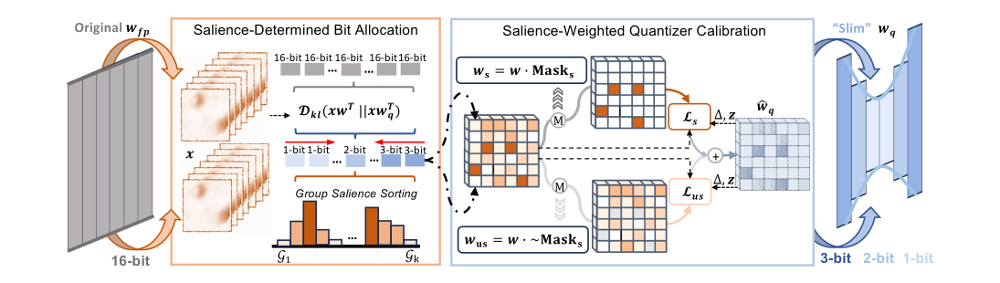

# SliM-LLM (arXiv:2405.14917)

> 大模型里"动一下输出就歪"的权重不是随机撒的，它们沿着输入通道扎堆成片。既然成片，混合精度就不必逐个元素挑——按 128 列一组分配位宽（3/2/1 bit），精度接近逐元素方案，却不需要 bitmap 或码本索引。

**SliM-LLM: Salience-Driven Mixed-Precision Quantization for Large Language Models**
Wei Huang, Haotong Qin, Yangdong Liu, Yawei Li, Qinshuo Liu, Xianglong Liu, Luca Benini, Michele Magno, Shiming Zhang, Xiaojuan Qi
HKU / ETH Zürich / Beihang · ICML 2025（arXiv 首发 2024-05，v2 2025-05）

- 论文：<https://arxiv.org/abs/2405.14917>
- PDF：<https://arxiv.org/pdf/2405.14917v2>
- 代码：<https://github.com/Aaronhuang-778/SliM-LLM>
- 许可：CC BY 4.0

---

## 导航

| 角度 | 文件 |
|---|---|
| 中文精读 / 伴读（结构标注 + 骨架段追问 + 术语表） | [`reading.org`](reading.org) |
| 原理故事（七拍讲法，给不懂量化的人听） | [`paper.org`](paper.org) |
| 中文全文翻译（逐节 + 全部图表，CC BY 4.0 允许） | [`translation_zh.md`](translation_zh.md) |
| Paper-river 溯源（倒读法，上下游脉络） | [`../../paper-river/SliM-LLM-2405.14917.org`](../../paper-river/SliM-LLM-2405.14917.org) · [英文版](../../paper-river/SliM-LLM-2405.14917_en.org) |
| Radar 数据源 | 无 —— 本文早于 radar 覆盖窗口，本次为 `scripts/resolve_paper.py` 的 arxiv-live 解析 |

---

## Radar 分析

### 0. 归档状态

radar 的 `data/summarized/` 覆盖窗口是 **2025-11-21 起**（279 天）。本文 2024-05 首发、2025-05 出 v2，**整个生命周期都在窗口之外**，所以：

- 没有 radar 的 composite score / `topic_bucket` / `practicality` 评分
- 没有同 bucket 的 siblings 记录
- `seeds.yaml` 与 `rejected.jsonl` 里都没有它 —— **未 triage**

下面的对比是我拿归档里 2025-11 以来的 mixed-precision 论文做的横向定位，不是 radar 自己打的分。

### 1. 同类对比 / novelty

SliM-LLM 有三个可分离的贡献。今天回看，**每一个都已经长出了专门的后继者**，而且后继者都在攻它当年没碰的那一面：

| SliM-LLM 的做法 | radar 里的后继者 | 后继者补了什么 |
|---|---|---|
| 组级（group-wise）混合精度，靠 salience 排序 | `2603.17354` NSDS（Beyond Outliers） | 去掉了对 calibration data 的依赖，并把"数值敏感度"拆成数值 + 结构双维度 |
| 用 **KL 散度**而非 MSE 做分配目标 | `2604.13440` A KL Lens on Quantization | 把"KL 比 MSE/SQNR 更贴合语言建模敏感度"从经验做法上升为形式化论证，并且 forward-only |
| 补偿约束锁死平均位宽（升一组必降一组） | `2605.18475` GAMMA | 换成 augmented Lagrangian + 整数规划投影，**跨层全局预算**；score reuse 让一次训练服务任意目标位宽 |
| 需要 calibration 才能排序 | `2606.04980` AlphaQ | 用 HT-SR 谱理论判断 expert 训练质量，**完全免 calibration**（MoE 场景） |
| 分配的是整数位宽 1/2/3 | `2606.04115` dMX | 分配的是 **MXFP 块浮点格式**，可微搜索 + 温度退火，落在 OCP 标准的硬件原生格式上 |

**novelty 判断**：核心观察（salience 沿 channel 聚簇 → 混合精度可以是结构化的）在 2024 年是真新的，也确实立住了 —— 今天 radar 里几乎所有 mixed-precision 工作都默认按模块/组/层分配，没人再回去做逐元素 bitmap。这个范式已经被吸收成背景假设，而不再是卖点。

但**它没做的那两件事恰好是现在的主战场**：跨层全局预算（GAMMA）、以及把分配对象从整数位宽换成硬件原生块浮点格式（dMX、TORQ）。所以现在读它，价值在于理解范式的来处，不在于拿来用。

### 2. 趋势定位

归档窗口内标题命中 `mixed-precision | bit-allocation | bit-width` 的论文：

| 月份 | 命中 / 当月总量 |
|---|---|
| 2025-11 | 3 / 1745 |
| 2025-12 | 6 / 5027 |
| 2026-01 | 4 / 6132 |
| 2026-02 | 8 / 7780 |
| 2026-03 | 7 / 8390 |
| 2026-04 | 7 / 8131 |
| 2026-05 | 11 / 10729 |
| 2026-06 | 7 / 7780 |
| 2026-07 | 5 / 6033 |
| 2026-08 | 3 / 5310 |
| **合计** | **61 / 67057（0.09%）** |

绝对数量常年在个位数到十几篇，占比横盘、近三个月还在往下走。**这是一个稳定但不升温的小方向**，不是热点。

更重要的是内部构成在漂移：早期（2025-11 ~ 2026-02）还有整数位宽的分配，2026-04 之后新出的基本都挂在 MXFP / NVFP / block-float 上（`dMX`、`Diagonal-Tiled Mixed-Precision Attention for Low-Bit MXFP`、`TORQ`）。**整数 1/2/3-bit 混合精度这一支基本冷了** —— 原因论文自己在 Limitations 里就写了：GPU 没有像样的 1-bit 支持。

对读者的含义：不值得为"追新"读这篇；值得为"看清 group-wise 分配这个范式是怎么被确立的"读这篇。

### 3. 工程可落地性

| 维度 | 值 |
|---|---|
| format / method | 整数 weight-only PTQ，group size 128，per-group INT1/INT2/INT3；backbone = GPTQ（SliM-LLM）或 OmniQuant（SliM-LLM+） |
| 最大测试模型 | LLaMA-2-70B、LLaMA-3-70B、OPT-66B（Tab. 1/8/14） |
| 精度 | 2-bit LLaMA-7B WikiText2 PPL **152.31 → 14.58**；LLaMA-13B 20.44 → 8.87；LLaMA-3-8B 210.00 → 39.66。零样本六项均值 LLaMA-7B **39.65 → 43.84**（SliM-LLM+ 对 OmniQuant 49.11 → 51.02） |
| 推理性能 | **-27%**：LLaMA-7B 2-bit，83.9 → 61.2 token/s（A800）。**低于 FP16 的 69.2** |
| 校准成本 | WikiText2 128 条 × 2048 token；SliM-LLM 无反向传播，单卡 A800 即可；SliM-LLM+ 要 AdamW，仍单卡 |
| 峰值内存 | LLaMA-7B 2-bit：权重 12.6G → 2.3G，运行时 14.4G → 4.4G |
| 额外索引开销 | **零**（这是全文的卖点）—— 组内共享 quantizer，只多存一个 per-group 2-bit 的位宽数组 |

**落地判断（AMD / 生产推理视角）**：

- *直接搬 → 不建议*。它依赖一个改过的 AutoGPTQ CUDA kernel，作者明说这是 "primarily conducted to validate feasibility"。更硬的问题是 1-bit 组在任何现代 GPU 上都没有原生支持，实际是拿更宽的容器在装 —— 所以速度不升反降，掉到 FP16 以下。一个"内存降到 1/5 但比不量化还慢"的方案，适用面很窄（只在纯 memory-bound、batch=1、装不下就跑不了的场景下划算）。
- *值得迁移的是 SBA 的分配思路*。它需要的输入 GPTQ 全都算好了（Hessian 逆的对角线就在手边），增量只是一次排序 + 16 次前向，成本几乎为零。把分配对象从 {1,2,3}-bit 换成 {MXFP4, MXFP6} 这类 OCP 原生块格式，正好绕开 1-bit 无硬件支持这个坑 —— dMX（`2606.04115`）已经在这条路上，可以对读。
- *SQC 的共享 τ 是最容易白嫖的一块*。它不改变任何存储/访存布局，纯粹是校准阶段搜一个标量，任何 group-wise quantizer 都能直接挂上去。

**`unknown` / 需要回原文或代码确认的**：

- Tab. 5 的 token/s 是什么 batch size、prefill 还是 decode，论文没说。-27% 这个数在 batch>1 或 GEMM 主导时是否还成立，无法从论文判断。
- 全文只做 weight-only，没有 activation 量化结果（无 W4A4 / W8A8 对照），跟 QuaRot / SpinQuant 这类 W-A 联合方案不可比。
- SBA 在 Algorithm 1 里位于 GPTQ 误差补偿循环**之前**一次算完，但补偿会改写后续列的权重 —— 排序依据在执行中被自己改掉了。论文全文未讨论，代码里是否有重排需要去仓库确认。

### 4. 归档里唯一的第三方评测

归档窗口内只有一篇论文在摘要层面点名 SliM-LLM：

**`2606.21257` An Empirical Study of OpenPangu Quantization on Ascend NPUs**（2026-06-19，北航等；radar relevance 8，bucket=survey，topic_relevance 4 / practicality 4）

**这篇 OpenPangu 实证研究的结论，与 SliM-LLM 自己报的头条数字方向相反 —— 它构成对 SliM-LLM 的反证。**

它在华为 Ascend 910B1 上，用**统一的校准与评估协议**、跨 **18 个任务**，把 RTN / GPTQ / AWQ / SmoothQuant / GPTAQ / BiLLM / SliM-LLM 七种方法放在 OpenPangu 1B 和 7B 上对比。结论：

- 8-bit weight-only 对两个模型**几乎无损**
- 4-bit 在 7B 上可用，但对 1B 在推理/数学/代码任务上明显有害
- **2-bit 及二值化设置普遍退化至接近随机行为**
- W4A4 SmoothQuant 产生非有限 PPL

**这一条直接顶在 SliM-LLM 的头条数字上**。原文报的是 2-bit LLaMA-7B PPL 14.58、零样本均值 43.84（FP16 是 64.09），本来就已经是"能说话但答不对题"的水平；换到另一个模型家族、另一套硬件、别人的手上跑，落到了"接近随机"。

三点得说在前面，免得把这个反证用重了：

1. **不是敌意复现** —— Xianglong Liu 同时挂名 SliM-LLM 和这篇，是同一批人。
2. **不是严格的复现失败** —— 换了模型家族（OpenPangu 而非 LLaMA）、换了硬件（Ascend 而非 A800），规模只到 7B。SliM-LLM 在 LLaMA 上的数字没有被推翻。
3. **目前只有摘要层面的信息** —— "2-bit 及二值化普遍崩溃"是个总括陈述，涵盖 BiLLM、SliM-LLM 等多种方法；**radar 归档里没有 SliM-LLM 在 OpenPangu 上的单独数字**。要坐实"SliM-LLM 具体掉到多少"，需去翻 `2606.21257` 的 PDF 正文表格。

所以它证明的是一件更窄但更有用的事：**2-bit 的可用性对模型家族极其敏感**——原文只在 LLaMA/OPT 上验证过，泛化性从未被检验。

配合前面 §2 的趋势（整数低位这一支在退潮）读，结论是一致的：这条路上真正立住的是那个**结构性论断**（要害度按通道聚簇 → 组级分配不损失信息），而不是那个位宽。

### 5. 是否已被 triage

**未 triage** —— `seeds.yaml` 和 `rejected.jsonl` 里都没有它。

一点观察（本 skill 不写这两个文件，要动请走 `paper-triage`）：`seeds.yaml` 收的正是这一代的地标论文，SliM-LLM 的直接邻居已经在里面了 —— AQLM（`2401.06118`, low_bits）、QuIP#（`2402.04396`, low_bits）、PB-LLM（`2310.00034`, qat），而 PB-LLM 恰好是本文在正文里点名对比并压过的方法。按这个收录标准，SliM-LLM 作为 `low_bits` seed 是够格的，缺席更像是覆盖窗口造成的遗漏而非有意拒绝。

---

*本页由 `paper-interpret` 生成于 2026-08-27。论文未被 radar pipeline 收录，元数据经 `scripts/resolve_paper.py` 从 arXiv 实时获取；上表的横向对比与趋势统计来自本仓库 `data/summarized/` 2025-11-21 ~ 2026-08-26 的 279 天归档。*
