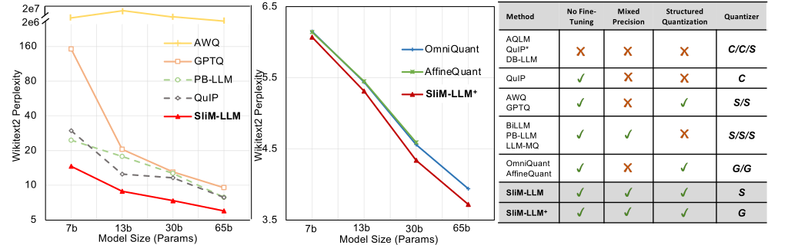
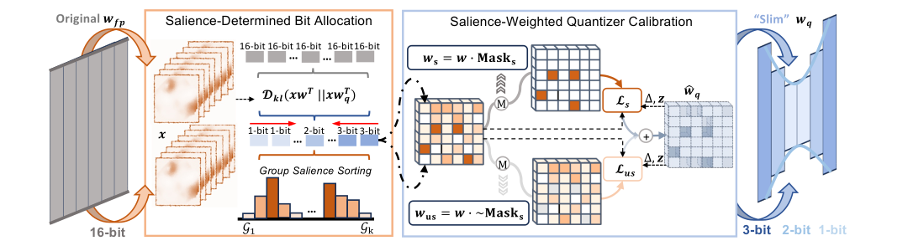
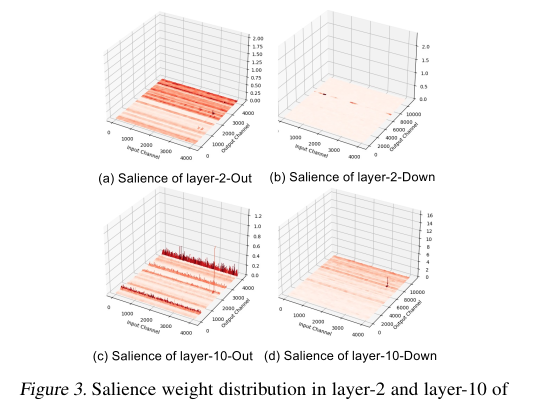
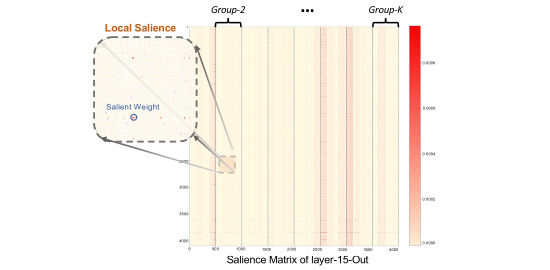
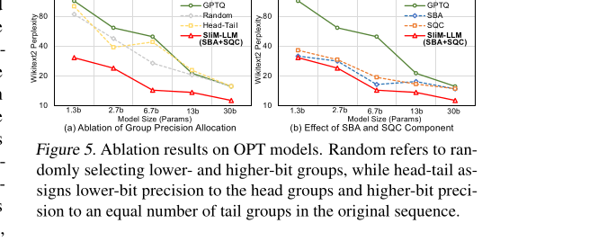
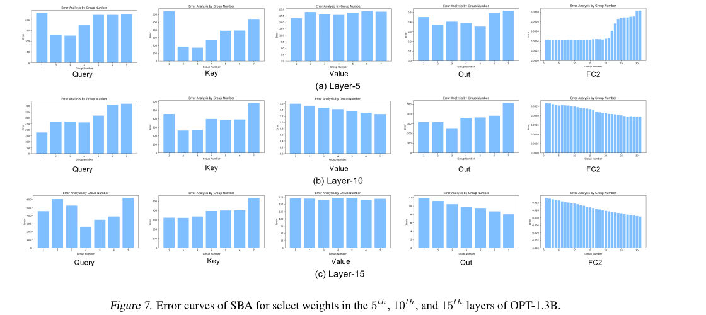
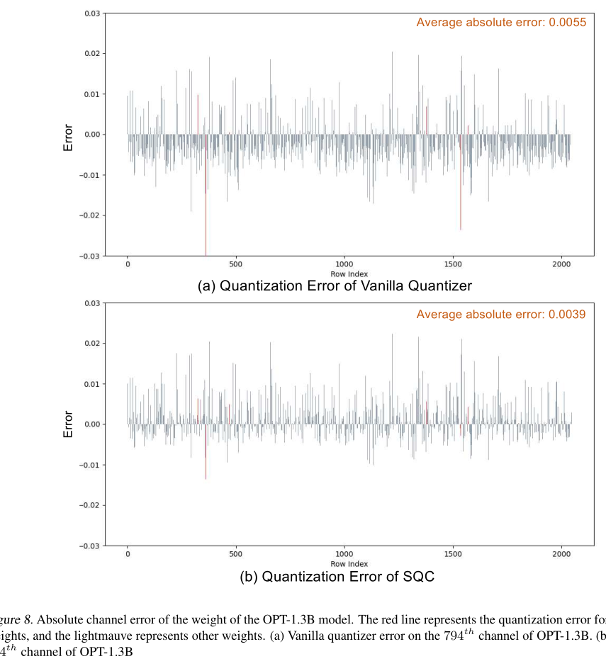
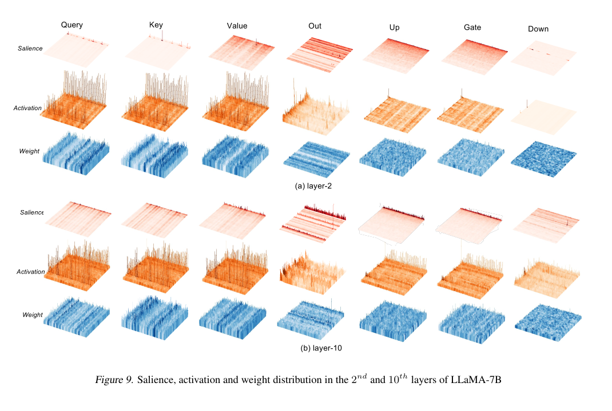
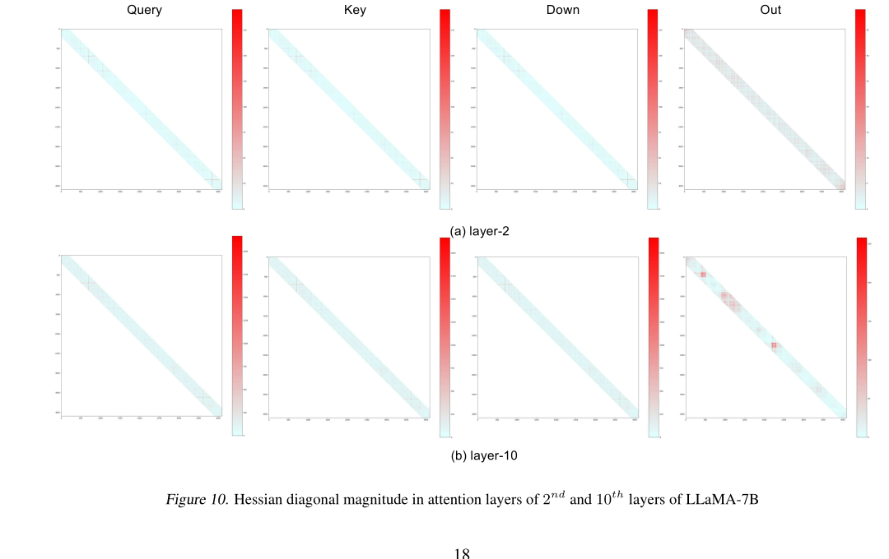
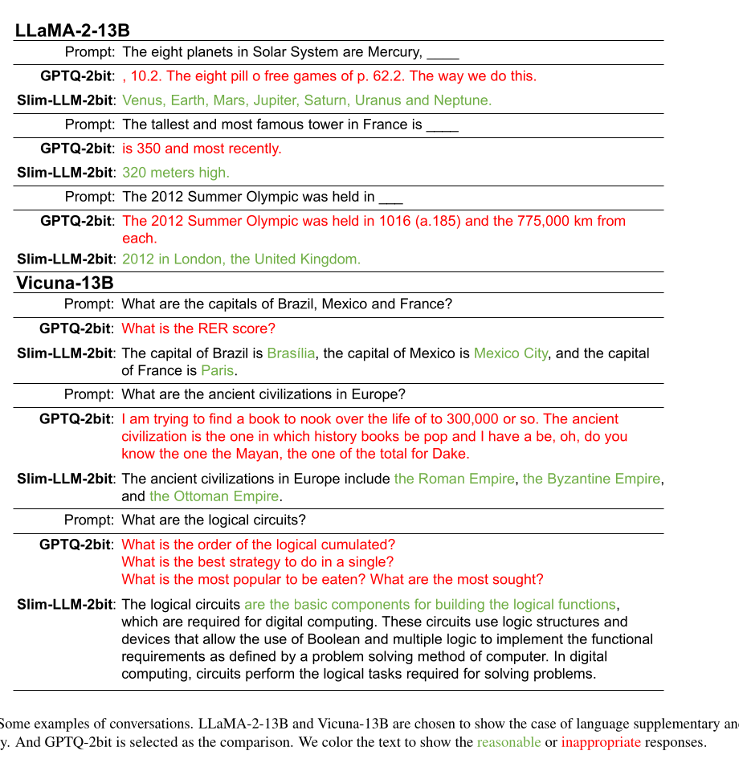

# SliM-LLM：面向大语言模型的显著性驱动混合精度量化

**原文标题**：SliM-LLM: Salience-Driven Mixed-Precision Quantization for Large Language Models
**作者**：Wei Huang（香港大学）、Haotong Qin🖂（苏黎世联邦理工学院 ETH Zürich）、Yangdong Liu（北京航空航天大学）、Yawei Li（ETH Zürich）、Qinshuo Liu（香港大学）、Xianglong Liu（北京航空航天大学）、Luca Benini（ETH Zürich）、Michele Magno（ETH Zürich）、Shiming Zhang🖂（香港大学）、Xiaojuan Qi🖂（香港大学）
**通讯作者**：haotong.qin@pbl.ee.ethz.ch, beszahng@hku.hk, xjqi@eee.hku.hk
**发表**：ICML 2025
**arXiv**：[2405.14917v2](https://arxiv.org/abs/2405.14917) [cs.LG] 25 May 2025
**代码**：https://github.com/Aaronhuang-778/SliM-LLM

本文为 arXiv:2405.14917v2 的中文全文翻译，原文以 CC BY 4.0 发布。

---

## 目录

- [摘要](#摘要)
- [1 引言](#1-引言)
- [2 相关工作](#2-相关工作)
- [3 SliM-LLM](#3-slim-llm)
  - [3.1 预备知识](#31-预备知识)
  - [3.2 显著性决定的比特分配](#32-显著性决定的比特分配)
  - [3.3 显著性加权量化器校准](#33-显著性加权量化器校准)
  - [3.4 SliM-LLM 的实现流程](#34-slim-llm-的实现流程)
- [4 实验](#4-实验)
  - [4.1 主要结果](#41-主要结果)
  - [4.2 消融实验结果](#42-消融实验结果)
  - [4.3 设备端高效推理](#43-设备端高效推理)
- [5 结论](#5-结论)
- [致谢](#致谢)
- [影响声明](#影响声明)
- [参考文献](#参考文献)
- [附录 A 局限性](#附录-a-局限性)
- [附录 B SliM-LLM 的实现](#附录-b-slim-llm-的实现)
- [附录 C 分组显著性决定比特分配的搜索细节](#附录-c-分组显著性决定比特分配的搜索细节)
- [附录 D SBA 的评估函数](#附录-d-sba-的评估函数)
- [附录 E SQC 的扩展消融实验](#附录-e-sqc-的扩展消融实验)
- [附录 F 量化分组大小的扩展消融实验](#附录-f-量化分组大小的扩展消融实验)
- [附录 G 显著性通道聚类的扩展讨论](#附录-g-显著性通道聚类的扩展讨论)
- [附录 H 更多对比实验](#附录-h-更多对比实验)
- [附录 I 真实对话示例](#附录-i-真实对话示例)
- [附录 J 效率相关的模型实验](#附录-j-效率相关的模型实验)
- [附录 K 视觉-语言模型上的量化表现](#附录-k-视觉-语言模型上的量化表现)

---

## 摘要

训练后量化（Post-training quantization, PTQ）是压缩大语言模型（LLM）的一种有效技术。然而，尽管统一精度量化在计算上高效，却往往会损害模型性能。为解决这一问题，我们提出了 SliM-LLM，一种显著性驱动的混合精度量化框架，在分组（group-wise）粒度上分配比特宽度。我们的方法基于这样一个观察：重要权重遵循一种结构化的分布，并引入了两个关键组件：1）显著性决定的比特分配（Salience-Determined Bit Allocation, SBA），根据各组的显著性自适应地为每层内的分组分配比特宽度；2）显著性加权量化器校准（Salience-Weighted Quantizer Calibration, SQC），通过引入元素级显著性来优化量化器参数。凭借其结构化的划分方式，SliM-LLM 提供了一种硬件友好的解决方案，在提高精度的同时匹配了统一量化方法的效率。实验表明，SliM-LLM 在各种低比特宽度的 LLM 上均取得了优异表现。例如，2-bit 量化的 LLaMA-7B 模型相较浮点基线将内存占用降低了近 6 倍，与最先进的无梯度 PTQ 方法相比困惑度（perplexity）下降了 48%，并且保持了 GPU 推理速度。此外，其扩展版本 SliM-LLM+ 结合了基于梯度的量化，进一步将困惑度降低了 35.1%。我们的代码已在 https://github.com/Aaronhuang-778/SliM-LLM 开源。

**关键词**：机器学习，ICML

---

## 1 引言

LLM 已在各种自然语言基准测试中展现出卓越性能（Brown et al., 2020；Hendrycks et al., 2020）。LLaMA（Touvron et al., 2023a）和 GPT（Brown et al., 2020）等模型推动了通用语言智能的进步。它们的能力也已扩展到多模态领域（Li et al., 2024b；Achiam et al., 2023；Team et al., 2023；Zhang et al., 2023；Huang et al., 2024b），进一步推动通用人工智能（AGI）的发展（Bubeck et al., 2023）。然而，其高昂的计算和内存需求仍然是实际部署中的重大挑战。



为了解决 LLM 的资源约束问题，PTQ 已成为一种高效且有效的压缩技术（Dettmers et al., 2022），在量化预训练 LLM 权重方面取得了成功（Frantar et al., 2022；Lin et al., 2023；Shao et al., 2023；Lee et al., 2023；Chee et al., 2024）。随着 LLM 规模不断扩大，由于应用中计算与存储资源有限，对更激进的低比特压缩的需求变得至关重要（Huang et al., 2024a；Tseng et al., 2024）。
然而，在低比特场景（≤3-bit）下，显著的性能下降仍是一大挑战。为缓解这一问题，非结构化混合精度量化（Shang et al., 2023；Huang et al., 2024a；Dettmers et al., 2023）和向量量化（Chee et al., 2024；Tseng et al., 2024；Egiazarian et al., 2024）方法被相继提出以保留性能。
虽然这些方法推动了该领域的发展，但它们往往对硬件不友好，引入了额外的存储需求，例如需要存储比特图（bitmap）或码本索引（code indices）。这带来了瓶颈，限制了部署时在内存和计算需求上的进一步降低。

本文提出了一种显著性驱动的混合分组 LLM（SliM-LLM）框架，一种精度高且推理高效的 LLM PTQ 方法（≤3-bit）。
我们的方法基于一个关键观察：对模型性能至关重要的显著（重要）权重呈现出结构化的分布，往往聚集在某些通道中（见 §3.2.1 及图 3）。
这一见解在以往研究中大多被忽视（Frantar et al., 2022），构成了将 SliM-LLM 设计为结构化、硬件友好的混合精度低比特方法的基础。它通过两个关键设计——分别在全局分组层面和局部元素层面保留重要权重——来维持性能。
首先，我们提出了一种新颖的显著性决定的比特分配（SBA）方法，该方法根据各量化分组的组级显著性排序自适应地为每个量化分组分配比特宽度。该分配策略经过优化以降低激活重构误差。通过对更重要的分组应用更高精度，并对不那么重要的分组降低比特宽度，SBA 在提升 LLM 整体性能的同时实现了较低的平均比特宽度。
其次，我们引入了显著性加权量化器校准（SQC），它增强了对局部显著权重的敏感度，确保组内的关键信息得以保留。
SQC 与 SBA 协同工作，利用权重的局部和全局显著性来保持 LLM 量化后的性能。
与逐元素混合精度方法（Shang et al., 2023；Dettmers et al., 2023；Huang et al., 2024a）不同，SliM-LLM 本质上是结构化的，在保持高性能的同时消除了额外的比特或计算开销。我们通过将 SliM-LLM 部署到一个面向 LLM 的应用级推理工具[^1]中进一步证明了这一点，实现了在 GPU 上高效的混合精度推理并保持稳定强劲的性能。

[^1]: https://github.com/AutoGPTQ/AutoGPTQ

实验表明，在多个 LLM 系列上，SliM-LLM 在各种基准测试中，尤其是在低比特场景下，超越了现有的免训练 PTQ 方法。以 GPTQ 为骨干，SliM-LLM 将 2-bit LLaMA-13B 和 LLaMA2-13B 在 WikiText2（Merity et al., 2016）上的困惑度分数分别从 20.44 和 28.14 提升至 8.87 和 9.41，性能提升均超过 56%。
SliM-LLM 甚至在部署友好性方面优于其他逐元素混合精度 PTQ 方法，例如 PB-LLM（Shang et al., 2023）、APTQ（Guan et al., 2024）和 LLM-MQ（Li et al., 2024a），展示了其在低比特精度与效率上的优越性。我们还将 SliM-LLM 集成到 OmniQuant（Shao et al., 2023）中，通过梯度优化得到 SliM-LLM+，进一步提升量化质量。此外，这种分组混合精度策略可以平滑地适配现有的量化感知训练（QAT）（Liu et al., 2023）、基于微调（Guo et al., 2023；Liao & Monz, 2024；Dettmers et al., 2024）或基于码本（Chee et al., 2024；Egiazarian et al., 2024；Tseng et al., 2024）的 LLM 压缩方法。这种权重显著性结构为 LLM 压缩引入了一种新的实用视角。



## 2 相关工作

**大语言模型**在多个自然语言处理领域取得了长足发展，在这些领域中确立了突出的范式（Bubeck et al., 2023；Chang et al., 2024；Zhao et al., 2023；Brown et al., 2020；Touvron et al., 2023a）。然而，LLM 的卓越表现依赖于海量参数与计算量，这为资源受限环境下的部署带来了重大挑战。因此，针对 LLM 压缩的研究已成为一个前景广阔的领域。现有的 LLM 压缩技术主要包括量化、剪枝和蒸馏（Xu et al., 2023；Ganesh et al., 2021；Frantar et al., 2022；Xiao et al., 2023a；Shao et al., 2023；Chee et al., 2024；Zhu et al., 2023；Frantar & Alistarh, 2023；Huang et al., 2024a；Qin et al., 2024）。低比特量化因能够在不改变网络结构的前提下有效缩减模型体积而受到广泛关注（Zhu et al., 2023；Zhao et al., 2023；Chang et al., 2024）。

LLM 的量化通常可分为量化感知训练（QAT）和 PTQ 两类，PTQ 已成为更实用的替代方案。LLM.int8()（Liu et al., 2023）和 ZeroQuant（Yao et al., 2022）等技术引入了分块量化（block-wise quantization），这是一种能降低硬件开销的经济高效的分组方式。进一步的进展，包括 AWQ（Lin et al., 2023）和 OWQ（Lee et al., 2023），对离群值权重通道应用缩放变换，以保留其表征能力。GPTQ（Frantar et al., 2022）利用基于 Hessian 的误差补偿（Frantar & Alistarh, 2022）最小化分组量化误差，在 3-bit 量化下取得了显著性能。OmniQuant（Shao et al., 2023）引入了一种可学习的缩放量化器，以输出感知的方式缓解量化误差。对于超低比特宽度量化，QuIP（Chee et al., 2024）、QuIP#（Tseng et al., 2024）和 AQLM（Egiazarian et al., 2024）等方法通过带可学习码本的矩阵分解与微调提升了 2-bit 量化性能。近期工作（Qin et al., 2024；Liao & Monz, 2024；Dettmers et al., 2024；Guo et al., 2023）通过利用参数高效微调（PEFT）进一步改进了量化技术，借助额外参数的学习实现了性能提升。

**混合精度量化**利用模型参数重要性和冗余度的差异，为各组件分配不同的比特宽度。在传统视觉网络中，HAWQ V2（Dong et al., 2020）和 HAWQ V3（Yao et al., 2021）利用 Hessian 分析和整数线性规划（ILP）在逐层基础上优化比特宽度分配。同样，OMPQ（Ma et al., 2023）使用网络正交性而非 Hessian 来进行比特宽度优化。对于大语言模型（LLM），APTQ（Guan et al., 2024）扩展了 HAWQ 的方法，基于 Hessian 迹为 Transformer 块分配混合比特宽度，在 3-bit 量化下取得了更好的精度。然而，块级或层级的混合精度策略在 2-bit 下无法维持压缩后的性能。为解决这一问题，SpQR（Dettmers et al., 2023）、PB-LLM（Shang et al., 2023）和 LLM-MQ（Li et al., 2023）等近期方法采用更细粒度的分组与逐元素混合精度以实现更精确的权重量化。尽管有所改进，这些低比特方法严重依赖细粒度划分，这对真实硬件部署和推理速度带来了重大挑战。

## 3 SliM-LLM

本节介绍一种结构化混合精度量化方法 SliM-LLM，以克服混合精度 LLM 在精度和效率上的瓶颈。我们设计了两种新颖策略：基于全局显著性分布确定分组比特宽度的显著性决定的比特分配（SBA），以及增强对局部重要权重信息感知能力的显著性加权量化器校准（SQC）。我们将分别在 §3.2 和 §3.3 中介绍 SBA 和 SQC。

### 3.1 预备知识

**量化框架。** 我们首先按照常见做法（Liu et al., 2023；Shao et al., 2023；Achiam et al., 2023）给出 LLM 的通用均匀量化过程。量化过程需要将分布在区间 $`[w_{\mathrm{min}},w_{\mathrm{max}}]`$ 内的浮点权重映射到 $`2^{N}`$ 的整数范围，其中 $`N`$ 为目标比特宽度。对于权重 $`\boldsymbol{w}_{f}\in\mathbb{R}^{n\times m}`$ ，其量化函数为：

```math
\left\lbrace\begin{array}{lr}\hat{\boldsymbol{w}}_{q}=\mathrm{clamp}(\lfloor\dfrac{\boldsymbol{w}_{f}}{s}\rceil+z,0,2^{N}-1),\\
s=\dfrac{w_{\mathrm{max}}-w_{\mathrm{min}}}{2^{N}-1},\quad z=-\lfloor\dfrac{w_{\mathrm{min}}}{s}\rceil\end{array}\right. \tag{1}
```

其中 $`\hat{\boldsymbol{w}}_{q}`$ 表示量化后的整数权重， $`\lfloor\cdot\rceil`$ 为取整（round）操作， $`\mathrm{clamp}(\cdot)`$ 将取值约束在整数范围内（例如 $`N=2`$ 时为 $`[0,1,2,3]`$ ）。 $`s`$ 为缩放因子， $`z`$ 为量化零点。当转换为 1-bit 量化时，计算方式为：

```math
\begin{array}{lr}\hat{\boldsymbol{w}}_{b}=\mathrm{sign}(\boldsymbol{w}_{f}),\quad \alpha=\frac{1}{l}\|\boldsymbol{w}_{f}\|_{\ell 1}\\
\mathrm{sign}(w)=\begin{cases}1&\text{if } w\geq 0,\\
-1&\text{others}.\end{cases}\end{array} \tag{2}
```

其中 $`\hat{\boldsymbol{w}}_{b}`$ 是二值化结果， $`\alpha`$ 表示二值化尺度， $`l`$ 是权重中元素的数量（Qin et al., 2023），用于通过 $`\alpha\hat{\boldsymbol{w}}_{b}`$ 反量化。我们可以按照常见做法（Nagel et al., 2020；Frantar et al., 2022）将 PTQ 的逐层损失形式化为：

```math
\mathcal{L}(\hat{\boldsymbol{w}}_{f})=\|\boldsymbol{x}\boldsymbol{w}_{f}^{\top}-\boldsymbol{x}\hat{\boldsymbol{w}}_{f}^{\top}\|^{2}\approx \mathrm{tr}((\hat{\boldsymbol{w}}_{f}-\boldsymbol{w})\boldsymbol{H}(\hat{\boldsymbol{w}}_{f}-\boldsymbol{w})^{\top}) \tag{3}
```

其中 $`\boldsymbol{x}\in\mathbb{R}^{t\times m}`$ 表示来自校准数据集的输入向量， $`\hat{\boldsymbol{w}}_{f}\in\mathbb{R}^{n\times m}`$ 是式 (1) 或式 (2) 量化结果的反量化权重， $`\boldsymbol{H}=\frac{1}{P}\sum_{k=1}^{P}\boldsymbol{x}^{[k]^{\top}}\boldsymbol{x}^{[k]}`$ 是通过 Levenberg-Marquardt 近似（Marquardt, 1963；Frantar & Alistarh, 2022）由一组输入激活得到的代理 Hessian 矩阵。

**参数显著性。**
在 LLM 中，权重矩阵中每个元素的重要程度各不相同（Dettmers et al., 2023；Frantar & Alistarh, 2023）。根据式 (3)，量化不同元素会对模型输出损失产生不同的影响。对损失影响显著的元素被称为显著权重。因此，我们遵循 SparseGPT（Frantar & Alistarh, 2023）将每个元素的显著性定义如下：

**定义 3.1。**

在如式 (3) 所表达的损失二次近似中，给定由 $`\frac{1}{P}\sum_{k=1}^{P}\boldsymbol{x}^{[k]^{\top}}\boldsymbol{x}^{[k]}`$ 生成的权重矩阵 Hessian 矩阵 $`H\in\mathbb{R}^{m\times m}`$ ，移除位置 $`(i,j)`$ 处的元素会给 LLM 中线性投影的输出矩阵带来误差 $`\delta_{i,j}=\frac{w_{i,j}^{2}}{[\boldsymbol{H}^{-1}]_{j,j}^{2}}`$ 。

其中 $`[\boldsymbol{H}^{-1}]_{jj}`$ 表示逆 Hessian 矩阵的第 $`j`$ 个对角项， $`\boldsymbol{H}^{-1}`$ 可以通过 Cholesky 分解（Krishnamoorthy & Menon, 2013）高效计算。根据定义 3.1，我们将消除误差 $`\delta_{ij}`$ 映射为 LLM 中每个权重元素的显著性度量，代表了不同权重对输出损失和语言能力的影响，这也导致了 LLM 混合精度量化策略的产生（Dettmers et al., 2023；Shang et al., 2023；Huang et al., 2024a；Li et al., 2024a）。
然而，现有的混合精度方案需要在整个权重矩阵上进行离散的比特宽度分配，这给硬件计算带来了沉重负担，从而影响了推理效率。

### 3.2 显著性决定的比特分配

我们揭示了权重显著性的空间聚类现象，这启发了我们提出的 LLM 分组混合精度量化理念，进而引入显著性决定的比特分配（SBA）技术，为每个分组分配最优精度。

#### 3.2.1 全局显著性的空间分布

我们首先对权重显著性分布进行了实证研究。结果表明，某些通道表现出更高的显著性，并呈现出空间聚类的趋势。如图 3 所示，在 LLaMA-7B 模型第 2 层的注意力投影中，围绕第 2100、3218 和 3853 个通道识别出显著性聚类。在其他层中也观察到了类似的结构化模式。此外，其他层中也检测到了聚类的显著性（如图 3 所示）。更多示例见附录 G。


图 3：权重显著性的空间分布。显著权重围绕若干特定通道（如第 2100、3218、3853 通道）呈现聚类分布，该结构化模式在不同层中普遍存在。

随后，我们分析了这一现象背后的原因。根据定义 3.1，权重的显著性与权重的量级以及 Hessian 矩阵的迹成正比，而后者可由输入激活的乘积 $`\boldsymbol{x}^{\top}\boldsymbol{x}`$ 近似。在 LLM 中，激活表现出极端的离群通道，而权重的数值差异相对较小（Xiao et al., 2023a；Nrusimha et al., 2024）。因此，我们提出对激活中的离群通道如何影响权重显著性分布进行分析：

**定理 1。**

给定输入校准激活 $`\boldsymbol{x}\in\mathbb{R}^{t\times m}`$ ，其在通道 $`p`$ 的位置存在一个离群通道 $`\boldsymbol{x}_{:,p}^{*}\gg\boldsymbol{x}_{:,j},\forall j\in[0,m],j\neq p`$ 。 $`\boldsymbol{H}=\boldsymbol{x}^{\top}\boldsymbol{x}`$ 的迹元素将在 $`(p,p)`$ 处出现巨大的离群值，即 $`\boldsymbol{H}_{p,p}\gg\boldsymbol{H}_{j,j},\forall j\in[0,m],j\neq p`$ ，因为 $`\boldsymbol{H}_{p,p}`$ 由 $`[\boldsymbol{x}_{:,p}^{*\top}\boldsymbol{x}_{:,p}^{*}]=\sum_{i=0}^{t}x_{i,p}^{*2}`$ 产生，这进一步导致权重第 $`p`$ 个通道处的参数显著性更大，即 $`\delta_{:,p}>\delta_{:,k},\ \delta_{:,k}=\frac{w_{:,k}^{2}}{[\boldsymbol{H}^{-1}]_{k,k}^{2}},\forall k\in[0,t],k\neq p`$ 。

定理 1 阐明了离群激活对通道显著权重分布的影响（详细证明见附录 G.1）。此外，近期研究表明，LLM 激活中的离群通道会以固定但聚集的模式持续出现（Nrusimha et al., 2024）。根据定理 1，这些持续出现的异常激活导致了显著权重的分布，如图 3 所示。于是，在分组量化过程中，每个分组的平均显著性呈现出不同的特征。

同时，以往的非结构化混合精度方法会带来额外的存储需求和计算开销，影响实时推理。然而，本节中观察到的权重显著性在空间上强烈的结构化特征，极大地启发我们首先开发一种在保持推理效率的同时对权重矩阵进行分组混合精度处理的策略。因此，我们旨在基于组内显著性差异分配比特宽度，这不仅能提升量化精度，还能借助结构化的比特宽度节省与反量化确保 LLM 的推理效率。

#### 3.2.2 分组比特分配

为了给每个分组分配最优比特宽度，我们为混合精度 LLM 引入了显著性决定的比特分配（SBA）技术，如图 2 所示。该技术基于分组显著性的差异，通过最小化与原始权重输出的信息熵距离来确定不同分组的最优比特宽度分配。具体而言，我们首先利用平均显著性作为每个权重分组的重要性指标并据此排序。然后，所提出的 SBA 按以下方式优化比特分配：

```math
\begin{aligned}
\text{目标}:\quad &\arg\min\ \mathcal{D}_{kl}\ (\boldsymbol{x}\boldsymbol{w}_{f}^{\top}\ \|\ \boldsymbol{x}(\hat{\boldsymbol{w}}_{sba})^{\top}),\\
&\text{其中}\ \hat{\boldsymbol{w}}_{sba}=[\hat{\boldsymbol{w}}_{0,b_{0}},\hat{\boldsymbol{w}}_{1,b_{1}}...\hat{\boldsymbol{w}}_{k-1,b_{k-1}},\hat{\boldsymbol{w}}_{k,b_{k}}]\\
\text{约束}:\quad &|\mathcal{G}_{N-1}|=|\mathcal{G}_{N+1}|,\\
&\text{其中}\ \mathcal{G}_{N-1}=\lbrace b_{i}\mid b_{i}=N-1\rbrace,\\
&\mathcal{G}_{N+1}=\lbrace b_{j}\mid b_{j}=N+1\rbrace
\end{aligned} \tag{4}
```

其中 $`\mathcal{D}_{kl}(\cdot\|\cdot)`$ 表示两个输出之间的 Kullback-Leibler（KL）散度， $`\hat{\boldsymbol{w}}_{sba}`$ 通常代表采用分组混合精度的权重反量化结果，记为 $`[\hat{\boldsymbol{w}}_{0,b_{0}},\hat{\boldsymbol{w}}_{1,b_{1}}...\hat{\boldsymbol{w}}_{k-1,b_{k-1}},\hat{\boldsymbol{w}}_{k,b_{k}}]`$ ，其中 $`b_{i}`$ 表示第 $`i`$ 个分组的比特宽度， $`\mathcal{G}`$ 是具有相同比特宽度的分组集合， $`N`$ 为目标平均比特宽度。我们采用了一种补偿约束策略来为 SBA 保持一致的平均比特数。
例如，在 2-bit 量化中，显著性更高的分组被量化为 3-bit。为抵消额外增加的比特数，我们将相同数量的低显著性分组量化为 1-bit（ $`|\mathcal{G}_{N-1}|=|\mathcal{G}_{N+1}|`$ ），其余分组则设为 2-bit。

我们采用一种高效的双指针搜索方法（更多细节示例见附录 C）来优化式 (4) 中的目标。当权重输出通道大小为 $`m`$ 、分组大小为 128 时， $`k=\frac{m}{128}`$ ，权重的搜索区域被限制在 $`[0,\frac{k}{2}]`$ 内，搜索空间十分有限、效率很高，例如在 LLaMA-7B 中仅需 16 次迭代。我们还在附录 C 中提供了详细的搜索误差示例。值得注意的是，SBA 与式 (3) 中传统的均方误差（MSE）量化方式不同，它转而使用 KL 散度作为损失度量。与使用权重的均方误差（MSE）相比，SBA 使用分块输出的 KL 散度作为精度分配指标，旨在使 LLM 输出激活矩阵的分布与量化后激活的分布对齐。这种方法提升了模型在低比特量化下的信息表征能力，从而实现更有效的比特宽度分配。虽然 HAWQ v2（Dong et al., 2019）采用整数线性规划（ILP）为各层分配比特宽度，但其方法也可以适配到分组级目标上。SBA 与 ILP 的详细比较见 §4.2。

### 3.3 显著性加权量化器校准

除了显著性的全局分组分布之外，我们还注意到组内显著性在离散分布上仍存在局部差异。现有的常见量化器对所有权重采取统一的处理方式以最小化量化的影响（误差），缺乏感知局部显著性差异的能力。因此，本节我们引入了显著性加权量化器校准（SQC），通过放大量化器对显著权重的感知，增强组内显著权重的信息。

#### 3.3.1 局部显著性的离散分布

在前述章节中，我们基于全局显著性对每个分组进行了分组级比特宽度分配。为了保持量化推理的效率，我们采用了常用的顺序结构化分组方式（Frantar et al., 2022；Lin et al., 2023；Shao et al., 2023）。然而，这种分组混合精度也导致了同一分组内不同元素之间显著性的差异。具体而言，如图 4 中的显著性分布所示，在 LLaMA-7B 第 10 层的注意力输出层中，显著性相对较低的 Group-2（图 4）内的一小部分稀疏权重仍然保持着较高的重要性。在 LLM 中，少量具有离群值的权重元素会影响显著性的局部分布。


图 4：分组内的局部显著性分布。尽管 Group-2 的整体（分组级）显著性较低，其内部仍存在少量局部显著性很高的稀疏权重元素。
这些离散的权重通常仅占该组的约 1%，但对 LLM 的建模能力起着至关重要的作用。

**表 1：使用统计量化器的 LLaMA 系列量化结果。** 本表报告 WikiText2 困惑度，C4 结果见附录 H。"-" 表示所选工作未给出对应模型或代码的结果。

| #W | Method | 1-7B | 1-13B | 1-30B | 1-65B | 2-7B | 2-13B | 2-70B | 3-8B | 3-70B |
|---|---|---|---|---|---|---|---|---|---|---|
| 16-bit | - | - | 5.68 | 5.09 | 4.10 | 3.53 | 5.47 | 4.88 | 3.31 | 5.75 |
| 3-bit | APTQ | 6.76 | - | - | - | - | - | - | - | - |
| 3-bit | LLM-MQ | - | - | - | - | - | 8.54 | - | - | - |
| 3-bit | RTN | 7.01 | 5.88 | 4.87 | 4.24 | 6.66 | 5.51 | 3.97 | 27.91 | 11.84 |
| 3-bit | AWQ | 6.46 | 5.51 | 4.63 | 3.99 | 6.24 | 5.32 | - | 8.22 | 4.81 |
| 3-bit | GPTQ | 6.55 | 5.62 | 4.80 | 4.17 | 6.29 | 5.42 | 3.85 | 8.19 | 5.22 |
| 3-bit | **SliM-LLM** | 6.40 | 5.48 | 4.61 | 3.99 | 6.24 | 5.26 | 3.67 | 7.16 | 4.08 |
| 2-bit | LLM-MQ | - | - | - | - | - | 12.17 | - | - | - |
| 2-bit | RTN | 1.9e3 | 781.20 | 68.04 | 15.08 | 4.2e3 | 122.08 | 27.27 | 1.9e3 | 4.6e5 |
| 2-bit | AWQ | 2.6e5 | 2.8e5 | 2.4e5 | 7.4e4 | 2.2e5 | 1.2e5 | - | 1.7e6 | 1.7e6 |
| 2-bit | GPTQ | 152.31 | 20.44 | 13.01 | 9.51 | 60.45 | 28.14 | 8.78 | 210.00 | 11.90 |
| 2-bit | QuIP | 29.74 | 12.48 | 11.57 | 7.83 | 39.73 | 13.48 | 6.64 | 84.97 | 13.03 |
| 2-bit | PB-LLM | 24.61 | 17.73 | 12.65 | 7.85 | 25.37 | 49.81 | NAN | 44.12 | 11.68 |
| 2-bit | **SliM-LLM** | 14.58 | 8.87 | 7.33 | 5.90 | 16.01 | 9.41 | 6.28 | 39.66 | 9.46 |

注：原表 16-bit 行浮点基线 3-70B 一列的值为 2.9（该数值在原文排版中另起一行，此处补全在对应位置）。

普通量化器难以表示局部显著信息，因为它们只考虑组内所有元素的平均误差。在分组量化过程中（式 (1)），非显著权重往往占主导地位，从而使关键信息退化，对 LLM 性能产生负面影响。

#### 3.3.2 显著性加权量化器

为防止每个分组中局部显著信息的退化，我们提出了显著性加权量化器校准（SQC），它通过局部显著性感知增强显著权重的表达，从而降低这些重要元素的量化误差，提升 LLM 压缩后的性能。

基于一个常见的观察结果（Dettmers et al., 2023；Huang et al., 2024a），每个分组中相对显著权重的比例仅为 1%-5%。因此，我们采用 3-$`\sigma`$ 规则来构造掩码，以在每个分组中选出显著部分（ $`\boldsymbol{w}(\mu+3\sigma)`$ ，图 2），约占 1% 的元素。选择完成后，我们得到 $`\boldsymbol{w}_{i}=\boldsymbol{w}_{i}^{s}\cup\boldsymbol{w}_{i}^{us}`$ ，其中 $`\boldsymbol{w}_{i}^{s}`$ 是显著部分， $`\boldsymbol{w}_{i}^{us}`$ 表示第 $`i`$ 组中的非显著元素。为了有效保留局部显著权重的信息，SQC 首先在量化器中引入校准参数 $`\tau`$ ，从而在量化过程中释放感知区间。然后，我们通过校准定义 SQC 量化器的局部显著性感知损失：

```math
\arg\min_{\tau}\ \|\boldsymbol{w}_{i}^{s}-\tau\cdot s\lbrace\mathcal{Q}(\boldsymbol{w}_{i}^{s},\tau\cdot s,\tau\cdot z)-\tau\cdot z\rbrace\|_{2}^{2}+
```

```math
\|\boldsymbol{w}_{i}^{us}-\tau\cdot s(\mathcal{Q}(\boldsymbol{w}_{i}^{us},\tau\cdot s,\tau\cdot z)-\tau\cdot z)\|_{2}^{2} \tag{5}
```

其中 $`\mathcal{Q}(\cdot)`$ 表示式 (1) 中的量化过程， $`\|\cdot\|_{2}^{2}`$ 表示 $`\ell_{2}`$ 损失，与式 (3) 保持一致。 $`\boldsymbol{w}_{i}^{s}`$ 和 $`\boldsymbol{w}_{i}^{us}`$ 分别表示由掩码操作产生的分组 $`i`$ 中的显著和非显著部分。在式 (5) 中， $`\tau`$ 扩展了 $`s`$ 和 $`z`$ 的解空间，灵活调整 $`s`$ 和 $`z`$ 以在最优 $`\tau^{*}`$ 下搜索最优损失，且不引入额外的参数，因为 $`\boldsymbol{w}_{i}^{s}`$ 和 $`\boldsymbol{w}_{i}^{us}`$ 共享同一个量化器。 $`\tau`$ 的搜索空间通过将区间 $`[1-\lambda,1+\lambda]`$ 线性划分为 $`2n`$ 个候选值来构成。我们根据经验将 $`\lambda`$ 设为 0.1， $`n`$ 设为 50，以在效率和精度之间取得平衡。

与传统的量化器校准方法相比，SQC 通过在校准过程中增强对显著元素的损失敏感度，有效缓解了一般平均损失所导致的组内局部显著权重退化问题（更多实验见附录 E）。此外，SQC 过程使 $`\boldsymbol{w}_{i}^{s}`$ 和 $`\boldsymbol{w}_{i}^{us}`$ 能够共享一组参数 $`\tau^{*}s`$ 和 $`\tau^{*}z`$ ，从而无需在存储和推理时区分组内权重。这使得分组级的反量化计算变得简单直接，从而避免了元素级比特图（bitmap）和非结构化分组所带来的硬件开销。SQC 与 SBA 分别捕获了组内的局部显著权重信息和跨组的全局权重组合，有效保留了关键信息，并在极低比特宽度下维持了 LLM 的性能。

### 3.4 SliM-LLM 的实现流程

我们将混合精度框架集成到先进的 PTQ 方法中，例如 GPTQ（Frantar et al., 2022）和 OmniQuant（Shao et al., 2023），它们都对分组量化具有良好的推理友好性。
我们主要将 SBA 和 SQC 集成到 GPTQ 中以得到 SliM-LLM。对于 SliM-LLM+，SBA 被插入到带有可学习量化器的 OmniQuant 中。SliM-LLM 的插入流程见算法 1（第 4 行和第 9 行），详细函数见算法 2。

**表 2：使用可学习量化器的 LLaMA-1 与 LLaMA-2 模型量化结果。** 本表报告 WikiText2 困惑度，C4 结果见附录 H。

| #W | Method | 1-7B | 1-13B | 1-30B | 1-65B | 2-7B | 2-13B | 2-70B |
|---|---|---|---|---|---|---|---|---|
| 16-bit | - | 5.68 | 5.09 | 4.10 | 3.53 | 5.47 | 4.88 | 3.31 |
| 3-bit | OmniQuant | 6.15 | 5.44 | 4.56 | 3.94 | 6.03 | 5.28 | 3.78 |
| 3-bit | AffineQuant | 6.14 | 5.45 | 4.59 | - | 6.08 | 5.28 | - |
| 3-bit | **SliM-LLM+** | 6.07 | 5.37 | 4.34 | 3.72 | 5.94 | 5.11 | 3.35 |
| 2-bit | OmniQuant | 9.72 | 7.93 | 7.12 | 5.95 | 11.06 | 8.26 | 6.55 |
| 2-bit | AffineQuant | 13.51 | 7.22 | 6.49 | - | 10.87 | 7.64 | - |
| 2-bit | **SliM-LLM+** | 9.68 | 7.17 | 6.41 | 5.74 | 10.87 | 7.59 | 6.44 |

## 4 实验

我们在仅权重量化条件下对 SliM-LLM 和 SliM-LLM+ 进行评估，重点关注 2/3 比特精度。我们的框架采用逐通道分组量化，实验中分组大小 $`groupsize=128`$ 。由于 SliM-LLM 无需反向传播，量化过程在单张 NVIDIA A800 GPU 上进行。对于 SliM-LLM+，我们沿用 OmniQuant（Shao et al., 2023）采用 AdamW 优化器，同样可在单张 A800 上完成。我们从 WikiText2（Merity et al., 2016）中随机选取 128 个样本作为校准数据，每个样本 2048 个 token。

**模型与评估。** 为了全面展示 SliM-LLM 和 SliM-LLM+ 在低比特下的性能优势，我们在 OPT（Zhang et al., 2022）、LLaMA（Touvron et al., 2023a）、LLaMA-2（Touvron et al., 2023b）和 LLaMA-3 上进行实验。我们采用困惑度（perplexity）作为评估指标，该指标被广泛认为是语言生成能力的稳定度量（Frantar et al., 2022；Lin et al., 2023；Huang et al., 2024a；Shang et al., 2023；Shao et al., 2023；Chee et al., 2024；Egiazarian et al., 2024；Huang et al., 2024b），尤其适用于压缩场景。实验在 WikiText2（Merity et al., 2016）和 C4（Raffel et al., 2020）数据集上进行。此外，为评估量化后 LLM 的实际应用能力，我们还在零样本基准上进行了评估。

### 4.1 主要结果

本节展示 LLaMA 系列模型上的实验，OPT 模型的结果见附录 H。对于语言生成任务，如表 1 所示，SliM-LLM 显著优于其骨干方法 GPTQ，尤其是在 2-bit 条件下。具体而言，在 LLaMA-7B 上，SliM-LLM 实现了 90% 的困惑度下降，而在 LLaMA-3-8B 上则提升了 81%。与元素级混合精度方法 PB-LLM 及基于码本的 QuIP 方法相比，SliM-LLM 进一步将困惑度降低了 41%~51%。如表 1 所示，SliM-LLM+ 的性能相较 OmniQuant 和 AffineQuant 仍然领先。我们还在附录 I 中提供了 2-bit 指令微调 Vicuna-13B（Chiang et al., 2023）和 LLaMA-13B 的对话示例。我们的方法在 2-bit 下展现出零样本优势，如表 3 所示，其中 SliM-LLM 和 SliM-LLM+ 优于其他方法。例如，与 GPTQ 和 OmniQuant 相比，我们的方法在 LLaMA-7B 上平均分别提升了 4.19% 和 1.91%。在 LLaMA-65B 上，2-bit 的 SliM-LLM 和 SliM-LLM+ 达到了与 FP16 相差 6% 以内的精度。为进一步展示 SliM-LLM 的通用性能，我们还在多模态模型上比较了低比特结果（表 15），SliM-LLM 在 4 个基准上均展现出领先的准确率。

**表 3：不同量化方法在零样本任务上的性能比较。**

| 模型 / 准确率 ↑ | #W | 方法 | PIQA | ARC-e | ARC-c | BoolQ | HellaSwag | Winogrande | 平均 |
|---|---|---|---|---|---|---|---|---|---|
| LLaMA-7B | 16-bit | - | 77.47 | 52.48 | 41.46 | 73.08 | 73.00 | 67.07 | 64.09 |
| LLaMA-7B | 2-bit | GPTQ | 55.49 | 31.02 | 22.17 | 53.49 | 33.84 | 41.91 | 39.65 |
| LLaMA-7B | 2-bit | AWQ | 47.78 | 28.77 | 21.31 | 31.19 | 24.47 | 40.03 | 32.26 |
| LLaMA-7B | 2-bit | **SliM-LLM** | 57.83 | 33.46 | 25.09 | 56.05 | 36.70 | 52.64 | 43.84 |
| LLaMA-7B | 2-bit | OmniQuant | 63.63 | 43.91 | 27.32 | 58.02 | 48.78 | 52.97 | 49.11 |
| LLaMA-7B | 2-bit | **SliM-LLM+** | 64.96 | 45.66 | 28.67 | 64.59 | 48.86 | 53.35 | 51.02 |
| LLaMA-13B | 16-bit | - | 79.10 | 59.89 | 44.45 | 68.01 | 76.21 | 70.31 | 66.33 |
| LLaMA-13B | 2-bit | GPTQ | 70.37 | 47.74 | 35.88 | 51.57 | 61.39 | 60.84 | 54.63 |
| LLaMA-13B | 2-bit | AWQ | 49.23 | 30.01 | 29.49 | 30.88 | 26.72 | 46.30 | 35.44 |
| LLaMA-13B | 2-bit | **SliM-LLM** | 73.19 | 47.95 | 36.27 | 55.92 | 63.04 | 61.79 | 56.36 |
| LLaMA-13B | 2-bit | OmniQuant | 73.14 | 49.38 | 36.93 | 63.34 | 62.19 | 61.77 | 57.64 |
| LLaMA-13B | 2-bit | **SliM-LLM+** | 74.15 | 50.26 | 37.04 | 64.31 | 63.57 | 63.11 | 58.74 |
| LLaMA-30B | 16-bit | - | 80.08 | 58.92 | 45.47 | 68.44 | 79.21 | 72.53 | 67.44 |
| LLaMA-30B | 2-bit | GPTQ | 71.92 | 48.27 | 36.20 | 61.27 | 65.76 | 63.11 | 57.76 |
| LLaMA-30B | 2-bit | AWQ | 49.17 | 28.56 | 25.97 | 34.73 | 24.97 | 46.99 | 35.07 |
| LLaMA-30B | 2-bit | **SliM-LLM** | 75.52 | 51.29 | 39.29 | 62.01 | 66.10 | 64.07 | 59.71 |
| LLaMA-30B | 2-bit | OmniQuant | 76.23 | 53.23 | 39.52 | 63.34 | 65.57 | 64.82 | 60.22 |
| LLaMA-30B | 2-bit | **SliM-LLM+** | 76.31 | 54.07 | 39.79 | 63.35 | 67.14 | 64.93 | 60.91 |
| LLaMA-65B | 16-bit | - | 80.79 | 58.71 | 46.24 | 82.29 | 80.72 | 77.50 | 71.04 |
| LLaMA-65B | 2-bit | GPTQ | 76.16 | 52.48 | 40.14 | 77.23 | 71.96 | 70.22 | 64.70 |
| LLaMA-65B | 2-bit | **SliM-LLM** | 77.09 | 53.72 | 40.25 | 77.51 | 72.05 | 70.91 | 65.26 |
| LLaMA-65B | 2-bit | OmniQuant | 77.78 | 53.71 | 40.90 | 78.04 | 74.55 | 68.85 | 65.64 |
| LLaMA-65B | 2-bit | **SliM-LLM+** | 78.06 | 53.90 | 41.18 | 78.33 | 75.59 | 69.99 | 66.18 |

### 4.2 消融结果


图 5：OPT 模型上的消融实验结果。Random 表示随机选择低位与高位分组，head-tail 表示按原始顺序将头部分组分配低比特、等量尾部分组分配高比特。

**表 4：SBA 与 ILP 在 LLaMA 上的 WikiText2 困惑度 ↓ 表现。**

| 方法 | #W | 7B | 13B | 30B | 65B |
|---|---|---|---|---|---|
| ILP | 2-bit | 17.55 | 9.51 | 9.27 | 7.46 |
| **SBA** | 2-bit | 14.58 | 8.87 | 7.33 | 5.90 |

**SBA 与 SQC 的消融实验。** 我们进行了详细的消融研究，以说明比特宽度分配的收益以及各组件的影响。图 5(a) 比较了三种跨分组比特宽度分配策略：随机分配、按空间顺序的 head-tail 分配，以及我们提出的 SBA。在平均比特宽度保持不变的情况下，随机与 head-tail 混合精度分配效果不佳，甚至会导致性能下降，如图 5(a) 所示。相比之下，SBA 持续带来显著的量化后性能提升，验证了我们混合精度方法的有效性。图 5(b) 展示了 SBA 与 SQC 的消融效果，表明这两种方法分别基于全局与局部显著性感知，都能提升量化性能。

**SBA 与 ILP 的比较。** 我们在 LLaMA 模型上比较了 HAWQ v2（Dong et al., 2019）中的 ILP 模型与 SBA 的性能。表 4 显示，SBA 在 LLaMA 上取得了全面的性能优势。我们观察到，在 2-bit 场景下，ILP 在搜索空间 {1-bit, 2-bit, 3-bit} 内保证了 1-bit 与 3-bit 分组数量相等。ILP 的优势在于目标比特宽度的选择范围更广，但在常用的固定整数比特宽度（如 2-bit、3-bit）下，SBA 基于输出特征 KL 散度的双指针搜索策略能够实现更优的匹配方案。

**表 5：GPTQ 与 SliM-LLM 在 GPU 上的部署结果（分组大小设为 128）。**

| #W | 方法 | 1-7B WM | 1-7B RM | 1-7B PPL ↓ | 1-7B Token/s | 1-13B WM | 1-13B RM | 1-13B PPL ↓ | 1-13B Token/s |
|---|---|---|---|---|---|---|---|---|---|
| FP16 | - | 12.6G | 14.4G | 5.68 | 69.2 | 24.3G | 27.1G | 5.09 | 52.5 |
| 3-bit | GPTQ | 3.2G | 5.1G | 6.55 | 83.4 | 5.8G | 8.7G | 5.62 | 57.6 |
| 3-bit | **SliM-LLM** | 3.2G | 5.2G | 6.40 | 79.1 | 5.8G | 8.8G | 5.48 | 48.5 |
| 2-bit | GPTQ | 2.2G | 4.4G | 152.31 | 83.9 | 4.0G | 7.6G | 20.44 | 92.6 |
| 2-bit | **SliM-LLM** | 2.3G | 4.4G | 14.58 | 61.2 | 4.1G | 7.8G | 8.87 | 73.7 |

（表中 WM 表示权重占用显存，RM 表示推理运行时总显存占用，PPL 为 WikiText2 困惑度，Token/s 为推理吞吐量。）

### 4.3 设备端高效推理

我们利用开源的 AutoGPTQ 扩展 CUDA 核以支持实验性的混合精度推理，详细过程见附录 B.2。如表 5 所示，我们评估了 LLaMA-7/13B 与 LLaMA-2-7B 在 2/3-bit 设置下的部署性能。结果表明，我们的混合精度方法在 GPU 上保持了良好的压缩率，并显著提升了模型精度，仅在推理速度上略有下降（A800 上测得）。我们还在表 14 中部署了 LLaMA-2-70B。由于目前 1-bit 运算缺乏良好的硬件支持，设备上需要额外的存储和计算开销。混合精度计算仍有相当大的优化空间，我们计划在未来工作中进一步改进。

## 5 结论

在本工作中，我们提出了 SliM-LLM，一种面向 LLM 的分组级混合精度 PTQ 框架，旨在低比特权重下优化性能的同时保持部署效率。SliM-LLM 的核心是显著性决定的比特分配（SBA），它动态地分配比特宽度以保留全局显著性信息。此外，显著性加权量化器校准（SQC）增强了局部信息的保留，减少了量化对局部显著权重的影响。实验结果表明，SliM-LLM 在保证推理效率的同时，显著提升了各类 LLM 的精度。总体而言，SliM-LLM 是一种通用的解决方案，能够无缝集成到现有的量化框架中，使其在资源受限的环境中得以实际部署。

## 致谢

作者感谢香港特别行政区政府创新科技署创新科技基金（内地与香港联合资助计划 MHP/053/21）、深圳市科技创新委员会「深港澳科技计划」（SGDX20210823103537034）以及香港大学跨学科战略研究种子基金对本工作的支持。本工作同时得到香港研究资助局—早期职业计划（项目编号 27209621）、优配研究金计划（项目编号 17202422、17212923）、瑞士国家科学基金会（SNSF）项目 200021E_219943「面向事件数据的神经形态注意力模型（NAMED）」的资助。

## 影响声明（Impact Statement）

本文提出了一种混合精度技术，用于实现大语言模型（LLM）准确且高效的低比特权重量化。该方法使 LLM 更加高效和易于获取，有可能进一步扩大其广泛影响。从积极的角度看，量化使 LLM 的使用变得更加容易，惠及更广泛的用户群体，尤其是低收入群体；它降低了部署 LLM 的成本和硬件门槛，促进了模型的边缘端推理（从而降低隐私数据泄露的风险），有助于提升社会生产力。从消极的角度看，LLM 可能被恶意用户利用来生成和传播虚假信息。量化本身既不能防止 LLM 固有的负面影响，也不会加剧这些影响。

## 参考文献

参考文献见原文：[arXiv:2405.14917](https://arxiv.org/abs/2405.14917)

## 附录 A 局限性

尽管混合精度框架显著提升了大语言模型的量化性能，但目前开箱即用的部署工具仍无法很好地支持高效的混合精度计算。同时，GPU 对 1/2/3-bit 推理的支持依然有限，这影响了低比特模型的推理优势。我们相信，未来在混合精度大语言模型的硬件效率方面仍有很大的提升空间。

## 附录 B SliM-LLM 的实现

### B.1 详细实现

本节详细介绍 SliM-LLM 的实现过程。算法 1 给出了 SliM-LLM 的主体框架，算法 2 给出了其中 SBA 与 SQC 两个子函数的具体实现。

**算法 1：SliM-LLM 的主体框架**

函数：`SliM-LLM(w, x_F, β, λ, N)`

输入：权重 `w`，校准激活 `x_F`，全局比特预算比例 `β`，阻尼系数 `λ`，目标平均比特宽度 `N`

输出：量化后的权重 `ŵ`

1. 计算 Hessian 矩阵 `H = x_F^⊤ x_F`
2. 对 `H` 添加阻尼项：`H ← H + λI`
3. 对 `H` 进行 Cholesky 分解，得到 `H^in ← Cholesky(H^{-1})^⊤`
4. 调用 `SBA(w, x_F, H^in, β, N)`，得到各分组的比特宽度分配 `{N_1, ..., N_g}`
5. 初始化误差累积矩阵 `E ← 0`
6. **for** 每个分组 `g_b`（按列顺序） **do**
7. &emsp;取出该分组对应的比特宽度 `N_b`
8. &emsp;调用 `SQC(w_s^b, w_us^b, g_b)`，得到该分组的量化尺度 `scale_b` 与零点 `zero_b`
9. &emsp;**for** 分组内的每一列 `j` **do**
10. &emsp;&emsp;对权重列 `w_{:,j}` 按 `N_b`-bit、`scale_b`、`zero_b` 进行量化，得到 `ŵ_{:,j}`
11. &emsp;&emsp;计算量化误差 `err ← (w_{:,j} - ŵ_{:,j}) / [H^in]_{j,j}`
12. &emsp;&emsp;将误差 `err` 按 GPTQ 方式补偿到尚未量化的后续列上：`w_{:,j:} ← w_{:,j:} - err · H^in_{j,j:}`
13. &emsp;**end for**
14. **end for**
15. **返回** 量化后的权重 `ŵ`

**算法 2：SliM-LLM 中 SBA 与 SQC 的详细实现**

函数：`SBA(w, x_F, H^in, β, N)`

输入：权重 `w`，校准激活 `x_F`，Hessian 逆矩阵的 Cholesky 因子 `H^in`，比特预算比例 `β`，目标平均比特宽度 `N`

输出：各分组的比特宽度分配 `{N_1, ..., N_g}`

1. 将权重按列划分为若干组 `{g_1, ..., g_G}`
2. **for** 每个分组 `g_b` **do**
3. &emsp;计算该组内每个元素的显著性 `δ_{i,j} = w_{i,j}^2 / [H^in]_{j,j}^2`
4. &emsp;计算该组的平均显著性 `s_b ← mean(δ_{i,j})`，`(i,j) ∈ g_b`
5. **end for**
6. 按平均显著性 `s_b` 对所有分组从小到大排序，得到有序序列
7. 初始化双指针：`left ← 1`（序列起始，最低显著性），`right ← G`（序列末尾，最高显著性）
8. 初始化候选比特宽度分配 `{N_1, ..., N_G} ← {N, ..., N}`（均为 `N`-bit）
9. 初始化最优 KL 散度 `KL_best ← +∞`
10. **while** `left < right` **do**
11. &emsp;将排序序列前 `⌊β·G⌋` 个分组（当前 `left` 侧）的比特宽度设为 `N-1`，后 `⌊β·G⌋` 个分组（当前 `right` 侧）的比特宽度设为 `N+1`，其余分组保持 `N`-bit
12. &emsp;按该候选比特宽度分配对权重进行量化，得到 `ŵ`
13. &emsp;计算原始层输出与量化后层输出经 softmax 归一化后的概率分布 `p`、`p̂`
14. &emsp;计算 KL 散度 `KL ← KL(p ‖ p̂)`
15. &emsp;**if** `KL < KL_best` **then**
16. &emsp;&emsp;更新 `KL_best ← KL`，并记录当前比特宽度分配为最优分配
17. &emsp;**end if**
18. &emsp;`left ← left + 1`，`right ← right - 1`（双指针同步向中间收缩，扩大高低比特分组的覆盖范围）
19. **end while**
20. **返回** 记录的最优比特宽度分配 `{N_1, ..., N_G}`

函数：`SQC(w_s^b, w_us^b, g_b)`

输入：分组 `g_b` 内的局部显著权重 `w_s^b`（`3σ` 之外）、非显著权重 `w_us^b`（`3σ` 之内）

输出：该分组的量化尺度 `scale_b` 与零点 `zero_b`

1. 基于分组 `g_b` 中权重的标准差 `σ`，将权重划分为显著子集 `w_s^b`（`|w - μ| > 3σ`）与非显著子集 `w_us^b`（`|w - μ| ≤ 3σ`）
2. 用非显著子集 `w_us^b` 的最大最小值初始化基础尺度 `scale_0` 与零点 `zero_0`
3. 初始化搜索参数 `τ` 的候选集合（例如在 `[0, 1]` 区间等间隔采样）
4. 初始化最优误差 `err_best ← +∞`
5. **for** 每个候选 `τ` **do**
6. &emsp;以 `τ` 放大非显著子集的动态范围，得到候选尺度 `scale_τ` 与零点 `zero_τ`
7. &emsp;**for** 显著子集 `w_s^b` 中的每个元素 `w_i` **do**
8. &emsp;&emsp;按 `scale_τ`、`zero_τ` 对 `w_i` 量化，得到 `ŵ_i`
9. &emsp;&emsp;计算该元素的量化误差 `e_i ← (w_i - ŵ_i)^2`
10. &emsp;**end for**
11. &emsp;**for** 非显著子集 `w_us^b` 中的每个元素 `w_j` **do**
12. &emsp;&emsp;按 `scale_τ`、`zero_τ` 对 `w_j` 量化，得到 `ŵ_j`
13. &emsp;&emsp;计算该元素的量化误差 `e_j ← (w_j - ŵ_j)^2`
14. &emsp;**end for**
15. &emsp;汇总该分组的总误差 `err_τ ← Σe_i + Σe_j`
16. &emsp;**if** `err_τ < err_best` **then**
17. &emsp;&emsp;更新 `err_best ← err_τ`
18. &emsp;&emsp;记录 `scale_b ← scale_τ`，`zero_b ← zero_τ`
19. &emsp;**end if**
20. **end for**
21. **返回** `scale_b`、`zero_b`
22. **结束**

算法 2 展示了 SBA 与 SQC 的具体逻辑：SBA 通过双指针搜索，在按平均显著性排序后的分组序列两端同步扩展高、低比特分组的范围，并以输出概率分布的 KL 散度作为搜索目标，从而在满足全局平均比特宽度约束的前提下找到误差最小的比特分配方案；SQC 则通过搜索参数 `τ` 放大非显著权重子集的量化步长范围，在兼顾局部显著权重与非显著权重量化误差的同时，找到能使分组总误差最小的量化尺度与零点。

### B.2 混合比特存储与计算

我们基于 AutoGPTQ 开发了一套支持混合精度量化的存储与推理部署框架。部署流程如下：SliM-LLM 完成混合精度量化后，会输出量化过程中生成的 scale、zero 以及分组比特宽度，用以标识每个线性投影层权重中各分组的量化参数与精度。随后，AutoGPTQ 根据不同分组的精度，将权重与零点打包为整数压缩表示（分别记为 `ŵ_int` 与 `ẑ_int`），从而显著降低存储与运算所需的比特宽度。权重打包完成后，AutoGPTQ 将模型加载至 GPU，GPU 上的混合精度量化核对不同分组的权重与零点执行反量化，并与输入激活进行计算，最终产生输出结果。


在 AutoGPTQ 的混合精度部署中，权重内存布局按分组组织，同一分组内共享相同精度，如图 6 所示。在每个分组内，相同精度的元素被打包为整数，无需额外填充，从而节省空间。由于整数的比特宽度是 2 的幂，这与同样是 2 的幂的分组大小天然兼容。例如，即使是 3-bit 这样的奇数比特存储，整数也可以在不填充的情况下存储这些数值，因为常用的分组大小 128 几乎是所有整数类型定义的倍数。这确保了分组内的元素能够充分利用整数提供的空间，而不会在同一个整数中存储不同精度的数值。`ẑ_int` 沿用 AutoGPTQ 的原有逻辑，但为便于使用而沿通道方向以统一精度打包。其他张量（如 scale）则保持原有浮点格式，以确保反量化计算的正确性。

为了标识每个分组的精度，我们还引入了一个额外的数组来存储各分组的比特宽度，其中每个数值以 2-bit 表示并聚合为整数，用以标记每个分组的量化精度以便精确重建。我们使用累加计算来确定每个分组的起始索引，从而确保在 `ŵ_int` 的高度及起始索引因精度变化而改变时仍能保持正确性。采用上述方法存储量化后的权重、零点以及额外的比特数组，能够有效降低模型存储与加载时的内存占用，从而降低模型部署所需的资源开销。

权重打包完成后，我们沿用改进后的 AutoGPTQ 逻辑进行 GPU 推理。GPU 逐分组处理并反量化权重进行计算。在 GPU 计算过程中，一个线程对 `ŵ_int` 某一列中一段连续内存数据进行反量化，并与块内共享的输入激活进行向量点积计算，将结果累加到对应的结果矩阵中。当多个线程组成一个逻辑块时，该块负责一段连续通道区域的计算与归约。我们通过遍历所有逻辑块完成线性层的计算。借助 AutoGPTQ 的原始逻辑与 CUDA Warp 的 32 线程单元，我们确保了在分组大小为 128 时，每个 warp 内线程具有相似的代码结构与数据访问逻辑。这一方法主要用于验证 SliM-LLM 的可行性，证明了带整数打包的混合精度量化不会带来额外的计算开销，体现了 SliM-LLM 的效率与精度优势。总之，通过将权重划分为若干结构化的混合精度分组，并采用合理的 GPU 利用策略，SliM-LLM 在性能与效率之间取得了平衡。

## 附录 C 分组显著性决定比特分配的搜索细节

我们基于输出信息熵（KL 散度）优化混合精度配置，搜索公式 (4) 所示的最优补偿比特宽度比例。

具体做法是：首先按各分组的平均显著性（作为量化度量）对分组排序，然后使用一个双指针，同时从排序列表的起始端（最低显著性）与末端（最高显著性）向中间移动。这保证了低比特与高比特分组数量相等，从而有效平衡了全局平均比特宽度补偿。随后，我们计算相应精度比例下的相对熵，并搜索最优比例。图 7 展示了 OPT-1.3B 模型第 2、10、15 层 Transformer 中若干自注意力层（Query、Key、Value、FC2）的搜索误差曲线。

由于搜索范围有限，极端情形包括：一半为 `(N-1)`-bit、一半为 `(N+1)`-bit 且不含 `N`-bit，或全部分组均为 `N`-bit（统一精度）。图 7 表明，相比统一比特宽度量化，混合精度可以取得更低的量化误差。我们还发现，在一组权重内可能存在多个低误差的精度组合，这使得 SBA 能够通过其灵活的搜索方式选取最优比例。



## 附录 D SBA 的评价函数

在表 6 中，我们采用了多种目标函数，并比较了它们在不同模型上对 SBA 性能的影响。与常用的均方误差（MSE）损失相比，KL 散度能够从信息熵的角度保证模型中关键激活位置的分布，因而在 OPT 与 LLaMA 系列模型的 SBA 比特分配策略中是更优的选择。在计算此处的 KL 散度时，我们首先通过 softmax 将各层输出转换为概率分布。

**表 6：SBA 中 MSE 与 KL 散度的比较**

| 方法 | #W | OPT-1.3B | OPT-2.7B | OPT-6.7B | OPT-13B | LLaMA-7B | LLaMA2-7B |
| --- | --- | --- | --- | --- | --- | --- | --- |
| MSE | 2-bit | 32.50 | 27.58 | 15.14 | 13.28 | 21.94 | 16.86 |
| KL 散度 | 2-bit | 30.71 | 13.26 | 11.27 | 10.12 | 14.58 | 16.01 |

## 附录 E SQC 的扩展消融实验

本节中，我们可视化了 SQC 在缓解局部显著权重信息退化方面的效果。我们观察了量化后的 OPT-1.3B 模型中随机选取的一个通道内权重的绝对误差。如图 8 所示，使用标准量化器量化后权重的总体绝对误差为 0.0055，而使用 SQC 后降至 0.0039。这进一步表明，公式 (5) 中搜索得到的参数 `τ` 能有效优化量化器参数，从而降低量化误差。

更重要的是，SQC 能够有效感知局部显著权重的信息，如图 8 中红色区域所示。与普通量化器相比，SQC 显著降低了显著权重的误差。具体而言，图 8(a) 中索引为 375 的突出权重表现出较高的量化误差，而在图 8(b) 中，该误差被有效降低。这证实了 SQC 感知局部显著权重的能力，能够有效防止关键信息的退化。



**表 7：OPT-6.7B、LLaMA-7B、LLaMA-2-7B、LLaMA-3-8B 在不同分组大小下使用 SliM-LLM 的消融结果（#g 表示分组大小）**

| 精度 / PPL ↓ | #g | OPT-6.7B | LLaMA-7B | LLaMA-2-7B | LLaMA-3-8B |
| --- | --- | --- | --- | --- | --- |
| 3-bit | 512 | 11.65 | 6.96 | 6.69 | 8.87 |
| 3-bit | 256 | 11.33 | 6.92 | 6.94 | 8.14 |
| 3-bit | 128 | 11.27 | 6.40 | 6.24 | 7.62 |
| 2-bit | 128 | 14.41 | 14.58 | 16.01 | 39.66 |
| 2-bit | 64 | 13.95 | 13.41 | 15.02 | 29.84 |
| 2-bit | 32 | 12.47 | 11.91 | 11.95 | 16.93 |

## 附录 F 量化分组大小的扩展消融实验

为了考察不同分组大小对 SliM-LLM 量化效果的影响，我们在 3-bit 精度下评估了 256 与 512 列的分组大小，观察到更大的分组大小能提升 GPU 推理效率。结果表明，增大分组粒度并未显著提高四个模型的困惑度，说明 SliM-LLM 具有较强的鲁棒性，且有利于更高效的部署方式。相反，在 2-bit 精度下，我们评估了 64 与 32 列的分组大小。随着分组粒度变细，模型的困惑度有所降低。这是因为更小的分组能够提供更精细的数据表示，并使用更多的量化参数，尽管这也带来了更高的计算与存储开销。128 的分组大小在效率与量化性能之间取得了较好的平衡。

## 附录 G 显著性通道聚类的扩展分析

### G.1 定理 1 的讨论

**定理 1。** 给定校准激活输入 $`x \in \mathbb{R}^{t \times m}`$ ，其在通道 `p` 处存在一个离群通道 $`x^*_{:,p} \gg x_{:,j}, \forall j \in [0, m], j \neq p`$ 。矩阵 $`H = x^\top x`$ 的迹元素将在 `(p, p)` 处出现显著的离群值，即 $`H_{p,p} \gg H_{j,j}, \forall j \in [0, m], j \neq p`$ ，因为 $`H_{p,p}`$ 由 $`[x^{*\top}_{:,p} x^*_{:,p}] = \sum_{i=0}^{t} x_{i,p}^{*2}`$ 产生，这将进一步导致权重第 `p` 个通道处的参数显著性更大，即 $`\delta_{:,p} > \delta_{:,k}`$ ，其中 $`\delta_{:,k} = \dfrac{w_{:,k}^2}{[H^{-1}]_{k,k}^2}, \forall k \in [0, t], k \neq p`$ 。

**证明。** 给定 $`x \in \mathbb{R}^{t \times m}`$ ，其存在离群通道 $`x^*_{:,p}`$ ， $`p \in [0, m]`$ ，而其余元素 $`x_{i,j}`$ 的量级较小，其中 $`x^*_{q,p} \gg x_{i,j}`$ 且 $`i, j \neq q, p`$ 。利用 Levenberg–Marquardt 近似（Marquardt, 1963），可以得到公式 (3) 所示的 Hessian 矩阵：

```math
H = \begin{pmatrix}
x_{11}^2 + \cdots & \cdots & \cdots & \cdots \\
\vdots & \ddots & \cdots & \vdots \\
\vdots & \vdots & {x^*_{p,p}}^2 + \cdots & \vdots \\
\cdots & \cdots & \cdots & \ddots
\end{pmatrix}
\qquad (6)
```

其中 $`[x^{*\top}_{:,p} x^*_{:,p}]`$ 将出现在位置 $`H_{p,p}`$ 处。按照 SparseGPT（Frantar & Alistarh, 2023）的做法， $`H`$ 的逆矩阵可以表示为：

```math
\delta_{i,j} = \frac{w_{i,j}^2}{[\mathrm{diag}((x^\top x + \lambda I)^{-1})]^2}
\qquad (7)
```

其中 $`(x^\top x + \lambda I)^{-1}`$ 是逐层重建问题中 Hessian 矩阵 $`H`$ 的新表示形式， $`\lambda`$ 是防止逆矩阵计算崩溃的 Hessian 阻尼因子。此外，按照大语言模型中常用的配置（Frantar & Alistarh, 2023；Frantar et al., 2022；Sun et al., 2023）， $`\lambda`$ 取值极小（ $`\lambda \le e^{-1}`$ ），而 Hessian 对角线上的数值较大。因此，仅考虑对角元素的影响（Sun et al., 2023），我们可以进一步将显著性近似为：

```math
\delta_{i,j} = \frac{w_{i,j}^2}{[\mathrm{diag}((x^\top x + \lambda I)^{-1})]^2}
\approx \frac{w_{i,j}^2}{[(\mathrm{diag}(x^\top x))^{-1}]^2}
= (w_{i,j} \cdot \|x_j\|_2^2)^2
\qquad (8)
```

这里 $`x^\top x`$ 的对角线为 $`\mathrm{diag}(\|x_j\|_2^2)`$ ，而 $`\|x_j\|_2`$ 衡量的是第 `j` 个通道在不同 token 上的 $`\ell_2`$ 范数。由此可以概括为：当存在离群通道 `p` 时， $`\|x_p\|_2`$ 的取值主要受 $`[x^{*\top}_{:,p} x^*_{:,p}]`$ 影响。此外，由于激活值相对较大而权重值之间的差异相对较小，权重的第 `p` 个通道也将表现出显著性。∎

### G.2 显著性、激活与权重量级的分布

图 9 展示了大语言模型中部分权重显著性的分布情况。本节进一步举例说明权重与输入激活特性的分布如何影响大语言模型中参数的显著性。该图展示了 LLaMA-7B 模型第 2 层与第 10 层 Transformer 模块中多头自注意力（MHA）与前馈模块（FFB）层的七个线性投影。



与已有研究（Nrusimha et al., 2024；Xiao et al., 2023a）的发现一致，激活在异常 token 与异常通道上表现出尤为明显的离群现象，极值之间相差超过两个数量级。值得注意的是，MHA 的 Query、Key、Value 层中存在明显不同的异常通道，其离群值在不同 token 间差异显著。这一模式在 FFB 层中同样成立。我们观察到，权重量级上的差异不如激活明显，因而对离群通道的影响较小。此外，权重沿行或列方向呈结构化分布（Dettmers et al., 2023；Huang et al., 2024a），从行维度上影响了显著性的整体分布（图 9）。然而，最突出的显著性主要由跨通道（列维度）的激活所驱动。

### G.3 Hessian 对角线聚类

3.2.1 节表明，输入激活中的离群 token 会导致权重 Hessian 矩阵对角线上对应位置出现显著数值。此外，由于 token sink 现象（Xiao et al., 2023b；Nrusimha et al., 2024），显著激活的关键 token 周围区域显著性升高，从而在 Hessian 矩阵对角线上形成显著性区域的聚类。为进一步阐明这一现象，图 10 展示了 LLaMA-7B 模型第 2 层与第 10 层中部分权重 Hessian 矩阵对角线上的数值。在该对角线中，某些位置呈现出明显偏高的数值（以红色标示），而其他位置则相对适中。在第 10 层的注意力聚合层中，token sink 现象导致 Hessian 矩阵对角线上出现显著数值的明显汇聚，深红色区域表明存在区域性聚类。这些发现进一步印证了输入激活对 Hessian 矩阵对角线的影响，进而导致权重跨通道显著性分布出现聚类现象。



## 附录 H 更多对比实验

本节提供了 SliM-LLM 的补充实验。表 8 展示了 SliM-LLM 与 SliM-LLM+ 在 OPT 系列模型上与其他方法的对比结果。表 9 展示了 SliM-LLM 在 C4 数据集上量化 LLaMA 系列模型的性能，表 10 则对比了 SliM-LLM+ 在 C4 数据集上的结果。在表 11 中，我们比较了 GPTQ、AWQ 与 SliM-LLM 在 Gemma2 与 Mixtral 模型上 2-bit 量化的结果，证明了 SliM-LLM 在更广泛的模型结构中具有更强的稳定性。此外，在表 12 中，我们补充了 LLaMA 系列模型在 4-bit 下不同量化方法的结果，表明 SliM-LLM 与 SliM-LLM+ 在实用的 4-bit 精度下具有最小的量化误差。为了在更广泛的基准上进行全面评估，我们进一步在表 13 中比较了 MMLU 与 MathQA 上的量化结果。

**表 8：OPT 系列模型在 WikiText2 上的量化结果（分组大小为 128）**

| #W PPL ↓ | 方法 | 1.3B | 2.7B | 6.7B | 13B | 30B | 66B |
| --- | --- | --- | --- | --- | --- | --- | --- |
| 16-bit | - | 14.63 | 12.47 | 10.86 | 10.12 | 9.56 | 9.34 |
| 3-bit | RTN | 1.2e2 | 3.0e2 | 23.54 | 46.03 | 18.80 | 1.4e6 |
| 3-bit | GPTQ | 16.47 | 13.69 | 11.65 | 10.35 | 9.73 | 10.96 |
| 3-bit | AWQ | 16.32 | 13.58 | 11.41 | 10.68 | 9.85 | 9.60 |
| 3-bit | QuIP | 16.21 | 13.79 | 11.51 | 10.50 | 9.75 | 9.59 |
| 3-bit | SliM-LLM | 15.91 | 13.26 | 11.27 | 10.26 | 9.70 | 9.48 |
| 3-bit | OmniQuant | 15.72 | 13.18 | 11.27 | 10.47 | 9.79 | 9.53 |
| 3-bit | AffineQuant | 15.61 | 12.98 | 11.18 | 10.51 | 9.81 | - |
| 3-bit | SliM-LLM+ | 15.58 | 12.84 | 11.18 | 10.44 | 9.67 | 9.51 |
| 2-bit | RTN | 1.3e4 | 5.7e4 | 7.8e3 | 7.6e4 | 1.3e4 | 3.6e5 |
| 2-bit | GPTQ | 1.1e2 | 61.59 | 20.18 | 21.36 | 12.71 | 82.10 |
| 2-bit | AWQ | 47.97 | 28.50 | 16.20 | 14.32 | 12.31 | 14.54 |
| 2-bit | QuIP | 41.64 | 28.98 | 18.57 | 16.02 | 11.48 | 10.76 |
| 2-bit | PB-LLM | 45.92 | 39.71 | 20.37 | 19.11 | 17.01 | 16.36 |
| 2-bit | SliM-LLM | 30.71 | 24.08 | 14.41 | 13.68 | 11.34 | 10.94 |
| 2-bit | OmniQuant | 23.95 | 18.13 | 14.43 | 12.94 | 11.39 | 30.84 |
| 2-bit | SliM-LLM+ | 24.57 | 17.98 | 14.22 | 12.16 | 11.27 | 14.98 |

**表 9：LLaMA 系列模型在 C4 上使用统计量化器的量化结果（分组大小为 128）**

| #W PPL ↓ | 方法 | 1-7B | 1-13B | 1-30B | 1-65B | 2-7B | 2-13B | 2-70B | 3-8B | 3-70B |
| --- | --- | --- | --- | --- | --- | --- | --- | --- | --- | --- |
| 16-bit | - | 7.08 | 6.61 | 5.98 | 5.62 | 6.97 | 6.46 | 5.52 | 9.22 | 6.85 |
| 3-bit | APTQ | 6.24 | - | - | - | - | - | - | - | - |
| 3-bit | RTN | 8.62 | 7.49 | 6.58 | 6.10 | 8.40 | 7.18 | 6.02 | 1.1e2 | 22.39 |
| 3-bit | AWQ | 7.92 | 7.07 | 6.37 | 5.94 | 7.84 | 6.94 | - | 11.62 | 8.03 |
| 3-bit | GPTQ | 7.85 | 7.10 | 6.47 | 6.00 | 7.89 | 7.00 | 5.85 | 13.67 | 10.52 |
| 3-bit | SliM-LLM | 6.14 | 6.05 | 6.33 | 5.94 | 7.74 | 5.26 | 5.09 | 13.10 | 8.64 |
| 2-bit | RTN | 1.0e3 | 4.5e2 | 99.45 | 17.15 | 4.9e3 | 1.4e2 | 42.13 | 2.5e4 | 4.6e5 |
| 2-bit | AWQ | 1.9e5 | 2.3e5 | 2.4e5 | 7.5e4 | 1.7e5 | 9.4e4 | - | 2.1e6 | 1.4e6 |
| 2-bit | GPTQ | 34.63 | 15.29 | 11.93 | 11.99 | 33.70 | 20.97 | NAN | 4.1e4 | 21.82 |
| 2-bit | QuIP | 33.74 | 21.94 | 10.95 | 13.99 | 31.94 | 16.16 | 8.17 | 1.3e2 | 22.24 |
| 2-bit | PB-LLM | 49.73 | 26.93 | 17.93 | 11.85 | 29.84 | 19.82 | 8.95 | 79.21 | 33.91 |
| 2-bit | SliM-LLM | 32.91 | 13.85 | 11.27 | 10.95 | 16.00 | 9.41 | 7.01 | 1.1e2 | 15.92 |

**表 10：LLaMA-1 与 LLaMA-2 模型使用可学习量化器在 C4 上的量化结果**

| #W PPL ↓ | 方法 | 1-7B | 1-13B | 1-30B | 1-65B | 2-7B | 2-13B | 2-70B |
| --- | --- | --- | --- | --- | --- | --- | --- | --- |
| 16-bit | - | 7.08 | 6.61 | 5.98 | 5.62 | 6.97 | 6.46 | 5.52 |
| 3-bit | OmniQuant | 7.75 | 7.05 | 6.37 | 5.93 | 7.75 | 6.98 | 5.85 |
| 3-bit | AffineQuant | 7.75 | 7.04 | 6.40 | - | 7.83 | 6.99 | - |
| 3-bit | SliM-LLM+ | 7.75 | 6.91 | 6.36 | 5.96 | 7.71 | 6.90 | 5.85 |
| 2-bit | OmniQuant | 12.97 | 10.36 | 9.36 | 8.00 | 15.02 | 11.05 | 8.52 |
| 2-bit | AffineQuant | 14.92 | 12.64 | 9.66 | - | 16.02 | 10.98 | - |
| 2-bit | SliM-LLM+ | 14.99 | 10.22 | 9.33 | 7.52 | 18.18 | 10.24 | 8.40 |

**表 11：Gemma2 与 Mixtral 上的 PPL 对比**

| 模型 / 评测 | 方法 | PPL（wikitext2） |
| --- | --- | --- |
| Gemma2-9B | GPTQ 2-bit | 186.77 |
| Gemma2-9B | AWQ 2-bit | 217.83 |
| Gemma2-9B | SliM-LLM 2bit | 26.30 |
| Mixtral 8x7B | GPTQ 2-bit | 16.38 |
| Mixtral 8x7B | AWQ 2-bit | 3.2e5 |
| Mixtral 8x7B | SliM-LLM 2bit | 7.44 |

**表 12：本文方法与其他方法在 4-bit 量化下的 PPL 结果**

| 方法 | LLaMA-7B | LLaMA-13B | LLaMA2-7B | LLaMA2-13B | LLaMA3-8B |
| --- | --- | --- | --- | --- | --- |
| FP16 | 5.68 | 5.09 | 5.47 | 4.88 | 5.75 |
| AWQ | 5.81 | 5.30 | 5.62 | 4.97 | 6.63 |
| GPTQ | 5.85 | 5.20 | 5.61 | 4.98 | 6.50 |
| SliM-LLM | 5.83 | 5.16 | 5.59 | 4.95 | 6.42 |
| OmniQuant | 5.77 | - | 5.58 | - | - |
| SliM-LLM+ | 5.75 | - | 5.57 | - | - |

## 附录 I 真实对话示例

本节展示了 LLaMA-2-13B 与 Vicuna-13B 在 SliM-LLM-2bit 与 GPTQ-2bit 下的一些对话示例，见图 11。



## 附录 J 效率相关的模型实验

表 14 展示了 AutoGPTQ 与 SliM-LLM 之间进一步的效率对比。结果表明，即使在参数量达 70B 的更大规模大语言模型下，SliM-LLM 依然能够在保持相当推理效率的同时展现出更好的精度。

**表 14：GPTQ 与 SliM-LLM 在 LLaMA-2-70B 上的 GPU 结果（分组大小设为 128）**

| #W | LLaMA-2-70B | WM | RM | PPL ↓ | Token/s |
| --- | --- | --- | --- | --- | --- |
| 3-bit | GPTQ | 28.0G | 34.9G | 3.85 | 6.5 |
| 3-bit | SliM-LLM | 28.0G | 35.2G | 3.67 | 6.2 |
| 2-bit | GPTQ | 16.4G | 23.3G | 8.78 | 9.7 |
| 2-bit | SliM-LLM | 23.5G | 4.4G | 6.28 | 8.4 |

## 附录 K 视觉语言模型上的量化性能

为进一步展示 SliM-LLM 的潜在应用能力，我们在表 15 中将 SliM-LLM 部署于 LLaVA-Next-8B（Liu et al., 2024），并在 4 个基准上进行评测。结果表明，在 3-bit 场景下，GPTQ、AWQ 与 SliM-LLM 表现相当。然而，当比特宽度设为 2 时，GPTQ 与 AWQ 在各个基准上均无法生成合理的回答，结果记为 "N"。SliM-LLM 则成功生成了合理的输出，其精度接近 3-bit 模型，体现了 SliM-LLM 在更广泛场景下的优越可用性。

**表 15：视觉语言模型（VLMs）上的量化结果**

| 方法 | #W | #G | AI2D | ChartQA | DocVQA | MMBench |
| --- | --- | --- | --- | --- | --- | --- |
| GPTQ | 3 | 128 | 66.2 | 65.1 | 75.6 | 67.4 |
| GPTQ | 2 | 128 | N | N | N | N |
| AWQ | 3 | 128 | 67.7 | 65.4 | 74.4 | 68.0 |
| AWQ | 2 | 128 | N | N | N | N |
| SliM-LLM | 3 | 128 | 68.2 | 67.5 | 74.8 | 68.9 |
| SliM-LLM | 2 | 128 | 57.2 | 49.3 | 60.6 | 60.9 |
