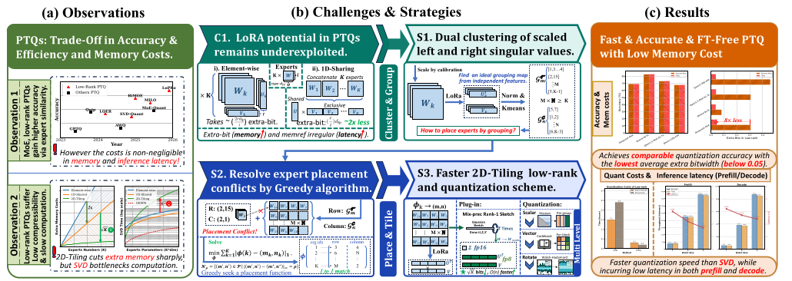
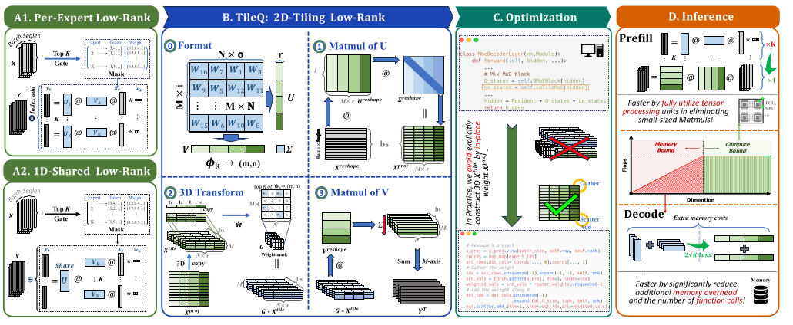
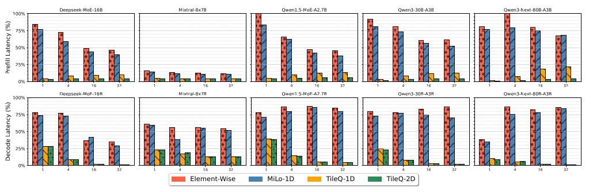
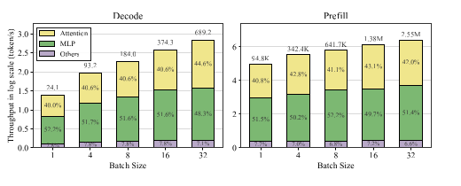
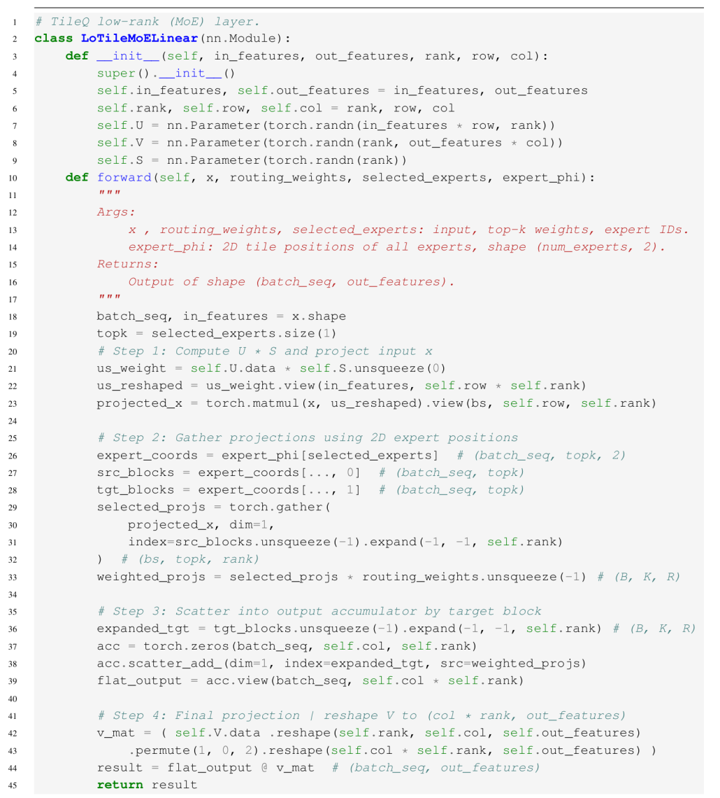
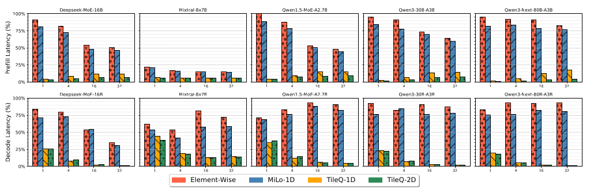
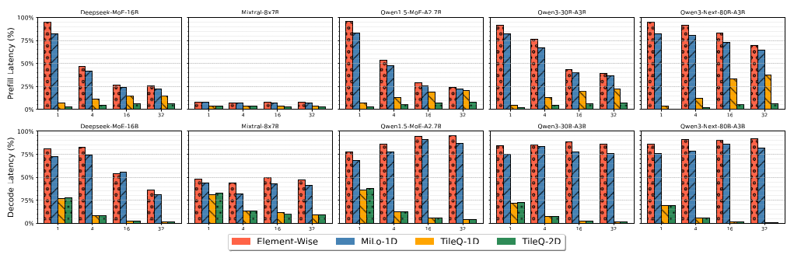

> **中文翻译（逐节复述，非逐句直译）**：本文依据 arXiv:2605.09281v1《TileQ: Efficient Low-Rank Quantization of Mixture-of-Experts with 2D Tiling》（Gu, Chen, Hu, Liu；中科院软件所），论文版权归原作者所有（arXiv 默认许可），因此这里用中文按章节转述论文内容，公式、表格与数字保持与原文一致。

# TileQ：基于 2D Tiling 的混合专家模型高效低秩量化

论文：[arXiv:2605.09281](https://arxiv.org/abs/2605.09281)（[PDF](https://arxiv.org/pdf/2605.09281v1)），cs.LG，2026-05-10，ICML 投稿格式。代码：论文给出匿名仓库 https://anonymous.4open.science/r/TileQ-BE20

## 摘要

MoE 通过稀疏激活专家取得很好的效果，但专家参数量巨大，部署困难。低秩量化是压缩 MoE 的一条路线，但现有做法仍带来不可忽略的额外显存和推理延迟。TileQ 是一种免微调（fine-tuning-free）的 PTQ 方法：把所有专家排成一个二维 tile 网格，让低秩因子在输入维和输出维两个方向上同时被共享（2D-tiling structured low-rank quantization）。此外，作者给出一个融合推理技巧，把多个专家的低秩计算合并成一次 pass，提高硬件利用率。结果：额外显存最多降到原来的 1/10，推理延迟降到约 5%（相对基线），同时精度保持 SOTA。

## 1 引言

MoE 把计算分给一组"专家"，每个 token 只激活其中少数几个，因此在相近效果下计算量远低于同规模稠密模型。代价是显存：虽然每步只用少数专家，所有参数都得常驻内存，这限制了资源受限硬件上的部署，也抬高了云端推理成本。

量化是主要的压缩手段。PTQ 无需重训，部署快，而且近期 SOTA 的 PTQ 已经逼近 QAT 的精度，所以适合 MoE。在 PTQ 中，低秩方法在 MoE 量化上表现不错，但作者指出需要在三点之间权衡：

1. 简单量化方案在极低比特下精度严重下降；
2. MoE 中专家小且稀疏，低秩 PTQ 往往带来显著的额外显存；
3. 高精度量化方法通常带来可观的推理延迟。

另外，微调类方法会损害泛化性，不利于快速任务适配。

目标：在极小推理延迟下取得高精度和高压缩比。贡献有三条：

- 提出 TileQ：免微调 PTQ，基于奇异子空间聚类得到 2D-tiling 布局，让专家间高效共享表示；
- 提出优化的融合算法，把所有 token 的多个低秩专家 GPU kernel 合成单次 pass，同时加速 prefill 与 decode；
- 实验表明 TileQ 无需微调、量化精度达到 SOTA，低秩额外显存最多节省 90%，推理延迟降到 5%。

## 2 相关工作

### 2.1 后训练量化（PTQ）

作者把 LLM 的 PTQ 方法按三层组织。

**基础格式（Base Format）**

- 对称格式：以零为中心的对称网格，运算简单，但对离群值敏感；
- 非对称格式：引入新格式或可学习的零点偏移，使量化范围更贴合权重经验分布；
- 向量格式：把一组权重当作向量，用聚类或码本编码压缩。

**优化方法（Optimization methods）**

- Hessian 优化（GPTQ 一类）：用 Hessian 加权的重建损失来优化量化权重，通常写作

```math
\mathcal{L}(W)=E_{X}\left[\|\bm{W}\bm{X}-\hat{\bm{W}}\bm{X}\|\right],
```

其中 $`H`$ 是代理 Hessian 矩阵（式 1）；
- 激活感知缩放（AWQ、SmoothQuant 等）：找出激活幅度显著的通道，调整其对应权重的尺度，以减少下游损失；
- 离群值缓解：旋转（Hadamard 旋转或可学习正交矩阵，利用正交不变性）和裁剪（截断离群值以限制数值范围）；
- 低秩与稀疏化：把权重分解成低秩因子，或施加结构化稀疏，同时降低显存和量化误差传播。

**微调（Fine-tuning）**

用轻量适配恢复精度，但任务特定微调可能损害模型通用性：LoRA 类（QLoRA 等）把低秩适配器接到量化模型上，只更新这些轻量模块；自监督微调则用无标注数据重新校准量化模型内部表征。

现代 PTQ 通常把这些策略模块化组合：先选基础格式，再叠加一种或多种优化技术，需要更高精度时再加微调。

### 2.2 MoE 量化中的低秩方法

MoE 模型里约 95% 的参数在 MLP 专家中，低秩方法能同时降低专家的存储，所以是有前景的方向。形式上，低秩量化把权重 $`\bm{W}\in\mathbb{R}^{i\times o}`$ 近似为

```math
\bm{W}\approx Q(\bm{W}-\bm{W}_{r})+\bm{W}_{r}\ ;\ \bm{W}_{r}=\bm{U}\bm{V}=\text{SVD}(\bm{W}),
```

其中 $`\bm{U}\in\mathbb{R}^{i\times r},\ \bm{V}\in\mathbb{R}^{r\times o}`$ ， $`r\ll\min(i,o)`$ 是秩， $`Q(\cdot)`$ 是量化算子（式 2）。传统做法对每个专家独立做低秩量化，不考虑专家之间的关系与冗余，低秩因子通常以 16 bit 存储；当专家数 $`K`$ 很大时压缩收益有限。

为此，MoE 的 PTQ 工作（如 MoE-SVD 一类）在 1D-tiling 下共享基 $`\bm{U}\in\mathbb{R}^{i\times r}`$ ，并为各专家保留各自的 $`\bm{V}\in\mathbb{R}^{r\times(o\times K)}`$ ，以捕获全体专家的共同结构。但这种共享奇异向量的方式只削掉约一半的显存开销，在稀疏 MoE 中仍有显著开销；推理时不同专家的 $`\bm{V}`$ 彼此不相交，需要对每个专家单独做 GEMM，缺乏计算融合，带来超过 50% 的额外延迟（MiLo 的报告）。

TileQ 同时解决压缩上限和推理效率问题：免微调、更高压缩比、最低延迟。

**图 1** 总览：（a）低秩 PTQ 的观察与动机——Observation 1：MoE 里低秩 PTQ 利用专家相似性获得更高精度，但显存与推理延迟代价不可忽略；Observation 2：低秩 PTQ 压缩性差、计算慢，TileQ 的 2D-tiling 大幅削减额外显存，但 SVD 成为计算瓶颈；（b）挑战与策略——C1：低秩潜力未被充分挖掘（逐专家方式额外比特多，1D 共享约省 2 倍但 memref 不规则、延迟高）；S1：对缩放后的左右奇异向量做双聚类；S2：用贪心算法解决专家放置冲突；S3：更快的 2D-tiling 低秩与量化方案；（c）结果：精度可比，平均额外比特最低（低于 0.05），量化速度快于 SVD，prefill/decode 延迟低。



## 3 方法

**模型设定**：每个 MoE 模块有 $`K`$ 个专家和一个路由器 $`\bm{G}`$ ，专家集合 $`\mathcal{W}=\lbrace \bm{W}_{k}\in\mathbb{R}^{o\times i}\rbrace _{k=1}^{K}`$ 。对输入 $`\bm{X}\in\mathbb{R}^{B\times i}`$ ，输出为

```math
\mathrm{MoE}(\bm{X})=\sum_{\bm{W}_{k}\in e_{k,\bm{X}}}\bm{G}_{k}(\bm{X})\cdot\bm{W}_{k}(\bm{X}),
```

$`\bm{G}(\bm{x})`$ 给出路由分数， $`e_{k,\bm{x}}`$ 是选中的 top-$`\mathcal{K}`$ 专家集合（式 3）。输出是被选专家输出的加权组合。

本节只关注 MoE 里的专家：先提出新的 2D 低秩 PTQ 格式（§3.1），再给出针对 prefill 与 decode 的融合推理算法（§3.2），最后做分析（§3.3）。

### 3.1 TileQ：面向 MoE 的 2D-Tiling 结构化低秩量化

**动机**：专家相似性是 MoE 剪枝与压缩的重要依据（冗余专家可由门控矩阵识别）。但现有低秩方法要么每个专家独立分解，要么沿一个维度拼接所有专家共享 $`\bm{U}`$ 或 $`\bm{V}`$ ，导致压缩比有限、推理延迟明显。

**方案**：把所有专家排成 2D tile 布局，同时利用行方向和列方向的相似性，联合共享 $`\bm{U}`$ 与 $`\bm{V}`$ ，即把 $`K`$ 个专家映射到 $`M\times N`$ 的网格（ $`K\rightarrow M*N`$ ）。对式 3 中的专家权重 $`\bm{W}_{k}`$ ：

```math
\bm{W}_{k}=\bm{{U}}_{p}\bm{\Sigma}\bm{{V}}_{q}+\hat{\bm{W}_{k}},\ \lbrace p,q\rbrace =\phi_{k}
```

其中 $`\bm{U}=[\bm{U}_{{1}},\bm{U}_{{2}},\cdots,\bm{U}_{{M}}]^{\top}\in\mathbb{R}^{{(M\times i)}\times{r}}`$ ， $`\bm{V}=[\bm{V}_{{1}},\bm{V}_{{2}},\cdots,\bm{V}_{{N}}]\in\mathbb{R}^{{r}\times{(N\times o)}}`$ ； $`\phi`$ 是位置表，把第 $`k`$ 个专家的权重映射到二维低秩矩阵中的 $`\lbrace p,q\rbrace `$ 块； $`\hat{\bm{W}_{k}}`$ 是量化矩阵（式 4）。也就是同一行 tile 的专家共享左因子 $`\bm{U}_p`$ ，同一列 tile 的专家共享右因子 $`\bm{V}_q`$ 。

整个流程分五步（图 2 给出整体示意）。

**Step 1：缩放（Scaling）。** 重要的激活值会显著影响量化精度，所以先把对角缩放矩阵编码进权重：

```math
\tilde{\bm{W}}_{k}^{scale}=\bm{W}_{k}s_{k}\in\mathbb{R}^{i\times o},
```

$`s_{k}`$ 是由校准得到的缩放向量（式 5）。这里隐含一次转置，使 $`\tilde{W}_k`$ 的左奇异向量对应输入特征空间（便于对 $`\bm{U}`$ 聚类），右奇异向量对应输出空间（便于对 $`\bm{V}`$ 聚类）。

**Step 2：提取（Extracting）。** 对每个 $`\tilde{W}_{k}^{scale}`$ 计算近似的秩 $`r_{0}`$ 分解：

```math
\tilde{\bm{W}}_{k}^{scale}\approx\bm{U}_{k}\bm{\Sigma}_{k}\bm{V}_{k}^{\top},
```

（式 6），再把 $`\bm{U}_{k},\bm{V}_{k}`$ 展平并归一化到 $`\mathbb{R}^{ri}`$ 与 $`\mathbb{R}^{ro}`$ ，作为范数特征嵌入：

```math
u_{k}=\frac{\mathrm{vec}(\bm{U}_{k})}{\|\mathrm{vec}(\bm{U}_{k})\|_{2}},\quad v_{k}=\frac{\mathrm{vec}(\bm{V}_{k})}{\|\mathrm{vec}(\bm{V}_{k})\|_{2}}.
```

（式 7）

**Step 3：聚类（Clustering）。** 对归一化嵌入做双聚类（biclustering），给每个专家 $`k`$ 分配一个理想网格坐标 $`(m_{k},n_{k})`$ 。用 KMeans：

```math
\left\lbrace \begin{aligned} \lbrace \mathcal{G}_{m}^{\text{row}}\rbrace _{m=0}^{M-1}&=\text{KMeans}\left(\lbrace \bar{u}_{k}\rbrace _{k=1}^{K},\,n_{clusters}=M\right),\\
\lbrace \mathcal{G}_{n}^{\text{col}}\rbrace _{n=0}^{N-1}&=\text{KMeans}\left(\lbrace \bar{v}_{k}\rbrace _{k=1}^{K},\,n_{clusters}=N\right),\end{aligned}\right.
```

（式 8）其中 $`m,n`$ 是行、列的簇索引，划分为 $`\mathcal{G}_{m}^{\text{row}}=\lbrace k\mid r_{k}=m\rbrace `$ 、 $`\mathcal{G}_{n}^{\text{col}}=\lbrace k\mid c_{k}=N\rbrace `$ （原文符号如此）。这样奇异子空间相似的专家会共享行或列，得到每个专家的理想 tile $`(m_{k},n_{k})`$ 。

**Step 4：2D-Tiling。** 理想 tile 很难全部满足，因为多个专家可能被分到同一个位置。映射必须满足：（i）两个块不能占同一个 tile；（ii）每个块尽量靠近理想位置。形式上寻找近似解

```math
\min_{\phi}\sum_{k=1}^{K}\left\|\phi(k)-(m_{k},n_{k})\right\|_{1}.
```

（式 9）作者用贪心空间分配：对每个位置 $`(m,n)`$ ，在物理网格上定义锚点 $`(m^{\star},n^{\star})=(\min(m,M{-}1),\min(n,N{-}1))`$ ，然后围绕锚点按切比雪夫距离做同心圆搜索，在未占用的格子里放置块：

```math
\mathcal{N}_{\rho}=\left\lbrace (m^{\prime},n^{\prime})\in\mathcal{P}\,\middle|\,\left\|(m^{\prime},n^{\prime})-(m^{\star},n^{\star})\right\|_{\infty}=\rho\right\rbrace ,
```

（式 10， $`\rho=0,1,2,\dots`$ 逐圈向外）。位置确定后构造 tiling 矩阵

```math
\bm{W}_{\text{big}}=\sum_{k=1}^{K}\mathcal{E}_{m_{k},n_{k}}\otimes\tilde{W}_{k}\in\mathbb{R}^{Mi\times No},
```

（式 11），其中 $`\mathcal{E}_{m,n}\in\lbrace 0,1\rbrace ^{M\times N}`$ 是在 $`(m,n)`$ 处为 1 的基矩阵， $`\otimes`$ 是分块 Kronecker 积（即把 $`\tilde{\bm{W}}_{k}`$ 放到第 $`(m_k,n_k)`$ 个 tile）。得到映射 $`\phi(k)\mapsto(m_k,n_k)`$ 之后，对 $`\bm{W}_{\text{big}}`$ 做秩 $`r`$ 的共享分解，每个专家的低秩部分为

```math
\tilde{\bm{W}}_{k}=(\bm{W}_{\text{big}})^{rank}_{\phi(k)}s_{k}^{-1}={\bm{U}}_{m_{k}}\bm{\Sigma}{\bm{V}}_{n_{k}}^{\top}s_{k}^{-1},
```

（式 12），这就得到了式 4 的第一项，即 TileQ 的低秩分量。

**Step 5：量化（Quantization）。** 对专家低秩分解之后的残差做量化：

```math
\hat{\bm{W}}=\text{Quant}(\bm{W}-\tilde{\bm{W}})=\mathcal{Q}(\bm{R}).
```

TileQ 只针对 MoE 量化里的低秩分量，对残差可以兼容主流量化方法。为了追求最优精度，作者选用 §2.1 中的三种策略：（1）使用 GPTQ/GPTVQ 的 Hessian 优化，分别做标量级与向量级量化；（2）引入 LoPRo 的低秩旋转以最大化量化精度。

**Plug-in（插件式替换）。** 对每个专家做特征提取（ $`K\times SVD(\mathbb{R}^{o\times i})`$ ）以及对 2D-tiling 矩阵做分解（ $`SVD(\mathbb{R}^{(M\times o)\times(N\times i)})`$ ）都很贵，所以用 Gaussian Sketch 近似替代（沿用 LoPRo 的做法）。计算秩 1 矩阵 $`\bm{W}_{1}=\bm{U}_{1}\bm{\Sigma}_{1}\bm{V}_{1}`$ ：

```math
\bm{U}=\frac{\bm{Q}}{\|\bm{Q}\|},\bm{\Sigma}=\frac{\|\bm{Q}^{\top}\bm{W}\|}{\|\bm{Q}\|},\bm{V}=\frac{\bm{Q}^{\top}\bm{W}}{\|\bm{Q}^{\top}\bm{W}\|},
```

（式 13），其中 $`S\in\mathbb{R}^{i}`$ 是高斯 sketch 向量， $`it`$ 是迭代次数， $`\bm{Q}=(\bm{W}\bm{W}^{\top})^{it}\bm{W}\bm{S}`$ （原文此处排版写作 $`\bm{\Sigma}`$ ，按上下文应为 sketch 向量 $`S`$ ）。然后令 $`\bm{W}=\bm{W}-\bm{W}_{1}`$ ，重复 $`r`$ 次即可得到任意秩的近似。由于奇异值矩阵 $`\bm{\Sigma}`$ 是对角阵、存储开销小，把 $`\bm{U}`$ 与 $`\bm{V}`$ 存成 fp8、 $`\bm{\Sigma}`$ 保留 fp16，存储可再减半。这种迭代方法精度几乎与 SVD 相同，但计算快得多。

**Insights（原文框）**：TileQ 无需微调，把 MoE 专家联合组织成 2D-tiling 低秩布局量化；该流程显式利用专家相似性，让低秩因子 $`\bm{U}`$ 、 $`\bm{V}`$ 在 tile 间共享。方法灵活，可支持从标量到向量的各种量化与其他优化；并且用快速 sketch 低秩近似取代昂贵 SVD、用混合精度存储，同时降低量化开销、提高压缩比。

### 3.2 2D-Tiling 下的高效融合稀疏低秩推理

**动机**：传统低秩 PTQ 在稠密模型中只带来很小的延迟开销（10% 以下）。但在 MoE 中专家小得多，开销不可忽略（从 15% 升到超过 75%）。MiLo 这类共享 $`\bm{U}`$ 的方法通过 kernel 优化把 Mixtral-8x7B 上的开销降到约 10%，但在 Qwen3-30B-A3B 这类更新、更稀疏的模型上，延迟又升到 50% 以上，实用性大打折扣。

**方案**（见图 2）：

```math
\mathrm{MoE}(\bm{X})=\mathrm{QMoE}(\bm{X})+\mathrm{LoTileMoE}(\bm{X}),
```

（式 14）QMoE 是标准量化 MoE 前向（式 3 的权重换成量化矩阵），保持与现有推理框架（vLLM、SGLang）兼容；LoTileMoE 是针对 tiled 低秩的高效推理，利用低秩结构把所有低秩专家融合计算。步骤如下。

对每个 token $`b\in\lbrace 1,\dots,B\rbrace `$ 及其第 $`t\in\lbrace 1,\dots,\mathcal{K}\rbrace `$ 个选中专家，记集合 $`E=\lbrace e_{b,t}\mid b\in[B],\,t\in[\mathcal{K}]\rbrace `$ ， $`g_{b,t}`$ 是路由权重，映射 $`\phi`$ 把该专家指派到 2D 网格里唯一的 tile： $`(m_{b,t},n_{b,t}):=\phi(e_{b,t})`$ 。

1. 先定义缩放后的左因子 $`\bm{U}\bm{\Sigma}\in\mathbb{R}^{(Mi)\times r}`$ ，对整个 batch 做一次投影：

```math
\bm{X}_{\text{proj}}=\bm{X}\cdot(\bm{U}\bm{\Sigma})_{\text{reshape}}\in\mathbb{R}^{B\times(Mr)},
```

其中 $`(\bm{U}\bm{\Sigma})_{\text{reshape}}\in\mathbb{R}^{i\times(Mr)}`$ 把"高矩阵"重排成与特征对齐的块。

2. 再 reshape 成 3D 张量，并沿列维度广播：

```math
\bm{X}_{\text{tile}}=\mathrm{reshape}(\bm{X}_{\text{proj}},[b,M,r])\otimes\mathbf{1}_{N}^{\top}\in\mathbb{R}^{b\times M\times(rN)},
```

$`\otimes`$ 表示通道方向重复。然后把所有未被选中的 tile 清零，只在激活专家所在位置注入路由加权的贡献。对每个 token-专家对 $`(b,t)`$ ，对应的 $`\bm{X}_{\text{tile}}`$ 切片位于行 $`m_{b,t}`$ 内的列区间 $`[n_{b,t}r,(n_{b,t}+1)r)`$ 。构造输出累加器 $`\bm{A}\in\mathbb{R}^{b\times M\times(rN)}`$ 并更新：

```math
\bm{A}[b,m_{b,t}]^{(n_{b,t})}\leftarrow g_{b,t}\cdot\bm{X}_{\text{tile}}[b,m_{b,t}]^{(n_{b,t})},
```

上标 $`(n)`$ 表示最后一维上第 $`n`$ 个长度为 $`r`$ 的连续块。

3. 批量矩阵乘：

```math
\bm{Y}=\bm{A}\cdot\bm{V}_{\text{reshape}}^{\top}\in\mathbb{R}^{b\times M\times o},
```

$`\bm{V}`$ 的 reshape 方式与 $`\bm{U}`$ 相同，每个切片 $`\bm{Y}[b,m,:]`$ 对应分配到 tile 行 $`m`$ 的所有专家的贡献。

4. 沿 top-$`\mathcal{K}`$ 方向求和聚合：

```math
\mathrm{LoTileMoE}(\bm{X})=\sum_{m=0}^{M-1}\bm{Y}[b,m,:]\in\mathbb{R}^{b\times o}.
```

（式 15）这样用 reshape、矩阵乘等规则张量操作替代了不规则的稀疏访问，这些操作在现代加速器上高度优化，在显存效率和硬件利用率间取得最优折中。

**Tricks（实现技巧）。** 实现中不显式构造累加张量（图 2C），而是把路由加权后的激活直接聚到一个紧凑的 2D 缓冲 $`\bm{S}\in\mathbb{R}^{b\times(Nr)}`$ ，其第 $`n`$ 列块保存所有分给该 tile 列的激活之和：

```math
\bm{S}[b]^{(n)}=\sum_{t:\,n_{b,t}=n}g_{b,t}\,\bm{X}_{\text{proj}}[b]^{(m_{b,t})},\quad\forall\,n\in[N].
```

（式 16）最终输出为 $`\bm{S}\cdot\bm{V}_{\text{flat}}^{\top}`$ 。这把显存复杂度从 $`O(bMrN)`$ 降到 $`O(bNr)`$ ，并且不需要实例化大的中间张量，可完全并行执行。

**图 2** 展示了流水：A1 逐专家低秩（每个选中专家各做一次小 matmul 再 index-add），A2 1D 共享低秩（共享 $`\bm{U}`$ ，各专家独立 $`\bm{V}`$ ），B 为 TileQ 的 2D-Tiling 低秩（0 格式： $`M\times N`$ 个 tile 的专家块；1 与 $`\bm{U}`$ 相乘；2 做 3D 变换并与 top-K 掩码相乘；3 与 $`\bm{V}`$ 相乘并沿 $`M`$ 轴求和），C 为优化（避免显式构造 3D 的 $`\bm{X}^{tile}`$ ，改为 gather 与 scatter-add 的原位实现），D 为推理对比：prefill 阶段把 $`K`$ 个小 matmul 合成一个，充分利用 tensor core 等张量处理单元；decode 阶段额外访存减少约 $`2\sqrt{K}`$ 倍并减少函数调用次数。



**Insights（原文框）**：LoTileMoE 实现了 2D-tiling 下低秩量化的高效批量推理。它用规则张量操作取代不规则的专家分发：输入只投影一次，消除动态循环与稀疏访存，从而延迟可忽略，并能利用高度优化的稠密 kernel（§4 验证）。

### 3.3 TileQ 分析

**压缩比。** TileQ 利用专家间的 2D tiling 获得更好压缩：低秩存储比 1D 基线低 $`\sqrt{K}`$ 倍，比逐元素（per-expert）方法低 $`2\sqrt{K}`$ 倍，在专家更多、更稀疏的 MoE 中尤其有利（详见附录 A.3）。

**量化误差。** 在 TileQ 中， $`e^{(k)}`$ 的误差满足

```math
\mathcal{E}_{\text{TileQ}}^{(k)}\leq\mathcal{E}_{\text{ind}}^{(k)}+\epsilon_{cluster},
```

（式 17）其中 $`\mathcal{E}_{\text{ind}}^{(k)}`$ 是逐专家低秩方法的误差， $`\epsilon_{cluster}`$ 是 2D-Tiling 下低秩引入的额外误差。因此 TileQ 的量化精度与独立逐专家压缩相当（证明见附录 A.2）。

**推理延迟。** 用稠密 GEMM 和向量化操作取代不规则的逐 token 专家分发，TileQ 避开了 MoE 的 kernel launch 与访存带宽瓶颈，复杂度为

```math
C_{TileQ}=\mathcal{O}(BiMr+BNro+B\mathcal{K}r).
```

（式 18）与张量硬件对齐后，prefill 与 decode 阶段延迟都显著更低（详见附录 A.4）。

## 4 评测

### 4.1 设置

**模型**：Qwen1.5-MoE-A2.7B、Qwen3-30B-A3B、Qwen3-Next-80B-A3B、Mixtral-8x7B、Deepseek-MoE-16B。结构见表 2。

**表 2**：MoE 模型专家结构，专家数写作"常规+共享"。

| 模型 | 专家数 | Top-K | 维度 |
|---|---|---|---|
| Qwen1.5-MoE-A2.7B | 60+4 | 4 | [1408,2048] |
| Qwen3-30B-A3B | 128+0 | 8 | [768,2048] |
| Qwen3-Next-80B-A3B | 512+1 | 10 | [512,2048] |
| Mixtral-8x7B | 8+0 | 2 | [14336,4096] |
| Deepseek-MoE-16B | 64+2 | 6 | [1408,2048] |

**基线**：GPTQ（标准逐通道 PTQ）、GPTVQ（向量量化变体）、LoPRo（低秩旋转）、MoEQuant（MoE 量化），FP16 结果作为上界；评测协议相同。

**指标**：WikiText-2 上的困惑度；下游任务：ARC（AC/AE）、PIQA（PQ）、WinoGrande（WI）、MMLU（MU）、HellaSwag（HS）。全部用 lm-eval 框架评测，其他细节见附录 B。

### 4.2 主结果

作者将 TileQ 与基线比较量化性能，结果在表 1，并从三个角度分析；与另外两个 MoE 专用 PTQ（MiLo、MxMoE）的对比放在附录 D.2。

**表 1**：TileQ 与基线在 2-bit、3-bit 下的量化结果。Extra.Bits（ $`X_y`$ ）表示分组量化 scale 与低秩分量各自分配的平均比特。报告 WikiText-2 困惑度与六个下游任务准确率：ARC-Challenge (AC)、ARC-Easy (AE)、PIQA (PQ)、WinoGrande (WI)、MMLU (MU)、HellaSwag (HS)。MoEQ 即 MoEQuant。TileQ$`_s`$ 为标量量化变体，TileQ$`_v`$ 为向量量化变体。

| 模型 | 方法 | Extra Bits | 2-bit Wiki PPL | AC | AE | PQ | WI | MU | HS | 3-bit Wiki PPL | AC | AE | PQ | WI | MU | HS |
|---|---|---|---|---|---|---|---|---|---|---|---|---|---|---|---|---|
| DeepSeek-MoE-16B | FP16 | - | 6.11 | 45.1 | 75.9 | 78.6 | 70.5 | 45.1 | 59.7 | 6.11 | 45.1 | 75.9 | 78.6 | 70.5 | 45.1 | 59.7 |
| | GPTQ | 0.13_0.0 | 24.1 | 24.4 | 50.2 | 66.5 | 53.3 | 25.3 | 45.3 | 7.17 | 32.3 | 66.7 | 76.1 | 67.9 | 37.3 | 53.7 |
| | GPTVQ | 0.13_0.0 | 7.32 | 35.5 | 70.1 | 75.2 | 66.6 | 35.3 | 51.1 | 6.53 | 37.2 | 70.2 | 77.1 | 68.6 | 42.5 | 56.9 |
| | MoEQ | 0.0_0 | 1e3 | 24.9 | 30.2 | 35.3 | 32.1 | 26.2 | 28.2 | 7.78 | 37.6 | 69.2 | 74.3 | 62.1 | 41.2 | 45.8 |
| | LoPRo | 0.43_0.31 | 7.03 | 38.3 | 72.5 | 75.8 | 68.4 | 38.2 | 52.5 | **6.19** | 42.6 | 74.8 | 78.7 | 69.8 | **45.1** | **58.8** |
| | TileQ$`_s`$ | 0.16_0.04 | 7.06 | 38.1 | 72.7 | 76.1 | 68.5 | 37.9 | 52.2 | 6.24 | **43.2** | **75.0** | 78.6 | 69.9 | 44.3 | 58.3 |
| | TileQ$`_v`$ | 0.16_0.04 | **6.71** | **40.2** | **73.3** | **76.2** | **68.8** | **39.1** | **53.0** | 6.23 | **43.2** | 74.9 | **78.8** | **70.3** | 44.4 | 58.6 |
| Mixtral-8x7B | FP16 | - | 3.87 | 61.9 | 87.3 | 83.7 | 77.1 | 71.2 | 67.3 | 3.87 | 61.9 | 87.3 | 83.7 | 77.1 | 71.2 | 67.3 |
| | GPTQ | 0.13_0.0 | 15.3 | 26.5 | 35.6 | 53.0 | 49.3 | 24.3 | 28.2 | 4.72 | 52.4 | 69.3 | 79.1 | 74.4 | 58.4 | 44.8 |
| | GPTVQ | 0.13_0.0 | 5.28 | 42.0 | 71.6 | 75.9 | 66.5 | 58.9 | 55.4 | 4.27 | 54.9 | 72.9 | 82.6 | 74.8 | 65.9 | 63.1 |
| | MoEQ | 0.0_0 | 13.4 | 38.9 | 49.8 | 60.3 | 49.9 | 44.2 | 40.5 | 5.45 | 57.4 | 80.2 | 78.9 | 71.9 | 63.4 | 60.1 |
| | LoPRo | 0.21_0.08 | 5.01 | 55.3 | 82.5 | 80.6 | 74.9 | 63.7 | 60.2 | 4.13 | 60.3 | 85.9 | 82.7 | 76.2 | 69.2 | 66.2 |
| | TileQ$`_s`$ | 0.16_0.03 | 4.98 | 55.5 | 82.8 | **80.9** | **75.1** | 63.8 | 60.3 | **4.10** | 60.4 | **86.1** | **82.9** | 76.4 | **69.4** | 66.4 |
| | TileQ$`_v`$ | 0.16_0.03 | **4.78** | **56.3** | **83.8** | 80.5 | 74.8 | **64.4** | **61.4** | 4.13 | **61.4** | **86.1** | 82.8 | **77.2** | 69.2 | **66.6** |
| Qwen1.5-MoE-A2.7B | FP16 | - | 6.79 | 41.6 | 72.9 | 79.6 | 69.1 | 61.2 | 59.3 | 6.79 | 41.6 | 72.9 | 79.6 | 69.1 | 61.2 | 59.3 |
| | GPTQ | 0.13_0.0 | 12.5 | 29.4 | 42.7 | 50.2 | 53.2 | 25.2 | 30.1 | 7.98 | 33.4 | 64.3 | 77.1 | 64.5 | 51.5 | 52.2 |
| | GPTVQ | 0.13_0.0 | 8.12 | 34.1 | 68.4 | 71.4 | 62.5 | 53.9 | 49.8 | 7.1 | 38.8 | 71.2 | 78.4 | 68.3 | 59.6 | 57.7 |
| | MoEQ | 0.0_0 | 5e5 | 34.9 | 34.8 | 59.0 | 58.2 | 48.4 | 38.5 | 8.21 | 32.6 | 63.6 | 76.2 | 63.8 | 50.1 | 50.4 |
| | LoPRo | 0.43_0.31 | 7.52 | 39.9 | 72.7 | 77.6 | 68.2 | 56.8 | 53.4 | 6.94 | 40.1 | 72.9 | 78.8 | 69.4 | 60.8 | 57.6 |
| | TileQ$`_s`$ | 0.16_0.04 | 7.56 | 39.6 | 72.5 | 77.8 | **68.9** | 57.5 | 54.1 | 6.94 | **40.3** | 72.9 | 79.1 | **69.4** | **61.0** | 58.0 |
| | TileQ$`_v`$ | 0.16_0.04 | **7.35** | **40.2** | **73.4** | **78.5** | 68.6 | **58.8** | **55.5** | **6.93** | 40.1 | **74.1** | **80.0** | 68.6 | 60.3 | **58.3** |
| Qwen3-30B-A3B | FP16 | - | 8.07 | 52.6 | 79.2 | 79.7 | 70.3 | 79.6 | 58.8 | 8.07 | 52.6 | 79.2 | 79.7 | 70.3 | 79.6 | 58.8 |
| | GPTQ | 0.13_0.0 | 14.6 | 31.1 | 54.4 | 68.9 | 57.2 | 53.1 | 43.2 | 9.42 | 44.0 | 70.3 | 75.1 | 63.4 | 72.2 | 50.1 |
| | GPTVQ | 0.13_0.0 | 11.8 | 34.1 | 58.5 | 70.7 | 61.2 | 61.5 | 47.9 | 8.7 | 47.9 | 73.1 | 76.5 | 66.2 | 76.1 | 54.1 |
| | MoEQ | 0.0_0 | 3e4 | 26.6 | 29.8 | 50.5 | 49.8 | 41.4 | 28.5 | 28.1 | 37.8 | 30.6 | 59.4 | 55.3 | 60.1 | 43.2 |
| | LoPRo | 0.58_0.46 | 11.1 | 34.4 | 58.3 | 71.5 | 62.9 | 62.9 | 48.0 | 8.57 | 50.2 | 75.4 | **77.4** | 68.7 | 77.7 | 56.1 |
| | TileQ$`_s`$ | 0.16_0.04 | 11.3 | 34.6 | 58.4 | 71.8 | 63.1 | 62.9 | 48.3 | 8.58 | 50.3 | 76.3 | 77.3 | **68.9** | **77.9** | **56.9** |
| | TileQ$`_v`$ | 0.16_0.04 | **10.1** | **42.2** | **70.4** | **74.1** | **65.7** | **71.3** | **50.8** | 8.64 | **50.8** | **76.6** | 77.0 | 68.2 | 77.3 | 56.8 |

（表中 Extra Bits 的下标按原文表示，为低秩分量的平均额外比特；粗体按原文表。）

分析要点：

**跨比特宽度。** TileQ 在极低比特下表现稳健，持续优于所有免微调基线（GPTQ、GPTVQ 等）。2-bit 下多数方法严重退化（如 Mixtral-8x7B 上 GPTQ 的 PPL 从 3.87 升到 15.3），而 TileQ$`_v`$ 的困惑度是 4.78；3-bit 下更接近 FP16：TileQ$`_s`$ 在 Mixtral 上 PPL 为 4.10（FP16 为 3.87），MMLU 得 69.4，接近未量化模型。作者将这种跨比特的一致优势归因于 TileQ 的混合多层量化策略。与逐元素方法 LoPRo 相比，TileQ 精度相当甚至更高，说明 MoE 中融合专家特征是有效的。

**量化策略。** TileQ 同时给出标量（TileQ$`_s`$ ）与向量（TileQ$`_v`$ ）两个变体，体现精度与实际效率间的细粒度权衡。2-bit 时 TileQ$`_v`$ 始终最好，得益于多维码本能刻画 tile 内的相关性；3-bit 时向量量化的收益减弱，TileQ$`_s`$ 在关键指标上持平或略超 TileQ$`_v`$ ，这是因为更高精度下对复杂码本的依赖下降。两个变体共享同一个低秩骨干，说明核心创新不在量化器本身，而在 2D-Tiling 机制。这种模块化设计让用户可以灵活选择：TileQ$`_s`$ 用于硬件友好、低延迟部署，TileQ$`_v`$ 用于追求极致精度的超低比特场景。

**泛化性与可扩展性。** TileQ 适用于稀疏度与规模不同的多种 MoE。在大专家模型 Mixtral-8x7B 上，TileQ$`_v`$ 把困惑度降到 4.78 并显著提升下游任务表现；在 Qwen3-MoE 这类稀疏模型上依然有效，2-bit 下 MMLU 达 71.3。其轻量低秩（仅 0.04 bit）达到接近最优精度，相比逐专家方案（0.04 vs. 0.32）额外显存开销降低 8 倍。无论专家是"大而稠密"还是"小而稀疏"，TileQ 都能自适应地保持高精度，可作为面向下一代稀疏 MoE 的通用压缩框架。

### 4.3 推理延迟

在 3 种 GPU 架构上评测 MoE block 的推理延迟：A800 结果见图 3，Qwen1.5-MoE 中各模块的占比见图 4，其他见附录 D.1。

**图 3**：A800 上 MoE MLP block 的推理延迟。TileQ-2D 为提出的 2D-tiling 低秩算法；Element-wise 基线指传统逐专家低秩做法。每个子图横轴为 batch size（1、4、16、32），纵轴为延迟百分比（上排 prefill、下排 decode），图例为 Element-Wise、MiLo-1D、TileQ-1D、TileQ-2D，列为五个模型（Deepseek-MoE-16B、Mixtral-8x7B、Qwen1.5-MoE-A2.7B、Qwen3-30B-A3B、Qwen3-Next-80B-A3B）。



**Prefill。** 所有 token 同时处理，激活矩阵大而稠密，偏向计算受限的规则运算。TileQ 把不规则的逐专家稀疏分发替换为一次结构化 GEMM，延迟低于 5%。这一趋势在不同模型规模和 batch size 下保持一致，说明 2D tiling 能在批量处理中最大化硬件利用率。

**Decode。** 此时只有少数专家被激活，显存带宽成为主要瓶颈。尽管计算强度降低，TileQ 保持静态、连续的权重布局，便于缓存和向量化访问；而 element-wise 与 MiLo-1D 仍很慢（在 Qwen3-MoE 上约 75% 延迟），不适合推理。

**图 4**：Qwen1.5-MoE-A2.7B（序列长度 4096）的推理吞吐及各模块时间占比。decode（左）吞吐（token/s，对数尺度）在 batch 1、4、8、16、32 分别为 24.1、93.7、184.0、374.3、689.2，其中 MLP 占比约 52.7%、51.7%、51.6%、51.6%、48.3%，Attention 约 40.0%、40.6%、40.6%、40.6%、44.6%；prefill（右）吞吐分别为 54.8K、342.4K、641.7K、1.38M、7.55M，MLP 占比约 51.5%、50.2%、52.7%、49.7%、51.4%，Attention 约 40.8%、42.8%、41.1%、43.1%、47.0%（读自图）。



由于实际中 MoE MLP block 约占总推理时间的 50%（图 4），TileQ 的端到端延迟收益同样明显。

### 4.4 消融实验

为验证 TileQ 各组件的贡献，作者在 Qwen1.5-MoE-A2.7B 上做 2-bit 消融。

**表 3**：TileQ 各组件消融（Qwen1.5-MoE-A2.7B，2-bit 量化；3-bit 列同表）。"LoRA Bits"为低秩额外比特。

| 消融项 | LoRA Bits | 2-bit PPL | 2-bit ACC | 3-bit PPL | 3-bit ACC |
|---|---|---|---|---|---|
| TileQ$`_v`$ | 0.04 | **7.35** | **62.5** | **6.93** | **63.6** |
| 去掉 Vector $`\mathcal{Q}`$ | 0.04 | 7.56 | 61.6 | 6.94 | 63.5 |
| 再去掉 Rotation | 0.04 | 7.6 | 61.8 | 6.97 | 63.5 |
| 再去掉 2D-Tiling | 0.31 | 7.49 | 61.6 | 6.94 | 63.5 |
| 再去掉 LoRA | 0.00 | 12.5 | 38.5 | 7.98 | 57.2 |

（原表为逐级累积移除，箭头表示在上一行基础上继续去掉。）

结论：TileQ$`_v`$ 融合 2D-Tiling、向量量化和旋转，在 2-bit 下优于所有变体，说明组件之间有协同。把向量量化换成标量量化，或去掉旋转，只带来小幅退化（PPL 到 7.56 到 7.60），说明低比特下高阶优化的收益有限；而在 3-bit 下所有配置表现接近，说明更高比特更适合高级量化策略。去掉 2D-Tiling 精度基本不变，但低秩比特增加 8 倍；而去掉低秩机制则严重退化，2-bit 下 PPL 升到 12.5、ACC 降到 38.5。这确认了通过 2D-Tiling 配合低秩建模利用专家相似性，是高效压缩的关键，能在不增加存储开销的前提下显著提高精度。关于秩与 tile 大小的进一步消融见附录 C。

### 4.5 量化时间

**表 4**：TileQ 各部分的时间开销（小时）。模型名为简写：DS$`_{16B}`$ 为 Deepseek-MoE-16B，M8$`_{7B}`$ 为 Mixtral-8x7B，Q1.5$`_{13B}`$ 为 Qwen1.5-MoE-A2.7B，Q3$`_{30B}`$ 为 Qwen3-30B-A3B。

| 模型 | 总计 | Tiling | Quant |
|---|---|---|---|
| DS$`_{16B}`$ | 1.60 | 0.10 | 1.50 |
| M8$`_{7B}`$ | 2.22 | 0.22 | 2.00 |
| Q1.5$`_{13B}`$ | 1.52 | 0.12 | 1.40 |
| Q3$`_{30B}`$ | 5.70 | 0.20 | 5.50 |

TileQ 的运行时间压倒性地由量化阶段决定，所有模型中占比超过 90%；而 2D-Tiling 步骤因为用了快速低秩 sketch，非常高效，体现出计算轻量与可扩展性。特别是在 Qwen3-30B-A3B 这类稀疏架构上，量化阶段因 GPTQ 对稀疏专家效率低而仍是瓶颈，留待后续优化。

## 5 结论

TileQ 是面向 MoE 的高效低秩 PTQ 方法。通过新颖的 2D tiling 策略，它显著降低低秩矩阵的存储开销并保持模型精度；tiling 带来的结构化计算模式还便于高度并行的推理，相比传统 MoE 低秩计算机制大幅降低延迟。总体上，TileQ 是对现有 PTQ 方法（如 GPTQ）的轻量、通用扩展，以极小的额外显存和可忽略的推理延迟取得 SOTA 性能，是在显存与计算受限条件下部署 MoE 的可扩展、硬件友好的方案。

**影响声明（Impact Statement）**：本文旨在推进机器学习领域，可能有许多社会影响，但作者认为没有需要特别强调的。

## 参考文献

论文列出约 60 余篇参考文献（GPTQ、AWQ、SmoothQuant、QuIP/QuIP#、SpinQuant、OmniQuant、VPTQ、GPTVQ、SpQR、QLoRA、SVDQuant、LQER、MoE-SVD、MiLo、MxMoE、MoEQuant、LoPRo、FLRQ、vLLM、SGLang、lm-eval 以及 Qwen、Mixtral、DeepSeekMoE 等模型报告），此处不逐条转述，以论文原文列表为准。

## 附录

附录目录：A TileQ 细节（A.1 代码、A.2 误差界、A.3 压缩比分析、A.4 时间复杂度）；B 评测细节；C 更多消融（C.1 秩、C.2 tile）；D 附录评测结果（D.1 其他 GPU 架构、D.2 与其他 MoE 方法比较）；E 局限与未来工作。另有符号表（表 5）。

### 符号表（表 5）

表 5 汇总了论文用到的符号，主要有： $`\mathcal{W}=\lbrace \bm{W}_{k}\in\mathbb{R}^{o\times i}\rbrace _{k=1}^{K}`$ 为专家权重集合（输出维 $`o`$ 、输入维 $`i`$ ）； $`\bm{U}=[\bm{U}_{1},\dots,\bm{U}_{M}]^{\top}\in\mathbb{R}^{(Mi)\times r}`$ 与 $`\bm{V}=[\bm{V}_{1},\dots,\bm{V}_{N}]\in\mathbb{R}^{r\times(No)}`$ 为堆叠后的共享左、右低秩因子； $`\bm{R}=\bm{W}_{k}-\tilde{\bm{W}}_{k}`$ 为残差， $`\hat{\bm{W}}_{k}=\text{Quant}(\bm{R})`$ 为量化结果； $`s_k`$ 为校准得到的缩放对角； $`\tilde{\bm{W}}_{k}^{scale}=\bm{W}_{k}\cdot s_{k}`$ ； $`\tilde{\bm{W}}_{k}={\bm{U}}_{m_{k}}\bm{S}{\bm{V}}_{n_{k}}^{\top}s_{k}^{-1}`$ ； $`\mathcal{E}_{m,n}`$ 为在 $`(m,n)`$ 处为 1 的基矩阵； $`\bm{S}`$ 为避免 3D 张量的紧凑累加缓冲； $`\bm{G}`$ 为路由函数； $`\mathcal{G}_{m}^{\text{row}},\mathcal{G}_{n}^{\text{col}}`$ 为双聚类得到的行、列簇； $`\phi`$ 为最终的放置函数； $`r_0`$ 为缩放权重 SVD 所用的秩； $`M,N`$ 为行、列 tile 数； $`b`$ 为 token 批索引， $`t`$ 为专家秩索引；还有用于快速低秩近似的高斯 sketch 向量。

总述：附录从压缩比、量化误差和推理延迟三个角度，对 TileQ 做理论与实证分析，用以论证设计选择，并解释它为何优于现有 MoE 低秩 PTQ 方法。

### A.1 TileQ 的代码

**量化过程（算法 1）。** 对专家集合 $`\mathcal{W}=\lbrace \bm{W}_{k}\in\mathbb{R}^{o\times i}\rbrace _{k=1}^{K}`$ ，输出 $`\lbrace \bm{U}_{m}\rbrace _{m=0}^{M-1},\lbrace \bm{V}_{n}\rbrace _{n=0}^{N-1},\bm{\Sigma}`$ 及量化后的专家。伪代码分五步：

- Step 1 缩放：在校准集上前向收集各专家输入激活 $`\bm{X}_{k}`$ ，计算缩放向量并缩放权重：

```math
s_{k}\leftarrow{\overline{\bm{X}}_{k}}^{p}/\sqrt{\max(\overline{\bm{X}}_{k})\cdot\min(\overline{\bm{X}}_{k})}
```

```math
\widetilde{\bm{W}}_{k}\leftarrow\bm{W}_{k}\cdot\text{diag}(s_{k})
```

- Step 2 用 sketch 提取低秩特征：

```math
\bm{U}_{k},\bm{V}_{k},\bm{\Sigma}_{k}\leftarrow\text{SketchSVD}(\widetilde{\bm{W}}_{k}^{\top},r_{0}=r/2)
```

展平、归一化得 $`u_{k}\leftarrow\mathrm{vec}(\bm{U}_{k})/\|\mathrm{vec}(\bm{U}_{k})\|`$ 、 $`v_{k}\leftarrow\mathrm{vec}(\bm{V}_{k})/\|\mathrm{vec}(\bm{V}_{k})\|`$ ，追加到列表 $`\mathcal{U},\mathcal{V}`$ 。
- Step 3 双聚类确定 2D tiling：

```math
\lbrace \mathcal{G}_{m}^{\text{row}}\rbrace _{m=0}^{M-1}\leftarrow\text{KMeans}(\mathcal{U},n\_clusters=M)
```

```math
\lbrace \mathcal{G}_{n}^{\text{col}}\rbrace _{n=0}^{N-1}\leftarrow\text{KMeans}(\mathcal{V},n\_clusters=N)
```

理想 tile 为 $`(m_{k}^{\star},n_{k}^{\star})\leftarrow(\text{cluster\_id}_{U}(k),\text{cluster\_id}_{V}(k))`$ 。
- Step 4 贪心空间放置以消解冲突： $`\phi\leftarrow\text{GreedyPlacement}(\lbrace (m_{k}^{\star},n_{k}^{\star})\rbrace _{k=1}^{K},M,N)`$ ，并构造

```math
\bm{W}_{\text{big}}\leftarrow\sum_{k=1}^{K}\mathcal{E}_{\phi(k)}\otimes\widetilde{\bm{W}}_{k}\in\mathbb{R}^{Mi\times No}
```

- Step 5 全局低秩分解加残差量化：

```math
\bm{U}_{\text{big}},\bm{\Sigma},\bm{V}_{\text{big}}\leftarrow\text{SketchSVD}(\bm{W}_{\text{big}},r)
```

取出共享因子 $`\bm{U}_{k}\leftarrow\bm{U}_{\text{big}}[mi:(m+1)i,:]`$ 、 $`\bm{V}_{k}\leftarrow\bm{V}_{\text{big}}[:,no:(n+1)o]`$ ，重建低秩部分

```math
\widetilde{\bm{W}}_{k}^{\text{lr}}\leftarrow\bm{U}_{k}\bm{\Sigma}\bm{V}_{k}^{\top}\cdot\text{diag}(s_{k})^{-1}
```

残差 $`\bm{R}_{k}\leftarrow\bm{W}_{k}-\widetilde{\bm{W}}_{k}^{\text{lr}}`$ ，用 Hessian 感知损失量化残差： $`\bm{H}_{k}\leftarrow\mathbb{E}[\bm{X}_{k}\bm{X}_{k}^{\top}]`$ ， $`\bm{W}_{k,q}\leftarrow\mathcal{Q}_{\text{GPTQ/GPTVQ}}(\bm{R}_{k};\bm{H}_{k},d)`$ ，最后保存 $`QModule.\text{expert}[k]\leftarrow(\bm{W}_{k,q},\bm{U}_{k},\bm{V}_{k},\bm{\Sigma},s_{k},\phi(k))`$ 。

**推理过程（图 5）。** 图 5 给出 TileQ 低秩 MoE 层的 PyTorch 推理代码 `LoTileMoELinear`：参数为 $`\bm{U}`$ （in_features*row × rank）、 $`\bm{V}`$ （rank × out_features*col）和 $`\bm{S}`$ （rank）。forward 分四步：Step 1 计算 $`U*S`$ 并对输入 $`x`$ 一次性投影；Step 2 用 `expert_phi` 给出的 2D tile 位置，按行块 gather 选中专家对应的投影并乘路由权重；Step 3 按目标列块 scatter_add 到输出累加器 `acc`；Step 4 把 $`\bm{V}`$ reshape 为 (col*rank, out_features)，与展平后的累加器相乘得到输出。



### A.2 误差界

TileQ 追求一个共享的低秩分解，在 2D tiled 布局下联合逼近所有专家：缩放后的专家被嵌入一个大块矩阵 $`\bm{W}_{\mathrm{big}}\in\mathbb{R}^{Mi\times No}`$ ，其中块 $`(p,q)`$ 为

```math
[\bm{W}_{\mathrm{big}}]_{(p,q)}=\begin{cases}\tilde{\bm{W}}_{k},&\text{if }\phi(k)=(p,q),\\ \bm{0},&\text{otherwise},\end{cases}
```

整体目标平衡四类近似误差：

1. $`\sum_{k=1}^{K}\|\bm{W}_{k}-\tilde{\bm{W}}_{k}^{\mathrm{tile}}\|_{F}^{2}`$ ：每个专家原始权重与其由 tiled 低秩分量重建版本之间的偏差，保证参数共享下单个专家功能不被破坏；
2. 一个空间一致性正则项：抑制偏离理想簇分配位置的大位移，保持专家相似性与 tile 位置之间的语义对齐；
3. $`\|\bm{W}_{\mathrm{big}}-\bm{U}\bm{\Sigma}\bm{V}^{\top}\|_{F}^{2}`$ ：共享 2D-tiling 低秩近似对所有专家的保真度，最小化它保证结构化分解抓住聚合专家权重的主导子空间；
4. $`\sum_{k=1}^{K}\|\bm{R}_{k}-\mathcal{Q}(\bm{R}_{k})\|_{F}^{2}`$ ，其中 $`\bm{R}_{k}=\bm{W}_{k}-\tilde{\bm{W}}_{k}`$ ：全精度权重映射到离散量化值时引入的失真。

核心优化因此在全局压缩、逐专家保真度、结构一致性与量化兼容性之间折中。作者强调各步骤的误差不会逐级累积，而是后一阶段补偿前一阶段的误差，所以算法最终误差仅由量化误差决定，形式化为

```math
\boxed{\mathcal{L}_{\text{TileQ}}=\underbrace{\sum_{k=1}^{K}\|\bm{R}_{k}-Q(\bm{R}_{k})\|_{F}^{2}}_{\text{quantization error}}\ \ \leq\min_{\bm{W}_{\mathrm{big}},\bm{U},\bm{\Sigma},\bm{V}}\ \underbrace{\|\bm{W}_{\mathrm{big}}-\bm{U}\bm{\Sigma}\bm{V}^{\top}\|_{F}^{2}}_{\text{global low-rank error}},}
```

（其中 $`\bm{W}_{\mathrm{big}}=[\tilde{\bm{W}}_{k}]_{\phi(k)}`$ 。）

**基于激活感知聚类的误差可控子空间共享。** 为刻画对模型输出的影响，采用由 $`\mathbf{A}=\mathbf{X}^{\top}\mathbf{X}`$ 诱导的激活加权范数，目标是界定该流程的逐专家重建误差：

```math
\mathcal{L}_{\text{TileQ}}=\mathrm{tr}\left((\mathbf{W}_{k}-\hat{\mathbf{W}}_{k})^{\top}\mathbf{A}(\mathbf{W}_{k}-\hat{\mathbf{W}}_{k})\right)
```

每个专家的最优秩 $`r`$ 低秩近似为

```math
\tilde{\mathbf{W}}_{k}=\min_{\mathrm{rank}(\mathbf{U})\leq r}\|\mathbf{W}_{k}-\mathbf{U}\mathbf{V}^{\top}\|_{\mathbf{A}}^{2}.
```

这相当于度量 $`\mathbf{A}`$ 下的广义 SVD： $`\tilde{\mathbf{W}}_{k}=\mathbf{U}_{k}\mathbf{S}_{k}\mathbf{V}_{k}^{\top}`$ ，其中 $`\mathbf{U}_{k}\in\mathbb{R}^{m\times r}`$ 满足 $`\mathbf{U}_{k}^{\top}\mathbf{A}\mathbf{U}_{k}=\mathbf{I}_{r}`$ 。聚类使用的嵌入改为

```math
u_{k}=\frac{\mathrm{vec}(\mathbf{U}_{k})}{\|\mathrm{vec}(\mathbf{U}_{k})\|_{\mathbf{A}\otimes\mathbf{I}}}\in\mathbb{R}^{mr},
```

其中范数由 Kronecker 积度量诱导：

```math
\|\mathrm{vec}(\mathbf{U})\|_{\mathbf{A}\otimes\mathbf{I}}^{2}=\mathrm{tr}(\mathbf{U}^{\top}\mathbf{A}\mathbf{U}).
```

（输出侧有激活则用输出侧激活，否则用单位阵。）用欧氏距离做 KMeans 时已隐含地尊重该度量。簇质心满足 $`\mathrm{vec}(\bar{\mathbf{U}}_{m})\propto c_{m}^{U}`$ 且 $`\bar{\mathbf{U}}_{m}^{\top}\mathbf{A}\bar{\mathbf{U}}_{m}=\mathbf{I}_{r}`$ ；KMeans 的近似保证（常数因子 $`c`$ ）给出

```math
\sum_{k=1}^{K}\|u_{k}-c_{m_{k}}^{U}\|_{2}^{2}\leq c\cdot\mathrm{OPT}_{U},
```

记 $`\mathcal{S}_{k}=\mathrm{col}(\mathbf{U}_{k})`$ 、 $`\bar{\mathcal{S}}_{m}=\mathrm{col}(\bar{\mathbf{U}}_{m})`$ 为列子空间，则它们在 $`\mathbf{A}`$ 度量下的典范角满足广义 Davis-Kahan 界：

```math
\|\sin\Theta_{\mathbf{A}}(\mathcal{S}_{k},\bar{\mathcal{S}}_{m_{k}})\|_{F}\leq\frac{\|\mathbf{U}_{k}-\bar{\mathbf{U}}_{m_{k}}\mathbf{Q}\|_{\mathbf{A}}}{\delta_{k}},
```

其中 $`\mathbf{Q}\in\mathbb{R}^{r\times r}`$ 为对齐矩阵， $`\delta_k`$ 为间隙项。再有（ $`C`$ 为常数，来自质心 reshape 时的范数对齐）：

```math
\|\mathbf{U}_{k}-\bar{\mathbf{U}}_{m_{k}}\mathbf{Q}\|_{\mathbf{A}}^{2}=2r-2\,\mathrm{tr}\left(\mathbf{Q}^{\top}\bar{\mathbf{U}}_{m_{k}}^{\top}\mathbf{A}\mathbf{U}_{k}\right)\leq C\cdot\|u_{k}-c_{m_{k}}^{U}\|_{2}^{2},
```

在"局部子空间邻近"（Local Subspace Proximity）模型里写

```math
\tilde{\mathbf{W}}_{k}=\bar{\mathbf{U}}_{m_{k}}\mathbf{M}_{k}\bar{\mathbf{V}}_{n_{k}}^{\top}+\mathbf{E}_{k},
```

并令 $`\epsilon_{k}=\|\mathbf{E}_{k}\|_{\mathbf{A}}=\sqrt{\mathrm{tr}(\mathbf{E}_{k}^{\top}\mathbf{A}\mathbf{E}_{k})}`$ 。对 $`\mathbf{A}`$-正交基，残差满足

```math
\epsilon_{k}\leq\|\tilde{\mathbf{W}}_{k}-\bar{\mathbf{U}}_{m_{k}}(\bar{\mathbf{U}}_{m_{k}}^{\top}\mathbf{A}\tilde{\mathbf{W}}_{k})\|_{\mathbf{A}}\leq\|\sin\Theta_{\mathbf{A}}(\mathcal{S}_{k},\bar{\mathcal{S}}_{m_{k}})\|_{F}\cdot\|\tilde{\mathbf{W}}_{k}\|_{\mathbf{A}}.
```

结合 Davis-Kahan 界与 KMeans 保证得

```math
\epsilon_{k}\leq\frac{\|\tilde{\mathbf{W}}_{k}\|_{\mathbf{A}}}{\delta}\cdot\sqrt{C}\cdot\|u_{k}-c_{m_{k}}^{U}\|_{2}.
```

对所有专家求和，并对右子空间做同样论证，总的激活加权误差满足

```math
\sum_{k=1}^{K}\epsilon_{k}^{2}\leq\frac{C^{\prime}}{\delta^{2}}\left(\sum_{k=1}^{K}\|u_{k}-c_{m_{k}}^{U}\|_{2}^{2}+\|v_{k}-c_{n_{k}}^{V}\|_{2}^{2}\right)\leq\frac{C^{\prime}c}{\delta^{2}}\left(\mathrm{OPT}_{U}+\mathrm{OPT}_{V}\right).
```

因此"局部子空间邻近"假设并非启发式：逐专家误差 $`\epsilon_k`$ 由激活感知聚类的质量和广义奇异子空间在 $`\mathbf{A}`$ 下的稳定性所可证地控制。当输入使专家子空间高度相似（最优聚类代价 $`\mathrm{OPT}_{U},\mathrm{OPT}_{V}`$ 小）时， $`\|\mathbf{X}(\mathbf{W}-\hat{\mathbf{W}})\|_{F}^{2}`$ 可被良好近似；这直接启发了 TileQ 的设计，即按左右奇异向量嵌入（由 $`\mathbf{A}=\mathbf{X}^{\top}\mathbf{X}`$ 构造）把专家分组成 tile，从而落实局部子空间共享，tiling 引入的近似误差继承上述保证。

**TileQ 的总重建误差。** 考虑一个 MoE 层，定义专家 $`k`$ 的输出误差

```math
\mathcal{E}^{(k)}=\|(\bm{W}_{k}-\tilde{\bm{W}}_{k}-\hat{\bm{W}}_{k})\bm{X}\|_{F}=\|(\bm{R}^{(k)}-\hat{\bm{W}}_{k})\bm{X}\|_{F}.
```

命题： $`\mathcal{E}^{(k)}\leq\mathcal{E}_{\mathrm{ind}}^{(k)}+\epsilon_{cluster}`$ ，其中 $`\mathcal{E}_{\mathrm{ind}}^{(k)}`$ 是独立逐专家低秩加量化基线的误差， $`\epsilon_{cluster}`$ 是 2D-Tiling 下低秩引入的误差。证明思路：

低秩近似一步：缩放权重 $`\tilde{\bm{W}}_{k}=\bm{W}_{k}\cdot\mathrm{diag}(s_{k})`$ 有全局 SVD（或 sketch）使 $`\|\tilde{\bm{W}}_{k}-\bm{U}_{k}\bm{\Sigma}_{k}\bm{V}_{k}^{\top}\|_{F}\leq\epsilon_{\mathrm{svd}}`$ 。于是

```math
\|(\bm{W}_{k}-\bm{U}_{k}\bm{\Sigma}_{k}\bm{V}_{k}^{\top}\mathrm{diag}(s_{k})^{-1})\bm{X}\|_{F}=\|\mathrm{diag}(s_{k})^{-1}(\tilde{\bm{W}}_{k}-\bm{U}_{k}\bm{\Sigma}_{k}\bm{V}_{k}^{\top})\bm{X}\|_{F}.
```

令 $`s_{\min}^{(k)}=\min_{i}(s_{k})_{i}>0`$ ，则

```math
\frac{1}{s_{\min}^{(k)}}\|(\tilde{\bm{W}}_{k}-\bm{U}_{k}\bm{\Sigma}_{k}\bm{V}_{k}^{\top})\bm{X}\|_{F}\leq\frac{\epsilon_{\mathrm{svd}}\cdot\|\bm{X}\|_{2}}{s_{\min}^{(k)}}.
```

即低秩误差贡献上界为 $`\epsilon_{\mathrm{tiling}}^{(k)}\cdot\|\bm{X}\|_{2}/s_{\min}^{(k)}`$ ，其中 $`\epsilon_{\mathrm{tiling}}^{(k)}=\|\tilde{\bm{W}}_{k}-\bm{U}_{k}\bm{\Sigma}_{k}\bm{V}_{k}^{\top}\|_{F}`$ 。

量化一步：GPTQ 保证 $`\|(\bm{R}^{(k)}-\hat{\bm{W}}_{k})\bm{H}^{1/2}\|_{F}\leq\delta_{\mathrm{gptq}}^{(k)}`$ ， $`\bm{H}=\mathbb{E}[\bm{X}\bm{X}^{\top}]`$ 。由

```math
\|(\bm{R}^{(k)}-\hat{\bm{W}}_{k})\bm{X}\|_{F}^{2}=\mathrm{Tr}\left((\bm{R}^{(k)}-\hat{\bm{W}}_{k})\bm{H}(\bm{R}^{(k)}-\hat{\bm{W}}_{k})^{\top}\right)
```

以及 $`\bm{H}\preceq\lambda_{\max}(\bm{H})\bm{I}`$ ，得

```math
\|(\bm{R}^{(k)}-\hat{\bm{W}}_{k})\bm{X}\|_{F}\leq\sqrt{\lambda_{\max}(\bm{H})}\cdot\|\bm{R}^{(k)}-\hat{\bm{W}}_{k}\|_{F}.
```

又 $`\|\bm{R}^{(k)}-\hat{\bm{W}}_{k}\|_{F}\lesssim\delta_{\mathrm{gptq}}^{(k)}/\sqrt{\lambda_{\min}(\bm{H})}`$ ，故

```math
\|(\bm{R}^{(k)}-\hat{\bm{W}}_{k})\bm{X}\|_{F}\lesssim\delta_{\mathrm{gptq}}^{(k)}\cdot\sqrt{\frac{\lambda_{\max}(\bm{H})}{\lambda_{\min}(\bm{H})}}=\delta_{\mathrm{gptq}}^{(k)}\cdot\kappa(\bm{H})^{1/2}.
```

与独立基线比较：独立基线中每个专家用自己的 SVD， $`\tilde{\bm{W}}_{k}\approx\hat{\bm{U}}_{k}\hat{\bm{\Sigma}}_{k}\hat{\bm{V}}_{k}^{\top}`$ （秩 $`r_{0}`$ ），误差

```math
\epsilon_{\mathrm{ind}}^{(k)}=\sum_{j=r_{0}+1}^{\min(o,i)}\sigma_{j}^{(k)}.
```

而 2D-tiling 对 $`\bm{W}_{\text{big}}`$ 做全局 SVD：

```math
\|\tilde{\bm{W}}_{k}-\bm{U}_{k}\bm{\Sigma}_{k}\bm{V}_{k}^{\top}\|_{F}\leq\sum_{j=r+1}^{\min(Ro,Ci)}\sigma_{j}(\bm{W}_{\text{big}}).
```

记额外误差 $`\eta^{(k)}:=\epsilon_{\mathrm{tiling}}^{(k)}-\epsilon_{\mathrm{ind}}^{(k)}\geq 0`$ 。当专家的激活感知奇异向量成簇（即 $`\mathrm{OPT}_{U},\mathrm{OPT}_{V}`$ 小）时，双聚类得到行、列簇 $`\mathcal{G}_{m}^{\text{row}},\mathcal{G}_{n}^{\text{col}}`$ ，共享基带来的额外误差满足

```math
\eta^{(k)}\leq O\left(\frac{1}{\sqrt{|\mathcal{G}_{m}^{\text{row}}|}}+\frac{1}{\sqrt{|\mathcal{G}_{n}^{\text{col}}|}}\right)\cdot\mathrm{diam}(\text{cluster}),
```

两种方法共享同一量化误差项，因此

```math
\mathcal{E}^{(k)}\leq\underbrace{\frac{\epsilon_{\mathrm{tiling}}^{(k)}\cdot\|\bm{X}\|_{2}}{s_{\min}^{(k)}}}_{\text{low-rank error}}+\underbrace{\delta_{\mathrm{gptq}}^{(k)}\cdot\kappa(\bm{H})^{1/2}}_{\text{quantization error}},
```

```math
\mathcal{E}^{(k)}\leq\frac{(\epsilon_{\mathrm{ind}}^{(k)}+\eta^{(k)})\cdot\|\bm{X}\|_{2}}{s_{\min}^{(k)}}+\delta_{\mathrm{gptq}}^{(k)}\cdot\kappa(\bm{H})^{1/2}
```

```math
\mathcal{E}^{(k)}\leq\mathcal{E}_{\mathrm{ind}}^{(k)}+\frac{\eta^{(k)}\cdot\|\bm{X}\|_{2}}{s_{\min}^{(k)}}
```

令 $`\epsilon_{cluster}=\eta^{(k)}\cdot\|\bm{X}\|_{2}/s_{\min}^{(k)}`$ 即得 $`\mathcal{E}^{(k)}\leq\mathcal{E}_{\mathrm{ind}}^{(k)}+\epsilon_{cluster}`$ 。

结论：当专家奇异值衰减快、激活感知子空间相似（最优聚类代价小）时，TileQ 的重建保真度可由低秩近似良好保证。通过按激活感知的左右奇异向量聚类，各专家与其所在 tile 的共享子空间偏差受控（前提是底层子空间可分）。TileQ 避免了先前方法对全部专家强制单一全局 $`\bm{U}`$ 或 $`\bm{V}`$ 的过度约束：同一 tile 行的专家共享左基（刻画输出空间结构），同一 tile 列的专家共享右基（刻画输入空间结构），在大幅降低冗余的同时保留表达力。由于路由带来的功能重叠，激活感知奇异子空间成簇（ $`\mathrm{OPT}`$ 小）在实践中常见，此时 TileQ 的逐专家重建误差几乎与独立低秩基线持平，而存储只需独立分解的一小部分。

### A.3 压缩比分析

记号： $`d`$ 为量化组件的目标比特数（如 2 或 3）， $`d_{\text{fp}}`$ 为原始浮点格式位宽（如 16）， $`d_{\text{low}}`$ 为存共享低秩因子的位宽， $`g`$ 为分组量化的组大小（用于 scale）。

**基础量化（Basic Quantization）。** 直接对完整专家权重做标量或向量（分组）量化，不做低秩分解。存储成本含量化权重和每组 scale（ $`K\cdot\lceil oi/g\rceil\cdot d_{\text{fp}}`$ ），每个权重元素的平均位宽为

```math
d_{\text{basic}}=d+\frac{d_{\text{fp}}}{g}
```

**逐元素（Element-wise）低秩量化。** 每个专家权重矩阵独立分解成低秩近似，无跨专家共享，额外存储含 $`(or+ir)`$ 个因子元素与 $`r^2`$ 个奇异值。除以权重元素总数：

```math
d_{\text{per-expert}}=d_{\text{basic}}+\frac{(or+ir)\cdot d_{\text{fp}}}{oi}+\frac{r^{2}\cdot d_{\text{fp}}}{oi}=d_{\text{basic}}+rd_{\text{fp}}\left(\frac{1}{i}+\frac{1}{o}\right)+\frac{r^{2}d_{\text{fp}}}{oi}.
```

由于没有跨专家共享，其低秩存储开销明显高于 1D 和 TileQ，在专家较小时尤甚。

**1D 共享低秩量化。** 把所有专家沿一个维度拼接（如 $`\bm{W}_{\text{cat}}\in\mathbb{R}^{o\times(Ki)}`$ ），分解 $`\bm{W}_{\text{cat}}\approx\bm{U}\bm{V}`$ ，每个专家的低秩分量由其切片重建，只共享一个因子；总量

```math
d_{\text{1D}}=d_{\text{basic}}+\left(\frac{r}{Ki}+\frac{r}{o}\right)d_{\text{fp}}.
```

**TileQ：2D-Tiling 结构化低秩量化。** $`\bm{U}=[\bm{U}_{1}^{\top},\dots,\bm{U}_{M}^{\top}]^{\top}\in\mathbb{R}^{Mi\times r}`$ ， $`\bm{V}=[\bm{V}_{1},\dots,\bm{V}_{N}]\in\mathbb{R}^{r\times No}`$ ， $`\bm{\Sigma}\in\mathbb{R}^{r\times r}`$ （全局共享或逐 tile，作者假设全局以最小化开销）。平均位宽为

```math
d_{\text{TileQ}}=d_{\text{basic}}+\underbrace{\frac{Mir\cdot d_{\text{low}}+Nor\cdot d_{\text{low}}}{Koi}}_{\text{shared low-rank overhead}}+\underbrace{\frac{r^{2}\cdot d_{\text{fp}}}{Koi}}_{\text{singular vector}}\approx d_{\text{basic}}+rd_{\text{low}}\left(\frac{M}{Ko}+\frac{N}{Ki}\right).
```

只看额外开销（忽略对大 $`K`$ 可忽略的 $`r^2`$ 项，并取 $`M,N\approx\sqrt{K}`$ ）：

```math
d_{\text{per-expert}}^{\prime}\approx\frac{2rd_{\text{fp}}}{i},\quad d_{\text{1D}}^{\prime}\approx\left(\frac{r}{i}\right)d_{\text{fp}},\quad d_{\text{TileQ}}^{\prime}\approx\frac{2rd_{\text{low}}}{i\sqrt{K}},
```

因此 TileQ 的额外位宽比 1D 低约 $`\sqrt{K}`$ 倍、比逐元素低约 $`2\sqrt{K}`$ 倍，二维参数共享同时利用输入、输出特征空间的专家相似性，减少冗余，在三者中平均位宽最低，对应更高压缩比和更低推理显存。

**数值实例。** 取一个代表性 MoE 层： $`\bm{W}_{k}\in\mathbb{R}^{o\times i}=\mathbb{R}^{2048\times 768}`$ （该维度与表 2 中 Qwen3-30B-A3B 的专家一致），算式中 $`K=128`$ 、 $`r=32`$ 、 $`d_{\text{fp}}=16`$ 、 $`d_{\text{low}}=8`$ 、 $`M=N=8`$ 、 $`g=128`$ 、 $`d=3`$ ，则 $`d_{\text{basic}}=d+d_{\text{fp}}/g=3+16/128=2.125`$ 。三种方案的额外比特为

```math
\Delta b_{\text{per-expert}}=rd_{\text{fp}}\left(\frac{1}{i}+\frac{1}{o}\right)+\frac{r^{2}d_{\text{fp}}}{io}=32\cdot 8\left(\frac{1}{768}+\frac{1}{2048}\right)+\frac{32^{2}\cdot 16}{768\cdot 2048}\approx 0.417+0.010=\mathbf{0.427}~\text{bits}.
```

```math
\Delta b_{\text{1D}}=\frac{rd_{\text{fp}}}{Ki}+\frac{rd_{\text{low}}}{o}=\frac{32\cdot 16}{128\cdot 768}+\frac{32\cdot 16}{2048}\approx 0.0052+0.256=\mathbf{0.257}~\text{bits}.
```

```math
\Delta b_{\text{TileQ}}\approx rd_{\text{low}}\left(\frac{M}{Ko}+\frac{N}{Ki}\right)=32\cdot 8\left(\frac{8}{128\cdot 2048}+\frac{8}{128\cdot 768}\right)\approx 0.0117+0.0313=\mathbf{0.041}~\text{bits}.
```

按原文，TileQ 比逐专家分解节省约一个数量级的低秩存储，并且随模型更稀疏（ $`K`$ 更大）收益更大。（作者在此处的数值代入与正文的 0.32 / 0.04 报告略有出入，原文如此。）

### A.4 时间复杂度

前向分三个主要步骤。

**1. 全局输入投影。** 输入 $`\bm{X}\in\mathbb{R}^{B\times i}`$ 与 reshape 后的共享因子相乘：

```math
\bm{X}_{\text{proj}}=\bm{X}\cdot(\bm{U}\bm{\Sigma})_{\text{reshape}}\in\mathbb{R}^{B\times(Mr)}.
```

这是一次稠密 GEMM，复杂度 $`O(BiMr)`$ 。

**2. 路由加权选择与累加。** 按列 tile 索引把结果累加进缓冲区，涉及 $`O(B\mathcal{K}r)`$ 次访存操作，累加用向量化的 scatter-add 实现，得到 $`\bm{X}_{\text{sum}}\in\mathbb{R}^{B\times(Nr)}`$ 。

**3. 输出重建。** 与 reshape 后的共享右因子相乘：

```math
\bm{Y}=\bm{X}_{\text{sum}}\cdot\bm{V}_{\text{flat}}\in\mathbb{R}^{B\times o},
```

另一次稠密 GEMM，复杂度 $`O(BNro)`$ 。

**总复杂度。** 主导项相加：

```math
T_{\text{TileQ}}=\mathcal{O}\left(BiMr+BNro+B\mathcal{K}r\right).
```

TileQ 用结构化批量稠密运算取代不规则稀疏专家计算，从而低延迟。作者在 prefill-decode 分离服务的场景下做三点分析。

对比传统逐专家 MoE 低秩实现：每个 token-专家对做独立的小 GEMM。prefill（计算受限）下算术强度差、算力浪费；decode（访存受限）下更糟，频繁 kernel launch、非合并访存和分散的权重读取主导延迟。总成本

```math
T_{\text{per-token}}=\mathcal{O}\left(B\mathcal{K}(ir+ro)\right)+\underbrace{\Omega(B\mathcal{K})}_{\text{kernel launch \& memory scatter}},
```

第二项反映软硬件层面不可避免的低效。而且这些 GEMM 形状很不利（"又高又瘦"），无法充分利用 tensor core、NPU 等加速器：尽管理论 FLOPs 不大，逐 token 分发的硬件效率低、延迟高。

TileQ 对整个 batch 只做两次形状良好的大 GEMM（ $`B\times i`$ 乘 $`i\times Mr`$ ，以及 $`B\times Nr`$ 乘 $`Nr\times o`$ ），大到足以激活 tensor core 流水线；配合向量化索引与 scatter-add，消除逐 token 开销，充分利用硬件并行。

与 1D 共享方法（如 MiLo）比较：1D 方法共享一个矩阵但另一因子仍按专家独立，对应 2D tiling 的退化配置（如行数为 1），即输出维度上没有共享。低秩计算的瓶颈在 prefill 与 decode 两阶段的权重读写，而 TileQ 通过均衡的 2D tiling 降低 tile 的有效维度，直接带来更高有效带宽。

总结：TileQ 快并非因为大幅降低渐近 FLOPs，而是把计算重构为与现代加速器优势对齐的形式（大而规则的 GEMM、向量化访存），同时通过 2D tiling 保留跨专家的参数共享。

### B 评测细节

所有量化和精度评测在单张 NVIDIA A800-80GB 上完成，唯一例外是 Mixtral-8x7B 的下游评测，单卡会 OOM，需要两张 A800。推理延迟测试在三种 GPU 上做 MLP block 延迟：A800、H800、RTX 5090。

校准数据：从 C4 语料随机采样 128 条序列，每条 2048 token（OmniQuant 等前人工作证明有效）。困惑度与推理效率实验中所有模型统一序列长度 4096。下游任务用 lm-evaluation-harness 框架，按 OpenLLM-V1 基准的各任务参数报告原始准确率（acc）。任务说明：

- ARC（AC/AE）：小学水平的多选科学题；Challenge 子集针对难以靠检索或共现启发式解决的问题，Easy 子集则较容易用基本方法解决；
- PIQA（PQ）：物理常识问答，从两种涉及日常物体交互的场景中选更合理的结果；
- WinoGrande（WI）：扩展的 Winograd Schema Challenge，用对抗过滤构造需要深层语境理解的指代消解题；
- HellaSwag（HS）：常识推理的句子补全，在多个选项（含对抗构造的干扰项）中选最可能的续写；
- MMLU（MU）：覆盖 STEM、人文、社科共 57 个学科，衡量事实知识与专业领域推理能力。

**TileQ 的超参数**：秩（2D-tiling 矩阵低秩近似的秩，默认 32）；tiling 网格的行数 $`M`$ 与列数 $`N`$ ，决定 $`K`$ 个专家如何排布，满足 $`M\times N\geq K`$ ，取近似方阵布局以平衡行、列一致性并容纳所有专家（Qwen1.5-MoE 默认 $`8\times 8`$ ）。

**量化阶段**：采用多级量化策略。标量与向量量化使用 GPTQ/GPTVQ 的 Hessian 代理量化方案，不引入权重裁剪或可学习码本等高级优化；旋转部分与 LoPRo 的旋转技术一致。

**基线**：主要比较三个成熟基线：GPTQ、GPTVQ 和 LoPRo（作者所知的超低比特 2-3 bit 仅权重 PTQ 的最新 SOTA，在精度上持续优于 QuIP#、OmniQuant 等更早方法）。其他低秩 PTQ（SVDQuant、LQER）以及 MoE 专用方法（MoEQuant、MiLo）因缺少开源代码、不支持较新的 MoE 架构、没有 2-3 bit 配置或实验细节不足等原因，无法在全部 4 个评测模型上做公平完整的比较，所以主精度比较限于表 1 的这三种方法（表中另有 MoEQuant）。推理效率评测中，只有 MiLo 与 SVDQuant 关注高效低秩推理：MiLo 面向 MoE，SVDQuant 面向扩散模型，所以延迟评测采用 MiLo 的低秩 MoE 设计。

### C 更多消融实验

在 Qwen1.5-MoE-A2.7B 上标量量化到 2-bit，验证两个关键超参数的影响并据此选定最终设置。

#### C.1 秩的消融

**表 6**：Qwen1.5-MoE-A2.7B 在 2-bit TileQ$`_S`$ 下的秩消融。Avg.Rank 是平均分到每个专家的秩，延迟在 batch size 16 下测。最终主评测采用秩 32。

| Tile-Rank | Decode 延迟 | Prefill 延迟 | Avg.Rank | Ex.Bit | Wiki | AC | AE | PQ | WI | MU | HS |
|---|---|---|---|---|---|---|---|---|---|---|---|
| 8 | 3.6% | 2.3% | 0.08 | 0.01 | 7.62 | 36.6 | 69.2 | 77.1 | 68.9 | 56.6 | 53.7 |
| 16 | 4.2% | 3.4% | 1.63 | 0.03 | 7.56 | 37.8 | 69.7 | 77.8 | 69.2 | 57.3 | 53.9 |
| 32 | 5.0% | 4.2% | 3.26 | 0.06 | 7.54 | 37.5 | 70.8 | 77.6 | 68.9 | 57.5 | 54.1 |
| 64 | 7.1% | 7.5% | 6.5 | 0.11 | 7.53 | 37.8 | 70.6 | 78.1 | 68.9 | 57.7 | 54.4 |
| 128 | 12.1% | 10.3% | 12.7 | 0.22 | 7.52 | 38.6 | 71.5 | 78.3 | 69 | 67.8 | 53.8 |

结论：首先，增大 Tile-Rank 在多数基准上持续提升精度，说明更高秩更能保留原专家的表达力；但在秩 32 之后许多指标的边际收益递减，出现饱和点。其次，内存开销（平均秩与因子存储的额外比特）与 decode 延迟随 Tile-Rank 的变化，使得大秩（64 及以上）带来很重的显存与延迟负担。综合以上，选 **Tile-Rank = 32** 为默认配置，在精度、显存和推理速度间取得较好折中；这一设置下 TileQ 在多数通用推理与常识任务上接近峰值性能，同时开销很低，说明结构化低秩共享能在不牺牲实用性的前提下有效压缩 MoE。

#### C.2 Tile 的消融

表 7 研究 2D tiling 配置 $`(M,N)`$ ，它决定 60 个专家如何排成块矩阵做共享低秩近似。延迟与性能关于布局长宽比呈明显的 U 形权衡。极端偏斜的布局（如 $`1\times 60`$ 或 $`60\times 1`$ ）因访存模式差、单一维度上跨专家一致性有限，decode 延迟高（超过 13%）。另外，当 tiling 维度 $`M`$ 很大时 decode 延迟显著升高：更大的 $`M`$ 使共享的左因子矩阵 $`\mathbf{U}`$ 更高，专家重建中需要更多 gather-scatter 操作（图 5 第 29、38 行），这是访存受限、缓存局部性差、向量化效率低的操作；随着 $`M`$ 增长，这类非结构化访存所占时间比例上升，拖累整体吞吐，尽管总参数量与算术运算量不变。这解释了为什么 $`M`$ 大的布局（如 $`32\times 2`$ 、 $`60\times 1`$ ）在相同 Tile-Rank 下延迟更高。

相反，接近方阵的 tiling，尤其是 $`8\times 8`$ 与 $`16\times 4`$ ，取得最佳平衡：decode 延迟最低（低至 5.1%），同时多数基准上精度达到峰值或接近峰值（如 $`8\times 8`$ 下 ARC Challenge 达 39.6）。这证明均衡的 2D 聚类同时提升硬件效率和表示共享。因此默认采用 $`8\times 8`$ ，在不牺牲任务表现下延迟最低。

**表 7**：Qwen1.5-MoE-A2.7B（2-bit）的 tiling 维度 $`(M,N)`$ 消融。 $`M`$ 、 $`N`$ 为 2D 专家布局的行数和列数（ $`M\times N\geq K=60`$ ），延迟在 batch size 16 下报告。

| M | N | Decode | Prefill | Wiki | AC | AE | PQ | WI | MU | HS |
|---|---|---|---|---|---|---|---|---|---|---|
| 1 | 60 | 13.2% | 5.4% | 7.62 | 38.1 | 70.2 | 76.8 | 70.0 | 58.4 | 53.9 |
| 2 | 30 | 10.1% | 5.3% | 7.65 | 37.8 | 71.2 | 77.5 | 68.7 | 57.2 | 53.9 |
| 4 | 15 | 7.8% | 5.2% | 7.56 | 37.2 | 71.2 | 77.4 | 67.8 | 56.7 | 53.8 |
| 8 | 8 | 5.1% | 5.2% | 7.56 | 39.6 | 72.5 | 77.8 | 68.9 | 57.0 | 53.5 |
| 16 | 4 | 8.1% | 5.2% | 7.52 | 39.0 | 72.6 | 77.9 | 68.5 | 56.9 | 53.5 |
| 32 | 2 | 11.4% | 5.3% | 7.54 | 37.4 | 69.1 | 77.7 | 68.7 | 57.0 | 53.4 |
| 60 | 1 | 15.2% | 5.5% | 7.53 | 37.2 | 70.0 | 77.1 | 68.6 | 56.8 | 53.3 |

### D 附录评测结果

#### D.1 其他 GPU 架构上的推理

作者另在 RTX 5090（Blackwell）与 H800（Hopper）上做了 MoE block 推理延迟评测，结果见图 6 与图 7。结论与 A800 一致：传统专家并行方式在稀疏 MoE 配置下延迟很高，而 TileQ 通过融合低秩运算，在稀疏度各异的 MoE 模型上持续保持低延迟，并且模型越稀疏加速越明显。

此外，TileQ 的融合计算策略在 1D-Sharing 范式下仍然有效，1D 共享可视为行数为 1 的 2D tiling 特例。相比 MiLo 中传统的 1D 低秩计算，TileQ 取得 3 倍到 20 倍的加速。

加速的原因主要有两点：

- **Prefill 阶段**：计算受限。TileQ 把多个细粒度 GEMM 融合成一个大规模矩阵乘，显著提高算术强度，更好利用 tensor core，在当前 batch size 下达到超过 60% 的峰值算力吞吐。
- **Decode 阶段**：访存受限。TileQ 消除了由 Top-$`K`$ 路由导致的对输入矩阵的重复读取：不再对 $`\mathbb{R}^{i}`$ 的 token 做加权聚合，而是在 $`\mathbb{R}^{r}`$ 的压缩低秩中间表示上操作，使访存减少超过 20 倍；kernel 调用次数也由 $`K`$ 降为常数（见图 5）。二者合力使 TileQ 在 decode 阶段也保持很高的计算效率。





#### D.2 与其他 MoE 方法的比较

同期有若干面向 MoE 的低比特 PTQ 工作发表或被接收，包括 MoEQuant、MiLo、MxMoE 与 LoPRo。对 MiLo 和 MxMoE，作者因实际限制无法做完整公平的比较：

- MiLo 与 MxMoE 缺少足够的实现细节（如序列长度、平均比特），也不支持本文评测的较新模型家族；
- MxMoE 还依赖自定义算子或硬件专用原语，与作者的实验基础设施不兼容。

尽管如此，为在更广的研究背景中定位本文方法，作者在附录给出这些同期方法的简述，并尽量做有限的逐例比较：从它们原论文中抽取与本文设置对齐（同样的基础模型如 Qwen1.5-MoE、同样的比特宽度 2/3-bit、同样的评测基准如 WikiText）的结果，与本文相同条件下的结果对比。

**与 MxMoE 比较（表 8）。** 这是标量量化 TileQ$`_s`$ 与 MxMoE 的对比。注意 MxMoE 原文报告的下游指标是 lm-evaluation-harness 中的 acc_norm，而非 acc；为公平起见，本表的 TileQ$`_s`$ 结果也采用 acc_norm 协议，因此与表 1 不同。

**表 8**：与 MxMoE 比较。

| 模型 | 方法 | Avg.bit | AC | AE | PQ | WI | PPL |
|---|---|---|---|---|---|---|---|
| Qwen1.5-MoE | MxMoE | 2.25 | 31.7 | 53.3 | 71.3 | 61.2 | 8.79 |
| | TileQ$`_s`$ | **2.16** | **39.6** | **67.3** | **77.6** | **68.9** | **7.56** |
| | MxMoE | 3.25 | **43.8** | 66.0 | 79.1 | 68.0 | 7.02 |
| | TileQ$`_s`$ | **3.16** | 43.1 | **69.1** | **79.9** | **69.4** | **6.94** |
| Mixtral-8x7B | MxMoE | 2.25 | 49.0 | 72.8 | 76.3 | 68.9 | 5.63 |
| | TileQ$`_s`$ | **2.16** | **58.8** | **81.3** | **81.5** | **75.1** | **4.98** |
| | MxMoE | 3.25 | 64.3 | 84.2 | **84.2** | 75.9 | 4.15 |
| | TileQ$`_s`$ | **3.16** | **65.6** | **85.5** | 83.8 | **76.4** | **4.10** |

结果显示，2-bit 下 TileQ$`_s`$ 在所有指标上持续优于 MxMoE，各任务（AC、PQ、PPL 等）得分均明显更高；例如 Mixtral-8x7B 上 TileQ$`_s`$ 把困惑度从 5.63 降到 4.98，AE 提高 8.5 个点。3-bit 下 TileQ$`_s`$ 在多数类别中仍保持优势（例如 Mixtral 上 WI 高 0.3、PPL 低 0.05）。

**与 MiLo 比较（表 9）。** MiLo 只报告约 3-bit 级别的量化结果，其 "HS" 指标同样基于 acc_norm，作者采用相同评测协议以保持一致。如表 9 所示，TileQ 在所有评测指标与模型上持续优于 MiLo。Deepseek-MoE 上 TileQ 把 PIQA 提高 1.3、HellaSwag 提高 3.9、MMLU 提高 2.4 个百分点，同时困惑度从 6.42 降到 6.24。在更大的 Mixtral-8x7B 上优势更明显，且显存更少（avg.bit：3.16 对 3.40）。

**表 9**：与 MiLo 比较。

| 模型 | 方法 | Avg.bit | PQ | HS | MU | PPL |
|---|---|---|---|---|---|---|
| Deepseek-MoE | MiLo | 3.4 | 78.9 | 74.6 | 41.9 | 6.42 |
| | TileQ$`_s`$ | 3.16 | 80.2 | 78.5 | 44.3 | 6.24 |
| Mixtral-8x7B | MiLo | 3.4 | 81.3 | 82.2 | 67.1 | 4.03 |
| | TileQ$`_s`$ | 3.16 | 83.8 | 86.0 | 69.5 | 4.12 |

（注：表 9 中 Mixtral 上 TileQ 的 PPL 4.12 略高于 MiLo 的 4.03，原文文字称"所有指标上持续优于"，与表中数值不完全一致，此处按表如实抄录。）

**小结。** 在所有 MoE 专用 PTQ 方法（LoPRo、MxMoE、MiLo、MoEQuant）中，TileQ 在相当甚至更激进的量化预算下都表现出持续更强的性能。作者认为这些比较共同证明 TileQ 是更稳健有效的 MoE 低比特 PTQ 方案。

### E 局限与未来工作

**量化中的计算瓶颈。** TileQ 的端到端运行时间被分解之后的量化步骤（如 GPTQ 或 GPTVQ）主导，对具有大量小专家的稀疏 MoE（如 Qwen3-30B-A3B）尤其如此。2D tiling 和低秩分解阶段计算量很轻，但量化后端仍是可扩展性瓶颈。后续一个关键方向是针对低秩结构化 MoE 权重协同设计量化算法，可能融合量化感知的低秩优化，以降低校准开销。

**与互补压缩技术的整合。** 本文只关注低秩量化。一个重要的探索方向是把 TileQ 与其他压缩范式（结构化剪枝以移除冗余专家或 token，或知识蒸馏）协同结合，这类混合方案可能在不损害任务表现的前提下进一步压缩模型规模与延迟。

