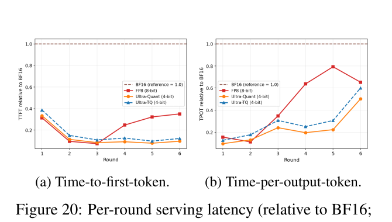
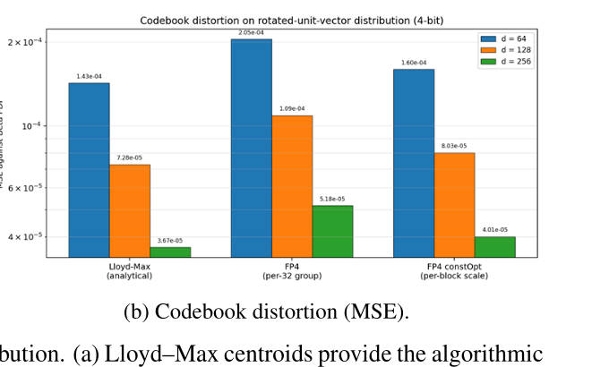
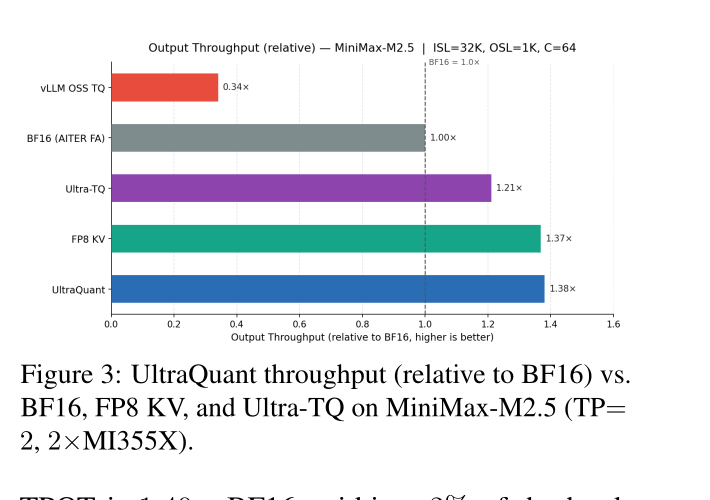
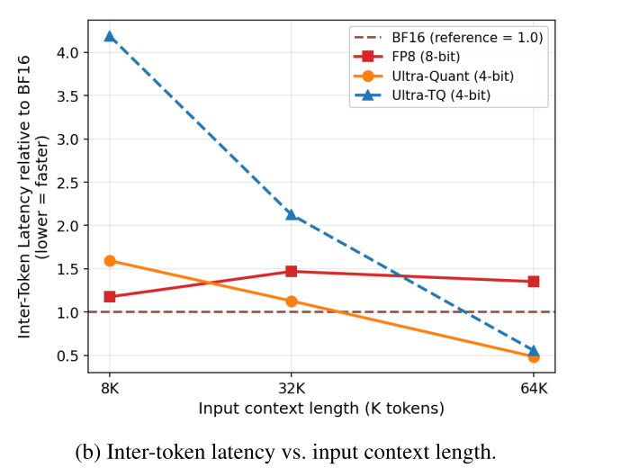
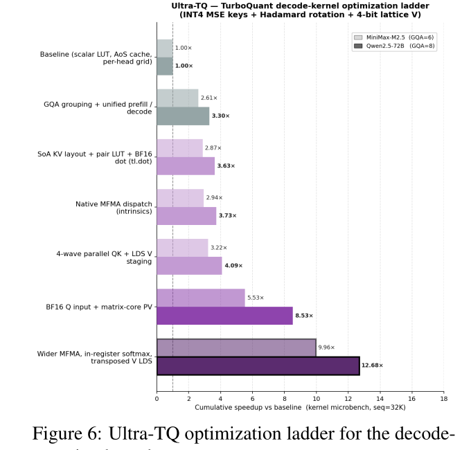
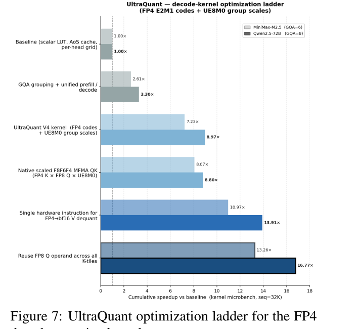

# UltraQuant：面向重上下文 Agent 的 4-bit KV 缓存

> 本文为 arXiv:2606.20474（*UltraQuant: 4-bit KV Caching for Context-Heavy Agents*）的中文解读与复述（非逐句翻译），行文以作者原意为准但用自己的话重新组织，原文版权归作者所有。数据、表格与关键数字按原文如实转录。

## 摘要

重上下文 Agent 给 KV 缓存带来一种特殊的压力：长前缀要在很多短轮对话之间反复复用，而并发度决定了服务系统能否把 GPU 真正跑满。本文研究面向这种场景的 4-bit KV 缓存压缩，用 TurboQuant 风格的旋转+码本量化（Zandieh et al., 2026）作为质量标杆，用 vLLM 的 FP8 KV 缓存作为部署标杆。三项贡献：第一，把 4-bit KV 缓存问题放到多轮 Agent 工作负载里考察，要求任务质量、缓存驻留和服务吞吐三者联合衡量；第二，给出让 4-bit 路径工程落地所需的实践选择——K/V 非对称处理、Walsh–Hadamard 旋转、去掉 QJL 的归一化步骤、以及分块缩放的变体；第三，给出针对 AMD GPU 的服务端优化，包括优化过的 decode-attention kernel，以及 **UltraQuant**——一条使用 FP8 查询、FP4 KV 张量、UE8M0 分组缩放因子、并在 CDNA4 上原生走 scaled-MFMA 的 FP4 近似路径。在一个长上下文、多轮的 Agent 工作负载上，UltraQuant 把缓存压力最大的后几轮的 P50 首 token 延迟（TTFT）降低了 3.47 倍（全部轮次平均 2.3 倍），并把输出吞吐比 FP8 KV 基线提升 1.63 倍。

## 1 引言

大模型已经从短上下文聊天机器人演变为能浏览网页、检查代码仓库、调用工具、完成实质性软件工程任务的 Agent（ReAct、Toolformer、WebArena、SWE-agent 等）。这类工作流需要长时记忆：模型要在很多轮对话里持续保留系统指令、工具定义、检索到的文档、代码库上下文以及不断演化的计划。随着模型上下文窗口不断迈向百万 token 乃至更长（Gemini 1.5、LongRoPE），KV 缓存随上下文长度线性增长，逐渐成为高带宽显存（HBM）的头号消耗者。

这推动了两条互补的研究路线：一条是改变模型架构或注意力机制以直接压缩 KV 状态，例如多头隐注意力（MLA，DeepSeek-V2/V3）、线性或状态空间模型替代方案（Mamba、SSD、Gated DeltaNet 等）；另一条把显存层级当作系统问题来处理，通过缓存复用、offload、分页式内存管理让宝贵的 HBM 被最有用的状态占据（PagedAttention、SGLang、PyramidKV）。KV 量化走的是第一条路线的变体：保持标准接口不变，直接降低显存开销。

压缩并不是免费的。一个可部署的 4-bit 方案必须不仅仅是"压缩率高"，还必须在长上下文任务上保住答案质量、能和分页式服务系统集成、并能在 GPU 矩阵核心上高效派发。FP8 KV 缓存在 vLLM 里已经是一个很强的部署基线：大约 2 倍压缩，精度近乎无损,且有原生硬件支持。TurboQuant（Zandieh et al., 2026）是一种数据无关（data-oblivious）的"标量+旋转"4-bit 方法，精度表现很强，但依赖码本查找和软件反量化。

本文在 AMD Instinct GPU 上研究两个"端点"方案：**Ultra-TQ** 保留 TurboQuant 的表示形式，通过布局、查找表（LUT）和 MFMA 调度优化来补齐 kernel 层面的性能差距，并通过针对每个模型做校准质心（calibrated centroids）来提升精度；**UltraQuant** 则把码本替换为一种 FP4 微张量近似，使得反量化被直接折叠进 CDNA4 原生的 scaled-MFMA 指令中。

本文的目标是给出一份面向部署的低比特 KV 缓存研究报告：哪些量化选择能保住质量、这些选择如何与 decode-attention kernel 相互作用、以及在什么情况下服务系统能真正从多出来的驻留上下文中获益。

## 2 相关工作

### 2.1 KV 缓存量化

KV 压缩领域已经收敛出几个反复出现的设计思路。Key 和 Value 需要被非对称处理，因为 key 的误差和 value 的误差对 softmax 分布的扰动方式不同，这一规律由 KIVI 和 KVQuant 确立。QJL 和 TurboQuant 利用旋转+码本方法在极小比特宽度下改善率失真（rate–distortion）表现，TurboQuant 尤其获得了社区的二次实现（TheTom 的 llama.cpp 移植、作者团队自己在 AMD ROCm 博客上的工程化工作）。然而码本引入了查找和不规则访存的开销。这些方法是 4-bit 质量的有用算法锚点，但它们最精确的表示形式并不会自动成为高效的服务格式。

### 2.2 旋转与码本量化

TurboQuant 风格的旋转（Kurtić et al., 2026）把离群值的能量分散到各个通道上，使标量量化器看到的分布更接近高斯分布。通过逐模型 Lloyd–Max 算法（或其分块变体 LMPB）拟合出的校准质心，则为旋转后的分布提供了一个强的 4-bit 码本。在本文中，这些码本只是背景和动机，而不是最终部署的格式：UltraQuant 用它们来说明为什么旋转之后 FP4 是可行的，然后再用硬件原生的 FP4 网格取代任意质心。

### 2.3 服务系统与硬件原生低精度

vLLM 式的分页式服务（PagedAttention）让 KV 缓存驻留变成一个系统问题，而不只是一个压缩指标。FP8 这样的硬件原生格式已经可以直接享受矩阵核心的支持。UltraQuant 把这种"服务优先"的视角延伸到 4-bit KV 缓存，目标是 CDNA4 的 scaled-F8F6F4 MFMA 路径——FP4 操作数和 UE8M0 缩放因子直接被矩阵核心本身消费。

## 3 Agent 工作流与并发分析

Agent 工作负载是长时间运行的会话，有一个巨大的共享前缀和很多较短的后续轮次。在这种场景下，压缩之所以重要，是因为它增加了能够驻留在设备上的"有用前缀"的数量。但压缩本身并不能保证更好的服务效果：量化和反量化引入的开销会拖慢 token 延迟，所以端到端的服务测量是必须的。本文用两个指标刻画服务效率：首 token 时间（TTFT）和单输出 token 时间（TPOT）。

为了模拟 Agent 式的显存压力，本文采用 vLLM 自带的多轮基准测试，对话数据来自 ShareGPT 数据集（真实的人类—LLM 对话，user/assistant 角色格式）。测试以 32 个并发聊天会话运行，报告 P50 TTFT 和 P50 TPOT，用一次运行就能刻画出每种 KV 缓存方案的效率。

表 1 展示了激发本次评估的显存压力场景。在长的单客户端前缀和高并发下，FP8 KV 缓存会反复驱逐有用状态，而 UltraQuant 能让明显更多的前缀保持驻留；这个优势在后几轮最大，TTFT 提升达到 3.47 倍。图 1 给出的逐轮延迟分解让这个效应更加具体：UltraQuant 在全部六轮对话中都能让 TTFT 和 TPOT 保持较低水平，而 FP8 随着累积上下文超出其驻留缓存容量而逐渐变差。

| 指标 | UltraQuant 相对于 FP8 KV |
|---|---|
| P50 TTFT —— 暖机轮次 (r2–3) | 0.86×（FP8 更快） |
| P50 TTFT —— 后期轮次 (r4–6) | **3.47×** |
| P50 TTFT —— 全部轮次 | 2.3× |
| 输出吞吐 | **1.63×** |

*表 1：在 MiniMax-M2.5、TP=2、AMD MI355X 上的 Agent 服务结果，数值为 UltraQuant 相对 FP8 KV 基线的倍数（除特别标注外均为越高越好）。优势出现在后期轮次：长的单客户端前缀超出了 FP8 有效驻留缓存容量时，TTFT 提升 3.47 倍，这一提升来自缓存驻留而非重新 prefill。*



## 4 Ultra-TurboQuant

Ultra-TurboQuant（Ultra-TQ）是本文对 TQ 4/4（4-bit key + 4-bit value 的 TurboQuant KV 缓存方案）做的优化实现。它的出发点和 TurboQuant 一致：原始 KV 缓存分布对一个小型标量码本来说是个很差的目标，但固定的 Walsh–Hadamard 旋转能把离群值的能量分散到各通道上，把每个坐标推向更接近轻尾、近高斯的区间,这样一个 4-bit 标量量化器就是一个合理的近似。附录 A 给出进一步的高效实现细节。

### 4.1 校准质心

本文首先观察到，校准 TurboQuant 的质心是与模型无关的。生产环境使用的 Lloyd–Max 质心是在理论假设下拟合的，即旋转后、折叠范数（norm-fold）后的 key 坐标服从 `` $`\mathrm{Beta}((d-1)/2,(d-1)/2)`$ `` 分布——这正是一个随机旋转的单位向量坐标应满足的精确分布律。但在真实激活值上，这一假设只是近似成立：经验分布与这一理想分布有轻微偏离，因此理论质心的位置略有偏差。在捕获到的 key 激活值上重新拟合同样的 16 级 Lloyd–Max 表就能纠正这一点。校准代价很低——对每一层旋转后的分布，仅需对球面上随机采样的约 20 个向量做一次前向传播，即可得到 16 个 FP32 电平——部署时只是一次表格替换，没有任何推理开销。需要说明的是，在实际实现中，本文只对量化 MSE 较高的 10% 的层做了这项校准。

单纯对码本做校准是本文测得的最强的"纯码本"手段：相对于一个公平的 fakequant 对照组，它把 key 的逐元素量化 MSE 降低了 10.3%（从 `` $`1.32\times 10^{-4}`$ `` 降到 `` $`1.18\times 10^{-4}`$ ``），并在 GPQA 上带来 +1.20 个百分点的提升。经验质心相对理论质心更收缩（`` $`d=64`$ `` 时最大的 `` $`|c|`$ `` 从 0.342 降到 0.288），反映出真实激活值与理想分布的轻微偏离。旋转仍然是不可替代的：即便在未旋转的分布上拟合出模型专属质心,其 MSE 仍比旋转后高出约 2.3 倍,说明质心的位置调整无法复现旋转所带来的白化效果。校准质心带来的增益是真实的，但也比较有限；本文在附录 B.1 中对这一增益的来源做了消融分析。

## 5 UltraQuant

无论一个校准过的码本有多好，它都必须在每一次注意力计算时被解码：每个 tile 要加载打包的索引、通过查找表 gather 出对应的质心、在寄存器中重建出 key 和 value，然后才能参与 QK 和 PV 乘积（Guo et al., 2024）。这种 gather 是不规则的，并且随上下文长度增长而增大，是长上下文 decode 的一个关键瓶颈。UltraQuant 把缓存存储为固定的 FP4 E2M1 网格,配合矩阵核心可以原生读取的 UE8M0 缩放因子，这样反量化就变成了单次指数位移，被折叠进指令本身,而不再是一次软件 gather。每个分组都需要一个缩放因子把数值映射到 FP4 网格上。UltraQuant 用一个单一常数来推导这个缩放因子，这个常数经过一次性选定，用以最小化旋转后分布上的量化误差，并且是离线校准、与模型无关的。

### 5.1 缓存布局

UltraQuant 采用 FP4–UE8M0 的 group-32 缓存布局,即一种与 AMD 矩阵核心对齐的 FP4 表示。head 维度被切分为 32 个通道一组的连续分组，每组编码为 32 个 FP4 E2M1 码（两个码打包进一个字节），再加一个 UE8M0 缩放因子。每组占用：

```math
32\times 4\text{ bits}+8\text{ bits}=16\text{ B}+1\text{ scale}=17\text{ B}
```

即每 32 个通道 17 字节，相当于每个元素 4.25 bit —— 与理想的 4-bit 表示相比只多出约 6%，同时保留了矩阵核心能原生消费的缩放格式。

### 5.2 反量化

反量化规则在概念上很简单：

```math
\texttt{value}=\texttt{code}\times 2^{\texttt{scale}},\qquad\texttt{scale}=\texttt{byte}-127.
```

因为 scale 是一个 2 的幂次指数，这不是一次浮点乘法：它只是移动了 FP4 码点的指数位,这个操作可以直接折叠进 scaled-MFMA 的累加器里。AMD 的 `MFMA_SCALE_F32_*_F8F6F4` 指令把 FP4 码和 UE8M0 字节作为原生操作数（Advanced Micro Devices, Inc., 2024），因此 key 和 value 从来不需要被还原成 BF16。查询（query）先被 Hadamard 旋转到 key 的基下，再被取整为 FP8 E4M3，这样 QK 乘积就运行在同一条 FP8 × FP4 的 scaled-MFMA 路径上。每组的缩放因子就存在这个 UE8M0 字节里，因此它必然是 2 的幂次 `` $`s=2^{E}`$ ``,而常数 `` $`c`$ ``（见 5.3 节）通过编码规则 `` $`E=\mathrm{round}(\log_{2}(c\cdot m))`$ `` 参与进来，而不是作为运行时的乘法出现。

### 5.3 常数优化缩放




旋转单位向量分布上的 Lloyd–Max 质心呈对称分布、在零点附近密集、在尾部逐渐变宽——这正是 FP4 需要去逼近的模式。图 2 中 `` $`d=64`$ `` 的对比表明，相比均匀的 INT4 网格，Lloyd–Max 把电平更密集地放在高概率的分布主体部分,同时仍保留了尾部的覆盖。FP4 E2M1 则有固定的、硬件规定好的间距;它的优势在于矩阵核心直接理解这种间距。按每 32 组直接套用 FP4 的 MSE 会一直比 Lloyd–Max 差（D'Alberto, 2026），但下面给出的常数优化分块缩放能够在保留 FP4 码点网格的前提下，弥合其中大部分差距,具体见图 3 的量化结果与附录 B.2 的消融。

每组 32 个通道通过单一的缩放因子 `` $`s=c\cdot m`$ `` 映射到 FP4 网格上，其中 `` $`m=\max_{i}|x_{i}|`$ `` 是该组的绝对值最大值，`` $`c`$ `` 是在所有分组、所有 head、所有模型之间共享的一个全局常数。本文同时丢弃了码本路径所使用的逐 token `` $`\ell_{2}`$ `` 归一化（K-norm）：因为每个分块的缩放因子本身就是从该块自身的绝对值最大值推出的，各分块已经是自缩放的，单独再做一次逐 token 归一化是冗余的。而且逐 token 的系数无论如何都无法折叠进注意力分数里——它穿不过 softmax——所以保留它只会多存一个标量、多一次运行时乘法，却没有质量上的收益。

分组的绝对值最大值 `` $`m`$ `` 已经吸收了全部逐 token、逐 head、逐模型的幅值变化：用 `` $`m`$ `` 去除就能把该组映射到 `` $`[-1,1]`$ `` 区间，不论模型或输入是什么。剩下的只是归一化坐标的"形状"，而在 Hadamard 旋转之后，这个形状近似服从 `` $`\mathrm{Beta}((d-1)/2,(d-1)/2)`$ ``，只依赖于 head 维度 `` $`d`$ ``。这正是为什么单一常数能起作用的原因：唯一剩下的自由度就是这个固定形状相对固定的 E2M1 网格坐落在哪里,也就是比值 `` $`c=s/m`$ ``。实质上，分组绝对值最大值和常数 `` $`c`$ `` 一起接管了 TurboQuant 逐 token K-norm 的角色：码本路径用一个存储的 `` $`\ell_{2}`$ `` 范数去重缩放每个 token，而 UltraQuant 用每 32 通道块自己的绝对值最大值和共享常数 `` $`c`$ `` 去重缩放每个块,从而在没有任何逐 token 状态、也没有额外运行时乘法的情况下达到同样的归一化效果。

本文选择 `` $`c`$ `` 来最小化 E2M1 网格在该分布上的重建误差。记 `` $`q(\cdot)`$ `` 为四舍五入到最近码点 `` $`F=\lbrace 0,\pm 0.5,\pm 1,\pm 1.5,\pm 2,\pm 3,\pm 4,\pm 6\rbrace`$ `` 的取整函数，最优值为：

```math
c^{*}=\arg\min_{c}\;\mathbb{E}\left[\left(z-c\,m\,q(z/(c\,m))\right)^{2}\right].
```

这是一个一维最小化问题，只需离线求解一次。本文在捕获到的旋转后 key 激活值上（一次小规模校准集上的前向传播）估计期望值，因为真实激活值与理想 Beta 分布有轻微偏离。在捕获到的 key 上求出的最小化解是 `` $`c=0.156`$ ``，这是本文实际部署的值。值得注意的是，旋转之后的分布在不同模型间足够相似，使得这一次拟合结果可以跨模型、跨 head 迁移使用。

为了做消融，本文在附录 B.2 中考察了其他常数取值；图 3 展示了对应的码本电平 MSE 差距。

## 6 精度结果

所有结果都使用了"边界层保护"：第一层和最后两层注意力层保留 BF16 的 KV 缓存（`` $`n=2`$ ``）。表 2 报告了三个模型、四个基准上的生产级精度矩阵。UltraQuant 在 MATH500 上稳定，在 GPQA 和 LCB-128K 上也有竞争力，但在 AIME25 上出现明显退化（Qwen3.5-A3B 上 -13.3 个百分点，MiniMax-M2.5 上 -10.0 个百分点）。本文选择把这一点作为真实的局限性直接呈现出来，而不是把它藏在平均值背后：目前的精度表现是"依赖具体基准"的，而不是"普遍近无损"的。

| 模型 | 基准 | BF16 | TQ 4/4 | Ultra-TQ | UltraQuant | UltraQuant − BF16 |
|---|---|---|---|---|---|---|
| Qwen3.5-A3B | GPQA-Diamond | 79.80 | 78.28 | – | 79.80 | +0.00 |
| MiniMax-M2.5 | GPQA-Diamond | 84.34 | 83.33 | 83.84 | 82.32 | -2.02 |
| Qwen2.5-72B | GPQA-Diamond | 49.49 | 52.53 | 52.53 | 51.01 | +1.52 |
| Qwen3.5-A3B | LCB-128K | 76.54 | 79.01 | 78.38 | 74.07 | -2.47 |
| MiniMax-M2.5 | LCB-128K | 75.82 | 74.73 | 76.00 | 71.43 | -4.39 |
| Qwen3.5-A3B | AIME25 | 90.00 | 83.33 | 83.33 | 76.67 | -13.33 |
| MiniMax-M2.5 | AIME25 | 86.67 | 80.00 | 83.33 | 76.67 | -10.00 |
| Qwen2.5-72B | AIME25 | 20.00 | 16.67 | – | 16.67 | -3.33 |
| Qwen3.5-A3B | MATH500 | 86.00 | 86.60 | 87.00 | 86.80 | +0.80 |
| MiniMax-M2.5 | MATH500 | 78.40 | 80.40 | 80.40 | 78.40 | +0.00 |

*表 2：生产级精度矩阵。精度以有效样本中正确率的百分比报告；由于模型上下文长度限制，Qwen2.5-72B 在 LCB-128K 上的单元格为空。*

## 7 性能结果

本文在 MiniMax-M2.5、TP=2、2×MI355X、32K/1K、并发 64 的设置下，测量 UltraQuant 的 decode 吞吐和单 token 延迟，并与四个基线对比：vLLM 开源 TurboQuant（Kurtić et al., 2026）、BF16 AITER（AMD ROCm, 2025）FlashAttention、硬件 FP8 KV、以及 Ultra-TQ。所有结果都相对 BF16 AITER FlashAttention 基线（=1.00×）报告。把反量化折叠进 MFMA 之后，UltraQuant 得到的指令组合几乎和 FP8 kernel 一样，因此它能贴着 FP8 的吞吐天花板走，同时把 KV 缓存的显存占用减半。图 4 展示了各 kernel 的吞吐对比：在并发 `` $`C{=}64`$ `` 时，UltraQuant 达到 BF16 输出吞吐的 1.38 倍,与硬件 FP8 KV（1.37 倍）相差不到约 1%，但每单位 HBM 能服务两倍的 KV 容量。



FP4 路径基本上把软件反量化从关键路径上移除，同时保留了 4-bit KV 缓存的显存容量收益。UltraQuant 提供 1.38 倍 BF16 基线吞吐，与硬件 FP8 KV 缓存路径（1.37 倍）持平,而每个元素只用一半的 KV 字节。在单 token 延迟上，BF16 没有反量化开销，所以所有 4-bit kernel 都比它慢；UltraQuant 的中位数 TPOT 是 BF16 的 1.40 倍，与硬件 FP8 KV 缓存路径（1.37 倍）相差约 2%,明显领先于 Ultra-TQ（1.58 倍）和 vLLM 开源 TurboQuant（5.56 倍）（图 5）。


这一优势随上下文长度增长而扩大。图 6 把逐 token 延迟相对输入上下文长度（从 8K 到 64K）做了扫描：UltraQuant 相对 BF16 单调改善，在 64K 时达到约 0.5 倍，而 FP8 一直停留在约 1.3–1.5 倍，Ultra-TQ 只在最长上下文时才追上来。正是这种减半的 KV 显存占用，让 UltraQuant 能在触发 HBM 压力导致的重新 prefill 之前，支撑更长的上下文。



## 8 结论

重上下文 Agent 让 KV 缓存容量成为一个部署层面的约束：长前缀必须能在很多轮对话间被复用，服务系统必须支撑足够多的并发会话才能让 GPU 保持满载。本文围绕这一场景做了一项 4-bit KV 缓存研究。在质量这条线上，TurboQuant 风格的旋转和码本方法提供了一个很强的 4-bit 锚点，校准和分块缩放的选择决定了能保留多少精度。在系统这条线上，Ultra-TQ 说明了精细的布局、LUT 和 MFMA 调度能弥合码本量化与生产级服务之间的大部分差距。UltraQuant 更进一步，用 FP4 微张量和 UE8M0 缩放因子去近似旋转后的码本路径,使 CDNA4 矩阵核心能直接完成反量化。

更广泛的结论是：低比特 KV 缓存应当被当作一种端到端的服务机制来评估，而不只是一种离线压缩方法。对 Agent 工作负载而言，真正重要的是任务成功率、缓存驻留、吞吐和交互性这几者的联合效果。本文的结果表明，4-bit KV 缓存能够保留激进压缩所带来的上下文容量收益，同时逼近硬件原生 FP8 KV 缓存的可部署性。

## 9 讨论

几个方向仍然open。算法路线上需要在同一个 Agent 基准下，对固定旋转、校准旋转和可学习旋转做更全面的比较。系统路线上需要覆盖更多的模型家族、上下文长度和并发场景。最后，UltraQuant 这种近似方式为未来的硬件感知量化提出了一个重要问题：当一个略欠最优的码本能够直接映射到矩阵核心指令时，端到端服务层面的最优解,可能更青睐硬件原生格式,而不是解析意义上最优的表示。

## 10 局限性

本文列出以下三条局限性：

1. 尽管本文为所有模型和所有 head 部署了单一常数 `` $`c=0.156`$ ``，但可能存在一个按层校准的更高效常数能带来更好的精度。本文也没有考虑让这个常数依赖于激活值分布本身来选取。出于简洁性的考虑，这些留给未来的工作。
2. UltraQuant 相对 FP8 在速度上的收益，只有在上下文长度长到超出 FP8 基线的驻留缓存容量时才能观察到，也就是说对于较短的上下文长度，该算法的收益没有被兑现。需要说明的是，这一点对 Ultra-TQ 并不成立——相对 Ultra-TQ 的性能收益总是能被兑现。
3. Ultra-TQ 风格的质心校准只应用在 10% 的层上，带来的收益也很小；在绝大多数层上，这种质心校准似乎没有带来任何收益。

## 致谢

作者感谢同事 Jiangyong Ren、Jiaxin Wang、Zhao Lin、Wei Luo、Chao Li、Xinjun Niu 以及 AMD Quark 团队提供的宝贵反馈和技术协助，也感谢 Paolo D'Alberto、Devleena Das、Rajeev Patwari 和 Elliott Delaye 提供的有价值的技术讨论。

## 参考文献

原文参考文献涉及 TurboQuant、QJL、KIVI、KVQuant、PagedAttention、SGLang、PyramidKV、Mamba/SSD、DeepSeek-V2/V3、Gemini 1.5、LongRoPE、ReAct、Toolformer、WebArena、SWE-agent、FLUTE、FlyDSL、AITER 等工作，具体条目请参阅原文（arXiv:2606.20474）。

## 附录 A：vLLM 中的 Kernel 实现

本文在 vLLM 中实现了两条服务端路径：**Ultra-TQ**，一种保留码本表示的优化 TurboQuant kernel；**UltraQuant**，一种 FP4 近似路径，KV 缓存以原始 FP4 微张量加 UE8M0 分组缩放因子的形式存储，反量化由矩阵核心本身完成。

该实现面向 CDNA4 的 scaled-MFMA 指令族，尤其是 `v_mfma_scale_f32_16x16x128_f8f6f4`。QK 乘积在一条指令里同时读取 FP4 key、FP8 query 和 UE8M0 缩放因子。V 路径同样避免了软件 LUT，而是通过硬件支持的低精度运算把 FP4 码和 UE8M0 缩放因子转换出来。相对于一个 TurboQuant 码本 kernel，关键的系统层面改动是把反量化从关键路径上移除：query 操作数在 K-tile 内层循环之外就被预先取整为 FP8，而缓存使用的分组缩放布局也被专门安排成匹配 MFMA 缩放操作数的布局。算法 1 给出了 UltraQuant 的缓存编码路径；它所取代的、基于码本的 Ultra-TQ 编码方式见附录 C。

**算法 1：FP4-ConstOpt KV 编码（UltraQuant）**

```
输入: K, V (BF16)；旋转矩阵 R；分组大小 g=32；E2M1 电平集合 F；全局常数 c（见 5.3 节）。
写入:
  1: K ← R·K        ▷ 旋转 key；V 不旋转
  2: 将 K, V 切分为 32 通道一组
  3: 对每组: m ← max_i |x_i|；E ← round(log2(c·m))
                      ▷ UE8M0 指数；无需逐 token 归一化，无需搜索
  4: 对每个坐标: code ← q(x_i / 2^E)
                      ▷ q：取整到 F 中最近的电平
  5: 每组存储 2 个 FP4 码/字节 + 1 个 UE8M0 字节 (E)
解码:
  6: Q ← R·Q；Q ← cast_fp8_e4m3(Q)
  7: 加载码值 + UE8M0 字节；x̂ ← code · 2^(byte−127)
  8: QK 经由 scaled FP8×FP4 MFMA 完成；PV 经由 FP4/缩放路径完成
输出: 硬件原生的 FP4+UE8M0 KV 缓存；反量化折叠进 MFMA 的缩放操作数中。
```

### A.1 Ultra-TQ Kernel 优化阶梯

TurboQuant 把 KV 缓存压缩到每元素 4 比特，以码本格式存储 key 和 value。缓存在运行时被动态反量化，这使得 decode 是显存带宽受限的。本文的 kernel 受 FLUTE（Guo et al., 2024）启发：FLUTE 离线重组量化矩阵以减少解包时的位操作开销，并使用向量化的 LUT 访问来降低共享内存压力。本文把这些思路适配到 vLLM 的 decode-attention 路径上，增加了 GQA 感知的 tiling、结构数组（SoA）式 KV 缓存布局，以及 AMD 专属的 MFMA 派发。

Ultra-TQ 的优化阶梯分三层：第一层，改进的 Triton kernel 修复了开源 TurboQuant 基线在 GQA、LUT 和布局方面的问题;第二层，原生 ISA 实现通过 AMD GCN intrinsics 直接发出矩阵核心指令，从而直接控制操作数布局和指令选择;第三层，FlyDSL（Li et al., 2026）实现无需逐设备源文件即可 JIT 编译到 AMD GCN ISA，并暴露出 MFMA 操作数布局，使得本文可以选用更宽的 MFMA 变体。



### A.2 UltraQuant Kernel 优化阶梯

UltraQuant 的 kernel 采用第 5 节描述的 FP4+UE8M0 缓存布局，并在同一个 DSL 实现上增加了三项 CDNA4 原生操作。第一，QK 乘积通过 scaled F8F6F4 MFMA 指令（`v_mfma_scale_f32_16x16x128_f8f6f4`）发出，该指令在一条指令里同时读取 FP4 key、FP8 query 及其 UE8M0 缩放因子;BF16 key 完全不需要被具象化。第二，V 的反量化 LUT 被替换为一种硬件转换路径，直接把 FP4 码和 UE8M0 缩放因子转换为 BF16，从关键路径上移除了软件反量化。第三，FP8 query 操作数被提到 K-tile 内层循环之外，这样每个 tile 都复用同一个预先量化好的 query，减少了重复打包、降低了寄存器压力。

该实现运行在标准的 ROCm/vLLM 技术栈上。Ultra-TQ 的 FlyDSL decode kernel 已经被上游合并进 vLLM 主线。UltraQuant 的 kernel 计划作为后续贡献发布。



### A.3 Decode-Attention Kernel 计数器

（本节补充 7.2 节的 roofline 分析。）FP8 KV 是显存带宽受限的，离屋顶线最近，但需要两倍的 KV 缓存空间，驱逐发生前可用容量就少了一半。Ultra-TQ 能达到 4-bit 的运算强度，但受反量化开销限制：其瓶颈是软件码本解码、LDS gather 和每元素一次的 VALU FMA，在最坏情况下计算开销会超过带宽节省。UltraQuant 同样能达到 4-bit 运算强度,且更接近带宽受限，在 roofline 图上比 Ultra-TQ 高出约 2.5 倍，因为带 UE8M0 缩放因子的 FP4 E2M1 被 scaled MFMA 原生消费，不需要码本、gather 或逐元素 FMA。

## 附录 B：消融实验

### B.1 分块缩放

这一消融实验在 GPT-OSS-20B 的 GPQA（中等难度，单一随机种子；`` $`1\sigma\approx 1.7`$ `` 个百分点）上，把"分块绝对值最大缩放"的贡献与"校准码本"的贡献分离开。两个效应比较突出。第一，把自适应统计量从单一的逐 token `` $`\ell_{2}`$ `` 范数切换为逐分块（32 个一组）绝对值最大值，是承担主要作用的改动：它才是真正挽回精度的因素，与码本选择无关。第二，在有了分块缩放之后，码本本身几乎不再重要——把校准过的 Lloyd 质心换成均匀网格，差异仍停留在单一随机种子的噪声范围内。这两点共同支撑了最终的部署设计：保留分块缩放,用固定的 FP4 网格取代校准过的、针对特定模型的码本。

| 配置 | 自适应统计量 | 码本 | GPQA |
|---|---|---|---|
| TQ-t4nc（生产版本） | 逐 token `` $`\ell_2`$ `` | Lloyd（校准） | 0.6503 |
| K+V Lloyd，逐 token | 逐 token `` $`\ell_2`$ `` | Lloyd（校准） | 0.6237 |
| LMPb full | 逐分块绝对值最大 | Lloyd（校准） | 0.6559 |
| Variant E | 逐分块绝对值最大 | 均匀（RTN） | 0.6528 |

*表 3：分块缩放消融实验（GPT-OSS-20B GPQA，中等难度，单一随机种子）。在旋转保持打开的前提下，从逐 token 到逐分块的自适应方式让两个 Lloyd 配置从 0.6237 移动到 0.6559；在固定分块缩放的前提下，Lloyd 与均匀码本（0.6559 对 0.6528）的差异处于噪声范围内。码本和自适应方式是联合拟合的，所以这并非一次完全干净的 A/B 测试，但方向在各个变体间是一致的。*

### B.2 全局常数

图 3 量化了码本近似的效果：在 `` $`d\in\lbrace 64,128,256\rbrace`$ `` 上,简单的按 32 分组 FP4 表现都在解析 Lloyd–Max 下界之上，而 constOpt 分块缩放能弥合这个 MSE 差距的大部分，同时仍保留硬件原生 FP4 网格。

本文还在同一评测上，把全局缩放常数 `` $`c`$ `` 与 FP8（8-bit）基线做了扫描。默认值 `` $`c=0.156`$ `` 是第 5.3 节推导出的 MSE 最优值，数据证实了这一点：它比 FP8 高出 +4.4 个百分点。把 `` $`c`$ `` 提高到 0.195（即"2 的幂次最优"值,见第 10 节）会把这个增益完全让掉，正好落在 FP8 基线上；而 `` $`c=1.0`$ ``（即原始绝对值最大值、不做 MSE 收缩）则比 FP8 低 4.3 个百分点。精度与"偏离 MSE 最优常数的距离"呈单调关系。

| 方案 | 精度 | 相对 FP8 基线 |
|---|---|---|
| FP8（8-bit 基线） | 63.0% | — |
| fp4 `` $`c=0.156`$ ``（默认） | 67.4% | +4.4 pp |
| fp4 `` $`c=0.195`$ `` | 63.0% | 0.0 pp |
| fp4 `` $`c=1.0`$ ``（无收缩） | 58.7% | -4.3 pp |

*表 4：全局常数消融实验。默认值 `` $`c=0.156`$ `` 是 MSE 最优的，也是唯一能比 FP8 更好的设置；更大的 `` $`c`$ `` 会抹掉这个增益，`` $`c=1.0`$ ``（原始绝对值最大值）则会退化到 8-bit 基线之下。*

### B.3 缓存压力（GMU）区间

本文在两个 GPU 显存利用率（GMU）工作点上报告了逐轮延迟，以展示排名相对关系如何随缓存压力变化。图 9 把两个区间叠放展示：上面一行是 `` $`\mathrm{GMU}{=}0.60`$ ``（正文的操作点），下面一行是压力更低的 `` $`\mathrm{GMU}{=}0.65`$ ``。在 `` $`\mathrm{GMU}{=}0.60`$ `` 时，驻留缓存预算很紧张，FP8 在后几轮明显变差，而 UltraQuant 保持较低；在 `` $`\mathrm{GMU}{=}0.65`$ `` 时，预算已经足够大，FP8 不再变差,三种方案的表现趋于接近。正文结果采用缓存压力更大的 `` $`\mathrm{GMU}{=}0.60`$ `` 区间，此时 UltraQuant 的驻留优势最大。


## 附录 C：校准 LUT int4 KV 编码（Ultra-TQ）

作为参照，算法 2 给出了 UltraQuant 所取代的、基于码本的编码路径。它是 TurboQuant 风格的方案：每一侧都有一个经过校准的 4-bit 码本，key 侧额外带一个逐 token 的范数标量，读取时通过查找表反量化。UltraQuant（算法 1）保留了旋转，但去掉了码本和逐 token 范数，换成带逐分块 UE8M0 缩放因子的固定 FP4 网格，使反量化能够折叠进矩阵核心本身。

**算法 2：校准 LUT int4 KV 编码（Ultra-TQ）**

```
输入: K, V (BF16)；旋转矩阵 R；分组大小 g；码本 C_K。
写入:
  1: K ← R·K          ▷ 旋转 key；V 不旋转
  2: 将 K, V 切分为 g 通道一组的块
  3: K: 存储块范数；将每个坐标编码为最近的 C_K 索引
  4: V: 存储块 (缩放因子, 零点)；将每个坐标编码为 4-bit 均匀量化
解码:
  5: Q ← R·Q
  6: 每个 tile 加载 K/V 码值 + 元数据
  7: K: 通过 C_K·范数 反量化；V: 通过 缩放因子·码值+零点 反量化
  8: 在反量化后的 K, V 上计算 QK 和 PV
输出: 旋转码本 K + 均匀量化 V 的缓存；反量化开销在读取时支付。
```
